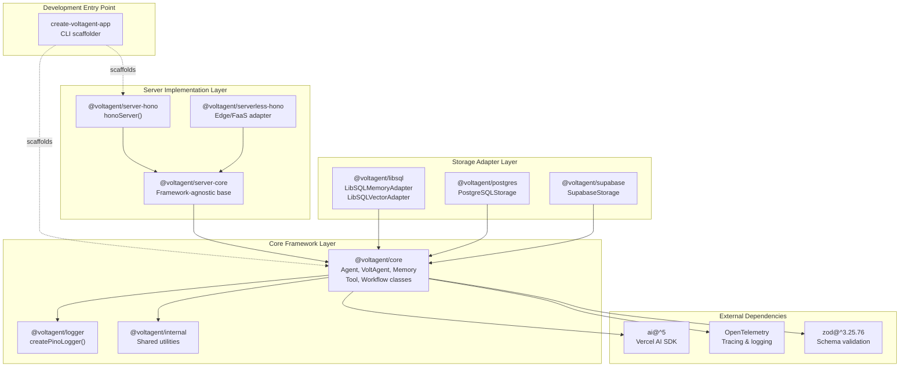
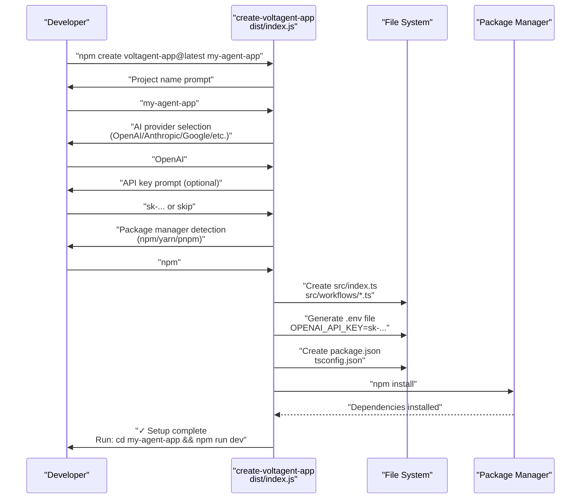
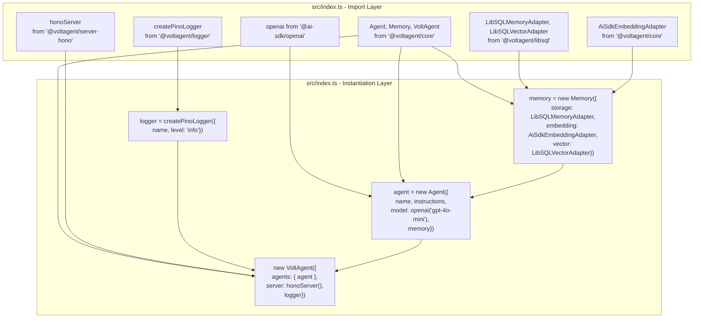
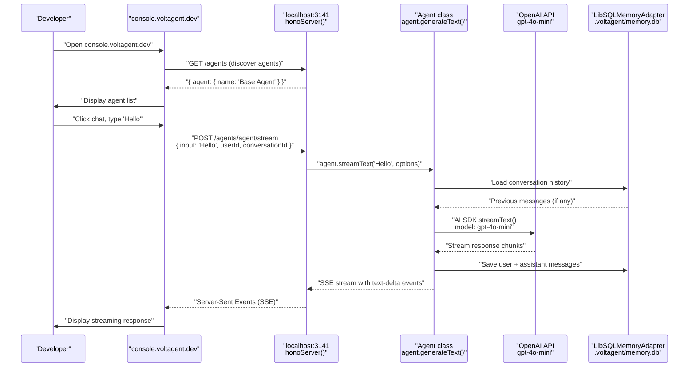
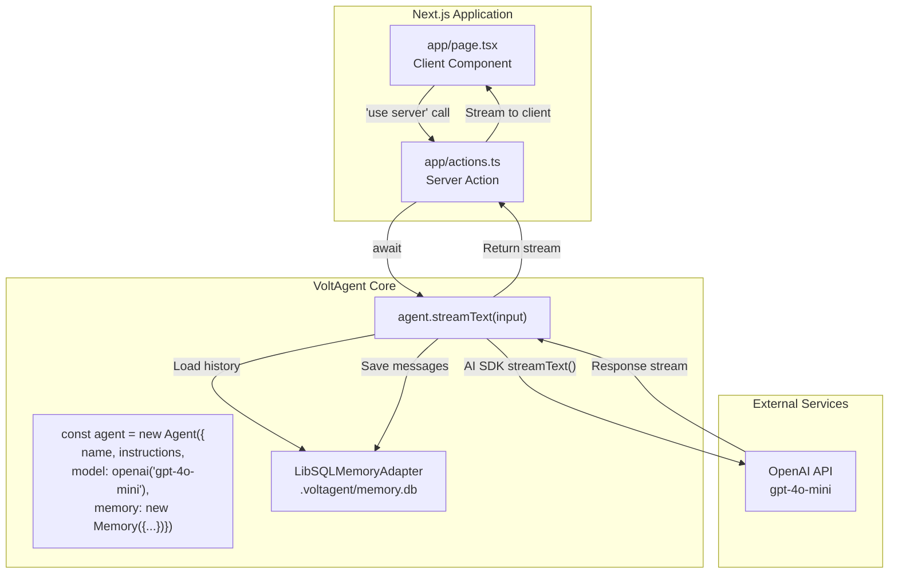

<!-- source: DeepWiki mcp.deepwiki.com · repo voltagent/voltagent · page 1.1 Getting Started · fetched 2026-10-27 -->

# Getting Started

<details>
<summary>Relevant source files</summary>

The following files were used as context for generating this wiki page:

- [CHANGELOG.md](CHANGELOG.md)
- [changelog.sh](changelog.sh)
- [examples/base/package.json](examples/base/package.json)
- [examples/base/src/index.ts](examples/base/src/index.ts)
- [examples/github-repo-analyzer/package.json](examples/github-repo-analyzer/package.json)
- [examples/with-rag-chatbot/package.json](examples/with-rag-chatbot/package.json)
- [examples/with-retrieval/package.json](examples/with-retrieval/package.json)
- [examples/with-subagents/package.json](examples/with-subagents/package.json)
- [examples/with-supabase/package.json](examples/with-supabase/package.json)
- [examples/with-tools/package.json](examples/with-tools/package.json)
- [examples/with-vercel-ai/package.json](examples/with-vercel-ai/package.json)
- [examples/with-voice-elevenlabs/package.json](examples/with-voice-elevenlabs/package.json)
- [examples/with-voice-openai/package.json](examples/with-voice-openai/package.json)
- [packages/cli/package.json](packages/cli/package.json)
- [packages/create-voltagent-app/CHANGELOG.md](packages/create-voltagent-app/CHANGELOG.md)
- [packages/create-voltagent-app/package.json](packages/create-voltagent-app/package.json)
- [packages/voice/package.json](packages/voice/package.json)

</details>


This guide provides a quick start for setting up and using VoltAgent, including installation and creating your first AI agent. Choose between automatic setup (recommended) or manual setup based on your preference.

## What is VoltAgent?

VoltAgent is an enterprise-grade TypeScript framework for building AI agents with production observability. The framework provides agent orchestration, multi-agent workflows, memory management, tool execution, and real-time monitoring through OpenTelemetry and the VoltOps platform.

### Core Framework Packages



**Package Ecosystem**: VoltAgent is organized as a monorepo with `@voltagent/core` as the foundation package. The `Agent` class handles LLM interactions via Vercel AI SDK v5, `Memory` provides conversation persistence with pluggable storage adapters, and `VoltAgent` orchestrates server startup and observability integration.

Sources: [CHANGELOG.md:1-10](). [packages/create-voltagent-app/package.json:1-60](). [examples/base/package.json:1-33]().

## Prerequisites

Before getting started with VoltAgent, ensure you have:

| Requirement | Version | Notes |
|-------------|---------|-------|
| **Node.js** | ≥20.0.0 | Required by all `@voltagent/*` packages |
| **Package Manager** | npm, yarn, or pnpm | For dependency installation |
| **LLM Provider API Key** | - | OpenAI, Anthropic, Google, Groq, Mistral, or Ollama (local, no key) |

Sources: [packages/create-voltagent-app/package.json:40-42](). [packages/cli/package.json:38-39](). [examples/base/package.json:14-18]().

## Automatic Setup (Recommended)

Create a new VoltAgent project using the `create-voltagent-app` CLI tool:

```bash
npm create voltagent-app@latest my-agent-app
```

The CLI guides you through an interactive setup process:

1. **Project Name**: Choose a name for your project
2. **AI Provider**: Select from OpenAI, Anthropic, Google, Groq, Mistral, or Ollama (local)
3. **API Key** (optional): Enter your API key or skip to add it later
4. **Package Manager**: Choose from installed package managers (npm, yarn, or pnpm)
5. **IDE Configuration**: Optionally configure MCP Docs Server for your IDE

### CLI Setup Flow

**Interactive Setup Process**: The `create-voltagent-app` CLI provides an interactive setup wizard that guides you through project initialization.



**Generated Dependencies**: The CLI automatically installs core packages based on your selections:
- `@voltagent/core` - Agent and VoltAgent classes
- `@voltagent/server-hono` - HTTP server implementation
- `@voltagent/libsql` - Local SQLite memory adapter
- `@voltagent/logger` - Pino-based logging
- `@ai-sdk/openai` (or selected provider) - LLM integration
- `ai@^5` - Vercel AI SDK
- `zod@^3.25.76` - Schema validation

Sources: [packages/create-voltagent-app/package.json:1-60](). [packages/create-voltagent-app/CHANGELOG.md:118-133](). [examples/base/package.json:4-13]().

## Project Structure

The `create-voltagent-app` scaffolder generates a complete TypeScript project with the following structure:

```
my-agent-app/
├── node_modules/
├── src/
│   ├── index.ts                    # Main entry point (Agent, VoltAgent setup)
│   └── workflows/
│       └── expense-approval.ts     # Example workflow with andThen/andAgent/andAll
├── .env                            # Environment variables (OPENAI_API_KEY, etc.)
├── package.json                    # Dependencies and scripts
├── tsconfig.json                   # TypeScript config (target: ES2022, module: ES2022)
└── README.md                       # Project documentation
```

### Generated src/index.ts Structure

The `create-voltagent-app` template generates a complete agent setup with memory, logging, and observability:



**Key Generated Code Entities**:
- `createPinoLogger()` - Structured logger with Pino (see page 8.3)
- `Memory` class with `LibSQLMemoryAdapter` - Conversation persistence (see page 5.1)
- `Agent` class with `openai('gpt-4o-mini')` model - LLM orchestration (see page 2.1)
- `honoServer()` - HTTP server on port 3141 (see page 4.2)
- `VoltAgent` class - Application orchestrator (see page 1.3)

Sources: [examples/base/src/index.ts:1-37](). [packages/create-voltagent-app/CHANGELOG.md:86-117]().

## Add Your API Key (if skipped)

If you skipped API key entry during setup, create or edit the `.env` file in your project root:

```bash
# For OpenAI
OPENAI_API_KEY=your-api-key-here

# For Anthropic
ANTHROPIC_API_KEY=your-api-key-here

# For Google
GOOGLE_GENERATIVE_AI_API_KEY=your-api-key-here

# For Groq
GROQ_API_KEY=your-api-key-here

# For Mistral
MISTRAL_API_KEY=your-api-key-here

# For Ollama (no API key needed, runs locally)
# Make sure Ollama is installed and running
```

## Start Your Application

Navigate to your project directory and run the development script:

```bash
cd my-agent-app
npm run dev
```

**Package Scripts**: The `create-voltagent-app` template includes these npm scripts:

| Script | Command | Purpose |
|--------|---------|---------|
| `dev` | `tsx watch --env-file=.env ./src` | Development mode with auto-reload |
| `build` | `tsc` | Compile TypeScript to JavaScript |
| `start` | `node dist/index.js` | Run compiled production build |
| `volt` | `volt` | VoltAgent CLI for MCP setup, testing, etc. |

**Server Startup Output**: When the server starts successfully, you'll see the `honoServer()` banner:

```
══════════════════════════════════════════════════
  VOLTAGENT SERVER STARTED SUCCESSFULLY
══════════════════════════════════════════════════
  ✓ HTTP Server: http://localhost:3141

  VoltOps Platform:    https://console.voltagent.dev
══════════════════════════════════════════════════
[VoltAgent] All packages are up to date
```

The server exposes these endpoints:
- `POST /agents/:id/text` - Generate text response
- `POST /agents/:id/stream` - Stream text response (SSE)
- `POST /agents/:id/object` - Generate structured object
- `GET /swagger` - OpenAPI documentation (if `enableSwaggerUI: true`)

Sources: [examples/base/package.json:27-31](). [CHANGELOG.md:1-10]().

## Interact with Your Agent

VoltAgent provides real-time observability through the VoltOps platform, which connects to your local development server:

1. **Open the Console**: Navigate to [`https://console.voltagent.dev`](https://console.voltagent.dev)
2. **Find Your Agent**: Your agent will be listed by name (e.g., "Base Agent")
3. **Open Agent Details**: Click on your agent's name to view details
4. **Start Chatting**: Click the chat icon in the bottom right corner
5. **Send a Message**: Type "Hello" and press Enter to interact

### Local Development Connection Flow

**Request Flow**: Messages sent through the VoltOps Console are forwarded to your local `honoServer()` instance, which invokes the `Agent` class to generate responses.



**Observability**: All agent interactions are traced with OpenTelemetry. Set `VOLTAGENT_PUBLIC_KEY` and `VOLTAGENT_SECRET_KEY` to enable remote trace export to VoltOps (see page 8.1).

Sources: [CHANGELOG.md:91-196](). [examples/base/src/index.ts:1-37]().

## Explore the Example Workflow

Your new project includes an expense approval workflow demonstrating VoltAgent's capabilities:

1. **Go to Workflows**: Visit [console.voltagent.dev/workflows](https://console.voltagent.dev/workflows)
2. **Select Your Project**: Choose your project from the selector
3. **Run Expense Approval Workflow**: Click "Run" on the workflow
4. **Provide Input**: Try this example input:

```json
{
  "amount": 75,
  "category": "office supplies",
  "description": "Notebooks and pens for team meeting"
}
```

The workflow demonstrates `andThen`, `andAgent`, `andAll`, `andRace`, and `andWhen` workflow steps.

Sources: [website/docs/getting-started/quick-start.md:156-213](). [CONSOLE.md:125-133](). [packages/create-voltagent-app/CHANGELOG.md:136-147]().

## Manual Setup (Alternative)

For manual setup without the CLI scaffolder, create a new TypeScript project and install VoltAgent packages:

```bash
mkdir my-voltagent-project
cd my-voltagent-project
npm init -y
```

### Install Dependencies

Install the required `@voltagent/*` packages and their peer dependencies:

```bash
# Development dependencies
npm install --save-dev typescript tsx @types/node @voltagent/cli

# Core VoltAgent packages
npm install @voltagent/core @voltagent/server-hono @voltagent/libsql @voltagent/logger

# AI SDK and provider (peer dependencies of @voltagent/core)
npm install ai@^5 @ai-sdk/openai@^2

# Schema validation (peer dependency)
npm install zod@^3.25.76
```

**Package Versions**: Ensure `ai` and `zod` versions match the peer dependency ranges in `@voltagent/core`:
- `ai`: `^5.0.0`
- `zod`: `^3.25.0 || ^4.0.0`

### Create TypeScript Configuration

Create `tsconfig.json` with ES2022 target (required for `@voltagent/*` packages):

```json
{
  "compilerOptions": {
    "target": "ES2022",
    "module": "ES2022",
    "moduleResolution": "bundler",
    "esModuleInterop": true,
    "outDir": "dist",
    "strict": true
  },
  "include": ["src"]
}
```

### Configure package.json Scripts

Add ESM support and npm scripts to `package.json`:

```json
{
  "type": "module",
  "scripts": {
    "build": "tsc",
    "dev": "tsx watch --env-file=.env ./src",
    "start": "node dist/index.js",
    "volt": "volt"
  }
}
```

### Create Minimal Agent Setup

Create `src/index.ts` with the minimal code to instantiate an `Agent` and `VoltAgent`:

```typescript
import { openai } from "@ai-sdk/openai";
import { Agent, VoltAgent } from "@voltagent/core";
import { honoServer } from "@voltagent/server-hono";

const agent = new Agent({
  name: "Assistant",
  instructions: "You are a helpful assistant",
  model: openai("gpt-4o-mini"),
});

new VoltAgent({
  agents: { agent },
  server: honoServer(),
});
```

Create a `.env` file with your OpenAI API key:

```bash
OPENAI_API_KEY=sk-...
```

Run the development server:

```bash
npm run dev
```

Sources: [examples/base/src/index.ts:1-37](). [examples/base/package.json:1-33](). [CHANGELOG.md:754-864]().

## Example Projects

The VoltAgent repository includes 20+ example applications demonstrating various integrations and features. Create them using the `--example` flag:

| Example | Description | Key Packages | Create Command |
|---------|-------------|--------------|----------------|
| **Base** | Minimal setup with memory and logging | `@voltagent/core`, `@voltagent/libsql` | `npm create voltagent-app@latest -- --example base` |
| **Tools** | Function calling with custom tools | `@voltagent/core`, `createTool()` | `npm create voltagent-app@latest -- --example with-tools` |
| **RAG Chatbot** | Semantic search with vector embeddings | `LibSQLVectorAdapter`, `AiSdkEmbeddingAdapter` | `npm create voltagent-app@latest -- --example with-rag-chatbot` |
| **Sub-Agents** | Multi-agent supervisor pattern | `Agent.subAgents`, `delegate_task` tool | `npm create voltagent-app@latest -- --example with-subagents` |
| **Voice (OpenAI)** | TTS/STT integration | `@voltagent/voice` | `npm create voltagent-app@latest -- --example with-voice-openai` |
| **Voice (ElevenLabs)** | Alternative voice provider | `@voltagent/voice` | `npm create voltagent-app@latest -- --example with-voice-elevenlabs` |
| **Supabase** | Cloud database storage | `@voltagent/supabase`, `SupabaseStorage` | `npm create voltagent-app@latest -- --example with-supabase` |
| **Next.js** | Server Actions integration | `@voltagent/core` (no server) | `npm create voltagent-app@latest -- --example with-nextjs` |

### Example: Next.js Integration Pattern

**Architecture**: The Next.js example demonstrates using `Agent` directly in Server Actions without `honoServer()`:



**Key Difference**: No `VoltAgent` or `honoServer()` required - the `Agent` is invoked directly from Server Actions. See page 6.5 for full Next.js integration details.

Sources: [examples/base/package.json:1-33](). [examples/with-supabase/package.json:1-34](). [examples/with-rag-chatbot/package.json:1-31](). [examples/with-subagents/package.json:1-34]().

## Next Steps

After setting up your first VoltAgent project, you can explore more advanced features:

1. Adding [Tools and Tool Management](#2.3) for function calling capabilities
2. Implementing [Memory and Context](#2.4) for persistent conversations
3. Building [Multi-Agent Systems](#2.5) with supervisor and sub-agents
4. Using the [Developer Console](#3.1) for debugging and monitoring
5. Adding [Voice Capabilities](#4.1) using `@voltagent/voice`

For a deeper understanding of VoltAgent's architecture and concepts, refer to the [Key Concepts](#1.2) section.

Sources: [README.md:148-160](). 

## Troubleshooting

If you encounter issues while setting up or running your VoltAgent project:

1. **Connection Issues**: Ensure your local agent server is running on port 3141 and that no firewall is blocking the connection to the Developer Console.

2. **LLM Provider Errors**: Verify your API keys are correctly set in the `.env` file.

3. **Dependencies**: Make sure you've installed all required dependencies, especially the LLM provider package you're using.

4. **TypeScript Errors**: Check that your TypeScript configuration is compatible with the VoltAgent requirements.

For additional support, join the [VoltAgent Discord community](https://s.voltagent.dev/discord).

Sources: [README.md:184-185](). [CONSOLE.md:86-97]().

---

