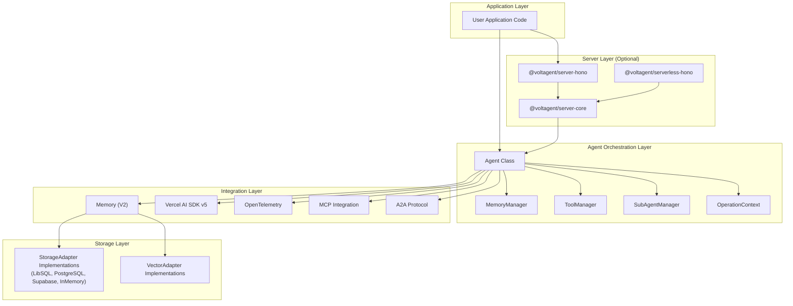
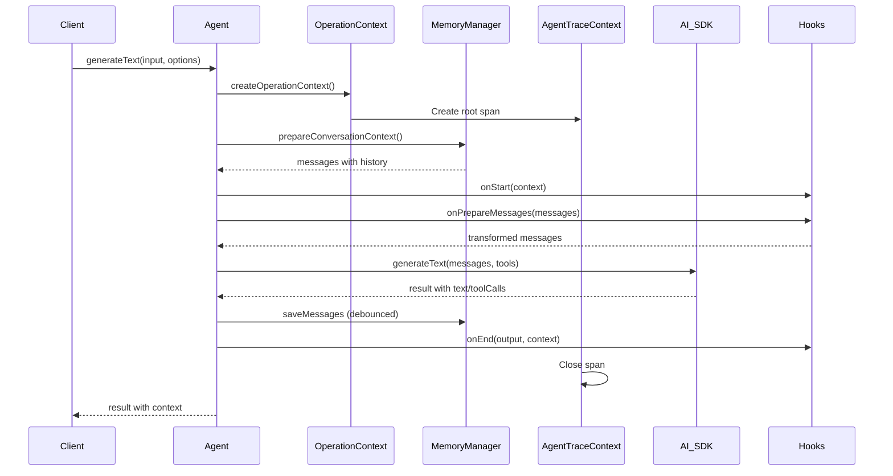
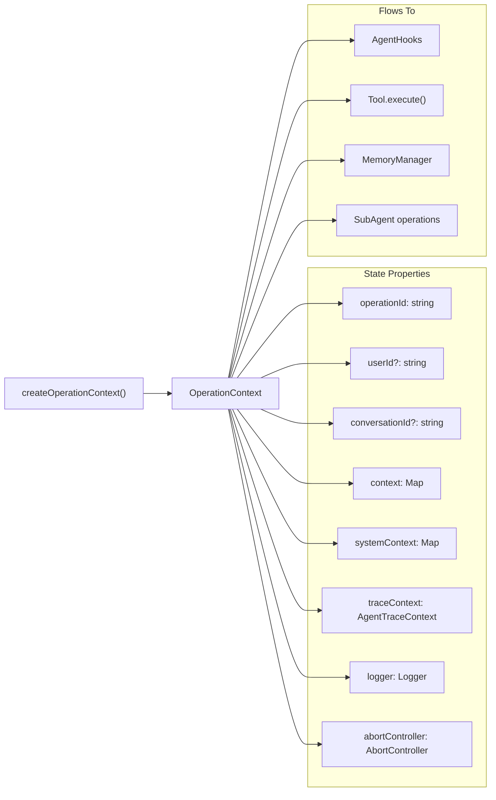
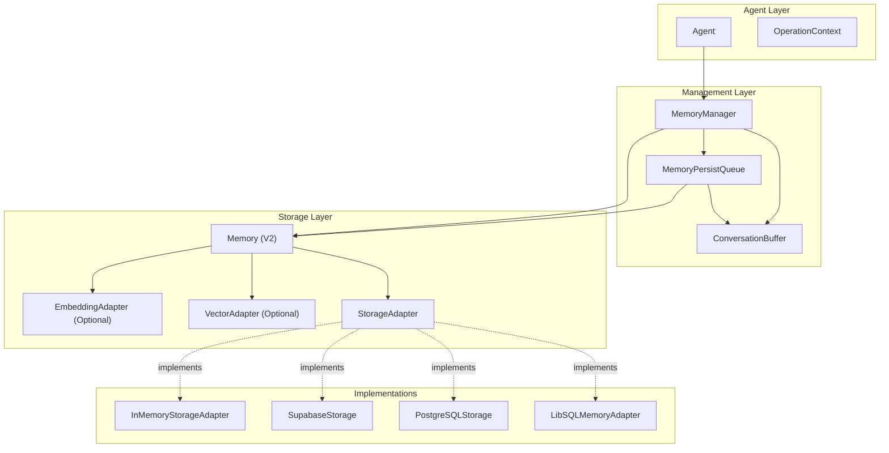
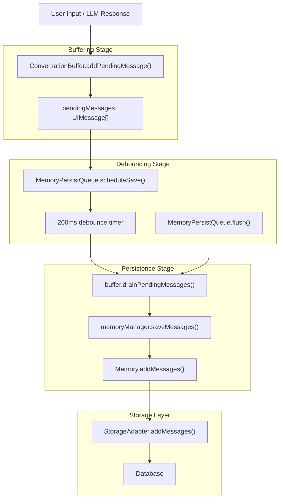
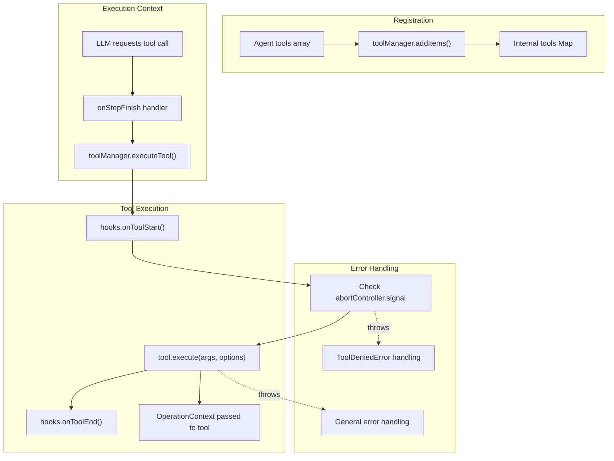
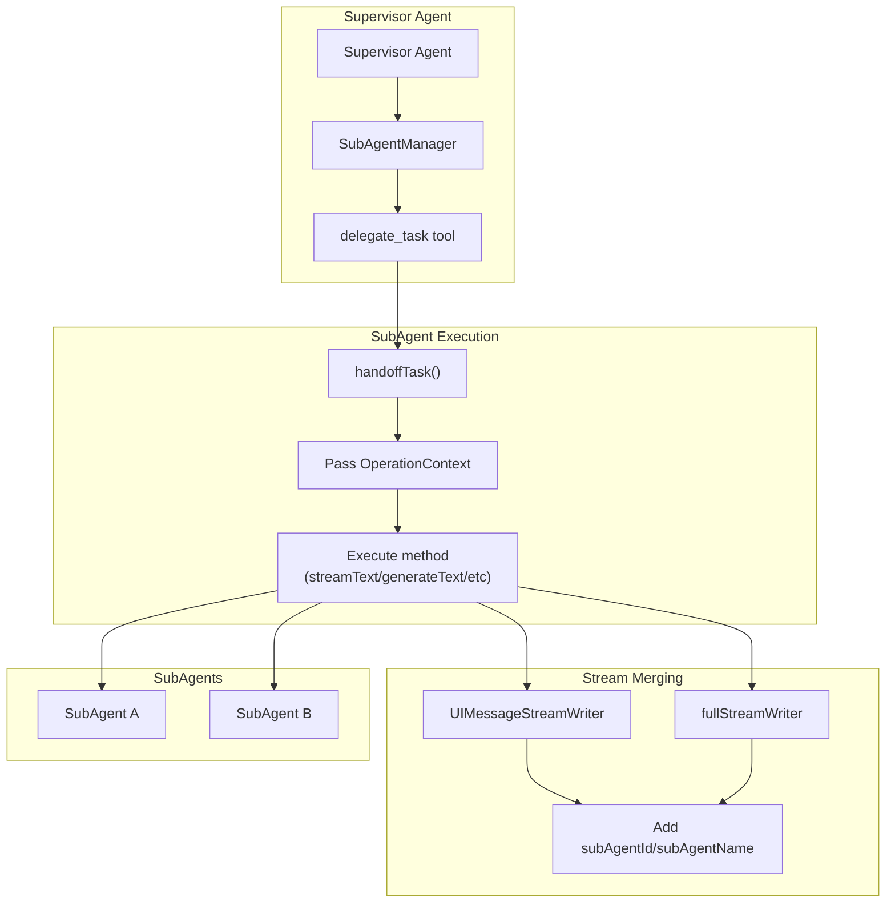
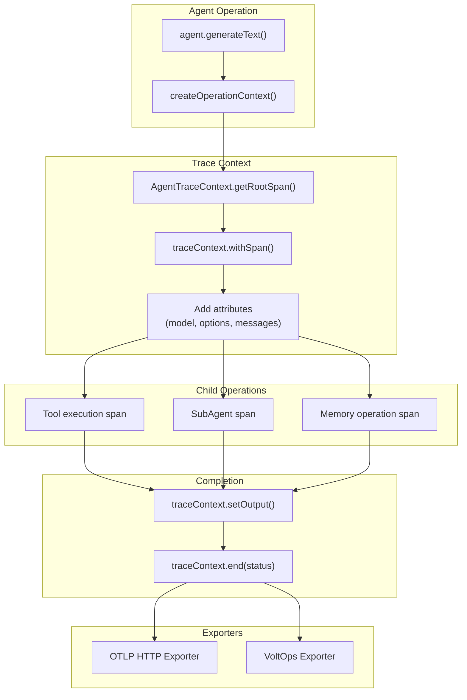
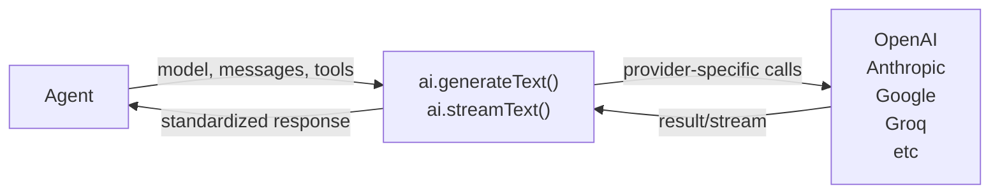

<!-- source: DeepWiki mcp.deepwiki.com · repo voltagent/voltagent · page 1.2 Architecture Overview · fetched 2026-10-27 -->

# Architecture Overview

<details>
<summary>Relevant source files</summary>

The following files were used as context for generating this wiki page:

- [.changeset/config.json](.changeset/config.json)
- [packages/core/src/agent/agent.spec-d.ts](packages/core/src/agent/agent.spec-d.ts)
- [packages/core/src/agent/agent.spec.ts](packages/core/src/agent/agent.spec.ts)
- [packages/core/src/agent/agent.ts](packages/core/src/agent/agent.ts)
- [packages/core/src/agent/hooks/index.spec.ts](packages/core/src/agent/hooks/index.spec.ts)
- [packages/core/src/agent/hooks/index.ts](packages/core/src/agent/hooks/index.ts)
- [packages/core/src/agent/index.ts](packages/core/src/agent/index.ts)
- [packages/core/src/agent/memory-persist-queue.ts](packages/core/src/agent/memory-persist-queue.ts)
- [packages/core/src/agent/message-normalizer.spec.ts](packages/core/src/agent/message-normalizer.spec.ts)
- [packages/core/src/agent/message-normalizer.ts](packages/core/src/agent/message-normalizer.ts)
- [packages/core/src/agent/providers/base/types.ts](packages/core/src/agent/providers/base/types.ts)
- [packages/core/src/agent/subagent/index.spec.ts](packages/core/src/agent/subagent/index.spec.ts)
- [packages/core/src/agent/subagent/index.ts](packages/core/src/agent/subagent/index.ts)
- [packages/core/src/agent/types.ts](packages/core/src/agent/types.ts)
- [packages/core/src/index.ts](packages/core/src/index.ts)
- [packages/core/src/memory/manager/memory-manager.ts](packages/core/src/memory/manager/memory-manager.ts)
- [website/docs/agents/context.md](website/docs/agents/context.md)
- [website/docs/agents/hooks.md](website/docs/agents/hooks.md)
- [website/docs/agents/overview.md](website/docs/agents/overview.md)
- [website/docs/agents/subagents.md](website/docs/agents/subagents.md)
- [website/docs/agents/tools.md](website/docs/agents/tools.md)

</details>


This document describes VoltAgent's high-level architecture, including its layered design, core execution model, and key design patterns. It provides a conceptual map of how the major components interact to orchestrate AI agent operations.

For package-level organization and dependencies, see [Package Ecosystem](#1.3). For detailed Agent API documentation, see [Agent System](#2.1). For memory implementation details, see [Memory System](#2.7).

---

## Architectural Layers

VoltAgent is organized into four primary architectural layers:



**Sources**: [packages/core/src/agent/agent.ts:241-336](), [packages/core/src/index.ts:1-194]()

---

## Core Execution Model

### Agent Operation Lifecycle

Every agent operation (e.g., `generateText`, `streamText`) follows this lifecycle:



The `OperationContext` object flows through every component, providing access to:
- `operationId`: Unique identifier for this execution
- `userId` and `conversationId`: User session identifiers
- `context`: User-defined context map
- `systemContext`: Internal state (stream writers, buffers)
- `traceContext`: OpenTelemetry span hierarchy
- `logger`: Contextual logger with operation metadata
- `abortController`: Cancellation mechanism

**Sources**: [packages/core/src/agent/agent.ts:344-520](), [packages/core/src/agent/types.ts:625-675]()

---

## Core Component Architecture

### Agent Class

The `Agent` class [packages/core/src/agent/agent.ts:241]() is the primary interface for all AI operations:

```mermaid
graph TB
    AGENT["Agent"]
    
    subgraph "Core Properties"
        ID["id: string"]
        NAME["name: string"]
        INSTRUCTIONS["instructions: InstructionsDynamicValue"]
        MODEL["model: LanguageModel | DynamicValue"]
    end
    
    subgraph "Managers"
        MEM_MGR["memoryManager: MemoryManager"]
        TOOL_MGR["toolManager: ToolManager"]
        SUBAGENT_MGR["subAgentManager: SubAgentManager"]
    end
    
    subgraph "Public Methods"
        GEN_TEXT["generateText(input, options)"]
        STREAM_TEXT["streamText(input, options)"]
        GEN_OBJ["generateObject(input, schema, options)"]
        STREAM_OBJ["streamObject(input, schema, options)"]
    end
    
    AGENT --> ID
    AGENT --> NAME
    AGENT --> INSTRUCTIONS
    AGENT --> MODEL
    AGENT --> MEM_MGR
    AGENT --> TOOL_MGR
    AGENT --> SUBAGENT_MGR
    AGENT --> GEN_TEXT
    AGENT --> STREAM_TEXT
    AGENT --> GEN_OBJ
    AGENT --> STREAM_OBJ
```



Key responsibilities:
- **LLM Interaction**: Delegates to AI SDK for model inference
- **Context Management**: Creates and maintains `OperationContext` per operation
- **Message Preparation**: Applies hooks, loads history, sanitizes messages
- **Tool Orchestration**: Manages tool execution through `ToolManager`
- **SubAgent Delegation**: Routes tasks to specialized agents via `SubAgentManager`

**Sources**: [packages/core/src/agent/agent.ts:241-336](), [packages/core/src/agent/types.ts:253-300]()

---

### OperationContext Flow

The `OperationContext` provides operational state throughout an agent's execution:



The `context` map is user-accessible and flows to hooks, tools, and subagents. The `systemContext` map stores internal state like stream writers and buffers that shouldn't be exposed to users.

**Sources**: [packages/core/src/agent/types.ts:625-675](), [packages/core/src/agent/agent.ts:1715-1798]()

---

## Memory Architecture

### Memory V2 Design

VoltAgent's memory system uses a three-tier architecture:



**Key components**:

| Component | Purpose | File Reference |
|-----------|---------|----------------|
| `MemoryManager` | Coordinates memory operations, manages buffer and queue | [packages/core/src/memory/manager/memory-manager.ts:28-86]() |
| `ConversationBuffer` | In-memory staging for messages before persistence | [packages/core/src/agent/conversation-buffer.ts:1-50]() |
| `MemoryPersistQueue` | Debounces saves (200ms default) to batch writes | [packages/core/src/agent/memory-persist-queue.ts:20-92]() |
| `Memory` | Storage abstraction with vector search support | [packages/core/src/memory/index.ts:1-50]() |

**Sources**: [packages/core/src/memory/manager/memory-manager.ts:28-86](), [packages/core/src/agent/conversation-buffer.ts:1-50](), [packages/core/src/agent/memory-persist-queue.ts:20-92]()

---

### Message Flow and Persistence

Messages flow through multiple stages before reaching storage:



The debounced queue prevents excessive database writes during multi-step operations (e.g., when multiple tool calls happen in sequence). The `flush()` method is called when operations complete to ensure all messages are persisted.

**Sources**: [packages/core/src/agent/conversation-buffer.ts:1-50](), [packages/core/src/agent/memory-persist-queue.ts:20-92](), [packages/core/src/memory/manager/memory-manager.ts:160-220]()

---

## Tool Execution Architecture

### Tool Manager and Execution Flow

The `ToolManager` [packages/core/src/tool/manager.ts:1-100]() handles tool registration and execution:



Tools receive the full `OperationContext` in their options, allowing them to:
- Access user context via `operationContext.context`
- Log with contextual logger via `operationContext.logger`
- Check cancellation via `operationContext.abortController.signal`
- Store results in system context via `operationContext.systemContext`

**Sources**: [packages/core/src/tool/manager.ts:1-100](), [packages/core/src/agent/agent.ts:1956-2100]()

---

## SubAgent Architecture

### Delegation and Coordination

The `SubAgentManager` [packages/core/src/agent/subagent/index.ts:35-71]() enables hierarchical agent structures:



**Key features**:
- **Context Inheritance**: SubAgents receive parent's `OperationContext`, including `userId`, `conversationId`, and custom `context` map
- **System Message Generation**: [packages/core/src/agent/subagent/index.ts:213-284]() creates enhanced instructions with agent roster and guidelines
- **Stream Merging**: SubAgent events are enriched with metadata (`subAgentId`, `subAgentName`) and merged into parent streams
- **Event Filtering**: `supervisorConfig.fullStreamEventForwarding.types` controls which event types propagate

**Sources**: [packages/core/src/agent/subagent/index.ts:35-284](), [packages/core/src/agent/subagent/stream-metadata-enricher.ts:1-100]()

---

## Message Processing Pipeline

### Sanitization and Normalization

Messages undergo sanitization before being sent to LLMs:


The `sanitizeMessagesForModel()` function [packages/core/src/agent/message-normalizer.ts:100-200]() ensures messages are clean before LLM processing by:
1. Removing working memory tool calls (internal-only)
2. Stripping provider metadata from tool parts to avoid provider-specific coupling
3. Dropping messages with only whitespace
4. Trimming redundant reasoning blocks

**Sources**: [packages/core/src/agent/message-normalizer.ts:1-200](), [packages/core/src/agent/agent.ts:1437-1570]()

---

## Observability Architecture

### OpenTelemetry Integration

VoltAgent uses OpenTelemetry for distributed tracing:



The `AgentTraceContext` [packages/core/src/agent/open-telemetry/trace-context.ts:1-200]() manages span hierarchy. Each operation creates a root span, and child operations (tool calls, subagent delegations) create child spans with proper parent linkage.

**Sources**: [packages/core/src/agent/open-telemetry/trace-context.ts:1-200](), [packages/core/src/agent/agent.ts:354-389]()

---

## Design Patterns

### 1. Context Propagation Pattern

The `OperationContext` flows through all components as an immutable reference, providing shared state without global variables:

```typescript
// Created once per operation
const oc = this.createOperationContext(input, options);

// Flows to hooks
await hooks.onStart({ agent: this, context: oc });

// Flows to tools
await tool.execute(args, { operationContext: oc });

// Flows to subagents
await subAgentManager.handoffTask({ ...options, parentOperationContext: oc });
```

**Sources**: [packages/core/src/agent/agent.ts:1715-1798]()

---

### 2. Debounced Persistence Pattern

The `MemoryPersistQueue` batches rapid message updates:

```typescript
// Each message triggers scheduleSave()
scheduleSave(buffer, oc) {
  if (this.timer) clearTimeout(this.timer);
  this.timer = setTimeout(() => this.persist(buffer, oc), 200);
}

// Explicit flush ensures persistence
async flush(buffer, oc) {
  if (this.timer) clearTimeout(this.timer);
  await this.persist(buffer, oc);
}
```

This prevents database thrashing during multi-step operations while ensuring eventual consistency.

**Sources**: [packages/core/src/agent/memory-persist-queue.ts:33-75]()

---

### 3. Adapter Pattern

Storage, vector, and embedding adapters provide pluggable implementations:

```typescript
// Storage interface
interface StorageAdapter {
  addMessages(messages: UIMessage[], userId: string, conversationId: string): Promise<void>;
  getMessages(userId: string, conversationId: string, options?: GetMessagesOptions): Promise<UIMessage[]>;
}

// Implementations
class LibSQLMemoryAdapter implements StorageAdapter { ... }
class PostgreSQLStorage implements StorageAdapter { ... }
class SupabaseStorage implements StorageAdapter { ... }
```

This enables swapping persistence layers (SQLite → PostgreSQL → Supabase) without changing agent code.

**Sources**: [packages/core/src/memory/types.ts:1-100]()

---

### 4. Dynamic Value Pattern

Instructions, models, and tools can be dynamic functions evaluated at runtime:

```typescript
type DynamicValue<T> = (options: DynamicValueOptions) => Promise<T> | T;

// Static
model: openai("gpt-4o")

// Dynamic - context-aware model selection
model: async (options) => {
  return options.context?.get("premium") ? openai("gpt-4o") : openai("gpt-4o-mini");
}
```

This enables context-dependent configuration without conditional logic in the agent.

**Sources**: [packages/core/src/voltops/types.ts:1-50](), [packages/core/src/agent/types.ts:130-143]()

---

## Integration Points

### AI SDK Integration

VoltAgent delegates LLM interaction to Vercel AI SDK v5:



The agent calls AI SDK functions [packages/core/src/agent/agent.ts:443-461]() and receives standardized results, then adds VoltAgent-specific properties like `context`.

**Sources**: [packages/core/src/agent/agent.ts:443-461]()

---

### Protocol Integrations

VoltAgent supports external protocols for tool and agent discovery:

| Protocol | Purpose | Integration Point |
|----------|---------|-------------------|
| **MCP** (Model Context Protocol) | Tool discovery from local/remote servers | [packages/core/src/mcp/index.ts:1-100]() |
| **A2A** (Agent-to-Agent) | HTTP/JSON-RPC inter-agent communication | [packages/core/src/a2a/index.ts:1-100]() |
| **Voice** | Speech synthesis and transcription | [packages/core/src/voice/index.ts:1-50]() |

**Sources**: [packages/core/src/mcp/index.ts:1-100](), [packages/core/src/a2a/index.ts:1-100](), [packages/core/src/voice/index.ts:1-50]()

---

## Summary

VoltAgent's architecture achieves flexibility through:

1. **Layered Design**: Clear separation between orchestration, integration, and storage layers
2. **Context Propagation**: `OperationContext` provides unified state management
3. **Adapter Pattern**: Pluggable storage, vector, and embedding implementations
4. **Debounced Persistence**: Optimized database writes without sacrificing correctness
5. **AI SDK Delegation**: Provider-agnostic LLM interaction
6. **OpenTelemetry**: First-class observability with distributed tracing

This architecture enables developers to build complex multi-agent systems with minimal boilerplate while maintaining full control over behavior through hooks, custom tools, and pluggable components.

**Sources**: [packages/core/src/agent/agent.ts:241-1800](), [packages/core/src/index.ts:1-194]()

---

