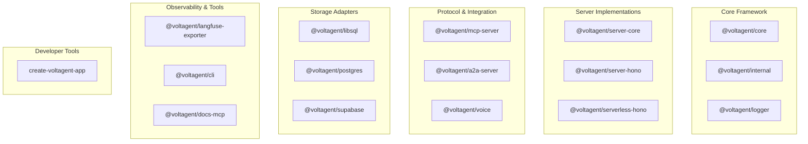
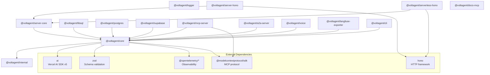

<!-- source: DeepWiki mcp.deepwiki.com · repo voltagent/voltagent · page 1.3 Package Ecosystem · fetched 2026-10-27 -->

# Package Ecosystem

<details>
<summary>Relevant source files</summary>

The following files were used as context for generating this wiki page:

- [CHANGELOG.md](CHANGELOG.md)
- [changelog.sh](changelog.sh)
- [examples/base/src/index.ts](examples/base/src/index.ts)
- [examples/with-google-ai/package.json](examples/with-google-ai/package.json)
- [examples/with-google-vertex-ai/package.json](examples/with-google-vertex-ai/package.json)
- [examples/with-groq-ai/package.json](examples/with-groq-ai/package.json)
- [examples/with-mcp/package.json](examples/with-mcp/package.json)
- [examples/with-nextjs/package.json](examples/with-nextjs/package.json)
- [packages/cli/package.json](packages/cli/package.json)
- [packages/core/package.json](packages/core/package.json)
- [packages/create-voltagent-app/CHANGELOG.md](packages/create-voltagent-app/CHANGELOG.md)
- [packages/create-voltagent-app/package.json](packages/create-voltagent-app/package.json)
- [packages/voice/package.json](packages/voice/package.json)
- [pnpm-lock.yaml](pnpm-lock.yaml)

</details>


This page documents the VoltAgent monorepo structure, describing all packages, their purposes, and interdependencies. It covers the organization of 11+ scoped `@voltagent/*` packages and the `create-voltagent-app` scaffolding tool.

For information about the overall architecture and execution flow, see [Architecture Overview](#1.2). For details about specific packages like `@voltagent/core`, see [Core Framework](#2).

---

## Monorepo Organization

The VoltAgent repository is structured as a pnpm workspace monorepo with three primary directories:

| Directory | Purpose | Package Count |
|-----------|---------|---------------|
| `packages/` | Core framework and integration packages | 11+ scoped packages |
| `examples/` | Reference implementations and demos | 20+ example applications |
| `website/` | Docusaurus documentation site | 1 documentation package |

All framework packages use the `@voltagent/` npm scope for organized distribution. The repository uses pnpm workspaces for dependency management, Lerna for multi-package operations, and Changesets for versioning and changelog generation.

**Sources:** [pnpm-lock.yaml:1-10]()

---

## Package Categories



**Package Categories**

The ecosystem is organized into six functional categories, each serving a distinct role in the framework.

**Sources:** [pnpm-lock.yaml:7-107](), [CHANGELOG.md:1-598]()

---

## Core Framework Packages

### @voltagent/core

The foundation package providing agent orchestration, memory management, tool execution, and workflow capabilities.

**Location:** `packages/core/`

**Key Exports:**
- `Agent` - Core agent class with `generateText`, `streamText`, `generateObject`, `streamObject` methods
- `Memory` - Memory V2 architecture with storage adapters
- `VoltAgent` - Main application container
- `createTool` - Tool creation utility
- `MCPConfiguration` - Model Context Protocol integration
- `Workflow` - Workflow orchestration system

**Dependencies:**
- `@voltagent/internal` - Shared utilities
- `ai` (peer) - Vercel AI SDK v5 for LLM abstraction
- `zod` (peer) - Schema validation (v3.25+ or v4.0+)
- `@voltagent/logger` (optional peer) - Structured logging
- `@ai-sdk/provider-utils` (peer) - AI provider utilities
- OpenTelemetry packages - Built-in observability
- `@modelcontextprotocol/sdk` - MCP integration
- `uuid` - Unique identifiers
- `zod-from-json-schema` and `zod-from-json-schema-v3` - JSON schema conversion for both Zod v3 and v4

**Build Configuration:**
- TypeScript with tsup bundler
- Dual exports: ESM (`.mjs`) and CJS (`.js`)
- Type declarations: `.d.ts` and `.d.mts`

**Sources:** [packages/core/package.json:1-78](), [CHANGELOG.md:1-100]()

---

### @voltagent/internal

Shared internal utilities used across packages. Not intended for direct consumption by end users.

**Location:** `packages/core/`

**Purpose:** Provides common utilities like safe JSON stringification, error handling, and type utilities to avoid duplication across packages.

**Sources:** [packages/core/package.json:18](), [CHANGELOG.md:517-519]()

---

### @voltagent/logger

Structured logging package built on Pino with contextual logging support.

**Location:** `packages/logger/`

**Key Exports:**
- `createPinoLogger` - Factory function for Pino logger instances
- Contextual logger with `operationId`, `userId`, `conversationId` support
- Environment-aware formatting (pretty in dev, JSON in production)

**Usage Pattern:**
```typescript
const logger = createPinoLogger({
  name: "my-voltagent-app",
  level: "info"
});
```

**Sources:** [examples/base/src/index.ts:11-15](), [packages/create-voltagent-app/CHANGELOG.md:92-116]()

---

## Server Implementation Packages

### @voltagent/server-core

Framework-agnostic server implementation providing base functionality for HTTP servers.

**Location:** `packages/server-core/`

**Purpose:** Provides abstract server interfaces and common request handling logic that can be adapted to different HTTP frameworks. Contains route registration, middleware patterns, and protocol integration points.

**Sources:** [pnpm-lock.yaml:7-107]()

---

### @voltagent/server-hono

Hono-based HTTP server implementation for traditional Node.js deployments.

**Location:** `packages/server-hono/`

**Key Features:**
- Auto-registration of agent routes (`/agents/:id/text`, `/agents/:id/stream`)
- MCP protocol routes (`/mcp/*`)
- A2A protocol routes (`/a2a/*`)
- Swagger/OpenAPI documentation generation
- Startup banner with route listing
- JWT authentication middleware

**Dependencies:**
- `@voltagent/core` - Core framework
- `@voltagent/server-core` - Base server logic
- `@voltagent/mcp-server` (optional) - MCP integration
- `@voltagent/a2a-server` (optional) - A2A integration
- `hono` - HTTP framework
- `@hono/node-server` - Node.js adapter
- `@hono/swagger-ui` - API documentation

**Example Usage:**
```typescript
import { honoServer } from "@voltagent/server-hono";

new VoltAgent({
  agents: { myAgent },
  server: honoServer({ port: 3000 })
});
```

**Sources:** [examples/base/src/index.ts:4](), [examples/with-google-ai/package.json:10](), [CHANGELOG.md:89-196]()

---

### @voltagent/serverless-hono

Serverless adapter for edge runtimes and FaaS platforms.

**Location:** `packages/serverless-hono/`

**Supported Platforms:**
- Cloudflare Workers
- Netlify Functions
- Other edge runtimes

**Purpose:** Provides lightweight adapter for deploying VoltAgent in serverless environments with cold start optimization and edge-compatible APIs.

**Sources:** [pnpm-lock.yaml:461-493](), [pnpm-lock.yaml:1071-1100]()

---

## Protocol and Integration Packages

### @voltagent/mcp-server

Model Context Protocol (MCP) server implementation exposing VoltAgent resources over standardized transports.

**Location:** `packages/mcp-server/`

**Transports Supported:**
- `stdio` - Standard input/output for local processes
- `http` - HTTP endpoints for remote access
- `sse` - Server-Sent Events for streaming

**Exposed Resources:**
- Agents - Available as MCP tools
- Workflows - Workflow execution via MCP
- Tools - Direct tool invocation
- Prompts - Prompt templates
- Resources - Static resources

**Configuration:**
```typescript
import { MCPServer } from "@voltagent/mcp-server";

const mcpServer = new MCPServer({
  name: "support-mcp",
  version: "1.0.0",
  agents: { assistant },
  protocols: { stdio: true, http: false, sse: false }
});
```

**Auto-Registration:** When registered with `VoltAgent` and `honoServer`, automatically exposes HTTP/SSE endpoints at `/mcp/*` routes.

**Sources:** [CHANGELOG.md:122-196](), [examples/with-mcp/package.json:1-29]()

---

### @voltagent/a2a-server

Agent-to-Agent (A2A) protocol server enabling inter-agent communication via JSON-RPC.

**Location:** `packages/a2a-server/`

**Key Features:**
- JSON-RPC over HTTP/SSE
- Agent discovery via `/.well-known/` endpoints
- Task management with custom hooks
- Request context forwarding (`userId`, `sessionId`, metadata)

**Endpoints:**
- `/.well-known/agent-to-agent` - Discovery endpoint
- `/a2a/:serverId` - RPC endpoint for agent invocation

**Configuration:**
```typescript
import { A2AServer } from "@voltagent/a2a-server";

const a2aServer = new A2AServer({
  name: "support-agent",
  version: "0.1.0"
});

new VoltAgent({
  agents: { assistant },
  a2aServers: { a2aServer },
  server: honoServer({ port: 3141 })
});
```

**Sources:** [CHANGELOG.md:89-120]()

---

### @voltagent/voice

Voice capabilities package integrating speech-to-text and text-to-speech providers.

**Location:** `packages/voice/`

**Supported Providers:**
- OpenAI Voice API - Text-to-speech
- ElevenLabs - Voice generation
- XSAI Speech - Transcription

**Dependencies:**
- `openai` - OpenAI API client
- `elevenlabs` - ElevenLabs API client
- `@xsai/generate-speech` - XSAI speech generation
- `@xsai/generate-transcription` - XSAI transcription

**Sources:** [packages/voice/package.json:1-51]()

---

## Storage Adapter Packages

### @voltagent/libsql

SQLite/Turso storage adapter for local development and edge deployments.

**Location:** `packages/libsql/`

**Key Exports:**
- `LibSQLMemoryAdapter` - Conversation history storage
- `LibSQLVectorAdapter` - Vector embeddings storage

**Default Database Location:** `.voltagent/memory.db`

**Usage Pattern:**
```typescript
import { LibSQLMemoryAdapter, LibSQLVectorAdapter } from "@voltagent/libsql";

const memory = new Memory({
  storage: new LibSQLMemoryAdapter({
    storageLimit: 100
  }),
  vector: new LibSQLVectorAdapter()
});
```

**Sources:** [examples/base/src/index.ts:9](), [examples/with-google-ai/package.json:8]()

---

### @voltagent/postgres

PostgreSQL storage adapter for enterprise deployments.

**Location:** `packages/postgres/`

**Purpose:** Provides production-ready storage with PostgreSQL for conversation history, vector embeddings, and metadata. Includes integration tests for CI/CD validation.

**Sources:** [pnpm-lock.yaml:7-107]()

---

### @voltagent/supabase

Supabase platform adapter integrating storage and authentication.

**Location:** `packages/supabase/`

**Key Features:**
- Cloud-native storage via Supabase
- Integrated authentication support
- Vector storage with pgvector

**Sources:** [pnpm-lock.yaml:7-107]()

---

## Observability and Tool Packages

### @voltagent/langfuse-exporter

Langfuse observability integration for production monitoring.

**Location:** `packages/langfuse-exporter/`

**Purpose:** Exports OpenTelemetry traces to Langfuse platform for LLM observability, cost tracking, and prompt management.

**Integration Pattern:** Registers as OpenTelemetry span processor, forwarding agent execution traces to Langfuse.

**Sources:** [pnpm-lock.yaml:960-998]()

---

### @voltagent/cli

Command-line interface for VoltAgent project management.

**Location:** `packages/cli/`

**Binary Name:** `volt`

**Commands:**

| Command | Purpose |
|---------|---------|
| `volt mcp setup` | Interactive MCP configuration for IDEs (Cursor, Windsurf, VS Code) |
| `volt mcp test` | Test MCP connection and provide usage examples |
| `volt mcp status` | Show current MCP configuration status |
| `volt mcp remove` | Remove MCP configuration |

**Dependencies:**
- `commander` - CLI framework
- `inquirer` - Interactive prompts
- `ora` - Spinner for loading states
- `chalk` - Terminal styling
- `boxen` - Message boxes
- `conf` - Configuration storage
- `posthog-node` - Anonymous usage analytics
- `npm-check-updates` - Package version checking

**Sources:** [packages/cli/package.json:1-61](), [packages/create-voltagent-app/CHANGELOG.md:165-198]()

---

### @voltagent/docs-mcp

MCP server for VoltAgent documentation integration with IDEs.

**Location:** `packages/docs-mcp/`

**Purpose:** Provides AI assistants in IDEs (Cursor, Windsurf, VS Code) with real-time access to VoltAgent documentation, examples, and best practices.

**Setup:** Configured via `volt mcp setup` command which writes IDE-specific configuration files.

**Sources:** [packages/create-voltagent-app/CHANGELOG.md:165-198]()

---

## Developer Tools

### create-voltagent-app

Interactive project scaffolding tool for creating new VoltAgent applications.

**Location:** `packages/create-voltagent-app/`

**Binary Names:**
- `create-voltagent`
- `create-voltagent-app`

**Key Features:**
- AI provider selection (OpenAI, Anthropic, Google, Groq, Mistral, Ollama)
- Optional API key input with skip option
- Automatic `.env` file generation
- Package manager detection (pnpm, npm, yarn, bun)
- Auto-install dependencies after project creation
- Cross-platform support (Windows, macOS, Linux)
- Template includes VoltOps observability setup

**Dependencies:**
- `inquirer` - Interactive CLI prompts
- `ora` - Loading spinners
- `chalk` - Terminal colors
- `boxen` - Message formatting
- `figlet` - ASCII art
- `fs-extra` - File system operations
- `tar` - Template extraction
- `posthog-node` - Anonymous usage analytics

**Generated Project Structure:**
```
my-voltagent-app/
├── src/
│   ├── index.ts          # Main entry point
│   └── workflows/        # Workflow definitions
├── .env                  # Environment variables
├── package.json          # Dependencies
└── tsconfig.json         # TypeScript config
```

**Usage:**
```bash
npx create-voltagent-app my-agent
# or
pnpm create voltagent-app my-agent
```

**Sources:** [packages/create-voltagent-app/package.json:1-60](), [packages/create-voltagent-app/CHANGELOG.md:1-135]()

---

## Package Dependency Graph



**Dependency Hierarchy**

All packages depend directly or transitively on `@voltagent/core`. The core package serves as the foundation, providing the `Agent`, `Memory`, `VoltAgent`, and `Workflow` abstractions. Storage adapters, protocol servers, and observability packages extend core functionality through well-defined interfaces.

**Sources:** [packages/core/package.json:5-63](), [pnpm-lock.yaml:108-144]()

---

## Peer Dependencies

Several packages use peer dependencies to avoid version conflicts and reduce bundle size:

| Package | Peer Dependency | Version Constraint | Optional |
|---------|----------------|-------------------|----------|
| `@voltagent/core` | `ai` | `5.x` | No |
| `@voltagent/core` | `zod` | `^3.25.0 \|\| ^4.0.0` | No |
| `@voltagent/core` | `@ai-sdk/provider-utils` | `3.x` | No |
| `@voltagent/core` | `@voltagent/logger` | `1.x` | Yes |
| `@voltagent/voice` | `@voltagent/core` | `^1.0.0` | No |

**Zod Version Strategy:** Core supports both Zod v3 and v4 using version-aware JSON schema conversion. It includes both `zod-from-json-schema@^0.5.0` (for v4) and `zod-from-json-schema-v3` alias (for v3), selecting the appropriate converter at runtime.

**Sources:** [packages/core/package.json:54-64](), [CHANGELOG.md:336-403]()

---

## Build and Distribution

### Build Configuration

All packages use `tsup` for bundling with the following configuration:

**Output Formats:**
- ESM: `.mjs` with `.d.mts` declarations
- CJS: `.js` with `.d.ts` declarations

**Entry Points:** Dual exports defined in `package.json`:
```json
{
  "exports": {
    ".": {
      "import": {
        "types": "./dist/index.d.mts",
        "default": "./dist/index.mjs"
      },
      "require": {
        "types": "./dist/index.d.ts",
        "default": "./dist/index.js"
      }
    }
  },
  "main": "dist/index.js",
  "module": "dist/index.mjs",
  "types": "dist/index.d.ts"
}
```

**Sources:** [packages/core/package.json:36-47]()

---

### Package Scripts

Standard scripts across all packages:

| Script | Purpose |
|--------|---------|
| `build` | Production build with tsup |
| `dev` | Watch mode for development |
| `lint` | Run Biome linter |
| `lint:fix` | Auto-fix linting issues |
| `publint` | Validate package.json for publishing |
| `attw` | Check TypeScript type exports |
| `test` | Run Vitest tests |
| `test:coverage` | Generate coverage report |

**Sources:** [packages/core/package.json:65-76]()

---

### Versioning and Publishing

**Versioning Strategy:** Uses Changesets for coordinated releases across packages.

**Release Channels:**
- `@latest` - Stable releases from `main` branch
- `@next` - Prerelease versions from `next` branch

**Workflow:**
1. Developers create changesets for changes
2. Changesets generates version bumps and changelogs
3. CI/CD publishes to npm with appropriate tags

**Changelog Generation:** The `changelog.sh` script aggregates individual package changelogs into a unified root `CHANGELOG.md`, processing `@voltagent/core` first for priority.

**Sources:** [changelog.sh:1-76](), [CHANGELOG.md:1-50]()

---

## Example Application Dependencies

Example applications demonstrate package usage patterns:

**Common Stack:**
```json
{
  "dependencies": {
    "@voltagent/core": "^1.1.26",
    "@voltagent/server-hono": "^1.0.18",
    "@voltagent/libsql": "^1.0.7",
    "@voltagent/logger": "^1.0.2",
    "@voltagent/cli": "^0.1.11",
    "ai": "^5.0.12",
    "zod": "^3.25.76"
  }
}
```

**AI Provider Examples:**
- `with-nextjs`: `@ai-sdk/openai`, `@ai-sdk/react` for Next.js integration
- `with-google-ai`: `@ai-sdk/google` for Gemini models
- `with-groq-ai`: `@ai-sdk/groq` for Groq inference
- `with-google-vertex-ai`: `@ai-sdk/google-vertex` for Vertex AI
- `with-amazon-bedrock`: `@ai-sdk/amazon-bedrock` with AWS credentials

**Deployment Examples:**
- `with-cloudflare-workers`: `@voltagent/serverless-hono`, `wrangler`
- `with-netlify-functions`: `@voltagent/serverless-hono`, `netlify-cli`
- `with-nextjs`: Next.js 15.x with App Router
- `with-nuxt`: Nuxt 4.x with Vue 3

**Sources:** [examples/with-google-ai/package.json:1-33](), [examples/with-nextjs/package.json:1-39](), [examples/with-mcp/package.json:1-29](), [examples/with-groq-ai/package.json:1-32](), [examples/with-google-vertex-ai/package.json:1-33]()

---

## File System Organization

```mermaid
graph TB
    ROOT["Repository Root"]
    
    PACKAGES["packages/"]
    ROOT --> PACKAGES
    
    PACKAGES --> CORE_DIR["core/"]
    PACKAGES --> INTERNAL_DIR["internal/"]
    PACKAGES --> LOGGER_DIR["logger/"]
    PACKAGES --> SERVER_CORE_DIR["server-core/"]
    PACKAGES --> SERVER_HONO_DIR["server-hono/"]
    PACKAGES --> SERVERLESS_DIR["serverless-hono/"]
    PACKAGES --> LIBSQL_DIR["libsql/"]
    PACKAGES --> POSTGRES_DIR["postgres/"]
    PACKAGES --> SUPABASE_DIR["supabase/"]
    PACKAGES --> MCP_DIR["mcp-server/"]
    PACKAGES --> A2A_DIR["a2a-server/"]
    PACKAGES --> VOICE_DIR["voice/"]
    PACKAGES --> LANGFUSE_DIR["langfuse-exporter/"]
    PACKAGES --> CLI_DIR["cli/"]
    PACKAGES --> DOCS_MCP_DIR["docs-mcp/"]
    PACKAGES --> CREATE_APP_DIR["create-voltagent-app/"]
    
    EXAMPLES["examples/"]
    ROOT --> EXAMPLES
    EXAMPLES --> BASE_EX["base/"]
    EXAMPLES --> NEXTJS_EX["with-nextjs/"]
    EXAMPLES --> MCP_EX["with-mcp/"]
    EXAMPLES --> OTHER_EX["20+ other examples"]
    
    WEBSITE["website/"]
    ROOT --> WEBSITE
    WEBSITE --> DOCS["docs/"]
    WEBSITE --> BLOG["blog/"]
    
    ROOT --> PNPM["pnpm-workspace.yaml"]
    ROOT --> LERNA["lerna.json"]
    ROOT --> CHANGESETS[".changeset/"]
```



**Directory Structure**

The monorepo uses pnpm workspaces defined in `pnpm-workspace.yaml`. Each package in `packages/` follows the same structure:

```
packages/<package-name>/
├── src/               # TypeScript source
├── dist/              # Build output (gitignored)
├── package.json       # Package metadata
├── tsconfig.json      # TypeScript config
├── tsup.config.ts     # Build config
└── CHANGELOG.md       # Package changelog
```

**Sources:** [pnpm-lock.yaml:1-10](), [changelog.sh:3-10]()

---

## Quality Assurance Tools

| Tool | Purpose | Configuration |
|------|---------|---------------|
| Biome | Linting and formatting | `biome.json` at root |
| Syncpack | Version consistency across packages | `syncpack` in root `package.json` |
| Publint | Package.json validation | Per-package script |
| Commitlint | Conventional commit enforcement | `.commitlintrc.json` at root |
| Vitest | Unit testing | Per-package test setup |
| Husky | Git hooks | Pre-commit linting |

**Package Version Consistency:** Syncpack ensures all packages use consistent versions of shared dependencies like `typescript`, `@types/node`, and `tsup`.

**Sources:** [pnpm-lock.yaml:14-94]()

---

