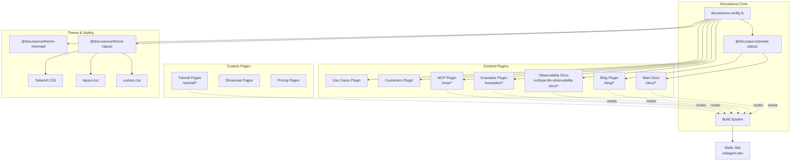
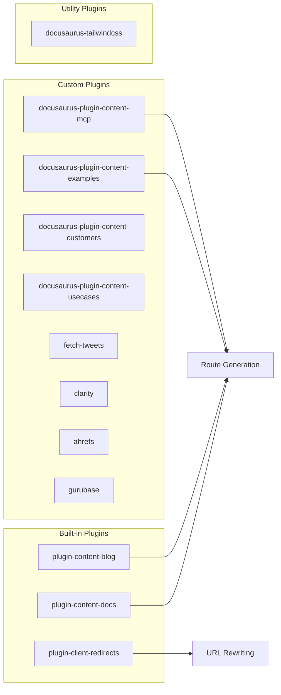
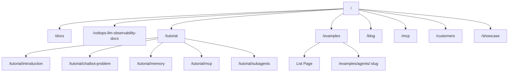
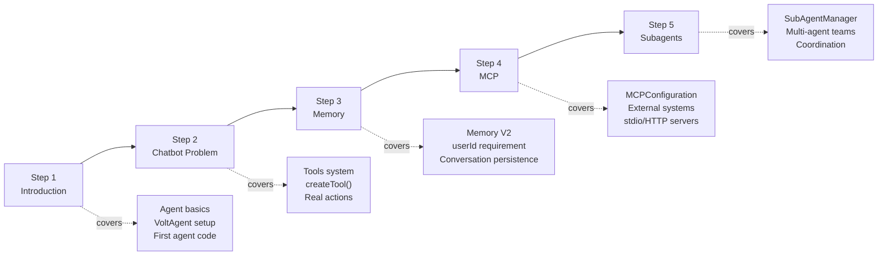
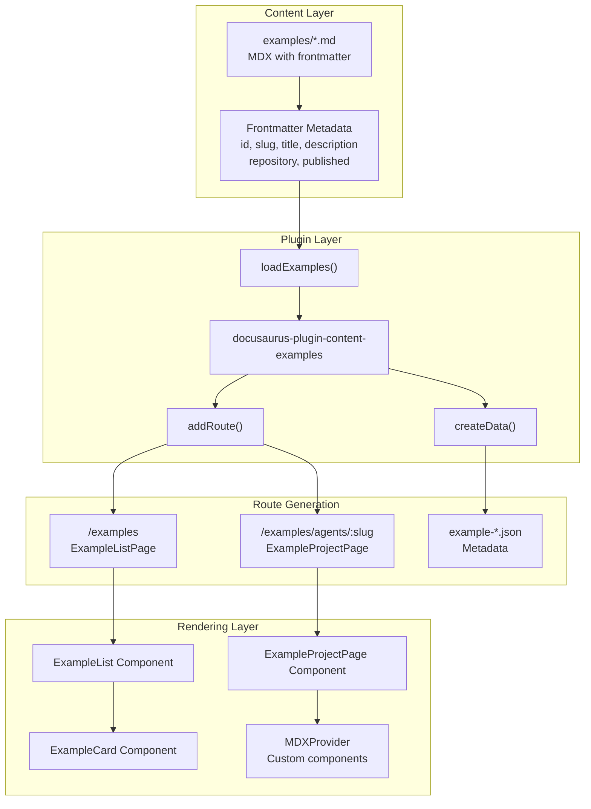
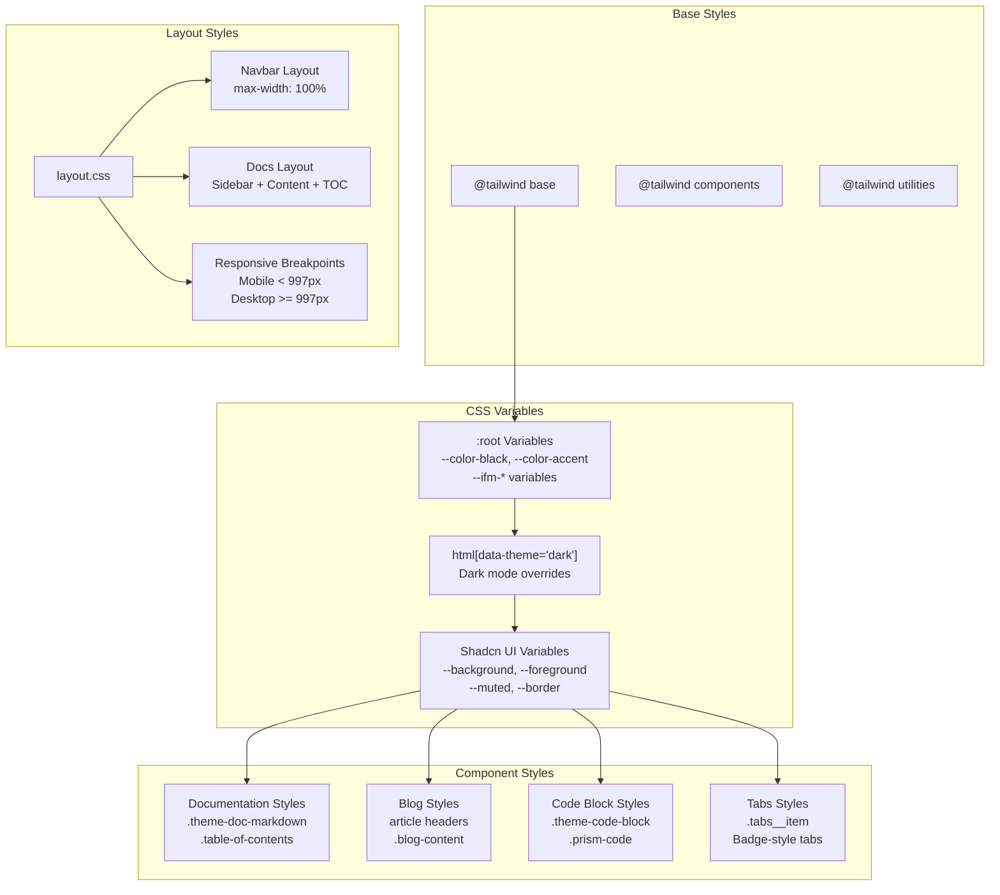

<!-- source: DeepWiki mcp.deepwiki.com · repo voltagent/voltagent · page 10 Documentation Website · fetched 2026-10-27 -->

# Documentation Website

<details>
<summary>Relevant source files</summary>

The following files were used as context for generating this wiki page:

- [examples/with-client-side-tools/app/globals.css](examples/with-client-side-tools/app/globals.css)
- [examples/with-whatsapp/README.md](examples/with-whatsapp/README.md)
- [website/blog/2025-07-30-claude-code-agents/index.md](website/blog/2025-07-30-claude-code-agents/index.md)
- [website/docusaurus.config.ts](website/docusaurus.config.ts)
- [website/examples/recipe-creator.md](website/examples/recipe-creator.md)
- [website/examples/whatsapp-order.md](website/examples/whatsapp-order.md)
- [website/package.json](website/package.json)
- [website/plugins/docusaurus-plugin-content-examples/index.js](website/plugins/docusaurus-plugin-content-examples/index.js)
- [website/src/components/blog-widgets/YouTubeEmbed.tsx](website/src/components/blog-widgets/YouTubeEmbed.tsx)
- [website/src/components/examples/Callout.tsx](website/src/components/examples/Callout.tsx)
- [website/src/components/examples/exampleCard.tsx](website/src/components/examples/exampleCard.tsx)
- [website/src/components/examples/index.tsx](website/src/components/examples/index.tsx)
- [website/src/components/privacy-policy/index.tsx](website/src/components/privacy-policy/index.tsx)
- [website/src/components/terms/index.tsx](website/src/components/terms/index.tsx)
- [website/src/components/tutorial/TutorialLayout.tsx](website/src/components/tutorial/TutorialLayout.tsx)
- [website/src/components/tutorial/TutorialNavbar.tsx](website/src/components/tutorial/TutorialNavbar.tsx)
- [website/src/css/custom.css](website/src/css/custom.css)
- [website/src/css/layout.css](website/src/css/layout.css)
- [website/src/pages/tutorial/chatbot-problem.tsx](website/src/pages/tutorial/chatbot-problem.tsx)
- [website/src/pages/tutorial/introduction.tsx](website/src/pages/tutorial/introduction.tsx)
- [website/src/pages/tutorial/mcp.tsx](website/src/pages/tutorial/mcp.tsx)
- [website/src/pages/tutorial/memory.tsx](website/src/pages/tutorial/memory.tsx)
- [website/src/pages/tutorial/subagents.tsx](website/src/pages/tutorial/subagents.tsx)
- [website/src/theme/ExampleListPage/index.tsx](website/src/theme/ExampleListPage/index.tsx)
- [website/src/theme/ExampleProjectPage/index.tsx](website/src/theme/ExampleProjectPage/index.tsx)

</details>


This document covers the Docusaurus-based documentation website hosted at voltagent.dev, including its architecture, content management system, tutorial framework, and examples showcase. For information about the CLI tools used during development, see [VoltAgent CLI](#7.1). For details about the example applications themselves, see [Example Applications](#9).

The website serves multiple purposes: technical documentation for the VoltAgent framework, a progressive 5-step tutorial system, a curated examples gallery, blog posts, and VoltOps observability platform documentation.

## Website Architecture

The documentation website is built on Docusaurus 3.1.1 with a classic preset configuration. The site uses multiple content plugins to manage different content types and implements custom routing logic for specialized pages.



**Sources:** [website/docusaurus.config.ts:1-420](), [website/package.json:1-68]()

### Docusaurus Configuration

The primary configuration file defines site metadata, plugin configurations, and routing behavior. The site supports multiple documentation instances to separate framework documentation from observability platform documentation.

| Configuration Aspect | Value | Purpose |
|---------------------|-------|---------|
| `title` | "VoltAgent" | Site title for SEO and branding |
| `url` | "https://voltagent.dev" | Production URL |
| `baseUrl` | "/" | Root path for all routes |
| `organizationName` | "VoltAgent" | GitHub organization |
| `trailingSlash` | `true` | Ensures consistent URLs |
| `onBrokenLinks` | "throw" | Fails build on broken links |

The configuration includes Google Analytics tracking (`gtag`), Algolia search integration, and Microsoft Clarity analytics. It defines two separate documentation instances: the main framework docs at `/docs` and VoltOps observability docs at `/voltops-llm-observability-docs`.

**Sources:** [website/docusaurus.config.ts:5-24](), [website/docusaurus.config.ts:61-64](), [website/docusaurus.config.ts:83-93]()

### Plugin System



The examples plugin is a custom implementation that loads MDX files from the `examples` directory, processes frontmatter metadata, and generates both list and detail pages. The plugin uses `gray-matter` for frontmatter parsing and creates aliased paths for hot module reloading during development.

**Sources:** [website/docusaurus.config.ts:68-268](), [website/plugins/docusaurus-plugin-content-examples/index.js:1-125]()

### Route Structure and Navigation

The navbar configuration defines the primary navigation structure with links to documentation, observability docs, showcase, customers, blog, and MCP pages. The site implements a hierarchical routing system where content plugins automatically register their routes during the build process.



The redirect configuration handles legacy URLs and ensures backward compatibility when routes change. For example, `/marketplace/` redirects to `/ai-agent-marketplace/`, and old observability docs paths redirect to the new `/voltops-llm-observability-docs/` structure.

**Sources:** [website/docusaurus.config.ts:284-323](), [website/docusaurus.config.ts:98-219]()

## Tutorial System

The tutorial system provides a progressive 5-step learning path for developers new to VoltAgent. Each step builds upon previous concepts, guiding users from basic agent creation through advanced multi-agent coordination.



**Sources:** [website/src/components/tutorial/TutorialNavbar.tsx:12-18]()

### TutorialLayout Component

The `TutorialLayout` component provides a consistent wrapper for all tutorial pages, handling navigation, progress tracking, and layout styling. It accepts props for current step number, total steps, step title, description, and optional previous/next step URLs.

The layout structure includes:
- Fixed tutorial navbar with progress indicator
- Step number badge with emerald accent colors
- Main content area with prose styling
- Previous/Next navigation buttons at the bottom
- Global background effects (gradient orbs and dot pattern)

```typescript
interface TutorialLayoutProps {
  children: React.ReactNode;
  currentStep: number;
  totalSteps: number;
  stepTitle: string;
  stepDescription: string;
  nextStepUrl?: string;
  prevStepUrl?: string;
  hideHeader?: boolean;
}
```

The component renders a dot pattern background using the `DotPattern` component with gray dots at 1.2px size and 20px spacing. Animated gradient orbs are positioned at various screen locations with blur effects to create visual depth.

**Sources:** [website/src/components/tutorial/TutorialLayout.tsx:13-133]()

### TutorialNavbar Component

The `TutorialNavbar` displays navigation controls and progress tracking for the tutorial. It renders differently on mobile versus desktop screens, providing a responsive navigation experience.

Desktop features:
- Logo and "Tutorial" label
- Progress bar showing completion percentage
- Step navigation with numbered pills for each step
- VoltOps Console link button
- Exit tutorial link

Mobile features:
- Compact header with logo and action buttons
- Simplified progress indicator
- Numbered-only step navigation (no labels)

The navbar includes a GitHub banner at the top encouraging users to star the repository. This banner spans the full width with an emerald gradient background and links to the GitHub repository.

**Sources:** [website/src/components/tutorial/TutorialNavbar.tsx:1-184]()

### Tutorial Page Structure

Each tutorial page follows a consistent pattern: embedded YouTube video, problem statement, solution explanation, code examples, and testing instructions. Pages use the `ColorModeProvider` wrapper to ensure proper theme support for code blocks.

The tutorial pages use comparison tables showing "without" versus "with" approaches, using red (XMarkIcon) and green (CheckIcon) indicators. These visual comparisons help users understand the value proposition of each concept.

Step 2 (Chatbot Problem) introduces the interactive code highlighting system where hovering over explanations highlights corresponding code sections. This is implemented using state management with `highlightedSection` and conditional CSS classes.

**Sources:** [website/src/pages/tutorial/introduction.tsx:12-580](), [website/src/pages/tutorial/chatbot-problem.tsx:10-580]()

## Examples System

The examples system showcases real-world VoltAgent implementations through MDX content files, custom rendering components, and a plugin-based architecture. Examples are stored as MDX files with frontmatter metadata and rendered through specialized theme components.



**Sources:** [website/plugins/docusaurus-plugin-content-examples/index.js:1-125]()

### Examples Plugin Implementation

The custom examples plugin extends Docusaurus by loading MDX files from the configured `contentPath` directory, parsing frontmatter with `gray-matter`, and generating routes for both list and detail pages.

The `loadExamples()` function reads all `.md` and `.mdx` files from the content directory, extracts frontmatter metadata including `id`, `slug`, `title`, `description`, `repository`, and `published` flags. It creates aliased site paths for hot reloading and sorts examples by ID.

During the `contentLoaded` lifecycle hook, the plugin:
1. Filters examples where `published !== false`
2. Creates JSON data files for each example's metadata
3. Registers routes with the Docusaurus router
4. Maps module dependencies for React components

**Sources:** [website/plugins/docusaurus-plugin-content-examples/index.js:6-35](), [website/plugins/docusaurus-plugin-content-examples/index.js:53-100]()

### ExampleProjectPage Component

The `ExampleProjectPage` theme component renders individual example detail pages with a rich layout including header sections, code blocks, callouts, and table of contents navigation.

Component structure:
- Metadata validation (returns 404 if example or content missing)
- SEO Head tags with title, description, keywords, OpenGraph
- Hero section with gradient background, example title, description, tags
- GitHub source code button (desktop: top-right, mobile: inline)
- MDX content rendering with custom component mappings
- Sticky table of contents sidebar (desktop only, XL screens)

The component uses custom MDX components including `YouTubeEmbed`, `Info`, `Success`, `Warning` callouts, and a custom `details` implementation with chevron animation. The table of contents is filtered to show only H2 and H3 headings.

**Sources:** [website/src/theme/ExampleProjectPage/index.tsx:1-303]()

### ExampleCard Component

The `ExampleCard` component displays a single example in grid layouts with hover effects, gradient overlays, and visual accents. Each card is wrapped in a Link component routing to the example's detail page.

Visual features:
- Gradient border from emerald-500/20
- Glow effects with positioned blur circles
- Hover state with enhanced shadows and border opacity
- Right-aligned arrow indicator that scales on hover
- Emerald color scheme matching brand identity

**Sources:** [website/src/components/examples/exampleCard.tsx:1-48]()

### Callout Components

Three callout component variants (`Info`, `Success`, `Warning`) provide styled information blocks within example content. Each variant uses a distinct color scheme and icon from Heroicons.

| Callout Type | Border Color | Icon | Use Case |
|-------------|-------------|------|----------|
| `Info` | `emerald-400/20` | InformationCircleIcon | General information, tips |
| `Success` | `lime-400/20` | ShieldCheckIcon | Success states, confirmations |
| `Warning` | `amber-400/25` | ExclamationTriangleIcon | Warnings, important notes |

The callouts render with a rounded border, icon badge, optional title in uppercase tracking-widest font, and children content with proper text styling for paragraphs, lists, and inline elements.

**Sources:** [website/src/components/examples/Callout.tsx:1-76]()

## Styling and Theming

The website implements a comprehensive dark-mode-first design system using Tailwind CSS combined with custom CSS variables and Docusaurus theme overrides.

### CSS Architecture



**Sources:** [website/src/css/custom.css:1-125](), [website/src/css/layout.css:1-257]()

### Color System

The color system defines primary brand colors and semantic colors through CSS variables. The emerald green (`#10b981`) serves as the primary accent color throughout the site.

Dark theme colors:
- Background: `#0a0a0a` for documentation pages, `#070f12` for landing pages
- Text: White with various opacity levels (`#f2f2f2`, `#b4b4b4`, `#9ca3af`)
- Accent: `#10b981` (emerald-500) for primary actions and links
- Borders: `#1f2937` for subtle borders, `#30363d` for code block borders

The Shadcn UI variable system provides a consistent token-based approach for background, foreground, muted, border, and accent colors with automatic dark mode support.

**Sources:** [website/src/css/custom.css:7-113]()

### Code Block Styling

Code blocks use a GitHub-inspired dark theme with syntax highlighting powered by Prism. The implementation includes:
- GitHub dark color palette (background: `#010409`, text: `#f0f6fc`)
- Tab-style code block titles with rounded top corners
- Always-visible copy button (opacity: 0.8)
- 13px base font size for code content
- 8px border radius with 1px solid borders

Light theme code blocks use `#f6f8fa` background with `rgba(208, 215, 222, 0.7)` borders.

**Sources:** [website/src/css/custom.css:265-350](), [website/docusaurus.config.ts:338-416]()

### Tabs Component Styling

The tabs implementation uses a modern badge-style design instead of traditional underlined tabs:
- Inline-flex layout with gap spacing
- Pill-shaped buttons with rounded corners
- Emerald color scheme for active state
- Border and background transitions on hover
- No bottom border on container

**Sources:** [website/src/css/custom.css:351-407]()

### Documentation Layout

The documentation layout implements a three-column structure on desktop (sidebar, content, TOC) with responsive breakpoints for mobile devices.

Desktop layout (>= 997px):
- Sidebar: 300px fixed width
- Content: Flexible width with 2rem horizontal padding
- TOC: 180px fixed width, hidden on screens < 1025px
- Maximum content width: 1600px on screens > 1992px

Mobile layout (< 997px):
- Single column with full width
- Sidebar hidden (shown via hamburger menu)
- TOC hidden (accessible via collapse button)
- 1rem horizontal padding

**Sources:** [website/src/css/layout.css:152-257]()

### Announcement Bar

The announcement bar displays at the top of all pages with a gradient emerald background, backdrop blur, and bottom border. It uses flexbox centering and can be dismissed by users. The bar encourages GitHub stars with custom link styling.

**Sources:** [website/src/css/layout.css:43-86]()

---

