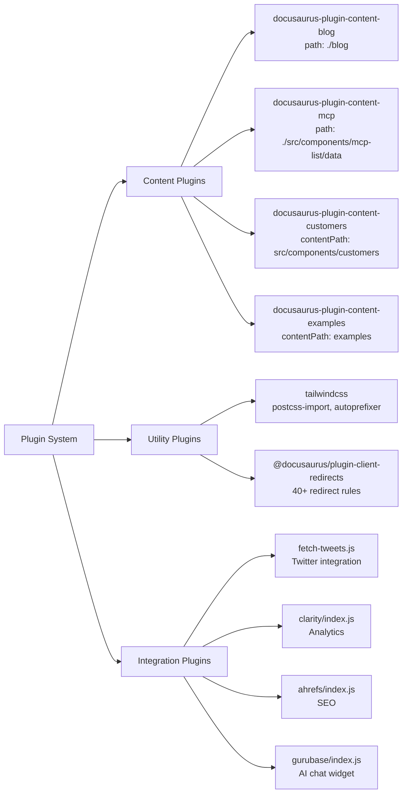
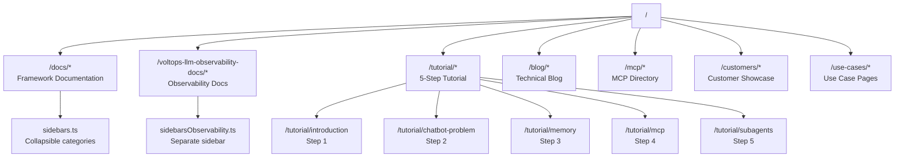
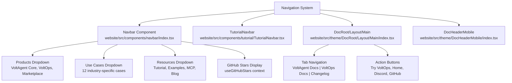
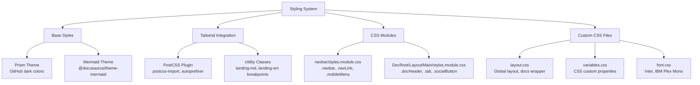
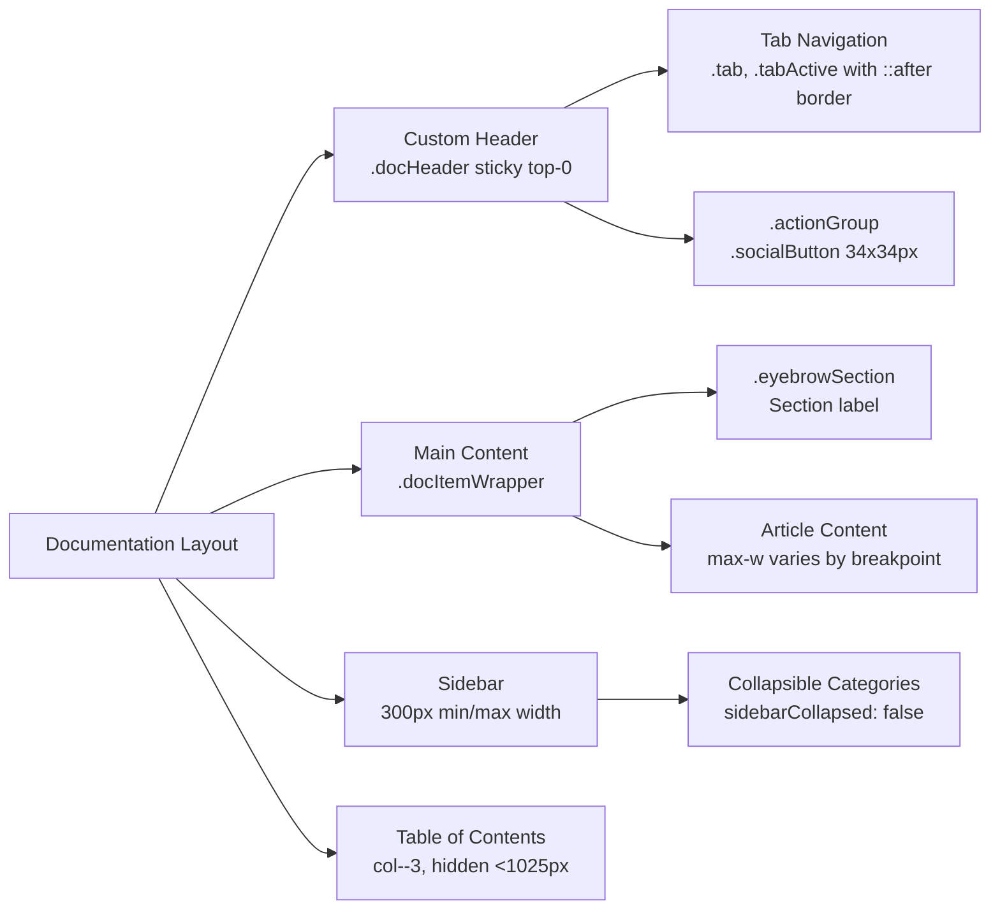
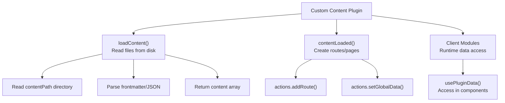
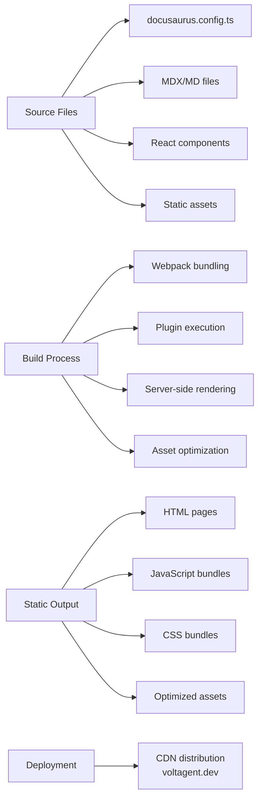

<!-- source: DeepWiki mcp.deepwiki.com · repo voltagent/voltagent · page 10.1 Website Architecture · fetched 2026-10-27 -->

# Website Architecture

<details>
<summary>Relevant source files</summary>

The following files were used as context for generating this wiki page:

- [examples/with-client-side-tools/app/globals.css](examples/with-client-side-tools/app/globals.css)
- [website/blog/2025-07-30-claude-code-agents/index.md](website/blog/2025-07-30-claude-code-agents/index.md)
- [website/docusaurus.config.ts](website/docusaurus.config.ts)
- [website/src/components/live-preview/index.tsx](website/src/components/live-preview/index.tsx)
- [website/src/components/navbar/index.tsx](website/src/components/navbar/index.tsx)
- [website/src/components/navbar/styles.module.css](website/src/components/navbar/styles.module.css)
- [website/src/components/supervisor-agent/workflow-code-example.tsx](website/src/components/supervisor-agent/workflow-code-example.tsx)
- [website/src/components/tutorial/TutorialLayout.tsx](website/src/components/tutorial/TutorialLayout.tsx)
- [website/src/components/tutorial/TutorialNavbar.tsx](website/src/components/tutorial/TutorialNavbar.tsx)
- [website/src/css/layout.css](website/src/css/layout.css)
- [website/src/pages/tutorial/chatbot-problem.tsx](website/src/pages/tutorial/chatbot-problem.tsx)
- [website/src/pages/tutorial/introduction.tsx](website/src/pages/tutorial/introduction.tsx)
- [website/src/pages/tutorial/mcp.tsx](website/src/pages/tutorial/mcp.tsx)
- [website/src/pages/tutorial/memory.tsx](website/src/pages/tutorial/memory.tsx)
- [website/src/pages/tutorial/subagents.tsx](website/src/pages/tutorial/subagents.tsx)
- [website/src/theme/DocHeaderMobile/index.tsx](website/src/theme/DocHeaderMobile/index.tsx)
- [website/src/theme/DocRoot/Layout/Main/index.tsx](website/src/theme/DocRoot/Layout/Main/index.tsx)
- [website/src/theme/DocRoot/Layout/Main/styles.module.css](website/src/theme/DocRoot/Layout/Main/styles.module.css)

</details>


## Purpose and Scope

This document describes the architecture of the VoltAgent documentation website (voltagent.dev), which is built using Docusaurus 3.x. It covers the static site generation system, custom component architecture, theming, plugin ecosystem, and content management patterns. For information about the tutorial system specifically, see [#10.2](#10.2). For example showcase pages, see [#10.3](#10.3).

The website serves multiple purposes:
- Technical documentation for `@voltagent/core` and related packages
- VoltOps observability platform documentation
- Interactive 5-step tutorial system
- Example project showcase
- Marketing and landing pages

## Technology Stack

The documentation website is built on the following core technologies:

| Technology | Purpose | Version/Config |
|------------|---------|----------------|
| **Docusaurus** | Static site generator | v3.x with TypeScript |
| **React** | Component framework | Via Docusaurus |
| **TypeScript** | Type safety | Configuration in `docusaurus.config.ts` |
| **Tailwind CSS** | Utility-first styling | PostCSS plugin configuration |
| **MDX** | Markdown with React | Native Docusaurus support |
| **Mermaid** | Diagram rendering | `@docusaurus/theme-mermaid` |
| **Algolia** | Search functionality | DocSearch integration |

**Sources:** [website/docusaurus.config.ts:1-420]()

## Docusaurus Configuration Architecture

The primary configuration file [website/docusaurus.config.ts:5-420]() defines the entire site structure using a typed `Config` object.

### Core Configuration

```mermaid
graph TB
    CONFIG["Config Object<br/>(docusaurus.config.ts)"]
    
    METADATA["Site Metadata<br/>title, tagline, url, favicon"]
    PRESETS["Presets<br/>classic preset"]
    PLUGINS["Plugins Array<br/>12+ custom plugins"]
    THEME["themeConfig<br/>navbar, footer, algolia"]
    
    CONFIG --> METADATA
    CONFIG --> PRESETS
    CONFIG --> PLUGINS
    CONFIG --> THEME
    
    PRESETS --> DOCS["docs configuration<br/>routeBasePath: /docs"]
    PRESETS --> BLOG_DISABLED["blog: false"]
    PRESETS --> GTAG["gtag tracking<br/>G-V4GFZ8WQ7D"]
    
    PLUGINS --> TAILWIND["tailwindcss plugin<br/>PostCSS integration"]
    PLUGINS --> OBSERVABILITY["@docusaurus/plugin-content-docs<br/>id: observability"]
    PLUGINS --> BLOG_PLUGIN["docusaurus-plugin-content-blog<br/>id: blog"]
    PLUGINS --> MCP_PLUGIN["docusaurus-plugin-content-mcp<br/>id: mcp"]
    PLUGINS --> REDIRECTS["@docusaurus/plugin-client-redirects"]
    PLUGINS --> CUSTOM["Custom plugins<br/>fetch-tweets, clarity, ahrefs"]
    
    THEME --> NAVBAR_CFG["navbar items<br/>style: dark"]
    THEME --> ALGOLIA_CFG["algolia search<br/>appId: C1TWP51DBB"]
    THEME --> PRISM["prism theme<br/>custom dark theme"]
```



**Sources:** [website/docusaurus.config.ts:5-67](), [website/docusaurus.config.ts:68-268](), [website/docusaurus.config.ts:269-417]()

### Multiple Documentation Instances

The site manages separate documentation sections using multiple `@docusaurus/plugin-content-docs` instances:

| Instance ID | Route | Purpose | Config Location |
|-------------|-------|---------|-----------------|
| `default` | `/docs/` | VoltAgent framework docs | [website/docusaurus.config.ts:45-50]() |
| `observability` | `/voltops-llm-observability-docs/` | VoltOps platform docs | [website/docusaurus.config.ts:83-93]() |
| `blog` | `/blog/` | Technical blog posts | [website/docusaurus.config.ts:221-236]() |
| `mcp` | `/mcp/` | MCP server directory | [website/docusaurus.config.ts:240-246]() |

**Sources:** [website/docusaurus.config.ts:83-93](), [website/docusaurus.config.ts:221-246]()

### Plugin System

The configuration registers multiple custom and third-party plugins:



**Sources:** [website/docusaurus.config.ts:68-268]()

## Content Structure and Routing

The website organizes content across multiple hierarchies:



**Sources:** [website/docusaurus.config.ts:45-50](), [website/docusaurus.config.ts:83-93](), [website/docusaurus.config.ts:221-246]()

## Custom Component Architecture

The website extends Docusaurus with numerous custom React components organized by functionality.

### Navigation Components

The navigation system uses custom components to provide a unified experience:



**Key Navigation Files:**
- [website/src/components/navbar/index.tsx:38-395]() - Main navbar with dropdowns
- [website/src/components/tutorial/TutorialNavbar.tsx:11-189]() - Tutorial-specific navbar
- [website/src/theme/DocRoot/Layout/Main/index.tsx:14-151]() - Documentation header tabs
- [website/src/theme/DocHeaderMobile/index.tsx:49-122]() - Mobile header with sidebar toggle

**Sources:** [website/src/components/navbar/index.tsx:38-395](), [website/src/components/tutorial/TutorialNavbar.tsx:11-189](), [website/src/theme/DocRoot/Layout/Main/index.tsx:14-151]()

### Tutorial System Components

The tutorial uses a specialized layout wrapper and navigation:

```mermaid
graph TB
    TUT_SYSTEM["Tutorial System"]
    
    LAYOUT["TutorialLayout<br/>website/src/components/tutorial/TutorialLayout.tsx"]
    NAVBAR["TutorialNavbar<br/>currentStep, totalSteps props"]
    PAGES["Tutorial Pages"]
    
    TUT_SYSTEM --> LAYOUT
    TUT_SYSTEM --> NAVBAR
    TUT_SYSTEM --> PAGES
    
    LAYOUT --> HEAD["Head Component<br/>SEO metadata"]
    LAYOUT --> BACKGROUND["Background Effects<br/>gradient orbs, DotPattern"]
    LAYOUT --> CONTENT["Content Wrapper<br/>max-w-5xl, prose styling"]
    LAYOUT --> NAV_BUTTONS["Prev/Next Navigation<br/>ChevronLeftIcon, ChevronRightIcon"]
    
    NAVBAR --> PROGRESS["Progress Bar<br/>currentStep / totalSteps * 100%"]
    NAVBAR --> STEPS["Step Navigation<br/>5 clickable step buttons"]
    NAVBAR --> ACTIONS["Action Buttons<br/>Exit Tutorial, Try VoltOps"]
    
    PAGES --> INTRO_PAGE["/tutorial/introduction<br/>Step 1: currentStep=1"]
    PAGES --> CHATBOT_PAGE["/tutorial/chatbot-problem<br/>Step 2: currentStep=2"]
    PAGES --> MEMORY_PAGE["/tutorial/memory<br/>Step 3: currentStep=3"]
    PAGES --> MCP_PAGE["/tutorial/mcp<br/>Step 4: currentStep=4"]
    PAGES --> SUBAGENTS_PAGE["/tutorial/subagents<br/>Step 5: currentStep=5"]
```



**Component Props:**
```typescript
interface TutorialLayoutProps {
  children: React.ReactNode;
  currentStep: number;
  totalSteps: number;
  stepTitle: string;
  stepDescription: string;
  nextStepUrl?: string;
  prevStepUrl?: string;
  hideHeader?: boolean;
}
```

**Sources:** [website/src/components/tutorial/TutorialLayout.tsx:13-133](), [website/src/components/tutorial/TutorialNavbar.tsx:6-189]()

### Interactive Components

The site includes several interactive demonstration components:

| Component | Location | Purpose |
|-----------|----------|---------|
| `MobileAgentCode` | Tutorial pages | Mobile-optimized code display with highlighting |
| `LivePreview` | Homepage | Sandpack-based code editor with VoltOps integration |
| `WorkflowCodeExample` | Supervisor agent demo | Animated beam diagrams showing agent communication |
| `ZoomableMermaid` | Blog posts | Interactive mermaid diagrams with zoom |

**Sources:** [website/src/pages/tutorial/introduction.tsx:9-356](), [website/src/components/live-preview/index.tsx:11-230]()

## Theming and Styling System

### CSS Architecture

The styling system combines Docusaurus themes, Tailwind CSS, and custom CSS modules:



**Key Styling Features:**
- Dark mode only: [website/docusaurus.config.ts:279-282]() disables color mode switching
- Custom Prism theme: [website/docusaurus.config.ts:338-415]() defines GitHub-inspired dark syntax highlighting
- Responsive breakpoints in CSS modules: [website/src/components/navbar/styles.module.css:290-311]()

**Sources:** [website/docusaurus.config.ts:52-59](), [website/docusaurus.config.ts:279-282](), [website/src/css/layout.css:1-257]()

### Documentation Layout Customization

The documentation pages use a custom layout that overrides Docusaurus defaults:



**Responsive Behavior:**
- Desktop (≥997px): Full header with tabs, sidebar visible [website/src/css/layout.css:188-224]()
- Tablet (768-996px): Simplified header, sidebar toggleable [website/src/css/layout.css:152-185]()
- Mobile (<768px): DocHeaderMobile component, full-width content [website/src/css/layout.css:246-288]()

**Sources:** [website/src/theme/DocRoot/Layout/Main/styles.module.css:1-342](), [website/src/css/layout.css:1-257]()

## Custom Theme Swizzling

Docusaurus theme components are customized ("swizzled") to modify default behavior:

| Original Component | Custom Location | Modifications |
|-------------------|-----------------|---------------|
| `DocRoot/Layout/Main` | [website/src/theme/DocRoot/Layout/Main/index.tsx]() | Added custom header with tabs, action buttons |
| `DocHeaderMobile` | [website/src/theme/DocHeaderMobile/index.tsx]() | Custom mobile header with section detection |

**Section Label Detection:** The mobile header uses `useSectionLabel()` hook to traverse the sidebar tree and find the parent category of the active document [website/src/theme/DocHeaderMobile/index.tsx:10-47]():

```typescript
const findParentLabel = (items: any[], parents: string[] = []): string | null => {
  for (const item of items) {
    if (item.type === "category") {
      const result = findParentLabel(item.items ?? [], [...parents, item.label]);
      if (result) return result;
    } else {
      // Match by docId or path
      if (matchesDocId || matchesPath) {
        return parents[parents.length - 1];
      }
    }
  }
  return null;
};
```

**Sources:** [website/src/theme/DocRoot/Layout/Main/index.tsx:14-151](), [website/src/theme/DocHeaderMobile/index.tsx:10-122]()

## Plugin Development Patterns

Custom plugins extend Docusaurus functionality for specialized content types:

### Content Plugin Pattern

Custom content plugins follow the Docusaurus plugin lifecycle:



Example plugin configuration for MCP directory [website/docusaurus.config.ts:240-246]():

```typescript
[
  "./plugins/docusaurus-plugin-content-mcp",
  {
    id: "mcp",
    routeBasePath: "mcp",
    path: "./src/components/mcp-list/data",
  },
]
```

**Sources:** [website/docusaurus.config.ts:240-268]()

## Client-Side Redirects

The site maintains backward compatibility with 40+ redirect rules [website/docusaurus.config.ts:98-218]():

```typescript
redirects: [
  {
    to: "/ai-agent-marketplace/",
    from: "/marketplace/",
  },
  {
    to: "/voltops-llm-observability-docs/vercel-ai/",
    from: "/docs-observability/vercel-ai/",
  },
  // ... 38 more redirects
]
```

**Redirect Categories:**
- Observability docs rebranding: `/docs-observability/*` → `/voltops-llm-observability-docs/*`
- Page consolidation: `/showcase/*` → `/customers/*`
- URL simplification: `/pricing/` → `/`
- Documentation reorganization: `/docs/providers/*` → `/docs/getting-started/providers-models/`

**Sources:** [website/docusaurus.config.ts:98-218]()

## Build and Deployment Process

The static site build follows the Docusaurus compilation pipeline:



**Build Configuration:**
- Base URL: `https://voltagent.dev` [website/docusaurus.config.ts:16-19]()
- Trailing slashes: enabled [website/docusaurus.config.ts:20]()
- Link validation: `onBrokenLinks: "throw"` [website/docusaurus.config.ts:26]()
- Analytics: Google Analytics `G-V4GFZ8WQ7D` [website/docusaurus.config.ts:61-64]()

**Sources:** [website/docusaurus.config.ts:5-67]()

## Search Integration

Algolia DocSearch provides site-wide search functionality:

```typescript
algolia: {
  appId: "C1TWP51DBB",
  apiKey: "80f0ff7c295210b58b46e0623e09654c",
  indexName: "web",
  contextualSearch: true,
  searchParameters: {
    attributesToHighlight: ["hierarchy.lvl0", "hierarchy"],
  },
}
```

The search indexes documentation, blog posts, and tutorial content with hierarchical highlighting [website/docusaurus.config.ts:328-336]().

**Sources:** [website/docusaurus.config.ts:328-336]()

---

