<!-- source: DeepWiki mcp.deepwiki.com · repo voltagent/voltagent · page 10.2 Tutorial System · fetched 2026-10-27 -->

# Tutorial System

<details>
<summary>Relevant source files</summary>

The following files were used as context for generating this wiki page:

- [examples/with-client-side-tools/app/globals.css](examples/with-client-side-tools/app/globals.css)
- [website/blog/2025-07-30-claude-code-agents/index.md](website/blog/2025-07-30-claude-code-agents/index.md)
- [website/docusaurus.config.ts](website/docusaurus.config.ts)
- [website/src/components/live-preview/index.tsx](website/src/components/live-preview/index.tsx)
- [website/src/components/navbar/index.tsx](website/src/components/navbar/index.tsx)
- [website/src/components/navbar/styles.module.css](website/src/components/navbar/styles.module.css)
- [website/src/components/supervisor-agent/workflow-code-example.tsx](website/src/components/supervisor-agent/workflow-code-example.tsx)
- [website/src/components/tutorial/TutorialLayout.tsx](website/src/components/tutorial/TutorialLayout.tsx)
- [website/src/components/tutorial/TutorialNavbar.tsx](website/src/components/tutorial/TutorialNavbar.tsx)
- [website/src/css/layout.css](website/src/css/layout.css)
- [website/src/pages/tutorial/chatbot-problem.tsx](website/src/pages/tutorial/chatbot-problem.tsx)
- [website/src/pages/tutorial/introduction.tsx](website/src/pages/tutorial/introduction.tsx)
- [website/src/pages/tutorial/mcp.tsx](website/src/pages/tutorial/mcp.tsx)
- [website/src/pages/tutorial/memory.tsx](website/src/pages/tutorial/memory.tsx)
- [website/src/pages/tutorial/subagents.tsx](website/src/pages/tutorial/subagents.tsx)
- [website/src/theme/DocHeaderMobile/index.tsx](website/src/theme/DocHeaderMobile/index.tsx)
- [website/src/theme/DocRoot/Layout/Main/index.tsx](website/src/theme/DocRoot/Layout/Main/index.tsx)
- [website/src/theme/DocRoot/Layout/Main/styles.module.css](website/src/theme/DocRoot/Layout/Main/styles.module.css)

</details>


The Tutorial System is a progressive, 5-step learning path that guides users from basic agent creation to advanced multi-agent coordination. It is implemented as a standalone section of the documentation website with custom layout components, interactive code examples, and embedded video content.

For information about the overall documentation website architecture, see [Website Architecture](#10.1). For details about the example applications that complement the tutorial, see [Examples and Showcase](#10.3).

---

## System Architecture

The tutorial system consists of five discrete pages, each implemented as a React component in the `/tutorial/*` route namespace. Each page shares a common layout component (`TutorialLayout`) and navigation component (`TutorialNavbar`).

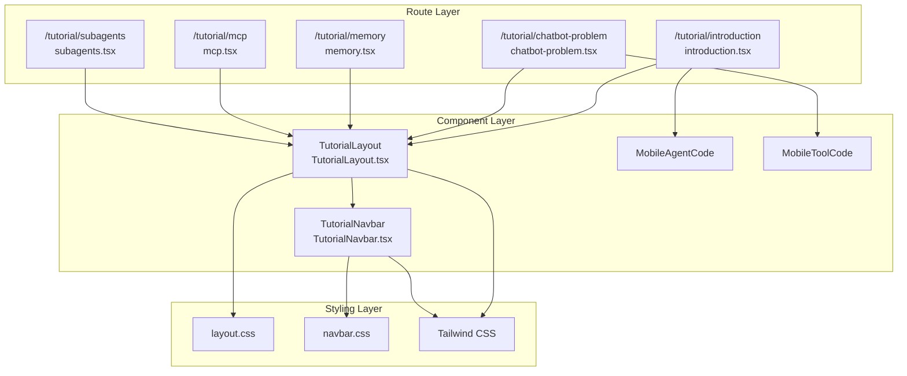

**Sources:** [website/src/pages/tutorial/introduction.tsx:1-50](), [website/src/components/tutorial/TutorialLayout.tsx:1-25](), [website/src/components/tutorial/TutorialNavbar.tsx:1-20]()

---

## Tutorial Content Structure

The tutorial follows a progressive disclosure pattern across five steps, each building on the previous:

| Step | Route | Title | Key Concepts |
|------|-------|-------|--------------|
| 1 | `/tutorial/introduction` | Introduction | Agent basics, project setup, VoltOps console |
| 2 | `/tutorial/chatbot-problem` | Chatbot Problem | Tool creation, `createTool`, parameter validation |
| 3 | `/tutorial/memory` | Memory | `userId`, `conversationId`, conversation persistence |
| 4 | `/tutorial/mcp` | MCP Integration | `MCPConfiguration`, stdio/HTTP servers, external systems |
| 5 | `/tutorial/subagents` | Subagents | Multi-agent coordination, `subAgents` property, delegation |

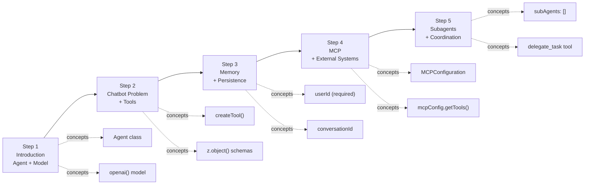

**Sources:** [website/src/components/tutorial/TutorialNavbar.tsx:12-18](), [website/src/pages/tutorial/introduction.tsx:38-45](), [website/src/pages/tutorial/chatbot-problem.tsx:36-44]()

---

## TutorialLayout Component

The `TutorialLayout` component provides consistent structure and navigation for all tutorial pages. It is defined in [website/src/components/tutorial/TutorialLayout.tsx:24-133]().

### Props Interface

```typescript
interface TutorialLayoutProps {
  children: React.ReactNode;
  currentStep: number;      // Current step (1-5)
  totalSteps: number;        // Total steps (always 5)
  stepTitle: string;         // Page title
  stepDescription: string;   // Meta description
  nextStepUrl?: string;      // Navigation to next step
  prevStepUrl?: string;      // Navigation to previous step
  hideHeader?: boolean;      // Optional header visibility
}
```

### Layout Structure

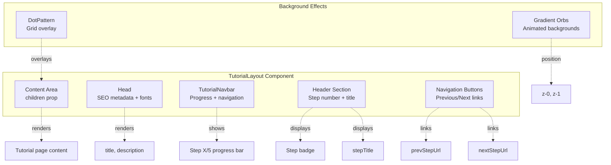

**Sources:** [website/src/components/tutorial/TutorialLayout.tsx:34-130]()

### Styling and Visual Effects

The layout implements a dark-themed design with animated gradient backgrounds:

- **Background Orbs:** Three animated gradient orbs positioned at different viewport locations [website/src/components/tutorial/TutorialLayout.tsx:55-63]()
- **Dot Pattern:** Grid overlay using `DotPattern` component with configurable dot size and spacing [website/src/components/tutorial/TutorialLayout.tsx:67-69]()
- **Responsive Padding:** Top padding adjusts from `190px` on mobile to `36` on desktop [website/src/components/tutorial/TutorialLayout.tsx:76]()

**Sources:** [website/src/components/tutorial/TutorialLayout.tsx:48-69]()

---

## TutorialNavbar Component

The `TutorialNavbar` provides step-by-step navigation and progress tracking. It is defined in [website/src/components/tutorial/TutorialNavbar.tsx:11-189]().

### Component Sections

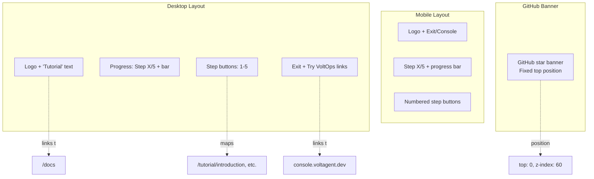

### Step Navigation Array

The steps are defined in [website/src/components/tutorial/TutorialNavbar.tsx:12-18]():

```typescript
const steps = [
  { number: 1, title: "Introduction", url: "/tutorial/introduction" },
  { number: 2, title: "Chatbot Problem", url: "/tutorial/chatbot-problem" },
  { number: 3, title: "Memory", url: "/tutorial/memory" },
  { number: 4, title: "MCP", url: "/tutorial/mcp" },
  { number: 5, title: "Subagents", url: "/tutorial/subagents" },
];
```

### Responsive Behavior

- **Desktop (≥768px):** Horizontal layout with full step titles, progress bar, and action buttons [website/src/components/tutorial/TutorialNavbar.tsx:113-184]()
- **Mobile (<768px):** Simplified header with numbered step buttons only [website/src/components/tutorial/TutorialNavbar.tsx:43-111]()

**Sources:** [website/src/components/tutorial/TutorialNavbar.tsx:11-189]()

---

## Interactive Code Examples

Each tutorial page includes interactive code examples with hover-based highlighting to connect explanations with specific code sections.

### Highlighting Implementation Pattern

The introduction and chatbot-problem pages use a highlighting system where hovering over explanation cards highlights corresponding code sections:

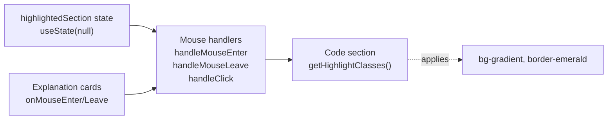

The `getHighlightClasses` function in [website/src/pages/tutorial/introduction.tsx:17-23]() returns different CSS classes based on whether the section is currently highlighted:

```typescript
const getHighlightClasses = (section: string) => {
  return highlightedSection === section
    ? "bg-gradient-to-r from-emerald-600/40 to-emerald-500/20 border-l-2 ..."
    : "text-muted-foreground ...";
};
```

### Code Sections

The introduction page defines these highlightable sections [website/src/pages/tutorial/introduction.tsx:387-483]():

- `imports`: Import statements
- `agent`: Agent instantiation
- `name`: Agent name property
- `behavior`: Instructions property
- `model`: Model selection
- `server`: VoltAgent server setup

**Sources:** [website/src/pages/tutorial/introduction.tsx:13-36](), [website/src/pages/tutorial/chatbot-problem.tsx:10-34]()

---

## Mobile-Specific Components

The tutorial system provides mobile-optimized components for complex code examples that require different layouts on small screens.

### MobileAgentCode Component

Used in the introduction tutorial for mobile devices [website/src/pages/tutorial/introduction.tsx:356]():

```typescript
{isMobile ? (
  <MobileAgentCode isVisible={true} />
) : (
  <div className="flex items-center justify-between gap-8">
    {/* Desktop interactive code */}
  </div>
)}
```

### MobileToolCode Component

Used in the chatbot-problem tutorial [website/src/pages/tutorial/chatbot-problem.tsx:12]():

```typescript
import { MobileToolCode } from "../../components/tutorial";
```

These components simplify the layout and remove hover interactions on mobile devices where hover states are not applicable.

**Sources:** [website/src/pages/tutorial/introduction.tsx:354-357](), [website/src/pages/tutorial/chatbot-problem.tsx:7-8]()

---

## Video Integration

Each tutorial page embeds YouTube videos using iframe elements with consistent styling and responsive aspect ratios.

### Video Container Pattern

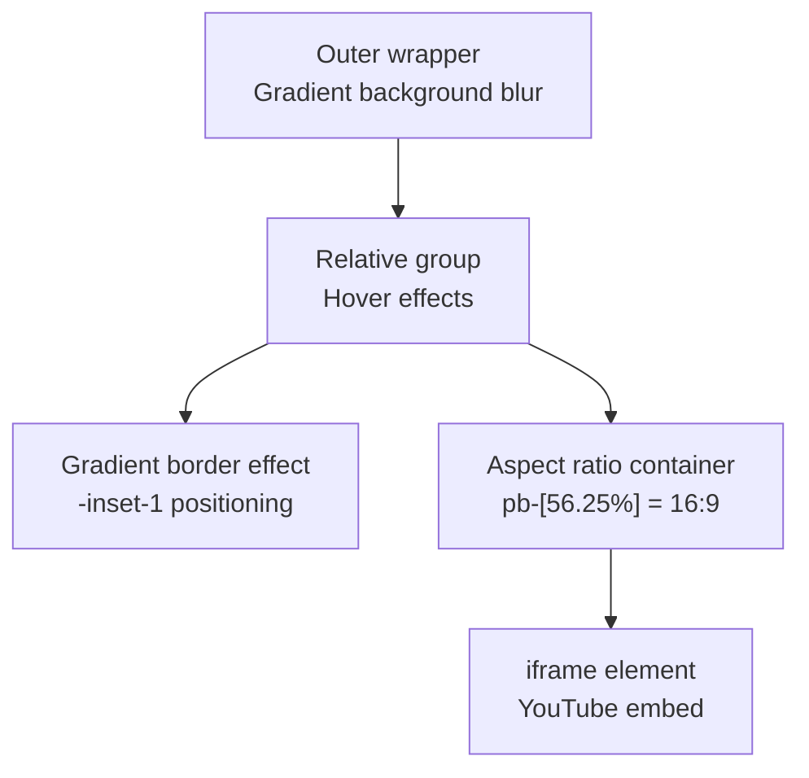

Standard video embedding code from [website/src/pages/tutorial/introduction.tsx:48-69]():

```tsx
<div className="relative w-full h-0 pb-[56.25%] rounded-xl overflow-hidden 
                border border-solid border-white/10 bg-black/40 backdrop-blur-sm">
  <iframe
    src="https://www.youtube.com/embed/{VIDEO_ID}"
    title="VoltAgent Introduction"
    className="absolute top-0 left-0 w-full h-full"
    frameBorder="0"
    allow="accelerometer; autoplay; clipboard-write; encrypted-media; 
           gyroscope; picture-in-picture"
    allowFullScreen
  />
</div>
```

### Video URLs by Step

| Step | Video Title | Video ID |
|------|-------------|----------|
| 1 | Introduction | CZ07r351T1k |
| 2 | Chatbot Problem | QVLUGG2ZhTI |
| 3 | Memory | agy4YjzPEJ8 |
| 4 | MCP | ebO8UVGcLbw |
| 5 | Subagents | N_ftq4Rc3FI |

**Sources:** [website/src/pages/tutorial/introduction.tsx:58](), [website/src/pages/tutorial/chatbot-problem.tsx:58](), [website/src/pages/tutorial/memory.tsx:29](), [website/src/pages/tutorial/mcp.tsx:29](), [website/src/pages/tutorial/subagents.tsx:30]()

---

## Demo GIF Integration

Tutorial pages use GIF animations to demonstrate concepts in action, particularly interactions with the VoltOps console.

### GIF Display Pattern

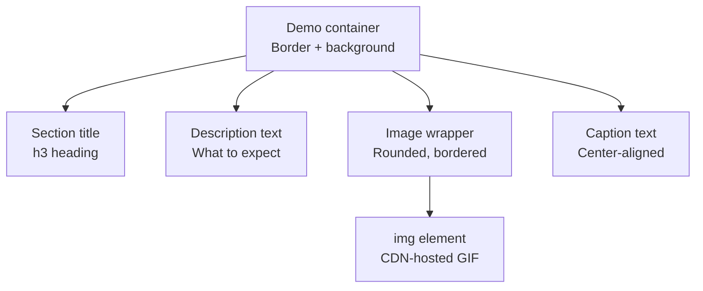

Example from the introduction tutorial [website/src/pages/tutorial/introduction.tsx:324-331]():

```tsx
<div className="mt-4 rounded-lg overflow-hidden border border-solid 
                border-white/10 bg-white/[0.02] backdrop-blur-sm">
  
</div>
```

### Demo GIF Locations

| Tutorial Step | Demo Type | CDN Path |
|--------------|-----------|----------|
| Introduction | VoltOps Dashboard | `/docs/tutorial/voltagent-voltops-demo.gif` |
| Memory | Memory Demo | `/docs/tutorial/voltops-memory-demo.gif` |
| MCP | Filesystem Operations | `/docs/mco-demo.gif` |
| Subagents | Multi-agent Workflow | `/docs/tutorial/subagent-demo.gif` |

**Sources:** [website/src/pages/tutorial/introduction.tsx:324-331](), [website/src/pages/tutorial/memory.tsx:234-240](), [website/src/pages/tutorial/mcp.tsx:277-283](), [website/src/pages/tutorial/subagents.tsx:444-451]()

---

## Navigation Integration

The tutorial system is integrated into the main site navigation through multiple entry points.

### Main Navbar Integration

The tutorial is accessible from the main navbar's Resources dropdown menu [website/src/components/navbar/index.tsx:219-230]():

```tsx
<Link to="/tutorial/introduction" className="no-underline">
  <div className="group p-3 -mx-1 hover:bg-slate-800 ...">
    <BookOpenIcon className="w-5 h-5 mr-3 ml-1 ..." />
    <div className="min-w-0 font-['Inter']">
      <div className="text-sm font-semibold ...">
        5 Steps Tutorial
      </div>
      <div className="text-xs font-normal text-gray-500 ...">
        Learn AI agent development in 5 steps
      </div>
    </div>
  </div>
</Link>
```

### Mobile Navbar Integration

On mobile devices, the tutorial link appears in the collapsed resources menu [website/src/components/navbar/index.tsx:524-535]():

```tsx
<Link to="/tutorial/introduction" className="no-underline">
  <div className="group p-3 pl-8 hover:bg-slate-800 ...">
    <BookOpenIcon className="w-5 h-5 mr-2 ..." />
    <div className="min-w-0 font-['Inter']">
      <div className="text-sm font-semibold ...">
        5 Steps Tutorial
      </div>
      <div className="text-xs text-gray-400">
        Learn AI agent development in 5 steps
      </div>
    </div>
  </div>
</Link>
```

**Sources:** [website/src/components/navbar/index.tsx:210-304](), [website/src/components/navbar/index.tsx:509-563]()

---

## Code Block Styling

Tutorial pages use the `CodeBlock` component from Docusaurus theme with the `ColorModeProvider` wrapper for consistent syntax highlighting.

### CodeBlock Usage Pattern

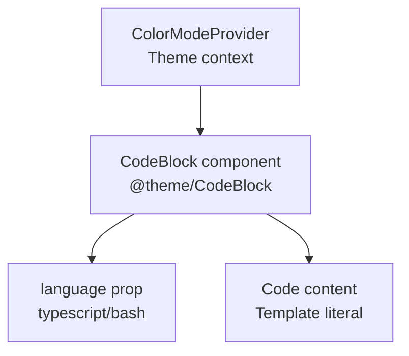

Example from the memory tutorial [website/src/pages/tutorial/memory.tsx:135-186]():

```tsx
<ColorModeProvider>
  <CodeBlock language="typescript">
    {`import { VoltAgent, Agent } from "@voltagent/core";
import { openai } from "@ai-sdk/openai";
// ... code content
`}
  </CodeBlock>
</ColorModeProvider>
```

### Supported Languages

The tutorial uses these language modes:
- `typescript`: TypeScript code examples
- `bash`: Shell commands and terminal output
- `javascript`: JavaScript examples (less common)

**Sources:** [website/src/pages/tutorial/memory.tsx:1](), [website/src/pages/tutorial/memory.tsx:135-136](), [website/src/pages/tutorial/mcp.tsx:185-186]()

---

## Content Sections Pattern

Tutorial pages follow a consistent content organization pattern with distinct visual sections.

### Section Component Structure

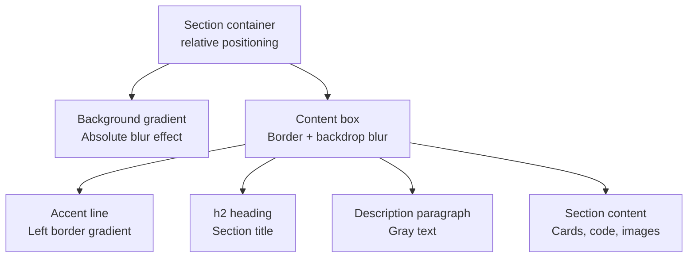

Standard section structure from [website/src/pages/tutorial/introduction.tsx:150-196]():

```tsx
<div className="relative mb-20">
  {/* Background gradient */}
  <div className="absolute inset-0 bg-gradient-to-br from-blue-500/5 
                  via-transparent to-emerald-500/5 rounded-3xl blur-3xl -z-10" />
  
  {/* Content container */}
  <div className="relative border border-solid border-white/10 rounded-2xl 
                  p-8 landing-md:p-10 bg-white/[0.02] backdrop-blur-sm">
    {/* Accent line */}
    <div className="absolute top-0 left-0 w-1 h-full bg-gradient-to-b 
                    from-blue-500 via-purple-500 to-transparent rounded-l-2xl" />
    
    <h2>Section Title</h2>
    <p>Description...</p>
    {/* Section content */}
  </div>
</div>
```

### Gradient Color Schemes

Each section type uses specific gradient combinations:

| Section Type | Gradient Colors | Accent Line |
|-------------|-----------------|-------------|
| Introduction | emerald-500/5 → purple-500/5 | emerald-500 → purple-500 |
| Problem | red-500/5 → orange-500/5 | red-500 → orange-500 |
| Solution | emerald-500/5 → cyan-500/5 | emerald-500 → cyan-500 |
| Info | blue-500/5 → emerald-500/5 | blue-500 → purple-500 |

**Sources:** [website/src/pages/tutorial/introduction.tsx:72-196](), [website/src/pages/tutorial/chatbot-problem.tsx:71-157]()

---

## Responsive Design System

The tutorial system uses Tailwind CSS with custom responsive breakpoints for mobile-first design.

### Custom Breakpoints

The `landing-md` breakpoint is used throughout tutorial pages:

```css
/* Defined in Tailwind config */
landing-md: 1024px  /* Desktop layouts */
landing-xs: 640px   /* Mobile adjustments */
```

### Responsive Patterns

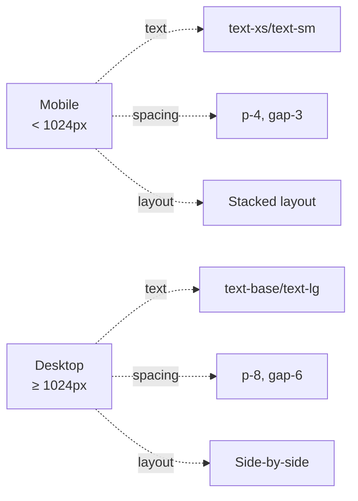

Example responsive classes from [website/src/pages/tutorial/introduction.tsx:76-83]():

```tsx
<h2 className="text-[21.6px] font-medium text-white mb-3">
  Why Do You Need VoltAgent?
</h2>
<p className="text-sm landing-md:text-base text-gray-400 leading-relaxed max-w-3xl">
  Building AI agents from scratch is like building a web app without React...
</p>
```

### Mobile Component Swapping

The `useMediaQuery` hook determines which components to render [website/src/pages/tutorial/introduction.tsx:14]():

```typescript
const isMobile = useMediaQuery("(max-width: 1023px)");
```

**Sources:** [website/src/pages/tutorial/introduction.tsx:14](), [website/src/pages/tutorial/introduction.tsx:76-83](), [website/src/pages/tutorial/chatbot-problem.tsx:12]()

---

## Iconography System

Tutorial pages use Heroicons for consistent visual elements across explanation cards and navigation.

### Icon Usage Patterns

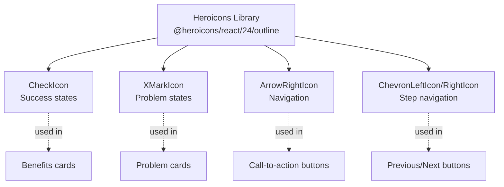

Example icon imports from [website/src/pages/tutorial/introduction.tsx:2-3]():

```typescript
import { CheckIcon, XMarkIcon } from "@heroicons/react/24/outline";
```

### Icon Styling

Icons receive consistent sizing and color treatment:
- Size: `w-4 h-4` to `w-5 h-5` (mobile to desktop)
- Colors: Themed based on context (emerald-400, red-400, etc.)
- Positioning: `mt-1` to align with first line of text

**Sources:** [website/src/pages/tutorial/introduction.tsx:2-3](), [website/src/components/tutorial/TutorialLayout.tsx:4-8](), [website/src/components/tutorial/TutorialNavbar.tsx:2]()

---

## Typography System

Tutorial pages implement a consistent typography hierarchy using custom font sizes and responsive scaling.

### Heading Hierarchy

| Element | Desktop Size | Mobile Size | Font Weight | Usage |
|---------|-------------|-------------|-------------|-------|
| Page Title | 24px | 24px | medium | Step title in header |
| Section h2 | 21.6px | 21.6px | medium | Major sections |
| Section h3 | 20px (base-lg) | 18px | medium | Subsections |
| Section h4 | 18px (base) | 16px | semibold | Cards, callouts |

### Text Styles

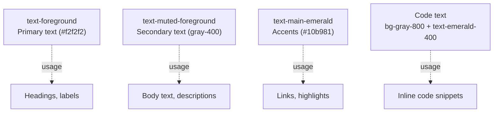

Example typography from [website/src/pages/tutorial/introduction.tsx:156-161]():

```tsx
<h2 className="text-[21.6px] font-medium text-white mb-3">
  What is VoltAgent?
</h2>
<p className="text-sm landing-md:text-base text-gray-400 leading-relaxed mb-8">
  VoltAgent is a TypeScript-first framework for building AI agents.
</p>
```

### Font Family

The tutorial uses Inter font family loaded via Google Fonts [website/src/components/tutorial/TutorialLayout.tsx:40-44]():

```tsx
<link
  href="https://fonts.googleapis.com/css2?family=Inter:wght@300;400;500;600;700&display=swap"
  rel="stylesheet"
/>
```

**Sources:** [website/src/pages/tutorial/introduction.tsx:156-161](), [website/src/components/tutorial/TutorialLayout.tsx:39-44](), [website/src/pages/tutorial/chatbot-problem.tsx:76-83]()

---

## Step Completion Tracking

The tutorial system visually indicates completed steps through the navbar's step buttons.

### Step State Logic

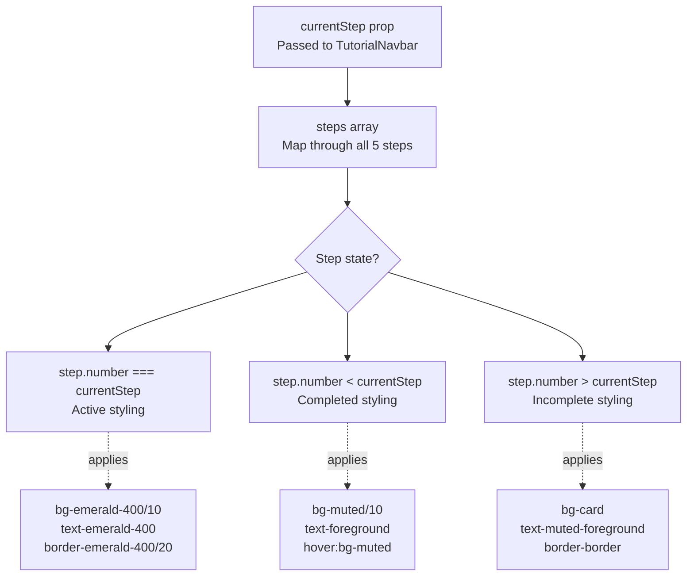

Implementation from [website/src/components/tutorial/TutorialNavbar.tsx:145-156]():

```tsx
<Link
  to={step.url}
  className={clsx(
    styles.tab,
    step.number === currentStep
      ? "bg-emerald-400/10 text-emerald-400 border border-emerald-400/20"
      : step.number < currentStep
        ? "bg-muted/10 text-foreground hover:bg-muted"
        : "bg-card border border-border text-muted-foreground ..."
  )}
>
  {step.number}. {step.title}
</Link>
```

**Sources:** [website/src/components/tutorial/TutorialNavbar.tsx:144-160](), [website/src/components/tutorial/TutorialNavbar.tsx:93-108]()

---

## Call-to-Action Integration

Tutorial pages include strategic CTAs to guide users to the VoltOps console for hands-on practice.

### VoltOps Console Links

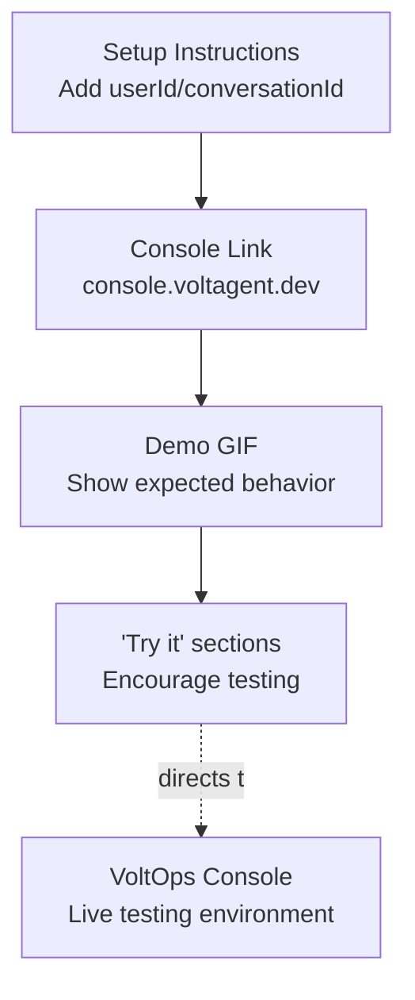

Example from the introduction tutorial [website/src/pages/tutorial/introduction.tsx:311-321]():

```tsx
<p className="text-gray-400 text-sm">
  Visit{" "}
  <a
    href="https://console.voltagent.dev"
    target="_blank"
    rel="noreferrer"
    className="text-emerald-400 hover:text-emerald-300 underline transition-colors"
  >
    console.voltagent.dev
  </a>{" "}
  to find your agent and start chatting:
</p>
```

### Testing Instructions

Each tutorial includes explicit testing steps:
1. Navigate to console.voltagent.dev
2. Set `userId` in settings
3. Set `conversationId` in settings
4. Try example prompts
5. Observe expected behavior

**Sources:** [website/src/pages/tutorial/introduction.tsx:311-321](), [website/src/pages/tutorial/memory.tsx:189-225](), [website/src/pages/tutorial/subagents.tsx:367-383]()

---

