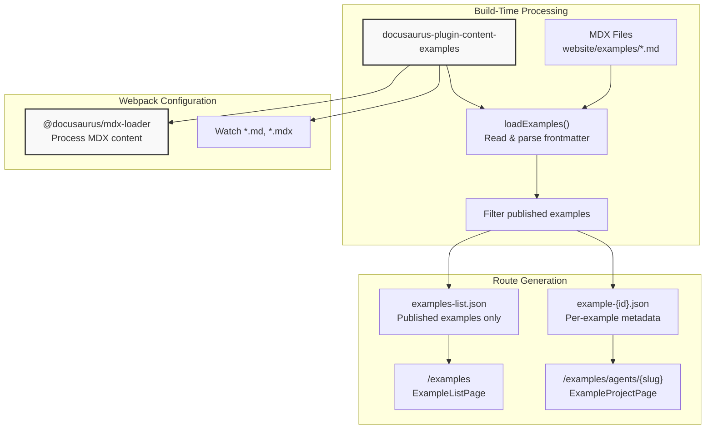
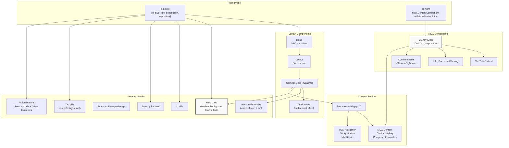
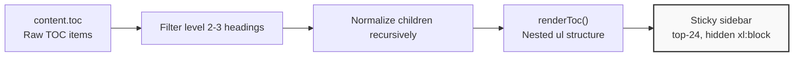
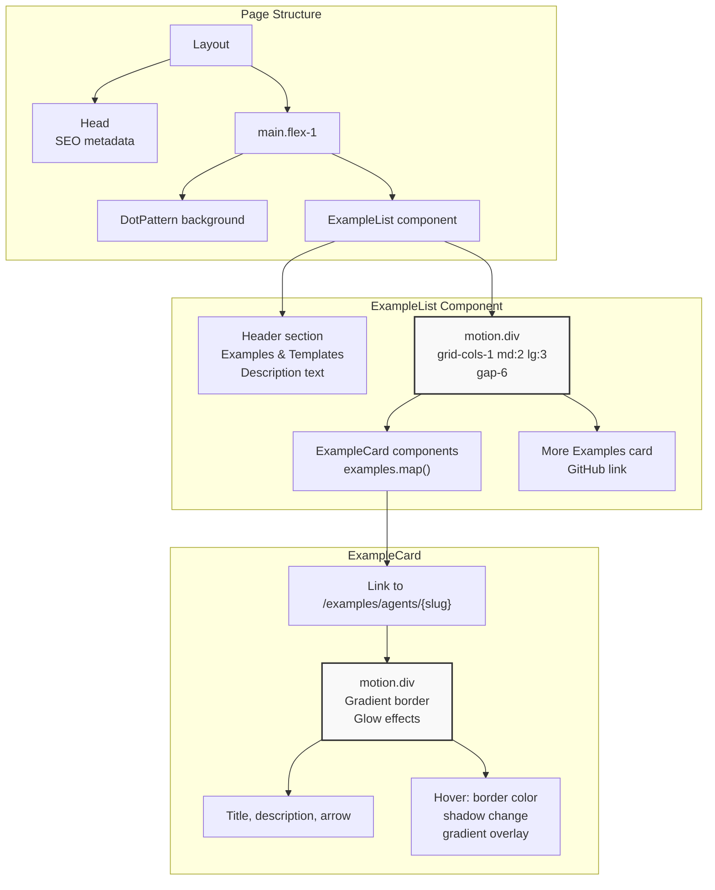
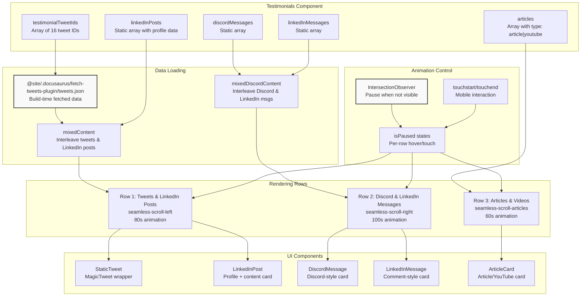
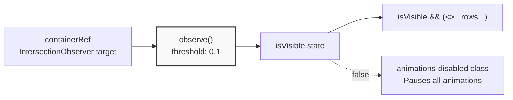
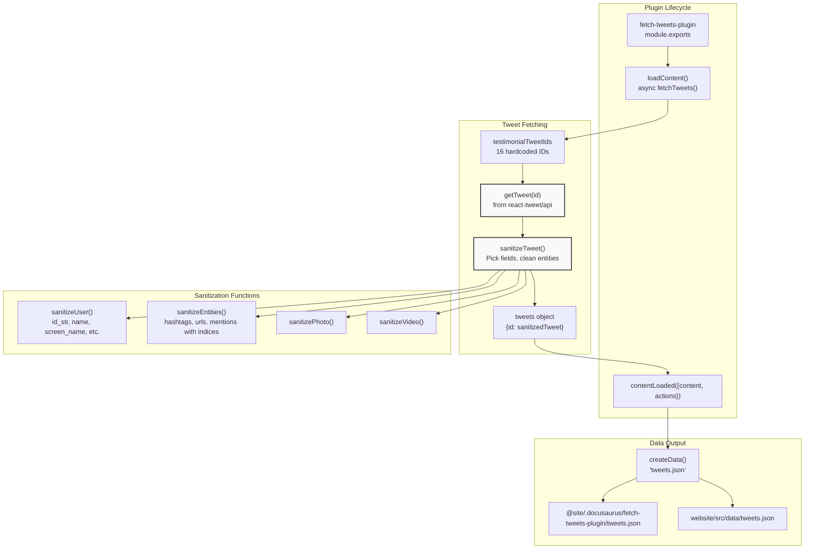
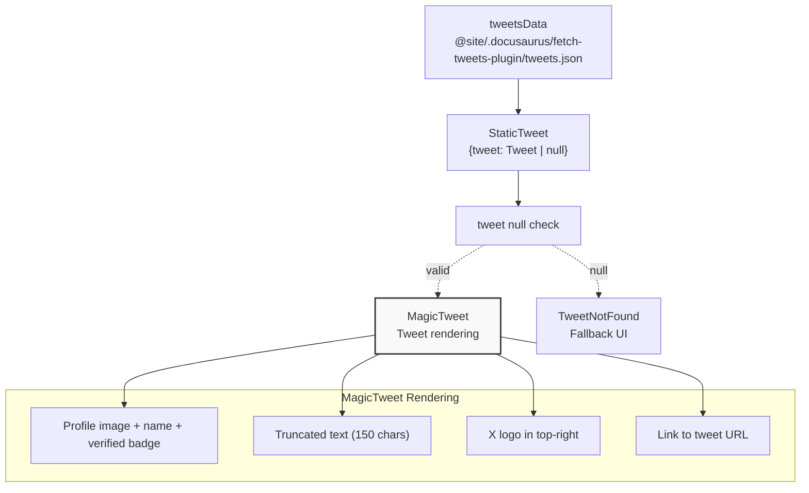

<!-- source: DeepWiki mcp.deepwiki.com · repo voltagent/voltagent · page 10.3 Examples and Showcase · fetched 2026-10-27 -->

# Examples and Showcase

<details>
<summary>Relevant source files</summary>

The following files were used as context for generating this wiki page:

- [examples/with-whatsapp/README.md](examples/with-whatsapp/README.md)
- [website/examples/recipe-creator.md](website/examples/recipe-creator.md)
- [website/examples/whatsapp-order.md](website/examples/whatsapp-order.md)
- [website/package.json](website/package.json)
- [website/plugins/docusaurus-plugin-content-examples/index.js](website/plugins/docusaurus-plugin-content-examples/index.js)
- [website/plugins/fetch-tweets.js](website/plugins/fetch-tweets.js)
- [website/src/components/blog-widgets/YouTubeEmbed.tsx](website/src/components/blog-widgets/YouTubeEmbed.tsx)
- [website/src/components/examples/Callout.tsx](website/src/components/examples/Callout.tsx)
- [website/src/components/examples/exampleCard.tsx](website/src/components/examples/exampleCard.tsx)
- [website/src/components/examples/index.tsx](website/src/components/examples/index.tsx)
- [website/src/components/magicui/tweet-card-client.tsx](website/src/components/magicui/tweet-card-client.tsx)
- [website/src/components/magicui/tweet-card.tsx](website/src/components/magicui/tweet-card.tsx)
- [website/src/components/privacy-policy/index.tsx](website/src/components/privacy-policy/index.tsx)
- [website/src/components/terms/index.tsx](website/src/components/terms/index.tsx)
- [website/src/components/testimonials/ArticleCard.tsx](website/src/components/testimonials/ArticleCard.tsx)
- [website/src/components/testimonials/DiscordMessage.tsx](website/src/components/testimonials/DiscordMessage.tsx)
- [website/src/components/testimonials/LinkedInMessage.tsx](website/src/components/testimonials/LinkedInMessage.tsx)
- [website/src/components/testimonials/LinkedInPost.tsx](website/src/components/testimonials/LinkedInPost.tsx)
- [website/src/components/testimonials/StaticTweet.tsx](website/src/components/testimonials/StaticTweet.tsx)
- [website/src/components/testimonials/Testimonials.tsx](website/src/components/testimonials/Testimonials.tsx)
- [website/src/components/testimonials/index.tsx](website/src/components/testimonials/index.tsx)
- [website/src/css/custom.css](website/src/css/custom.css)
- [website/src/data/tweets.json](website/src/data/tweets.json)
- [website/src/pages/index.tsx](website/src/pages/index.tsx)
- [website/src/theme/ExampleListPage/index.tsx](website/src/theme/ExampleListPage/index.tsx)
- [website/src/theme/ExampleProjectPage/index.tsx](website/src/theme/ExampleProjectPage/index.tsx)

</details>


This page documents the website's example and showcase system, including how example projects are authored, rendered, and displayed, as well as the community testimonials carousel that aggregates social proof from multiple platforms.

For information about the overall website architecture and configuration, see [Website Architecture](#10.1). For the tutorial system, see [Tutorial System](#10.2).

## Purpose and Scope

The Examples and Showcase system consists of two primary subsystems:

1. **Example Projects** - MDX-based example pages with code walkthroughs, setup instructions, and interactive elements
2. **Community Showcase** - Automated testimonials carousel displaying tweets, LinkedIn posts, Discord messages, and community articles

Both systems leverage Docusaurus plugins and React components to provide discoverable, well-structured content for users exploring VoltAgent capabilities.

---

## Example Content Architecture

### MDX Frontmatter Schema

Example pages are authored as MDX files in [website/examples/]() with structured frontmatter:

```yaml
---
id: 1                                    # Numeric identifier
slug: recipe-generator                   # URL path segment
title: AI Recipe Generator Agent         # Display title
description: Intelligent recipe...       # Short description
repository: https://github.com/...       # GitHub source link
published: true                          # Optional visibility flag
tags: ["MCP", "Exa", "OpenAI"]          # Optional categorization
---
```

**Sources:** [website/examples/recipe-creator.md:1-7](), [website/examples/whatsapp-order.md:1-7]()

### Plugin Loading and Route Generation



**Diagram: Example Content Loading Pipeline**

The plugin system processes examples in three phases:

| Phase | Function | Output |
|-------|----------|--------|
| **Load** | `loadExamples()` reads MDX files, parses frontmatter via `gray-matter` | Array of example objects with metadata |
| **Filter** | Excludes examples with `published: false` | Published examples subset |
| **Generate** | `contentLoaded()` creates routes and data files | JSON data files + route configs |

**Sources:** [website/plugins/docusaurus-plugin-content-examples/index.js:6-35](), [website/plugins/docusaurus-plugin-content-examples/index.js:53-100]()

### Webpack MDX Processing

The plugin configures webpack to process MDX files with Docusaurus's MDX loader:

```
Rule: /\.mdx?$/i
Include: [contentDir]
Loader: @docusaurus/mdx-loader
Options:
  - siteDir
  - staticDirs  
  - markdownConfig
```

This enables importing MDX content directly as React components in route modules.

**Sources:** [website/plugins/docusaurus-plugin-content-examples/index.js:102-127]()

---

## Example Page Rendering

### ExampleProjectPage Component Structure



**Diagram: ExampleProjectPage Component Hierarchy**

**Sources:** [website/src/theme/ExampleProjectPage/index.tsx:45-303]()

### Custom MDX Component Overrides

The page provides custom implementations for standard MDX elements:

| Component | Implementation | Purpose |
|-----------|---------------|---------|
| `details` | Custom with `ChevronRightIcon` rotation on toggle | Collapsible sections with smooth animations |
| `YouTubeEmbed` | Responsive 16:9 iframe wrapper | Video embeds in example walkthroughs |
| `Info/Success/Warning` | Color-coded callout boxes | Highlighted information blocks |

**Sources:** [website/src/theme/ExampleProjectPage/index.tsx:91-122](), [website/src/components/examples/Callout.tsx:35-76]()

### Table of Contents Generation



**Diagram: TOC Processing Flow**

The TOC system extracts h2 and h3 headings from MDX content, builds a nested structure, and renders clickable anchor links in a sticky sidebar (desktop only).

**Sources:** [website/src/theme/ExampleProjectPage/index.tsx:124-154](), [website/src/theme/ExampleProjectPage/index.tsx:288-295]()

---

## Example List Display

### ExampleListPage and Grid Layout



**Diagram: Example List Page Structure**

**Sources:** [website/src/theme/ExampleListPage/index.tsx:11-45](), [website/src/components/examples/index.tsx:10-92](), [website/src/components/examples/exampleCard.tsx:14-48]()

### Visual Design Patterns

All example cards share consistent visual treatment:

- **Gradient backgrounds**: `from-emerald-500/20 via-slate-900/70 to-slate-900/30`
- **Glow effects**: Positioned absolutely with `blur-3xl` and emerald colors
- **Hover states**: Border color change to `emerald-500/40`, shadow intensification
- **Typography**: Title in white → emerald on hover, gray-400 description → gray-300 on hover

**Sources:** [website/src/components/examples/exampleCard.tsx:17-44]()

---

## Testimonials and Community Showcase

### Multi-Row Carousel Architecture



**Diagram: Testimonials Carousel Data Flow**

**Sources:** [website/src/components/testimonials/Testimonials.tsx:271-602]()

### Infinite Scroll Implementation

Each row implements seamless infinite scrolling via CSS animations:

| Row | Direction | Duration | Content Duplication |
|-----|-----------|----------|---------------------|
| **Row 1** | Left | 80s (desktop), 120s (mobile) | `[...mixedContent, ...mixedContent]` |
| **Row 2** | Right | 100s (desktop), 140s (mobile) | `[...mixedDiscordContent, ...mixedDiscordContent]` |
| **Row 3** | Left | 60s (desktop), 100s (mobile) | `[...articles, ...articles]` |

Animation keyframes:
- **seamlessScrollLeft**: `translateX(0)` → `translateX(-50%)` - translates exactly one duplicate width
- **seamlessScrollRight**: `translateX(-50%)` → `translateX(0)` - reverse direction

**Sources:** [website/src/components/testimonials/Testimonials.tsx:11-78](), [website/src/components/testimonials/Testimonials.tsx:455-597]()

### Performance Optimizations



**Diagram: Visibility-Based Animation Control**

The component only renders animated rows when visible in viewport, reducing CPU/GPU usage when scrolled out of view.

**Sources:** [website/src/components/testimonials/Testimonials.tsx:292-305](), [website/src/components/testimonials/Testimonials.tsx:453-454]()

### Content Card Components

Each card type follows a consistent structure with platform-specific styling:

| Component | Icon Color | Border Hover | Truncation Limit |
|-----------|-----------|--------------|------------------|
| `StaticTweet` | White X logo | `hover:border-emerald-500` | 150 chars |
| `LinkedInPost` | `#0077b5` LinkedIn | `hover:border-emerald-500` | 165 chars |
| `DiscordMessage` | `#5865F2` Discord | N/A (no hover) | 141 chars |
| `LinkedInMessage` | `#0077b5` LinkedIn | `hover:border-emerald-500` | 181 chars |
| `ArticleCard` | Emerald article icon / YouTube logo | `hover:border-emerald-500` | N/A |

**Sources:** [website/src/components/testimonials/StaticTweet.tsx:1-18](), [website/src/components/testimonials/LinkedInPost.tsx:21-83](), [website/src/components/testimonials/DiscordMessage.tsx:21-80](), [website/src/components/testimonials/LinkedInMessage.tsx:22-99](), [website/src/components/testimonials/ArticleCard.tsx:20-126]()

---

## Build-Time Tweet Fetching

### fetch-tweets-plugin Architecture



**Diagram: Tweet Fetching and Sanitization Pipeline**

**Sources:** [website/plugins/fetch-tweets.js:151-229]()

### Tweet Data Sanitization

The sanitization process strips unnecessary fields and ensures valid data structure:

**User Fields Preserved:**
```javascript
["id_str", "name", "screen_name", "profile_image_url_https", 
 "profile_image_shape", "verified", "is_blue_verified"]
```

**Entities Structure:**
```javascript
{
  hashtags: [{indices: [start, end], text: string}],
  urls: [{indices: [start, end], url, display_url, expanded_url}],
  user_mentions: [{indices: [start, end], id_str, name, screen_name}],
  symbols: [{indices: [start, end], text}],
  media: [{indices: [start, end], url, display_url, expanded_url}]
}
```

Missing `indices` fields are defaulted to `[0, 0]` to prevent rendering errors.

**Sources:** [website/plugins/fetch-tweets.js:44-149]()

### Tweet Display Component



**Diagram: Tweet Rendering Component Flow**

The `MagicTweet` component receives sanitized tweet data and renders a static card without client-side hydration, improving page load performance.

**Sources:** [website/src/components/testimonials/StaticTweet.tsx:9-18](), [website/src/components/magicui/tweet-card.tsx:222-296]()

---

## Integration Points

### Homepage Integration

The testimonials carousel appears on the homepage between the `SupervisorAgent` and `Workflows` sections:

```typescript
<SupervisorAgent />
<Testimonials />
<Workflows />
```

**Sources:** [website/src/pages/index.tsx:73-74]()

### Example Navigation Flow

```
Homepage → Examples CTA
  ↓
/examples (ExampleListPage)
  ↓
Click ExampleCard
  ↓
/examples/agents/{slug} (ExampleProjectPage)
  ↓
"Back to Examples" → /examples
"Other Mini Examples" → GitHub repo
"Source Code" → Example GitHub directory
```

**Sources:** [website/src/components/examples/exampleCard.tsx:16](), [website/src/theme/ExampleProjectPage/index.tsx:186-192](), [website/src/theme/ExampleProjectPage/index.tsx:261-269]()

---

