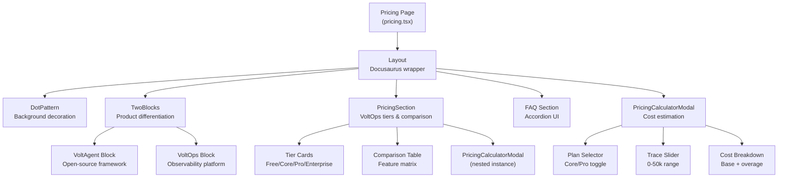
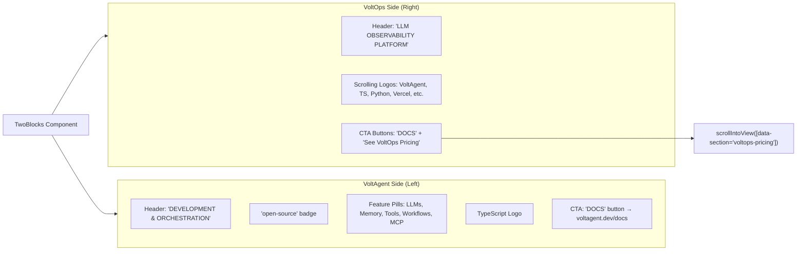
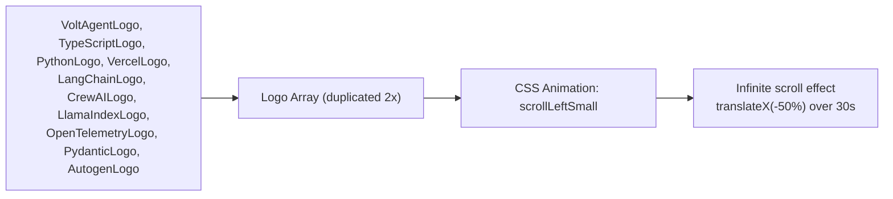
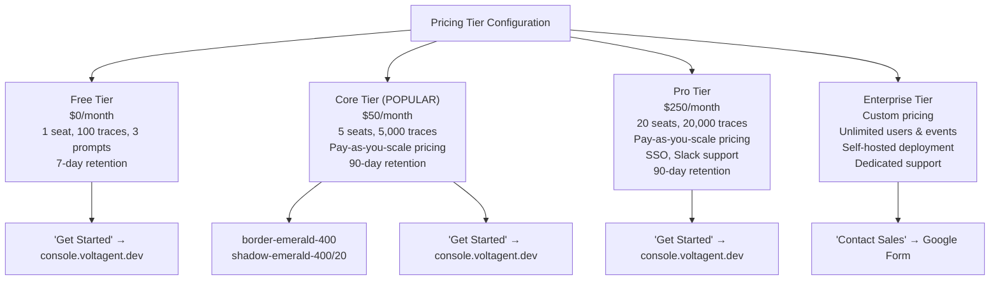
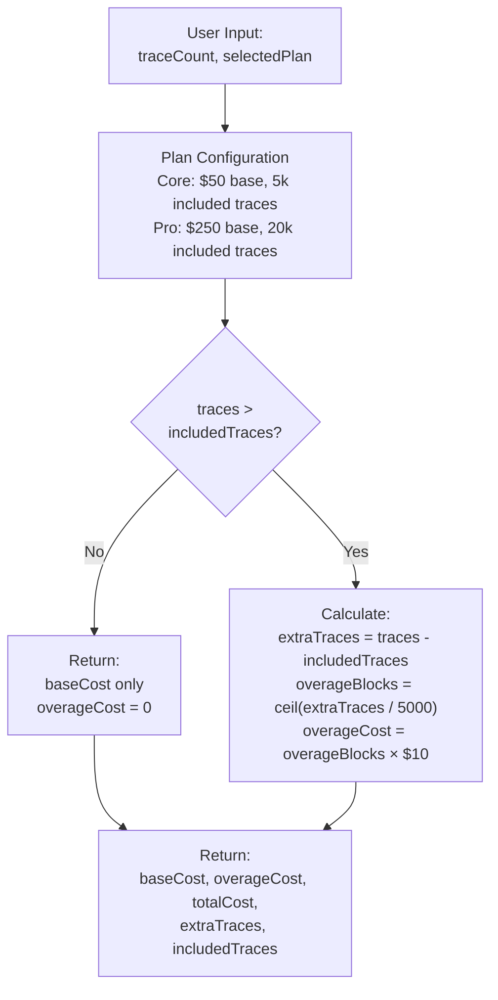
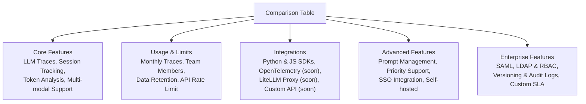
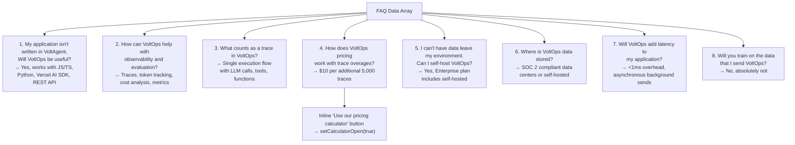
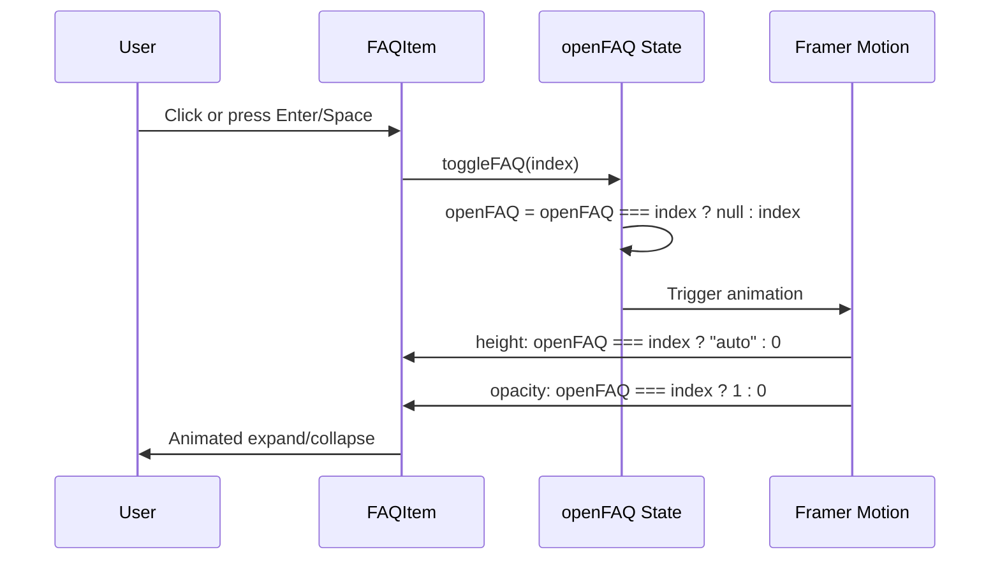
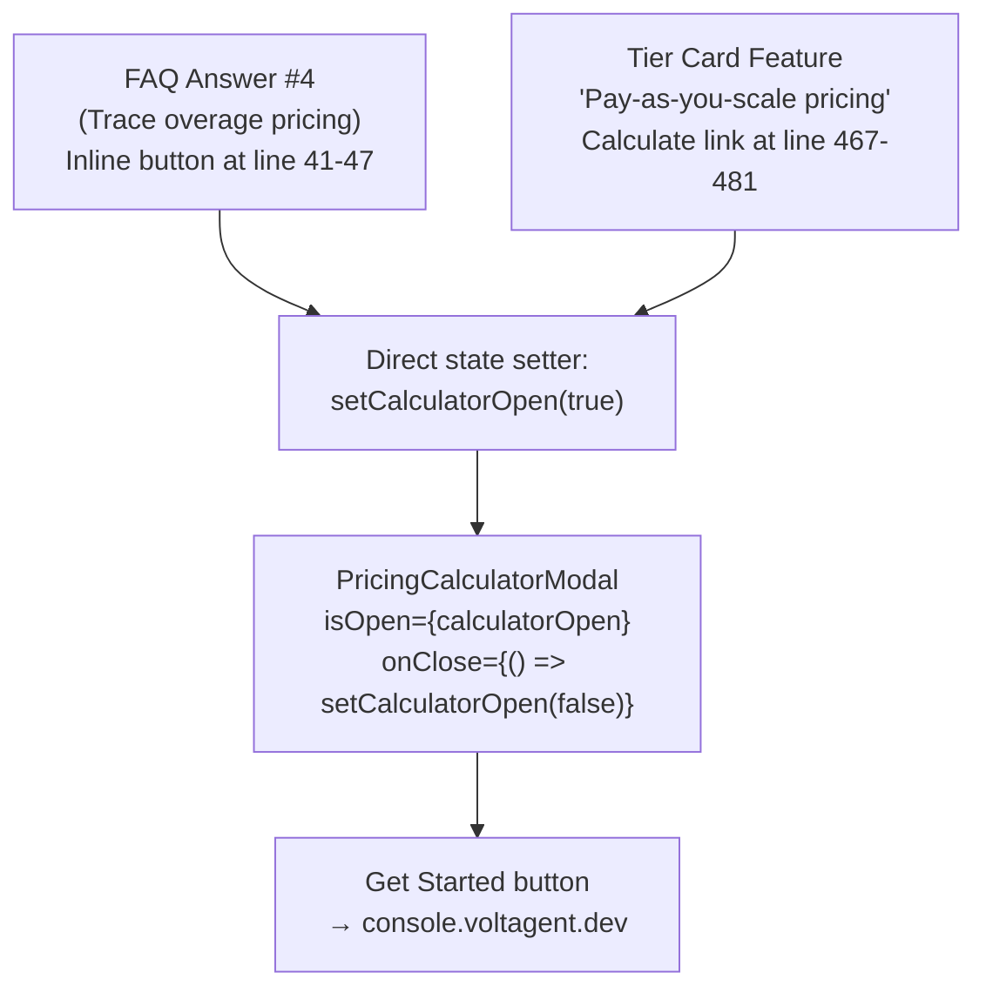

<!-- source: DeepWiki mcp.deepwiki.com · repo voltagent/voltagent · page 10.4 Pricing and Product Pages · fetched 2026-10-27 -->

# Pricing and Product Pages

<details>
<summary>Relevant source files</summary>

The following files were used as context for generating this wiki page:

- [website/src/components/console/PricingCalculatorModal.tsx](website/src/components/console/PricingCalculatorModal.tsx)
- [website/src/components/console/PricingSection.tsx](website/src/components/console/PricingSection.tsx)
- [website/src/components/two-blocks-pricing/index.tsx](website/src/components/two-blocks-pricing/index.tsx)
- [website/src/components/two-blocks/index.tsx](website/src/components/two-blocks/index.tsx)
- [website/src/pages/pricing.tsx](website/src/pages/pricing.tsx)

</details>


## Purpose and Scope

This document describes the pricing page implementation in the VoltAgent documentation website, including the VoltAgent vs VoltOps product differentiation, pricing tiers, interactive calculator, and FAQ sections. The pricing page serves dual purposes: communicating that VoltAgent Core Framework is free and open-source while presenting VoltOps LLM Observability pricing plans.

For general website architecture and Docusaurus configuration, see [Website Architecture](#10.1). For other marketing content pages, see [Examples and Showcase](#10.3).

## Page Architecture

The pricing page is implemented as a custom React component at [website/src/pages/pricing.tsx:1-186]() using Docusaurus Layout and Framer Motion for animations.

### Component Hierarchy



**Sources:** [website/src/pages/pricing.tsx:1-186](), [website/src/components/console/PricingSection.tsx:1-588](), [website/src/components/two-blocks-pricing/index.tsx:1-258]()

### Page State Management

The pricing page manages three key pieces of state:

| State Variable | Type | Purpose | File |
|----------------|------|---------|------|
| `openFAQ` | `number \| null` | Tracks which FAQ accordion is expanded | [website/src/pages/pricing.tsx:11]() |
| `calculatorOpen` | `boolean` | Controls PricingCalculatorModal visibility | [website/src/pages/pricing.tsx:12]() |
| `selectedPlan` | `"core" \| "pro"` | Active plan in calculator (component-internal) | [website/src/components/console/PricingCalculatorModal.tsx:12]() |
| `traceCount` | `number` | Monthly trace count for cost calculation | [website/src/components/console/PricingCalculatorModal.tsx:11]() |

**Sources:** [website/src/pages/pricing.tsx:10-16](), [website/src/components/console/PricingCalculatorModal.tsx:10-12]()

## Product Differentiation (TwoBlocks Component)

The `TwoBlocks` component at [website/src/components/two-blocks-pricing/index.tsx:18-257]() provides side-by-side comparison of VoltAgent (free framework) and VoltOps (paid observability platform).

### Component Structure



**Sources:** [website/src/components/two-blocks-pricing/index.tsx:18-257]()

### Framework Logo Carousel

The VoltOps side displays a continuously scrolling carousel of supported frameworks using CSS animation at [website/src/components/two-blocks-pricing/index.tsx:141-154]():



The logos are duplicated twice to create seamless infinite scrolling at [website/src/components/two-blocks-pricing/index.tsx:171-209]().

**Sources:** [website/src/components/two-blocks-pricing/index.tsx:139-220]()

### Responsive Design

The component uses Tailwind custom breakpoints (`landing-xs`, `landing-sm`, `landing-md`) for progressive enhancement:

| Breakpoint | Text Sizes | Spacing | Layout |
|------------|-----------|---------|--------|
| `landing-xs` | `text-xs` to `text-base` | `p-3`, `mb-2` | Single column |
| `landing-sm` | `text-base` to `text-lg` | `p-4`, `mb-4` | Single column |
| `landing-md` | `text-lg` to `text-2xl` | `p-6`, `mb-6` | `lg:grid-cols-2` |

**Sources:** [website/src/components/two-blocks-pricing/index.tsx:22-254]()

## Pricing Tiers and Plans

The `PricingSection` component at [website/src/components/console/PricingSection.tsx:1-588]() renders VoltOps pricing tiers with feature cards and comparison table.

### Tier Configuration

Four pricing tiers are defined at [website/src/components/console/PricingSection.tsx:22-90]():



**Sources:** [website/src/components/console/PricingSection.tsx:22-90]()

### Tier Card Rendering

Each tier card displays at [website/src/components/console/PricingSection.tsx:386-489]():

1. **Tier name and description** (lines 402-408)
2. **CTA button** with conditional styling based on `buttonVariant` (lines 410-430)
3. **Price display** with period (lines 432-448)
4. **Feature list** with `CheckCircleIcon` indicators (lines 450-486)
5. **Interactive "Calculate" link** for pay-as-you-scale tiers (lines 467-481)

**Sources:** [website/src/components/console/PricingSection.tsx:386-489]()

### Dynamic Color Theming

The component accepts color props for brand customization at [website/src/components/console/PricingSection.tsx:6-20]():

| Prop | Default | Usage |
|------|---------|-------|
| `primaryColor` | `emerald-400` | Main accent color |
| `primaryColorHover` | `emerald-300` | Hover states |
| `primaryColorBorder` | `emerald-500/30` | Border colors |
| `primaryColorShadow` | `emerald-400/20` | Shadow effects |
| `primaryColorText` | `emerald-500` | Text highlights |

Color mapping is resolved at [website/src/components/console/PricingSection.tsx:268-329]() to support dynamic Tailwind classes.

**Sources:** [website/src/components/console/PricingSection.tsx:6-336](), [website/src/pages/pricing.tsx:105-111]()

## Pricing Calculator

The `PricingCalculatorModal` at [website/src/components/console/PricingCalculatorModal.tsx:1-242]() provides interactive cost estimation for VoltOps usage.

### Calculation Logic

The cost calculation at [website/src/components/console/PricingCalculatorModal.tsx:14-42]() follows this algorithm:



**Note:** The calculation at line 19 incorrectly sets `baseCost: 500` for Pro tier instead of `250`. The correct Pro tier base is $250/month per [website/src/components/console/PricingSection.tsx:58]().

**Sources:** [website/src/components/console/PricingCalculatorModal.tsx:14-42]()

### Calculator UI Components

The modal renders at [website/src/components/console/PricingCalculatorModal.tsx:48-238]():

| Component | Lines | Purpose |
|-----------|-------|---------|
| Backdrop | 51-61 | Dismisses modal on click/Escape |
| Plan Selector | 104-131 | Toggle between Core ($50) and Pro ($250) |
| Trace Slider | 133-164 | Range input 0-50,000 with gradient fill |
| Cost Breakdown | 167-208 | Shows base, included traces, overage, total |
| Pricing Info | 210-216 | Displays "$10 per 5,000 additional traces" |
| Action Buttons | 220-235 | Close / Get Started → console.voltagent.dev |

**Sources:** [website/src/components/console/PricingCalculatorModal.tsx:48-238]()

### Range Slider Styling

Custom CSS at [website/src/components/console/PricingCalculatorModal.tsx:149-154]() creates a gradient fill effect:

```css
background: linear-gradient(to right, 
  #00d992 0%, 
  #00d992 ${(traceCount / 50000) * 100}%, 
  #374151 ${(traceCount / 50000) * 100}%, 
  #374151 100%)
```

Additional range slider styles are imported from [website/src/components/console/PricingCalculatorModal.module.css]().

**Sources:** [website/src/components/console/PricingCalculatorModal.tsx:3](), [website/src/components/console/PricingCalculatorModal.tsx:149-154]()

## Comparison Table

The feature comparison table at [website/src/components/console/PricingSection.tsx:492-556]() displays all tiers across 5 feature categories.

### Feature Categories



**Sources:** [website/src/components/console/PricingSection.tsx:92-265]()

### Feature Value Rendering

The `renderFeatureValue` function at [website/src/components/console/PricingSection.tsx:337-361]() handles three value types:

| Value Type | Rendering |
|------------|-----------|
| `boolean: true` | Green `CheckCircleIcon` with `primaryColor` |
| `boolean: false` | Gray `XMarkIcon` |
| `"soon"` string | Badge with `primaryColor` background/border/text |
| Other strings | Plain text (e.g., "5,000 traces", "90 days") |

The comparison table is fully responsive with `landing-xs`, `landing-sm`, `landing-md` breakpoints for text sizes and spacing at [website/src/components/console/PricingSection.tsx:492-556]().

**Sources:** [website/src/components/console/PricingSection.tsx:337-361](), [website/src/components/console/PricingSection.tsx:492-556]()

## FAQ Section

The FAQ section at [website/src/pages/pricing.tsx:114-178]() uses an accordion pattern with Framer Motion animations.

### FAQ Data Structure

Eight questions are defined at [website/src/pages/pricing.tsx:18-73]():



**Sources:** [website/src/pages/pricing.tsx:18-73]()

### Accordion Interaction

FAQ accordion state is managed by `openFAQ` at [website/src/pages/pricing.tsx:11]() with `toggleFAQ` handler at [website/src/pages/pricing.tsx:14-16]():



Framer Motion configuration at [website/src/pages/pricing.tsx:159-166]():
- `initial={false}` prevents animation on mount
- `animate` sets height to `"auto"` or `0` based on `openFAQ === index`
- `transition={{ duration: 0.3, ease: "easeInOut" }}`

**Sources:** [website/src/pages/pricing.tsx:11](), [website/src/pages/pricing.tsx:14-16](), [website/src/pages/pricing.tsx:132-175]()

## Interactive Features

### Calculator Trigger Points

The pricing calculator modal can be opened from three locations:



**Sources:** [website/src/pages/pricing.tsx:41-47](), [website/src/components/console/PricingSection.tsx:467-481](), [website/src/pages/pricing.tsx:180-181]()

### Scroll-to-Pricing Behavior

The VoltOps "See VoltOps Pricing" button at [website/src/components/two-blocks-pricing/index.tsx:238-249]() uses `scrollIntoView` with `data-section` attribute selector:

```javascript
const voltOpsPricingSection = document.querySelector(
  '[data-section="voltops-pricing"]'
);
if (voltOpsPricingSection) {
  voltOpsPricingSection.scrollIntoView({
    behavior: "smooth",
  });
}
```

The target section is marked at [website/src/components/console/PricingSection.tsx:370]():
```jsx
data-section="voltops-pricing"
```

**Sources:** [website/src/components/two-blocks-pricing/index.tsx:238-249](), [website/src/components/console/PricingSection.tsx:370]()

### External Navigation

All CTA buttons navigate to external URLs:

| Button | URL | Lines |
|--------|-----|-------|
| VoltAgent "DOCS" | `https://voltagent.dev/docs/` | [website/src/components/two-blocks-pricing/index.tsx:104]() |
| VoltOps "DOCS" | `/voltops-llm-observability-docs/` | [website/src/components/two-blocks-pricing/index.tsx:228]() |
| Free/Core/Pro "Get Started" | `https://console.voltagent.dev` | [website/src/components/console/PricingSection.tsx:420]() |
| Enterprise "Contact Sales" | `https://forms.gle/BrnyFF4unP9pZxAh7` | [website/src/components/console/PricingSection.tsx:414]() |
| Calculator "Get Started" | `https://console.voltagent.dev` | [website/src/components/console/PricingCalculatorModal.tsx:230]() |

All external links use `window.open(url, "_blank")` for new tab navigation.

**Sources:** [website/src/components/two-blocks-pricing/index.tsx:103-105](), [website/src/components/console/PricingSection.tsx:410-422](), [website/src/components/console/PricingCalculatorModal.tsx:228-234]()

### Accessibility Features

The pricing page implements keyboard navigation and ARIA attributes:

- FAQ items respond to `Enter` and `Space` keys at [website/src/pages/pricing.tsx:142-146]()
- Calculator backdrop responds to `Escape` key at [website/src/pages/pricing.tsx:54-58]()
- Calculator close button has `aria-label="Close calculator"` at [website/src/components/console/PricingCalculatorModal.tsx:84]()
- ChevronDownIcon rotates based on state at [website/src/pages/pricing.tsx:152-156]()
- All interactive elements use `role="button"` and `tabIndex={0}` for keyboard access

**Sources:** [website/src/pages/pricing.tsx:142-146](), [website/src/components/console/PricingCalculatorModal.tsx:54-84]()

## SEO and Meta Configuration

The pricing page configures SEO metadata at [website/src/pages/pricing.tsx:76-78]():

```jsx
<Layout
  title="VoltOps LLM Observability Pricing"
  description="Simple, transparent pricing for VoltOps LLM Observability platform. VoltAgent Core Framework is free and open source. Monitor and scale your AI applications with confidence."
>
```

The title and description emphasize:
1. VoltOps pricing (primary topic)
2. VoltAgent is free and open-source (key differentiator)
3. Simplicity and transparency (value proposition)

**Sources:** [website/src/pages/pricing.tsx:76-79]()

---

