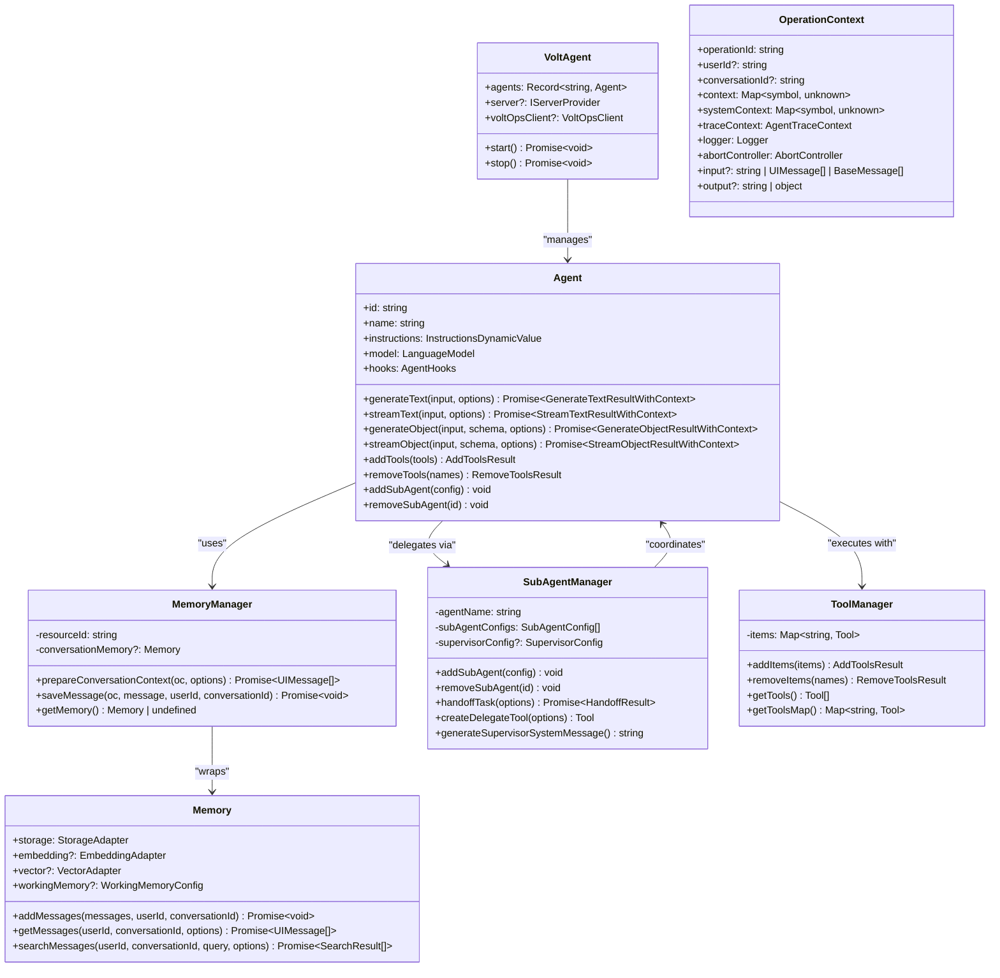
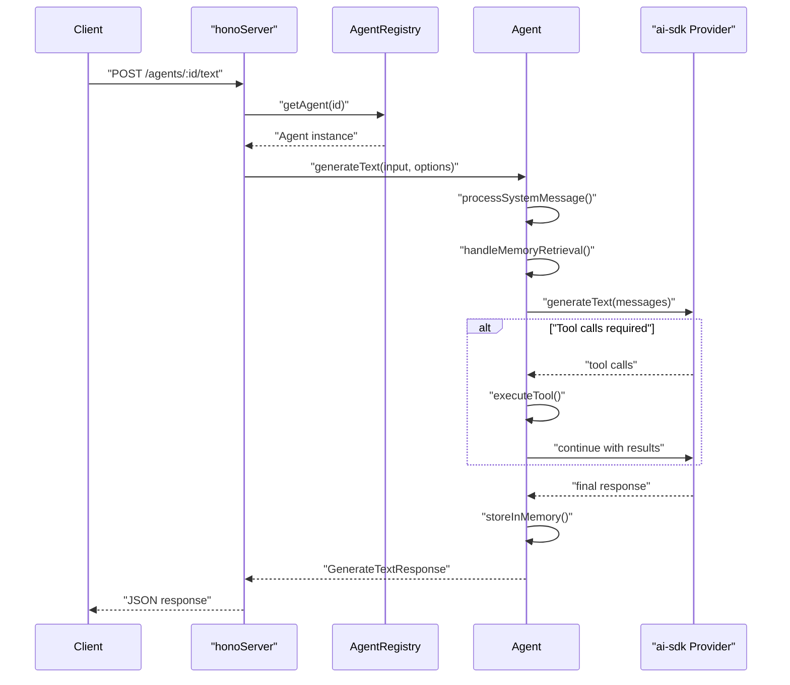
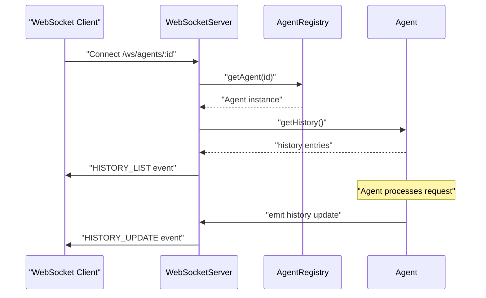
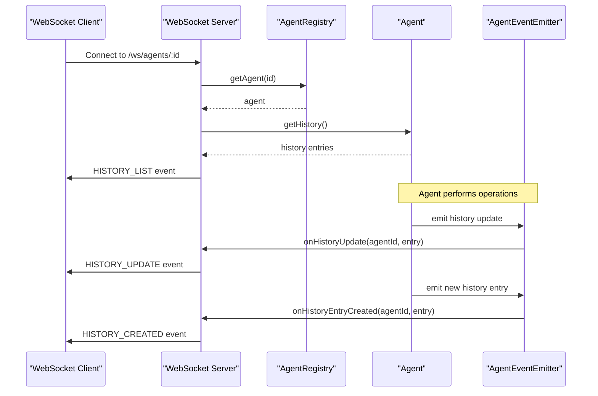
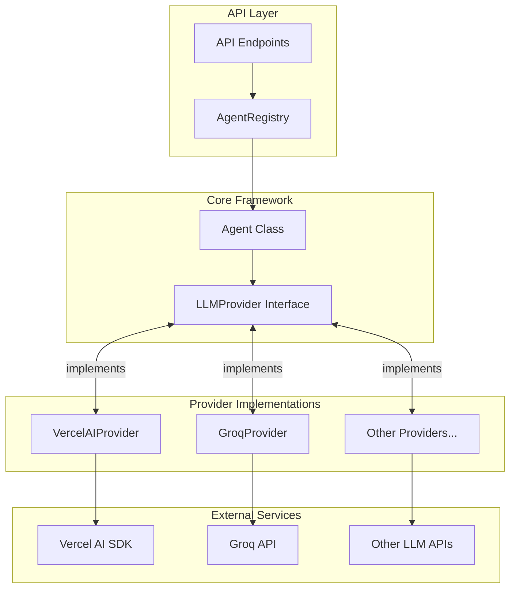
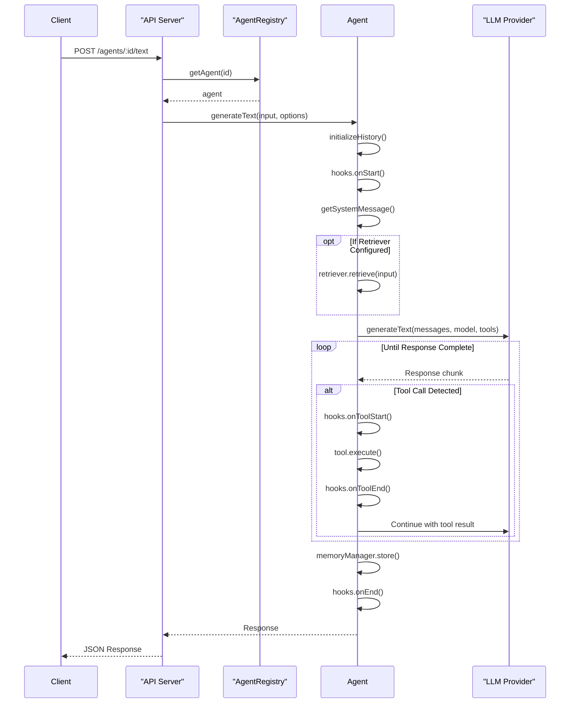
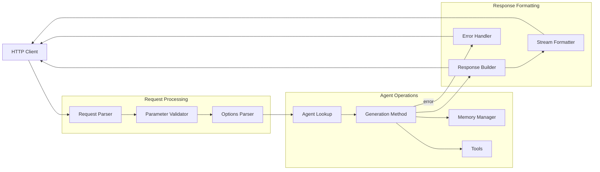

<!-- source: DeepWiki mcp.deepwiki.com · repo voltagent/voltagent · page 11 API Reference · fetched 2026-10-27 -->

## Server Configuration

### VoltAgent Class

The `VoltAgent` class is the main entry point for starting a VoltAgent server with multiple agents.

```typescript
class VoltAgent {
  constructor(options: VoltAgentOptions)
  async start(): Promise<void>
  async stop(): Promise<void>
}

interface VoltAgentOptions {
  agents: Record<string, Agent>;
  server?: IServerProvider;
  voltOpsClient?: VoltOpsClient;
}
```

**Example:**
```typescript
import { VoltAgent, Agent } from "@voltagent/core";
import { honoServer } from "@voltagent/server-hono";
import { openai } from "@ai-sdk/openai";

const assistantAgent = new Agent({
  name: "Assistant",
  instructions: "You are a helpful assistant",
  model: openai("gpt-4o-mini")
});

const app = new VoltAgent({
  agents: {
    assistant: assistantAgent
  },
  server: honoServer({
    port: 3141,
    enableSwaggerUI: true
  })
});

await app.start();
// Server running at http://localhost:3141
// Swagger UI at http://localhost:3141/ui
```

Sources:
- [packages/core/src/voltagent.ts:1-100]()

### honoServer()

Creates an HTTP server provider using Hono framework.

```typescript
function honoServer(options?: {
  port?: number;
  hostname?: string;
  enableSwaggerUI?: boolean;
  cors?: CORSConfig;
  openapi?: {
    info?: OpenAPIInfo;
    servers?: OpenAPIServer[];
  };
}): IServerProvider
```

**Options:**

| Option | Type | Default | Description |
|--------|------|---------|-------------|
| `port` | `number` | `3141` | Port to listen on |
| `hostname` | `string` | `"0.0.0.0"` | Hostname to bind to |
| `enableSwaggerUI` | `boolean` | `true` | Enable Swagger UI at `/ui` |
| `cors` | `CORSConfig` | - | CORS configuration |
| `openapi.info` | `OpenAPIInfo` | - | OpenAPI metadata |
| `openapi.servers` | `OpenAPIServer[]` | - | Server URLs for OpenAPI spec |

**Example:**
```typescript
const server = honoServer({
  port: 8080,
  enableSwaggerUI: true,
  cors: {
    origin: ["http://localhost:3000"],
    credentials: true
  },
  openapi: {
    info: {
      title: "My Agent API",
      version: "1.0.0"
    }
  }
});
```

Sources:
- [packages/server-hono/src/index.ts:1-100]()

### serverlessHono()

Creates a serverless provider for edge runtimes (Cloudflare Workers, Netlify Functions).

```typescript
function serverlessHono(options?: {
  enableSwaggerUI?: boolean;
  cors?: CORSConfig;
  openapi?: {
    info?: OpenAPIInfo;
    servers?: OpenAPIServer[];
  };
}): IServerlessProvider
```

**Example:**
```typescript
import { serverlessHono } from "@voltagent/serverless-hono";

export const app = new VoltAgent({
  agents: { assistant: assistantAgent },
  server: serverlessHono({
    enableSwaggerUI: true
  })
});

// For Cloudflare Workers
export default {
  fetch: app.fetch
};
```

Sources:
- [packages/serverless-hono/src/index.ts:1-100]()

## Utility Functions

### Message Helpers

Utilities for working with messages.

```typescript
import { messageHelpers } from "@voltagent/core";

// Add timestamp metadata to a message
const timestamped = messageHelpers.addTimestampToMessage(
  message,
  new Date().toISOString()
);

// Convert between message formats
const uiMessages = convertModelMessagesToUIMessages(modelMessages);
```

Sources:
- [packages/core/src/utils/message-converter.ts:1-50]()

### createHooks()

Creates a typed hooks object.

```typescript
function createHooks(hooks: AgentHooks): AgentHooks
```

**Example:**
```typescript
import { createHooks } from "@voltagent/core";

const hooks = createHooks({
  onStart: async ({ agent, context }) => {
    console.log("Starting");
  },
  onEnd: async ({ output, error }) => {
    console.log("Finished");
  }
});
```

Sources:
- [packages/core/src/agent/hooks/index.ts:140-147]()

### Type Guards

Utilities for checking error types.

```typescript
import { 
  isAbortError,
  isVoltAgentError,
  isToolDeniedError 
} from "@voltagent/core";

try {
  await agent.generateText("Hello");
} catch (error) {
  if (isAbortError(error)) {
    console.log("Operation was cancelled");
  } else if (isToolDeniedError(error)) {
    console.log("Tool execution was denied");
  } else if (isVoltAgentError(error)) {
    console.log("VoltAgent error:", error.message);
  }
}
```

Sources:
- [packages/core/src/agent/errors.ts:1-100]()

### Usage Conversion

Convert between different usage formats.

```typescript
import { convertUsage } from "@voltagent/core";

const standardizedUsage = convertUsage(aiSdkUsage);
// Returns: {
//   promptTokens: number,
//   completionTokens: number,
//   totalTokens: number,
//   cachedInputTokens?: number,
//   reasoningTokens?: number
// }
```

Sources:
- [packages/core/src/utils/usage-converter.ts:1-50]()

## Advanced Types

### SubAgentConfig

Configuration for sub-agent delegation.

```typescript
type SubAgentConfig = 
  | Agent  // Direct agent reference
  | StreamTextSubAgentConfig
  | GenerateTextSubAgentConfig
  | StreamObjectSubAgentConfig
  | GenerateObjectSubAgentConfig;

interface StreamTextSubAgentConfig {
  agent: Agent;
  method: "streamText";
  options?: StreamTextOptions;
}

interface GenerateTextSubAgentConfig {
  agent: Agent;
  method: "generateText";
  options?: GenerateTextOptions;
}

interface StreamObjectSubAgentConfig {
  agent: Agent;
  method: "streamObject";
  schema: z.ZodType;
  options?: StreamObjectOptions;
}

interface GenerateObjectSubAgentConfig {
  agent: Agent;
  method: "generateObject";
  schema: z.ZodType;
  options?: GenerateObjectOptions;
}
```

Use `createSubagent()` helper for type-safe configuration:

```typescript
import { createSubagent } from "@voltagent/core";

const subAgents = [
  // Direct reference (uses streamText by default)
  writerAgent,
  
  // Explicit method configuration
  createSubagent({
    agent: editorAgent,
    method: "generateText",
    options: { temperature: 0.3 }
  }),
  
  // Object generation
  createSubagent({
    agent: dataAgent,
    method: "generateObject",
    schema: personSchema
  })
];
```

Sources:
- [packages/core/src/agent/subagent/types.ts:1-150]()

### SupervisorConfig

Configuration for supervisor agents with sub-agents.

```typescript
interface SupervisorConfig {
  systemMessage?: string;
  includeAgentsMemory?: boolean;
  customGuidelines?: string[];
  fullStreamEventForwarding?: {
    types?: StreamEventType[];
  };
  throwOnStreamError?: boolean;
  includeErrorInEmptyResponse?: boolean;
}
```

**Example:**
```typescript
const supervisorAgent = new Agent({
  name: "Supervisor",
  instructions: "Coordinate between specialists",
  model: openai("gpt-4o"),
  subAgents: [writerAgent, editorAgent],
  supervisorConfig: {
    customGuidelines: [
      "Always verify results from sub-agents",
      "Provide clear final answers"
    ],
    fullStreamEventForwarding: {
      types: ["tool-call", "tool-result", "text-delta"]
    },
    throwOnStreamError: false
  }
});
```

Sources:
- [packages/core/src/agent/types.ts:206-248]()

### DynamicValue

Type for values that can be resolved dynamically at runtime.

```typescript
type DynamicValue<T> = (options: DynamicValueOptions) => Promise<T> | T;

interface DynamicValueOptions {
  context?: Map<string | symbol, unknown>;
}
```

**Example:**
```typescript
// Dynamic model selection
const agent = new Agent({
  name: "Smart Assistant",
  instructions: "You are helpful",
  model: async ({ context }) => {
    const priority = context?.get("priority");
    return priority === "high" 
      ? openai("gpt-4o")
      : openai("gpt-4o-mini");
  }
});

// Dynamic instructions
const agent = new Agent({
  name: "Translator",
  model: openai("gpt-4o"),
  instructions: async ({ context }) => {
    const language = context?.get("targetLanguage") || "English";
    return `Translate all responses to ${language}`;
  }
});

// Dynamic tools
const agent = new Agent({
  name: "Adaptive Agent",
  model: openai("gpt-4o"),
  instructions: "You are helpful",
  tools: async ({ context }) => {
    const userRole = context?.get("userRole");
    return userRole === "admin" 
      ? [readTool, writeTool, deleteTool]
      : [readTool];
  }
});
```

Sources:
- [packages/core/src/voltops/types.ts:1-50]()

## Error Handling

### Error Types

VoltAgent defines several error types for different failure scenarios.

```typescript
// Base error type
class VoltAgentError extends Error {
  readonly code?: string;
  readonly statusCode?: number;
  readonly toolErrorInfo?: ToolErrorInfo;
}

// Abort/cancellation errors
class AbortError extends VoltAgentError {
  readonly code = "ABORT_ERROR";
}

class CancellationError extends VoltAgentError {
  readonly code = "CANCELLATION_ERROR";
}

// Tool execution errors
class ToolDeniedError extends VoltAgentError {
  readonly code = "TOOL_DENIED";
}

// HTTP client errors (400-499)
class ClientHTTPError extends VoltAgentError {
  readonly statusCode: number;
}
```

### Error Handling Example

```typescript
import { 
  isAbortError,
  isToolDeniedError,
  isClientHTTPError 
} from "@voltagent/core";

try {
  const result = await agent.generateText("Process this", {
    abortSignal: controller.signal
  });
} catch (error) {
  if (isAbortError(error)) {
    console.log("User cancelled the operation");
  } else if (isToolDeniedError(error)) {
    console.log("A tool execution was denied");
    console.log("Tool info:", error.toolErrorInfo);
  } else if (isClientHTTPError(error)) {
    console.log(`HTTP ${error.statusCode} error:`, error.message);
  } else {
    console.error("Unexpected error:", error);
  }
}
```

Sources:
- [packages/core/src/agent/errors.ts:1-150]()

## OpenTelemetry Integration

VoltAgent has built-in OpenTelemetry support for distributed tracing.

### AgentTraceContext

Each operation automatically creates a trace context with spans for all activities.

```typescript
interface AgentTraceContext {
  getRootSpan(): Span;
  withSpan<T>(span: Span, fn: () => Promise<T>): Promise<T>;
  setInput(input: any): void;
  setOutput(output: any): void;
  setUsage(usage: UsageInfo): void;
  end(status: "completed" | "error", error?: Error): void;
}
```

### Automatic Instrumentation

All agent operations are automatically traced:

```typescript
const result = await agent.generateText("Hello");
// Creates spans for:
// - Root operation span
// - System message preparation
// - Memory retrieval
// - LLM call
// - Tool executions
// - Memory persistence
```

### Custom Spans in Hooks

You can create custom spans in hooks:

```typescript
import { trace } from "@voltagent/core";

const hooks = createHooks({
  onStart: async ({ context }) => {
    const tracer = trace.getTracer("my-app");
    const span = tracer.startSpan("custom-preprocessing");
    
    try {
      // Your custom logic
      await preprocessData();
      span.setStatus({ code: SpanStatusCode.OK });
    } catch (error) {
      span.setStatus({ 
        code: SpanStatusCode.ERROR,
        message: error.message 
      });
      throw error;
    } finally {
      span.end();
    }
  }
});
```

Sources:
- [packages/core/src/agent/open-telemetry/trace-context.ts:1-100]()
- [packages/core/src/observability/index.ts:1-50]()

## Best Practices

### Context Management

Always use `context` for operation-specific data:

```typescript
// ✅ Good - operation-specific context
await agent.generateText("Translate this", {
  context: new Map([
    ["targetLanguage", "French"],
    ["formality", "formal"]
  ])
});

// ❌ Bad - global state
let globalLanguage = "French";
await agent.generateText("Translate this");
```

### Memory Configuration

Always provide `userId` and `conversationId` for memory:

```typescript
// ✅ Good - proper memory isolation
await agent.generateText("Hello", {
  userId: "user-123",
  conversationId: "conv-456"
});

// ❌ Bad - memory won't persist
await agent.generateText("Hello");
```

### Error Handling

Always handle potential errors:

```typescript
// ✅ Good - comprehensive error handling
try {
  const result = await agent.generateText("Process this");
} catch (error) {
  if (isAbortError(error)) {
    // Handle cancellation
  } else if (isToolDeniedError(error)) {
    // Handle tool denial
  } else {
    // Log and report unexpected errors
    logger.error("Unexpected error:", error);
  }
}
```

### Resource Cleanup

Always clean up resources when done:

```typescript
const app = new VoltAgent({
  agents: { assistant: agent },
  server: honoServer()
});

try {
  await app.start();
  // Application running
} finally {
  await app.stop(); // Cleanup
}
```

Sources:
- [website/docs/agents/overview.md:1-100]()
- [website/docs/agents/context.md:1-100]()
# API Reference

<details>
<summary>Relevant source files</summary>

The following files were used as context for generating this wiki page:

- [.changeset/config.json](.changeset/config.json)
- [packages/core/src/agent/agent.spec-d.ts](packages/core/src/agent/agent.spec-d.ts)
- [packages/core/src/agent/agent.spec.ts](packages/core/src/agent/agent.spec.ts)
- [packages/core/src/agent/agent.ts](packages/core/src/agent/agent.ts)
- [packages/core/src/agent/hooks/index.spec.ts](packages/core/src/agent/hooks/index.spec.ts)
- [packages/core/src/agent/hooks/index.ts](packages/core/src/agent/hooks/index.ts)
- [packages/core/src/agent/index.ts](packages/core/src/agent/index.ts)
- [packages/core/src/agent/memory-persist-queue.ts](packages/core/src/agent/memory-persist-queue.ts)
- [packages/core/src/agent/message-normalizer.spec.ts](packages/core/src/agent/message-normalizer.spec.ts)
- [packages/core/src/agent/message-normalizer.ts](packages/core/src/agent/message-normalizer.ts)
- [packages/core/src/agent/providers/base/types.ts](packages/core/src/agent/providers/base/types.ts)
- [packages/core/src/agent/subagent/index.spec.ts](packages/core/src/agent/subagent/index.spec.ts)
- [packages/core/src/agent/subagent/index.ts](packages/core/src/agent/subagent/index.ts)
- [packages/core/src/agent/types.ts](packages/core/src/agent/types.ts)
- [packages/core/src/index.ts](packages/core/src/index.ts)
- [packages/core/src/memory/manager/memory-manager.ts](packages/core/src/memory/manager/memory-manager.ts)
- [website/docs/agents/context.md](website/docs/agents/context.md)
- [website/docs/agents/hooks.md](website/docs/agents/hooks.md)
- [website/docs/agents/overview.md](website/docs/agents/overview.md)
- [website/docs/agents/subagents.md](website/docs/agents/subagents.md)
- [website/docs/agents/tools.md](website/docs/agents/tools.md)

</details>


This document provides comprehensive API documentation for VoltAgent's core classes, interfaces, and types. This reference covers the programmatic TypeScript API exposed by `@voltagent/core` and related packages.

## Overview

The VoltAgent API is organized into several key areas:

1. **Agent System** - `Agent` class, configuration, and execution methods
2. **Context & Execution** - `OperationContext`, generation options, and lifecycle management
3. **Hooks System** - `AgentHooks` for extending agent behavior
4. **Memory System** - `Memory` class and storage adapters
5. **Tools System** - `Tool` interface and creation utilities
6. **Server Configuration** - `VoltAgent`, `honoServer`, and deployment options
7. **Utility Functions** - Message helpers, type guards, and convenience methods

## Core Class Hierarchy

The `@voltagent/core` package provides the primary programmatic interface for building AI agents. The diagram below shows the main classes and their relationships:

#### VoltAgent Architecture



Sources:
- [packages/core/src/agent/agent.ts:241-336]()
- [packages/core/src/agent/types.ts:626-674]()
- [packages/core/src/agent/subagent/index.ts:35-71]()
- [packages/core/src/memory/manager/memory-manager.ts:28-85]()
- [packages/core/src/tool/manager.ts:1-50]()


## HTTP Server API

VoltAgent includes a built-in HTTP API server that exposes agents via REST endpoints and WebSocket connections.

### Server Configuration

The server is configured through the `honoServer()` function:

```typescript
new VoltAgent({
  agents: { myAgent },
  server: honoServer({
    port: 3141,
    enableSwaggerUI: true,
    cors: { origin: "*" }
  })
});
```

Default server output:
```
  ══════════════════════════════════════════════════
    VOLTAGENT SERVER STARTED SUCCESSFULLY  
  ══════════════════════════════════════════════════
    ✓ HTTP Server:  http://localhost:3141
    ✓ Swagger UI:   http://localhost:3141/ui
  ══════════════════════════════════════════════════
```

### Agent Management Endpoints

| Method | Endpoint | Description |
|--------|----------|-------------|
| GET | `/agents` | List all registered agents |
| GET | `/agents/:id` | Get details for a specific agent |
| GET | `/agents/count` | Get total number of agents |

Sample response for `/agents`:
```json
{
  "success": true,
  "data": [
    {
      "id": "my-agent", 
      "name": "My Agent",
      "status": "idle",
      "model": "gpt-4o-mini",
      "tools": [{"name": "search", "description": "Search tool"}],
      "subAgents": []
    }
  ]
}
```

Sources:
- [packages/server-hono/src/index.ts:1-50]()
- [packages/server-core/src/routes.ts:1-50]()

### Generation Endpoints

| Method | Endpoint | Description |
|--------|----------|-------------|
| POST | `/agents/:id/text` | Generate a text response |
| POST | `/agents/:id/stream` | Stream a text response via SSE |
| POST | `/agents/:id/object` | Generate a structured object response |
| POST | `/agents/:id/stream-object` | Stream a structured object via SSE |

#### Request Processing Flow



Common request format:
```json
{
  "input": "Your message here",
  "options": {
    "userId": "user-123", 
    "conversationId": "conv-456",
    "temperature": 0.7,
    "maxSteps": 10
  }
}
```

Sources:
- [packages/server-core/src/handlers.ts:1-50]()
- [packages/core/src/agent/agent.ts:1-50]()

### WebSocket API

Real-time agent monitoring via WebSocket connections:

| Endpoint | Description |
|----------|-------------|
| `/ws/agents/:id` | WebSocket connection for agent events |

Event types:
- `HISTORY_UPDATE` - Agent history entry updated
- `HISTORY_CREATED` - New history entry created  
- `HISTORY_LIST` - Full history on connection
- `CONNECTION_TEST` - Connection health check

WebSocket event flow:


### Additional Endpoints

| Method | Endpoint | Description |
|--------|----------|-------------|
| GET | `/agents/:id/history` | Get agent execution history |
| GET | `/updates` | Check for available updates |
| POST | `/updates` | Install available updates |
| GET | `/doc` | OpenAPI 3.1 specification |
| GET | `/ui` | Interactive Swagger UI |

Sources:
- [packages/server-core/src/websocket.ts:1-50]()
- [packages/server-hono/src/routes.ts:1-50]()

### Agent History

| Method | Endpoint | Description |
|--------|----------|-------------|
| GET | `/agents/:id/history` | Get history entries for a specific agent |

#### Sample Response

```json
{
  "success": true,
  "data": [
    {
      "id": "history-123",
      "input": "Tell me a joke",
      "output": "Why don't scientists trust atoms? Because they make up everything!",
      "status": "completed",
      "timestamp": "2023-06-01T10:30:00.000Z",
      "steps": [...],
      "events": [...]
    }
  ]
}
```

Sources:
- [packages/core/src/server/api.ts:217-239]()

### Updates

| Method | Endpoint | Description |
|--------|----------|-------------|
| GET | `/updates` | Check for available package updates |
| POST | `/updates` | Update all packages |
| POST | `/updates/:packageName` | Update a specific package |

Sources:
- [packages/core/src/server/api.ts:483-565]()

## WebSocket API

VoltAgent provides a WebSocket API for real-time updates about agent activities.

### Connection

Connect to the WebSocket endpoint at:
- `/ws/agents/:id` (where `:id` is the agent ID)

### Event Types

| Event Type | Description |
|------------|-------------|
| `HISTORY_UPDATE` | Sent when an agent's history entry is updated |
| `HISTORY_CREATED` | Sent when a new history entry is created |
| `HISTORY_LIST` | Sent upon connection with all history entries |
| `CONNECTION_TEST` | Test connection event |
| `ECHO` | Echo response for testing |

### WebSocket Communication Flow



Sources:
- [packages/core/src/server/api.ts:586-730]()

## Provider Integration

The API serves as a unified interface to different LLM providers. The following diagram illustrates how provider implementations connect to the API:



Each provider implements the common `LLMProvider` interface with four core methods:
- `generateText`: Generate a text response
- `streamText`: Stream a text response
- `generateObject`: Generate a structured object response
- `streamObject`: Stream a structured object response

Sources:
- [packages/vercel-ai/src/index.ts:40-498]()
- [packages/groq-ai/src/index.ts:19-431]()

## Authentication

The VoltAgent API server does not implement built-in authentication by default. If you plan to expose the API outside your local network, you should implement appropriate security measures such as:

- Firewall rules to restrict access
- Reverse proxy with authentication
- VPN or private network configurations

Sources:
- [website/docs/api/overview.md:88-91]()

## Example Usage

Here are some examples of using the API with curl:

### List Agents

```bash
curl http://localhost:3141/agents
```

### Generate Text

```bash
curl -X POST http://localhost:3141/agents/your-agent-id/text \
     -H "Content-Type: application/json" \
     -d '{ 
       "input": "Tell me a joke!", 
       "options": { 
         "userId": "user-123", 
         "conversationId": "your-unique-conversation-id" 
       } 
     }'
```

### Stream Text

```bash
curl -N -X POST http://localhost:3141/agents/your-agent-id/stream \
     -H "Content-Type: application/json" \
     -d '{ 
       "input": "Tell me a joke!", 
       "options": { 
         "userId": "user-123", 
         "conversationId": "your-unique-conversation-id" 
       } 
     }'
```

See the [API Overview](website/docs/api/overview.md) for more detailed examples.

Sources:
- [website/docs/api/overview.md:92-175]()

## Request Processing Flow

The following diagram illustrates how requests are processed through the API server:



Sources:
- [packages/core/src/agent/index.ts:744-986]()
- [packages/core/src/server/api.ts:242-267]()

## Request and Response Data Flow



Sources:
- [packages/core/src/server/api.ts:242-481]()

## Notes on Using the Object Generation API

There's a current limitation with the object generation endpoints (`/object` and `/stream-object`): While the API documentation specifies that the `schema` parameter should be a standard JSON Schema object, the backend implementation expects a Zod schema instance.

Sending a JSON Schema object via the API will result in a runtime error. This issue is tracked for a future update. Until it's resolved, generating objects via the raw API requires careful handling or using the Agent directly in your TypeScript code with a proper Zod schema.

Sources:
- [website/docs/api/overview.md:82-86]()

---

