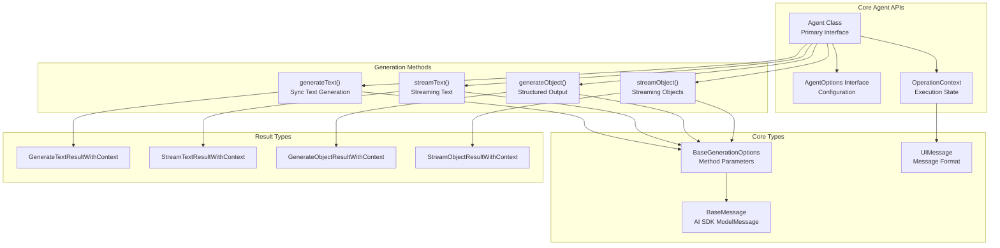

<!-- source: DeepWiki mcp.deepwiki.com · repo voltagent/voltagent · page 11.1 Core API · fetched 2026-10-27 -->

# Core API

<details>
<summary>Relevant source files</summary>

The following files were used as context for generating this wiki page:

- [.changeset/config.json](.changeset/config.json)
- [packages/core/src/agent/agent.spec-d.ts](packages/core/src/agent/agent.spec-d.ts)
- [packages/core/src/agent/agent.spec.ts](packages/core/src/agent/agent.spec.ts)
- [packages/core/src/agent/agent.ts](packages/core/src/agent/agent.ts)
- [packages/core/src/agent/hooks/index.spec.ts](packages/core/src/agent/hooks/index.spec.ts)
- [packages/core/src/agent/hooks/index.ts](packages/core/src/agent/hooks/index.ts)
- [packages/core/src/agent/index.ts](packages/core/src/agent/index.ts)
- [packages/core/src/agent/memory-persist-queue.ts](packages/core/src/agent/memory-persist-queue.ts)
- [packages/core/src/agent/message-normalizer.spec.ts](packages/core/src/agent/message-normalizer.spec.ts)
- [packages/core/src/agent/message-normalizer.ts](packages/core/src/agent/message-normalizer.ts)
- [packages/core/src/agent/providers/base/types.ts](packages/core/src/agent/providers/base/types.ts)
- [packages/core/src/agent/subagent/index.spec.ts](packages/core/src/agent/subagent/index.spec.ts)
- [packages/core/src/agent/subagent/index.ts](packages/core/src/agent/subagent/index.ts)
- [packages/core/src/agent/types.ts](packages/core/src/agent/types.ts)
- [packages/core/src/index.ts](packages/core/src/index.ts)
- [packages/core/src/memory/manager/memory-manager.ts](packages/core/src/memory/manager/memory-manager.ts)
- [website/docs/agents/context.md](website/docs/agents/context.md)
- [website/docs/agents/hooks.md](website/docs/agents/hooks.md)
- [website/docs/agents/overview.md](website/docs/agents/overview.md)
- [website/docs/agents/subagents.md](website/docs/agents/subagents.md)
- [website/docs/agents/tools.md](website/docs/agents/tools.md)

</details>


This document provides comprehensive reference documentation for the `@voltagent/core` package APIs, including classes, methods, and TypeScript interfaces. This covers the foundational agent framework, memory management, tool system, and workflow orchestration.

For HTTP endpoint reference and OpenAPI specifications, see [Server API](#10.2). For command-line tool documentation, see [CLI Reference](#10.3).

## Core Architecture Overview

The VoltAgent core framework is built around several key API areas that work together to provide AI agent capabilities:

### Agent System Architecture



**Sources:** [packages/core/src/agent/agent.ts:234-330](), [packages/core/src/agent/types.ts:224-271](), [packages/core/src/index.ts:24-32]()

### Memory and Persistence APIs

```mermaid
graph TB
    subgraph "Memory V2 System"
        Memory["Memory Class<br/>Main Interface"]
        StorageAdapter["StorageAdapter Interface<br/>Pluggable Backend"]
        EmbeddingAdapter["EmbeddingAdapter Interface<br/>Vector Generation"]
        VectorAdapter["VectorAdapter Interface<br/>Similarity Search"]
    end
    
    subgraph "Storage Implementations"
        InMemoryStorageAdapter["InMemoryStorageAdapter"]
        LibSQLMemoryAdapter["LibSQLMemoryAdapter"]
        PostgreSQLMemoryAdapter["PostgreSQLMemoryAdapter"]
        SupabaseMemoryAdapter["SupabaseMemoryAdapter"]
    end
    
    subgraph "Message Processing"
        ConversationBuffer["ConversationBuffer<br/>Message Merging"]
        MemoryPersistQueue["MemoryPersistQueue<br/>Debounced Writes"]
        MemoryManager["MemoryManager<br/>Orchestration"]
    end
    
    subgraph "Data Types"
        Conversation["Conversation Interface"]
        GetMessagesOptions["GetMessagesOptions"]
        SearchOptions["SearchOptions"]
        WorkingMemoryConfig["WorkingMemoryConfig"]
    end
    
    Memory --> StorageAdapter
    Memory --> EmbeddingAdapter
    Memory --> VectorAdapter
    
    StorageAdapter --> InMemoryStorageAdapter
    StorageAdapter --> LibSQLMemoryAdapter
    StorageAdapter --> PostgreSQLMemoryAdapter
    StorageAdapter --> SupabaseMemoryAdapter
    
    Agent --> ConversationBuffer
    Agent --> MemoryPersistQueue
    Agent --> MemoryManager
    
    Memory --> Conversation
    Memory --> GetMessagesOptions
    Memory --> SearchOptions
    Memory --> WorkingMemoryConfig
```



**Sources:** [packages/core/src/memory/index.ts:1-50](), [packages/core/src/agent/conversation-buffer.ts:1-35](), [packages/core/src/agent/memory-persist-queue.ts:1-30](), [packages/core/src/index.ts:80-106]()

## Agent Class API

The `Agent` class is the primary interface for creating and interacting with AI agents.

### Constructor and Configuration

The `Agent` constructor accepts an `AgentOptions` configuration object:

| Property | Type | Required | Description |
|----------|------|----------|-------------|
| `name` | `string` | Yes | Agent identifier and display name |
| `instructions` | `InstructionsDynamicValue` | Yes | Behavior guidelines (string or dynamic function) |
| `model` | `LanguageModel \| DynamicValue<LanguageModel>` | Yes | AI SDK model instance |
| `id` | `string` | No | Unique identifier (defaults to name) |
| `tools` | `(Tool \| Toolkit)[] \| DynamicValue<...>` | No | Available tools for agent |
| `memory` | `Memory \| false` | No | Memory storage instance |
| `subAgents` | `SubAgentConfig[]` | No | Specialized agents for delegation |
| `maxSteps` | `number` | No | Maximum tool execution iterations (default: 5) |
| `temperature` | `number` | No | Model creativity parameter |
| `hooks` | `AgentHooks` | No | Lifecycle event handlers |

**Sources:** [packages/core/src/agent/types.ts:224-271](), [packages/core/src/agent/agent.ts:261-329]()

### Core Generation Methods

The Agent class provides four primary generation methods:

#### generateText()

```typescript
async generateText(
  input: string | UIMessage[] | BaseMessage[],
  options?: GenerateTextOptions
): Promise<GenerateTextResultWithContext>
```

Generates complete text response after LLM and tool execution finishes.

**Sources:** [packages/core/src/agent/agent.ts:338-505]()

#### streamText()

```typescript
async streamText(
  input: string | UIMessage[] | BaseMessage[],
  options?: StreamTextOptions
): Promise<StreamTextResultWithContext>
```

Returns streaming response with real-time text chunks and events.

**Sources:** [packages/core/src/agent/agent.ts:510-815]()

#### generateObject()

```typescript
async generateObject<T extends z.ZodType>(
  input: string | UIMessage[] | BaseMessage[],
  schema: T,
  options?: GenerateObjectOptions
): Promise<GenerateObjectResultWithContext<z.infer<T>>>
```

Generates structured output conforming to Zod schema.

**Sources:** [packages/core/src/agent/agent.ts:820-994]()

#### streamObject()

```typescript
async streamObject<T extends z.ZodType>(
  input: string | UIMessage[] | BaseMessage[],
  schema: T,
  options?: StreamObjectOptions
): Promise<StreamObjectResultWithContext<z.infer<T>>>
```

Streams partial object updates during generation.

**Sources:** [packages/core/src/agent/agent.ts:999-1133]()

### Generation Options

All generation methods accept a `BaseGenerationOptions` parameter:

| Option | Type | Description |
|--------|------|-------------|
| `userId` | `string` | User identifier for memory/context |
| `conversationId` | `string` | Conversation identifier for memory |
| `context` | `ContextInput` | Additional context data |
| `maxSteps` | `number` | Override agent's default maxSteps |
| `tools` | `(Tool \| Toolkit)[]` | Additional tools for this request |
| `hooks` | `AgentHooks` | Override agent's hooks for this request |
| `abortSignal` | `AbortSignal` | Cancellation signal |
| `experimental_output` | `Output.object() \| Output.text()` | AI SDK structured output |

**Sources:** [packages/core/src/agent/agent.ts:170-219]()

### Result Types

#### GenerateTextResultWithContext

Extends AI SDK's `GenerateTextResult` with additional VoltAgent context:

```typescript
interface GenerateTextResultWithContext {
  text: string;
  usage: LanguageModelUsage;
  finishReason: FinishReason;
  warnings?: CallWarning[];
  context: Map<string | symbol, unknown>;
}
```

#### StreamTextResultWithContext

Provides streaming capabilities with context:

```typescript
interface StreamTextResultWithContext {
  text: Promise<string>;
  textStream: AsyncIterableStream<string>;
  fullStream: AsyncIterable<VoltAgentTextStreamPart>;
  usage: Promise<LanguageModelUsage>;
  finishReason: Promise<FinishReason>;
  context: Map<string | symbol, unknown>;
  
  // Response helpers
  toUIMessageStream(): ReadableStream<UIMessage>;
  toUIMessageStreamResponse(options?): Response;
}
```

**Sources:** [packages/core/src/agent/agent.ts:102-127](), [packages/core/src/agent/agent.ts:149-164]()

## Memory System API

### Memory Class

The `Memory` class provides unified memory management:

```typescript
class Memory {
  constructor(options: {
    storage?: StorageAdapter;
    embedding?: EmbeddingAdapter;
    vector?: VectorAdapter;
    workingMemory?: WorkingMemoryConfig;
  });
  
  async saveMessage(conversation: Conversation, message: UIMessage): Promise<void>;
  async getMessages(conversationId: string, options?: GetMessagesOptions): Promise<UIMessage[]>;
  async searchMessages(query: string, options?: SearchOptions): Promise<SearchResult[]>;
  async createConversation(input: CreateConversationInput): Promise<Conversation>;
}
```

### Storage Adapters

| Adapter | Package | Use Case |
|---------|---------|----------|
| `InMemoryStorageAdapter` | `@voltagent/core` | Development, testing |
| `LibSQLMemoryAdapter` | `@voltagent/libsql` | SQLite, Turso |
| `PostgreSQLMemoryAdapter` | `@voltagent/postgres` | Production PostgreSQL |
| `SupabaseMemoryAdapter` | `@voltagent/supabase` | Supabase cloud |

### Conversation Processing

#### ConversationBuffer

Merges tool calls and results into cohesive UI messages:

```typescript
class ConversationBuffer {
  addModelMessages(messages: ModelMessage[], source: MessageSource): void;
  ingestUIMessages(messages: UIMessage[], markAsSaved?: boolean): void;
  drainPendingMessages(): UIMessage[];
  getAllMessages(): UIMessage[];
}
```

#### MemoryPersistQueue

Provides debounced writes to prevent excessive database operations:

```typescript
class MemoryPersistQueue {
  constructor(memoryManager: MemoryManager, options?: {
    debounceMs?: number;
    logger?: Logger;
  });
  
  scheduleSave(buffer: ConversationBuffer, context: OperationContext): void;
  flush(buffer: ConversationBuffer, context: OperationContext): Promise<void>;
}
```

**Sources:** [packages/core/src/agent/conversation-buffer.ts:18-35](), [packages/core/src/agent/memory-persist-queue.ts:20-31]()

## Tool System API

### Tool Creation

```typescript
function createTool<TParameters extends z.ZodType, TResult>(config: {
  name: string;
  description: string;
  parameters: TParameters;
  execute: (params: z.infer<TParameters>, options?: ToolExecuteOptions) => Promise<TResult> | TResult;
}): Tool<TParameters, TResult>
```

### Tool Interface

```typescript
interface Tool<TParameters extends z.ZodType, TResult> {
  readonly name: string;
  readonly description: string;
  readonly parameters: TParameters;
  execute(params: z.infer<TParameters>, options?: ToolExecuteOptions): Promise<TResult>;
}
```

### ToolExecuteOptions

Tool execution context and cancellation:

```typescript
interface ToolExecuteOptions {
  abortController?: AbortController;
  operationContext?: OperationContext;
  signal?: AbortSignal; // deprecated
}
```

**Sources:** [packages/core/src/tool/create-tool.ts:1-50](), [packages/core/src/agent/providers/base/types.ts:243-266]()

## SubAgent System API

### SubAgent Configuration

```typescript
type SubAgentConfig = 
  | Agent  // Direct agent reference
  | StreamTextSubAgentConfig
  | GenerateTextSubAgentConfig
  | StreamObjectSubAgentConfig
  | GenerateObjectSubAgentConfig;

interface StreamTextSubAgentConfig {
  agent: Agent;
  method: "streamText";
  options?: StreamTextOptions;
}
```

### SubAgent Creation Helper

```typescript
function createSubagent(config: {
  agent: Agent;
  method?: "streamText" | "generateText" | "streamObject" | "generateObject";
  schema?: z.ZodType; // required for object methods
  options?: BaseGenerationOptions;
}): SubAgentConfig
```

**Sources:** [packages/core/src/agent/subagent/types.ts:1-100](), [packages/core/src/index.ts:34-44]()

## Workflow System API

### Workflow Creation

```typescript
function createWorkflow<TInput, TOutput>(
  name: string,
  steps: WorkflowStep<TInput, TOutput>
): Workflow<TInput, TOutput>

function createWorkflowChain(): WorkflowChain
```

### Workflow Step Functions

```typescript
function andAgent<TInput, TOutput>(
  agent: Agent,
  options?: { 
    input?: (context: WorkflowStepContext<TInput>) => string | BaseMessage[];
    maxSteps?: number;
  }
): WorkflowStep<TInput, TOutput>

function andThen<TInput, TOutput>(
  fn: (context: WorkflowStepContext<TInput>) => Promise<TOutput> | TOutput
): WorkflowStep<TInput, TOutput>

function andWhen<TInput>(
  condition: (context: WorkflowStepContext<TInput>) => boolean | Promise<boolean>
): WorkflowStep<TInput, TInput>
```

**Sources:** [packages/core/src/workflow/index.ts:1-50](), [packages/core/src/index.ts:1-12]()

## Hooks System API

### Hook Types

```typescript
interface AgentHooks {
  onStart?: (args: OnStartHookArgs) => Promise<void> | void;
  onEnd?: (args: OnEndHookArgs) => Promise<void> | void;
  onToolStart?: (args: OnToolStartHookArgs) => Promise<void> | void;
  onToolEnd?: (args: OnToolEndHookArgs) => Promise<void> | void;
  onHandoff?: (args: OnHandoffHookArgs) => Promise<void> | void;
  onError?: (args: OnErrorHookArgs) => Promise<void> | void;
}
```

### Hook Creation

```typescript
function createHooks(hooks: AgentHooks): AgentHooks
```

### Hook Argument Types

| Hook | Arguments | Description |
|------|-----------|-------------|
| `onStart` | `{ agent, context }` | Agent operation begins |
| `onEnd` | `{ agent, output, error, context }` | Operation completes |
| `onToolStart` | `{ agent, tool, context }` | Tool execution starts |
| `onToolEnd` | `{ agent, tool, output, error, context }` | Tool execution ends |
| `onHandoff` | `{ agent, sourceAgent }` | SubAgent delegation |
| `onError` | `{ agent, error, context }` | Error occurs |

**Sources:** [packages/core/src/agent/hooks.ts:1-100](), [packages/core/src/index.ts:33]()

## Core Types and Interfaces

### Message Types

#### UIMessage (VoltAgent Format)
```typescript
interface UIMessage {
  id: string;
  role: "user" | "assistant" | "system";
  parts: UIMessagePart[];
  metadata?: Record<string, unknown>;
}
```

#### BaseMessage (AI SDK Format)
```typescript
type BaseMessage = ModelMessage; // From @ai-sdk/provider-utils
```

### Context and State

#### OperationContext
```typescript
interface OperationContext {
  readonly operationId: string;
  userId?: string;
  conversationId?: string;
  readonly context: Map<string | symbol, unknown>;
  readonly systemContext: Map<string | symbol, unknown>;
  isActive: boolean;
  traceContext: AgentTraceContext;
  logger: Logger;
  abortController: AbortController;
  startTime: Date;
}
```

#### AgentFullState
```typescript
interface AgentFullState {
  id: string;
  name: string;
  instructions?: string;
  status: string;
  model: string;
  node_id: string;
  tools: ToolWithNodeId[];
  subAgents: SubAgentStateData[];
  memory: Record<string, unknown> & { node_id: string };
}
```

**Sources:** [packages/core/src/agent/types.ts:589-628](), [packages/core/src/agent/types.ts:81-97](), [packages/core/src/index.ts:110-125]()

## Error Handling API

### Error Types

```typescript
interface VoltAgentError extends Error {
  name: "VoltAgentError";
  code?: string;
  details?: Record<string, unknown>;
}

interface AbortError extends VoltAgentError {
  name: "AbortError";
  code: "OPERATION_ABORTED";
}
```

### Error Utilities

```typescript
function isVoltAgentError(error: unknown): error is VoltAgentError
function isAbortError(error: unknown): error is AbortError
```

**Sources:** [packages/core/src/agent/errors.ts:1-50](), [packages/core/src/index.ts:126-127]()

## Observability API

### VoltAgentObservability

```typescript
class VoltAgentObservability {
  constructor(options: {
    processors?: SpanProcessor[];
    logProcessors?: LogProcessor[];
  });
}
```

### Span Processing

```typescript
interface ObservabilitySpan {
  traceId: string;
  spanId: string;
  parentSpanId?: string;
  name: string;
  startTime: number;
  endTime?: number;
  attributes: SpanAttributes;
  events: SpanEvent[];
  status: SpanStatus;
}
```

**Sources:** [packages/core/src/observability/index.ts:1-50](), [packages/core/src/index.ts:50-78]()

---

