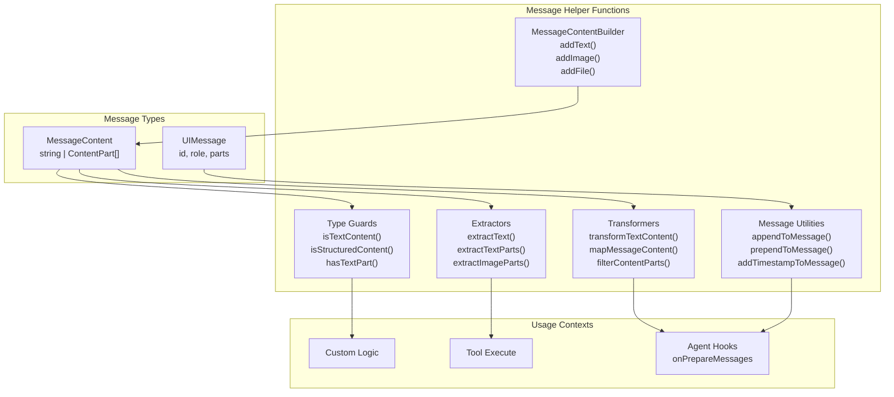
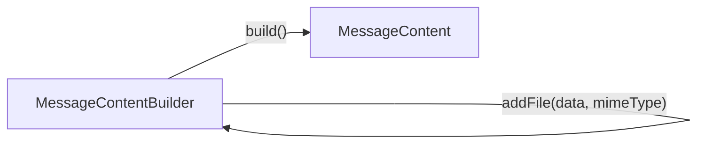
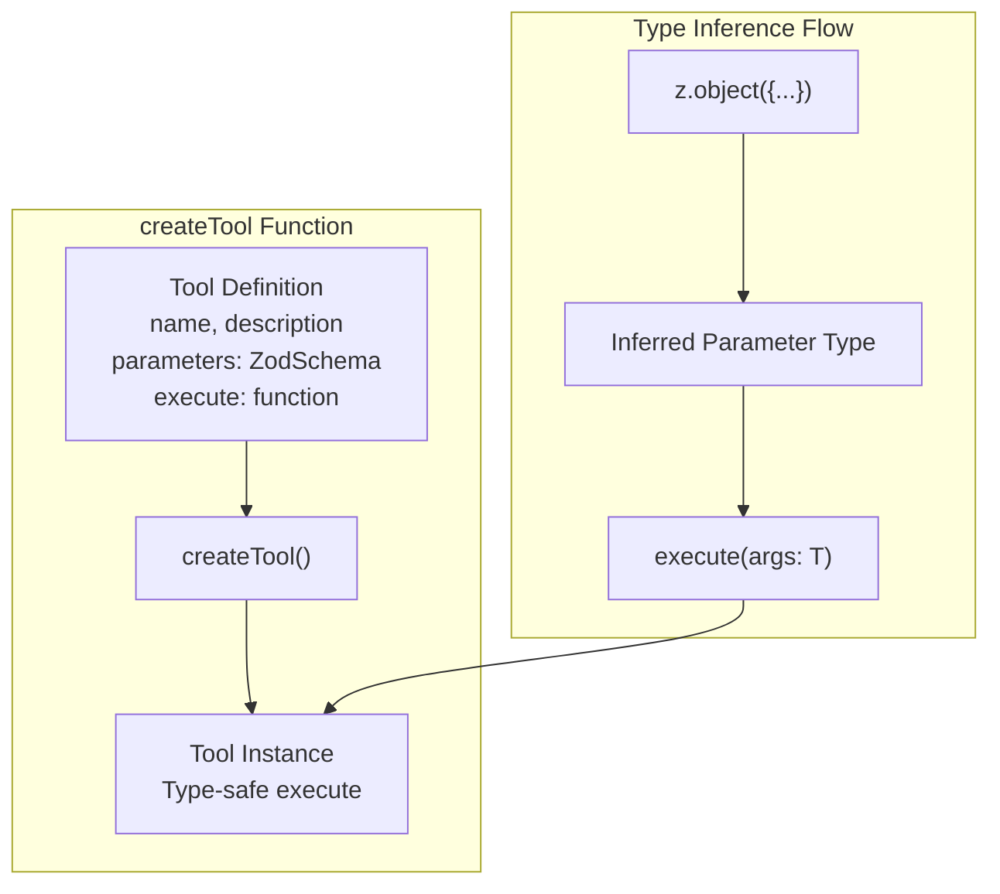
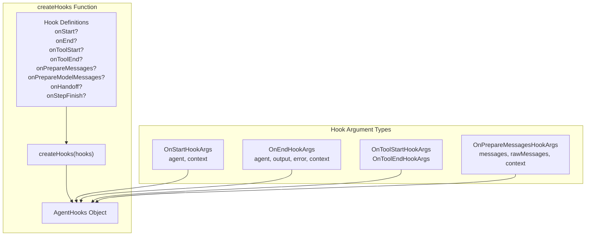
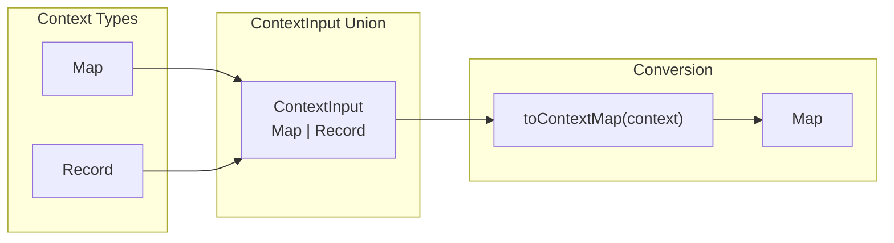
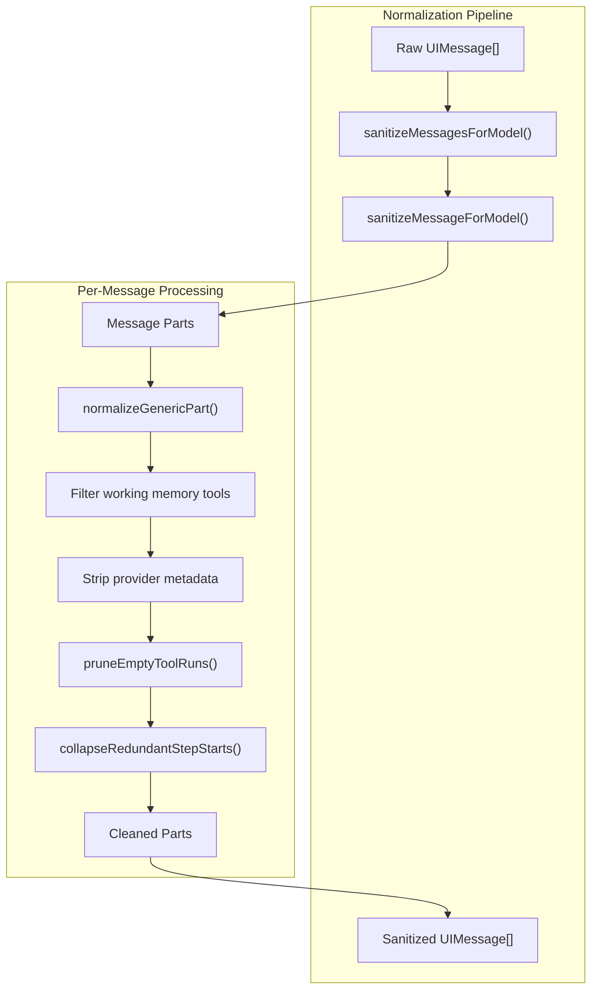

<!-- source: DeepWiki mcp.deepwiki.com · repo voltagent/voltagent · page 11.3 Utility APIs · fetched 2026-10-27 -->

# Utility APIs

<details>
<summary>Relevant source files</summary>

The following files were used as context for generating this wiki page:

- [.github/workflows/prerelease.yml](.github/workflows/prerelease.yml)
- [.github/workflows/pull-request.yml](.github/workflows/pull-request.yml)
- [.github/workflows/release.yml](.github/workflows/release.yml)
- [examples/with-jwt-auth/src/index.ts](examples/with-jwt-auth/src/index.ts)
- [examples/with-playwright/src/index.ts](examples/with-playwright/src/index.ts)
- [package.json](package.json)
- [packages/core/src/agent/agent.spec-d.ts](packages/core/src/agent/agent.spec-d.ts)
- [packages/core/src/agent/agent.spec.ts](packages/core/src/agent/agent.spec.ts)
- [packages/core/src/agent/agent.ts](packages/core/src/agent/agent.ts)
- [packages/core/src/agent/hooks/index.spec.ts](packages/core/src/agent/hooks/index.spec.ts)
- [packages/core/src/agent/hooks/index.ts](packages/core/src/agent/hooks/index.ts)
- [packages/core/src/agent/memory-persist-queue.ts](packages/core/src/agent/memory-persist-queue.ts)
- [packages/core/src/agent/message-normalizer.spec.ts](packages/core/src/agent/message-normalizer.spec.ts)
- [packages/core/src/agent/message-normalizer.ts](packages/core/src/agent/message-normalizer.ts)
- [packages/core/src/memory/manager/memory-manager.ts](packages/core/src/memory/manager/memory-manager.ts)
- [packages/core/src/utils/message-helpers.spec.ts](packages/core/src/utils/message-helpers.spec.ts)
- [packages/core/src/utils/message-helpers.ts](packages/core/src/utils/message-helpers.ts)
- [pnpm-workspace.yaml](pnpm-workspace.yaml)
- [website/docs/agents/context.md](website/docs/agents/context.md)
- [website/docs/agents/hooks.md](website/docs/agents/hooks.md)
- [website/docs/agents/tools.md](website/docs/agents/tools.md)
- [website/docs/utils/message-helpers.md](website/docs/utils/message-helpers.md)

</details>


This document covers utility functions and helper APIs that simplify common tasks when working with VoltAgent. These utilities handle message manipulation, tool creation, hook configuration, and context management. For core agent APIs, see [Core API](#11.1). For server configuration, see [Server API](#11.2).

## Overview

VoltAgent provides several utility modules:

| Module | Purpose | Primary Use Cases |
|--------|---------|------------------|
| Message Helpers | Manipulate message content and structure | Extracting text, transforming content, building messages |
| Tool Creation | Type-safe tool definition | Creating agent tools with schema validation |
| Hook Creation | Hook configuration | Defining lifecycle hooks with proper typing |
| Context Utilities | Context management | Converting between Map and object contexts |
| Message Normalization | Message sanitization | Preparing messages for LLM consumption |

**Sources:** [packages/core/src/utils/message-helpers.ts:1-500](), [packages/core/src/agent/hooks/index.ts:1-155](), [packages/core/src/agent/agent.ts:86-96]()

## Message Helpers Architecture



**Sources:** [packages/core/src/utils/message-helpers.ts:1-500](), [website/docs/utils/message-helpers.md:1-400]()

## Message Helpers API

### Type Guards

Type guards determine the format of message content and enable type-safe operations.

| Function | Input | Returns | Description |
|----------|-------|---------|-------------|
| `isTextContent(content)` | `MessageContent` | `boolean` | Checks if content is a string |
| `isStructuredContent(content)` | `MessageContent` | `boolean` | Checks if content is an array of parts |
| `hasTextPart(content)` | `MessageContent` | `boolean` | Checks if content contains text |
| `hasImagePart(content)` | `MessageContent` | `boolean` | Checks if content contains images |
| `hasFilePart(content)` | `MessageContent` | `boolean` | Checks if content contains files |

Usage example from hooks:

```typescript
import { hasTextPart } from "@voltagent/core/utils";

const hooks = createHooks({
  onPrepareMessages: async ({ messages }) => {
    // Filter out messages without text content
    const filtered = messages.filter(msg => 
      msg.parts.some(part => hasTextPart([part]))
    );
    return { messages: filtered };
  }
});
```

**Sources:** [packages/core/src/utils/message-helpers.ts:5-47](), [packages/core/src/utils/message-helpers.spec.ts:29-60]()

### Extractors

Extractors retrieve specific content types from messages.

| Function | Input | Returns | Description |
|----------|-------|---------|-------------|
| `extractText(content)` | `MessageContent` | `string` | Concatenates all text parts |
| `extractTextParts(content)` | `MessageContent` | `Array<{type: "text", text: string}>` | Returns all text parts |
| `extractImageParts(content)` | `MessageContent` | `Array<any>` | Returns all image parts |
| `extractFileParts(content)` | `MessageContent` | `Array<any>` | Returns all file parts |

**Sources:** [packages/core/src/utils/message-helpers.ts:49-98](), [packages/core/src/utils/message-helpers.spec.ts:62-109]()

### Transformers

Transformers modify message content while preserving structure.

| Function | Signature | Description |
|----------|-----------|-------------|
| `transformTextContent` | `(content: MessageContent, transformer: (text: string) => string) => MessageContent` | Applies function to all text parts |
| `mapMessageContent` | `(message: UIMessage, transformer: (text: string) => string) => UIMessage` | Maps over UIMessage text parts |
| `filterContentParts` | `(content: MessageContent, predicate: (part: any) => boolean) => MessageContent` | Filters content parts |
| `normalizeToArray` | `(content: MessageContent) => Array<any>` | Always returns array format |
| `normalizeContent` | `(content: MessageContent) => MessageContent` | Returns most compact form |

Example from agent hooks showing text transformation:

```typescript
const hooks = createHooks({
  onPrepareMessages: async ({ messages }) => {
    // Add timestamps to all messages
    const enhanced = messages.map(msg => 
      mapMessageContent(msg, text => `[${new Date().toISOString()}] ${text}`)
    );
    return { messages: enhanced };
  }
});
```

**Sources:** [packages/core/src/utils/message-helpers.ts:100-183](), [website/docs/utils/message-helpers.md:172-250]()

### MessageContentBuilder

`MessageContentBuilder` provides a fluent interface for constructing messages.



Example usage:

```typescript
import { MessageContentBuilder } from "@voltagent/core/utils";

const content = new MessageContentBuilder()
  .addText("Check this image:")
  .addImage("data:image/png;base64,...")
  .addText("And this file:")
  .addFile("document content", "text/plain")
  .build();
```

**Sources:** [packages/core/src/utils/message-helpers.ts:184-289](), [packages/core/src/utils/message-helpers.spec.ts:227-272]()

### Message-Level Utilities

Functions that operate on complete `UIMessage` objects.

| Function | Signature | Description |
|----------|-----------|-------------|
| `appendToMessage` | `(message: UIMessage, content: MessageContent) => UIMessage` | Adds content to end of message |
| `prependToMessage` | `(message: UIMessage, content: MessageContent) => UIMessage` | Adds content to start of message |
| `addTimestampToMessage` | `(message: UIMessage, timestamp: string) => UIMessage` | Adds timestamp metadata |
| `hasContent` | `(message: UIMessage) => boolean` | Checks if message has any content |
| `getContentLength` | `(message: UIMessage) => number` | Returns total content length |
| `combineMessages` | `(messages: UIMessage[]) => UIMessage` | Merges multiple messages |

**Sources:** [packages/core/src/utils/message-helpers.ts:291-500](), [website/docs/utils/message-helpers.md:252-380]()

## Tool Creation API



The `createTool` function creates type-safe tools with automatic parameter type inference from Zod schemas.

### Basic Usage

```typescript
import { createTool } from "@voltagent/core";
import { z } from "zod";

const calculatorTool = createTool({
  name: "calculate",
  description: "Perform a mathematical calculation",
  parameters: z.object({
    expression: z.string().describe("The mathematical expression"),
  }),
  execute: async (args) => {
    // args is automatically typed as { expression: string }
    const result = eval(args.expression);
    return { result };
  },
});
```

### Accessing Operation Context in Tools

Tools receive `OperationContext` through the options parameter:

```typescript
const contextAwareTool = createTool({
  name: "log_with_context",
  description: "Logs with operation context",
  parameters: z.object({
    message: z.string(),
  }),
  execute: async ({ message }, options) => {
    // Access operation context
    const oc = options?.operationContext;
    const userId = oc?.userId;
    const operationId = oc?.operationId;
    
    // Access custom context values
    const customData = oc?.context.get("customKey");
    
    console.log(`[${operationId}] User ${userId}: ${message}`);
    return "Logged successfully";
  },
});
```

**Sources:** [packages/core/src/tool/index.ts:1-200](), [website/docs/agents/tools.md:10-163](), [packages/core/src/agent/agent.spec.ts:519-583]()

## Hook Creation API



The `createHooks` function creates a typed hooks object with default implementations for any omitted hooks.

### Hook Type Signatures

All hooks receive a single argument object containing relevant data:

| Hook | Argument Type | When Called |
|------|--------------|-------------|
| `onStart` | `OnStartHookArgs` | Before agent starts processing |
| `onEnd` | `OnEndHookArgs` | After agent completes (success or error) |
| `onToolStart` | `OnToolStartHookArgs` | Before tool execution |
| `onToolEnd` | `OnToolEndHookArgs` | After tool execution |
| `onPrepareMessages` | `OnPrepareMessagesHookArgs` | After sanitization, before LLM |
| `onPrepareModelMessages` | `OnPrepareModelMessagesHookArgs` | After conversion to ModelMessage |
| `onHandoff` | `OnHandoffHookArgs` | When task handed off to agent |
| `onStepFinish` | `OnStepFinishHookArgs` | After each generation step |

### Hook Creation Example

```typescript
import { createHooks } from "@voltagent/core";

const myHooks = createHooks({
  onStart: async ({ agent, context }) => {
    console.log(`Starting: ${agent.name}`);
    console.log(`Operation ID: ${context.operationId}`);
  },
  
  onPrepareMessages: async ({ messages, context }) => {
    // Transform messages before LLM sees them
    const enhanced = messages.map(msg => 
      addTimestampToMessage(msg, new Date().toISOString())
    );
    return { messages: enhanced };
  },
  
  onToolEnd: async ({ tool, output, error, context }) => {
    if (error) {
      console.error(`Tool ${tool.name} failed:`, error.message);
    } else {
      console.log(`Tool ${tool.name} result:`, output);
    }
  },
});
```

### Hook Argument Object Structures

Each hook receives structured arguments:

```typescript
// OnStartHookArgs
interface OnStartHookArgs {
  agent: Agent;
  context: OperationContext;
}

// OnEndHookArgs
interface OnEndHookArgs {
  conversationId: string;
  agent: Agent;
  output: AgentOperationOutput | undefined;
  error: VoltAgentError | CancellationError | undefined;
  context: OperationContext;
}

// OnPrepareMessagesHookArgs
interface OnPrepareMessagesHookArgs {
  messages: UIMessage[];
  rawMessages?: UIMessage[];
  agent: Agent;
  context: OperationContext;
}
```

**Sources:** [packages/core/src/agent/hooks/index.ts:1-155](), [website/docs/agents/hooks.md:1-300](), [packages/core/src/agent/hooks/index.spec.ts:1-482]()

## Context Utilities



### toContextMap Function

Converts between plain objects and Map for context handling.

```typescript
type ContextInput = Map<string | symbol, unknown> | Record<string | symbol, unknown>;

function toContextMap(context?: ContextInput): Map<string | symbol, unknown> | undefined {
  if (!context) return undefined;
  return context instanceof Map ? context : new Map(Object.entries(context));
}
```

This utility is used internally by the Agent class to normalize context input:

```typescript
// In Agent constructor
this.context = toContextMap(options.context);

// Usage in agent execution
const result = await agent.generateText("Hello", {
  context: { userId: "123", sessionId: "abc" } // Automatically converted to Map
});
```

**Sources:** [packages/core/src/agent/agent.ts:86-96](), [packages/core/src/agent/agent.spec.ts:208-254]()

## Message Normalization API



### sanitizeMessagesForModel

Prepares messages for LLM consumption by removing working memory tool calls, stripping metadata, and normalizing structure.

```typescript
function sanitizeMessagesForModel(messages: UIMessage[]): UIMessage[]
function sanitizeMessageForModel(message: UIMessage): UIMessage | null
```

### Normalization Behavior

The sanitization process:

1. **Removes Working Memory Tool Calls**: Filters out `update_working_memory`, `get_working_memory`, and `clear_working_memory` tool parts
2. **Strips Provider Metadata**: Removes `callProviderMetadata` and `providerMetadata` from tool parts (but preserves on text parts)
3. **Strips Reasoning Metadata**: Removes `providerMetadata` from reasoning parts to prevent GPT-5 rejection
4. **Prunes Empty Tool Runs**: Removes tool parts without state or results
5. **Collapses Step Starts**: Removes redundant `step-start` parts
6. **Filters Empty Content**: Drops messages/parts with no effective content

### Usage in Agent

The agent automatically applies sanitization before calling hooks:

```typescript
// In agent.ts prepareExecution
const sanitized = sanitizeMessagesForModel(uiMessages);

// Then calls hook with sanitized messages
const hookResult = await this.getMergedHooks(options).onPrepareMessages?.({
  messages: sanitized,
  rawMessages: uiMessages, // Original unsanitized messages
  context: oc,
  agent: this,
});
```

**Sources:** [packages/core/src/agent/message-normalizer.ts:1-230](), [packages/core/src/agent/message-normalizer.spec.ts:1-160](), [packages/core/src/agent/agent.spec.ts:255-320]()

## Importing Utilities

All utilities can be imported from their respective modules:

```typescript
// Message helpers
import { 
  extractText, 
  MessageContentBuilder,
  messageHelpers // All helpers in one object
} from "@voltagent/core/utils";

// Tool and hook creation
import { createTool } from "@voltagent/core";
import { createHooks } from "@voltagent/core";

// Message normalization (internal API)
import { 
  sanitizeMessagesForModel,
  sanitizeMessageForModel 
} from "@voltagent/core/agent/message-normalizer";
```

The `messageHelpers` object provides access to all message utilities through a single import:

```typescript
import { messageHelpers } from "@voltagent/core";

const text = messageHelpers.extractText(content);
const hasImages = messageHelpers.hasImagePart(content);
const builder = new messageHelpers.MessageContentBuilder();
```

**Sources:** [packages/core/src/utils/message-helpers.ts:1-10](), [website/docs/utils/message-helpers.md:9-18]()

---

