<!-- source: DeepWiki mcp.deepwiki.com · repo voltagent/voltagent · page 12.2 Package Development · fetched 2026-10-27 -->

# Package Development

<details>
<summary>Relevant source files</summary>

The following files were used as context for generating this wiki page:

- [.github/workflows/prerelease.yml](.github/workflows/prerelease.yml)
- [.github/workflows/pull-request.yml](.github/workflows/pull-request.yml)
- [.github/workflows/release.yml](.github/workflows/release.yml)
- [examples/with-google-ai/package.json](examples/with-google-ai/package.json)
- [examples/with-google-vertex-ai/package.json](examples/with-google-vertex-ai/package.json)
- [examples/with-groq-ai/package.json](examples/with-groq-ai/package.json)
- [examples/with-jwt-auth/src/index.ts](examples/with-jwt-auth/src/index.ts)
- [examples/with-mcp/package.json](examples/with-mcp/package.json)
- [examples/with-nextjs/package.json](examples/with-nextjs/package.json)
- [examples/with-playwright/src/index.ts](examples/with-playwright/src/index.ts)
- [package.json](package.json)
- [packages/core/package.json](packages/core/package.json)
- [packages/core/src/utils/message-helpers.spec.ts](packages/core/src/utils/message-helpers.spec.ts)
- [packages/core/src/utils/message-helpers.ts](packages/core/src/utils/message-helpers.ts)
- [pnpm-lock.yaml](pnpm-lock.yaml)
- [pnpm-workspace.yaml](pnpm-workspace.yaml)
- [website/docs/utils/message-helpers.md](website/docs/utils/message-helpers.md)

</details>


This document covers the creation and development of new packages within the VoltAgent ecosystem. It explains package types, development workflows, and the tools available for creating new provider integrations and framework extensions.

For information about contributing to existing packages, see [Contributing Guidelines](#11.2). For general development environment setup, see [Development Setup](#11.1).

## Package Types in the VoltAgent Ecosystem

The VoltAgent framework consists of several categories of packages, each serving specific purposes within the ecosystem:

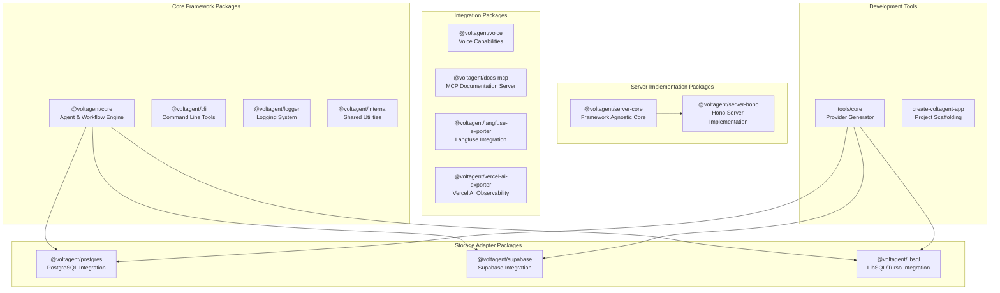

Sources: [packages/server-hono/package.json:1-51](), [packages/supabase/package.json:1-54](), [packages/libsql/package.json:1-56](), [packages/postgres/package.json:1-56](), [packages/voice/package.json:1-51](), [tools/core/README.md:1-276]()

## Creating a New Package

### Package Structure Setup

All VoltAgent packages follow a consistent structure. To create a new package from scratch:

1. Create package directory in `packages/` with kebab-case naming
2. Initialize package.json with `@voltagent/<name>` scope
3. Set up TypeScript, build, and test configurations
4. Configure dual module exports (ESM/CJS)

#### Directory Structure

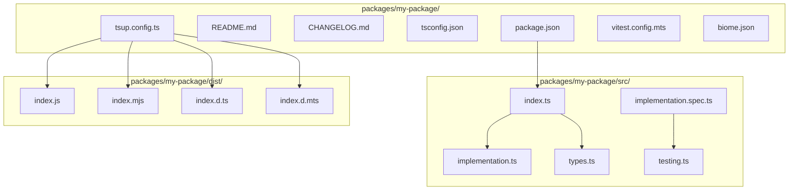

Sources: [packages/core/package.json:1-78](), [packages/libsql/package.json:1-56](), [packages/server-hono/package.json:1-51]()

### Package Naming Conventions

- **Namespace**: All packages use `@voltagent/` scope
- **Pattern**: `@voltagent/<feature-name>` in kebab-case
- **Examples**: `@voltagent/postgres`, `@voltagent/server-hono`, `@voltagent/libsql`
- **Special Case**: `create-voltagent-app` (no namespace for scaffolding tools)

Sources: [packages/core/package.json:2](), [packages/postgres/package.json:2](), [pnpm-workspace.yaml:1-8]()

### Essential package.json Configuration

**Title: Minimal Package Configuration Structure**

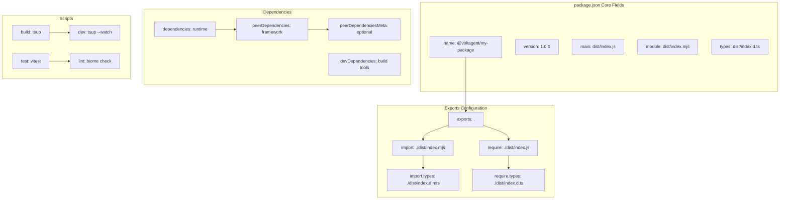

Sources: [packages/core/package.json:1-78](), [packages/libsql/package.json:1-56]()

| Field | Purpose | Example Value |
|-------|---------|---------------|
| `name` | Package identifier | `"@voltagent/my-package"` |
| `version` | Semantic version | `"1.0.0"` |
| `main` | CommonJS entry | `"dist/index.js"` |
| `module` | ESM entry | `"dist/index.mjs"` |
| `types` | TypeScript declarations | `"dist/index.d.ts"` |
| `exports` | Conditional exports | See [packages/core/package.json:36-47]() |
| `files` | Published files | `["dist"]` |

Sources: [packages/core/package.json:1-78](), [packages/server-hono/package.json:1-51]()

## Provider Generator Tool

VoltAgent includes an Nx generator for creating new provider packages automatically:

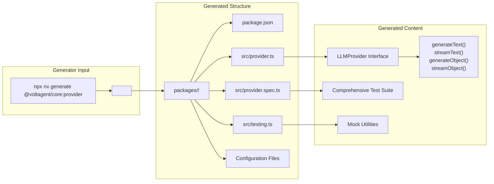

Sources: [tools/core/README.md:6-22](), [tools/core/README.md:94-128]()

### Using the Provider Generator

To create a new provider package:

```bash
npx nx generate @voltagent/core:provider my-ai-provider
```

This generates a complete package structure with:
- Package configuration with proper exports and dependencies
- Provider class template implementing `LLMProvider` interface
- Comprehensive test suite covering all provider methods
- Build and development configurations
- Documentation template

Sources: [tools/core/README.md:6-22](), [tools/core/README.md:43-80]()

## Development Workflow

### Package Creation Process

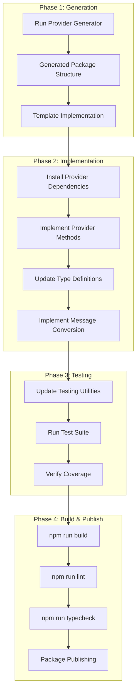

Sources: [tools/core/README.md:82-221](), [packages/supabase/package.json:44-52](), [packages/libsql/package.json:46-54]()

## Dependency Management

### Workspace Configuration

The monorepo uses pnpm workspaces defined in [pnpm-workspace.yaml:1-8]():

```yaml
packages:
  - "!archive/**"
  - "!packages/sdk"
  - "!packages/vercel-ai-exporter"
  - "packages/*"
  - "examples/*"
  - "examples/**/*"
```

This configuration:
- Includes all `packages/*` directories as workspace members
- Excludes archived and deprecated packages
- Includes examples for testing integration

Sources: [pnpm-workspace.yaml:1-8](), [package.json:97-100]()

### Dependency Types and Patterns

**Title: Dependency Classification in VoltAgent Packages**

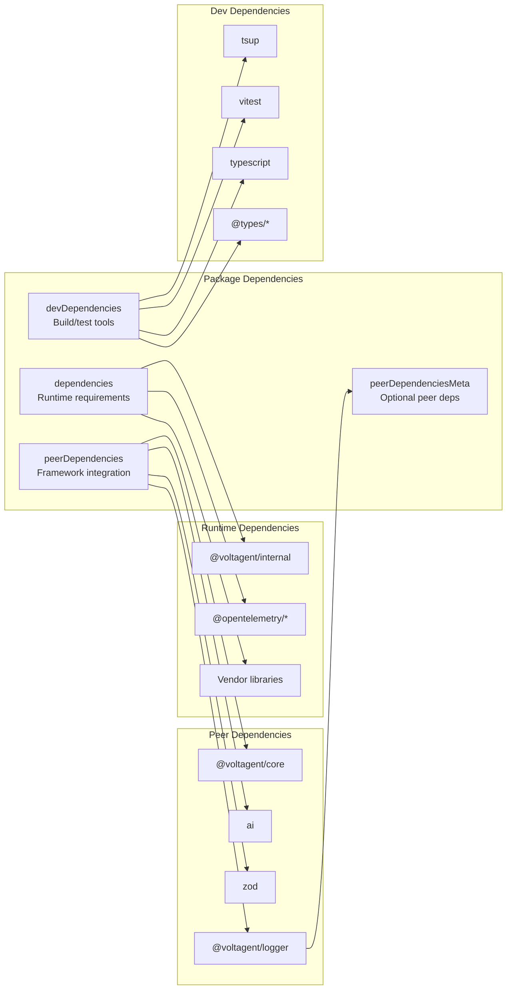

Sources: [packages/core/package.json:5-35](), [packages/libsql/package.json:5-45]()

#### Dependencies (Runtime)

Runtime dependencies are bundled with the package:

```json
"dependencies": {
  "@voltagent/internal": "^0.0.11",
  "@opentelemetry/api": "^1.9.0",
  "zod-from-json-schema": "^0.5.0"
}
```

Common runtime dependencies across packages:
- `@voltagent/internal` - Shared utilities
- `@opentelemetry/*` - Observability primitives
- Vendor-specific SDKs (e.g., `@libsql/client`, `pg`)

Sources: [packages/core/package.json:5-24](), [packages/postgres/package.json:5-8]()

#### Peer Dependencies (Framework Integration)

Peer dependencies are required by the consuming application:

```json
"peerDependencies": {
  "@ai-sdk/provider-utils": "3.x",
  "@voltagent/logger": "1.x",
  "ai": "5.x",
  "zod": "^3.25.0 || ^4.0.0"
},
"peerDependenciesMeta": {
  "@voltagent/logger": {
    "optional": true
  }
}
```

Peer dependency patterns:
- **Required**: `@voltagent/core`, `ai`, `zod` for most packages
- **Optional**: `@voltagent/logger` (marked in `peerDependenciesMeta`)
- **Version Ranges**: Major version pinning with caret ranges

Sources: [packages/core/package.json:54-64](), [packages/libsql/package.json:37-45]()

#### Dev Dependencies (Build Tools)

Development dependencies for build and test:

```json
"devDependencies": {
  "@types/node": "^24.2.1",
  "tsup": "^8.5.0",
  "typescript": "^5.8.2",
  "vitest": "^3.2.4"
}
```

Standard dev dependencies:
- `tsup` - Bundler (always version `^8.5.0`)
- `typescript` - Type checker (always version `^5.8.2`)
- `vitest` - Test runner (always version `^3.2.4`)
- `@types/node` - Node.js type definitions

Sources: [packages/core/package.json:25-35](), [packages/postgres/package.json:10-20]()

### Version Synchronization

The monorepo uses Syncpack to maintain consistent dependency versions:

```bash
# Check for version mismatches
pnpm sp lint

# Fix version mismatches
pnpm sp fix-mismatches
```

Syncpack ensures:
- All packages use the same version of `typescript`, `tsup`, `vitest`
- Peer dependency ranges are consistent
- Workspace protocol is used for internal dependencies

Sources: [package.json:89](), [.github/workflows/pull-request.yml:38-39]()

## Build Configuration with tsup

### tsup Overview

VoltAgent packages use `tsup` for TypeScript bundling. It provides:
- Zero-config TypeScript compilation
- Dual ESM/CJS output
- Automatic declaration file generation
- Watch mode for development

Sources: [packages/core/package.json:31]()

### Basic tsup.config.ts

Create `tsup.config.ts` in the package root:

```typescript
import { defineConfig } from 'tsup';

export default defineConfig({
  entry: ['src/index.ts'],
  format: ['cjs', 'esm'],
  dts: true,
  splitting: false,
  sourcemap: true,
  clean: true,
});
```

This configuration:
- **entry**: Main export file(s)
- **format**: Both CommonJS and ES Modules
- **dts**: Generate TypeScript declaration files
- **splitting**: Code splitting (usually disabled for libraries)
- **sourcemap**: Source maps for debugging
- **clean**: Remove dist before build

Sources: [packages/core/package.json:67](), [packages/libsql/package.json:47]()

### Dual Module Output

tsup generates multiple output files:

**Title: tsup Build Output Structure**

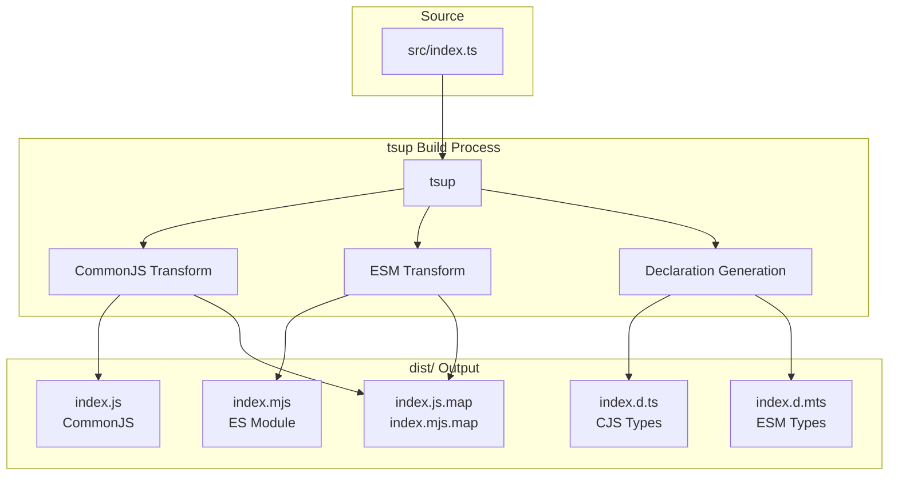

Sources: [packages/core/package.json:36-47](), [packages/server-hono/package.json:22-33]()

| Output File | Format | Used By |
|-------------|--------|---------|
| `dist/index.js` | CommonJS | Node.js `require()` |
| `dist/index.mjs` | ES Module | Node.js `import`, bundlers |
| `dist/index.d.ts` | TypeScript | CommonJS type resolution |
| `dist/index.d.mts` | TypeScript | ESM type resolution |

### Build Scripts

Standard npm scripts using tsup:

```json
"scripts": {
  "build": "tsup",
  "dev": "tsup --watch",
  "typecheck": "tsc --noEmit"
}
```

- **build**: Production build with all outputs
- **dev**: Watch mode for development
- **typecheck**: Type validation without emitting files

Sources: [packages/core/package.json:66-68](), [packages/libsql/package.json:46-54]()

## Exports Configuration

### Package Exports Field

The `exports` field in package.json defines entry points and module formats:

```json
"exports": {
  ".": {
    "import": {
      "types": "./dist/index.d.mts",
      "default": "./dist/index.mjs"
    },
    "require": {
      "types": "./dist/index.d.ts",
      "default": "./dist/index.js"
    }
  }
}
```

This configuration:
- Maps `.` (root export) to both ESM and CJS
- Provides TypeScript types for each format
- Ensures correct module resolution

Sources: [packages/core/package.json:36-47](), [packages/server-hono/package.json:22-33]()

### Conditional Exports

**Title: Module Resolution with Conditional Exports**

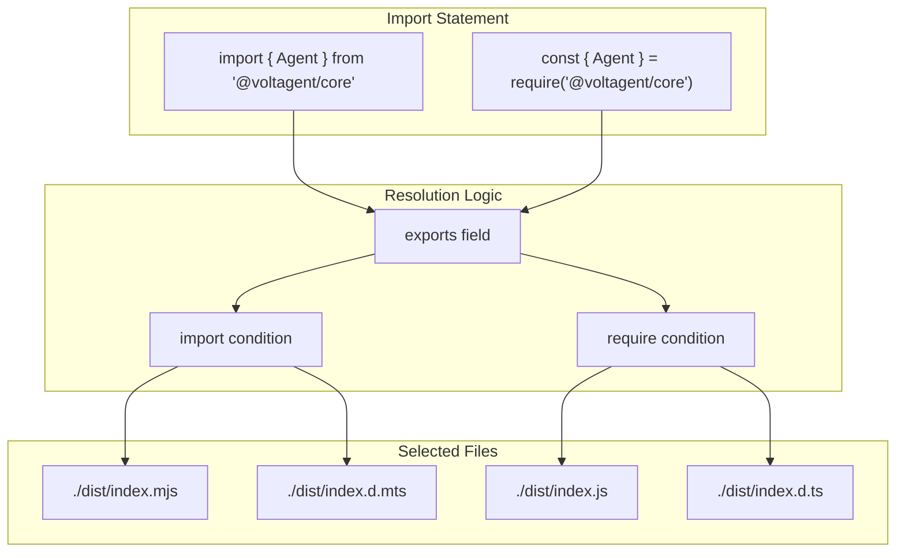

Sources: [packages/core/package.json:36-47]()

### Legacy Fields for Compatibility

Include legacy fields alongside `exports`:

```json
{
  "main": "dist/index.js",
  "module": "dist/index.mjs",
  "types": "dist/index.d.ts"
}
```

These fields provide fallback for:
- Older bundlers without `exports` support
- TypeScript versions before 4.7
- Build tools with limited module resolution

Sources: [packages/core/package.json:52-53](), [packages/core/package.json:77]()

### Published Files Filter

The `files` field controls which files are included in npm package:

```json
"files": [
  "dist"
]
```

This ensures only build artifacts are published, excluding:
- Source files (`src/`)
- Test files (`*.spec.ts`)
- Configuration files (`tsconfig.json`, `vitest.config.mts`)
- Development utilities

Sources: [packages/core/package.json:48-50]()

## Standard Build Tools

### Tool Versions and Configuration

**Title: Build Tool Stack in VoltAgent Packages**

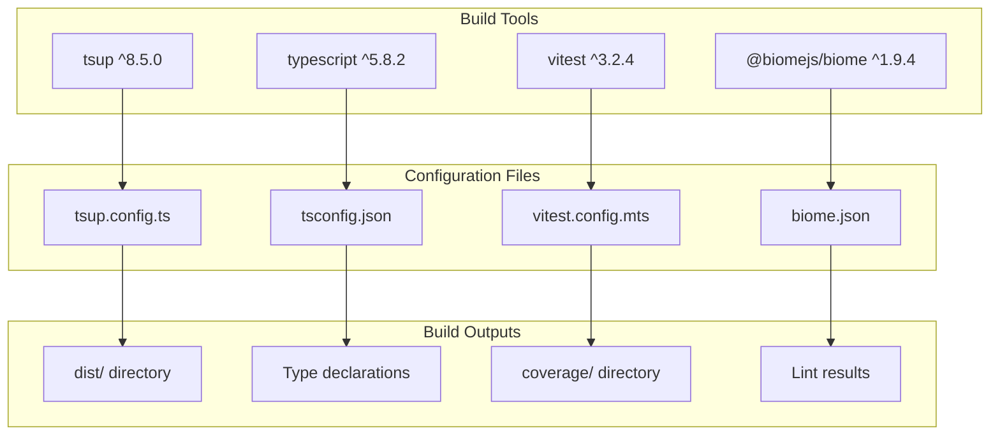

Sources: [packages/core/package.json:25-35](), [package.json:6-38]()

| Tool | Version | Purpose | Config File |
|------|---------|---------|-------------|
| `tsup` | `^8.5.0` | TypeScript bundling | `tsup.config.ts` |
| `typescript` | `^5.8.2` | Type checking | `tsconfig.json` |
| `vitest` | `^3.2.4` | Testing framework | `vitest.config.mts` |
| `@biomejs/biome` | `^1.9.4` | Linting/formatting | `biome.json` |

Sources: [packages/core/package.json:31-34](), [package.json:8]()

### Standard npm Scripts

All packages implement these scripts:

```json
"scripts": {
  "build": "tsup",
  "dev": "tsup --watch",
  "test": "vitest --reporter=hanging-process --reporter=default --typecheck",
  "test:coverage": "vitest run --coverage --typecheck",
  "typecheck": "tsc --noEmit",
  "lint": "biome check .",
  "lint:fix": "biome check . --write",
  "publint": "publint --strict",
  "attw": "attw --pack"
}
```

Sources: [packages/core/package.json:65-76]()

Script purposes:
- **build**: Production build with tsup
- **dev**: Watch mode for development
- **test**: Run tests with hanging process detection
- **test:coverage**: Generate coverage reports
- **typecheck**: Validate TypeScript without emitting
- **lint**: Check code quality with Biome
- **lint:fix**: Auto-fix linting issues
- **publint**: Validate package.json for npm publishing
- **attw**: Check for TypeScript resolution issues

Sources: [packages/core/package.json:65-76](), [packages/postgres/package.json:46-56]()

## Memory Adapter Development

Memory adapters are a specific type of package that extends VoltAgent's storage capabilities:

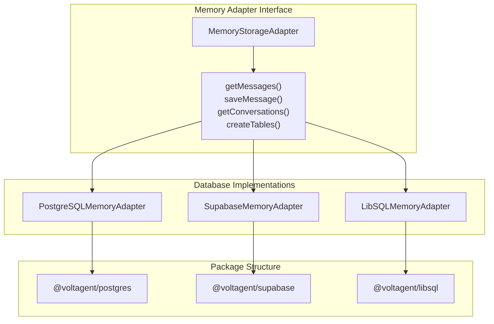

Sources: [packages/postgres/CHANGELOG.md:47-119](), [packages/supabase/CHANGELOG.md:31-115](), [packages/libsql/package.json:1-56]()

### Migration System

Memory adapters include automatic database migration capabilities:

- **PostgreSQL**: Uses SQL migration scripts with version tracking
- **Supabase**: Automatic schema migration with user-friendly SQL outputs
- **LibSQL**: Seamless column addition with proper indexing

Sources: [packages/postgres/CHANGELOG.md:383-430](), [packages/supabase/CHANGELOG.md:539-586]()

## Integration Package Development

Integration packages extend VoltAgent with external service capabilities:

### Observability Integrations

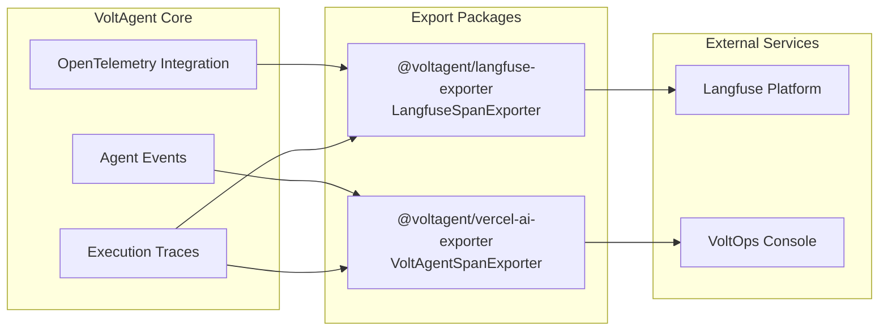

Sources: [packages/langfuse-exporter/package.json:1-53](), [packages/vercel-ai-exporter/package.json:1-67]()

### Voice Capabilities Package

The voice package demonstrates integration with external APIs:

- **Dependencies**: `elevenlabs`, `openai`, `@xsai/generate-speech`, `@xsai/generate-transcription`
- **Functionality**: Text-to-speech and speech-to-text integration
- **Architecture**: Provider-agnostic voice capabilities

Sources: [packages/voice/package.json:5-10]()

## Server Implementation Packages

Server packages provide HTTP API capabilities:

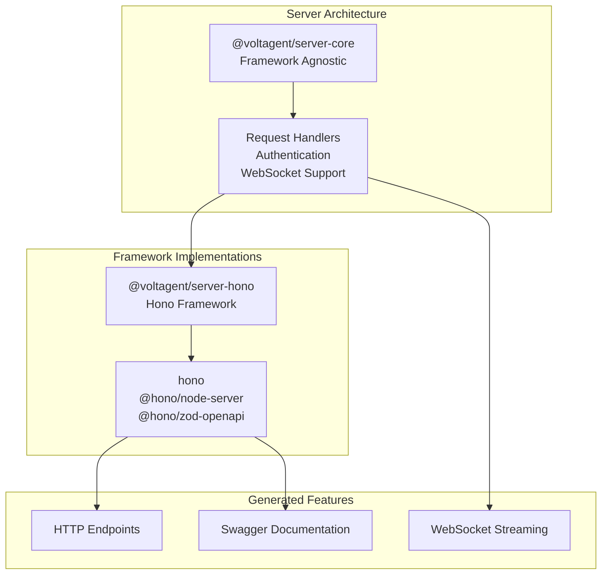

Sources: [packages/server-core/package.json:1-51](), [packages/server-hono/package.json:5-12]()

## Testing and Quality Assurance

### Test Suite Structure

All packages include comprehensive testing:

| Test Type | Purpose | Tools |
|-----------|---------|-------|
| Unit Tests | Individual function testing | `vitest` |
| Integration Tests | Database/API testing | `vitest` with containers |
| Type Tests | TypeScript validation | `tsc --noEmit` |
| Linting | Code quality | `biome` |
| Package Validation | Export verification | `publint`, `attw` |

Sources: [packages/postgres/package.json:48-53](), [packages/supabase/package.json:50-51](), [packages/langfuse-exporter/package.json:43-50]()

### Test Configuration

Packages use standardized test configurations:

- **Test Runner**: `vitest` with TypeScript support
- **Coverage**: `@vitest/coverage-v8` for coverage reports
- **Mocking**: Built-in vitest mocking capabilities
- **CI Integration**: GitHub Actions workflows

Sources: [packages/libsql/package.json:52-53](), [packages/voice/package.json:47-48]()

## Publishing and Distribution

### Package Exports

All packages support dual module formats:

```javascript
"exports": {
  ".": {
    "import": {
      "types": "./dist/index.d.mts",
      "default": "./dist/index.mjs"
    },
    "require": {
      "types": "./dist/index.d.ts", 
      "default": "./dist/index.js"
    }
  }
}
```

Sources: [packages/server-hono/package.json:22-33](), [packages/supabase/package.json:20-31]()

### Peer Dependencies

Packages define peer dependencies for framework integration:

- **Core Framework**: `@voltagent/core ^1.0.0`
- **AI SDK**: `ai ^5.0.0` (for memory adapters)
- **Zod**: `^3.25.0 || ^4.0.0` (for schema validation)

Sources: [packages/supabase/package.json:38-42](), [packages/server-hono/package.json:40-43]()

### Changesets Integration

The monorepo uses Changesets for version management and publishing:

- **Version Management**: Automated semantic versioning
- **Changelog Generation**: Automatic changelog updates
- **Publishing**: Coordinated package releases

Sources: [packages/postgres/CHANGELOG.md:1-503](), [packages/supabase/CHANGELOG.md:1-758]()

---

