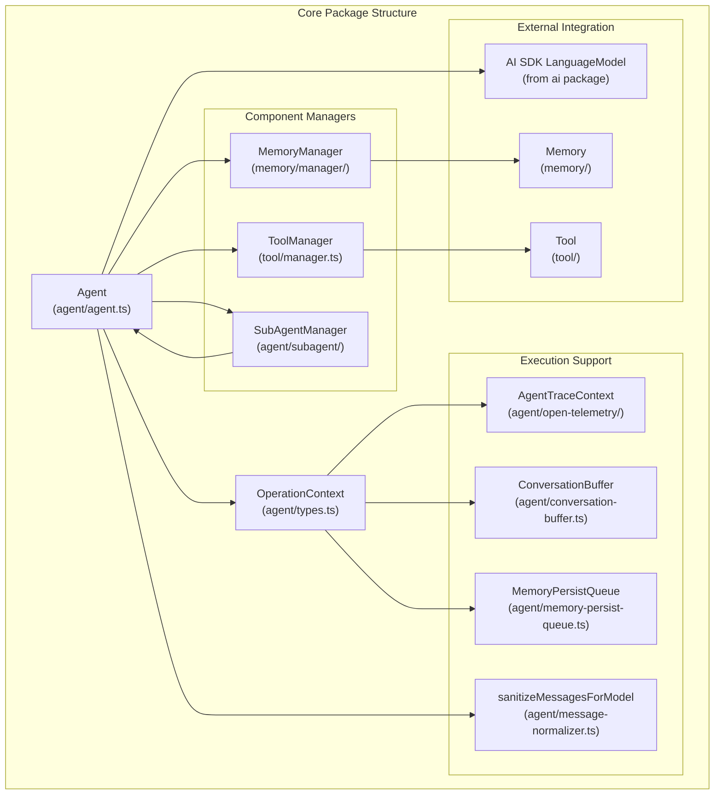
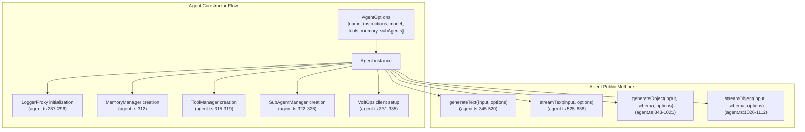
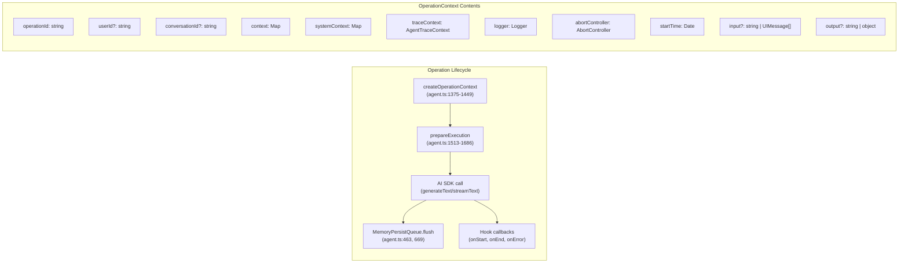
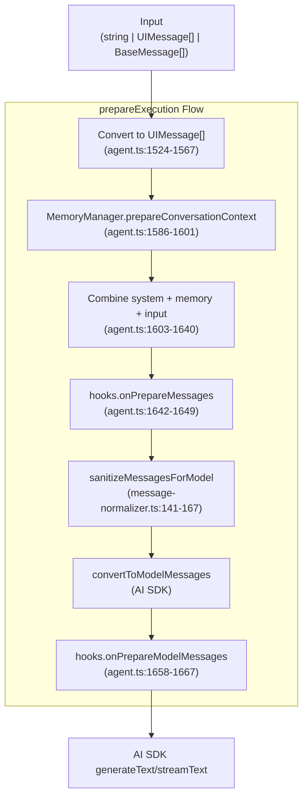
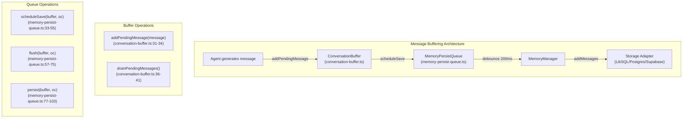

<!-- source: DeepWiki mcp.deepwiki.com · repo voltagent/voltagent · page 2 Core Framework · fetched 2026-10-27 -->

# Core Framework

<details>
<summary>Relevant source files</summary>

The following files were used as context for generating this wiki page:

- [.changeset/config.json](.changeset/config.json)
- [packages/core/src/agent/agent.spec-d.ts](packages/core/src/agent/agent.spec-d.ts)
- [packages/core/src/agent/agent.spec.ts](packages/core/src/agent/agent.spec.ts)
- [packages/core/src/agent/agent.ts](packages/core/src/agent/agent.ts)
- [packages/core/src/agent/hooks/index.spec.ts](packages/core/src/agent/hooks/index.spec.ts)
- [packages/core/src/agent/hooks/index.ts](packages/core/src/agent/hooks/index.ts)
- [packages/core/src/agent/index.ts](packages/core/src/agent/index.ts)
- [packages/core/src/agent/memory-persist-queue.ts](packages/core/src/agent/memory-persist-queue.ts)
- [packages/core/src/agent/message-normalizer.spec.ts](packages/core/src/agent/message-normalizer.spec.ts)
- [packages/core/src/agent/message-normalizer.ts](packages/core/src/agent/message-normalizer.ts)
- [packages/core/src/agent/providers/base/types.ts](packages/core/src/agent/providers/base/types.ts)
- [packages/core/src/agent/subagent/index.spec.ts](packages/core/src/agent/subagent/index.spec.ts)
- [packages/core/src/agent/subagent/index.ts](packages/core/src/agent/subagent/index.ts)
- [packages/core/src/agent/types.ts](packages/core/src/agent/types.ts)
- [packages/core/src/index.ts](packages/core/src/index.ts)
- [packages/core/src/memory/manager/memory-manager.ts](packages/core/src/memory/manager/memory-manager.ts)
- [website/docs/agents/context.md](website/docs/agents/context.md)
- [website/docs/agents/hooks.md](website/docs/agents/hooks.md)
- [website/docs/agents/overview.md](website/docs/agents/overview.md)
- [website/docs/agents/subagents.md](website/docs/agents/subagents.md)
- [website/docs/agents/tools.md](website/docs/agents/tools.md)

</details>


**Purpose and Scope**: This document describes the `@voltagent/core` package, which provides the fundamental abstractions and orchestration layer for building AI agents. It covers the `Agent` class architecture, execution contexts, the lifecycle pipeline, and core component managers (tools, memory, sub-agents). For detailed information about specific subsystems, see:
- Agent configuration and methods → [Agent System](#2.1)
- Multi-agent coordination → [SubAgent and Multi-Agent Systems](#2.2)
- Lifecycle extension points → [Agent Lifecycle and Hooks](#2.3)
- Memory persistence → [Memory System](#2.7)

---

## Package Architecture

The `@voltagent/core` package is structured around a central `Agent` class that orchestrates multiple manager components. Each manager handles a specific concern (tools, memory, sub-agents) and operates within the context of an `OperationContext` that flows through the entire execution pipeline.



**Core Class Relationships**

| Component | File Path | Primary Responsibility |
|-----------|-----------|------------------------|
| `Agent` | [packages/core/src/agent/agent.ts]() | Main orchestrator, exposes `generateText`, `streamText`, `generateObject`, `streamObject` |
| `OperationContext` | [packages/core/src/agent/types.ts:626-674]() | Per-operation state container with `operationId`, `userId`, `conversationId`, context maps |
| `MemoryManager` | [packages/core/src/memory/manager/memory-manager.ts:28-86]() | Coordinates conversation persistence and retrieval |
| `ToolManager` | [packages/core/src/tool/manager.ts]() | Registers and executes tools, handles tool errors |
| `SubAgentManager` | [packages/core/src/agent/subagent/index.ts:35-71]() | Manages delegation via `delegate_task` tool |
| `AgentTraceContext` | [packages/core/src/agent/open-telemetry/trace-context.ts]() | OpenTelemetry span hierarchy management |

**Sources**: [packages/core/src/agent/agent.ts:241-336](), [packages/core/src/agent/types.ts:626-674](), [packages/core/src/memory/manager/memory-manager.ts:28-86](), [packages/core/src/agent/subagent/index.ts:35-71]()

---

## Agent Class: Central Orchestrator

The `Agent` class (defined in [packages/core/src/agent/agent.ts:241]()) is the primary entry point for all agent operations. It initializes component managers, processes execution options, and delegates to the AI SDK for LLM interactions.



**Key Agent Properties**

| Property | Type | Description |
|----------|------|-------------|
| `id` | `string` | Agent identifier (auto-generated or custom) |
| `name` | `string` | Human-readable agent name |
| `instructions` | `InstructionsDynamicValue` | System message (static string or dynamic function) |
| `model` | `LanguageModel \| DynamicValue<LanguageModel>` | AI SDK model instance or resolver |
| `maxSteps` | `number` | Maximum tool execution iterations (default: 5) |
| `temperature` | `number?` | Default LLM temperature |
| `maxOutputTokens` | `number?` | Default token limit |
| `hooks` | `AgentHooks` | Lifecycle event handlers |

**Constructor Initialization Sequence**:
1. Store basic config (`id`, `name`, `instructions`, `model`, `temperature`, etc.) - [agent.ts:269-284]()
2. Create `LoggerProxy` with agent metadata - [agent.ts:287-296]()
3. Initialize `MemoryManager` with provided or default memory - [agent.ts:312]()
4. Create `ToolManager` with static tools - [agent.ts:315-316]()
5. Initialize `SubAgentManager` with sub-agents - [agent.ts:322-326]()
6. Setup VoltOps prompt helper if client provided - [agent.ts:331-335]()

**Sources**: [packages/core/src/agent/agent.ts:241-336](), [packages/core/src/agent/types.ts:253-300]()

---

## Execution Model and Operation Context

Every agent method call (`generateText`, `streamText`, etc.) creates a new `OperationContext` that flows through the entire execution pipeline. This context carries user-provided data, system state, tracing information, and references to component instances.



**OperationContext Structure** (defined in [packages/core/src/agent/types.ts:626-674]()):

| Field | Type | Purpose |
|-------|------|---------|
| `operationId` | `string` | Unique identifier for this operation (UUID) |
| `userId` | `string?` | Optional user identifier for memory isolation |
| `conversationId` | `string?` | Optional conversation thread identifier |
| `context` | `Map<string \| symbol, unknown>` | User-managed context (shared across hooks/tools) |
| `systemContext` | `Map<string \| symbol, unknown>` | Internal state (e.g., `uiStreamWriter`, `fullStreamWriter`) |
| `traceContext` | `AgentTraceContext` | OpenTelemetry span hierarchy manager |
| `logger` | `Logger` | Scoped logger with operation metadata |
| `abortController` | `AbortController` | Cancellation signal for LLM and tools |
| `startTime` | `Date` | Operation start timestamp |
| `input` | `string \| UIMessage[] \| BaseMessage[]?` | Original input provided by caller |
| `output` | `string \| object?` | Generated output (populated after completion) |

**Context Creation Flow** ([agent.ts:1375-1449]()):
1. Generate `operationId` using `randomUUID()`
2. Merge agent's default context with call-specific context
3. Create `AgentTraceContext` for OpenTelemetry tracing
4. Initialize scoped logger with `operationId`, `userId`, `conversationId`
5. Create `AbortController` for cancellation support
6. Retrieve or create `ConversationBuffer` from system context
7. Retrieve or create `MemoryPersistQueue` from system context

**Sources**: [packages/core/src/agent/types.ts:626-674](), [packages/core/src/agent/agent.ts:1375-1449]()

---

## Core Component Managers

The `Agent` class delegates specific responsibilities to three manager components, each operating independently but sharing the `OperationContext`.

### MemoryManager

The `MemoryManager` ([memory/manager/memory-manager.ts:28-86]()) coordinates conversation persistence using the `Memory` instance, manages conversation buffers, and handles semantic search when configured.

**Key Methods**:
- `prepareConversationContext(oc, limit?, semanticOptions?)` - Loads conversation history and semantic results - [memory-manager.ts:186-267]()
- `saveMessage(oc, message, userId, conversationId)` - Persists a single message - [memory-manager.ts:341-391]()
- `addConversationEntry(oc, message)` - Adds to in-memory buffer - [memory-manager.ts:299-314]()

**Initialization** ([agent.ts:309-312]()):
```typescript
this.memory = options.memory; // Memory | false | undefined
this.memoryManager = new MemoryManager(this.id, this.memory, {}, this.logger);
```

### ToolManager

The `ToolManager` ([tool/manager.ts]()) handles tool registration, validation, and execution with error handling.

**Key Methods**:
- `addItems(tools)` - Registers tools and toolkits
- `removeItems(names)` - Unregisters tools by name
- `getItems()` - Returns all registered tools
- `createAISDKTools()` - Converts to AI SDK tool format

**Initialization** ([agent.ts:315-319]()):
```typescript
const staticTools = typeof options.tools === "function" ? [] : options.tools;
this.toolManager = new ToolManager(staticTools, this.logger);
if (options.toolkits) {
  this.toolManager.addItems(options.toolkits);
}
```

### SubAgentManager

The `SubAgentManager` ([agent/subagent/index.ts:35-71]()) manages sub-agent delegation, creates the `delegate_task` tool, and forwards stream events.

**Key Methods**:
- `addSubAgent(config)` - Registers a sub-agent - [subagent/index.ts:76-84]()
- `createDelegateTool(options)` - Generates delegation tool - [subagent/index.ts:603-733]()
- `handoffTask(options)` - Executes delegation - [subagent/index.ts:296-596]()
- `generateSupervisorSystemMessage(base, memory, config?)` - Builds supervisor prompt - [subagent/index.ts:213-284]()

**Initialization** ([agent.ts:322-326]()):
```typescript
this.subAgentManager = new SubAgentManager(
  this.name,
  options.subAgents || [],
  this.supervisorConfig,
);
```

**Sources**: [packages/core/src/memory/manager/memory-manager.ts:28-86](), [packages/core/src/tool/manager.ts](), [packages/core/src/agent/subagent/index.ts:35-71]()

---

## Message Processing Pipeline

Before messages reach the AI SDK, they pass through a normalization pipeline that sanitizes metadata, removes internal tool calls, and converts between VoltAgent's `UIMessage` format and the provider's `ModelMessage` format.



**Message Normalization** ([message-normalizer.ts:141-167]()):

The `sanitizeMessagesForModel` function performs these transformations:
1. **Remove working memory tool calls** - Strips `update_working_memory`, `get_working_memory` tool parts - [message-normalizer.ts:100-104]()
2. **Strip provider metadata** - Removes `callProviderMetadata`, `providerMetadata` from tool parts to avoid GPT-5 errors - [message-normalizer.ts:113-137]()
3. **Drop empty messages** - Removes messages with only whitespace or no valid parts - [message-normalizer.ts:161-164]()
4. **Trim reasoning noise** - Removes empty reasoning blocks - [message-normalizer.ts:71-92]()

**Key Functions**:
- `sanitizeMessageForModel(message)` - Processes a single message - [message-normalizer.ts:102-139]()
- `sanitizeMessagesForModel(messages)` - Batch processor - [message-normalizer.ts:141-167]()

**Hook Integration** ([agent.ts:1642-1667]()):
- `onPrepareMessages` - Called after sanitization but before model conversion, allows UI message transformation
- `onPrepareModelMessages` - Called after model conversion, allows final provider-specific adjustments

**Sources**: [packages/core/src/agent/message-normalizer.ts:141-167](), [packages/core/src/agent/agent.ts:1513-1686]()

---

## Persistence and Buffering Strategy

VoltAgent implements a debounced persistence strategy to minimize database writes during multi-step agent executions. Messages accumulate in a `ConversationBuffer` and are flushed via a `MemoryPersistQueue` with configurable debounce intervals.



**ConversationBuffer** ([conversation-buffer.ts:8-45]()):
- Temporary in-memory storage for messages within an operation
- Stored in `OperationContext.systemContext` with symbol key `BUFFER_CONTEXT_KEY`
- Methods: `addPendingMessage(message)`, `drainPendingMessages()`

**MemoryPersistQueue** ([memory-persist-queue.ts:20-122]()):
- Debounces saves with 200ms default delay - [memory-persist-queue.ts:29]()
- Maintains per-conversation queue entries keyed by `userId:conversationId`
- Clears timer and flushes on explicit `flush()` call - [memory-persist-queue.ts:57-75]()
- Enqueues background operations with 5 retries and 30s timeout

**Flush Timing**:
1. **During execution**: Each step schedules a debounced save - via `MemoryManager.addConversationEntry()`
2. **At completion**: Explicit flush before `onEnd` hook - [agent.ts:463](), [agent.ts:669]()
3. **On error**: Best-effort flush via `flushPendingMessagesOnError()` - [agent.ts:516]()

**Sources**: [packages/core/src/agent/conversation-buffer.ts:8-45](), [packages/core/src/agent/memory-persist-queue.ts:20-122](), [packages/core/src/agent/agent.ts:463-478]()

---

## Integration with AI SDK

The `Agent` class wraps the Vercel AI SDK's `generateText`, `streamText`, `generateObject`, and `streamObject` functions, adding VoltAgent-specific features while preserving all AI SDK capabilities.

**AI SDK Integration Points**:

| VoltAgent Method | AI SDK Function | Return Type Enhancement |
|------------------|-----------------|-------------------------|
| `agent.generateText()` | `ai.generateText()` | Adds `context: Map<string \| symbol, unknown>` to result |
| `agent.streamText()` | `ai.streamText()` | Adds `context` property, wraps `fullStream` for sub-agent events |
| `agent.generateObject()` | `ai.generateObject()` | Adds `context` property |
| `agent.streamObject()` | `ai.streamObject()` | Adds `context` property |

**Model Resolution** ([agent.ts:1799-1820]()):
- Static `LanguageModel` instances used directly
- Dynamic `DynamicValue<LanguageModel>` functions called with `{ context: oc.context }`
- Dynamic models enable per-request model selection (e.g., based on user tier)

**Tool Conversion** ([agent.ts:1689-1728]()):
- VoltAgent `Tool` instances converted to AI SDK tool format
- Dynamic tools resolved via `DynamicValue` function
- Sub-agent `delegate_task` tool automatically added if sub-agents configured
- Tools merged: static + dynamic + delegation

**Step Handler Integration** ([agent.ts:1918-2088]()):
- VoltAgent creates `onStepFinish` callback to intercept each LLM step
- Populates `conversationSteps` array in `OperationContext`
- Triggers tool execution hooks (`onToolStart`, `onToolEnd`)
- Handles sub-agent delegation via `delegate_task` tool
- Manages `ConversationBuffer` for message accumulation

**Sources**: [packages/core/src/agent/agent.ts:443-461](), [packages/core/src/agent/agent.ts:1799-1820](), [packages/core/src/agent/agent.ts:1689-1728](), [packages/core/src/agent/agent.ts:1918-2088]()

---

## Type System and Options

The `@voltagent/core` package uses TypeScript extensively to provide type safety for agent configuration, execution options, and result types.

**Key Type Definitions**:

| Type | File | Purpose |
|------|------|---------|
| `AgentOptions` | [agent/types.ts:253-300]() | Agent constructor configuration |
| `BaseGenerationOptions` | [agent/agent.ts:176-226]() | Shared options for all generation methods |
| `GenerateTextOptions` | [agent/agent.ts:228]() | `generateText`-specific options |
| `StreamTextOptions` | [agent/agent.ts:229-231]() | `streamText` with `onFinish` callback |
| `OperationContext` | [agent/types.ts:626-674]() | Per-operation state container |
| `DynamicValue<T>` | [voltops/types.ts]() | Function that resolves value at runtime |
| `InstructionsDynamicValue` | [agent/types.ts:131]() | Static string or dynamic prompt resolver |

**Dynamic Value Pattern** ([agent/types.ts:40]()):
```typescript
// Static value
const model = openai("gpt-4o");

// Dynamic value
const model: DynamicValue<LanguageModel> = async (options) => {
  const tier = options.context?.get("userTier");
  return tier === "premium" ? openai("gpt-4o") : openai("gpt-4o-mini");
};
```

**Result Type Extensions**:
- `GenerateTextResultWithContext` - AI SDK result + `context` property - [agent/agent.ts:156-162]()
- `StreamTextResultWithContext` - AI SDK result + `context` + wrapped `fullStream` - [agent/agent.ts:108-133]()
- `GenerateObjectResultWithContext` - AI SDK result + `context` - [agent/agent.ts:167-170]()
- `StreamObjectResultWithContext` - AI SDK result + `context` - [agent/agent.ts:138-151]()

**Sources**: [packages/core/src/agent/types.ts:253-300](), [packages/core/src/agent/agent.ts:176-226](), [packages/core/src/agent/types.ts:626-674]()

---

