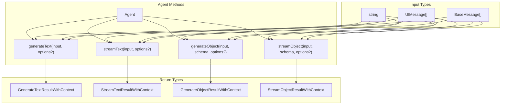

<!-- source: DeepWiki mcp.deepwiki.com · repo voltagent/voltagent · page 2.1 Agent System · fetched 2026-10-27 -->

# Agent System

<details>
<summary>Relevant source files</summary>

The following files were used as context for generating this wiki page:

- [.changeset/config.json](.changeset/config.json)
- [packages/core/src/agent/agent.spec-d.ts](packages/core/src/agent/agent.spec-d.ts)
- [packages/core/src/agent/agent.spec.ts](packages/core/src/agent/agent.spec.ts)
- [packages/core/src/agent/agent.ts](packages/core/src/agent/agent.ts)
- [packages/core/src/agent/hooks/index.spec.ts](packages/core/src/agent/hooks/index.spec.ts)
- [packages/core/src/agent/hooks/index.ts](packages/core/src/agent/hooks/index.ts)
- [packages/core/src/agent/index.ts](packages/core/src/agent/index.ts)
- [packages/core/src/agent/memory-persist-queue.ts](packages/core/src/agent/memory-persist-queue.ts)
- [packages/core/src/agent/message-normalizer.spec.ts](packages/core/src/agent/message-normalizer.spec.ts)
- [packages/core/src/agent/message-normalizer.ts](packages/core/src/agent/message-normalizer.ts)
- [packages/core/src/agent/providers/base/types.ts](packages/core/src/agent/providers/base/types.ts)
- [packages/core/src/agent/subagent/index.spec.ts](packages/core/src/agent/subagent/index.spec.ts)
- [packages/core/src/agent/subagent/index.ts](packages/core/src/agent/subagent/index.ts)
- [packages/core/src/agent/types.ts](packages/core/src/agent/types.ts)
- [packages/core/src/index.ts](packages/core/src/index.ts)
- [packages/core/src/memory/manager/memory-manager.ts](packages/core/src/memory/manager/memory-manager.ts)
- [website/docs/agents/context.md](website/docs/agents/context.md)
- [website/docs/agents/hooks.md](website/docs/agents/hooks.md)
- [website/docs/agents/overview.md](website/docs/agents/overview.md)
- [website/docs/agents/subagents.md](website/docs/agents/subagents.md)
- [website/docs/agents/tools.md](website/docs/agents/tools.md)

</details>


The `Agent` class is the central building block of VoltAgent, providing a unified interface for creating AI agents that interact with Large Language Models (LLMs), execute tools, maintain conversation memory, and coordinate with other agents.

This document covers the `Agent` class, its configuration options (`AgentOptions`), and the four core methods for agent interaction: `generateText()`, `streamText()`, `generateObject()`, and `streamObject()`.

For related topics, see:
- [SubAgent and Multi-Agent Systems](#2.2) - Multi-agent coordination patterns
- [Agent Lifecycle and Hooks](#2.3) - Event hooks and lifecycle management
- [Operation Context and Execution](#2.4) - Execution context and flow
- [Message Handling and Normalization](#2.5) - Message processing pipeline
- [Tools and Tool Management](#2.6) - Tool creation and execution
- [Memory System](#2.7) - Conversation persistence and retrieval

## Agent Class Overview

The `Agent` class is defined in [packages/core/src/agent/agent.ts:241]() and provides the primary interface for agent operations. Each agent instance is configured with:

- **Identity**: `name` and optional `id` for agent identification
- **Behavior**: `instructions` defining agent personality and capabilities
- **Model**: `LanguageModel` from AI SDK for LLM integration
- **Capabilities**: Optional `tools`, `memory`, `subAgents`, and `retriever`
- **Observability**: Built-in `Logger`, `AgentTraceContext`, and `VoltAgentObservability`

```mermaid
graph TB
    subgraph "Agent Public API"
        Agent["Agent Class"]
        generateText["generateText()"]
        streamText["streamText()"]
        generateObject["generateObject()"]
        streamObject["streamObject()"]
    end
    
    subgraph "Configuration"
        AgentOptions["AgentOptions"]
        name["name: string"]
        instructions["instructions: string | DynamicValue"]
        model["model: LanguageModel | DynamicValue"]
        tools["tools?: Tool[] | DynamicValue"]
        memory["memory?: Memory | false"]
        subAgents["subAgents?: SubAgentConfig[]"]
    end
    
    subgraph "Internal Managers"
        ToolManager["ToolManager"]
        SubAgentManager["SubAgentManager"]
        MemoryManager["MemoryManager"]
    end
    
    subgraph "External Dependencies"
        LanguageModel["LanguageModel (AI SDK v5)"]
        Memory["Memory (conversation storage)"]
        BaseRetriever["BaseRetriever (RAG)"]
    end
    
    Agent --> AgentOptions
    AgentOptions --> name
    AgentOptions --> instructions
    AgentOptions --> model
    AgentOptions --> tools
    AgentOptions --> memory
    AgentOptions --> subAgents
    
    Agent --> generateText
    Agent --> streamText
    Agent --> generateObject
    Agent --> streamObject
    
    Agent --> ToolManager
    Agent --> SubAgentManager
    Agent --> MemoryManager
    
    Agent --> LanguageModel
    MemoryManager --> Memory
    Agent --> BaseRetriever
```



**Agent Class Architecture**

The `Agent` class coordinates between multiple internal managers:
- `ToolManager`: Handles tool registration and execution (see [Tools and Tool Management](#2.6))
- `SubAgentManager`: Manages task delegation to specialized agents (see [SubAgent and Multi-Agent Systems](#2.2))
- `MemoryManager`: Manages conversation persistence and retrieval (see [Memory System](#2.7))

Sources: [packages/core/src/agent/agent.ts:241-336](), [packages/core/src/agent/types.ts:253-301]()

## AgentOptions Configuration

The `Agent` constructor accepts an `AgentOptions` object defined in [packages/core/src/agent/types.ts:253-301]() that configures all aspects of agent behavior.

### Required Options

| Option | Type | Description |
|--------|------|-------------|
| `name` | `string` | Agent identifier and display name, used in logs and delegation |
| `instructions` | `InstructionsDynamicValue` | Agent behavior guidelines (static string or dynamic function) |
| `model` | `LanguageModel \| DynamicValue<LanguageModel>` | AI SDK v5 `LanguageModel` instance or dynamic selector |

### Optional Configuration

| Option | Type | Default | Description |
|--------|------|---------|-------------|
| `id` | `string` | `name` | Unique identifier (auto-generated from `name` if not provided) |
| `purpose` | `string` | - | Brief description used in supervisor context |
| `tools` | `(Tool \| Toolkit)[] \| DynamicValue` | `[]` | Available tools for agent execution |
| `toolkits` | `Toolkit[]` | `[]` | Tool collections for modular capability management |
| `memory` | `Memory \| false` | `InMemory` | Conversation persistence (set `false` to disable) |
| `retriever` | `BaseRetriever` | - | RAG retriever for context augmentation |
| `subAgents` | `SubAgentConfig[]` | `[]` | Specialized agents for task delegation |
| `supervisorConfig` | `SupervisorConfig` | - | Supervisor behavior customization (when `subAgents` provided) |

### Execution Parameters

| Option | Type | Default | Description |
|--------|------|---------|-------------|
| `maxSteps` | `number` | `5` | Maximum tool execution iterations per operation |
| `stopWhen` | `StopWhen` | `stepCountIs(maxSteps)` | Custom stop condition for ai-sdk execution |
| `temperature` | `number` | - | Model creativity (0.0 = deterministic, 1.0 = creative) |
| `maxOutputTokens` | `number` | - | Maximum tokens in model response |
| `markdown` | `boolean` | `false` | Enable automatic markdown formatting in responses |

### System Integration

| Option | Type | Description |
|--------|------|-------------|
| `hooks` | `AgentHooks` | Lifecycle event handlers (see [Agent Lifecycle and Hooks](#2.3)) |
| `logger` | `Logger` | Custom logger instance (defaults to global logger) |
| `voltOpsClient` | `VoltOpsClient` | VoltOps integration for prompt management and observability |
| `observability` | `VoltAgentObservability` | Custom observability configuration |
| `context` | `ContextInput` | Default context map for all operations |
| `voice` | `Voice` | Voice synthesis configuration |

### Dynamic Values

Dynamic values enable runtime configuration based on context. The `DynamicValue<T>` type is defined in [packages/core/src/voltops/types.ts]():

```typescript
type DynamicValue<T> = (options: DynamicValueOptions) => Promise<T> | T;

interface DynamicValueOptions {
  context?: Map<string | symbol, unknown>;
}
```

**Example: Dynamic model selection based on user tier**

```typescript
import { Agent } from "@voltagent/core";
import { openai } from "@ai-sdk/openai";

const agent = new Agent({
  name: "Assistant",
  instructions: "You are a helpful assistant",
  // Dynamic model selection
  model: async ({ context }) => {
    const tier = context?.get("userTier");
    return tier === "premium" ? openai("gpt-4o") : openai("gpt-4o-mini");
  }
});

// Use with context
await agent.generateText("Hello", {
  context: new Map([["userTier", "premium"]])
});
```

**Example: Dynamic tools based on permissions**

```typescript
const agent = new Agent({
  name: "Assistant",
  instructions: "You are a helpful assistant",
  model: openai("gpt-4o"),
  // Dynamic tools selection
  tools: async ({ context }) => {
    const permissions = context?.get("permissions") as string[] || [];
    const availableTools = [];
    
    if (permissions.includes("read")) {
      availableTools.push(readTool);
    }
    if (permissions.includes("write")) {
      availableTools.push(writeTool);
    }
    
    return availableTools;
  }
});
```

Sources: [packages/core/src/agent/types.ts:253-301](), [packages/core/src/agent/agent.ts:268-336](), [packages/core/src/voltops/types.ts]()

## Core Agent Methods

The `Agent` class provides four primary methods for interacting with language models, each serving different use cases.

### Method Overview



**Agent Method Overview**

### generateText()

Generates a complete text response. The method waits for the LLM to finish processing (including all tool calls) before returning the full result.

**Signature**: [packages/core/src/agent/agent.ts:345-520]()

```typescript
async generateText(
  input: string | UIMessage[] | BaseMessage[],
  options?: GenerateTextOptions
): Promise<GenerateTextResultWithContext>
```

**Return Type**: `GenerateTextResultWithContext` extends AI SDK's `GenerateTextResult` with an additional `context` field:

```typescript
interface GenerateTextResultWithContext {
  text: string;
  usage: LanguageModelUsage;
  finishReason: string;
  toolCalls: ToolCall[];
  toolResults: ToolResult[];
  warnings?: CallWarning[];
  response: ProviderResponse;
  context: Map<string | symbol, unknown>;
}
```

**Example Usage**:

```typescript
// Simple text input
const result = await agent.generateText("What is the capital of France?");
console.log(result.text); // "The capital of France is Paris."
console.log(result.usage.totalTokens); // e.g., 45

// With options
const result = await agent.generateText("Tell me a joke", {
  temperature: 0.9,
  maxOutputTokens: 100,
  userId: "user-123",
  conversationId: "conv-456"
});

// With UIMessage array (for multi-turn conversations)
const result = await agent.generateText([
  { role: "user", parts: [{ type: "text", text: "Hello" }] },
  { role: "assistant", parts: [{ type: "text", text: "Hi there!" }] },
  { role: "user", parts: [{ type: "text", text: "What's the weather?" }] }
]);
```

Sources: [packages/core/src/agent/agent.ts:345-520]()

### streamText()

Generates a streaming text response, providing real-time updates as tokens are generated. Useful for interactive UIs where you want to display text as it's being generated.

**Signature**: [packages/core/src/agent/agent.ts:525-838]()

```typescript
async streamText(
  input: string | UIMessage[] | BaseMessage[],
  options?: StreamTextOptions
): Promise<StreamTextResultWithContext>
```

**Return Type**: `StreamTextResultWithContext` extends AI SDK's `StreamTextResult`:

```typescript
interface StreamTextResultWithContext {
  text: Promise<string>;
  textStream: AsyncIterableStream<string>;
  fullStream: AsyncIterable<VoltAgentTextStreamPart>;
  usage: Promise<LanguageModelUsage>;
  finishReason: Promise<FinishReason>;
  toUIMessageStream(): AsyncIterable<UIMessage>;
  toUIMessageStreamResponse(options?): Response;
  context: Map<string | symbol, unknown>;
}
```

**Example Usage**:

```typescript
// Stream to console
const stream = await agent.streamText("Write a short story");

for await (const chunk of stream.textStream) {
  process.stdout.write(chunk);
}

// Access final result
const finalText = await stream.text;
const usage = await stream.usage;
console.log(`Total tokens: ${usage.totalTokens}`);

// Use fullStream for detailed events
const stream = await agent.streamText("Calculate 123 * 456");

for await (const event of stream.fullStream) {
  if (event.type === "text-delta") {
    process.stdout.write(event.textDelta);
  } else if (event.type === "tool-call") {
    console.log(`\nUsing tool: ${event.toolName}`);
  } else if (event.type === "tool-result") {
    console.log(`Tool completed: ${event.toolName}`);
  }
}
```

Sources: [packages/core/src/agent/agent.ts:525-838]()

### generateObject()

Generates a structured object conforming to a Zod schema. The LLM returns data in a validated structure rather than free-form text.

**Signature**: [packages/core/src/agent/agent.ts:843-1021]()

```typescript
async generateObject<T extends z.ZodType>(
  input: string | UIMessage[] | BaseMessage[],
  schema: T,
  options?: GenerateObjectOptions
): Promise<GenerateObjectResultWithContext<z.infer<T>>>
```

**Return Type**: `GenerateObjectResultWithContext<T>` extends AI SDK's `GenerateObjectResult`:

```typescript
interface GenerateObjectResultWithContext<T> {
  object: T;
  usage: LanguageModelUsage;
  finishReason: string;
  warnings?: CallWarning[];
  response: ProviderResponse;
  context: Map<string | symbol, unknown>;
}
```

**Example Usage**:

```typescript
import { z } from "zod";

// Define schema
const PersonSchema = z.object({
  name: z.string(),
  age: z.number(),
  occupation: z.string(),
  skills: z.array(z.string())
});

// Generate object
const result = await agent.generateObject(
  "Create a profile for a software engineer named Alice",
  PersonSchema
);

console.log(result.object);
// {
//   name: "Alice",
//   age: 28,
//   occupation: "Software Engineer",
//   skills: ["JavaScript", "TypeScript", "React", "Node.js"]
// }

// Type-safe access
const name: string = result.object.name; // TypeScript knows the type
const age: number = result.object.age;
```

Sources: [packages/core/src/agent/agent.ts:843-1021]()

### streamObject()

Generates a structured object with streaming updates. Provides partial objects as they're being constructed by the LLM.

**Signature**: [packages/core/src/agent/agent.ts:1026-1150]()

```typescript
async streamObject<T extends z.ZodType>(
  input: string | UIMessage[] | BaseMessage[],
  schema: T,
  options?: StreamObjectOptions
): Promise<StreamObjectResultWithContext<z.infer<T>>>
```

**Return Type**: `StreamObjectResultWithContext<T>` extends AI SDK's `StreamObjectResult`:

```typescript
interface StreamObjectResultWithContext<T> {
  object: Promise<T>;
  partialObjectStream: ReadableStream<Partial<T>>;
  textStream: AsyncIterableStream<string>;
  usage: Promise<LanguageModelUsage>;
  finishReason: Promise<FinishReason>;
  context: Map<string | symbol, unknown>;
}
```

**Example Usage**:

```typescript
import { z } from "zod";

const RecipeSchema = z.object({
  name: z.string(),
  ingredients: z.array(z.string()),
  steps: z.array(z.string()),
  prepTime: z.number()
});

const stream = await agent.streamObject(
  "Create a recipe for chocolate chip cookies",
  RecipeSchema
);

// Stream partial updates
for await (const partial of stream.partialObjectStream) {
  console.log("Partial update:", partial);
  // First iteration: { name: "Chocolate Chip Cookies" }
  // Second iteration: { name: "...", ingredients: ["flour", "sugar"] }
  // etc.
}

// Get final complete object
const finalRecipe = await stream.object;
console.log("Complete recipe:", finalRecipe);
```

Sources: [packages/core/src/agent/agent.ts:1026-1150]()

## Method Options

All four methods accept similar options through `BaseGenerationOptions` [packages/core/src/agent/agent.ts:176-226]():

### Context and Identity

| Option | Type | Description |
|--------|------|-------------|
| `userId` | `string` | User identifier for memory isolation and logging |
| `conversationId` | `string` | Conversation thread identifier for memory retrieval |
| `context` | `ContextInput` | Custom context map for this operation |
| `parentAgentId` | `string` | Parent agent ID when called as subagent |
| `parentOperationContext` | `OperationContext` | Parent operation context for delegation chains |
| `parentSpan` | `Span` | OpenTelemetry parent span for trace hierarchy |

### Memory and Context

| Option | Type | Description |
|--------|------|-------------|
| `contextLimit` | `number` | Maximum number of conversation messages to load |
| `semanticMemory` | `object` | Semantic search configuration for memory retrieval |
| `semanticMemory.enabled` | `boolean` | Enable semantic search |
| `semanticMemory.semanticLimit` | `number` | Number of semantic results to retrieve |
| `semanticMemory.semanticThreshold` | `number` | Similarity threshold (0.0-1.0) |
| `semanticMemory.mergeStrategy` | `"prepend" \| "append" \| "interleave"` | How to merge semantic results with recent messages |

### Execution Control

| Option | Type | Description |
|--------|------|-------------|
| `maxSteps` | `number` | Maximum tool execution iterations (overrides agent default) |
| `stopWhen` | `StopWhen` | Custom stop condition for ai-sdk execution |
| `tools` | `(Tool \| Toolkit)[]` | Additional tools for this operation only |
| `hooks` | `AgentHooks` | Operation-specific hooks (merged with agent hooks) |
| `abortSignal` | `AbortSignal` | Signal for operation cancellation |

### Model Parameters

| Option | Type | Description |
|--------|------|-------------|
| `temperature` | `number` | Override agent's temperature setting |
| `maxOutputTokens` | `number` | Override agent's token limit |
| `topP` | `number` | Nucleus sampling parameter |
| `topK` | `number` | Top-K sampling parameter |
| `presencePenalty` | `number` | Penalize tokens based on presence |
| `frequencyPenalty` | `number` | Penalize tokens based on frequency |
| `stopSequences` | `string[]` | Sequences that stop generation |
| `seed` | `number` | Random seed for reproducible outputs |

### Provider-Specific

| Option | Type | Description |
|--------|------|-------------|
| `providerOptions` | `ProviderOptions` | Provider-specific model configuration |
| `experimental_output` | `Output.object() \| Output.text()` | AI SDK experimental structured output |

**Example with Multiple Options**:

```typescript
const result = await agent.generateText("What's the weather in Paris?", {
  // Context
  userId: "user-123",
  conversationId: "conv-456",
  context: new Map([["userLocation", "Paris"]]),
  
  // Memory
  contextLimit: 10,
  semanticMemory: {
    enabled: true,
    semanticLimit: 5,
    semanticThreshold: 0.7,
    mergeStrategy: "prepend"
  },
  
  // Execution
  maxSteps: 3,
  temperature: 0.7,
  maxOutputTokens: 500,
  
  // Additional tools
  tools: [weatherTool]
});
```

Sources: [packages/core/src/agent/agent.ts:176-226]()

## Agent Methods

### Text Generation Methods

| Method | Return Type | Description |
|--------|-------------|-------------|
| `generateText()` | `GenerateTextResultWithContext` | Complete text response with usage info |
| `streamText()` | `StreamTextResultWithContext` | Streaming text with real-time updates |
| `generateObject()` | `GenerateObjectResultWithContext<T>` | Structured object conforming to Zod schema |
| `streamObject()` | `StreamObjectResultWithContext<T>` | Streaming structured object generation |

All methods accept the same base options:

```typescript
interface BaseGenerationOptions {
  userId?: string;
  conversationId?: string;
  context?: ContextInput;
  maxSteps?: number;
  tools?: (Tool | Toolkit)[];
  hooks?: AgentHooks;
  temperature?: number;
  maxOutputTokens?: number;
}
```

Sources: [packages/core/src/agent/agent.ts:169-229](), [packages/core/src/agent/agent.ts:335-1150]()

### Context Management

The agent automatically creates and manages `OperationContext` for each method call:

```typescript
private createOperationContext(
  input: string | UIMessage[] | BaseMessage[],
  options?: BaseGenerationOptions
): OperationContext
```

This context provides:
- Unique operation IDs for tracing
- Execution-scoped logging
- OpenTelemetry span management
- Resource cleanup via `AbortController`

Sources: [packages/core/src/agent/agent.ts:1188-1264]()

## Tool Integration

The agent integrates with the tool system through `ToolManager`, which handles:

- Tool registration and validation
- AI SDK tool format conversion via `getToolsForAI()`
- Step execution handling through `createStepHandler()`
- SubAgent delegation via automatic `delegate_task` tool injection

Sources: [packages/core/src/tool/manager.ts](), [packages/core/src/agent/agent.ts:1425-1500]()

## Observability Integration

The agent provides comprehensive observability through:

- `AgentTraceContext` for OpenTelemetry span management
- Automatic span attribute population with model parameters
- Usage tracking and performance metrics
- Error tracking and status reporting
- Integration with VoltOps platform for visual workflow monitoring

Sources: [packages/core/src/agent/open-telemetry/trace-context.ts](), [packages/core/src/agent/agent.ts:355-375]()

---

