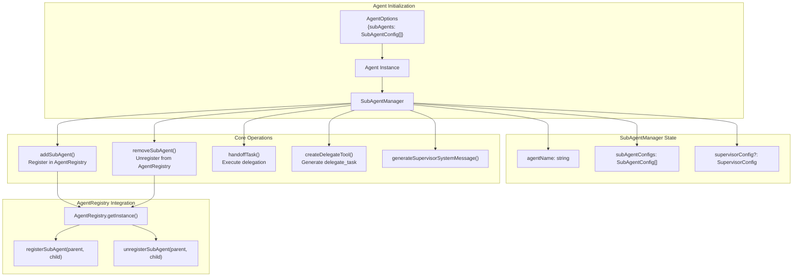
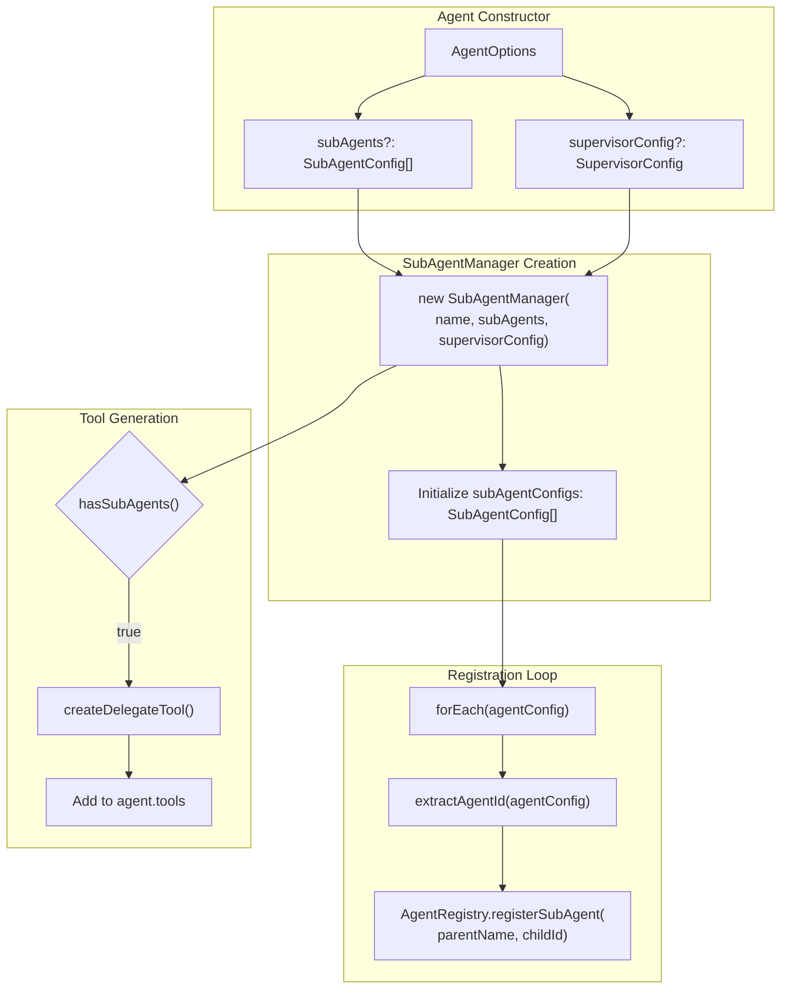
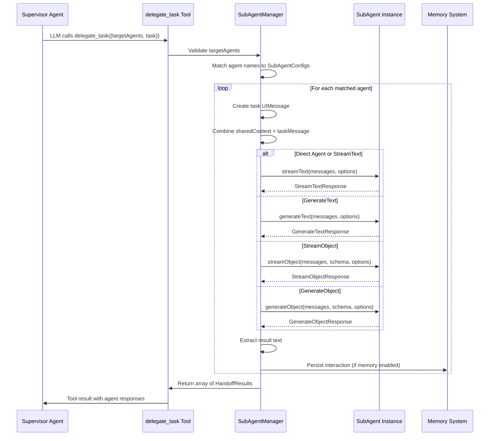
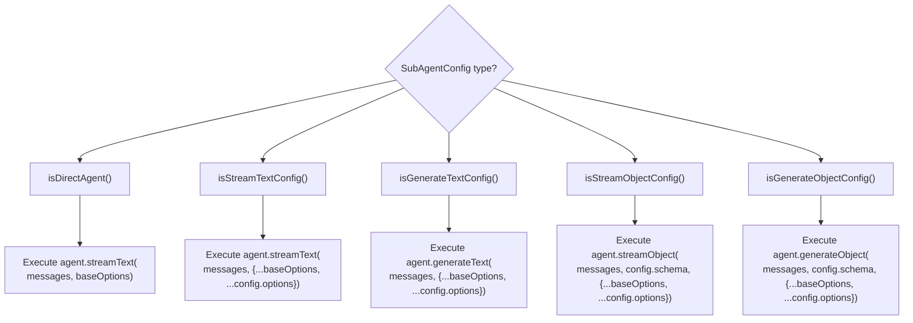
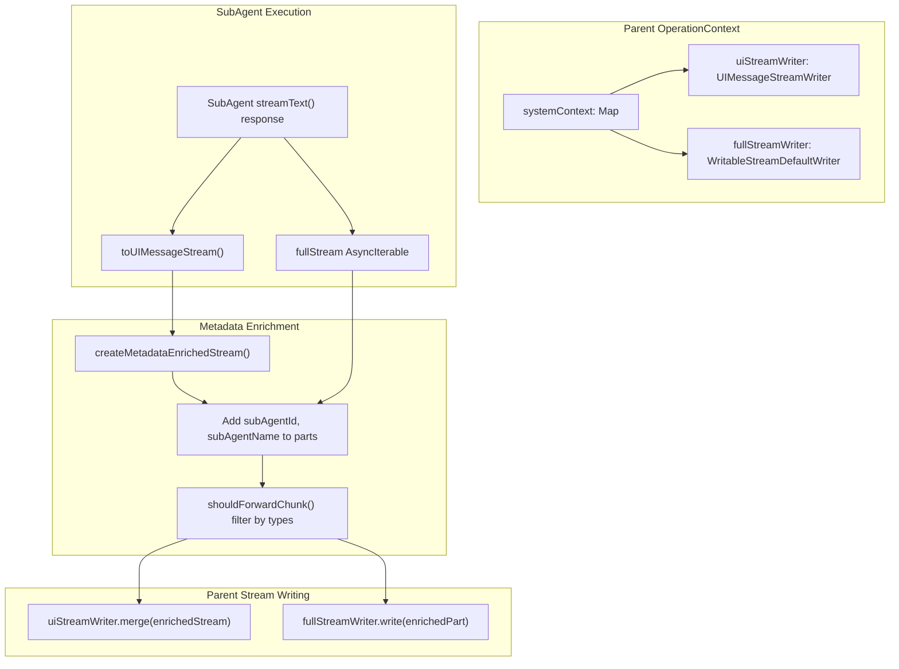
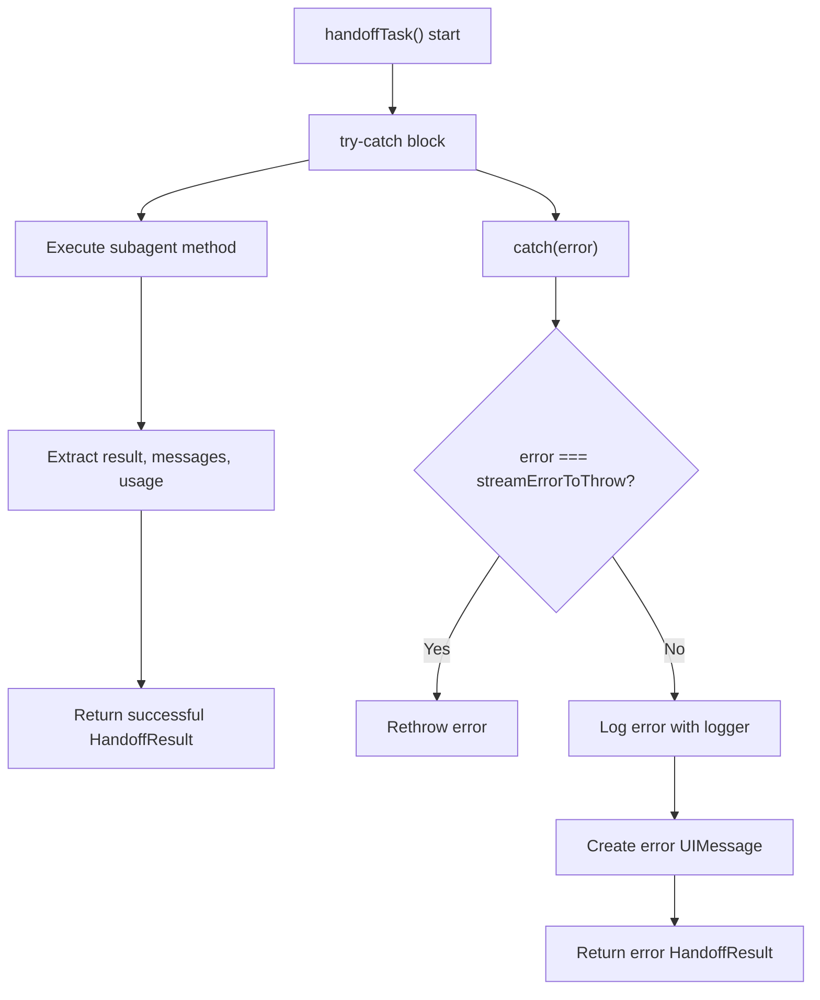
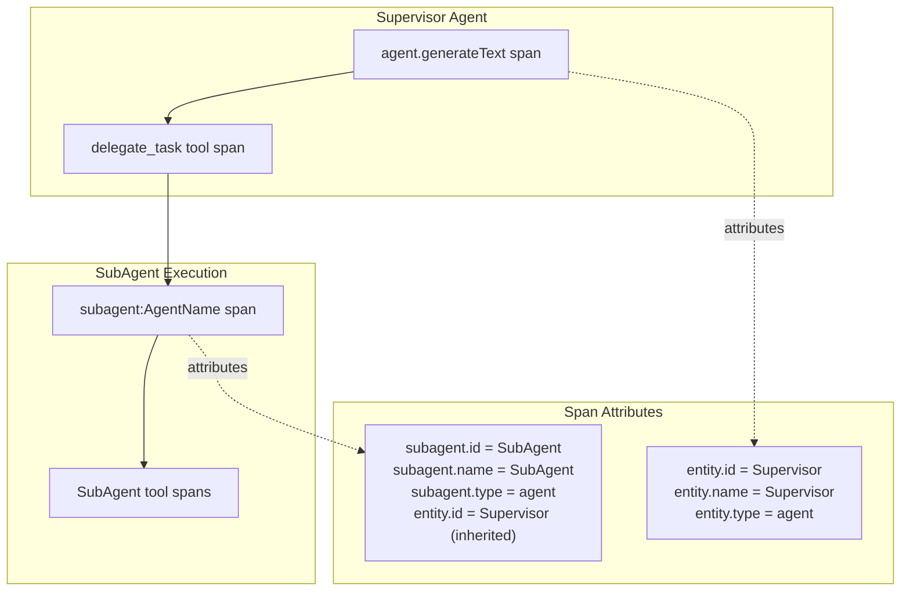
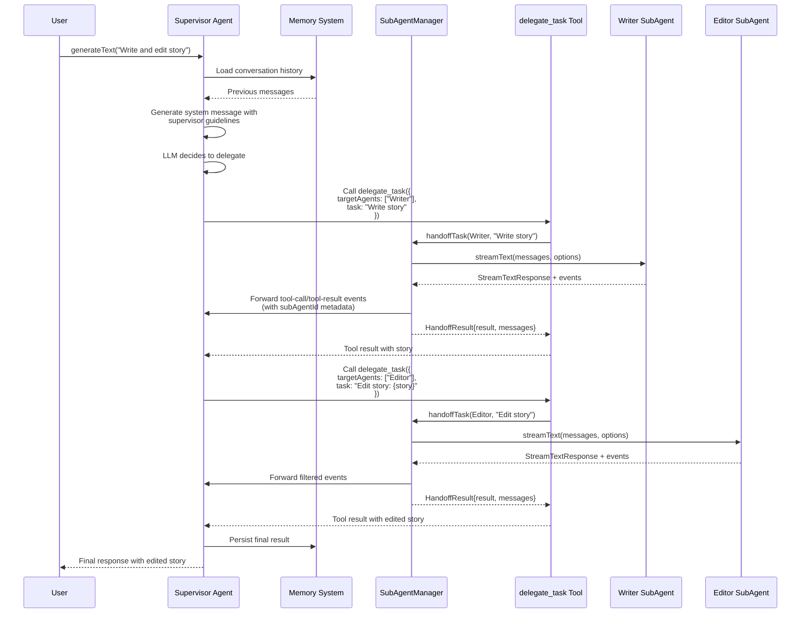

<!-- source: DeepWiki mcp.deepwiki.com · repo voltagent/voltagent · page 2.2 SubAgent and Multi-Agent Systems · fetched 2026-10-27 -->

# SubAgent and Multi-Agent Systems

<details>
<summary>Relevant source files</summary>

The following files were used as context for generating this wiki page:

- [.changeset/config.json](.changeset/config.json)
- [CHANGELOG.md](CHANGELOG.md)
- [changelog.sh](changelog.sh)
- [examples/base/src/index.ts](examples/base/src/index.ts)
- [packages/cli/package.json](packages/cli/package.json)
- [packages/core/src/agent/index.ts](packages/core/src/agent/index.ts)
- [packages/core/src/agent/providers/base/types.ts](packages/core/src/agent/providers/base/types.ts)
- [packages/core/src/agent/subagent/index.spec.ts](packages/core/src/agent/subagent/index.spec.ts)
- [packages/core/src/agent/subagent/index.ts](packages/core/src/agent/subagent/index.ts)
- [packages/core/src/agent/types.ts](packages/core/src/agent/types.ts)
- [packages/core/src/index.ts](packages/core/src/index.ts)
- [packages/create-voltagent-app/CHANGELOG.md](packages/create-voltagent-app/CHANGELOG.md)
- [packages/create-voltagent-app/package.json](packages/create-voltagent-app/package.json)
- [packages/voice/package.json](packages/voice/package.json)
- [website/docs/agents/overview.md](website/docs/agents/overview.md)
- [website/docs/agents/subagents.md](website/docs/agents/subagents.md)

</details>


This document covers the multi-agent architecture in VoltAgent, focusing on the `SubAgentManager` class, supervisor-subagent coordination patterns, and the `delegate_task` tool mechanism. For general agent capabilities, see [Agent System](#2.1). For agent lifecycle events during delegation, see [Agent Lifecycle and Hooks](#2.3).

## Purpose and Architecture

VoltAgent implements a hierarchical multi-agent system where a **supervisor agent** coordinates specialized **subagents**. Each subagent focuses on a specific domain (e.g., writing, translation, data analysis), while the supervisor orchestrates task delegation using an automatically generated `delegate_task` tool.

The `SubAgentManager` class [packages/core/src/agent/subagent/index.ts:35-71]() encapsulates all subagent coordination logic, including:
- Registration of parent-child relationships in `AgentRegistry`
- Automatic generation of the `delegate_task` tool
- Task handoff execution with configurable execution methods
- Event forwarding from subagent streams to parent streams
- Supervisor system message generation with memory integration

**Sources:** [packages/core/src/agent/subagent/index.ts:1-700](), [packages/core/src/agent/types.ts:180-248]()

## SubAgentManager Class Structure



**Sources:** [packages/core/src/agent/subagent/index.ts:35-108](), [packages/core/src/agent/types.ts:206-248]()

## SubAgentConfig Types

VoltAgent supports multiple execution methods for subagents, allowing precise control over how each subagent processes delegated tasks:

| Config Type | Method | Return Type | Use Case |
|------------|--------|-------------|----------|
| Direct Agent | `streamText` (default) | `StreamTextResponse` | Simple delegation with streaming |
| `StreamTextSubAgentConfig` | `streamText` | `StreamTextResponse` | Text streaming with custom options |
| `GenerateTextSubAgentConfig` | `generateText` | `GenerateTextResponse` | Complete text generation |
| `StreamObjectSubAgentConfig` | `streamObject` | `StreamObjectResponse` | Structured data streaming |
| `GenerateObjectSubAgentConfig` | `generateObject` | `GenerateObjectResponse` | Complete structured data |

The `SubAgentConfig` union type [packages/core/src/agent/subagent/types.ts:1-150]() allows either:
- Direct `Agent` instance (uses default `streamText`)
- Configuration object specifying `agent`, `method`, `schema` (for object methods), and `options`

**Example configuration:**
```typescript
// Direct agent (uses streamText by default)
const directConfig: Agent = writerAgent;

// StreamText with custom options
const streamConfig: StreamTextSubAgentConfig = {
  agent: writerAgent,
  method: "streamText",
  options: { maxSteps: 5 }
};

// GenerateObject with Zod schema
const objectConfig: GenerateObjectSubAgentConfig = {
  agent: dataAgent,
  method: "generateObject",
  schema: z.object({ result: z.string() })
};
```

**Sources:** [packages/core/src/agent/subagent/types.ts:1-150](), [packages/core/src/index.ts:34-44]()

## Supervisor Agent Initialization



When an `Agent` is constructed with `subAgents`, the agent automatically:
1. Creates a `SubAgentManager` instance [packages/core/src/agent/agent.ts:200-250]()
2. Registers each parent-child relationship in `AgentRegistry` [packages/core/src/agent/subagent/index.ts:76-84]()
3. Generates a `delegate_task` tool if subagents exist [packages/core/src/agent/subagent/index.ts:681-800]()
4. Enhances system message with supervisor guidelines [packages/core/src/agent/subagent/index.ts:213-284]()

**Sources:** [packages/core/src/agent/subagent/index.ts:58-84](), [packages/core/src/agent/agent.ts:200-250]()

## The delegate_task Tool

The `delegate_task` tool is automatically generated by `SubAgentManager.createDelegateTool()` [packages/core/src/agent/subagent/index.ts:681-800]() when a supervisor agent has subagents.

### Tool Schema

```typescript
// Zod schema for delegate_task tool
z.object({
  targetAgents: z.array(z.string())
    .describe("Names of agents to delegate to (can delegate to multiple agents)"),
  task: z.string()
    .describe("The task description to delegate"),
  context: z.record(z.string(), z.any()).optional()
    .describe("Additional context information")
})
```

The tool validates that:
- Task is non-empty [packages/core/src/agent/subagent/index.ts:750-755]()
- At least one target agent name matches a registered subagent [packages/core/src/agent/subagent/index.ts:760-775]()

**Sources:** [packages/core/src/agent/subagent/index.ts:681-750]()

### Execution Flow



**Sources:** [packages/core/src/agent/subagent/index.ts:296-643](), [packages/core/src/agent/types.ts:296-343]()

## Task Handoff Execution

The `handoffTask()` method [packages/core/src/agent/subagent/index.ts:296-643]() handles the core delegation logic:

### Message Construction

1. **Task Message Creation** [packages/core/src/agent/subagent/index.ts:347-356]():
   - Wraps task text in `UIMessage` with role `"user"`
   - Includes context if provided (serialized with `safeStringify`)

2. **Message Merging** [packages/core/src/agent/subagent/index.ts:359]():
   - Combines `sharedContext` (conversation history from supervisor)
   - Appends new task message

### Base Options Propagation

```typescript
const baseOptions = {
  conversationId: handoffConversationId,
  userId,
  parentAgentId: sourceAgent?.id || parentAgentId,
  parentHistoryEntryId,
  parentOperationContext,
  context,
  abortSignal: parentOperationContext?.abortController?.signal,
  maxSteps,
  parentSpan, // From delegate_task tool execution context
};
```

These options ensure:
- Conversation continuity across supervisor and subagents
- User identity propagation
- Parent-child relationship tracking
- Abort signal propagation for cancellation
- OpenTelemetry span hierarchy

**Sources:** [packages/core/src/agent/subagent/index.ts:370-380](), [packages/core/src/agent/types.ts:296-343]()

### Method Dispatch

The manager uses type guards [packages/core/src/agent/subagent/index.ts:154-184]() to determine execution path:



**Sources:** [packages/core/src/agent/subagent/index.ts:154-184](), [packages/core/src/agent/subagent/index.ts:382-597]()

## Event Forwarding System

When a subagent executes via `streamText` or `streamObject`, its stream events can be forwarded to the parent supervisor's stream in real-time.

### Stream Writer Integration



**Sources:** [packages/core/src/agent/subagent/index.ts:387-416](), [packages/core/src/agent/subagent/stream-metadata-enricher.ts:1-100]()

### Event Type Filtering

The `SupervisorConfig.fullStreamEventForwarding` option [packages/core/src/agent/types.ts:190-231]() controls which event types are forwarded:

**Default configuration:**
```typescript
fullStreamEventForwarding: {
  types: ["tool-call", "tool-result"] // Only meaningful actions
}
```

**Available event types** (from AI SDK `TextStreamPart`):
- `text-delta`, `text-start`, `text-end`
- `reasoning-delta`, `reasoning-start`, `reasoning-end`
- `tool-call`, `tool-result`, `tool-error`
- `tool-input-delta`, `tool-input-start`, `tool-input-end`
- `source`, `file`, `start-step`, `finish-step`
- `start`, `finish`, `abort`, `error`, `raw`

The `shouldForwardChunk()` function [packages/core/src/agent/subagent/stream-metadata-enricher.ts:50-80]() filters events based on the configured types.

**Sources:** [packages/core/src/agent/types.ts:190-231](), [packages/core/src/agent/subagent/stream-metadata-enricher.ts:50-80](), [website/docs/agents/subagents.md:290-324]()

### Metadata Enrichment

The `createMetadataEnrichedStream()` function [packages/core/src/agent/subagent/stream-metadata-enricher.ts:10-48]() wraps subagent streams to add metadata:

```typescript
// Enriched stream part structure
type EnrichedPart = TextStreamPart & {
  subAgentId: string;
  subAgentName: string;
};
```

This metadata allows parent streams to:
- Identify which subagent generated each event
- Filter events by specific subagent
- Display agent-specific labels in UI (e.g., `[WriterAgent] Tool: search_tool`)

**Sources:** [packages/core/src/agent/subagent/stream-metadata-enricher.ts:10-48](), [website/docs/agents/subagents.md:290-390]()

## Supervisor System Message Generation

The `generateSupervisorSystemMessage()` method [packages/core/src/agent/subagent/index.ts:213-284]() creates enhanced instructions for supervisor agents.

### Default Template Structure

```
You are a supervisor agent that coordinates between specialized agents:

<specialized_agents>
- AgentName1: Purpose/instructions
- AgentName2: Purpose/instructions
</specialized_agents>

<instructions>
{baseInstructions}
</instructions>

<guidelines>
- Default guideline 1
- Default guideline 2
- ...
- {customGuidelines if provided}
</guidelines>

<agents_memory>
{agentsMemory if includeAgentsMemory is true}
</agents_memory>
```

**Default guidelines** [packages/core/src/agent/subagent/index.ts:238-257]() include:
- Provide final answer when all agents respond
- Don't mention agent names in user-facing responses
- Optimize by contacting multiple agents simultaneously
- Keep inter-agent communication concise
- Agents don't know about each other
- Forward confirmations/questions to user
- Reuse information from `<agents_memory>`
- Never disclose tool/function information

**Sources:** [packages/core/src/agent/subagent/index.ts:213-284](), [website/docs/agents/subagents.md:361-420]()

### Configuration Options

| Option | Type | Default | Description |
|--------|------|---------|-------------|
| `systemMessage` | `string` | undefined | Complete override of default template |
| `includeAgentsMemory` | `boolean` | `true` | Include `<agents_memory>` section |
| `customGuidelines` | `string[]` | `[]` | Additional guidelines appended to defaults |
| `fullStreamEventForwarding` | `FullStreamEventForwardingConfig` | `{types: ["tool-call", "tool-result"]}` | Event forwarding filter |
| `throwOnStreamError` | `boolean` | `false` | Throw exceptions on subagent stream errors |
| `includeErrorInEmptyResponse` | `boolean` | `true` | Include error text in empty responses |

**Custom system message example:**
```typescript
supervisorConfig: {
  systemMessage: `You are TaskBot. Use delegate_task to assign work.
  Available specialists: Writer, Editor.`,
  includeAgentsMemory: false // Don't append memory section
}
```

**Sources:** [packages/core/src/agent/types.ts:206-248](), [website/docs/agents/subagents.md:82-106]()

## Error Handling

### Stream Error Handling

When a subagent stream encounters an error, the supervisor's behavior depends on configuration [packages/core/src/agent/types.ts:232-248]():

**Graceful handling (default):**
```typescript
supervisorConfig: {
  throwOnStreamError: false, // Catch errors, return as results
  includeErrorInEmptyResponse: true // Include error message in result
}
```

Result format:
```typescript
{
  result: "Error in delegating task to AgentName: error details",
  messages: [taskMessage, errorUIMessage],
  usage: undefined
}
```

**Exception-based handling:**
```typescript
supervisorConfig: {
  throwOnStreamError: true // Let errors propagate
}
```

Errors are thrown and must be caught by the caller (useful for retry logic).

**Sources:** [packages/core/src/agent/subagent/index.ts:604-642](), [website/docs/agents/subagents.md:156-289]()

### Try-Catch Implementation

The `handoffTask()` method wraps execution in try-catch [packages/core/src/agent/subagent/index.ts:338-642]():



**Sources:** [packages/core/src/agent/subagent/index.ts:338-642]()

## Parallel Delegation

The `handoffToMultiple()` method [packages/core/src/agent/subagent/index.ts:648-679]() enables parallel task delegation:

```typescript
// Execute multiple subagents simultaneously
const results = await subAgentManager.handoffToMultiple({
  task: "Analyze this data from different perspectives",
  targetAgents: [dataAgent, visualizationAgent, summaryAgent],
  userId: "user123",
  conversationId: "conv456"
});
```

**Implementation:**
- Uses `Promise.all()` to execute handoffs in parallel
- Each handoff uses the same `conversationId` (shared context)
- Errors in individual handoffs don't fail the entire operation
- Returns array of `HandoffResult` objects (may include errors)

**Sources:** [packages/core/src/agent/subagent/index.ts:648-679](), [packages/core/src/agent/subagent/index.spec.ts:331-374]()

## OpenTelemetry Span Hierarchy

SubAgent operations maintain proper parent-child span relationships for observability:



**Key span attributes:**
- **Root agents:** Use `entity.id`, `entity.name`, `entity.type`
- **Subagents:** Use `subagent.id`, `subagent.name`, `subagent.type` namespace
- **Subagents inherit parent's `entity.id`** for correct trace association
- Span names use `subagent:AgentName` prefix for clarity

This ensures:
- Proper hierarchical trace visualization
- Correct filtering by root entity ID (excludes subagent-only queries)
- Clear distinction between root agents and subagents in observability data

**Sources:** [CHANGELOG.md:286-335](), [packages/core/src/agent/subagent/index.ts:369-380]()

## MaxSteps Calculation

The `calculateMaxSteps()` method [packages/core/src/agent/subagent/index.ts:197-205]() determines the default maximum steps for supervisor agents:

**Priority order:**
1. **Agent-level `maxSteps`** (highest priority): Use if provided in `AgentOptions`
2. **Calculated based on subagent count**: `10 * subAgentConfigs.length`
3. **Default**: `10` if no subagents

This ensures supervisor agents have sufficient steps to delegate to multiple subagents and handle their tool usage.

**Sources:** [packages/core/src/agent/subagent/index.ts:197-205](), [packages/core/src/agent/subagent/index.spec.ts:229-247]()

## Registry Integration

The `AgentRegistry` maintains a global map of parent-child relationships:

```typescript
// Internal structure
private subAgentMap: Map<string, Set<string>> = new Map();
// Key: parent agent name
// Value: Set of child agent IDs
```

**Operations:**
- `registerSubAgent(parentName, childId)` [packages/core/src/agent/subagent/index.ts:83]()
- `unregisterSubAgent(parentName, childId)` [packages/core/src/agent/subagent/index.ts:91]()
- `unregisterAllSubAgents()` [packages/core/src/agent/subagent/index.ts:102-108]()

This registry enables:
- Prevention of circular dependencies
- Discovery of agent hierarchies
- Cleanup when agents are destroyed

**Sources:** [packages/core/src/agent/subagent/index.ts:76-108](), [packages/core/src/registries/agent-registry.ts:1-200]()

## Complete Multi-Agent Execution Flow



**Sources:** [packages/core/src/agent/subagent/index.ts:296-643](), [packages/core/src/agent/agent.ts:500-800](), [website/docs/agents/subagents.md:1-600]()

---

