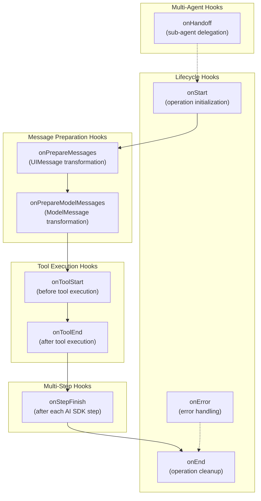
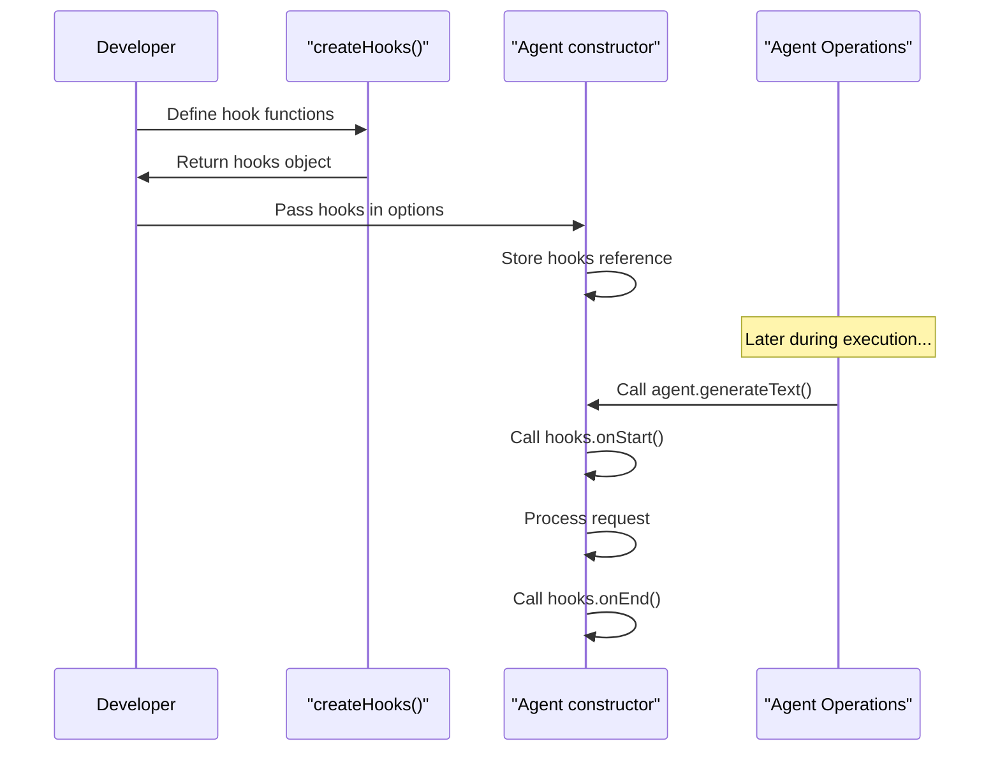
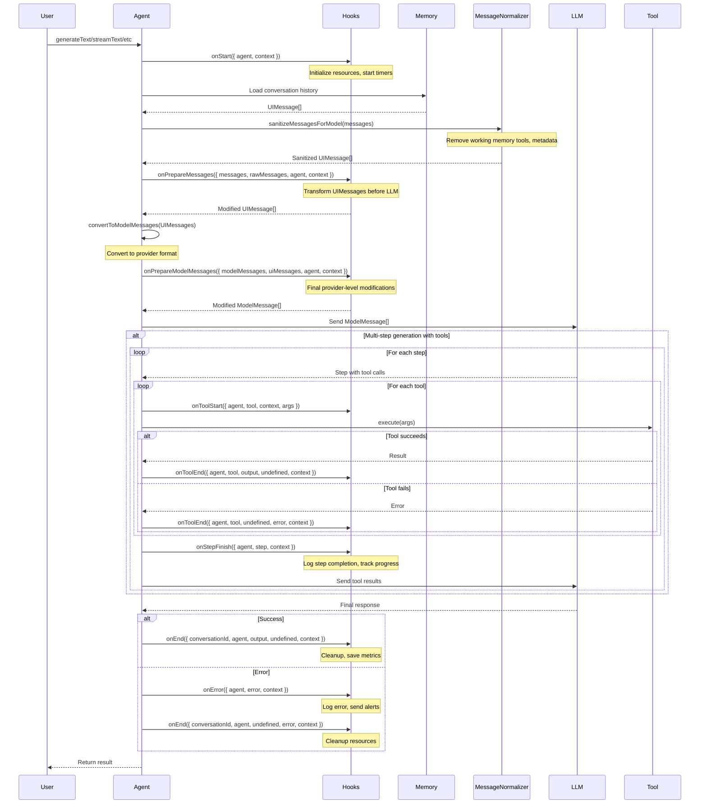
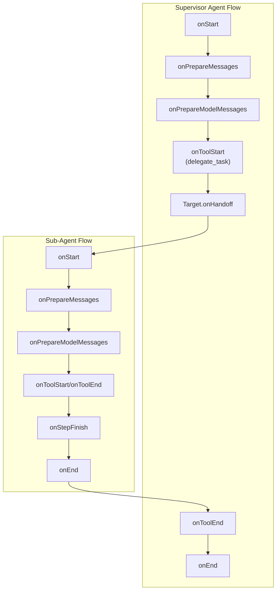
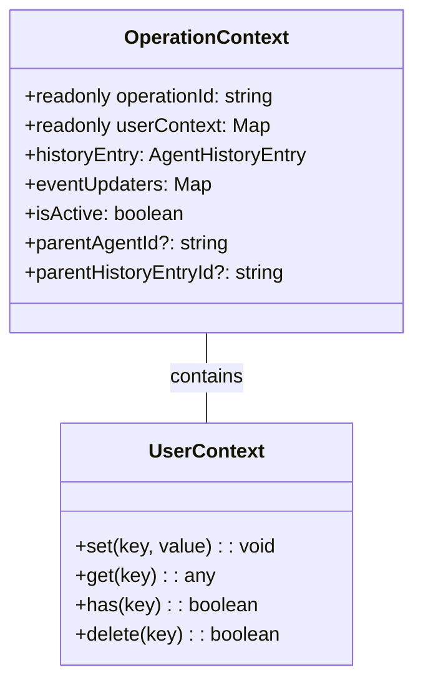
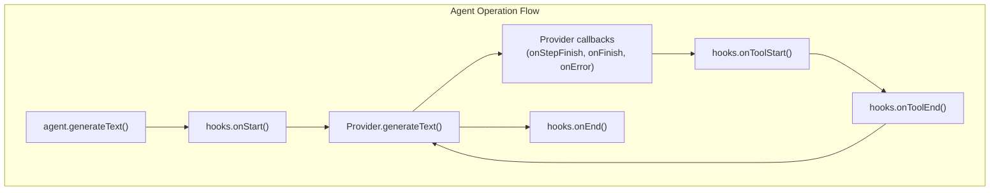

<!-- source: DeepWiki mcp.deepwiki.com · repo voltagent/voltagent · page 2.3 Agent Lifecycle and Hooks · fetched 2026-10-27 -->

# Agent Hooks

<details>
<summary>Relevant source files</summary>

The following files were used as context for generating this wiki page:

- [.changeset/config.json](.changeset/config.json)
- [packages/core/src/agent/agent.spec-d.ts](packages/core/src/agent/agent.spec-d.ts)
- [packages/core/src/agent/agent.spec.ts](packages/core/src/agent/agent.spec.ts)
- [packages/core/src/agent/agent.ts](packages/core/src/agent/agent.ts)
- [packages/core/src/agent/hooks/index.spec.ts](packages/core/src/agent/hooks/index.spec.ts)
- [packages/core/src/agent/hooks/index.ts](packages/core/src/agent/hooks/index.ts)
- [packages/core/src/agent/index.ts](packages/core/src/agent/index.ts)
- [packages/core/src/agent/memory-persist-queue.ts](packages/core/src/agent/memory-persist-queue.ts)
- [packages/core/src/agent/message-normalizer.spec.ts](packages/core/src/agent/message-normalizer.spec.ts)
- [packages/core/src/agent/message-normalizer.ts](packages/core/src/agent/message-normalizer.ts)
- [packages/core/src/agent/providers/base/types.ts](packages/core/src/agent/providers/base/types.ts)
- [packages/core/src/agent/subagent/index.spec.ts](packages/core/src/agent/subagent/index.spec.ts)
- [packages/core/src/agent/subagent/index.ts](packages/core/src/agent/subagent/index.ts)
- [packages/core/src/agent/types.ts](packages/core/src/agent/types.ts)
- [packages/core/src/index.ts](packages/core/src/index.ts)
- [packages/core/src/memory/manager/memory-manager.ts](packages/core/src/memory/manager/memory-manager.ts)
- [website/docs/agents/context.md](website/docs/agents/context.md)
- [website/docs/agents/hooks.md](website/docs/agents/hooks.md)
- [website/docs/agents/overview.md](website/docs/agents/overview.md)
- [website/docs/agents/subagents.md](website/docs/agents/subagents.md)
- [website/docs/agents/tools.md](website/docs/agents/tools.md)

</details>


Agent Hooks provide a powerful mechanism to customize and extend the VoltAgent framework by injecting code at specific points in an agent's lifecycle. This document explains how hooks work, when they're triggered, and how to effectively use them to add custom behavior to your agents.

For information about operation context and the `userContext` mechanism that hooks can leverage, see [Operation Context (userContext)](#2.4).

## Hook System Overview

The `AgentHooks` system provides eight extension points for injecting custom logic at specific stages of agent execution. Hooks enable cross-cutting concerns like logging, monitoring, message transformation, and resource management without modifying core agent code.

### Hook Categories and Execution Order



### Hook Interface Structure

All hooks receive a typed argument object with relevant context. The `createHooks` helper provides type safety:

| Hook | Argument Type | Key Properties |
|------|---------------|----------------|
| `onStart` | `OnStartHookArgs` | `agent`, `context` |
| `onPrepareMessages` | `OnPrepareMessagesHookArgs` | `messages`, `rawMessages`, `agent`, `context` |
| `onPrepareModelMessages` | `OnPrepareModelMessagesHookArgs` | `modelMessages`, `uiMessages`, `agent`, `context` |
| `onToolStart` | `OnToolStartHookArgs` | `agent`, `tool`, `context`, `args` |
| `onToolEnd` | `OnToolEndHookArgs` | `agent`, `tool`, `output`, `error`, `context` |
| `onStepFinish` | `OnStepFinishHookArgs` | `agent`, `step`, `context` |
| `onHandoff` | `OnHandoffHookArgs` | `agent`, `sourceAgent` |
| `onError` | `OnErrorHookArgs` | `agent`, `error`, `context` |
| `onEnd` | `OnEndHookArgs` | `conversationId`, `agent`, `output`, `error`, `context` |

Sources: [packages/core/src/agent/hooks/index.ts:1-107](), [packages/core/src/agent/agent.ts:268-276]()

### Hook Execution in Agent Methods

The following table shows which hooks execute for each agent method:

| Method | Hooks Executed |
|--------|----------------|
| `generateText` | `onStart` → `onPrepareMessages` → `onPrepareModelMessages` → (`onToolStart` → `onToolEnd` → `onStepFinish`)* → `onEnd` (or `onError` → `onEnd`) |
| `streamText` | Same as `generateText` |
| `generateObject` | `onStart` → `onEnd` (or `onError` → `onEnd`) - no message prep or tool hooks |
| `streamObject` | Same as `generateObject` |

*Tool and step hooks execute zero or more times depending on LLM behavior and `maxSteps` configuration.

Sources: [packages/core/src/agent/agent.ts:344-1021](), [packages/core/src/agent/hooks/index.ts:1-107]()

## Creating and Using Hooks

Hooks are created using the `createHooks` function and can be attached to an agent during initialization or set later.



Sources: [packages/core/src/agent/hooks/index.ts:62-82](), [packages/core/src/agent/index.ts:141-145]()

Here's a basic example of creating hooks and attaching them to an agent:

```typescript
import { 
  Agent, 
  createHooks,
  type OnStartHookArgs, 
  type OnEndHookArgs 
} from "@voltagent/core";
import { VercelAIProvider } from "@voltagent/vercel-ai";
import { openai } from "@ai-sdk/openai";

// Create hooks with the helper function
const myHooks = createHooks({
  onStart: async ({ agent, context }: OnStartHookArgs) => {
    console.log(`Agent ${agent.name} starting operation ${context.operationId}`);
    // Initialize operation-specific resources or state
    context.userContext.set("startTime", Date.now());
  },
  
  onEnd: async ({ agent, output, error, context }: OnEndHookArgs) => {
    const startTime = context.userContext.get("startTime");
    const duration = startTime ? Date.now() - startTime : 0;
    
    if (error) {
      console.error(`Agent ${agent.name} failed after ${duration}ms: ${error.message}`);
    } else {
      console.log(`Agent ${agent.name} succeeded in ${duration}ms`);
    }
    // Clean up any resources
  }
});

// Attach hooks to a new agent
const agent = new Agent({
  name: "Agent with Hooks",
  description: "An agent demonstrating hooks usage",
  llm: new VercelAIProvider(),
  model: openai("gpt-4o"),
  hooks: myHooks
});
```

Sources: [packages/core/src/agent/hooks/index.ts:62-82](), [website/docs/agents/hooks.md:16-130]()

## Hook Lifecycle and Execution Flow

### Complete Hook Execution Sequence

The following diagram shows the complete execution order of all hooks during an agent operation:



Sources: [packages/core/src/agent/agent.ts:344-520](), [packages/core/src/agent/message-normalizer.ts:1-160](), [packages/core/src/agent/hooks/index.ts:1-107]()

### Hook Execution in Multi-Agent Systems

When using sub-agents, the `onHandoff` hook coordinates between agents:



Sources: [packages/core/src/agent/subagent/index.ts:296-650](), [packages/core/src/agent/hooks/index.ts:27-30]()

## Available Hooks

VoltAgent provides eight lifecycle hooks that execute at specific points during agent operations. Each hook receives a typed argument object with relevant context.

### onStart Hook

Executes at the beginning of an agent operation, before memory loading or LLM calls.

**Triggered by:** `agent.generateText()`, `agent.streamText()`, `agent.generateObject()`, `agent.streamObject()`

**Arguments (`OnStartHookArgs`):**
- `agent`: The `Agent` instance
- `context`: The `OperationContext` with `operationId`, `userId`, `conversationId`, and user-managed `context` Map

**Common use cases:**
- Initialize operation-specific resources
- Set up distributed tracing spans
- Start performance timers
- Log operation metadata

**Example:**
```typescript
onStart: async ({ agent, context }) => {
  context.context.set("startTime", Date.now());
  context.context.set("requestId", crypto.randomUUID());
  console.log(`[${agent.name}] Starting operation ${context.operationId}`);
}
```

Sources: [packages/core/src/agent/hooks/index.ts:9-12](), [packages/core/src/agent/agent.ts:410]()

### onPrepareMessages Hook

Executes after VoltAgent sanitizes UIMessages but before conversion to provider-specific ModelMessages. This hook allows modification of the message array that will be sent to the LLM.

**Triggered by:** All generation methods, after message sanitization via `sanitizeMessagesForModel`

**Arguments (`OnPrepareMessagesHookArgs`):**
- `messages`: Array of sanitized `UIMessage` objects that will be sent to the LLM
- `rawMessages`: Optional array of unsanitized messages (for inspection/debugging)
- `agent`: The `Agent` instance
- `context`: The `OperationContext`

**Returns:** Optional `{ messages?: UIMessage[] }` to replace the message array

**Common use cases:**
- Add custom metadata to messages
- Filter or reorder messages
- Inject system prompts dynamically
- Transform message content before LLM sees it

**Example:**
```typescript
onPrepareMessages: async ({ messages, rawMessages, agent, context }) => {
  // Add timestamp to each message
  const timestamped = messages.map(msg => ({
    ...msg,
    metadata: { 
      ...msg.metadata, 
      timestamp: new Date().toISOString() 
    }
  }));
  
  return { messages: timestamped };
}
```

Sources: [packages/core/src/agent/hooks/index.ts:49-63](), [packages/core/src/agent/agent.spec.ts:256-319](), [website/docs/agents/hooks.md:43-61]()

### onPrepareModelMessages Hook

Executes after UIMessages are converted to provider-specific `ModelMessage` objects but before sending to the LLM. This is the final opportunity to modify messages.

**Triggered by:** All generation methods, after `convertToModelMessages` conversion

**Arguments (`OnPrepareModelMessagesHookArgs`):**
- `modelMessages`: Array of provider-specific `ModelMessage` objects
- `uiMessages`: The sanitized `UIMessage` array that produced the model messages
- `agent`: The `Agent` instance
- `context`: The `OperationContext`

**Returns:** Optional `{ modelMessages?: ModelMessage[] }` to replace the model message array

**Common use cases:**
- Add provider-specific metadata
- Inject final system instructions
- Modify message content at the provider level
- Handle provider-specific message transformations

**Example:**
```typescript
onPrepareModelMessages: async ({ modelMessages, uiMessages, agent, context }) => {
  // Inject final instruction as system message
  const systemMsg = {
    role: 'system' as const,
    content: [{
      type: 'text' as const,
      text: 'Always respond in JSON format.'
    }]
  };
  
  return { modelMessages: [systemMsg, ...modelMessages] };
}
```

Sources: [packages/core/src/agent/hooks/index.ts:65-79](), [packages/core/src/agent/agent.spec.ts:382-453](), [website/docs/agents/hooks.md:63-77]()

### onToolStart Hook

Executes immediately before a tool is executed during multi-step generation.

**Triggered by:** AI SDK step execution when LLM decides to use a tool

**Arguments (`OnToolStartHookArgs`):**
- `agent`: The `Agent` instance
- `tool`: The `AgentTool` being executed
- `context`: The `OperationContext`
- `args`: The parsed arguments passed to the tool

**Common use cases:**
- Log tool invocations
- Validate tool inputs
- Track tool usage metrics
- Manage tool-specific resources

**Example:**
```typescript
onToolStart: async ({ agent, tool, context, args }) => {
  console.log(`[${agent.name}] Executing tool: ${tool.name}`);
  context.context.set(`tool_${tool.name}_start`, Date.now());
  
  // Track tool calls
  const toolCalls = context.context.get("toolCalls") || [];
  toolCalls.push({ tool: tool.name, args, timestamp: Date.now() });
  context.context.set("toolCalls", toolCalls);
}
```

Sources: [packages/core/src/agent/hooks/index.ts:32-38](), [packages/core/src/agent/hooks/index.spec.ts:232-271]()

### onToolEnd Hook

Executes after a tool completes, whether successfully or with an error.

**Triggered by:** After tool execution completes in AI SDK step processing

**Arguments (`OnToolEndHookArgs`):**
- `agent`: The `Agent` instance
- `tool`: The `AgentTool` that was executed
- `output`: The tool result (if successful, `undefined` on error)
- `error`: The error object (if failed, `undefined` on success)
- `context`: The `OperationContext`

**Common use cases:**
- Log tool results and errors
- Calculate tool execution time
- Handle tool-specific cleanup
- Record tool metrics

**Example:**
```typescript
onToolEnd: async ({ agent, tool, output, error, context }) => {
  const startTime = context.context.get(`tool_${tool.name}_start`);
  const duration = startTime ? Date.now() - startTime : 0;
  
  if (error) {
    console.error(`Tool ${tool.name} failed after ${duration}ms:`, error);
  } else {
    console.log(`Tool ${tool.name} completed in ${duration}ms`);
  }
}
```

Sources: [packages/core/src/agent/hooks/index.ts:40-48](), [packages/core/src/agent/hooks/index.spec.ts:161-230]()

### onStepFinish Hook

Executes after each AI SDK step completes during multi-step generation. A step includes the LLM response and any tool executions in that round.

**Triggered by:** AI SDK's `onStepFinish` callback during `generateText` or `streamText`

**Arguments (`OnStepFinishHookArgs`):**
- `agent`: The `Agent` instance
- `step`: The AI SDK `StepResult` object containing step details
- `context`: The `OperationContext`

**Common use cases:**
- Monitor multi-step reasoning progress
- Log intermediate results
- Track token usage per step
- Implement custom step limits

**Example:**
```typescript
onStepFinish: async ({ agent, step, context }) => {
  const stepNumber = context.context.get("stepCount") || 0;
  context.context.set("stepCount", stepNumber + 1);
  
  console.log(`Step ${stepNumber + 1} completed:`, {
    finishReason: step.finishReason,
    usage: step.usage,
    toolCalls: step.toolCalls?.length || 0
  });
}
```

Sources: [packages/core/src/agent/hooks/index.ts:87-91](), [packages/core/src/agent/agent.spec.ts:905-947]()

### onHandoff Hook

Executes when a supervisor agent delegates a task to a sub-agent via the `delegate_task` tool.

**Triggered by:** Sub-agent task delegation in multi-agent systems

**Arguments (`OnHandoffHookArgs`):**
- `agent`: The target `Agent` receiving the task
- `sourceAgent`: The source `Agent` delegating the task

**Common use cases:**
- Track delegation chains in multi-agent workflows
- Log inter-agent communication
- Synchronize state between agents
- Implement delegation policies

**Example:**
```typescript
onHandoff: async ({ agent, sourceAgent }) => {
  console.log(`Task delegated from ${sourceAgent.name} to ${agent.name}`);
  
  // Track delegation chain
  const chain = agent.context?.get("delegationChain") || [];
  chain.push(sourceAgent.name);
  agent.context?.set("delegationChain", chain);
}
```

Sources: [packages/core/src/agent/hooks/index.ts:27-30](), [packages/core/src/agent/subagent/index.ts:340-342]()

### onError Hook

Executes when an error occurs during agent operation, before the error is propagated.

**Triggered by:** Errors during generation, tool execution, or memory operations

**Arguments (`OnErrorHookArgs`):**
- `agent`: The `Agent` instance
- `error`: The error object (`VoltAgentError`, `AbortError`, or standard `Error`)
- `context`: The `OperationContext`

**Common use cases:**
- Log errors with full context
- Send error alerts
- Implement custom error handling
- Record error metrics

**Example:**
```typescript
onError: async ({ agent, error, context }) => {
  console.error(`[${agent.name}] Operation ${context.operationId} failed:`, {
    error: error.message,
    userId: context.userId,
    conversationId: context.conversationId,
    stack: error.stack
  });
  
  // Send to error tracking service
  await errorTracker.report({
    agentName: agent.name,
    operationId: context.operationId,
    error
  });
}
```

Sources: [packages/core/src/agent/hooks/index.ts:81-85](), [packages/core/src/agent/agent.spec.ts:829-854]()

### onEnd Hook

Executes after an agent operation completes, whether successfully or with an error. Always runs, making it ideal for cleanup.

**Triggered by:** After all processing completes for any generation method

**Arguments (`OnEndHookArgs`):**
- `conversationId`: The conversation ID for the operation
- `agent`: The `Agent` instance
- `output`: The standardized `AgentOperationOutput` (if successful, `undefined` on error)
- `error`: The error object (if failed, `undefined` on success)
- `context`: The `OperationContext`

**Common use cases:**
- Clean up resources
- Record final metrics
- Save operation results
- Update analytics

**Example:**
```typescript
onEnd: async ({ conversationId, agent, output, error, context }) => {
  const startTime = context.context.get("startTime");
  const duration = startTime ? Date.now() - startTime : 0;
  
  if (error) {
    console.error(`[${agent.name}] Failed in ${duration}ms:`, error.message);
  } else {
    console.log(`[${agent.name}] Completed in ${duration}ms`, {
      conversationId,
      usage: output?.usage,
      finishReason: output?.finishReason
    });
  }
  
  // Cleanup resources
  const resources = context.context.get("resources");
  if (resources) {
    await resources.cleanup();
  }
}
```

Sources: [packages/core/src/agent/hooks/index.ts:14-25](), [packages/core/src/agent/agent.ts:465-478](), [packages/core/src/agent/hooks/index.spec.ts:61-139]()

## Working with Operation Context

One of the most powerful aspects of the hooks system is the `OperationContext` object, which includes `userContext` - a Map that lets you store and retrieve values across different hooks during a single operation.



Sources: [packages/core/src/agent/types.ts:320-345](), [website/docs/agents/context.md:16-24]()

**Key Properties:**
- `operationId`: Unique identifier for the operation
- `userContext`: A Map for storing custom data
- `historyEntry`: Information about the current history entry
- `isActive`: Whether the operation is still in progress

The `userContext` Map is particularly useful for passing state between hooks:

```typescript
// In onStart
onStart: ({ context }) => {
    context.userContext.set("requestId", `req-${Date.now()}`);
    context.userContext.set("startTime", performance.now());
},

// In onEnd
onEnd: ({ context }) => {
    const requestId = context.userContext.get("requestId");
    const startTime = context.userContext.get("startTime");
    const duration = performance.now() - startTime;
    console.log(`Request ${requestId} completed in ${duration}ms`);
}
```

Sources: [website/docs/agents/context.md:114-181]()

## Practical Examples

### Resource Management with Hooks

This example shows how to use hooks for managing a Playwright browser instance:

```typescript
import { Agent, createHooks } from "@voltagent/core";
import { chromium, type Browser, type Page } from "playwright";

// Define symbol keys for userContext
const PAGE_KEY = Symbol("playwrightPage");
const BROWSER_KEY = Symbol("playwrightBrowser");

// Helper to get/create a page
async function ensurePage(context) {
  let page = context.userContext.get(PAGE_KEY);
  if (!page || page.isClosed()) {
    const browser = await chromium.launch();
    page = await browser.newPage();
    context.userContext.set(BROWSER_KEY, browser);
    context.userContext.set(PAGE_KEY, page);
  }
  return page;
}

// Create hooks for browser management
const browserHooks = createHooks({
  onEnd: async ({ context }) => {
    const browser = context.userContext.get(BROWSER_KEY);
    if (browser) {
      console.log(`Closing browser for operation ${context.operationId}`);
      await browser.close();
    }
  }
});

// Create agent with the hooks
const agent = new Agent({
  name: "Browser Agent",
  // ... other config ...
  hooks: browserHooks,
  tools: [
    // Example tool that uses the page from context
    createTool({
      name: "navigate",
      // ... parameter definition ...
      execute: async ({ url }, options) => {
        const page = await ensurePage(options.operationContext);
        await page.goto(url);
        return `Navigated to ${url}`;
      }
    })
  ]
});
```

Sources: [website/docs/agents/context.md:42-104](), [examples/with-playwright/src/index.ts:32-44]()

### Logging and Monitoring with Hooks

This example creates comprehensive logging hooks that track the entire operation lifecycle:

```typescript
import { createHooks } from "@voltagent/core";

const loggingHooks = createHooks({
  onStart: async ({ agent, context }) => {
    console.log(`[${Date.now()}] Agent ${agent.name} starting operation ${context.operationId}`);
    context.context.set("startTime", Date.now());
    context.context.set("toolCalls", []);
  },
  
  onPrepareMessages: async ({ messages, agent, context }) => {
    console.log(`[${agent.name}] Preparing ${messages.length} messages for LLM`);
    // Log message roles without content
    const roles = messages.map(m => m.role).join(', ');
    console.log(`Message sequence: ${roles}`);
    
    // Return unchanged messages
    return { messages };
  },
  
  onToolStart: async ({ agent, tool, context, args }) => {
    console.log(`[${Date.now()}] Agent ${agent.name} using tool '${tool.name}'`, args);
    context.context.set(`tool_${tool.name}_start`, Date.now());
    
    // Track tool usage
    const toolCalls = context.context.get("toolCalls") || [];
    toolCalls.push({ tool: tool.name, startTime: Date.now() });
    context.context.set("toolCalls", toolCalls);
  },
  
  onToolEnd: async ({ agent, tool, output, error, context }) => {
    const startTime = context.context.get(`tool_${tool.name}_start`);
    const duration = startTime ? Date.now() - startTime : 0;
    
    if (error) {
      console.error(`[${Date.now()}] Tool '${tool.name}' failed after ${duration}ms:`, error.message);
    } else {
      console.log(`[${Date.now()}] Tool '${tool.name}' completed in ${duration}ms`);
    }
  },
  
  onStepFinish: async ({ agent, step, context }) => {
    const stepCount = (context.context.get("stepCount") || 0) + 1;
    context.context.set("stepCount", stepCount);
    
    console.log(`[${agent.name}] Step ${stepCount} completed:`, {
      finishReason: step.finishReason,
      toolCallCount: step.toolCalls?.length || 0,
      usage: step.usage
    });
  },
  
  onError: async ({ agent, error, context }) => {
    console.error(`[${agent.name}] Operation ${context.operationId} encountered error:`, {
      message: error.message,
      userId: context.userId,
      conversationId: context.conversationId
    });
  },
  
  onEnd: async ({ agent, output, error, context }) => {
    const startTime = context.context.get("startTime");
    const duration = startTime ? Date.now() - startTime : 0;
    const toolCalls = context.context.get("toolCalls") || [];
    
    if (error) {
      console.error(`[${Date.now()}] Agent ${agent.name} failed after ${duration}ms`);
    } else {
      console.log(`[${Date.now()}] Agent ${agent.name} completed in ${duration}ms`);
      console.log(`Total tool calls: ${toolCalls.length}`);
      
      // Log token usage if available
      if (output && "usage" in output && output.usage) {
        console.log(`Token usage: ${output.usage.totalTokens} total (${output.usage.promptTokens} prompt + ${output.usage.completionTokens} completion)`);
      }
    }
  }
});
```

Sources: [website/docs/agents/hooks.md:132-232](), [packages/core/src/agent/hooks/index.spec.ts:1-273]()

### Message Transformation with Hooks

This example shows how to use the message preparation hooks to transform messages:

```typescript
import { createHooks, messageHelpers } from "@voltagent/core";

const messageTransformHooks = createHooks({
  onPrepareMessages: async ({ messages, rawMessages, agent, context }) => {
    // Add timestamps to all messages
    const timestamped = messages.map(msg => 
      messageHelpers.addTimestampToMessage(msg, new Date().toISOString())
    );
    
    // Filter out empty messages
    const filtered = timestamped.filter(msg => {
      const hasContent = msg.parts.some(part => 
        part.type === 'text' && part.text.trim().length > 0
      );
      return hasContent;
    });
    
    console.log(`Filtered ${messages.length - filtered.length} empty messages`);
    
    return { messages: filtered };
  },
  
  onPrepareModelMessages: async ({ modelMessages, uiMessages, agent, context }) => {
    // Add a final instruction as a system message
    const userId = context.userId;
    const finalInstruction = {
      role: 'system' as const,
      content: [{
        type: 'text' as const,
        text: `Remember to be helpful and concise. User ID: ${userId}`
      }]
    };
    
    // Insert instruction before the last user message
    const result = [...modelMessages];
    result.splice(result.length - 1, 0, finalInstruction);
    
    return { modelMessages: result };
  }
});
```

Sources: [packages/core/src/agent/hooks/index.ts:49-79](), [packages/core/src/agent/agent.spec.ts:256-453](), [website/docs/agents/hooks.md:43-77]()

## Advanced Hook Patterns

### Hook Composition and Reuse

You can compose multiple hooks together for better organization and reuse:

```typescript
// Create specialized hooks
const loggingHooks = createHooks({ /* logging hooks */ });
const metricHooks = createHooks({ /* metric hooks */ });
const resourceHooks = createHooks({ /* resource management hooks */ });

// Combine them for an agent
function combineHooks(...hookSets) {
  return createHooks({
    onStart: async (args) => {
      for (const hooks of hookSets) {
        await hooks.onStart?.(args);
      }
    },
    onEnd: async (args) => {
      for (const hooks of hookSets) {
        await hooks.onEnd?.(args);
      }
    },
    // Similarly for other hook types...
  });
}

// Use the combined hooks
const agent = new Agent({
  // ...
  hooks: combineHooks(loggingHooks, metricHooks, resourceHooks)
});
```

### Provider-Specific Hook Integration

LLM Providers like Vercel AI and Groq can be integrated with hooks:



Sources: [packages/vercel-ai/src/index.ts:299-337](), [packages/groq-ai/src/index.ts:297-323](), [packages/core/src/agent/index.ts:823-826]()

## Best Practices

### 1. Keep Hooks Lightweight

Hooks execute synchronously in the agent's execution path. Long-running operations can block processing and impact latency.

**Bad:**
```typescript
onToolStart: async ({ tool }) => {
  // Blocks agent execution
  await expensiveAnalytics.track(tool.name);
}
```

**Good:**
```typescript
onToolStart: async ({ tool, context }) => {
  // Queue for background processing
  context.context.set("pendingAnalytics", [
    ...(context.context.get("pendingAnalytics") || []),
    { tool: tool.name, timestamp: Date.now() }
  ]);
}

onEnd: async ({ context }) => {
  // Process in cleanup phase
  const pending = context.context.get("pendingAnalytics");
  if (pending) {
    void analytics.trackBatch(pending); // Fire-and-forget
  }
}
```

### 2. Handle Errors in Hooks

Hook errors can disrupt agent operations. Always wrap risky code in try/catch blocks.

**Bad:**
```typescript
onEnd: async ({ output }) => {
  // Unhandled errors break agent cleanup
  await externalService.log(output);
}
```

**Good:**
```typescript
onEnd: async ({ output, context }) => {
  try {
    await externalService.log(output);
  } catch (error) {
    console.error("Failed to log to external service:", error);
    // Agent operation continues successfully
  }
}
```

### 3. Use TypeScript Types for Safety

Import hook argument types for IDE autocomplete and compile-time validation:

```typescript
import { 
  createHooks,
  type OnStartHookArgs,
  type OnPrepareMessagesHookArgs,
  type OnToolEndHookArgs,
  type OnEndHookArgs
} from "@voltagent/core";

const hooks = createHooks({
  onStart: async ({ agent, context }: OnStartHookArgs) => {
    // Full type safety and autocomplete
  },
  
  onPrepareMessages: async ({ messages, context }: OnPrepareMessagesHookArgs) => {
    // TypeScript validates return type
    return { messages };
  },
  
  onToolEnd: async ({ tool, output, error, context }: OnToolEndHookArgs) => {
    // Correct types for all arguments
  },
  
  onEnd: async ({ agent, output, error, context }: OnEndHookArgs) => {
    // Type-safe implementation
  }
});
```

Sources: [packages/core/src/agent/hooks/index.ts:1-107](), [website/docs/agents/hooks.md:16-130]()

### 4. Use Symbols for Context Keys

Avoid key collisions in the shared `context` Map by using Symbol keys, especially in reusable hooks:

```typescript
// Define symbol keys at module level
const TIMER_KEY = Symbol('mylib.timer');
const METADATA_KEY = Symbol('mylib.metadata');

const hooks = createHooks({
  onStart: ({ context }) => {
    context.context.set(TIMER_KEY, Date.now());
    context.context.set(METADATA_KEY, { /* ... */ });
  },
  
  onEnd: ({ context }) => {
    const startTime = context.context.get(TIMER_KEY);
    const metadata = context.context.get(METADATA_KEY);
    // No risk of collision with other hooks
  }
});
```

Sources: [website/docs/agents/context.md:15-24](), [examples/with-playwright/src/index.ts:32-44]()

### 5. Clean Up Resources in onEnd

The `onEnd` hook always executes (even on errors), making it ideal for resource cleanup:

```typescript
const resourceHooks = createHooks({
  onStart: async ({ context }) => {
    // Acquire resources
    const connection = await database.connect();
    const fileHandle = await fs.open('temp.log', 'w');
    
    context.context.set('dbConnection', connection);
    context.context.set('fileHandle', fileHandle);
  },
  
  onEnd: async ({ context }) => {
    // Always clean up, even if operation failed
    const connection = context.context.get('dbConnection');
    const fileHandle = context.context.get('fileHandle');
    
    if (connection) {
      await connection.close().catch(console.error);
    }
    
    if (fileHandle) {
      await fileHandle.close().catch(console.error);
    }
  }
});
```

### 6. Return Modified Messages from Preparation Hooks

Both `onPrepareMessages` and `onPrepareModelMessages` must return the message array for modifications to take effect:

```typescript
const hooks = createHooks({
  onPrepareMessages: async ({ messages }) => {
    // ✅ Correct: return modified messages
    const filtered = messages.filter(msg => msg.role !== 'system');
    return { messages: filtered };
  },
  
  onPrepareModelMessages: async ({ modelMessages }) => {
    // ❌ Wrong: modifications ignored if not returned
    modelMessages.push(newMessage);
    // Missing return statement
  }
});
```

Sources: [packages/core/src/agent/hooks/index.ts:49-79](), [packages/core/src/agent/agent.spec.ts:256-453]()

### 7. Use onError for Centralized Error Handling

The `onError` hook provides a single place to handle all agent errors:

```typescript
const errorHandlingHooks = createHooks({
  onError: async ({ agent, error, context }) => {
    // Centralized error logging
    logger.error("Agent operation failed", {
      agentName: agent.name,
      operationId: context.operationId,
      userId: context.userId,
      conversationId: context.conversationId,
      error: {
        message: error.message,
        stack: error.stack,
        name: error.name
      }
    });
    
    // Send to error tracking service
    if (isProduction()) {
      await errorTracker.captureException(error, {
        tags: {
          agentName: agent.name,
          operationId: context.operationId
        }
      });
    }
  }
});
```

Sources: [packages/core/src/agent/hooks/index.ts:81-85](), [packages/core/src/agent/agent.spec.ts:829-854]()

## Implementation Details

### Core Hook Implementation

The `AgentHooks` system is implemented across several core files:

**Hook Type Definitions:** [packages/core/src/agent/hooks/index.ts:1-107]()
- Defines all hook argument interfaces (`OnStartHookArgs`, `OnPrepareMessagesHookArgs`, etc.)
- Exports the `createHooks` helper function
- Provides TypeScript types for type-safe hook implementations

**Agent Integration:** [packages/core/src/agent/agent.ts:268-276]()
```typescript
// Agent stores hooks from constructor options
this.hooks = options.hooks || {};
```

**Hook Invocation Points:**
- `onStart`: [packages/core/src/agent/agent.ts:410]() (in `generateText`)
- `onPrepareMessages`: [packages/core/src/agent/agent.ts:1380-1413]() (in `prepareExecution`)
- `onPrepareModelMessages`: [packages/core/src/agent/agent.ts:1416-1432]() (in `prepareExecution`)
- `onToolStart`: Called by AI SDK during step execution
- `onToolEnd`: Called by AI SDK after tool completion
- `onStepFinish`: [packages/core/src/agent/agent.ts:1722-1787]() (in `createStepHandler`)
- `onHandoff`: [packages/core/src/agent/subagent/index.ts:340-342]() (in `handoffTask`)
- `onError`: [packages/core/src/agent/agent.ts:656-660]() (in stream `onError` callback)
- `onEnd`: [packages/core/src/agent/agent.ts:465-478]() (after successful generation)

### Hook Merging Strategy

The `getMergedHooks` method combines agent-level hooks with operation-level hooks:

```typescript
// From agent.ts (simplified)
private getMergedHooks(options?: { hooks?: AgentHooks }): AgentHooks {
  if (!options?.hooks) {
    return this.hooks;
  }
  
  // Merge agent hooks with operation hooks
  return {
    onStart: options.hooks.onStart || this.hooks.onStart,
    onPrepareMessages: options.hooks.onPrepareMessages || this.hooks.onPrepareMessages,
    onPrepareModelMessages: options.hooks.onPrepareModelMessages || this.hooks.onPrepareModelMessages,
    // ... other hooks
  };
}
```

Operation-level hooks (passed in method options) take precedence over agent-level hooks.

Sources: [packages/core/src/agent/agent.ts:1628-1669](), [packages/core/src/agent/hooks/index.ts:1-107]()

### Message Sanitization Flow

Before `onPrepareMessages` executes, the `sanitizeMessagesForModel` function removes internal metadata:

**Sanitization:** [packages/core/src/agent/message-normalizer.ts:1-160]()
- Removes `update_working_memory` tool calls
- Strips provider metadata from tool parts
- Filters empty messages
- Preserves tool call/result integrity

The sanitized messages are then passed to `onPrepareMessages`, with the original unsanitized messages available in `rawMessages` for inspection.

Sources: [packages/core/src/agent/message-normalizer.ts:1-160](), [packages/core/src/agent/agent.spec.ts:256-319]()

### OperationContext Structure

Hooks receive the `OperationContext` which provides execution metadata:

**Definition:** [packages/core/src/agent/types.ts:626-674]()

Key fields accessible in hooks:
- `operationId`: Unique identifier (UUID)
- `userId`: Optional user identifier
- `conversationId`: Optional conversation identifier
- `context`: User-managed Map for storing values across hooks
- `systemContext`: System-managed Map for internal state
- `traceContext`: OpenTelemetry trace context for distributed tracing
- `logger`: Contextual logger with operation metadata
- `abortController`: For cancellation support
- `input`: The original input (string, UIMessages, or BaseMessages)
- `output`: The generated output (available in `onEnd`)

Sources: [packages/core/src/agent/types.ts:626-674](), [packages/core/src/agent/agent.ts:1186-1252]()

## Summary

Agent Hooks provide a powerful extension mechanism for customizing agent behavior at key lifecycle points. With hooks, you can:

1. Add logging, metrics, and monitoring
2. Manage resources used during operations
3. Track and respond to errors
4. Build complex workflows in multi-agent systems

The hooks system, combined with the `userContext` mechanism, allows for flexible, modular extensions to VoltAgent without modifying the core agent implementation.

---

