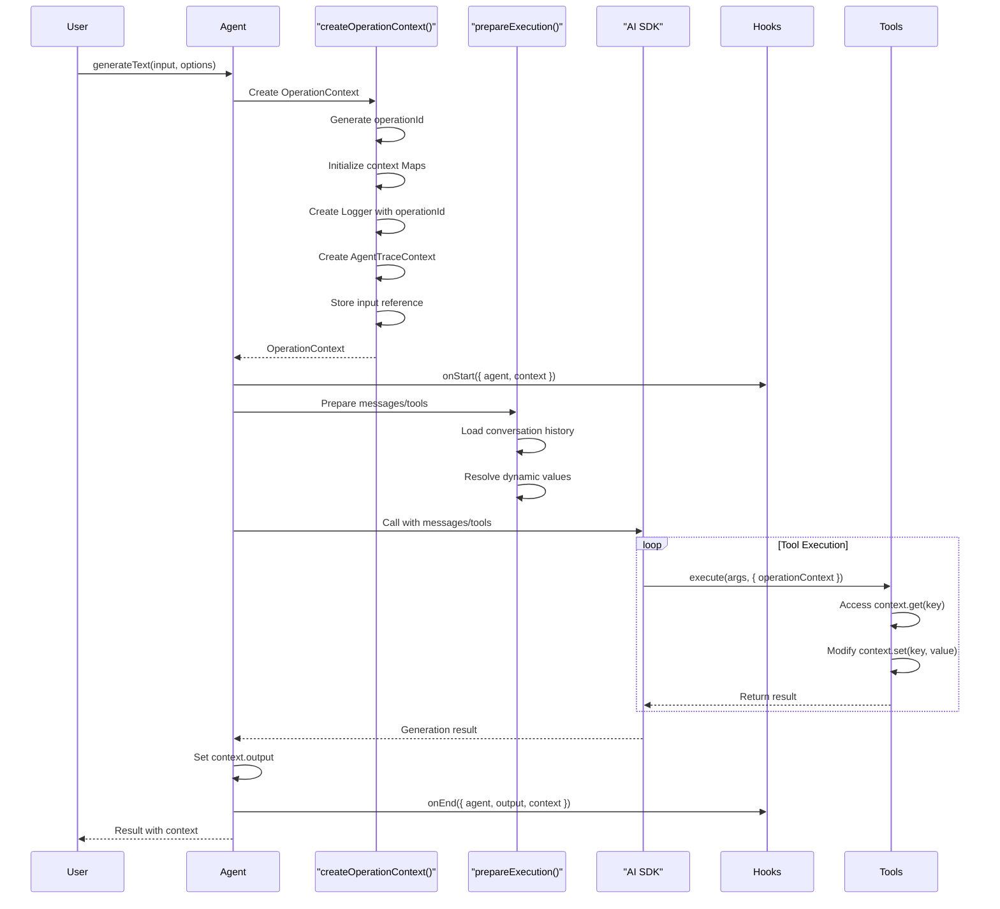
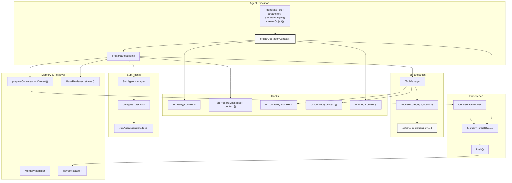
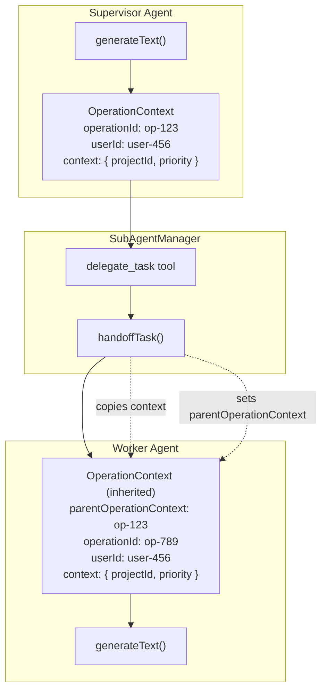
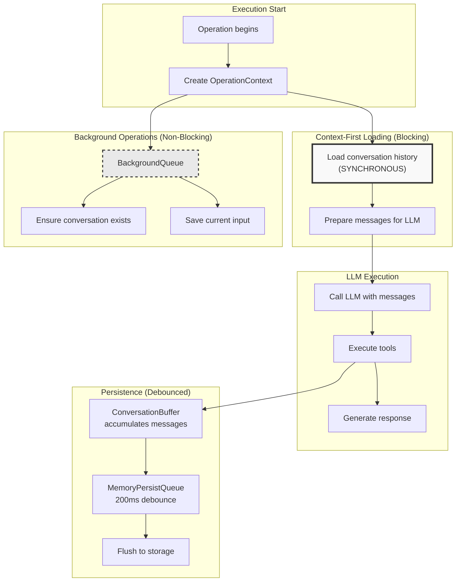
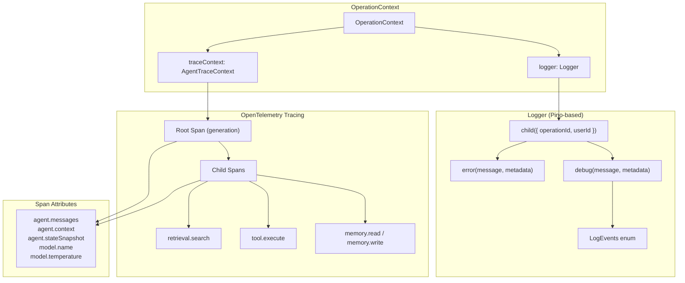
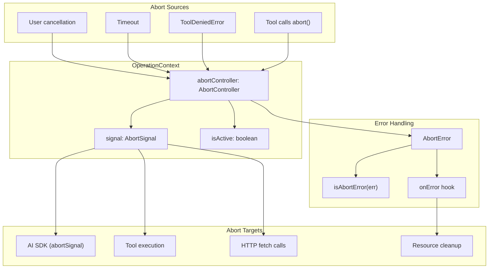

<!-- source: DeepWiki mcp.deepwiki.com · repo voltagent/voltagent · page 2.4 Operation Context and Execution · fetched 2026-10-27 -->

# Operation Context and Execution

<details>
<summary>Relevant source files</summary>

The following files were used as context for generating this wiki page:

- [packages/core/src/agent/agent.spec-d.ts](packages/core/src/agent/agent.spec-d.ts)
- [packages/core/src/agent/agent.spec.ts](packages/core/src/agent/agent.spec.ts)
- [packages/core/src/agent/agent.ts](packages/core/src/agent/agent.ts)
- [packages/core/src/agent/hooks/index.spec.ts](packages/core/src/agent/hooks/index.spec.ts)
- [packages/core/src/agent/hooks/index.ts](packages/core/src/agent/hooks/index.ts)
- [packages/core/src/agent/memory-persist-queue.ts](packages/core/src/agent/memory-persist-queue.ts)
- [packages/core/src/agent/message-normalizer.spec.ts](packages/core/src/agent/message-normalizer.spec.ts)
- [packages/core/src/agent/message-normalizer.ts](packages/core/src/agent/message-normalizer.ts)
- [packages/core/src/memory/manager/memory-manager.ts](packages/core/src/memory/manager/memory-manager.ts)
- [website/docs/agents/context.md](website/docs/agents/context.md)
- [website/docs/agents/hooks.md](website/docs/agents/hooks.md)
- [website/docs/agents/tools.md](website/docs/agents/tools.md)

</details>


**Purpose**: This document explains the `OperationContext` system that provides shared state, metadata, and execution control across all components during a single agent operation. It covers context creation, propagation, lifecycle management, and how different components (hooks, tools, retrievers, sub-agents) access and modify context.

**Scope**: For information about the Agent class and its core methods, see [Agent System](#2.1). For hooks that receive OperationContext, see [Agent Lifecycle and Hooks](#2.3). For message handling that occurs within the context, see [Message Handling and Normalization](#2.5).

---

## OperationContext Structure

The `OperationContext` is the central data structure that flows through every stage of an agent operation. It is created once at the start of each execution method (`generateText`, `streamText`, `generateObject`, `streamObject`) and persists until completion.

```mermaid
graph TB
    OC["OperationContext"]
    
    subgraph "Identity & Tracking"
        OID["operationId: string"]
        UID["userId?: string"]
        CID["conversationId?: string"]
        ST["startTime: Date"]
    end
    
    subgraph "Context Maps"
        CTX["context: Map&lt;string|symbol, unknown&gt;<br/>(user-provided data)"]
        SCTX["systemContext: Map&lt;string|symbol, unknown&gt;<br/>(internal VoltAgent data)"]
    end
    
    subgraph "Execution Control"
        AC["abortController: AbortController"]
        ACTIVE["isActive: boolean"]
    end
    
    subgraph "Observability"
        LOG["logger: Logger<br/>(contextual logger)"]
        TRACE["traceContext: AgentTraceContext<br/>(OpenTelemetry spans)"]
    end
    
    subgraph "Input/Output"
        IN["input: string | UIMessage[] | BaseMessage[]<br/>(original user input)"]
        OUT["output?: string | object<br/>(generated response)"]
    end
    
    OC --> OID
    OC --> UID
    OC --> CID
    OC --> ST
    OC --> CTX
    OC --> SCTX
    OC --> AC
    OC --> ACTIVE
    OC --> LOG
    OC --> TRACE
    OC --> IN
    OC --> OUT
```



**Sources**: [packages/core/src/agent/types.ts](), [packages/core/src/agent/agent.ts:98-134]()

### Core Fields

| Field | Type | Purpose |
|-------|------|---------|
| `operationId` | `string` | Unique identifier for this operation (UUID) |
| `userId` | `string?` | User identifier for memory and tracing |
| `conversationId` | `string?` | Conversation thread identifier |
| `context` | `Map<string\|symbol, unknown>` | User-provided custom data |
| `systemContext` | `Map<string\|symbol, unknown>` | Internal VoltAgent state |
| `logger` | `Logger` | Contextual logger with operation metadata |
| `traceContext` | `AgentTraceContext` | OpenTelemetry tracing integration |
| `abortController` | `AbortController` | Cancellation control |
| `isActive` | `boolean` | Whether the operation is still running |
| `startTime` | `Date` | When the operation started |
| `input` | `string \| UIMessage[] \| BaseMessage[]` | Original input to the operation |
| `output` | `string \| object?` | Generated output (available after completion) |

**Sources**: [packages/core/src/agent/types.ts](), [website/docs/agents/context.md:179-245]()

---

## Context Creation and Lifecycle

The `OperationContext` is created at the beginning of each agent operation and flows through the entire execution pipeline.



**Sources**: [packages/core/src/agent/agent.ts:1268-1350](), [packages/core/src/agent/agent.ts:345-520]()

### Creation Process

The `createOperationContext` method initializes the context with the following steps:

1. **Generate Operation ID**: Create a unique identifier using `randomUUID()`
2. **Merge Context Maps**: Combine constructor context with execution context
3. **Extract User Info**: Get `userId` and `conversationId` from options
4. **Create Logger**: Initialize contextual logger with operation metadata
5. **Create Trace Context**: Set up OpenTelemetry root span
6. **Store Input**: Save the original input for reference
7. **Initialize Control**: Create `AbortController` and set `isActive = true`

**Sources**: [packages/core/src/agent/agent.ts:1268-1350]()

---

## Context Propagation

The `OperationContext` propagates through the entire execution pipeline, ensuring all components have access to shared state and metadata.



**Sources**: [packages/core/src/agent/agent.ts:345-520](), [packages/core/src/agent/agent.ts:1351-1491](), [packages/core/src/tool/manager.ts]()

### Context Inheritance in Sub-Agents

Sub-agents automatically receive the parent's `OperationContext`, ensuring continuity across multi-agent workflows:



**Sources**: [packages/core/src/agent/subagent/index.ts](), [website/docs/agents/context.md:314-373]()

---

## User Context vs System Context

The `OperationContext` maintains two separate context maps for different purposes:

### User Context (`context`)

The `context` map stores user-provided data that can be read and modified by application code:

- **Set During Construction**: Default context passed to `Agent` constructor
- **Set During Execution**: Context passed to `generateText()`, `streamText()`, etc.
- **Modified by Hooks**: Hooks can read and write to `context`
- **Modified by Tools**: Tools can read and write via `options.operationContext.context`
- **Returned in Result**: Final `context` is available on the result object

```typescript
// Example: User context flow
const defaultContext = new Map([["environment", "production"]]);
const agent = new Agent({
  name: "MyAgent",
  model: openai("gpt-4o"),
  instructions: "...",
  context: defaultContext, // Default for all operations
});

const result = await agent.generateText("Hello", {
  context: new Map([
    ["requestId", "req-123"],
    ["priority", "high"],
  ]), // Overrides default
});

console.log(result.context.get("requestId")); // "req-123"
```

**Sources**: [website/docs/agents/context.md:26-86](), [packages/core/src/agent/agent.ts:88-96]()

### System Context (`systemContext`)

The `systemContext` map stores internal VoltAgent state not exposed to users:

- **Stream Writers**: `fullStreamWriter`, `uiStreamWriter` for sub-agent coordination
- **Conversation Buffer**: Reference to `ConversationBuffer` instance
- **Memory Queue**: Reference to `MemoryPersistQueue` instance
- **Internal Flags**: Various system-level state tracking

```typescript
// Internal usage example (from agent.ts)
const BUFFER_CONTEXT_KEY = Symbol("conversationBuffer");
const QUEUE_CONTEXT_KEY = Symbol("memoryPersistQueue");

// System context stores internal objects
oc.systemContext.set(BUFFER_CONTEXT_KEY, buffer);
oc.systemContext.set(QUEUE_CONTEXT_KEY, persistQueue);

// Retrieved by internal methods
const buffer = this.getConversationBuffer(oc);
const queue = this.getMemoryPersistQueue(oc);
```

**Sources**: [packages/core/src/agent/agent.ts:78-79](), [packages/core/src/agent/agent.ts:1521-1536]()

---

## Accessing Context in Components

Different components access the `OperationContext` through different interfaces.

### In Hooks

Hooks receive `OperationContext` as part of their argument object:

```typescript
const hooks = createHooks({
  onStart: async ({ agent, context }) => {
    // Access operation metadata
    console.log("Operation ID:", context.operationId);
    console.log("User ID:", context.userId);
    
    // Access user context
    const priority = context.context.get("priority");
    
    // Modify user context
    context.context.set("startTime", Date.now());
  },
  
  onEnd: async ({ agent, output, context }) => {
    // Access input and output
    console.log("Input:", context.input);
    console.log("Output:", context.output);
    
    // Calculate duration
    const startTime = context.context.get("startTime");
    const duration = Date.now() - startTime;
    console.log("Duration:", duration);
  },
});
```

**Sources**: [packages/core/src/agent/hooks/index.ts:8-91](), [website/docs/agents/hooks.md:246-356]()

### In Tools

Tools receive `OperationContext` through the second `options` parameter:

```typescript
const debugTool = createTool({
  name: "debug_info",
  description: "Log debugging information",
  parameters: z.object({
    message: z.string(),
  }),
  execute: async (args, options) => {
    const oc = options?.operationContext;
    
    // Access operation metadata
    console.log("Operation ID:", oc?.operationId);
    console.log("User ID:", oc?.userId);
    
    // Access original input
    console.log("Original input:", oc?.input);
    
    // Access user context
    const requestId = oc?.context?.get("requestId");
    
    // Modify user context
    oc?.context?.set("toolCalls", (oc.context.get("toolCalls") || 0) + 1);
    
    // Access abort control
    if (oc?.abortController?.signal.aborted) {
      throw new Error("Operation was aborted");
    }
    
    return `Debug info logged`;
  },
});
```

**Sources**: [website/docs/agents/tools.md:359-401](), [packages/core/src/tool/index.ts]()

### In Retrievers

Retrievers receive context through the `options` parameter:

```typescript
class CustomRetriever extends BaseRetriever {
  async retrieve(input: string, options?: {
    context?: Map<string | symbol, unknown>;
    operationContext?: OperationContext;
  }) {
    const oc = options?.operationContext;
    
    // Access user context
    const userId = options?.context?.get("userId");
    
    // Store references in context
    if (options?.context) {
      options.context.set("retrievedDocs", documentIds);
      options.context.set("retrievalTime", Date.now());
    }
    
    return retrievedContent;
  }
}
```

**Sources**: [website/docs/agents/context.md:273-312]()

---

## Context-First Optimization

VoltAgent implements a "context-first optimization" pattern where conversation history is loaded synchronously (blocking) while metadata operations are enqueued in the background.



**Sources**: [packages/core/src/memory/manager/memory-manager.ts:350-399](), [packages/core/src/agent/memory-persist-queue.ts]()

### ConversationBuffer and MemoryPersistQueue

The context-first pattern uses two key components:

**ConversationBuffer** (`packages/core/src/agent/conversation-buffer.ts`):
- Accumulates messages during execution
- Stored in `systemContext` with symbol key
- Messages are added via `addMessage(message)`
- Retrieved via `this.getConversationBuffer(oc)`

**MemoryPersistQueue** (`packages/core/src/agent/memory-persist-queue.ts`):
- Debounces writes with configurable delay (default 200ms)
- Batches multiple messages into single save operations
- Provides `scheduleSave()` for debounced saves
- Provides `flush()` for immediate persistence

```typescript
// From agent.ts
const buffer = this.getConversationBuffer(oc);
const persistQueue = this.getMemoryPersistQueue(oc);

// During tool execution
buffer.addMessage(assistantMessage);
persistQueue.scheduleSave(buffer, oc); // Debounced

// At operation end
await persistQueue.flush(buffer, oc); // Immediate
```

**Sources**: [packages/core/src/agent/conversation-buffer.ts](), [packages/core/src/agent/memory-persist-queue.ts:1-149](), [packages/core/src/agent/agent.ts:1521-1536]()

---

## Logging and Tracing Integration

The `OperationContext` integrates logging and tracing to provide comprehensive observability.



**Sources**: [packages/core/src/agent/agent.ts:287-306](), [packages/core/src/agent/open-telemetry/trace-context.ts](), [packages/core/src/logger/index.ts]()

### Contextual Logger

Each `OperationContext` has a contextual logger that automatically includes operation metadata:

```typescript
// Logger creation in createOperationContext
const logger = this.logger.child({
  operationId: oc.operationId,
  userId: oc.userId,
  conversationId: oc.conversationId,
});

// Usage in tools
oc.logger.debug("Tool starting", {
  event: LogEvents.TOOL_EXECUTION_STARTED,
  toolName: "calculate",
});
```

**Sources**: [packages/core/src/agent/agent.ts:1268-1350](), [packages/core/src/logger/index.ts]()

### Trace Context

The `AgentTraceContext` manages OpenTelemetry spans with proper hierarchy:

```typescript
// Root span for entire operation
const rootSpan = oc.traceContext.getRootSpan();

// Create child span for specific operation
const memorySpan = oc.traceContext.createChildSpan(
  "memory.read",
  "memory",
  {
    label: "Load Conversation History",
    attributes: {
      "memory.operation": "read",
      "memory.limit": contextLimit,
    },
  }
);

// Execute within span
await oc.traceContext.withSpan(memorySpan, async () => {
  const messages = await loadMessages();
  return messages;
});

// End span
oc.traceContext.endChildSpan(memorySpan, "completed", {
  output: { messageCount: messages.length },
});
```

**Sources**: [packages/core/src/agent/open-telemetry/trace-context.ts](), [packages/core/src/memory/manager/memory-manager.ts:98-172]()

---

## Abort Control and Cancellation

The `OperationContext` includes an `AbortController` for operation cancellation.



**Sources**: [packages/core/src/agent/agent.ts:1537-1564](), [website/docs/agents/tools.md:403-483]()

### Tool Cancellation

Tools can check abort status and trigger cancellation:

```typescript
const searchTool = createTool({
  name: "search_web",
  description: "Search the web",
  parameters: z.object({ query: z.string() }),
  execute: async (args, options) => {
    const ac = options?.operationContext?.abortController;
    const signal = ac?.signal;
    
    // Check if already aborted
    if (signal?.aborted) {
      throw new Error("Search was cancelled");
    }
    
    // Tool can trigger abort to cancel entire operation
    if (args.query.includes("forbidden")) {
      ac?.abort("Forbidden query detected");
      throw new Error("Query contains forbidden terms");
    }
    
    // Pass signal to fetch
    const response = await fetch(url, { signal });
    return await response.json();
  },
});
```

**Sources**: [website/docs/agents/tools.md:414-450](), [packages/core/src/agent/errors.ts]()

---

## Best Practices

### 1. Use Typed Context Keys

Prefer symbol keys for internal state to avoid collisions:

```typescript
const REQUEST_ID_KEY = Symbol("requestId");
const METRICS_KEY = Symbol("metrics");

// Set context
oc.context.set(REQUEST_ID_KEY, "req-123");

// Get context
const requestId = oc.context.get(REQUEST_ID_KEY);
```

### 2. Initialize Context Early

Set default context in the agent constructor for values used across all operations:

```typescript
const defaultContext = new Map([
  ["environment", process.env.NODE_ENV],
  ["version", "1.0.0"],
]);

const agent = new Agent({
  name: "MyAgent",
  model: openai("gpt-4o"),
  instructions: "...",
  context: defaultContext,
});
```

### 3. Access Input/Output for Audit Trails

Use `oc.input` and `oc.output` in hooks for comprehensive logging:

```typescript
const auditHooks = createHooks({
  onEnd: async ({ context, output }) => {
    await auditLog.save({
      timestamp: context.startTime,
      operationId: context.operationId,
      userId: context.userId,
      input: context.input,
      output: context.output,
      duration: Date.now() - context.startTime.getTime(),
    });
  },
});
```

**Sources**: [website/docs/agents/context.md:179-271](), [website/docs/agents/hooks.md:300-356]()

### 4. Respect Context-First Pattern

Don't block on non-critical operations during context preparation:

```typescript
// ✅ Good: Load context synchronously, metadata async
const { messages } = await memoryManager.prepareConversationContext(
  oc, input, userId, conversationId, contextLimit
);

// Background: Ensure conversation exists + save input
// These run in BackgroundQueue without blocking

// ❌ Bad: Blocking on non-critical metadata
await ensureConversation(); // Blocks conversation loading
await saveInput(); // Blocks conversation loading
const messages = await getMessages(); // Too late!
```

**Sources**: [packages/core/src/memory/manager/memory-manager.ts:350-445]()

### 5. Handle Abort Signals in Long-Running Tools

Always check `signal.aborted` and pass signal to async operations:

```typescript
const longRunningTool = createTool({
  name: "process_data",
  description: "Process large dataset",
  parameters: z.object({ datasetId: z.string() }),
  execute: async (args, options) => {
    const signal = options?.operationContext?.abortController?.signal;
    
    // Check before starting
    if (signal?.aborted) {
      throw new Error("Operation cancelled");
    }
    
    // Listen for abort during execution
    signal?.addEventListener("abort", () => {
      cleanup();
    });
    
    // Pass to async operations
    const data = await fetchDataset(args.datasetId, { signal });
    return processData(data);
  },
});
```

**Sources**: [website/docs/agents/tools.md:403-483]()

---

