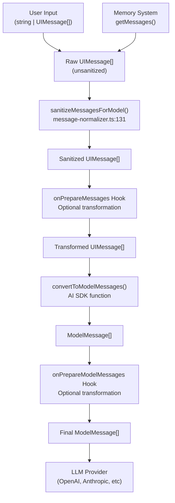
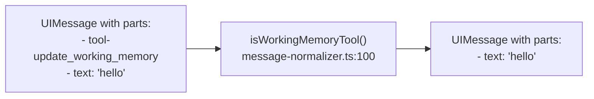
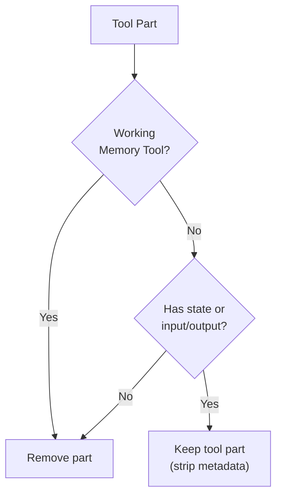
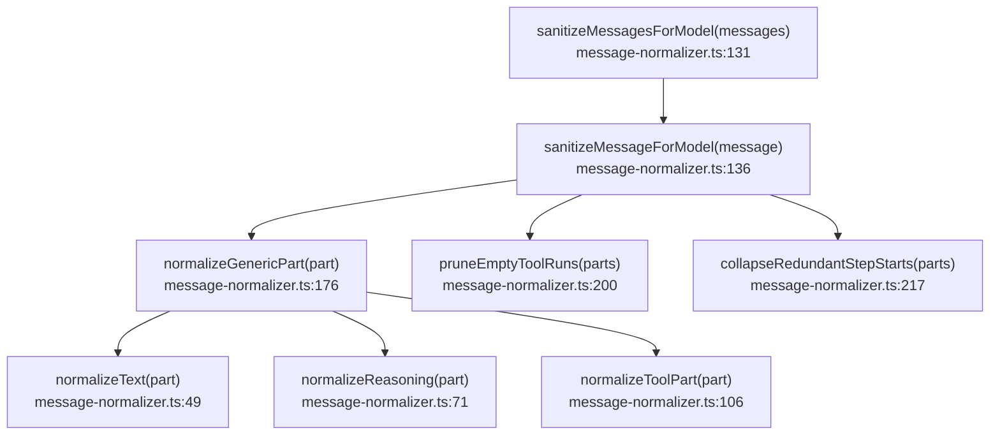
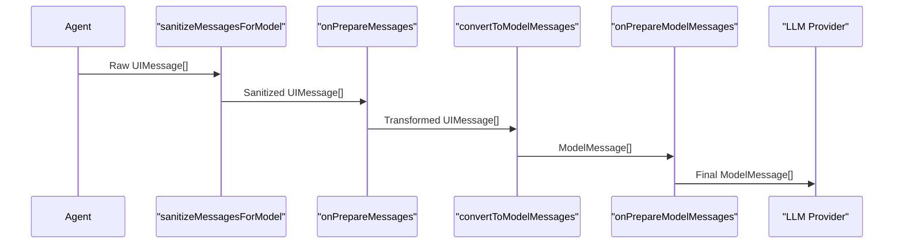
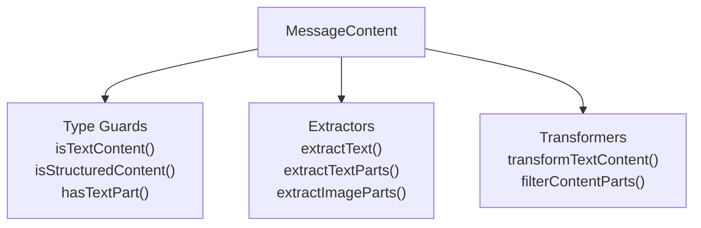

<!-- source: DeepWiki mcp.deepwiki.com · repo voltagent/voltagent · page 2.5 Message Handling and Normalization · fetched 2026-10-27 -->

# Message Handling and Normalization

<details>
<summary>Relevant source files</summary>

The following files were used as context for generating this wiki page:

- [.github/workflows/prerelease.yml](.github/workflows/prerelease.yml)
- [.github/workflows/pull-request.yml](.github/workflows/pull-request.yml)
- [.github/workflows/release.yml](.github/workflows/release.yml)
- [examples/with-jwt-auth/src/index.ts](examples/with-jwt-auth/src/index.ts)
- [examples/with-playwright/src/index.ts](examples/with-playwright/src/index.ts)
- [package.json](package.json)
- [packages/core/src/agent/agent.spec-d.ts](packages/core/src/agent/agent.spec-d.ts)
- [packages/core/src/agent/agent.spec.ts](packages/core/src/agent/agent.spec.ts)
- [packages/core/src/agent/agent.ts](packages/core/src/agent/agent.ts)
- [packages/core/src/agent/hooks/index.spec.ts](packages/core/src/agent/hooks/index.spec.ts)
- [packages/core/src/agent/hooks/index.ts](packages/core/src/agent/hooks/index.ts)
- [packages/core/src/agent/memory-persist-queue.ts](packages/core/src/agent/memory-persist-queue.ts)
- [packages/core/src/agent/message-normalizer.spec.ts](packages/core/src/agent/message-normalizer.spec.ts)
- [packages/core/src/agent/message-normalizer.ts](packages/core/src/agent/message-normalizer.ts)
- [packages/core/src/memory/manager/memory-manager.ts](packages/core/src/memory/manager/memory-manager.ts)
- [packages/core/src/utils/message-helpers.spec.ts](packages/core/src/utils/message-helpers.spec.ts)
- [packages/core/src/utils/message-helpers.ts](packages/core/src/utils/message-helpers.ts)
- [pnpm-workspace.yaml](pnpm-workspace.yaml)
- [website/docs/agents/context.md](website/docs/agents/context.md)
- [website/docs/agents/hooks.md](website/docs/agents/hooks.md)
- [website/docs/agents/tools.md](website/docs/agents/tools.md)
- [website/docs/utils/message-helpers.md](website/docs/utils/message-helpers.md)

</details>


This page documents the message handling and normalization system in VoltAgent. It covers how messages are processed, sanitized, and transformed as they flow through the agent execution pipeline before being sent to LLM providers.

For information about conversation storage and retrieval, see [Memory System](#2.7). For information about message processing hooks, see [Agent Lifecycle and Hooks](#2.3).

## Overview

VoltAgent processes messages through multiple stages to ensure they are properly formatted, sanitized, and compatible with LLM provider requirements. The system handles two primary message formats and provides extensibility through hooks and utility functions.

**Sources:** [packages/core/src/agent/agent.ts:1-100](), [packages/core/src/agent/message-normalizer.ts:1-50]()

## Message Types

VoltAgent uses two distinct message formats during agent execution:

| Format | Type | Purpose | Used By |
|--------|------|---------|---------|
| UI Messages | `UIMessage` | High-level message representation with parts array | Memory, hooks, agent API |
| Model Messages | `ModelMessage` | Provider-specific message format | AI SDK, LLM providers |

### UIMessage Structure

```typescript
interface UIMessage {
  id: string;
  role: "user" | "assistant" | "system";
  parts: UIMessagePart[];
  metadata?: Record<string, unknown>;
}

type UIMessagePart = 
  | { type: "text"; text: string }
  | { type: "tool-*"; toolCallId: string; state: string; input?: any; output?: any }
  | { type: "reasoning"; text: string }
  | { type: "file"; url: string }
  | { type: "step-start" }
```

**Sources:** [packages/core/src/agent/agent.ts:1-20]()

### ModelMessage Structure

`ModelMessage` represents the provider-specific format after conversion from `UIMessage`. The AI SDK handles this conversion via `convertToModelMessages()`.

**Sources:** [packages/core/src/agent/agent.ts:22]()

## Message Flow Pipeline



**Message Flow Through Agent Execution**

**Sources:** [packages/core/src/agent/agent.ts:356-462](), [packages/core/src/agent/agent.ts:1414-1500]()

## Sanitization Rules

The `sanitizeMessageForModel()` function applies the following normalization rules to clean messages before LLM processing:

### Working Memory Tool Removal



**Working Memory Tool Filtering**

Working memory tools (`update_working_memory`, `get_working_memory`, `clear_working_memory`) are stripped from messages to prevent them from appearing in LLM context.

**Sources:** [packages/core/src/agent/message-normalizer.ts:3-7](), [packages/core/src/agent/message-normalizer.ts:100-104]()

### Provider Metadata Stripping

The sanitizer handles provider metadata differently based on part type:

| Part Type | Provider Metadata | Reason |
|-----------|-------------------|---------|
| Tool parts | **Stripped** | `callProviderMetadata` and `providerMetadata` removed, but `input` and `output` preserved |
| Text parts | **Preserved** | Metadata may contain useful information for text processing |
| Reasoning parts | **Stripped** | Prevents GPT-5 rejection errors when `reasoning_trace_id` is present |

**Sources:** [packages/core/src/agent/message-normalizer.ts:106-129](), [packages/core/src/agent/message-normalizer.ts:71-92]()

### Empty Message Pruning

Messages are removed if all parts are filtered out or contain only whitespace:

```typescript
// Empty message detection logic
if (!effectiveParts.length) {
  return null; // Message is dropped
}
```

**Sources:** [packages/core/src/agent/message-normalizer.ts:149-174]()

### Tool Call Handling



**Tool Call Processing Decision Tree**

Incomplete tool calls with `state: "input-available"` are retained to allow follow-up results to merge later.

**Sources:** [packages/core/src/agent/message-normalizer.ts:106-129](), [packages/core/src/agent/message-normalizer.ts:200-215]()

### Redundant Element Removal

- **Step-start parts**: Multiple consecutive `step-start` parts are collapsed into one
- **Empty reasoning blocks**: Reasoning parts with only whitespace are removed

**Sources:** [packages/core/src/agent/message-normalizer.ts:217-225](), [packages/core/src/agent/message-normalizer.ts:71-92]()

## Normalization Implementation

### Core Functions



**Message Normalization Function Hierarchy**

**Sources:** [packages/core/src/agent/message-normalizer.ts:131-225]()

### Usage in Agent Execution

The agent calls sanitization during message preparation:

```typescript
// In prepareExecution method
const sanitized = sanitizeMessagesForModel(messagesWithHistory);
```

**Sources:** [packages/core/src/agent/agent.ts:1414-1500]()

## Hook Integration

VoltAgent provides two hooks for custom message transformation:

### onPrepareMessages Hook

Operates on sanitized `UIMessage[]` arrays **before** conversion to `ModelMessage[]`.

**Timing:** After `sanitizeMessagesForModel()`, before `convertToModelMessages()`

**Signature:**
```typescript
onPrepareMessages: async ({ messages, rawMessages, agent, context }) => {
  // messages: sanitized UIMessage[]
  // rawMessages: unsanitized UIMessage[] (for reference)
  
  return { messages: transformedMessages };
}
```

**Use cases:**
- Add timestamps to messages
- Filter messages by role or content
- Inject system prompts
- Restore metadata from rawMessages

**Sources:** [packages/core/src/agent/hooks/index.ts:49-63](), [packages/core/src/agent/agent.ts:1462-1474]()

### onPrepareModelMessages Hook

Operates on `ModelMessage[]` arrays **after** conversion from `UIMessage[]`.

**Timing:** After `convertToModelMessages()`, before sending to provider

**Signature:**
```typescript
onPrepareModelMessages: async ({ modelMessages, uiMessages, agent, context }) => {
  // modelMessages: provider-specific ModelMessage[]
  // uiMessages: the sanitized UIMessage[] that produced modelMessages
  
  return { modelMessages: transformedModelMessages };
}
```

**Use cases:**
- Provider-specific adjustments
- Payload compression
- Last-minute system directives
- Protocol-level structure changes

**Sources:** [packages/core/src/agent/hooks/index.ts:65-79](), [packages/core/src/agent/agent.ts:1476-1489]()

### Hook Execution Order



**Message Transformation Hook Execution**

**Sources:** [packages/core/src/agent/agent.ts:1414-1500]()

## Message Helpers

The `messageHelpers` module provides utilities for message content manipulation at both the content level and message level.

### Content-Level Operations

These operate on `MessageContent` (string or array of parts):



**Content-Level Helper Categories**

**Sources:** [packages/core/src/utils/message-helpers.ts:1-183]()

### Message-Level Operations

These operate on `UIMessage` objects:

| Function | Purpose | Example |
|----------|---------|---------|
| `mapMessageContent()` | Transform text in all parts | Uppercase all text |
| `prependToMessage()` | Add content at start | Add timestamp prefix |
| `appendToMessage()` | Add content at end | Add signature suffix |
| `addTimestampToMessage()` | Add timestamp to message | Audit logging |

**Sources:** [packages/core/src/utils/message-helpers.ts:126-138](), [packages/core/src/utils/message-helpers.ts:266-336]()

### Builder Pattern

`MessageContentBuilder` provides a fluent API for constructing complex message content:

```typescript
const builder = new MessageContentBuilder();
builder
  .addText("Check this image:")
  .addImage("data:image/png;base64,...")
  .addText("What do you see?");

const content = builder.build(); // Returns MessageContent
```

**Sources:** [packages/core/src/utils/message-helpers.ts:186-264]()

### Common Patterns

**Extract text from any message format:**
```typescript
import { extractText } from "@voltagent/core/utils";

const text = extractText(message.content); // Works with string or array
```

**Transform message text:**
```typescript
import { mapMessageContent } from "@voltagent/core/utils";

const uppercased = mapMessageContent(message, text => text.toUpperCase());
```

**Check for specific content types:**
```typescript
import { hasImagePart, hasTextPart } from "@voltagent/core/utils";

if (hasImagePart(content)) {
  // Handle image processing
}
```

**Sources:** [packages/core/src/utils/message-helpers.ts:52-98](), [packages/core/src/utils/message-helpers.ts:126-138]()

## Integration Points

### Memory System Integration

The memory system stores and retrieves `UIMessage[]` arrays. When loading conversation history, messages may contain working memory tool calls or provider metadata that must be sanitized before sending to the LLM.

**Sources:** [packages/core/src/memory/manager/memory-manager.ts:178-248]()

### ConversationBuffer Integration

`ConversationBuffer` accumulates messages during agent execution. The `MemoryPersistQueue` debounces writes to storage, batching messages for efficiency.

**Sources:** [packages/core/src/agent/conversation-buffer.ts:1-100](), [packages/core/src/agent/memory-persist-queue.ts:1-149]()

### Tool Execution Integration

When tools are executed, their results are added as `UIMessage` parts with `type: "tool-{name}"`. The sanitizer ensures tool metadata is properly handled before the next LLM call.

**Sources:** [packages/core/src/agent/agent.ts:1700-1800]()

## Best Practices

### Using Hooks for Message Transformation

**onPrepareMessages** is ideal for:
- Business logic transformations
- Message filtering by role or content
- Adding timestamps or metadata
- Accessing raw messages for analytics

**onPrepareModelMessages** is ideal for:
- Provider-specific quirks
- Payload size optimization
- Last-minute system messages
- Protocol-level adjustments

**Sources:** [website/docs/agents/hooks.md:234-241]()

### Message Helper Selection

Use **content-level helpers** when:
- Working with message parts independently
- Extracting specific content types
- Building messages programmatically

Use **message-level helpers** when:
- Transforming entire UIMessage objects
- Maintaining message structure
- Working with hooks that receive UIMessages

**Sources:** [website/docs/utils/message-helpers.md:1-15]()

### Avoiding Common Pitfalls

1. **Don't mutate original messages**: Helpers return new objects; avoid modifying inputs directly
2. **Check message format**: Use type guards before operating on content
3. **Handle empty results**: Sanitization may return `null` for empty messages
4. **Preserve tool state**: Don't strip `input-available` state from incomplete tool calls

**Sources:** [packages/core/src/agent/message-normalizer.ts:136-174](), [packages/core/src/agent/message-normalizer.spec.ts:101-115]()

---

