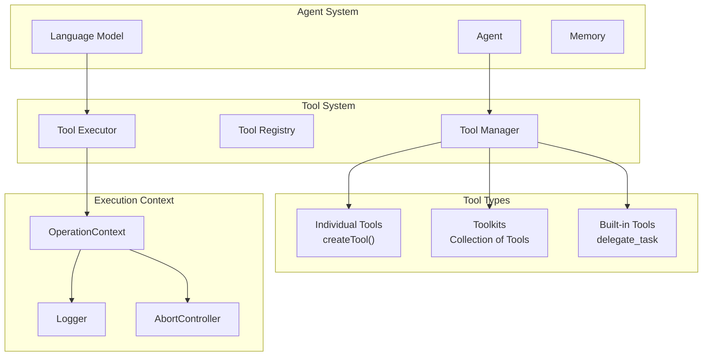
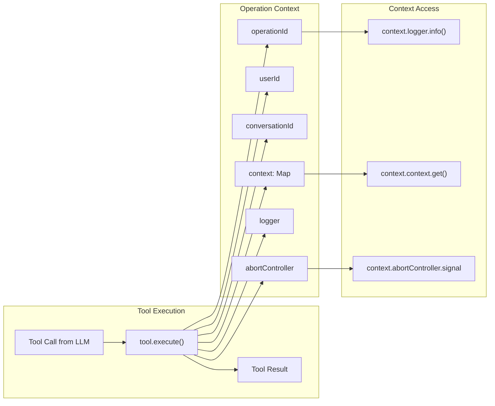
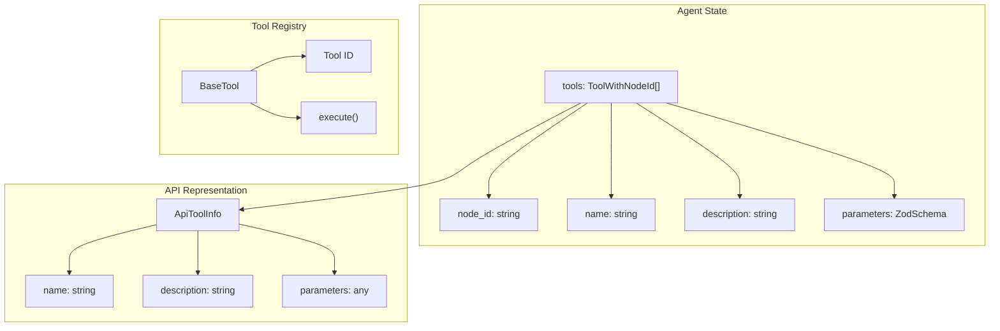
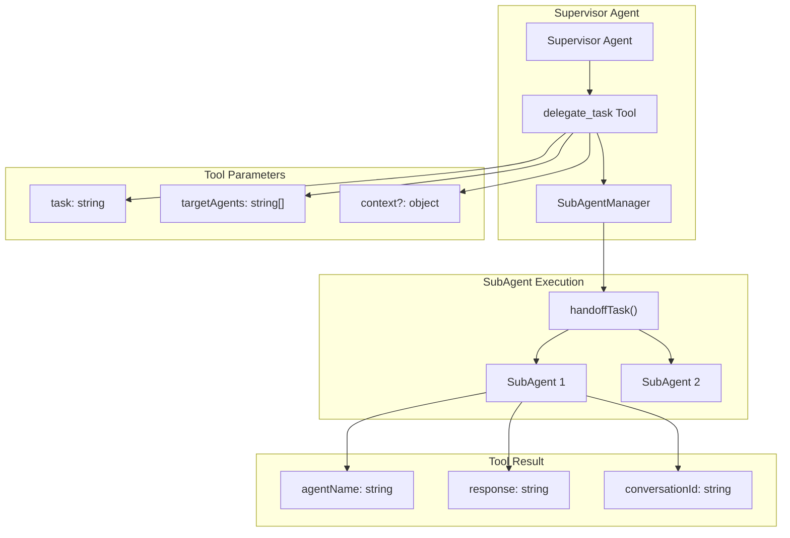

<!-- source: DeepWiki mcp.deepwiki.com · repo voltagent/voltagent · page 2.6 Tools and Tool Management · fetched 2026-10-27 -->

# Tools and Tool Management

<details>
<summary>Relevant source files</summary>

The following files were used as context for generating this wiki page:

- [.changeset/config.json](.changeset/config.json)
- [packages/core/src/agent/agent.spec-d.ts](packages/core/src/agent/agent.spec-d.ts)
- [packages/core/src/agent/agent.spec.ts](packages/core/src/agent/agent.spec.ts)
- [packages/core/src/agent/agent.ts](packages/core/src/agent/agent.ts)
- [packages/core/src/agent/hooks/index.spec.ts](packages/core/src/agent/hooks/index.spec.ts)
- [packages/core/src/agent/hooks/index.ts](packages/core/src/agent/hooks/index.ts)
- [packages/core/src/agent/index.ts](packages/core/src/agent/index.ts)
- [packages/core/src/agent/memory-persist-queue.ts](packages/core/src/agent/memory-persist-queue.ts)
- [packages/core/src/agent/message-normalizer.spec.ts](packages/core/src/agent/message-normalizer.spec.ts)
- [packages/core/src/agent/message-normalizer.ts](packages/core/src/agent/message-normalizer.ts)
- [packages/core/src/agent/providers/base/types.ts](packages/core/src/agent/providers/base/types.ts)
- [packages/core/src/agent/subagent/index.spec.ts](packages/core/src/agent/subagent/index.spec.ts)
- [packages/core/src/agent/subagent/index.ts](packages/core/src/agent/subagent/index.ts)
- [packages/core/src/agent/types.ts](packages/core/src/agent/types.ts)
- [packages/core/src/index.ts](packages/core/src/index.ts)
- [packages/core/src/memory/manager/memory-manager.ts](packages/core/src/memory/manager/memory-manager.ts)
- [website/docs/agents/context.md](website/docs/agents/context.md)
- [website/docs/agents/hooks.md](website/docs/agents/hooks.md)
- [website/docs/agents/overview.md](website/docs/agents/overview.md)
- [website/docs/agents/subagents.md](website/docs/agents/subagents.md)
- [website/docs/agents/tools.md](website/docs/agents/tools.md)

</details>


This document covers the VoltAgent tool system, including tool creation, execution, management, and integration with agents. Tools enable agents to interact with external systems, APIs, databases, and perform actions beyond text generation.

For information about agent-to-agent delegation, see [Multi-Agent Systems](#2.5). For memory and retrieval capabilities, see [Memory System](#2.3).

## Tool System Overview

VoltAgent's tool system allows agents to extend their capabilities by executing external functions during generation. Tools are defined with structured schemas and can access operation context for logging and state management.

### Tool Architecture



Sources: [packages/core/src/agent/types.ts:113-114](), [packages/core/src/agent/subagent/index.ts:684-745]()

## Tool Creation

Tools are created using the `createTool` function, which defines the tool's interface and execution logic.

### Basic Tool Structure

```typescript
import { createTool } from "@voltagent/core";
import { z } from "zod";

const weatherTool = createTool({
  name: "get_weather",
  description: "Get current weather for a location",
  parameters: z.object({
    location: z.string().describe("City and state/country"),
    units: z.enum(["celsius", "fahrenheit"]).optional()
  }),
  execute: async ({ location, units = "celsius" }, context) => {
    // Tool implementation
    const weather = await fetchWeather(location, units);
    return {
      temperature: weather.temp,
      conditions: weather.conditions,
      humidity: weather.humidity
    };
  }
});
```

### Tool Properties

| Property | Type | Description |
|----------|------|-------------|
| `name` | `string` | Unique identifier for the tool |
| `description` | `string` | Natural language description for the LLM |
| `parameters` | `ZodSchema` | Input validation schema using Zod |
| `execute` | `function` | Implementation function |

Sources: [packages/core/src/tool/index.ts]()

### Tool Execution Context

Tools receive an `OperationContext` parameter providing access to execution state:



Sources: [packages/core/src/agent/types.ts:587-628](), [packages/core/src/agent/providers/base/types.ts:243-266]()

### Advanced Tool Example

```typescript
const databaseTool = createTool({
  name: "query_database", 
  description: "Execute SQL queries on the database",
  parameters: z.object({
    query: z.string().describe("SQL query to execute"),
    params: z.array(z.any()).optional().describe("Query parameters")
  }),
  execute: async ({ query, params = [] }, operationContext) => {
    const logger = operationContext?.logger;
    const signal = operationContext?.abortController?.signal;
    
    logger?.info("Executing database query", { query });
    
    try {
      // Check for cancellation
      if (signal?.aborted) {
        throw new Error("Query cancelled");
      }
      
      const result = await db.query(query, params);
      
      logger?.info("Query completed", { 
        rowCount: result.rows.length 
      });
      
      return {
        success: true,
        data: result.rows,
        rowCount: result.rows.length
      };
    } catch (error) {
      logger?.error("Query failed", { error });
      return {
        success: false,
        error: error.message
      };
    }
  }
});
```

Sources: [packages/core/src/agent/types.ts:631-647]()

## Tool Management in Agents

### Adding Tools to Agents

Tools are provided to agents via the `tools` property during initialization or dynamically:

```typescript
import { Agent } from "@voltagent/core";
import { openai } from "@ai-sdk/openai";

const agent = new Agent({
  name: "Assistant",
  instructions: "Use tools to help users",
  model: openai("gpt-4o"),
  tools: [weatherTool, databaseTool] // Static tools
});
```

### Dynamic Tool Management

```typescript
// Add tools dynamically
agent.addTool(newTool);

// Remove tools
agent.removeTool("tool_name");

// Get current tools
const currentTools = agent.getTools();
```

### Tool State in Agent

Tools are tracked in the agent's state with additional metadata:



Sources: [packages/core/src/agent/types.ts:44-55](), [packages/core/src/agent/types.ts:81-97]()

## Toolkits

Toolkits organize related tools into reusable collections:

```typescript
import { createToolkit } from "@voltagent/core";

const weatherToolkit = createToolkit({
  name: "weather_toolkit",
  description: "Complete weather information system",
  tools: [
    getCurrentWeatherTool,
    getWeatherForecastTool,
    getWeatherAlertsTool
  ]
});

const agent = new Agent({
  name: "Weather Assistant",
  instructions: "Help with weather information",
  model: openai("gpt-4o"),
  toolkits: [weatherToolkit] // Use toolkit
});
```

Sources: [packages/core/src/agent/types.ts:113-114](), [packages/core/src/agent/types.ts:236]()

## Built-in Tools

### Delegate Task Tool

The `delegate_task` tool is automatically created for agents with subagents:



Sources: [packages/core/src/agent/subagent/index.ts:684-745]()

### Delegate Task Implementation

The delegate task tool is created dynamically by the `SubAgentManager`:

```typescript
// From SubAgentManager.createDelegateTool()
const delegateTool = createTool({
  id: "delegate_task",
  name: "delegate_task", 
  description: "Delegate a task to one or more specialized agents",
  parameters: z.object({
    task: z.string().describe("The specific task to delegate"),
    targetAgents: z.array(z.string()).describe("Names of target agents"),
    context: z.record(z.any()).optional().describe("Additional context")
  }),
  execute: async (params, operationContext) => {
    // Implementation handles agent lookup and task handoff
    return await this.handoffToMultiple({
      task: params.task,
      targetAgents: validAgents,
      // ... other options
    });
  }
});
```

Sources: [packages/core/src/agent/subagent/index.ts:701-745]()

## Tool Error Handling

### Tool Error Information

Tool errors are captured with detailed context:

```typescript
interface ToolErrorInfo {
  toolCallId: string;
  toolName: string;
  toolExecutionError?: unknown;
  toolArguments?: unknown;
}
```

### Error Handling Patterns

```typescript
const robustTool = createTool({
  name: "robust_operation",
  description: "Tool with comprehensive error handling",
  parameters: z.object({
    operation: z.string()
  }),
  execute: async ({ operation }, context) => {
    const logger = context?.logger;
    
    try {
      // Check for cancellation
      if (context?.abortController?.signal?.aborted) {
        throw new Error("Operation cancelled");
      }
      
      const result = await performOperation(operation);
      
      logger?.info("Operation completed", { operation });
      return result;
      
    } catch (error) {
      logger?.error("Operation failed", { 
        operation, 
        error: error.message 
      });
      
      // Return structured error instead of throwing
      return {
        success: false,
        error: error.message,
        operation
      };
    }
  }
});
```

Sources: [packages/core/src/agent/types.ts:634-647]()

## Tool Execution Flow

```mermaid
sequenceDisagram
    participant Agent as "Agent"
    participant LLM as "Language Model"
    participant ToolMgr as "Tool Manager"
    participant Tool as "Tool Execute"
    participant Context as "Operation Context"
    
    Agent->>LLM: "Generate with tools"
    LLM->>Agent: "Tool call required"
    Agent->>ToolMgr: "Execute tool call"
    ToolMgr->>Tool: "tool.execute(params, context)"
    Tool->>Context: "Access logger, context"
    Tool->>Tool: "Perform operation"
    Tool->>ToolMgr: "Return result"
    ToolMgr->>Agent: "Tool result"
    Agent->>LLM: "Continue with result"
    LLM->>Agent: "Final response"
```

Sources: [packages/core/src/agent/types.ts](), [packages/core/src/agent/subagent/index.ts:296-643]()

## Best Practices

### Tool Design Guidelines

1. **Clear Descriptions**: Write descriptions that help the LLM understand when and how to use the tool
2. **Structured Parameters**: Use detailed Zod schemas with descriptions
3. **Error Handling**: Implement comprehensive error handling and logging
4. **Cancellation Support**: Check for abort signals in long-running operations
5. **Context Logging**: Use the operation context logger for traceability

### Tool Naming Conventions

- Use descriptive, action-oriented names: `get_weather`, `send_email`, `query_database`
- Avoid generic names: `tool1`, `helper`, `utility`
- Use consistent naming patterns within toolkits

### Performance Considerations

- Keep tool execution fast to avoid blocking generation
- Use async operations appropriately
- Implement timeouts for external API calls
- Consider caching for frequently accessed data

Sources: [packages/core/src/agent/types.ts:634-647](), [packages/core/src/agent/subagent/index.ts]()

---

