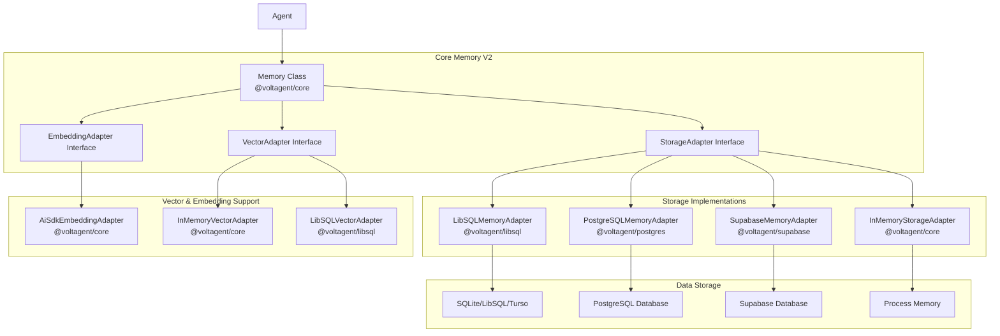
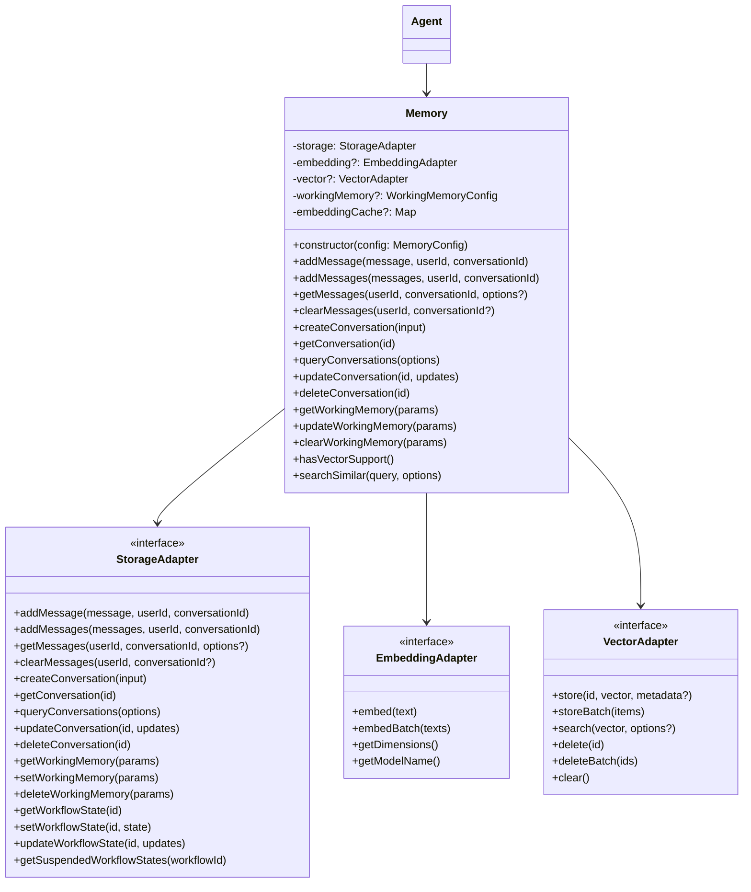
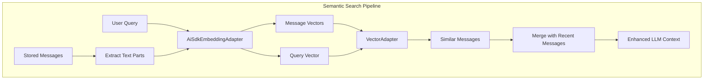
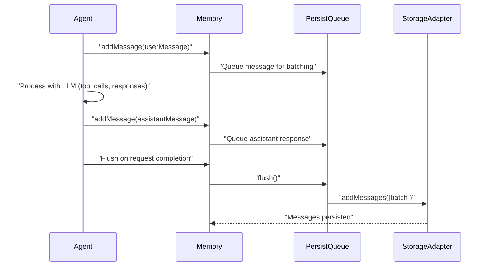

<!-- source: DeepWiki mcp.deepwiki.com · repo voltagent/voltagent · page 2.7 Memory System · fetched 2026-10-27 -->

# Memory System

<details>
<summary>Relevant source files</summary>

The following files were used as context for generating this wiki page:

- [CHANGELOG.md](CHANGELOG.md)
- [changelog.sh](changelog.sh)
- [examples/base/src/index.ts](examples/base/src/index.ts)
- [packages/cli/package.json](packages/cli/package.json)
- [packages/core/src/agent/agent.spec-d.ts](packages/core/src/agent/agent.spec-d.ts)
- [packages/core/src/agent/agent.spec.ts](packages/core/src/agent/agent.spec.ts)
- [packages/core/src/agent/agent.ts](packages/core/src/agent/agent.ts)
- [packages/core/src/agent/hooks/index.spec.ts](packages/core/src/agent/hooks/index.spec.ts)
- [packages/core/src/agent/hooks/index.ts](packages/core/src/agent/hooks/index.ts)
- [packages/core/src/agent/memory-persist-queue.ts](packages/core/src/agent/memory-persist-queue.ts)
- [packages/core/src/agent/message-normalizer.spec.ts](packages/core/src/agent/message-normalizer.spec.ts)
- [packages/core/src/agent/message-normalizer.ts](packages/core/src/agent/message-normalizer.ts)
- [packages/core/src/memory/manager/memory-manager.ts](packages/core/src/memory/manager/memory-manager.ts)
- [packages/create-voltagent-app/CHANGELOG.md](packages/create-voltagent-app/CHANGELOG.md)
- [packages/create-voltagent-app/package.json](packages/create-voltagent-app/package.json)
- [packages/voice/package.json](packages/voice/package.json)
- [website/docs/agents/context.md](website/docs/agents/context.md)
- [website/docs/agents/hooks.md](website/docs/agents/hooks.md)
- [website/docs/agents/tools.md](website/docs/agents/tools.md)

</details>


The Memory System in VoltAgent enables agents to maintain persistent conversation history, working memory, and semantic search capabilities across multiple interactions. The system uses a pluggable architecture with different storage adapters for various deployment scenarios.

## Memory V2 Architecture

VoltAgent's Memory V2 system provides a unified interface for conversation storage with pluggable backends, optional embeddings for semantic search, and working memory for maintaining agent context.

### Memory V2 System Architecture



Sources: [website/docs/agents/memory/overview.md:1-50](), [packages/core/src/memory/types.ts:150-197]()

### Memory Class Interface



Sources: [packages/core/src/memory/types.ts:150-369](), [website/docs/agents/memory/overview.md:10-50]()

### Core Memory Components

1. **Memory Class**: Central orchestrator that coordinates storage, embeddings, and vector operations.
   - Provides unified API for conversation management
   - Handles working memory operations
   - Manages semantic search when vector adapters are configured
   - Implements embedding caching for performance

2. **Storage Adapters**: Pluggable persistence backends for conversations and messages.
   - **LibSQLMemoryAdapter**: SQLite/LibSQL/Turso database storage
   - **PostgreSQLMemoryAdapter**: Production PostgreSQL database storage
   - **SupabaseMemoryAdapter**: Supabase cloud database storage
   - **InMemoryStorageAdapter**: In-memory storage for development/testing

3. **Embedding Adapters**: Convert text to vectors for semantic search.
   - **AiSdkEmbeddingAdapter**: Wraps AI SDK embedding models

4. **Vector Adapters**: Store and search vectors for semantic retrieval.
   - **InMemoryVectorAdapter**: In-memory vector storage for development
   - **LibSQLVectorAdapter**: Persistent vector storage using LibSQL

## Storage Adapters

### Storage Schema Structure

All storage adapters implement a consistent schema with the following tables:

| Table | Purpose | Key Columns |
|-------|---------|-------------|
| `{prefix}_conversations` | Conversation metadata | `id`, `resourceId`, `userId`, `title`, `metadata`, `createdAt`, `updatedAt` |
| `{prefix}_messages` | Individual messages | `conversationId`, `messageId`, `userId`, `role`, `parts`, `metadata`, `createdAt` |
| `{prefix}_users` | User metadata for working memory | `id`, `metadata`, `createdAt`, `updatedAt` |
| `{prefix}_workflow_states` | Workflow suspension/resume state | `id`, `workflowId`, `status`, `suspension`, `metadata` |

Sources: [website/docs/agents/memory/supabase.md:53-124](), [packages/core/src/memory/types.ts:22-121]()

### LibSQL Memory Adapter

The `LibSQLMemoryAdapter` provides SQLite, LibSQL, and Turso database support:

```typescript
import { Memory } from "@voltagent/core";
import { LibSQLMemoryAdapter } from "@voltagent/libsql";

const memory = new Memory({
  storage: new LibSQLMemoryAdapter({
    url: "file:./.voltagent/memory.db", // Local SQLite
    // url: "libsql://your-database.turso.io", // Remote Turso
    // authToken: process.env.DATABASE_AUTH_TOKEN, // For Turso
    tablePrefix: "voltagent_memory",
    storageLimit: 100,
  }),
});
```

**Use Cases:**
- Local development with SQLite files
- Edge deployments with Turso
- Serverless applications requiring embedded databases

Sources: [website/docs/agents/memory/libsql.md:30-85](), [packages/libsql/src/index.ts:1-11]()

### PostgreSQL Memory Adapter

The `PostgreSQLMemoryAdapter` provides production-grade PostgreSQL support:

```typescript
import { Memory } from "@voltagent/core";
import { PostgreSQLMemoryAdapter } from "@voltagent/postgres";

const memory = new Memory({
  storage: new PostgreSQLMemoryAdapter({
    connection: process.env.DATABASE_URL,
    maxConnections: 10,
    tablePrefix: "voltagent_memory",
    storageLimit: 100,
  }),
});
```

**Features:**
- Automatic table creation and migrations
- Connection pooling for concurrent access
- Advanced querying and pagination capabilities
- SSL support for production deployments

Sources: [website/docs/agents/memory/postgres.md:65-112](), [packages/postgres/src/index.ts:1-11]()

### Supabase Memory Adapter

The `SupabaseMemoryAdapter` integrates with Supabase cloud databases:

```typescript
import { Memory } from "@voltagent/core";
import { SupabaseMemoryAdapter } from "@voltagent/supabase";

const memory = new Memory({
  storage: new SupabaseMemoryAdapter({
    supabaseUrl: process.env.SUPABASE_URL,
    supabaseKey: process.env.SUPABASE_KEY,
    tableName: "voltagent_memory",
    storageLimit: 100,
  }),
});
```

**Benefits:**
- Managed PostgreSQL with built-in Auth and Realtime
- Row Level Security (RLS) for multi-tenant applications
- Integration with existing Supabase projects

Sources: [website/docs/agents/memory/supabase.md:213-260](), [packages/supabase/src/index.ts:1-11]()

## Working Memory

Working memory enables agents to maintain concise, important context across conversation turns. It can be conversation-scoped or user-scoped and supports both structured (JSON schema) and template-based (Markdown) formats.

### Working Memory Configuration

```typescript
import { Memory } from "@voltagent/core";
import { LibSQLMemoryAdapter } from "@voltagent/libsql";
import { z } from "zod";

// Template-based working memory
const memory = new Memory({
  storage: new LibSQLMemoryAdapter({ url: "file:./.voltagent/memory.db" }),
  workingMemory: {
    enabled: true,
    scope: "conversation", // or "user"
    template: `
# Profile
- Name:
- Role:

# Goals
-

# Preferences
-
`,
  },
});

// Schema-based working memory
const workingSchema = z.object({
  userProfile: z.object({
    name: z.string().optional(),
    timezone: z.string().optional(),
  }).optional(),
  tasks: z.array(z.string()).optional(),
});

const memoryWithSchema = new Memory({
  storage: new LibSQLMemoryAdapter({ url: "file:./.voltagent/memory.db" }),
  workingMemory: {
    enabled: true,
    scope: "user",
    schema: workingSchema,
  },
});
```

### Working Memory API

When working memory is enabled, agents automatically get these tools:

| Tool | Purpose |
|------|---------|
| `get_working_memory()` | Returns current working memory content |
| `update_working_memory(content)` | Updates working memory content |
| `clear_working_memory()` | Clears working memory content |

Programmatic access via `Memory` instance:

```typescript
// Get working memory
const content = await memory.getWorkingMemory({ 
  conversationId: "conv-123", 
  userId: "user-456" 
});

// Update working memory
await memory.updateWorkingMemory({ 
  conversationId: "conv-123", 
  userId: "user-456", 
  content: "Updated context data" 
});

// Clear working memory
await memory.clearWorkingMemory({ 
  conversationId: "conv-123", 
  userId: "user-456" 
});
```

Sources: [website/docs/agents/memory/overview.md:49-151](), [packages/core/src/memory/types.ts:125-143]()

## Semantic Search and Vector Operations

Memory V2 supports semantic search through embeddings and vector storage, enabling retrieval-augmented generation (RAG) capabilities.

### Semantic Search Architecture



### Configuring Semantic Search

```typescript
import { Memory, AiSdkEmbeddingAdapter, InMemoryVectorAdapter } from "@voltagent/core";
import { LibSQLMemoryAdapter, LibSQLVectorAdapter } from "@voltagent/libsql";
import { openai } from "@ai-sdk/openai";

// Development setup with in-memory vectors
const memory = new Memory({
  storage: new LibSQLMemoryAdapter({ url: "file:./.voltagent/memory.db" }),
  embedding: new AiSdkEmbeddingAdapter(openai.embedding("text-embedding-3-small")),
  vector: new InMemoryVectorAdapter(),
  enableCache: true, // Cache embeddings for performance
});

// Production setup with persistent vectors
const persistentMemory = new Memory({
  storage: new LibSQLMemoryAdapter({ url: "file:./.voltagent/memory.db" }),
  embedding: new AiSdkEmbeddingAdapter(openai.embedding("text-embedding-3-small")),
  vector: new LibSQLVectorAdapter({ url: "file:./.voltagent/memory.db" }),
});
```

### Using Semantic Search

```typescript
// Enable semantic search in agent calls
const response = await agent.generateText("What did we discuss about pricing?", {
  userId: "user-123",
  conversationId: "conv-456",
  semanticMemory: {
    enabled: true,
    semanticLimit: 5,
    semanticThreshold: 0.7,
    mergeStrategy: "append", // "prepend" | "append" | "interleave"
  },
});

// Programmatic semantic search
const results = await memory.searchSimilar("pricing discussion", {
  limit: 5,
  threshold: 0.7,
  filter: { userId: "user-123" },
});
```

**Merge Strategies:**
- `append`: Add semantic results after recent messages
- `prepend`: Add semantic results before recent messages  
- `interleave`: Alternate between recent and semantic messages

Sources: [website/docs/agents/memory/overview.md:152-221](), [packages/core/src/memory/types.ts:201-369]()

## Message Persistence Pipeline

VoltAgent uses a sophisticated batching and debouncing system for message persistence to ensure consistency and performance.

### Message Batching Flow



**Key Features:**
- **Batching**: Groups multiple messages into single database operations
- **Debouncing**: Delays writes to reduce database load during rapid interactions
- **Consistency**: Ensures all messages from a complete interaction are saved together
- **Error Recovery**: Flushes queued messages even when errors occur

Sources: [website/docs/agents/memory/overview.md:156-159]()

## User and Conversation Identification

Memory operations require proper identification of users and conversations to maintain data isolation and context continuity.

### Identifier Behavior

| Parameter | Behavior | Impact |
|-----------|----------|--------|
| `userId` | Unique string identifying the end-user | Segregates memory entries per user. Defaults to `"default"` if omitted |
| `conversationId` | Unique string identifying a conversation thread | **If provided**: Maintains conversation continuity<br/>**If omitted**: New random UUID generated each call (fresh conversation) |

### Usage Examples

```typescript
// Continuous conversation (same conversationId)
const SUPPORT_THREAD = "case-987-abc";
const response1 = await agent.generateText("My router is not working.", {
  userId: "user-456",
  conversationId: SUPPORT_THREAD,
});

const response2 = await agent.generateText("I tried restarting it, still no luck.", {
  userId: "user-456", 
  conversationId: SUPPORT_THREAD, // Agent remembers router issue
});

// New conversation each time (no conversationId)
const response3 = await agent.generateText("Help with account setup", { 
  userId: "user-123" 
}); // Fresh context

const response4 = await agent.generateText("Question about billing", { 
  userId: "user-123" 
}); // Another fresh context
```

Sources: [website/docs/agents/memory/overview.md:246-347]()

## Implementation Examples

### Basic Memory Setup

```typescript
import { Agent, Memory } from "@voltagent/core";
import { LibSQLMemoryAdapter } from "@voltagent/libsql";
import { openai } from "@ai-sdk/openai";

// Default in-memory storage (no persistence)
const agent = new Agent({
  name: "Basic Agent",
  instructions: "Uses default in-memory storage.",
  model: openai("gpt-4o-mini"),
  // memory: false, // Explicitly disable memory
});

// Persistent storage with LibSQL
const persistentAgent = new Agent({
  name: "Persistent Agent",
  instructions: "Uses LibSQL for memory.",
  model: openai("gpt-4o-mini"),
  memory: new Memory({
    storage: new LibSQLMemoryAdapter({ 
      url: "file:./.voltagent/memory.db" 
    }),
  }),
});
```

### Advanced Memory with Semantic Search

```typescript
import { Agent, Memory, AiSdkEmbeddingAdapter, InMemoryVectorAdapter } from "@voltagent/core";
import { LibSQLMemoryAdapter } from "@voltagent/libsql";
import { openai } from "@ai-sdk/openai";

const memory = new Memory({
  storage: new LibSQLMemoryAdapter({ url: "file:./.voltagent/memory.db" }),
  embedding: new AiSdkEmbeddingAdapter(openai.embedding("text-embedding-3-small")),
  vector: new InMemoryVectorAdapter(),
  workingMemory: { 
    enabled: true,
    scope: "conversation",
  },
});

const agent = new Agent({
  name: "Smart Memory Agent",
  instructions: "Retrieves with semantic search and tracks working memory.",
  model: openai("gpt-4o-mini"),
  memory,
});

// Usage with semantic search
const result = await agent.generateText("What did I say about pricing last week?", {
  userId: "user-123",
  conversationId: "conv-456",
  semanticMemory: {
    enabled: true,
    semanticLimit: 5,
    semanticThreshold: 0.7,
    mergeStrategy: "append",
  },
});
```

Sources: [website/docs/agents/memory/overview.md:262-313]()

## Summary

Memory and Context in VoltAgent provide complementary capabilities for maintaining state:

- **Memory System**: Enables long-term persistence across multiple interactions through storage providers like LibSQLStorage.

- **Context System**: Facilitates sharing state within a single operation through the `userContext` Map.

These systems can be used together to build agents that both remember past conversations and effectively manage request-specific resources and state.

---

