<!-- source: DeepWiki mcp.deepwiki.com · repo voltagent/voltagent · page 2.8 Workflow System · fetched 2026-10-27 -->

# Workflow System

<details>
<summary>Relevant source files</summary>

The following files were used as context for generating this wiki page:

- [.changeset/config.json](.changeset/config.json)
- [CHANGELOG.md](CHANGELOG.md)
- [changelog.sh](changelog.sh)
- [examples/base/src/index.ts](examples/base/src/index.ts)
- [packages/cli/package.json](packages/cli/package.json)
- [packages/core/src/agent/index.ts](packages/core/src/agent/index.ts)
- [packages/core/src/agent/providers/base/types.ts](packages/core/src/agent/providers/base/types.ts)
- [packages/core/src/agent/subagent/index.spec.ts](packages/core/src/agent/subagent/index.spec.ts)
- [packages/core/src/agent/subagent/index.ts](packages/core/src/agent/subagent/index.ts)
- [packages/core/src/agent/types.ts](packages/core/src/agent/types.ts)
- [packages/core/src/index.ts](packages/core/src/index.ts)
- [packages/create-voltagent-app/CHANGELOG.md](packages/create-voltagent-app/CHANGELOG.md)
- [packages/create-voltagent-app/package.json](packages/create-voltagent-app/package.json)
- [packages/voice/package.json](packages/voice/package.json)
- [website/docs/agents/overview.md](website/docs/agents/overview.md)
- [website/docs/agents/subagents.md](website/docs/agents/subagents.md)

</details>


The Workflow System provides declarative orchestration of multi-step agent operations, enabling complex task sequences with branching, parallelization, and error handling. This system allows you to chain steps using functions like `andThen`, `andAgent`, `andAll`, and `andRace` to build robust AI workflows.

**Scope**: This page covers workflow creation, step types, execution control, and cancellation. For agent-specific capabilities, see [Agent System](#2.1). For memory persistence during workflows, see [Memory System](#2.7). For multi-agent coordination patterns, see [SubAgent and Multi-Agent Systems](#2.2).

## Core Architecture

The workflow system consists of three primary components: workflow builders, step executors, and execution context managers.

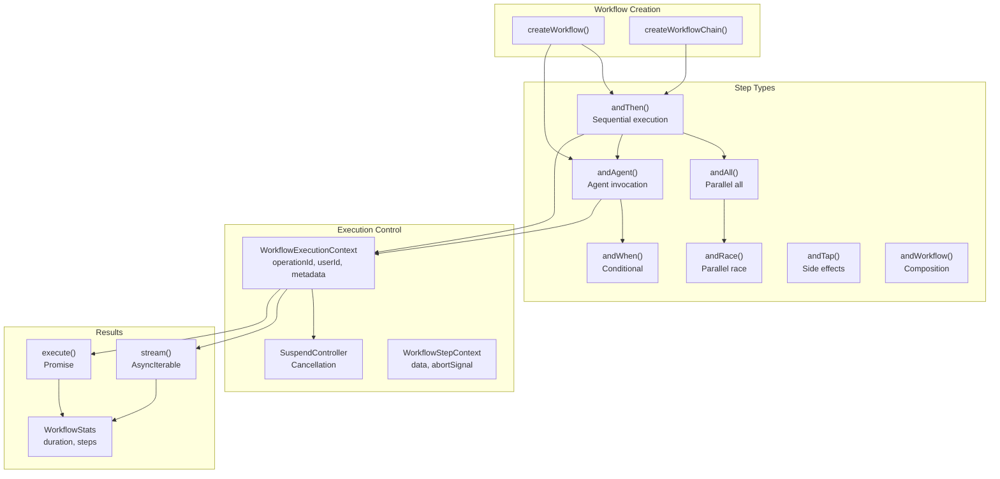

**Sources**: 
- [packages/core/src/index.ts:1-11]()
- [CHANGELOG.md:29-48]()
- [CHANGELOG.md:549-723]()

## Workflow and WorkflowConfig

A workflow is created using `createWorkflow()` and returns a `Workflow` object. The `WorkflowConfig` defines metadata and optional schema validation.

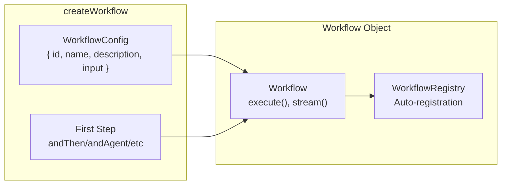

| Property | Type | Description |
|----------|------|-------------|
| `id` | `string` | Unique workflow identifier |
| `name` | `string` | Human-readable workflow name |
| `description` | `string` (optional) | Workflow purpose description |
| `input` | `z.ZodType` (optional) | Zod schema for input validation |

**Sources**:
- [packages/core/src/index.ts:17-23]()
- [CHANGELOG.md:145-154]()

## Step Types

Each step type implements a specific orchestration pattern. Steps are chained using method calls on the returned workflow object.

### andThen - Sequential Execution

The `andThen()` step executes a synchronous or asynchronous function, passing the previous step's output as input to the next step.

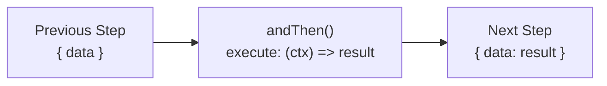

| Parameter | Type | Description |
|-----------|------|-------------|
| `id` | `string` | Step identifier |
| `execute` | `function` | `(ctx: WorkflowStepContext) => T \| Promise<T>` |

**Sources**:
- [packages/core/src/index.ts:7]()
- [CHANGELOG.md:145-154]()

### andAgent - Agent Invocation

The `andAgent()` step invokes an agent's `generateText`, `streamText`, `generateObject`, or `streamObject` method within the workflow.

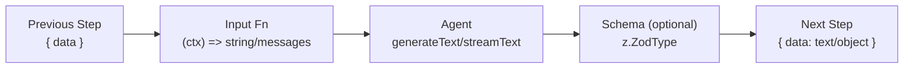

| Parameter | Type | Description |
|-----------|------|-------------|
| `input` | `function` | `(ctx) => string \| UIMessage[] \| ModelMessage[]` |
| `agent` | `Agent` | Agent instance to invoke |
| `options` | `object` (optional) | Method-specific options (schema for object methods) |

**Sources**:
- [packages/core/src/index.ts:5]()
- [CHANGELOG.md:628-723]()
- [packages/core/src/agent/subagent/types.ts:1-44]()

### andAll - Parallel Execution (All Complete)

The `andAll()` step executes multiple workflows or functions in parallel and waits for all to complete.

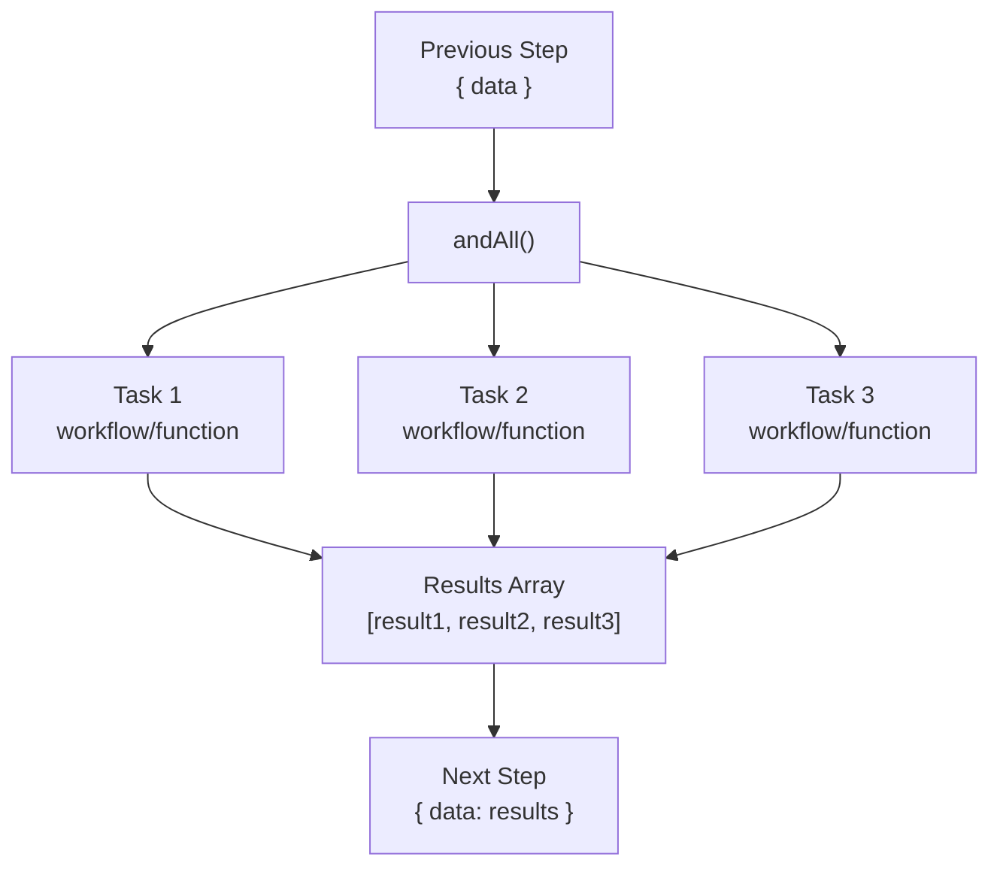

**Sources**:
- [packages/core/src/index.ts:8]()

### andRace - Parallel Execution (First Complete)

The `andRace()` step executes multiple workflows or functions in parallel and resolves with the first to complete.

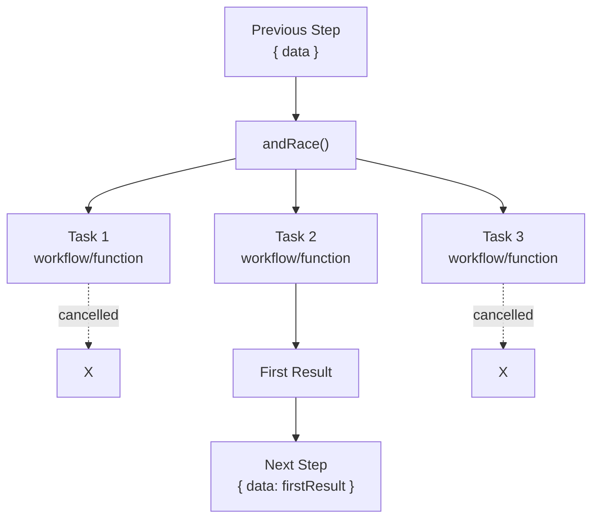

**Sources**:
- [packages/core/src/index.ts:9]()

### andWhen - Conditional Branching

The `andWhen()` step evaluates a condition and executes different workflows based on the result.

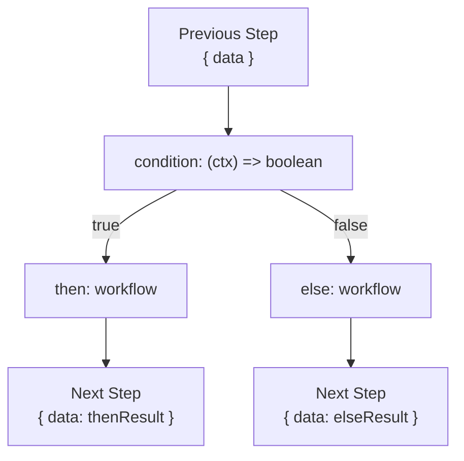

| Parameter | Type | Description |
|-----------|------|-------------|
| `condition` | `function` | `(ctx: WorkflowStepContext) => boolean \| Promise<boolean>` |
| `then` | `Workflow` | Workflow to execute if condition is true |
| `else` | `Workflow` (optional) | Workflow to execute if condition is false |

**Sources**:
- [packages/core/src/index.ts:7]()

### andTap - Side Effects

The `andTap()` step executes a function for side effects without modifying the data flow. The original data passes through unchanged.

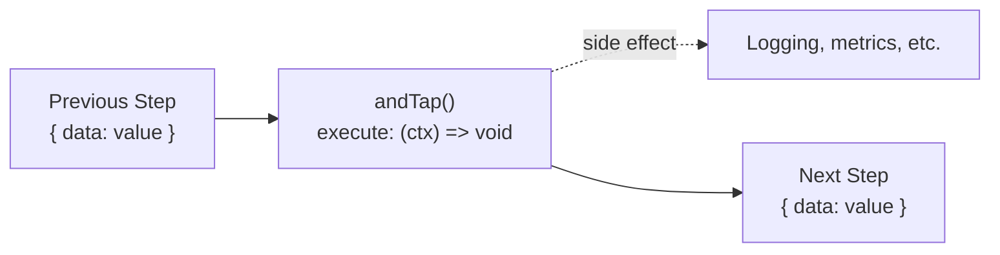

**Sources**:
- [packages/core/src/index.ts:10]()

### andWorkflow - Workflow Composition

The `andWorkflow()` step embeds another workflow as a step, enabling workflow reuse and composition.

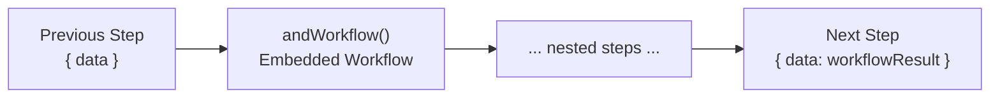

**Sources**:
- [packages/core/src/index.ts:11]()

## Workflow Execution

Workflows expose two execution methods: `execute()` for promise-based execution and `stream()` for streaming results.

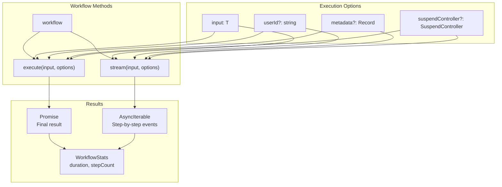

**Sources**:
- [packages/core/src/index.ts:17-23]()
- [CHANGELOG.md:29-48]()

## WorkflowExecutionContext and WorkflowStepContext

Two context objects flow through workflow execution, providing metadata and operational data.

### WorkflowExecutionContext

Global context for the entire workflow execution.

| Property | Type | Description |
|----------|------|-------------|
| `operationId` | `string` | Unique execution identifier |
| `userId` | `string` (optional) | User associated with execution |
| `metadata` | `Record<string, unknown>` (optional) | Custom execution metadata |
| `abortSignal` | `AbortSignal` | Signal for cancellation |

### WorkflowStepContext

Context for an individual step execution, includes current step's data.

| Property | Type | Description |
|----------|------|-------------|
| `data` | `T` | Output from previous step |
| `executionContext` | `WorkflowExecutionContext` | Global execution context |
| `abortSignal` | `AbortSignal` | Signal for cancellation |

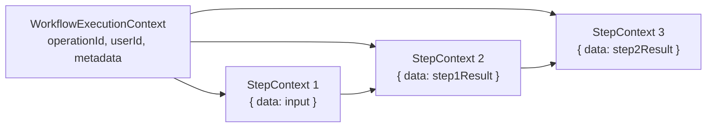

**Sources**:
- [packages/core/src/index.ts:14-16]()

## Cancellation with SuspendController

The `createSuspendController()` function creates a controller for cancelling workflow execution. Cancellation can be triggered programmatically or via HTTP endpoint.

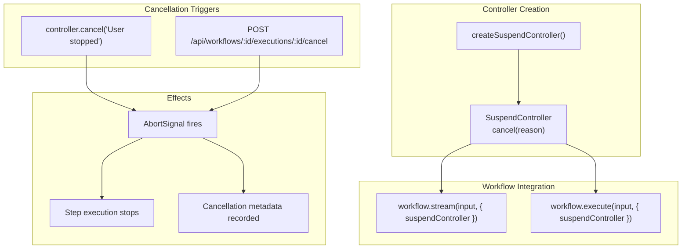

**Example Usage** (from CHANGELOG):
```typescript
import { createSuspendController } from "@voltagent/core";

const controller = createSuspendController();
const stream = workflow.stream(input, { suspendController: controller });

// Cancel from application code
controller.cancel("User stopped the workflow");

// Or via HTTP
await fetch(`/api/workflows/${workflowId}/executions/${executionId}/cancel`, {
  method: "POST",
  headers: { "Content-Type": "application/json" },
  body: JSON.stringify({ reason: "User stopped the workflow" }),
});
```

**Sources**:
- [CHANGELOG.md:29-48]()
- [packages/core/src/index.ts:4]()

## Integration with Agents

The `andAgent()` step bridges workflows and agents, supporting all four agent methods with proper type inference and schema validation.

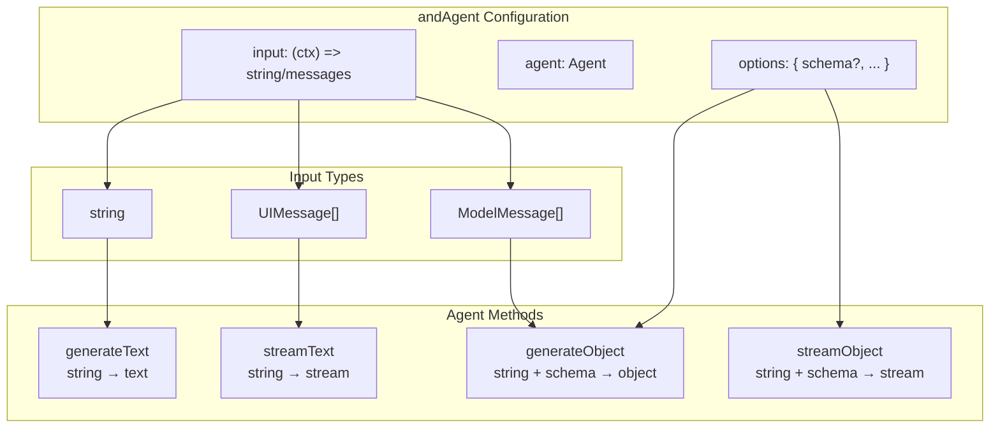

### andAgent with generateText

```typescript
workflow.andAgent(
  ({ data }) => `Process: ${data.text}`,
  agent,
  { schema: z.object({ result: z.string() }) }
)
```

### andAgent with ModelMessage[] Input

```typescript
workflow.andAgent(
  ({ data }) => [
    {
      role: "user",
      content: [{ type: "text", text: `Hello ${data.name}` }],
    },
  ] as ModelMessage[],
  agent,
  { schema: z.object({ reply: z.string() }) }
)
```

**Sources**:
- [CHANGELOG.md:628-723]()
- [packages/core/src/index.ts:5]()
- [website/docs/agents/subagents.md:1-50]()

## Workflow Streaming and Results

The `stream()` method returns an `AsyncIterable` that emits workflow events as execution progresses.

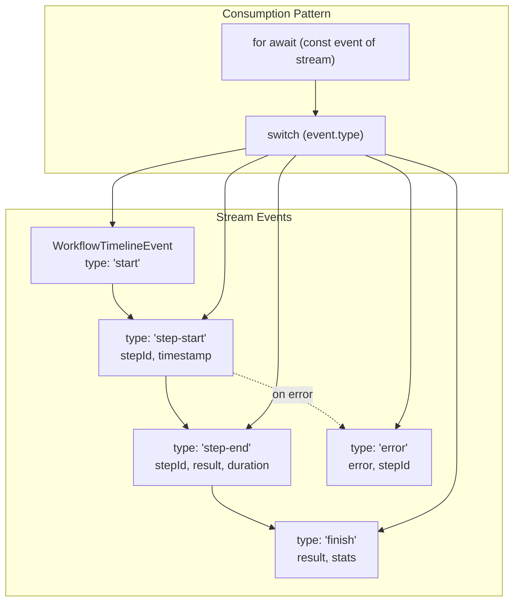

### WorkflowStats

Statistics collected during workflow execution.

| Property | Type | Description |
|----------|------|-------------|
| `duration` | `number` | Total execution time (ms) |
| `stepCount` | `number` | Number of steps executed |
| `startTime` | `Date` | Execution start timestamp |
| `endTime` | `Date` | Execution end timestamp |

**Sources**:
- [packages/core/src/index.ts:17-23]()
- [CHANGELOG.md:60-84]()

## Error Handling in Workflows

Workflow errors propagate through the execution chain. Use try/catch with `execute()` or handle error events with `stream()`.

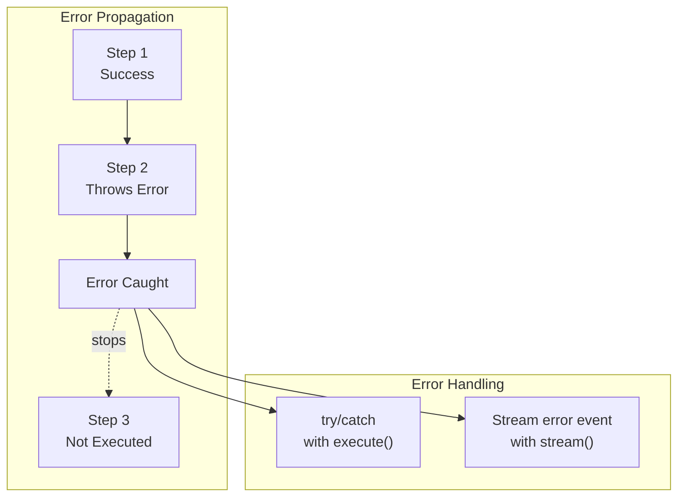

**Sources**:
- [CHANGELOG.md:60-84]()
- [packages/core/src/index.ts:17-23]()

## WorkflowRegistry

Workflows created with `createWorkflow()` are automatically registered in the `WorkflowRegistry` for discovery and management.

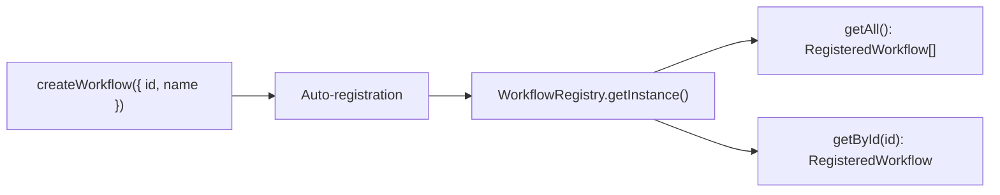

| Method | Return Type | Description |
|--------|-------------|-------------|
| `getInstance()` | `WorkflowRegistry` | Singleton registry instance |
| `getAll()` | `RegisteredWorkflow[]` | All registered workflows |
| `getById(id)` | `RegisteredWorkflow \| undefined` | Find workflow by ID |

**Sources**:
- [packages/core/src/index.ts:138]()

---

