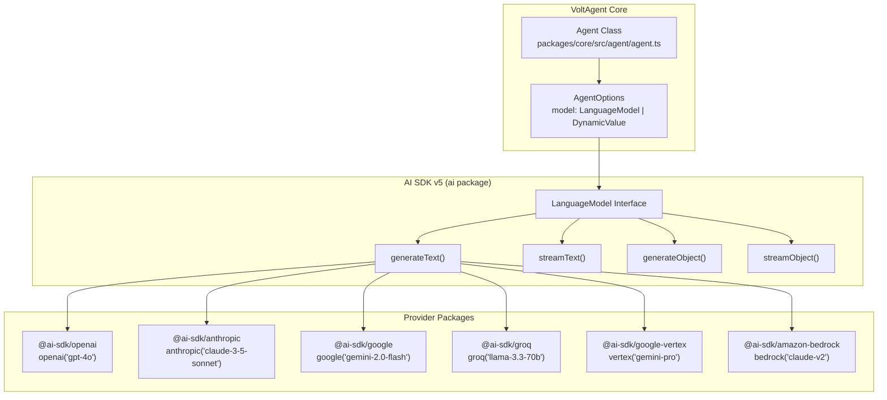
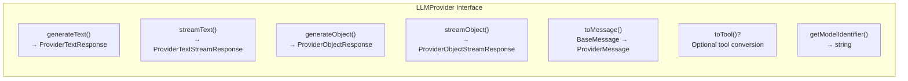
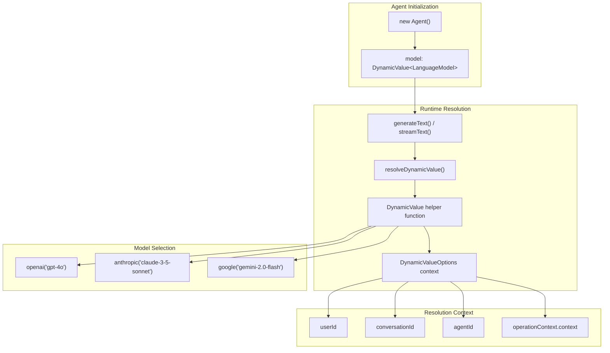
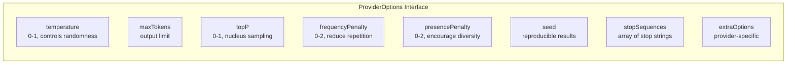
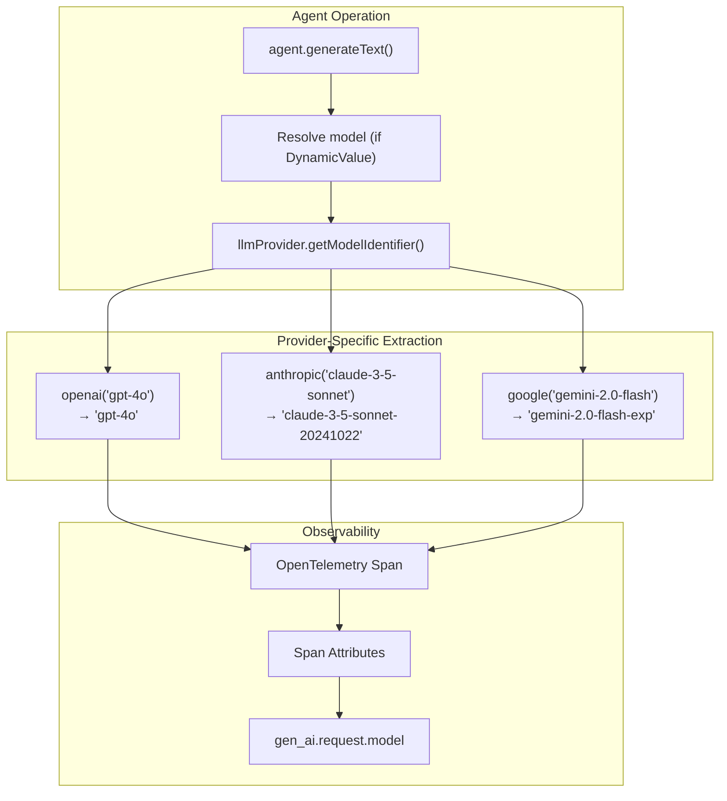

<!-- source: DeepWiki mcp.deepwiki.com · repo voltagent/voltagent · page 3 AI Provider Integration · fetched 2026-10-27 -->

# AI Provider Integration

<details>
<summary>Relevant source files</summary>

The following files were used as context for generating this wiki page:

- [.changeset/config.json](.changeset/config.json)
- [examples/with-google-ai/package.json](examples/with-google-ai/package.json)
- [examples/with-google-vertex-ai/package.json](examples/with-google-vertex-ai/package.json)
- [examples/with-groq-ai/package.json](examples/with-groq-ai/package.json)
- [examples/with-mcp/package.json](examples/with-mcp/package.json)
- [examples/with-nextjs/package.json](examples/with-nextjs/package.json)
- [packages/core/package.json](packages/core/package.json)
- [packages/core/src/agent/index.ts](packages/core/src/agent/index.ts)
- [packages/core/src/agent/providers/base/types.ts](packages/core/src/agent/providers/base/types.ts)
- [packages/core/src/agent/subagent/index.spec.ts](packages/core/src/agent/subagent/index.spec.ts)
- [packages/core/src/agent/subagent/index.ts](packages/core/src/agent/subagent/index.ts)
- [packages/core/src/agent/types.ts](packages/core/src/agent/types.ts)
- [packages/core/src/index.ts](packages/core/src/index.ts)
- [pnpm-lock.yaml](pnpm-lock.yaml)
- [website/docs/agents/overview.md](website/docs/agents/overview.md)
- [website/docs/agents/subagents.md](website/docs/agents/subagents.md)

</details>


This document explains how VoltAgent integrates with Large Language Model (LLM) providers through the Vercel AI SDK v5 abstraction layer. It covers the provider architecture, supported providers, model configuration, and dynamic model selection patterns.

For information about how agents use models to generate responses, see [Agent System](#2.1). For details on configuring provider-specific options in agent operations, see [Operation Context and Execution](#2.4).

---

## Provider Architecture Overview

VoltAgent uses the Vercel AI SDK v5 as its LLM abstraction layer, enabling support for multiple AI providers through a unified interface. This design allows agents to switch between providers without code changes and supports advanced features like dynamic model selection and prompt management.

### AI SDK Abstraction Layer



**Sources:** [packages/core/src/agent/types.ts:260](), [packages/core/src/agent/providers/base/types.ts:401-456](), [packages/core/package.json:54-58]()

### LLMProvider Interface

The `LLMProvider` interface defines the contract for all provider implementations. While VoltAgent uses AI SDK's providers directly (which implement a compatible interface), understanding this structure is useful for custom provider implementations.



**Key Methods:**

| Method | Purpose | Returns |
|--------|---------|---------|
| `generateText()` | Synchronous text generation | `ProviderTextResponse<T>` |
| `streamText()` | Streaming text generation | `ProviderTextStreamResponse<T>` |
| `generateObject()` | Synchronous structured output | `ProviderObjectResponse<T, Schema>` |
| `streamObject()` | Streaming structured output | `ProviderObjectStreamResponse<T, Schema>` |
| `toMessage()` | Convert BaseMessage to provider format | Provider-specific message type |
| `toTool()` | Optional: Convert tool definitions | Provider-specific tool type |
| `getModelIdentifier()` | Get string representation of model | `string` |

**Sources:** [packages/core/src/agent/providers/base/types.ts:401-456]()

---

## Supported Providers

VoltAgent supports all providers available through the AI SDK v5. Each provider requires its own package installation and API key configuration.

### Provider Package Matrix

| Provider | Package | Example Model | API Key Variable |
|----------|---------|---------------|------------------|
| OpenAI | `@ai-sdk/openai` | `gpt-4o`, `gpt-4o-mini` | `OPENAI_API_KEY` |
| Anthropic | `@ai-sdk/anthropic` | `claude-3-5-sonnet-20241022` | `ANTHROPIC_API_KEY` |
| Google AI | `@ai-sdk/google` | `gemini-2.0-flash-exp` | `GOOGLE_GENERATIVE_AI_API_KEY` |
| Google Vertex AI | `@ai-sdk/google-vertex` | `gemini-pro`, `gemini-ultra` | GCP credentials |
| Groq | `@ai-sdk/groq` | `llama-3.3-70b-versatile` | `GROQ_API_KEY` |
| Amazon Bedrock | `@ai-sdk/amazon-bedrock` | `anthropic.claude-v2` | AWS credentials |
| Mistral | `@ai-sdk/mistral` | `mistral-large-latest` | `MISTRAL_API_KEY` |

**Sources:** [pnpm-lock.yaml:110-148](), [pnpm-lock.yaml:286-324](), [pnpm-lock.yaml:326-361](), [pnpm-lock.yaml:643-678](), [pnpm-lock.yaml:772-807](), [pnpm-lock.yaml:809-844]()

### OpenAI Configuration

```typescript
import { Agent } from '@voltagent/core';
import { openai } from '@ai-sdk/openai';

const agent = new Agent({
  name: 'OpenAI Agent',
  instructions: 'You are a helpful assistant',
  model: openai('gpt-4o'),
});
```

**Installation:**
```bash
pnpm add @ai-sdk/openai
```

**Environment:**
```bash
OPENAI_API_KEY=sk-...
```

**Sources:** [examples/base/package.json:110-112]()

### Anthropic Configuration

```typescript
import { anthropic } from '@ai-sdk/anthropic';

const agent = new Agent({
  name: 'Claude Agent',
  instructions: 'You are Claude, a thoughtful assistant',
  model: anthropic('claude-3-5-sonnet-20241022'),
});
```

**Installation:**
```bash
pnpm add @ai-sdk/anthropic
```

**Environment:**
```bash
ANTHROPIC_API_KEY=sk-ant-...
```

**Sources:** [examples/with-anthropic/package.json:328-330]()

### Google AI Configuration

```typescript
import { google } from '@ai-sdk/google';

const agent = new Agent({
  name: 'Gemini Agent',
  instructions: 'You are a Google Gemini assistant',
  model: google('gemini-2.0-flash-exp'),
});
```

**Installation:**
```bash
pnpm add @ai-sdk/google
```

**Environment:**
```bash
GOOGLE_GENERATIVE_AI_API_KEY=...
```

**Sources:** [examples/with-google-ai/package.json:645-647]()

### Google Vertex AI Configuration

```typescript
import { vertex } from '@ai-sdk/google-vertex';

const agent = new Agent({
  name: 'Vertex Agent',
  instructions: 'Enterprise Gemini assistant',
  model: vertex('gemini-pro'),
});
```

**Installation:**
```bash
pnpm add @ai-sdk/google-vertex
```

**Environment:**
Requires Google Cloud credentials configured via `GOOGLE_APPLICATION_CREDENTIALS` or default application credentials.

**Sources:** [examples/with-google-vertex-ai/package.json:774-776]()

### Groq Configuration

```typescript
import { groq } from '@ai-sdk/groq';

const agent = new Agent({
  name: 'Groq Agent',
  instructions: 'Fast inference assistant',
  model: groq('llama-3.3-70b-versatile'),
});
```

**Installation:**
```bash
pnpm add @ai-sdk/groq
```

**Environment:**
```bash
GROQ_API_KEY=gsk_...
```

**Sources:** [examples/with-groq-ai/package.json:811-813]()

### Amazon Bedrock Configuration

```typescript
import { bedrock } from '@ai-sdk/amazon-bedrock';
import { fromEnv } from '@aws-sdk/credential-providers';

const agent = new Agent({
  name: 'Bedrock Agent',
  instructions: 'AWS Bedrock assistant',
  model: bedrock('anthropic.claude-v2', {
    region: 'us-east-1',
    credentials: fromEnv(),
  }),
});
```

**Installation:**
```bash
pnpm add @ai-sdk/amazon-bedrock @aws-sdk/credential-providers
```

**Environment:**
Requires AWS credentials configured via environment variables or AWS SDK configuration.

**Sources:** [examples/with-amazon-bedrock/package.json:288-293]()

---

## Dynamic Model Selection

VoltAgent supports runtime model selection through the `DynamicValue` pattern, enabling model switching based on context, user preferences, or A/B testing scenarios.

### DynamicValue Pattern Architecture



**Sources:** [packages/core/src/agent/types.ts:130-143](), [packages/core/src/voltops/types.ts]()

### Basic Dynamic Model Example

```typescript
import { Agent } from '@voltagent/core';
import { openai } from '@ai-sdk/openai';
import { anthropic } from '@ai-sdk/anthropic';
import type { DynamicValueOptions } from '@voltagent/core';

const agent = new Agent({
  name: 'Adaptive Agent',
  instructions: 'You adapt to user needs',
  // Dynamic model based on userId
  model: async (options: DynamicValueOptions) => {
    const premiumUsers = ['user-123', 'user-456'];
    
    if (premiumUsers.includes(options.userId || '')) {
      return openai('gpt-4o'); // Premium model
    }
    return openai('gpt-4o-mini'); // Standard model
  },
});

// Model selected based on userId
const response = await agent.generateText('Hello', {
  userId: 'user-123', // Gets gpt-4o
});
```

**Sources:** [packages/core/src/agent/types.ts:136]()

### Context-Based Model Selection

```typescript
const agent = new Agent({
  name: 'Context-Aware Agent',
  instructions: 'Adapts model to task complexity',
  model: async (options: DynamicValueOptions) => {
    // Access custom context from operation
    const taskType = options.operationContext?.context.get('taskType');
    
    switch (taskType) {
      case 'code-generation':
        return anthropic('claude-3-5-sonnet-20241022'); // Best for coding
      case 'creative-writing':
        return openai('gpt-4o'); // Best for creativity
      case 'data-analysis':
        return google('gemini-2.0-flash-exp'); // Best for reasoning
      default:
        return openai('gpt-4o-mini'); // Default
    }
  },
});

// Specify context to influence model selection
const response = await agent.generateText('Write a function', {
  context: new Map([['taskType', 'code-generation']]),
});
```

**Sources:** [packages/core/src/agent/types.ts:29-34](), [packages/core/src/voltops/types.ts]()

### A/B Testing with Dynamic Models

```typescript
const agent = new Agent({
  name: 'A/B Test Agent',
  instructions: 'Testing model performance',
  model: async (options: DynamicValueOptions) => {
    // Hash userId to ensure consistent assignment
    const hash = hashString(options.userId || '');
    const variant = hash % 2; // 50/50 split
    
    if (variant === 0) {
      // Variant A: OpenAI
      return openai('gpt-4o');
    } else {
      // Variant B: Anthropic
      return anthropic('claude-3-5-sonnet-20241022');
    }
  },
});

function hashString(str: string): number {
  let hash = 0;
  for (let i = 0; i < str.length; i++) {
    hash = ((hash << 5) - hash) + str.charCodeAt(i);
    hash = hash & hash;
  }
  return Math.abs(hash);
}
```

**Sources:** [packages/core/src/agent/types.ts:136]()

---

## VoltOps Integration for Prompt Management

VoltAgent integrates with VoltOps for centralized prompt and model management. This enables runtime updates to instructions and models without code deployments.

### VoltOps Dynamic Instructions

```typescript
import { Agent, VoltOpsClient } from '@voltagent/core';
import { openai } from '@ai-sdk/openai';

const voltOpsClient = new VoltOpsClient({
  publicKey: process.env.VOLTOPS_PUBLIC_KEY!,
  secretKey: process.env.VOLTOPS_SECRET_KEY!,
});

const agent = new Agent({
  name: 'Managed Agent',
  // Dynamic instructions from VoltOps
  instructions: async (options) => {
    return await voltOpsClient.getPrompt({
      name: 'customer-support-agent',
      variables: {
        userName: options.userId || 'Guest',
      },
    });
  },
  model: openai('gpt-4o'),
  voltOpsClient,
});
```

**PromptContent Response Structure:**

```typescript
interface PromptContent {
  content: string;           // The actual prompt text
  prompt_id?: string;        // Base prompt ID
  prompt_version_id?: string; // Specific version ID
  name?: string;             // Prompt name
  version?: number;          // Version number
  labels?: string[];         // Classification labels
  tags?: string[];           // User-defined tags
  config?: {                 // Recommended configuration
    model?: string;
    temperature?: number;
    [key: string]: any;
  };
}
```

**Sources:** [packages/core/src/agent/types.ts:131](), [packages/core/src/voltops/types.ts]()

### VoltOps Model Selection

```typescript
const agent = new Agent({
  name: 'VoltOps Managed Agent',
  instructions: 'Managed by VoltOps',
  // Dynamic model selection from VoltOps config
  model: async (options) => {
    const promptContent = await voltOpsClient.getPrompt({
      name: 'adaptive-agent',
    });
    
    // VoltOps returns recommended model in config
    const modelName = promptContent.config?.model || 'gpt-4o-mini';
    
    // Map model name to provider
    if (modelName.startsWith('gpt-')) {
      return openai(modelName);
    } else if (modelName.startsWith('claude-')) {
      return anthropic(modelName);
    } else if (modelName.startsWith('gemini-')) {
      return google(modelName);
    }
    
    return openai('gpt-4o-mini'); // Fallback
  },
  voltOpsClient,
});
```

**Sources:** [packages/core/src/voltops/types.ts](), [packages/core/src/agent/types.ts:318-321]()

---

## Provider Options Configuration

Provider options control LLM behavior such as temperature, token limits, and sampling parameters. These can be configured at the agent level or per-operation.

### Common Provider Options



**Sources:** [packages/core/src/agent/types.ts:148-176]()

### Agent-Level Provider Options

```typescript
import { Agent } from '@voltagent/core';
import { openai } from '@ai-sdk/openai';

const agent = new Agent({
  name: 'Configured Agent',
  instructions: 'You are precise and deterministic',
  model: openai('gpt-4o'),
  // Default provider options for all operations
  temperature: 0.1,        // Low temperature for consistency
  maxOutputTokens: 2048,   // Token limit
});

// Uses default temperature: 0.1
const response = await agent.generateText('Explain quantum computing');
```

**Sources:** [packages/core/src/agent/types.ts:280-281](), [website/docs/agents/overview.md:46-48]()

### Per-Operation Provider Options

```typescript
// Override agent defaults for specific operations
const creativeResponse = await agent.generateText(
  'Write a creative story',
  {
    provider: {
      temperature: 0.9,      // Override agent's 0.1
      maxTokens: 4096,       // Override agent's 2048
      topP: 0.95,            // Add nucleus sampling
      frequencyPenalty: 0.5, // Reduce repetition
      presencePenalty: 0.3,  // Encourage topic diversity
    },
  }
);

const deterministicResponse = await agent.generateText(
  'Calculate the result',
  {
    provider: {
      temperature: 0,        // Fully deterministic
      seed: 12345,           // Reproducible
    },
  }
);
```

**Sources:** [packages/core/src/agent/types.ts:148-176]()

### Provider-Specific Options

```typescript
// Use extraOptions for provider-specific parameters
const response = await agent.generateText('Generate text', {
  provider: {
    temperature: 0.7,
    extraOptions: {
      // OpenAI-specific
      logit_bias: { '50256': -100 }, // Suppress specific tokens
      user: 'user-123',              // User tracking
      
      // Or Anthropic-specific
      // top_k: 40,
      
      // Or Google-specific
      // safetySettings: [...],
    },
  },
});
```

**Sources:** [packages/core/src/agent/types.ts:164]()

### Provider Options Summary Table

| Option | Type | Range | Default | Purpose |
|--------|------|-------|---------|---------|
| `temperature` | number | 0-1 | Model default | Controls randomness (0=deterministic, 1=creative) |
| `maxTokens` | number | Provider-specific | Model default | Maximum tokens in response |
| `topP` | number | 0-1 | Model default | Nucleus sampling threshold |
| `frequencyPenalty` | number | 0-2 | 0 | Penalize repeated tokens |
| `presencePenalty` | number | 0-2 | 0 | Penalize tokens based on presence |
| `seed` | number | Any integer | undefined | For reproducible results |
| `stopSequences` | string[] | N/A | undefined | Sequences that stop generation |
| `extraOptions` | object | Provider-specific | undefined | Provider-specific parameters |

**Sources:** [packages/core/src/agent/types.ts:148-176]()

---

## Provider Response Types

Understanding the response structures helps when consuming LLM outputs in different scenarios.

### Text Generation Response

```typescript
interface ProviderTextResponse<TOriginalResponse> {
  provider: TOriginalResponse;  // Original AI SDK response
  text: string;                 // Generated text
  usage?: UsageInfo;            // Token usage
  toolCalls?: any[];            // Tool invocations (if any)
  toolResults?: any[];          // Tool results (if any)
  finishReason?: string;        // Why generation stopped
  reasoning?: string;           // Model reasoning (if supported)
  warnings?: any[];             // Provider warnings
}

interface UsageInfo {
  promptTokens: number;
  completionTokens: number;
  totalTokens: number;
  cachedInputTokens?: number;   // Prompt caching (if supported)
  reasoningTokens?: number;     // Reasoning tokens (o1 models)
}
```

**Sources:** [packages/core/src/agent/providers/base/types.ts:43-84](), [packages/core/src/agent/providers/base/types.ts:23-29]()

### Stream Text Response

```typescript
interface ProviderTextStreamResponse<TOriginalResponse> {
  provider: TOriginalResponse;           // Original response
  textStream: AsyncIterableStream<string>; // Text chunks
  fullStream?: AsyncIterable<StreamPart>; // All events
  text?: Promise<string>;                 // Final text (when done)
  finishReason?: Promise<string>;         // Final reason
  usage?: Promise<UsageInfo>;             // Final usage
  reasoning?: Promise<string | undefined>; // Final reasoning
}

type StreamPart = TextStreamPart<any> & {
  subAgentId?: string;     // If from subagent
  subAgentName?: string;   // If from subagent
};
```

**Sources:** [packages/core/src/agent/providers/base/types.ts:86-141](), [packages/core/src/agent/providers/base/types.ts:87-91]()

### Object Generation Response

```typescript
interface ProviderObjectResponse<TOriginalResponse, TObject> {
  provider: TOriginalResponse;  // Original response
  object: TObject;              // Validated object
  usage?: UsageInfo;            // Token usage
  finishReason?: string;        // Why generation stopped
  warnings?: any[];             // Provider warnings
}

interface ProviderObjectStreamResponse<TOriginalResponse, TObject> {
  provider: TOriginalResponse;
  objectStream: AsyncIterableStream<Partial<TObject>>; // Partial updates
  object?: Promise<TObject>;                           // Final object
  usage?: Promise<UsageInfo>;
  warnings?: Promise<any[] | undefined>;
}
```

**Sources:** [packages/core/src/agent/providers/base/types.ts:146-171](), [packages/core/src/agent/providers/base/types.ts:176-207]()

---

## Model Identifier Resolution

VoltAgent needs to track which models are used for observability and cost tracking. The `getModelIdentifier()` method provides a standardized way to extract model names from provider-specific model objects.

### Model Identifier Flow



**Sources:** [packages/core/src/agent/providers/base/types.ts:455]()

### Usage in Observability

The model identifier is automatically included in OpenTelemetry traces and VoltOps events:

```typescript
// Model identifier is automatically tracked
const response = await agent.generateText('Hello');

// Trace includes:
// - gen_ai.request.model: "gpt-4o"
// - gen_ai.system: "openai"
// - gen_ai.operation.name: "chat"
```

**Sources:** [packages/core/src/agent/providers/base/types.ts:452-456]()

---

## Provider Package Dependencies

VoltAgent requires specific package versions to ensure compatibility.

### Core Dependencies

```json
{
  "peerDependencies": {
    "@ai-sdk/provider-utils": "3.x",
    "ai": "5.x",
    "zod": "^3.25.0 || ^4.0.0"
  }
}
```

**Sources:** [packages/core/package.json:54-58]()

### Provider Package Installation

Each provider requires its own package:

```bash
# OpenAI
pnpm add @ai-sdk/openai

# Anthropic
pnpm add @ai-sdk/anthropic

# Google AI
pnpm add @ai-sdk/google

# Google Vertex AI
pnpm add @ai-sdk/google-vertex

# Groq
pnpm add @ai-sdk/groq

# Amazon Bedrock
pnpm add @ai-sdk/amazon-bedrock @aws-sdk/credential-providers

# Mistral
pnpm add @ai-sdk/mistral
```

**Sources:** [pnpm-lock.yaml:110-148](), [pnpm-lock.yaml:286-324](), [pnpm-lock.yaml:326-361](), [pnpm-lock.yaml:643-678](), [pnpm-lock.yaml:772-807](), [pnpm-lock.yaml:809-844]()

### Version Compatibility Matrix

| Package | Required Version | VoltAgent Core Version |
|---------|------------------|------------------------|
| `ai` | `5.x` | All versions |
| `@ai-sdk/provider-utils` | `3.x` | All versions |
| `zod` | `^3.25.0 \|\| ^4.0.0` | All versions |

**Sources:** [packages/core/package.json:54-58]()

---

## Summary

VoltAgent's AI provider integration architecture provides:

1. **Provider Abstraction**: AI SDK v5 enables uniform access to multiple LLM providers
2. **Dynamic Selection**: Runtime model switching based on context, user, or configuration
3. **VoltOps Integration**: Centralized prompt and model management without code deployments
4. **Flexible Configuration**: Per-agent and per-operation provider options
5. **Type Safety**: Full TypeScript support with inference for all providers

The abstraction layer allows applications to switch providers without code changes while maintaining advanced features like streaming, structured output, and tool calling across all supported models.

---

