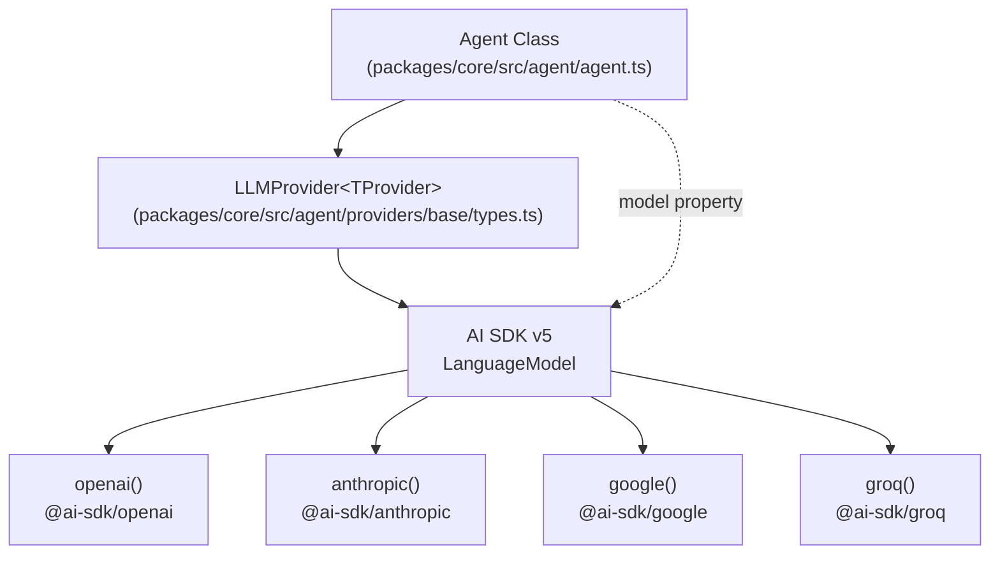
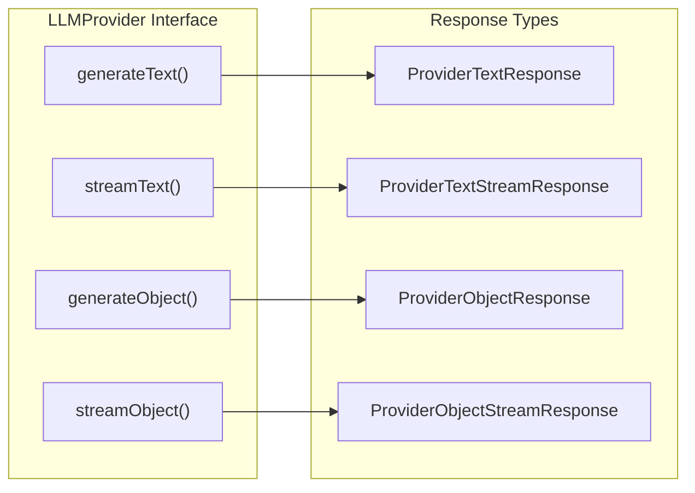
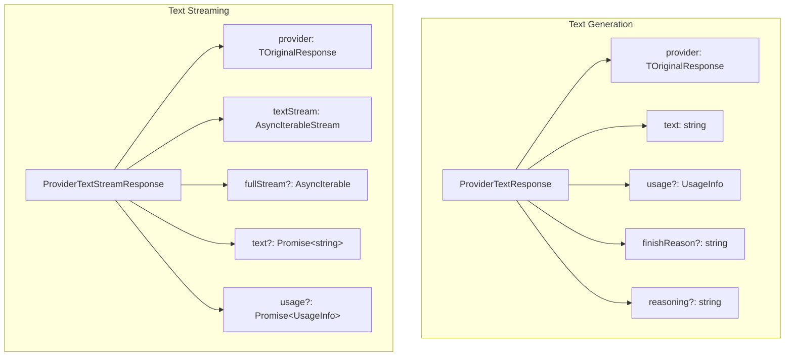
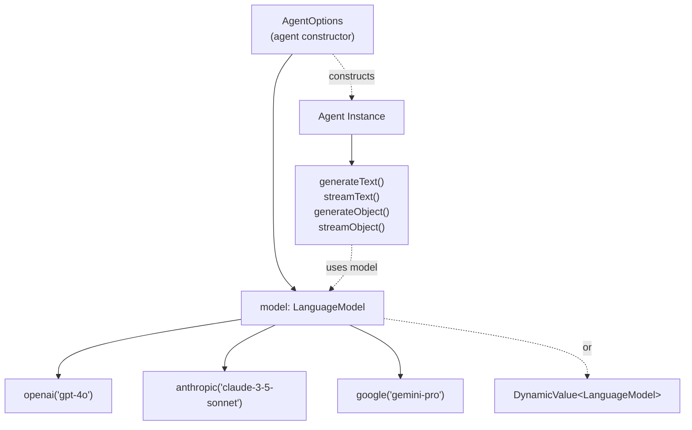
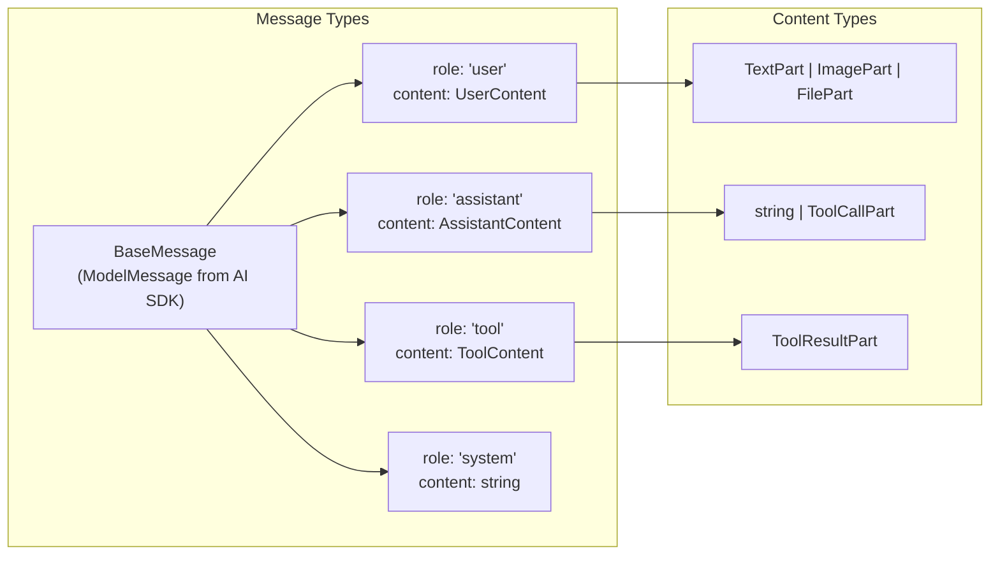
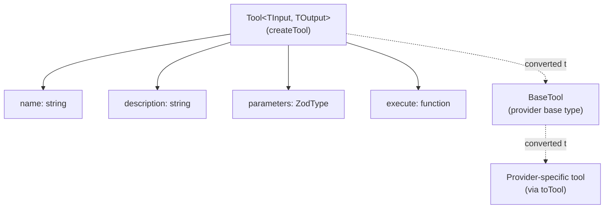
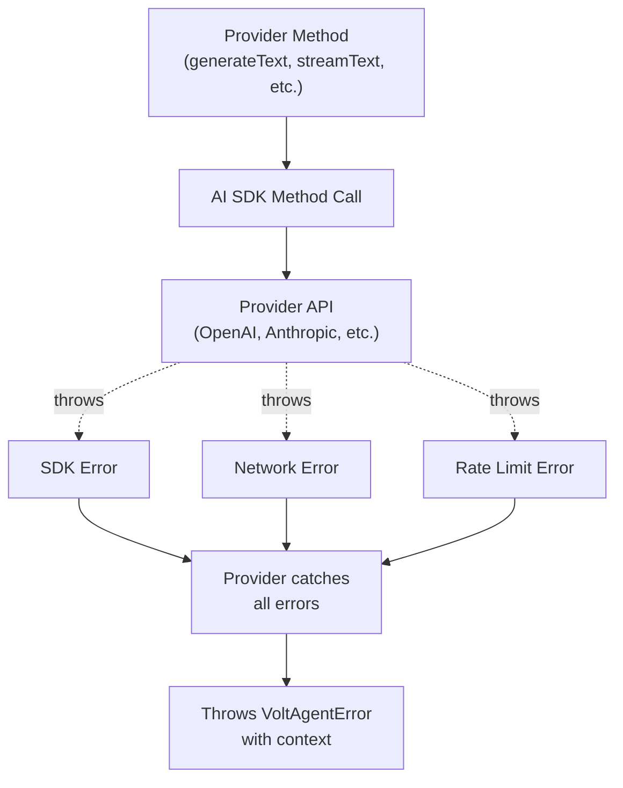
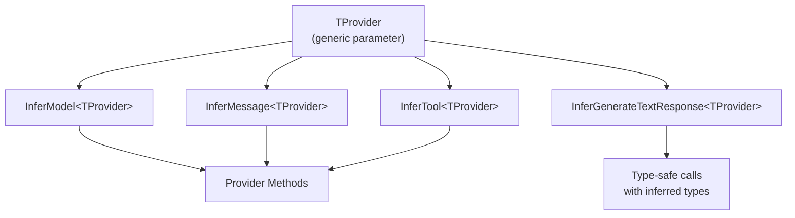

<!-- source: DeepWiki mcp.deepwiki.com · repo voltagent/voltagent · page 3.1 Provider Architecture · fetched 2026-10-27 -->

# Provider Architecture

<details>
<summary>Relevant source files</summary>

The following files were used as context for generating this wiki page:

- [.changeset/config.json](.changeset/config.json)
- [examples/with-google-ai/package.json](examples/with-google-ai/package.json)
- [examples/with-google-vertex-ai/package.json](examples/with-google-vertex-ai/package.json)
- [examples/with-groq-ai/package.json](examples/with-groq-ai/package.json)
- [examples/with-mcp/package.json](examples/with-mcp/package.json)
- [examples/with-nextjs/package.json](examples/with-nextjs/package.json)
- [packages/core/package.json](packages/core/package.json)
- [packages/core/src/agent/index.ts](packages/core/src/agent/index.ts)
- [packages/core/src/agent/providers/base/types.ts](packages/core/src/agent/providers/base/types.ts)
- [packages/core/src/agent/subagent/index.spec.ts](packages/core/src/agent/subagent/index.spec.ts)
- [packages/core/src/agent/subagent/index.ts](packages/core/src/agent/subagent/index.ts)
- [packages/core/src/agent/types.ts](packages/core/src/agent/types.ts)
- [packages/core/src/index.ts](packages/core/src/index.ts)
- [pnpm-lock.yaml](pnpm-lock.yaml)
- [website/docs/agents/overview.md](website/docs/agents/overview.md)
- [website/docs/agents/subagents.md](website/docs/agents/subagents.md)

</details>


## Purpose and Scope

This page documents the LLM provider abstraction layer in VoltAgent, which enables agents to work with any AI model through a unified interface. The architecture uses Vercel AI SDK v5 as its foundation and defines the `LLMProvider` interface that all provider implementations must satisfy.

For information about specific provider configurations (OpenAI, Anthropic, Google, etc.), see [Supported Providers](#3.2). For dynamic model selection and prompt management, see [Dynamic Model Selection](#3.3).

## AI SDK v5 Foundation

VoltAgent leverages Vercel AI SDK v5 as the underlying abstraction layer for LLM interactions. The AI SDK provides standardized interfaces for model communication, tool calling, and streaming across different providers. VoltAgent's provider architecture wraps these capabilities to add agent-specific functionality like memory integration, observability, and error handling.



**Sources:**
- [packages/core/src/agent/types.ts:260]()
- [packages/core/src/agent/providers/base/types.ts:401-456]()
- [packages/core/package.json:54-58]()

## LLMProvider Interface

The `LLMProvider<TProvider>` interface defines the contract that all provider implementations must satisfy. It consists of four core generation methods, message/tool conversion methods, and model identification.

### Core Methods



The interface is defined with these method signatures:

| Method | Input | Output | Purpose |
|--------|-------|--------|---------|
| `generateText` | `GenerateTextOptions<TModel>` | `ProviderTextResponse<T>` | Generates complete text response |
| `streamText` | `StreamTextOptions<TModel>` | `ProviderTextStreamResponse<T>` | Streams text response incrementally |
| `generateObject` | `GenerateObjectOptions<TModel, TSchema>` | `ProviderObjectResponse<T, TObject>` | Generates structured object |
| `streamObject` | `StreamObjectOptions<TModel, TSchema>` | `ProviderObjectStreamResponse<T, TObject>` | Streams structured object |

Each method accepts standard options including messages, model, tools, and provider-specific parameters.

**Sources:**
- [packages/core/src/agent/providers/base/types.ts:401-456]()
- [packages/core/src/agent/providers/base/types.ts:307-348]()

### Conversion Methods

The interface includes methods for converting between VoltAgent's standard types and provider-specific formats:

```typescript
// Message conversion (required)
toMessage(message: BaseMessage): InferMessage<TProvider>

// Tool conversion (optional)
toTool?(tool: BaseTool): InferTool<TProvider>

// Model identification (required)
getModelIdentifier(model: InferModel<TProvider>): string
```

These methods enable VoltAgent to work with any provider while maintaining a consistent internal representation of messages and tools.

**Sources:**
- [packages/core/src/agent/providers/base/types.ts:439-455]()
- [packages/core/src/agent/providers/base/types.ts:236-273]()

## Response Type System

VoltAgent wraps AI SDK responses in provider response types that add VoltAgent-specific metadata while preserving access to the original provider response.



### Response Properties

**ProviderTextResponse** ([packages/core/src/agent/providers/base/types.ts:44-84]()):
- `provider`: Original AI SDK response object
- `text`: Generated text content
- `usage`: Token usage statistics
- `finishReason`: Reason generation stopped
- `reasoning`: Model's reasoning text (if available)
- `warnings`: Provider warnings

**ProviderTextStreamResponse** ([packages/core/src/agent/providers/base/types.ts:96-141]()):
- `provider`: Original AI SDK response object
- `textStream`: Async iterable for text chunks
- `fullStream`: Async iterable for all event types
- `text`: Promise resolving to full text
- `usage`: Promise resolving to token usage
- `finishReason`: Promise resolving to finish reason
- `reasoning`: Promise resolving to reasoning text

**ProviderObjectResponse** ([packages/core/src/agent/providers/base/types.ts:146-171]()):
- `provider`: Original AI SDK response object
- `object`: Generated structured object
- `usage`: Token usage statistics
- `finishReason`: Reason generation stopped
- `warnings`: Provider warnings

**ProviderObjectStreamResponse** ([packages/core/src/agent/providers/base/types.ts:176-207]()):
- `provider`: Original AI SDK response object
- `objectStream`: Async iterable for partial objects
- `object`: Promise resolving to final object
- `usage`: Promise resolving to token usage
- `warnings`: Promise resolving to warnings

**Sources:**
- [packages/core/src/agent/providers/base/types.ts:34-207]()
- [packages/core/src/agent/types.ts:824-846]()

## Integration with Agent System

Agents specify their LLM model through the `model` property in `AgentOptions`, which accepts any AI SDK `LanguageModel`.



The model is used directly by the agent's generation methods without requiring a separate provider instance. VoltAgent passes the model and other options to AI SDK methods, which handle the actual provider communication.

### Agent Configuration Example

```typescript
// From agent options structure
const agent = new Agent({
  name: "Assistant",
  instructions: "You are helpful",
  model: openai("gpt-4o"), // AI SDK LanguageModel
  
  // Optional provider-level defaults
  temperature: 0.7,
  maxOutputTokens: 2048,
  
  // Agent capabilities
  tools: [weatherTool],
  memory: memoryInstance,
});
```

**Sources:**
- [packages/core/src/agent/types.ts:253-300]()
- [examples/with-google-ai/package.json:5-6]()
- [examples/with-groq-ai/package.json:5-6]()
- [examples/with-anthropic/package.json:5-6]()

## Message Type System

The provider architecture uses AI SDK's `ModelMessage` type as the base message format, ensuring full compatibility with AI SDK features.



The `BaseMessage` type is an alias for AI SDK's `ModelMessage`, providing multimodal support (text, images, files) and full tool calling capabilities.

**Sources:**
- [packages/core/src/agent/providers/base/types.ts:236-237]()
- [packages/core/src/agent/providers/base/types.ts:209-227]()

## Tool Integration

Tools are converted to provider-specific formats through the optional `toTool` method. VoltAgent's `Tool<TInput, TOutput>` type wraps Zod schemas and execution logic.



The `BaseTool` type ([packages/core/src/agent/providers/base/types.ts:268]()) represents tools in the provider abstraction layer, allowing providers to implement custom tool formats while maintaining compatibility with VoltAgent's tool system.

**Sources:**
- [packages/core/src/agent/providers/base/types.ts:239-268]()
- [packages/core/src/agent/types.ts:264-265]()

## Error Handling Contract

Provider implementations must catch underlying SDK/API errors and throw standardized `VoltAgentError` instances. This ensures consistent error handling across all providers.



### Error Documentation Requirements

Each provider method in the interface includes the following documentation:

```typescript
/**
 * Generates a text response based on the provided options.
 * Implementers should catch underlying SDK/API errors and throw a VoltAgentError.
 * @throws {VoltAgentError} If an error occurs during generation.
 */
```

This contract ensures that calling code can handle errors consistently regardless of the underlying provider.

**Sources:**
- [packages/core/src/agent/providers/base/types.ts:402-409]()
- [packages/core/src/agent/providers/base/types.ts:411-418]()
- [packages/core/src/agent/providers/base/types.ts:420-427]()
- [packages/core/src/agent/providers/base/types.ts:429-436]()

## Type Safety and Inference

The provider architecture uses TypeScript generics and type inference to maintain type safety across provider boundaries.



The inference utilities ([packages/core/src/agent/providers/base/types.ts:351-399]()) extract types from provider implementations:

- `InferModel<T>`: Extracts the model type
- `InferMessage<T>`: Extracts the message format
- `InferTool<T>`: Extracts the tool format
- `InferGenerateTextResponse<T>`: Extracts the response type
- `InferProviderParams<T>`: Extracts provider-specific parameters

This approach allows VoltAgent to work with any AI SDK provider while maintaining full type safety.

**Sources:**
- [packages/core/src/agent/providers/base/types.ts:351-399]()
- [packages/core/src/agent/types.ts:328-373]()

## Provider Options and Parameters

The `ProviderOptions` type ([packages/core/src/agent/types.ts:148-176]()) defines common LLM configuration parameters that can be passed at the agent level or per-request:

| Parameter | Type | Range | Description |
|-----------|------|-------|-------------|
| `temperature` | `number` | 0-1 | Controls randomness |
| `maxTokens` | `number` | - | Maximum tokens to generate |
| `topP` | `number` | 0-1 | Nucleus sampling threshold |
| `frequencyPenalty` | `number` | 0-2 | Penalizes repeated tokens |
| `presencePenalty` | `number` | 0-2 | Penalizes existing tokens |
| `seed` | `number` | - | Seed for reproducible results |
| `stopSequences` | `string[]` | - | Stop generation sequences |
| `extraOptions` | `Record<string, unknown>` | - | Provider-specific options |

These options are normalized and passed to the AI SDK, which translates them to provider-specific formats.

**Sources:**
- [packages/core/src/agent/types.ts:148-176]()
- [packages/core/src/agent/providers/base/types.ts:276-289]()

---

