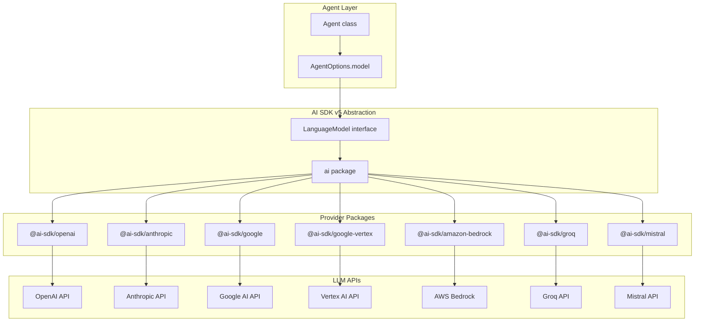
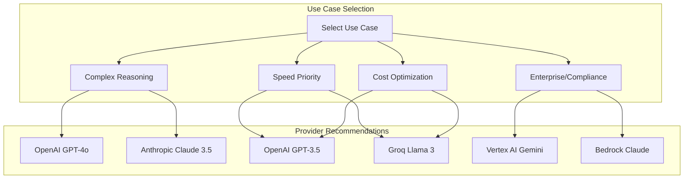
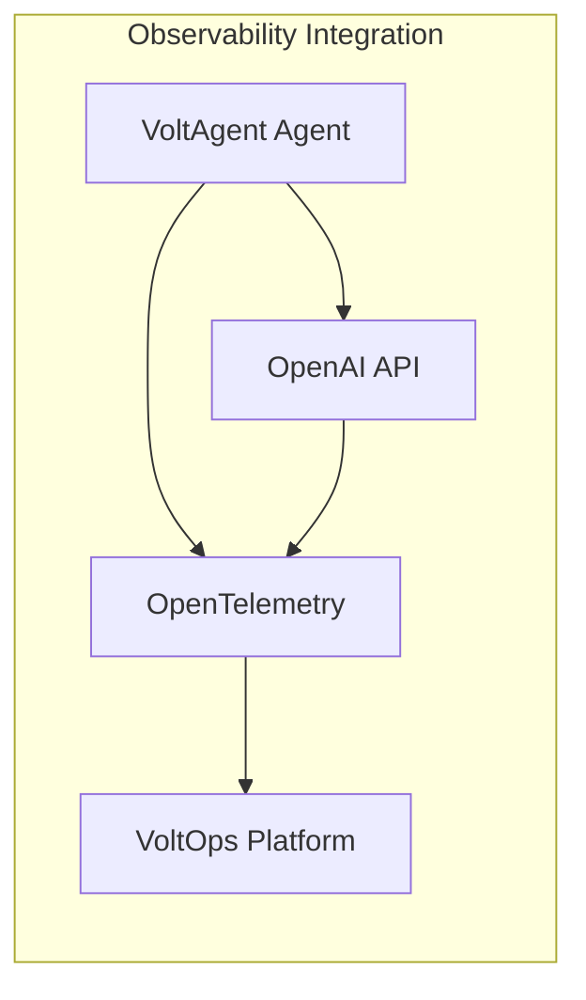

<!-- source: DeepWiki mcp.deepwiki.com · repo voltagent/voltagent · page 3.2 Supported Providers · fetched 2026-10-27 -->

# Supported Providers

<details>
<summary>Relevant source files</summary>

The following files were used as context for generating this wiki page:

- [examples/base/package.json](examples/base/package.json)
- [examples/github-repo-analyzer/package.json](examples/github-repo-analyzer/package.json)
- [examples/with-google-ai/package.json](examples/with-google-ai/package.json)
- [examples/with-google-vertex-ai/package.json](examples/with-google-vertex-ai/package.json)
- [examples/with-groq-ai/package.json](examples/with-groq-ai/package.json)
- [examples/with-mcp/package.json](examples/with-mcp/package.json)
- [examples/with-nextjs/package.json](examples/with-nextjs/package.json)
- [examples/with-rag-chatbot/package.json](examples/with-rag-chatbot/package.json)
- [examples/with-retrieval/package.json](examples/with-retrieval/package.json)
- [examples/with-subagents/package.json](examples/with-subagents/package.json)
- [examples/with-supabase/package.json](examples/with-supabase/package.json)
- [examples/with-tools/package.json](examples/with-tools/package.json)
- [examples/with-vercel-ai/package.json](examples/with-vercel-ai/package.json)
- [examples/with-voice-elevenlabs/package.json](examples/with-voice-elevenlabs/package.json)
- [examples/with-voice-openai/package.json](examples/with-voice-openai/package.json)
- [packages/core/package.json](packages/core/package.json)
- [pnpm-lock.yaml](pnpm-lock.yaml)

</details>


VoltAgent supports multiple LLM providers through the Vercel AI SDK v5 abstraction layer. This enables agents to use different models while maintaining a consistent API across all providers.

For information about provider architecture and abstraction patterns, see page 3.1. For dynamic model selection and prompt management, see page 3.3.

## Overview

VoltAgent integrates with 7+ major AI providers through official AI SDK provider packages. All providers share the same configuration pattern and API surface, enabling easy switching between models without code changes.

## Supported Providers Overview

| Provider | Package | Models | Example |
|----------|---------|--------|---------|
| OpenAI | `@ai-sdk/openai` | GPT-4o, GPT-4 Turbo, GPT-3.5 | `examples/base`, `examples/with-nextjs` |
| Anthropic | `@ai-sdk/anthropic` | Claude 3.5 Sonnet, Claude 3 Opus | `examples/with-anthropic` |
| Google AI | `@ai-sdk/google` | Gemini Pro, Gemini Ultra | `examples/with-google-ai` |
| Google Vertex AI | `@ai-sdk/google-vertex` | Gemini (Enterprise) | `examples/with-google-vertex-ai` |
| Amazon Bedrock | `@ai-sdk/amazon-bedrock` | Claude, Llama, Titan | `examples/with-amazon-bedrock` |
| Groq | `@ai-sdk/groq` | Llama 3, Mixtral | `examples/with-groq-ai` |
| Mistral AI | `@ai-sdk/mistral` | Mistral Large, Mistral Medium | `examples/with-playwright` |

**Sources:** [pnpm-lock.yaml:110-112](), [pnpm-lock.yaml:328-330](), [pnpm-lock.yaml:224-226](), [pnpm-lock.yaml:811-813](), [pnpm-lock.yaml:774-776](), [pnpm-lock.yaml:288-290](), [pnpm-lock.yaml:1297-1299]()

## Provider Integration Architecture



**Sources:** [packages/core/package.json:30](), [examples/base/package.json:5](), [examples/with-anthropic/package.json:4]()

## OpenAI

### Installation

```bash
npm install @ai-sdk/openai ai
```

### Configuration

```typescript
import { openai } from '@ai-sdk/openai';
import { Agent } from '@voltagent/core';

const agent = new Agent({
  name: 'OpenAI Assistant',
  model: openai('gpt-4o'),
  instructions: 'You are a helpful AI assistant.',
});
```

### Available Models

- `gpt-4o` - Latest multimodal model
- `gpt-4-turbo` - High performance, large context
- `gpt-4` - Previous generation flagship
- `gpt-3.5-turbo` - Fast, cost-effective

### Environment Variables

```bash
OPENAI_API_KEY=sk-...
```

**Sources:** [examples/base/package.json:5](), [pnpm-lock.yaml:110-112](), [examples/with-nextjs/package.json:5]()

## Anthropic

### Installation

```bash
npm install @ai-sdk/anthropic ai
```

### Configuration

```typescript
import { anthropic } from '@ai-sdk/anthropic';
import { Agent } from '@voltagent/core';

const agent = new Agent({
  name: 'Claude Assistant',
  model: anthropic('claude-3-5-sonnet-20241022'),
  instructions: 'You are a helpful AI assistant.',
});
```

### Available Models

- `claude-3-5-sonnet-20241022` - Latest high-intelligence model
- `claude-3-opus-20240229` - Most capable model
- `claude-3-sonnet-20240229` - Balanced performance
- `claude-3-haiku-20240307` - Fast, compact model

### Environment Variables

```bash
ANTHROPIC_API_KEY=sk-ant-...
```

**Sources:** [examples/with-anthropic/package.json:4-6](), [pnpm-lock.yaml:328-330]()

## Google AI (Gemini)

### Installation

```bash
npm install @ai-sdk/google ai
```

### Configuration

```typescript
import { google } from '@ai-sdk/google';
import { Agent } from '@voltagent/core';

const agent = new Agent({
  name: 'Gemini Assistant',
  model: google('gemini-1.5-pro'),
  instructions: 'You are a helpful AI assistant.',
});
```

### Available Models

- `gemini-1.5-pro` - Advanced reasoning, multimodal
- `gemini-1.5-flash` - Fast, efficient responses
- `gemini-pro` - Standard model

### Environment Variables

```bash
GOOGLE_GENERATIVE_AI_API_KEY=...
```

**Sources:** [examples/with-google-ai/package.json:4-6](), [pnpm-lock.yaml:645-647]()

## Google Vertex AI

### Installation

```bash
npm install @ai-sdk/google-vertex ai
```

### Configuration

```typescript
import { vertex } from '@ai-sdk/google-vertex';
import { Agent } from '@voltagent/core';

const agent = new Agent({
  name: 'Vertex Assistant',
  model: vertex('gemini-1.5-pro', {
    project: 'your-project-id',
    location: 'us-central1',
  }),
  instructions: 'You are a helpful AI assistant.',
});
```

### Available Models

- `gemini-1.5-pro` - Enterprise Gemini Pro
- `gemini-1.5-flash` - Enterprise Gemini Flash
- `gemini-pro` - Standard enterprise model

### Environment Variables

```bash
GOOGLE_APPLICATION_CREDENTIALS=path/to/service-account.json
# Or use gcloud authentication
```

**Sources:** [examples/with-google-vertex-ai/package.json:4-6](), [pnpm-lock.yaml:774-776]()

## Amazon Bedrock

### Installation

```bash
npm install @ai-sdk/amazon-bedrock @aws-sdk/credential-providers ai
```

### Configuration

```typescript
import { bedrock } from '@ai-sdk/amazon-bedrock';
import { Agent } from '@voltagent/core';

const agent = new Agent({
  name: 'Bedrock Assistant',
  model: bedrock('anthropic.claude-3-5-sonnet-20241022-v2:0', {
    region: 'us-east-1',
  }),
  instructions: 'You are a helpful AI assistant.',
});
```

### Available Models

- `anthropic.claude-3-5-sonnet-20241022-v2:0` - Claude 3.5 Sonnet
- `anthropic.claude-3-opus-20240229-v1:0` - Claude 3 Opus
- `meta.llama3-70b-instruct-v1:0` - Llama 3 70B
- `amazon.titan-text-premier-v1:0` - Amazon Titan

### Environment Variables

```bash
AWS_REGION=us-east-1
AWS_ACCESS_KEY_ID=...
AWS_SECRET_ACCESS_KEY=...
# Or use AWS credential providers
```

**Sources:** [examples/with-amazon-bedrock/package.json:4-6](), [pnpm-lock.yaml:288-293]()

## Groq

### Installation

```bash
npm install @ai-sdk/groq ai
```

### Configuration

```typescript
import { groq } from '@ai-sdk/groq';
import { Agent } from '@voltagent/core';

const agent = new Agent({
  name: 'Groq Assistant',
  model: groq('llama-3.3-70b-versatile'),
  instructions: 'You are a helpful AI assistant.',
});
```

### Available Models

- `llama-3.3-70b-versatile` - Llama 3.3 70B
- `llama-3.1-70b-versatile` - Llama 3.1 70B
- `mixtral-8x7b-32768` - Mixtral 8x7B

### Environment Variables

```bash
GROQ_API_KEY=gsk_...
```

**Sources:** [examples/with-groq-ai/package.json:4-6](), [pnpm-lock.yaml:811-813]()

## Mistral AI

### Installation

```bash
npm install @ai-sdk/mistral ai
```

### Configuration

```typescript
import { mistral } from '@ai-sdk/mistral';
import { Agent } from '@voltagent/core';

const agent = new Agent({
  name: 'Mistral Assistant',
  model: mistral('mistral-large-latest'),
  instructions: 'You are a helpful AI assistant.',
});
```

### Available Models

- `mistral-large-latest` - Latest large model
- `mistral-medium-latest` - Balanced performance
- `mistral-small-latest` - Fast, efficient
- `open-mistral-7b` - Open source 7B model

### Environment Variables

```bash
MISTRAL_API_KEY=...
```

**Sources:** [pnpm-lock.yaml:1297-1299]()

## Common Configuration Patterns

### Model Parameters

All providers support standard configuration options through the AI SDK:

```typescript
import { openai } from '@ai-sdk/openai';

const model = openai('gpt-4o', {
  temperature: 0.7,        // Creativity (0-2)
  maxTokens: 1000,         // Maximum response length
  topP: 0.9,              // Nucleus sampling
  frequencyPenalty: 0,     // Repetition penalty
  presencePenalty: 0,      // Topic diversity
  seed: 42,               // Deterministic responses
});
```

### Custom Endpoints

Providers support custom base URLs for proxies or alternative deployments:

```typescript
// Azure OpenAI
const azureModel = openai('gpt-4o', {
  baseURL: 'https://your-resource.openai.azure.com/openai/deployments/your-deployment',
  apiKey: process.env.AZURE_OPENAI_API_KEY,
  apiVersion: '2024-02-01',
});

// Custom proxy
const proxiedModel = anthropic('claude-3-5-sonnet-20241022', {
  baseURL: 'https://your-proxy.com/v1',
});
```

### Multi-Provider Setup

Switch between providers dynamically:

```typescript
import { openai } from '@ai-sdk/openai';
import { anthropic } from '@ai-sdk/anthropic';
import { Agent } from '@voltagent/core';

const providerChoice = process.env.AI_PROVIDER || 'openai';

const models = {
  openai: openai('gpt-4o'),
  anthropic: anthropic('claude-3-5-sonnet-20241022'),
  google: google('gemini-1.5-pro'),
};

const agent = new Agent({
  name: 'Multi-Provider Assistant',
  model: models[providerChoice],
  instructions: 'You are a helpful AI assistant.',
});
```

**Sources:** [examples/with-google-ai/package.json:5](), [examples/with-anthropic/package.json:5](), [examples/with-groq-ai/package.json:5]()

## Provider-Specific Features

### Function Calling / Tool Use

All providers support tool calling with varying syntax:

| Provider | Tool Support | Notes |
|----------|--------------|-------|
| OpenAI | Native function calling | Full support |
| Anthropic | Native tool use | Full support |
| Google AI | Function calling | Full support |
| Vertex AI | Function calling | Full support |
| Bedrock | Tool use (model-dependent) | Claude models support tools |
| Groq | Function calling | Model-dependent |
| Mistral | Function calling | Full support |

### Multimodal Capabilities

Vision and image understanding support:

| Provider | Vision Models | Example |
|----------|---------------|---------|
| OpenAI | `gpt-4o`, `gpt-4-vision-preview` | Image analysis |
| Anthropic | `claude-3-opus`, `claude-3-sonnet` | Vision tasks |
| Google AI | `gemini-1.5-pro`, `gemini-pro-vision` | Image understanding |
| Vertex AI | `gemini-1.5-pro` | Enterprise vision |
| Bedrock | `anthropic.claude-3-*` | Vision via Claude |

### Streaming Support

All providers support streaming responses through the AI SDK:

```typescript
const agent = new Agent({
  model: openai('gpt-4o'), // Any provider
});

const stream = await agent.streamText('Tell me a story');

for await (const chunk of stream) {
  console.log(chunk);
}
```

**Sources:** [packages/core/package.json:30](), [examples/with-nextjs/package.json:6-7]()

## Integration Examples

### Provider Selection by Use Case



**Sources:** [examples/with-google-vertex-ai/package.json](), [examples/with-amazon-bedrock/package.json]()

## Example Applications by Provider

### OpenAI Examples

| Example | Package Dependencies | Description |
|---------|---------------------|-------------|
| `examples/base` | `@ai-sdk/openai` | Basic chat agent |
| `examples/with-nextjs` | `@ai-sdk/openai`, `@ai-sdk/react` | Next.js integration |
| `examples/with-voice-openai` | `@ai-sdk/openai`, `@voltagent/voice` | Voice capabilities |
| `examples/with-rag-chatbot` | `@ai-sdk/openai` | RAG implementation |

**Sources:** [examples/base/package.json:5](), [examples/with-nextjs/package.json:5-6](), [examples/with-voice-openai/package.json:5-11]()

### Anthropic Examples

| Example | Package Dependencies | Description |
|---------|---------------------|-------------|
| `examples/with-anthropic` | `@ai-sdk/anthropic` | Claude integration |

**Sources:** [examples/with-anthropic/package.json:4-6]()

### Google Examples

| Example | Package Dependencies | Description |
|---------|---------------------|-------------|
| `examples/with-google-ai` | `@ai-sdk/google` | Gemini integration |
| `examples/with-google-vertex-ai` | `@ai-sdk/google-vertex` | Enterprise Vertex AI |

**Sources:** [examples/with-google-ai/package.json:5](), [examples/with-google-vertex-ai/package.json:5]()

### Other Provider Examples

| Example | Provider | Package |
|---------|----------|---------|
| `examples/with-groq-ai` | Groq | `@ai-sdk/groq` |
| `examples/with-amazon-bedrock` | AWS Bedrock | `@ai-sdk/amazon-bedrock` |
| `examples/with-playwright` | Mistral | `@ai-sdk/mistral` |

**Sources:** [examples/with-groq-ai/package.json:5](), [examples/with-amazon-bedrock/package.json:4-6]()

## Environment Variables Summary

### Required Environment Variables by Provider

| Provider | Environment Variable | Format |
|----------|---------------------|--------|
| OpenAI | `OPENAI_API_KEY` | `sk-...` |
| Anthropic | `ANTHROPIC_API_KEY` | `sk-ant-...` |
| Google AI | `GOOGLE_GENERATIVE_AI_API_KEY` | API key string |
| Vertex AI | `GOOGLE_APPLICATION_CREDENTIALS` | Path to service account JSON |
| Bedrock | `AWS_ACCESS_KEY_ID`, `AWS_SECRET_ACCESS_KEY` | AWS credentials |
| Groq | `GROQ_API_KEY` | `gsk_...` |
| Mistral | `MISTRAL_API_KEY` | API key string |

### Optional Configuration Variables

| Variable | Purpose | Providers |
|----------|---------|-----------|
| `OPENAI_BASE_URL` | Custom endpoint | OpenAI, Anthropic |
| `AWS_REGION` | AWS region | Bedrock |
| `GOOGLE_CLOUD_PROJECT` | GCP project | Vertex AI |
| `OPENAI_ORGANIZATION` | Organization ID | OpenAI |

**Sources:** [examples/with-google-vertex-ai/package.json](), [examples/with-amazon-bedrock/package.json:6-7]()

## Best Practices

### API Key Management

- Store API keys in environment variables
- Use different keys for development and production
- Implement proper key rotation policies
- Monitor API usage and costs

### Model Selection

- Use `gpt-4o` for complex reasoning tasks
- Use `gpt-3.5-turbo` for simple, fast responses
- Consider cost vs. performance trade-offs
- Test different models for your specific use case

### Error Handling

```typescript
import { Agent } from '@voltagent/core';
import { openai } from '@ai-sdk/openai';

const agent = new Agent({
  model: openai('gpt-4o'),
  // Error handling configuration
});

try {
  const response = await agent.generateText('Hello');
} catch (error) {
  // Handle OpenAI API errors
  console.error('OpenAI error:', error);
}
```

## Integration with Other VoltAgent Features

### Observability

OpenAI integration works with VoltAgent's observability features:



**Sources:** [packages/core/package.json:8-16]()

### Memory Persistence

OpenAI conversations can be persisted using VoltAgent's memory adapters:

- PostgreSQL adapter: `@voltagent/postgres`
- Supabase adapter: `@voltagent/supabase`
- LibSQL adapter: `@voltagent/libsql`

**Sources:** [examples/with-postgres/package.json:7-9](), [examples/with-supabase/package.json:6-11]()

### Server Integration

OpenAI agents can be deployed using VoltAgent's server packages:

```typescript
import { createHonoServer } from '@voltagent/server-hono';
import { Agent } from '@voltagent/core';
import { openai } from '@ai-sdk/openai';

const agent = new Agent({
  model: openai('gpt-4o'),
});

const server = createHonoServer({ agent });
```

**Sources:** [examples/base/package.json:10](), [packages/core/package.json:54-57]()

---

