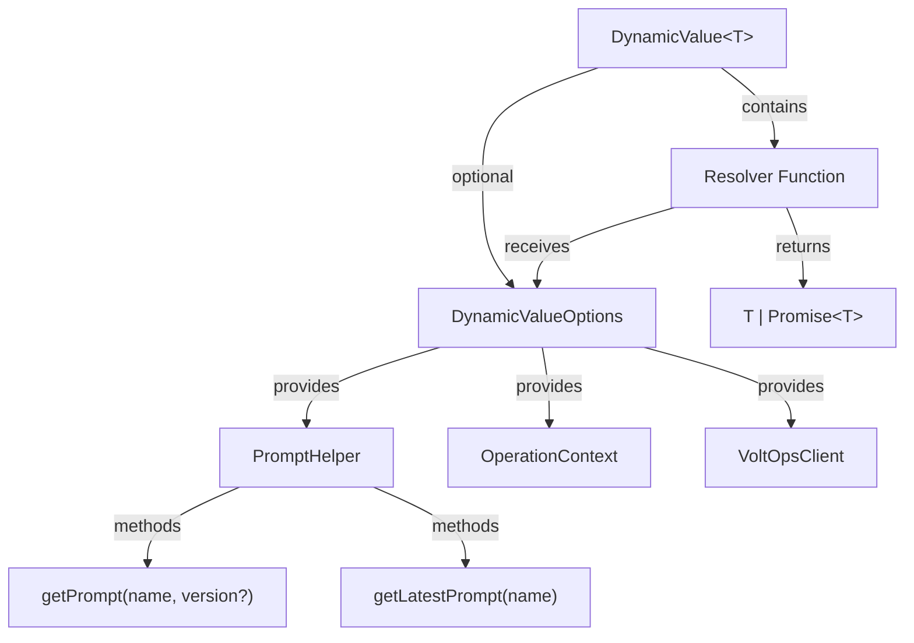
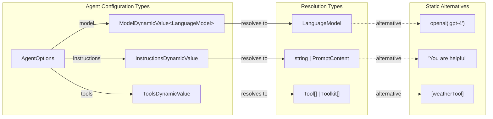
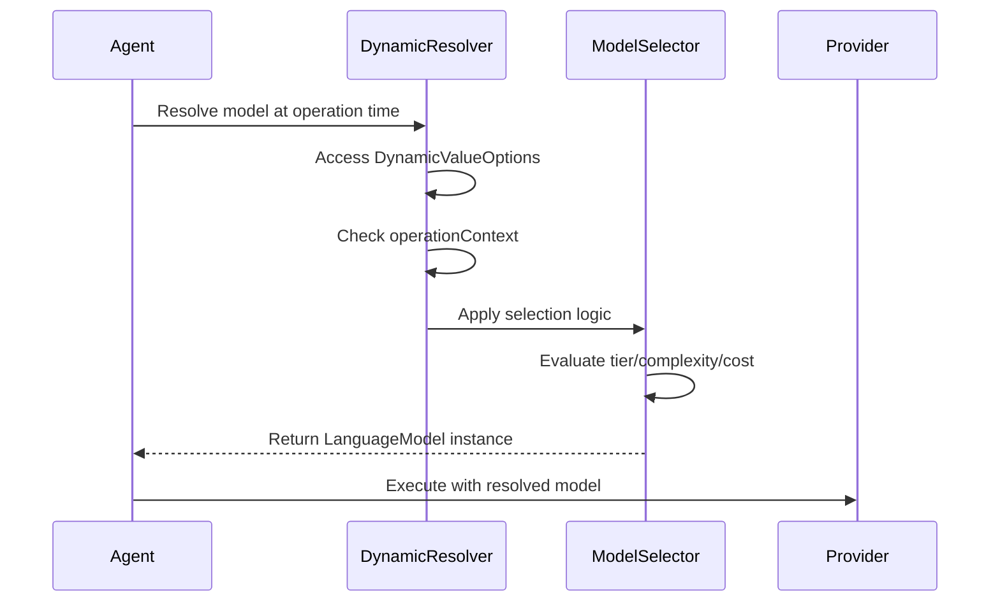
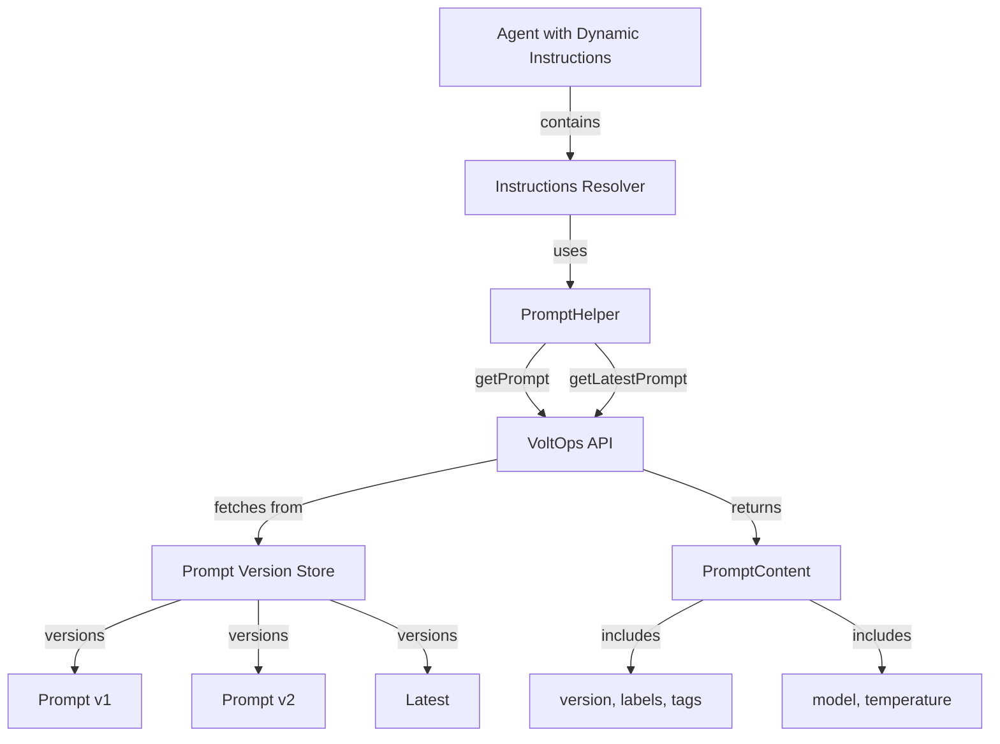
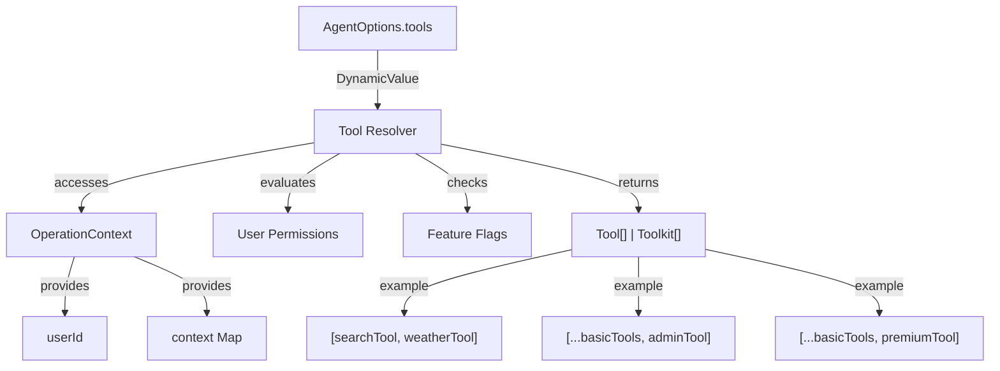
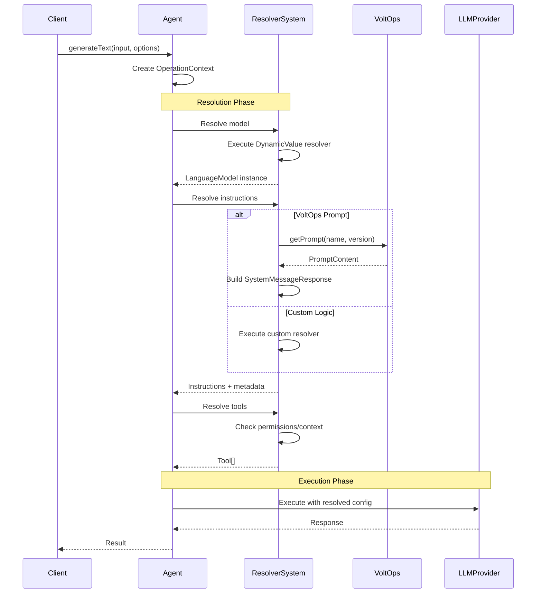
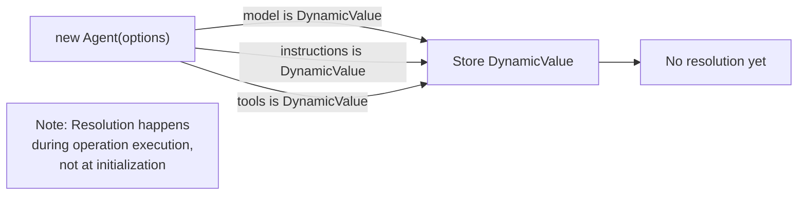

<!-- source: DeepWiki mcp.deepwiki.com · repo voltagent/voltagent · page 3.3 Dynamic Model Selection · fetched 2026-10-27 -->

# Dynamic Model Selection

<details>
<summary>Relevant source files</summary>

The following files were used as context for generating this wiki page:

- [.changeset/config.json](.changeset/config.json)
- [CHANGELOG.md](CHANGELOG.md)
- [changelog.sh](changelog.sh)
- [examples/base/src/index.ts](examples/base/src/index.ts)
- [packages/cli/package.json](packages/cli/package.json)
- [packages/core/src/agent/index.ts](packages/core/src/agent/index.ts)
- [packages/core/src/agent/providers/base/types.ts](packages/core/src/agent/providers/base/types.ts)
- [packages/core/src/agent/subagent/index.spec.ts](packages/core/src/agent/subagent/index.spec.ts)
- [packages/core/src/agent/subagent/index.ts](packages/core/src/agent/subagent/index.ts)
- [packages/core/src/agent/types.ts](packages/core/src/agent/types.ts)
- [packages/core/src/index.ts](packages/core/src/index.ts)
- [packages/create-voltagent-app/CHANGELOG.md](packages/create-voltagent-app/CHANGELOG.md)
- [packages/create-voltagent-app/package.json](packages/create-voltagent-app/package.json)
- [packages/voice/package.json](packages/voice/package.json)
- [website/docs/agents/overview.md](website/docs/agents/overview.md)
- [website/docs/agents/subagents.md](website/docs/agents/subagents.md)

</details>


This page explains how VoltAgent supports runtime resolution of agent configuration using the `DynamicValue` pattern. This includes dynamic selection of AI models, instructions/prompts, and tools. For information about configuring static AI providers, see [Supported Providers](#3.2). For the underlying provider architecture, see [Provider Architecture](#3.1).

## Overview

VoltAgent allows agent configurations to be determined at runtime rather than at initialization time. This enables use cases such as:

- Selecting different models based on user tier, request complexity, or cost optimization
- Managing prompts through VoltOps Console with versioning and A/B testing
- Conditionally enabling tools based on user permissions or context
- Switching between providers dynamically based on availability or routing logic

The framework provides three types of dynamic configuration:
- **Dynamic Models** (`ModelDynamicValue<T>`) - Select the LLM at runtime
- **Dynamic Instructions** (`InstructionsDynamicValue`) - Resolve prompts from VoltOps or custom logic
- **Dynamic Tools** (`ToolsDynamicValue`) - Configure available tools per request

**Sources:**
- [packages/core/src/agent/types.ts:131-143]()
- [packages/core/src/voltops/types.ts:30-34]()

## DynamicValue Pattern

### Type Definition



The `DynamicValue<T>` type wraps a resolver function that computes values at runtime. The resolver receives `DynamicValueOptions` providing access to:

- **`promptHelper`** - Methods to fetch prompts from VoltOps
- **`operationContext`** - Current operation context (userId, conversationId, etc.)
- **`voltOpsClient`** - Direct VoltOps client access for advanced scenarios

**Sources:**
- [packages/core/src/agent/types.ts:30-40]()
- [packages/core/src/voltops/types.ts]()

### Type Hierarchy



**Sources:**
- [packages/core/src/agent/types.ts:131-143]()
- [packages/core/src/agent/types.ts:253-267]()

## Dynamic Model Selection

### Implementation

Models can be specified as static `LanguageModel` instances or `DynamicValue<LanguageModel>` resolvers. The resolver function receives runtime context and returns the appropriate model.

```typescript
// Type definition (from agent/types.ts:136)
export type ModelDynamicValue<T> = T | DynamicValue<T>;

// AgentOptions uses this for the model field (agent/types.ts:260)
model: LanguageModel | DynamicValue<LanguageModel>
```

### Resolution Flow



### Common Patterns

**Tier-Based Model Selection:**
```typescript
// Example pattern (not in codebase directly)
model: async (options) => {
  const { operationContext } = options;
  const userTier = operationContext?.context?.get('userTier');
  
  if (userTier === 'premium') {
    return openai('gpt-4o');
  }
  return openai('gpt-4o-mini');
}
```

**Cost-Optimized Routing:**
```typescript
// Example pattern
model: async (options) => {
  const { operationContext } = options;
  const requestComplexity = analyzeComplexity(operationContext?.input);
  
  if (requestComplexity > 0.7) {
    return openai('gpt-4o'); // Use powerful model for complex requests
  }
  return openai('gpt-4o-mini'); // Use cheaper model for simple requests
}
```

**Sources:**
- [packages/core/src/agent/types.ts:136]()
- [packages/core/src/agent/types.ts:260]()

## Dynamic Instructions

### Type Definition

Instructions support both static strings and `DynamicValue` resolvers that can return either plain text or structured `PromptContent` from VoltOps.

```typescript
// Type definition (from agent/types.ts:131)
export type InstructionsDynamicValue = string | DynamicValue<string | PromptContent>;
```

### VoltOps Integration



### Resolution Patterns

**VoltOps Prompt Management:**
```typescript
// Using VoltOps prompt helper (pattern from types)
instructions: async (options) => {
  const { promptHelper } = options;
  
  // Fetch specific version
  const prompt = await promptHelper.getPrompt('customer-support', 2);
  return prompt; // Returns PromptContent with metadata
  
  // Or get latest version
  // const latest = await promptHelper.getLatestPrompt('customer-support');
  // return latest;
}
```

**Context-Aware Instructions:**
```typescript
// Example pattern
instructions: async (options) => {
  const { operationContext } = options;
  const language = operationContext?.context?.get('language') || 'en';
  
  return `You are a helpful assistant. Respond in ${language}.`;
}
```

### SystemMessageResponse Structure

When dynamic instructions resolve to `PromptContent`, the system wraps them in `SystemMessageResponse` with metadata for tracking:

```typescript
// From agent/types.ts:303-323
export interface SystemMessageResponse {
  systemMessages: BaseMessage | BaseMessage[];
  promptMetadata?: {
    prompt_id?: string;          // Base prompt ID
    prompt_version_id?: string;  // PromptVersion entity ID
    name?: string;
    version?: number;
    labels?: string[];
    tags?: string[];
    config?: {
      model?: string;
      temperature?: number;
      [key: string]: any;
    };
  };
  isDynamicInstructions?: boolean;
}
```

**Sources:**
- [packages/core/src/agent/types.ts:131]()
- [packages/core/src/agent/types.ts:261]()
- [packages/core/src/agent/types.ts:303-323]()
- [packages/core/src/voltops/types.ts:30-34]()

## Dynamic Tools

### Type Definition

Tools can be specified as static arrays or dynamic resolvers that determine available tools at runtime based on user permissions, context, or other factors.

```typescript
// Type definition (from agent/types.ts:141-143)
export type ToolsDynamicValue =
  | (Tool<any, any> | Toolkit)[]
  | DynamicValue<(Tool<any, any> | Toolkit)[]>;
```

### Resolution Architecture



### Permission-Based Tool Access

```typescript
// Example pattern
tools: async (options) => {
  const { operationContext } = options;
  const userPermissions = operationContext?.context?.get('permissions') || [];
  
  const basicTools = [searchTool, weatherTool];
  
  if (userPermissions.includes('admin')) {
    return [...basicTools, adminTool, auditTool];
  }
  
  if (userPermissions.includes('premium')) {
    return [...basicTools, premiumAnalyticsTool];
  }
  
  return basicTools;
}
```

**Sources:**
- [packages/core/src/agent/types.ts:141-143]()
- [packages/core/src/agent/types.ts:264]()

## Resolution Lifecycle

### Execution Flow



### Resolution Context

Each resolver receives `DynamicValueOptions` containing:

| Field | Type | Description |
|-------|------|-------------|
| `promptHelper` | `PromptHelper` | Methods to fetch VoltOps prompts |
| `operationContext` | `OperationContext` | Current operation state |
| `voltOpsClient` | `VoltOpsClient` | Direct VoltOps client access |

The `OperationContext` provides:
- `userId` - User identifier
- `conversationId` - Conversation identifier
- `context` - User-defined context Map
- `systemContext` - System-managed context
- `logger` - Contextual logger instance

**Sources:**
- [packages/core/src/agent/types.ts:625-674]()
- [packages/core/src/voltops/types.ts:30-34]()

## Integration Points

### Agent Initialization



Dynamic values are **not** resolved during agent construction. They are stored and resolved later when:
- `generateText()` is called
- `streamText()` is called
- `generateObject()` is called
- `streamObject()` is called

### Operation Execution

Each agent method call triggers resolution:

1. Create `OperationContext` with current request data
2. Build `DynamicValueOptions` from context
3. Resolve model if dynamic
4. Resolve instructions if dynamic (may fetch from VoltOps)
5. Resolve tools if dynamic
6. Execute with resolved configuration

**Sources:**
- [packages/core/src/agent/agent.ts]() (implementation details)
- [packages/core/src/agent/types.ts:253-300]()

## Use Cases

### A/B Testing Prompts

```typescript
const agent = new Agent({
  name: "Support Agent",
  model: openai("gpt-4o-mini"),
  instructions: async (options) => {
    const { promptHelper, operationContext } = options;
    const userId = operationContext?.userId;
    
    // Route 10% of users to experimental prompt
    const experimentGroup = hashUserId(userId) % 10 === 0;
    
    if (experimentGroup) {
      return await promptHelper.getPrompt('support-v2-experiment');
    }
    return await promptHelper.getPrompt('support-v2-stable');
  },
});
```

### Multi-Tenant Model Routing

```typescript
const agent = new Agent({
  name: "Multi-Tenant Agent",
  model: async (options) => {
    const { operationContext } = options;
    const tenantConfig = operationContext?.context?.get('tenant');
    
    switch (tenantConfig?.provider) {
      case 'openai':
        return openai(tenantConfig.model || 'gpt-4o-mini');
      case 'anthropic':
        return anthropic(tenantConfig.model || 'claude-3-sonnet');
      case 'google':
        return google(tenantConfig.model || 'gemini-pro');
      default:
        return openai('gpt-4o-mini'); // fallback
    }
  },
  instructions: "You are a helpful assistant",
});
```

### Feature-Gated Tools

```typescript
const agent = new Agent({
  name: "Feature Gated Agent",
  model: openai("gpt-4o-mini"),
  instructions: "You are a helpful assistant with various capabilities",
  tools: async (options) => {
    const { operationContext } = options;
    const features = operationContext?.context?.get('enabledFeatures') || [];
    
    const tools = [baseSearchTool, weatherTool];
    
    if (features.includes('analytics')) {
      tools.push(analyticsToolkit);
    }
    
    if (features.includes('admin')) {
      tools.push(adminToolkit);
    }
    
    return tools;
  },
});
```

**Sources:**
- [website/docs/agents/overview.md:60-67]()
- [packages/core/src/agent/types.ts:253-300]()

## VoltOps Prompt Management

### Prompt Versioning

VoltOps Console allows managing prompts with:
- **Version control** - Track changes, rollback to previous versions
- **Labels and tags** - Organize prompts by environment, feature, team
- **Configuration** - Store model preferences, temperature, etc. with prompts
- **A/B testing** - Route traffic between prompt versions

### PromptHelper Methods

| Method | Signature | Description |
|--------|-----------|-------------|
| `getPrompt` | `(name: string, version?: number)` | Fetch specific prompt version |
| `getLatestPrompt` | `(name: string)` | Fetch latest published version |

Both methods return `PromptContent` with:
- Prompt text
- Version metadata (ID, number, labels, tags)
- Configuration (model, temperature, etc.)

### Metadata Tracking

When using VoltOps prompts, the system automatically captures metadata in `SystemMessageResponse`:

```typescript
{
  systemMessages: [...],
  promptMetadata: {
    prompt_id: "abc123",           // Base prompt ID
    prompt_version_id: "version456", // Specific version ID
    name: "customer-support",
    version: 2,
    labels: ["production"],
    tags: ["support", "multilingual"],
    config: {
      model: "gpt-4o",
      temperature: 0.7
    }
  },
  isDynamicInstructions: true
}
```

This metadata enables:
- Tracing which prompt version was used
- Cost attribution by prompt
- Performance analysis by version
- Debugging prompt issues

**Sources:**
- [packages/core/src/agent/types.ts:303-323]()
- [packages/core/src/voltops/types.ts]()
- [website/docs/agents/overview.md:61-65]()

## Best Practices

### Performance Considerations

- **Cache resolved values** when appropriate (e.g., feature flags that don't change per request)
- **Minimize VoltOps API calls** by using latest version or caching
- **Keep resolvers fast** - they execute on every request

### Error Handling

- **Provide fallbacks** for dynamic resolution failures
- **Validate resolved models** are compatible with required features
- **Log resolution errors** for debugging

### Type Safety

```typescript
// Good: Explicit typing
const model: ModelDynamicValue<LanguageModel> = async (options) => {
  // TypeScript knows return type must be LanguageModel
  return openai("gpt-4o-mini");
};

// Good: Inline resolver with type inference
const agent = new Agent({
  model: async (options) => {
    // options is correctly typed as DynamicValueOptions
    return options.operationContext?.userId ? 
      openai("gpt-4o") : openai("gpt-4o-mini");
  },
  instructions: "...",
});
```

### Testing

- **Test both static and dynamic paths**
- **Mock VoltOps client** for unit tests
- **Verify resolver behavior** with different contexts
- **Test fallback scenarios** when resolution fails

**Sources:**
- [packages/core/src/agent/types.ts:131-143]()
- [packages/core/src/agent/types.ts:253-300]()

---

