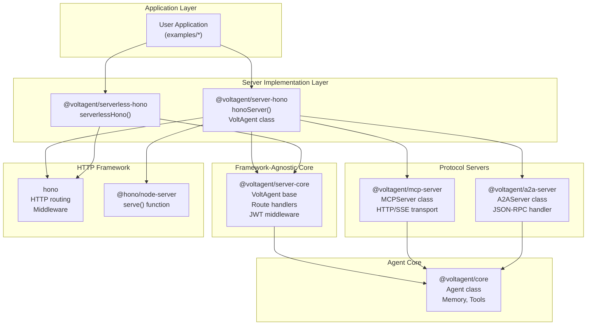
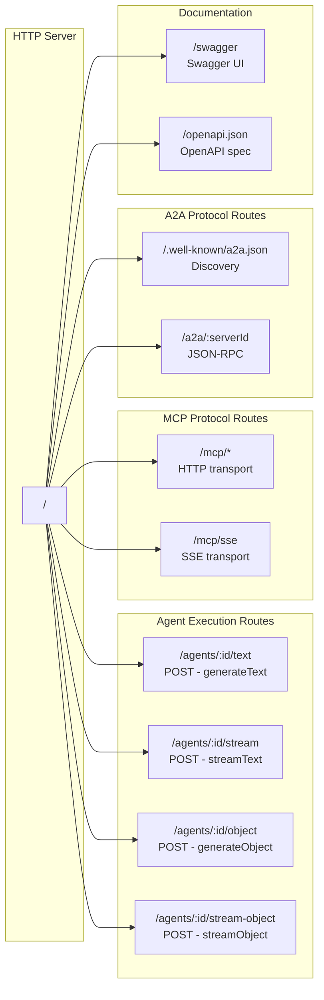
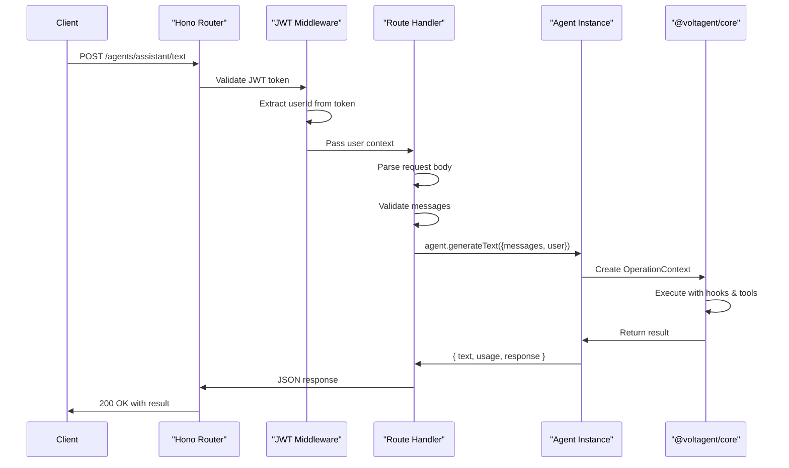
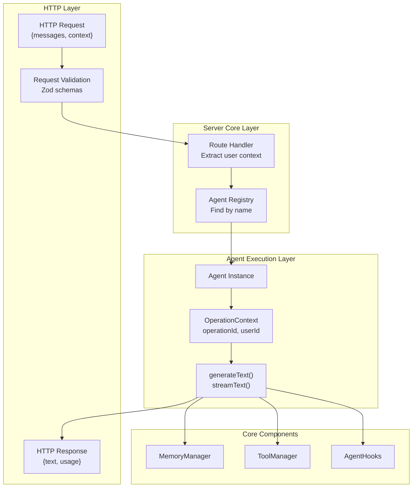

<!-- source: DeepWiki mcp.deepwiki.com · repo voltagent/voltagent · page 4 Server and API System · fetched 2026-10-27 -->

# Server and API System

<details>
<summary>Relevant source files</summary>

The following files were used as context for generating this wiki page:

- [examples/with-google-ai/package.json](examples/with-google-ai/package.json)
- [examples/with-google-vertex-ai/package.json](examples/with-google-vertex-ai/package.json)
- [examples/with-groq-ai/package.json](examples/with-groq-ai/package.json)
- [examples/with-mcp/package.json](examples/with-mcp/package.json)
- [examples/with-nextjs/package.json](examples/with-nextjs/package.json)
- [packages/core/package.json](packages/core/package.json)
- [packages/server-core/package.json](packages/server-core/package.json)
- [packages/server-hono/package.json](packages/server-hono/package.json)
- [pnpm-lock.yaml](pnpm-lock.yaml)

</details>


## Purpose and Scope

This document covers the server implementation layer of VoltAgent, including HTTP/WebSocket endpoint exposure, request handling, API structure, and deployment configurations. It explains how the `@voltagent/server-core` and `@voltagent/server-hono` packages expose agent capabilities through REST and streaming APIs, auto-register protocol routes (MCP, A2A), and support both traditional Node.js and serverless deployments.

For agent orchestration and execution logic, see [Agent System](#2.1). For protocol-specific implementations, see [Model Context Protocol](#6.1) and [Agent-to-Agent Protocol](#6.2). For authentication mechanisms, see [Authentication and Security](#4.5).

---

## Server Architecture

VoltAgent implements a layered server architecture with framework-agnostic core logic and pluggable HTTP framework adapters.

### Package Structure



**Sources:** [packages/server-hono/package.json:1-54](), [packages/server-core/package.json:1-63](), Diagram 1

The architecture separates concerns into three layers:

1. **Framework-Agnostic Core** (`@voltagent/server-core`) - Contains shared logic for request validation, JWT authentication, WebSocket handling, and agent execution coordination
2. **HTTP Framework Adapters** (`@voltagent/server-hono`, `@voltagent/serverless-hono`) - Implement HTTP routing, middleware, and protocol integration using Hono framework
3. **Protocol Servers** - Integrate MCP and A2A capabilities as modular route handlers

**Sources:** [packages/server-core/package.json:1-63](), [packages/server-hono/package.json:1-54]()

---

## Server Packages

### @voltagent/server-core

The framework-agnostic server core provides base functionality without coupling to specific HTTP frameworks.

**Key Features:**
- `VoltAgent` base class for agent registration and management
- JWT authentication middleware via `jwtAuth` function
- WebSocket utilities for streaming responses
- Request validation and error handling
- Separate edge runtime export at `@voltagent/server-core/edge`

**Dependencies:**
- `@voltagent/core` - Agent execution
- `@modelcontextprotocol/sdk` - MCP protocol support
- `jsonwebtoken` - JWT verification
- `ws` - WebSocket server implementation
- `zod-from-json-schema` - Schema conversion

**Exports:**
- Main export: Core server utilities
- Edge export (`./edge`): Edge runtime compatible utilities

**Sources:** [packages/server-core/package.json:1-63]()

### @voltagent/server-hono

Hono-based HTTP server implementation with auto-registered routes and OpenAPI generation.

**Key Components:**
- `honoServer()` - Factory function for creating configured Hono app
- `VoltAgent` class - Extends server-core with agent registration
- Auto-registers `/agents/*`, `/mcp/*`, `/a2a/*` routes
- Swagger UI integration via `@hono/swagger-ui`
- Startup banner display

**Dependencies:**
- `@voltagent/server-core` - Base functionality
- `@voltagent/a2a-server` - Agent-to-Agent protocol
- `@voltagent/mcp-server` - Model Context Protocol
- `hono` - HTTP framework
- `@hono/node-server` - Node.js adapter
- `@hono/swagger-ui` - API documentation UI
- `openapi3-ts` - OpenAPI spec generation

**Sources:** [packages/server-hono/package.json:1-54](), Diagram 4

### @voltagent/serverless-hono

Serverless-optimized adapter for edge runtimes and FaaS platforms.

**Deployment Targets:**
- Cloudflare Workers
- Netlify Functions
- Vercel Edge Functions
- AWS Lambda@Edge

**Key Differences from server-hono:**
- No `@hono/node-server` dependency
- No startup banner
- Optimized for cold starts
- Compatible with edge runtime constraints

**Sources:** Diagram 1, examples in `with-cloudflare-workers` and `with-netlify-functions`

---

## API Endpoints and Route Structure

### Registered Routes

The server auto-registers three categories of routes:



**Sources:** Diagram 4, [packages/server-hono/package.json:1-54]()

### Agent Execution Endpoints

#### POST /agents/:id/text

Synchronous text generation using `agent.generateText()`.

**Request Format:**
```typescript
{
  messages: UIMessage[],
  context?: Record<string, unknown>,
  user?: { userId: string, [key: string]: unknown }
}
```

**Response Format:**
```typescript
{
  text: string,
  finishReason: 'stop' | 'length' | 'content-filter' | 'tool-calls',
  usage: { promptTokens: number, completionTokens: number },
  response: {
    id: string,
    timestamp: Date,
    modelId: string
  }
}
```

**Sources:** Diagram 4

#### POST /agents/:id/stream

Streaming text generation using `agent.streamText()`. Returns Server-Sent Events (SSE).

**SSE Event Types:**
- `text-delta` - Incremental text chunks
- `finish` - Final completion event with usage stats
- `error` - Error events

**Sources:** Diagram 4

#### POST /agents/:id/object

Synchronous structured object generation using `agent.generateObject()`.

**Request Format:**
```typescript
{
  messages: UIMessage[],
  schema: ZodSchema,
  context?: Record<string, unknown>,
  user?: { userId: string, [key: string]: unknown }
}
```

**Response Format:**
```typescript
{
  object: T, // Type inferred from schema
  usage: { promptTokens: number, completionTokens: number }
}
```

**Sources:** Diagram 4

#### POST /agents/:id/stream-object

Streaming structured object generation using `agent.streamObject()`. Returns partial objects as SSE.

**Sources:** Diagram 4

---

## honoServer Configuration

### Basic Setup

```typescript
import { honoServer } from '@voltagent/server-hono';
import { Agent } from '@voltagent/core';

const myAgent = new Agent({
  name: 'assistant',
  model: openai('gpt-4'),
  instructions: 'You are a helpful assistant'
});

const app = honoServer({
  agents: [myAgent],
  port: 3000,
  enableSwagger: true
});

app.start();
```

**Configuration Options:**

| Option | Type | Description |
|--------|------|-------------|
| `agents` | `Agent[]` | Array of agent instances to register |
| `port` | `number` | Server port (default: 3000) |
| `enableSwagger` | `boolean` | Enable Swagger UI (default: true) |
| `jwtSecret` | `string` | JWT secret for authentication |
| `customRoutes` | `(app: Hono) => void` | Custom route registration function |
| `banner` | `boolean` | Display startup banner (default: true) |

**Sources:** [packages/server-hono/package.json:1-54](), examples in `with-nextjs`, `with-mcp`

### VoltAgent Class

The `VoltAgent` class extends the base implementation from `server-core` with Hono-specific functionality.

**Agent Registration:**
```typescript
const voltAgent = new VoltAgent();

voltAgent.registerAgent(
  new Agent({
    name: 'customer-support',
    model: openai('gpt-4')
  })
);

voltAgent.registerAgent(
  new Agent({
    name: 'data-analyst',
    model: anthropic('claude-3-5-sonnet')
  })
);
```

**Sources:** [packages/server-hono/package.json:1-54]()

---

## Request/Response Flow



**Sources:** Diagram 3, [packages/server-core/package.json:1-63]()

### Error Handling

The server implements standardized error responses:

| Status Code | Error Type | Description |
|-------------|------------|-------------|
| 400 | `ValidationError` | Invalid request body or parameters |
| 401 | `AuthenticationError` | Missing or invalid JWT token |
| 403 | `AuthorizationError` | Insufficient permissions |
| 404 | `NotFoundError` | Agent not found |
| 500 | `InternalError` | Server-side execution error |

**Sources:** [packages/server-core/package.json:1-63]()

---

## Protocol Integration

### MCP Routes

The `@voltagent/mcp-server` package registers routes for Model Context Protocol integration:

**Endpoints:**
- `POST /mcp/message` - HTTP transport for MCP messages
- `GET /mcp/sse` - Server-Sent Events transport
- `GET /mcp/tools` - List available MCP tools

**Sources:** [packages/server-hono/package.json:8-11](), Diagram 4

### A2A Routes

The `@voltagent/a2a-server` package registers routes for Agent-to-Agent communication:

**Endpoints:**
- `GET /.well-known/a2a.json` - Discovery endpoint exposing agent capabilities
- `POST /a2a/:serverId` - JSON-RPC endpoint for inter-agent calls

**Sources:** [packages/server-hono/package.json:8-11](), Diagram 4

---

## OpenAPI and Swagger

### Auto-Generated Documentation

The server automatically generates OpenAPI 3.0 specifications for all registered agent endpoints.

**Access Points:**
- Swagger UI: `http://localhost:3000/swagger`
- OpenAPI JSON: `http://localhost:3000/openapi.json`

**Generated Schema Includes:**
- All agent endpoints with request/response schemas
- Authentication requirements
- Error response formats
- SSE stream specifications

**Implementation:**
Uses `openapi3-ts` for spec generation and `@hono/swagger-ui` for documentation UI.

**Sources:** [packages/server-hono/package.json:15](), Diagram 4

---

## Deployment Patterns

### Traditional Node.js Server

Standard deployment using `@hono/node-server`:

```typescript
import { serve } from '@hono/node-server';
import { honoServer } from '@voltagent/server-hono';

const app = honoServer({ agents: [...] });

serve({
  fetch: app.fetch,
  port: 3000
});
```

**Use Cases:**
- Long-running servers
- WebSocket support required
- Traditional VPS/container deployments

**Examples:** `with-nextjs`, `with-mcp`, `with-google-ai`

**Sources:** [packages/server-hono/package.json:6](), [examples/with-nextjs/package.json:1-39]()

### Serverless Deployment

Edge-optimized deployment using `@voltagent/serverless-hono`:

```typescript
import { serverlessHono } from '@voltagent/serverless-hono';

export default serverlessHono({
  agents: [...]
});
```

**Platform-Specific Configurations:**

#### Cloudflare Workers

```typescript
// wrangler.toml
name = "voltagent-worker"
main = "src/index.ts"
compatibility_date = "2024-01-01"

[env.production]
vars = { OPENAI_API_KEY = "sk-..." }
```

**Example:** `examples/with-cloudflare-workers`

**Sources:** Diagram 2, examples in `with-cloudflare-workers`

#### Netlify Functions

```typescript
// netlify/functions/agent.ts
import { serverlessHono } from '@voltagent/serverless-hono';

export default serverlessHono({ agents: [...] });
```

**Example:** `examples/with-netlify-functions`

**Sources:** Diagram 2, examples in `with-netlify-functions`

---

## Authentication and Middleware

### JWT Authentication

The `jwtAuth` middleware from `@voltagent/server-core` validates JWT tokens and extracts user context.

**Usage:**
```typescript
import { jwtAuth } from '@voltagent/server-core';

app.use('/agents/*', jwtAuth({
  secret: process.env.JWT_SECRET,
  algorithms: ['HS256']
}));
```

**Token Payload:**
```typescript
{
  userId: string,
  roles?: string[],
  exp: number,
  iat: number
}
```

**User Context Injection:**
The middleware injects `c.get('user')` into Hono context, making user information available to agent endpoints.

**Example:** `examples/with-jwt-auth`

**Sources:** [packages/server-core/package.json:10](), Diagram 4

### Custom Middleware

Custom middleware can be added to the Hono app:

```typescript
const app = honoServer({
  agents: [...],
  customRoutes: (app) => {
    app.use('*', logger());
    app.use('*', cors());
    
    app.get('/health', (c) => c.json({ status: 'ok' }));
  }
});
```

**Sources:** [packages/server-hono/package.json:1-54]()

---

## Startup Banner

The `honoServer` displays a startup banner showing registered agents and available routes:

```
┌─────────────────────────────────────────┐
│  VoltAgent Server                       │
│  http://localhost:3000                  │
├─────────────────────────────────────────┤
│  Agents:                                │
│    • assistant                          │
│    • data-analyst                       │
│                                         │
│  Routes:                                │
│    • POST /agents/:id/text              │
│    • POST /agents/:id/stream            │
│    • GET  /swagger                      │
└─────────────────────────────────────────┘
```

**Configuration:**
Disable with `banner: false` in `honoServer()` options.

**Sources:** [packages/server-hono/package.json:1-54]()

---

## Integration with Core Agent System

The server layer acts as a thin HTTP wrapper around `@voltagent/core` Agent instances:



**Key Integration Points:**

1. **User Context Propagation** - JWT user information flows to `OperationContext.userId`
2. **Request Context** - HTTP request data available in `OperationContext.context`
3. **Streaming Support** - SSE streams map directly to `streamText()` / `streamObject()` async generators
4. **Error Translation** - Core errors converted to HTTP status codes

**Sources:** Diagram 3, [packages/server-core/package.json:1-63](), [packages/server-hono/package.json:1-54]()

---

