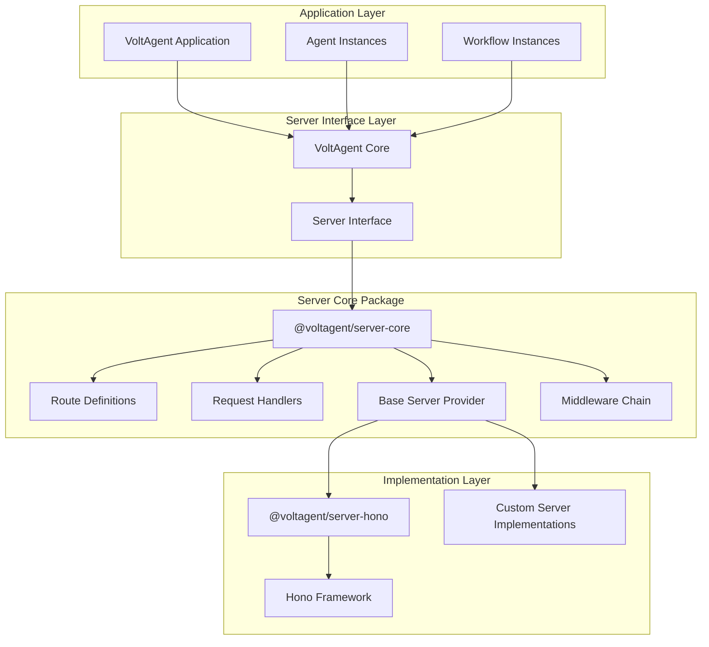
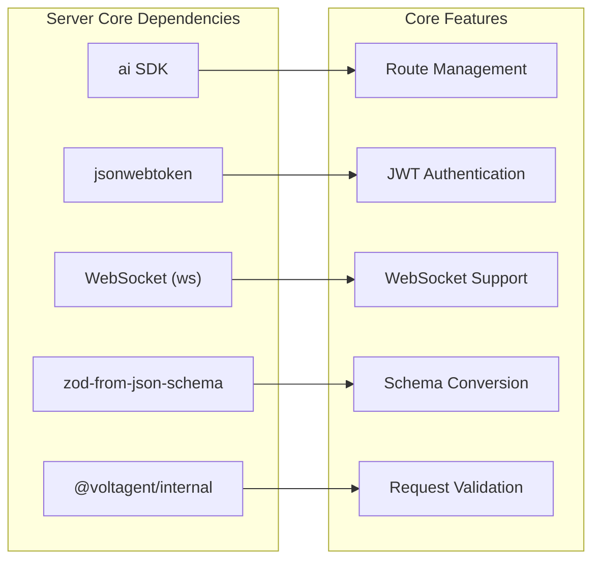
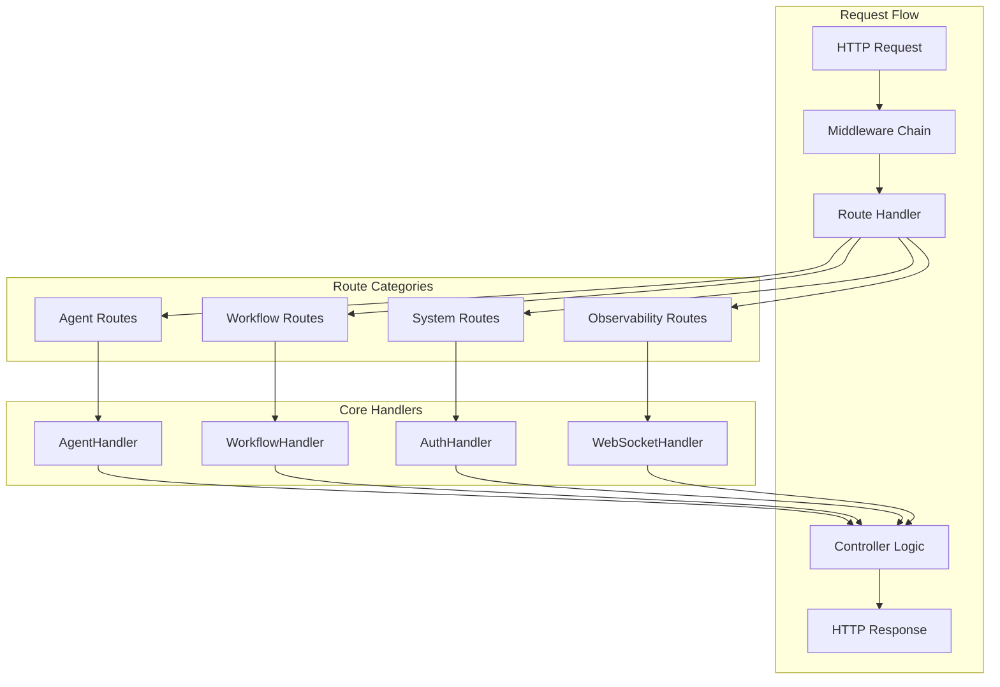
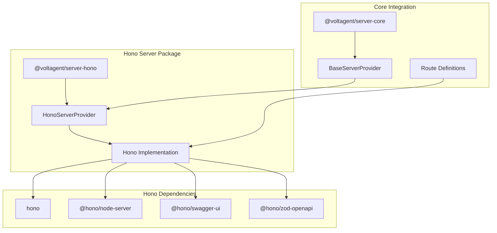
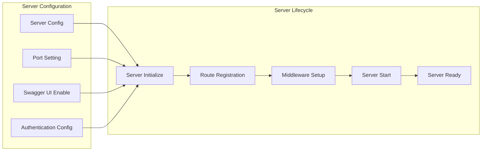
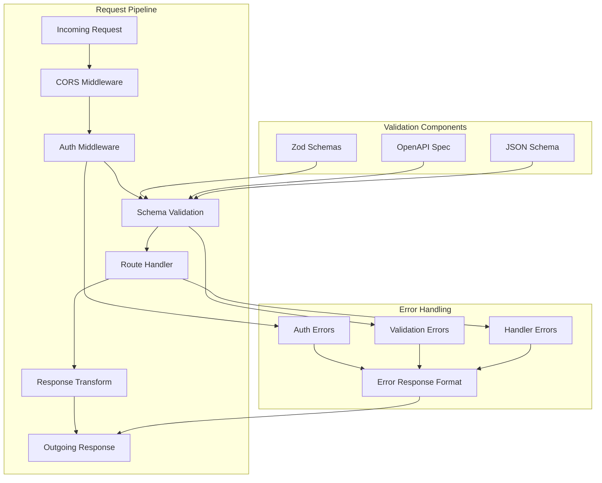
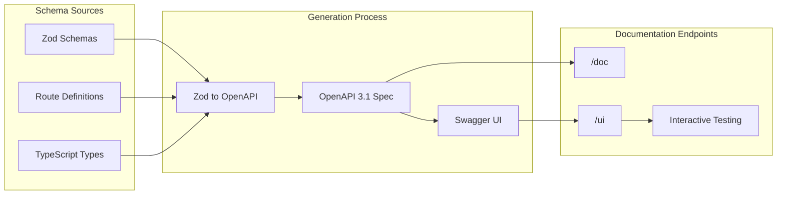
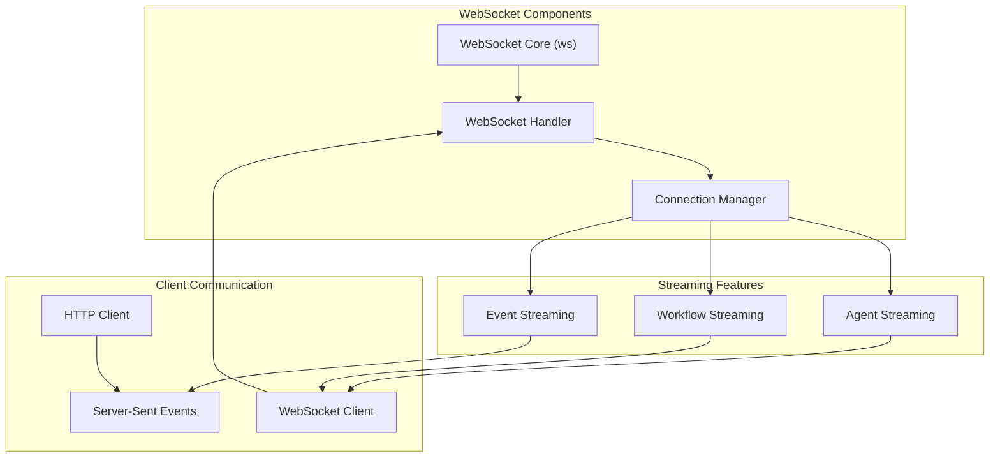

<!-- source: DeepWiki mcp.deepwiki.com · repo voltagent/voltagent · page 4.1 Server Architecture · fetched 2026-10-27 -->

# Server Architecture

Relevant source files

The following files were used as context for generating this wiki page:

- [examples/with-google-ai/package.json](examples/with-google-ai/package.json)
- [examples/with-google-vertex-ai/package.json](examples/with-google-vertex-ai/package.json)
- [examples/with-groq-ai/package.json](examples/with-groq-ai/package.json)
- [examples/with-mcp/package.json](examples/with-mcp/package.json)
- [examples/with-nextjs/package.json](examples/with-nextjs/package.json)
- [packages/core/package.json](packages/core/package.json)
- [packages/server-core/package.json](packages/server-core/package.json)
- [packages/server-hono/package.json](packages/server-hono/package.json)
- [pnpm-lock.yaml](pnpm-lock.yaml)

This document covers the framework-agnostic server architecture of VoltAgent, including the core server framework, pluggable server implementations, and how HTTP endpoints are structured and handled. For specific implementation details about the Hono server, see [Hono Server Implementation](#4.2). For detailed endpoint documentation, see [API Endpoints](#4.3). For authentication and security features, see [Authentication and Security](#4.4).

## Framework-Agnostic Design

VoltAgent 1.x introduces a pluggable server architecture that separates core functionality from specific HTTP framework implementations. This design allows developers to use different server frameworks or create custom implementations while maintaining consistent API behavior.

The architecture consists of three main layers:

| Layer | Package | Responsibility |
|-------|---------|---------------|
| **Core Framework** | `@voltagent/server-core` | Framework-agnostic route definitions, handlers, and middleware |
| **Implementation** | `@voltagent/server-hono` | Hono-specific server implementation |
| **Custom Implementations** | User-defined | Custom server framework integrations |

Sources: [packages/server-core/package.json:1-51](), [packages/server-hono/package.json:1-51](), [website/docs/api/overview.md:10-16]()

## Server Core Components

The `@voltagent/server-core` package provides the foundation for all server implementations through a set of framework-agnostic components.

### Core Dependencies and Features

The server core includes several key dependencies that enable its functionality:

- **AI SDK Integration**: Direct integration with the `ai` package for LLM operations
- **JWT Authentication**: Built-in support for JSON Web Token authentication
- **WebSocket Support**: Real-time communication through the `ws` package
- **Schema Management**: Automatic conversion between JSON Schema and Zod schemas
- **Internal Utilities**: Shared utilities from `@voltagent/internal`

Sources: [packages/server-core/package.json:5-11]()

### Route Handler Architecture

The server core defines handlers for different categories of endpoints:

| Handler Type | Endpoints Managed |
|--------------|-------------------|
| **Agent Handler** | `/agents/*` - Agent operations (text, object, streaming) |
| **Workflow Handler** | `/workflows/*` - Workflow execution and management |
| **Auth Handler** | Authentication and authorization |
| **WebSocket Handler** | Real-time communication and streaming |
| **System Handler** | Health checks, updates, configuration |

Sources: [packages/server-core/package.json:1-51](), [website/docs/api/overview.md:64-97]()

## Hono Server Implementation

The `@voltagent/server-hono` package provides the official HTTP server implementation using the Hono framework, chosen for its performance and TypeScript-first design.

### Hono Integration Architecture

Key features of the Hono implementation:

- **Node.js Server**: Uses `@hono/node-server` for Node.js compatibility
- **Swagger UI**: Automatic API documentation through `@hono/swagger-ui`
- **OpenAPI Integration**: Schema-first development with `@hono/zod-openapi`
- **Type Safety**: Full TypeScript support with runtime validation

Sources: [packages/server-hono/package.json:5-12]()

### Server Startup and Configuration

The server configuration includes:

| Configuration | Purpose |
|---------------|---------|
| **Port** | HTTP server port (default 3141) |
| **Swagger UI** | Enable/disable automatic API documentation |
| **Authentication** | JWT configuration and middleware setup |
| **CORS** | Cross-origin request handling |

Sources: [website/docs/api/overview.md:19-48]()

## Request Processing Pipeline

The server processes requests through a well-defined pipeline that handles authentication, validation, and response formatting.

### Request Validation and Processing

The request processing pipeline includes:

1. **CORS Handling**: Cross-origin request support
2. **Authentication**: JWT token validation where required
3. **Schema Validation**: Automatic request/response validation using Zod schemas
4. **Route Handling**: Business logic execution
5. **Response Transformation**: Consistent response formatting
6. **Error Handling**: Structured error responses

Sources: [packages/server-core/package.json:8-11](), [packages/server-hono/package.json:8-9]()

## API Documentation System

VoltAgent servers automatically generate comprehensive API documentation using OpenAPI specifications and Swagger UI.

### Documentation Generation Flow

The documentation system provides:

| Endpoint | Content | Purpose |
|----------|---------|---------|
| `/doc` | Raw OpenAPI 3.1 specification | API specification for tooling |
| `/ui` | Interactive Swagger UI | Human-readable documentation and testing |
| **Auto-generated** | Type-safe schemas | Runtime validation and documentation |

Sources: [packages/server-hono/package.json:8](), [website/docs/api/overview.md:52-61]()

## WebSocket and Real-time Features

The server architecture includes built-in support for real-time communication through WebSocket connections, enabling streaming responses and live updates.

### WebSocket Integration

Real-time features include:

- **Agent Streaming**: Live text and object generation
- **Workflow Streaming**: Real-time workflow execution updates
- **Event Streaming**: System events and observability data
- **Connection Management**: Automatic connection handling and cleanup

Sources: [packages/server-core/package.json:9](), [website/docs/api/overview.md:105]()

---

