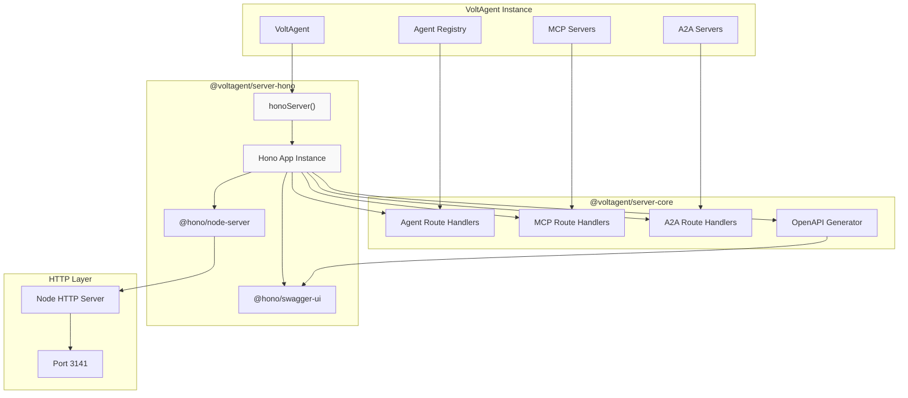
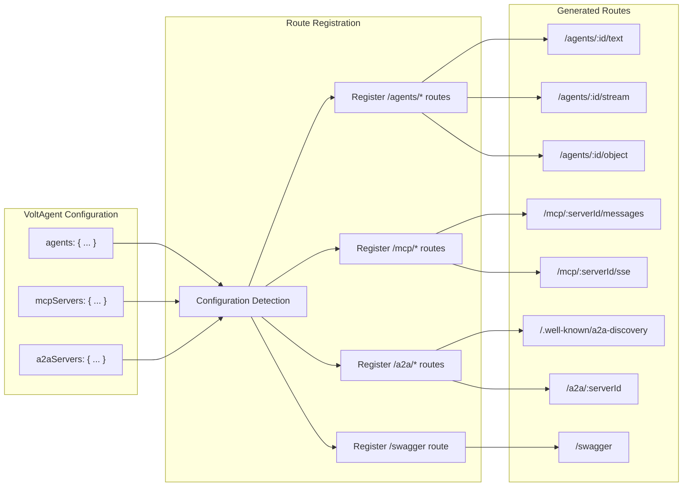
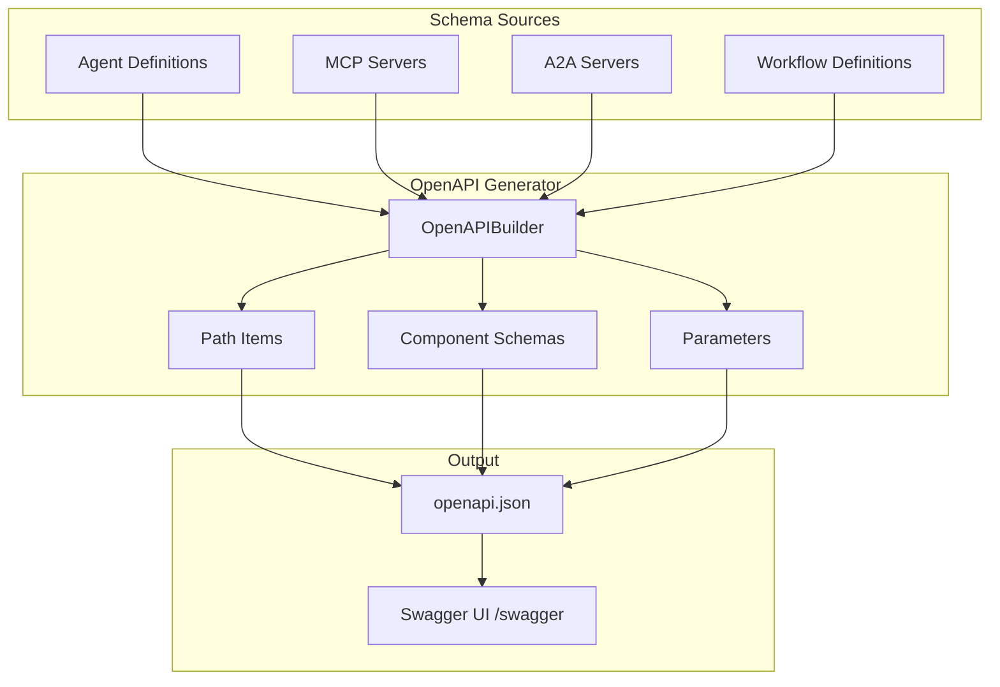
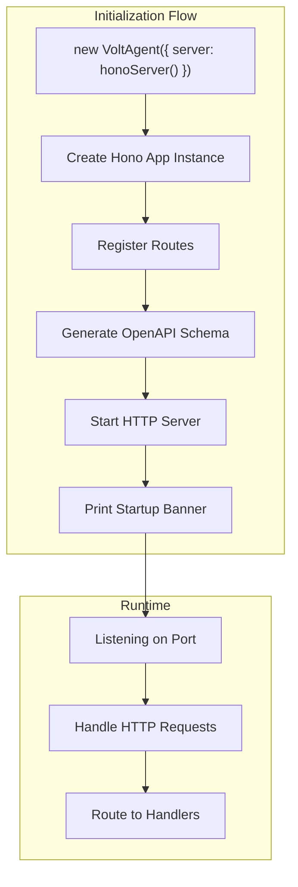

<!-- source: DeepWiki mcp.deepwiki.com · repo voltagent/voltagent · page 4.2 Hono Server Implementation · fetched 2026-10-27 -->

# Hono Server Implementation

<details>
<summary>Relevant source files</summary>

The following files were used as context for generating this wiki page:

- [CHANGELOG.md](CHANGELOG.md)
- [changelog.sh](changelog.sh)
- [examples/base/src/index.ts](examples/base/src/index.ts)
- [packages/cli/package.json](packages/cli/package.json)
- [packages/create-voltagent-app/CHANGELOG.md](packages/create-voltagent-app/CHANGELOG.md)
- [packages/create-voltagent-app/package.json](packages/create-voltagent-app/package.json)
- [packages/server-core/package.json](packages/server-core/package.json)
- [packages/server-hono/package.json](packages/server-hono/package.json)
- [packages/voice/package.json](packages/voice/package.json)

</details>


## Purpose and Scope

This document covers the `@voltagent/server-hono` package, which provides a production-ready HTTP server implementation for VoltAgent using the [Hono](https://hono.dev/) web framework. The package implements the server abstraction defined in `@voltagent/server-core` [see [4.1](#4.1)] and adds Node.js-specific runtime capabilities, automatic route registration, and developer tooling.

For serverless deployment variants (Cloudflare Workers, Netlify Functions), see [4.3](#4.3). For details on individual API endpoints and request/response formats, see [4.4](#4.4).

**Sources:** [packages/server-hono/package.json:1-54](), [CHANGELOG.md:826-842]()

---

## honoServer Function

The `honoServer` function is the primary entry point for creating a Hono-based HTTP server. It returns a server configuration object that `VoltAgent` uses to initialize the HTTP server and register routes.

### Basic Usage

```typescript
import { VoltAgent } from "@voltagent/core";
import { honoServer } from "@voltagent/server-hono";

new VoltAgent({
  agents: { myAgent },
  server: honoServer(),  // Uses default configuration
});
```

### Configuration Options

The `honoServer` function accepts a configuration object with the following properties:

| Option | Type | Default | Description |
|--------|------|---------|-------------|
| `port` | `number` | `3141` | HTTP port to bind the server to |
| `enableSwaggerUI` | `boolean` | `false` | Whether to enable Swagger UI interface at `/swagger` |
| `hostname` | `string` | `"0.0.0.0"` | Hostname/interface to bind to |
| `cors` | `CorsOptions` | - | CORS configuration for cross-origin requests |

### Example with Custom Configuration

```typescript
import { honoServer } from "@voltagent/server-hono";

new VoltAgent({
  agents: { myAgent },
  server: honoServer({
    port: 8080,
    enableSwaggerUI: true,
    hostname: "localhost",
  }),
});
```

**Sources:** [CHANGELOG.md:826-842](), [examples/base/src/index.ts:1-38]()

---

## Server Architecture

The Hono server implementation follows a layered architecture where `@voltagent/server-hono` provides the HTTP runtime while delegating core route handling logic to `@voltagent/server-core`.



**Sources:** [packages/server-hono/package.json:1-54](), [packages/server-core/package.json:1-63]()

---

## Route Auto-Registration

The Hono server automatically registers routes based on the VoltAgent configuration. Routes are organized into three categories: agent execution routes, MCP protocol routes, and A2A protocol routes.

### Route Registration Flow



### Agent Execution Routes

For each agent registered in the `agents` configuration, the server automatically creates three endpoints:

- `POST /agents/{agentId}/text` - Generate text response
- `POST /agents/{agentId}/stream` - Stream text response with SSE
- `POST /agents/{agentId}/object` - Generate structured object response

These routes are implemented by handlers from `@voltagent/server-core` and mapped through the Hono router.

**Sources:** [CHANGELOG.md:92-96](), [CHANGELOG.md:126-169]()

---

## Protocol Integration

### MCP Routes

When `mcpServers` are configured, the Hono server automatically registers Model Context Protocol endpoints:

| Route | Method | Purpose |
|-------|--------|---------|
| `/mcp/{serverId}/messages` | `POST` | HTTP transport for MCP messages |
| `/mcp/{serverId}/sse` | `GET` | Server-Sent Events transport for MCP |

The MCP routes enable IDE integrations and remote MCP clients to access VoltAgent agents, tools, and workflows. The server proxies MCP traffic to the underlying `@voltagent/mcp-server` implementation.

```typescript
import { MCPServer } from "@voltagent/mcp-server";
import { honoServer } from "@voltagent/server-hono";

const mcpServer = new MCPServer({
  name: "my-mcp-server",
  version: "1.0.0",
  agents: { myAgent },
});

new VoltAgent({
  agents: { myAgent },
  mcpServers: { primary: mcpServer },
  server: honoServer({ port: 3141 }),
  // Routes auto-registered:
  // POST /mcp/primary/messages
  // GET  /mcp/primary/sse
});
```

**Sources:** [CHANGELOG.md:122-196]()

### A2A Routes

When `a2aServers` are configured, the server registers Agent-to-Agent protocol endpoints:

| Route | Method | Purpose |
|-------|--------|---------|
| `/.well-known/a2a-discovery` | `GET` | Agent discovery endpoint |
| `/a2a/{serverId}` | `POST` | JSON-RPC endpoint for agent invocation |

The A2A protocol enables distributed agent communication where external agents can discover and invoke your VoltAgent instance over HTTP.

```typescript
import { A2AServer } from "@voltagent/a2a-server";
import { honoServer } from "@voltagent/server-hono";

const a2aServer = new A2AServer({
  name: "support-agent",
  version: "0.1.0",
});

new VoltAgent({
  agents: { supportAgent },
  a2aServers: { a2aServer },
  server: honoServer({ port: 3141 }),
  // Routes auto-registered:
  // GET  /.well-known/a2a-discovery
  // POST /a2a/support-agent
});
```

**Sources:** [CHANGELOG.md:91-120]()

---

## Swagger/OpenAPI Generation

The Hono server automatically generates OpenAPI 3.0 specifications for all registered routes using the `openapi3-ts` library. When `enableSwaggerUI` is enabled, the server mounts the Swagger UI interface at `/swagger`.

### OpenAPI Schema Generation



### Generated Schema Structure

The OpenAPI specification includes:

- **Paths**: All registered routes with request/response schemas
- **Components**: Reusable schema definitions for messages, tool calls, errors
- **Security**: JWT authentication schemes when configured [see [4.5](#4.5)]
- **Tags**: Route grouping by protocol (agents, mcp, a2a)

### Example OpenAPI Output

When MCP and A2A servers are registered, the OpenAPI schema includes entries like:

```json
{
  "paths": {
    "/agents/{agentId}/text": { /* ... */ },
    "/agents/{agentId}/stream": { /* ... */ },
    "/mcp/{serverId}/messages": { /* ... */ },
    "/mcp/{serverId}/sse": { /* ... */ },
    "/.well-known/a2a-discovery": { /* ... */ },
    "/a2a/{serverId}": { /* ... */ }
  }
}
```

**Sources:** [packages/server-hono/package.json:1-54](), [CHANGELOG.md:92-96](), [CHANGELOG.md:169-170]()

---

## Startup Banner

When the Hono server starts, it prints a formatted startup banner to the console showing:

1. VoltAgent version
2. Server listening address (host:port)
3. List of registered routes by category
4. Swagger UI URL (if enabled)

### Banner Format

The startup banner groups routes by protocol and displays them in a readable format:

```
┌─────────────────────────────────────────┐
│                                         │
│   VoltAgent Server v1.0.18              │
│   Listening on http://localhost:3141    │
│                                         │
└─────────────────────────────────────────┘

Agent Routes:
  POST   /agents/myAgent/text
  POST   /agents/myAgent/stream
  POST   /agents/myAgent/object

MCP Routes:
  POST   /mcp/primary/messages
  GET    /mcp/primary/sse

A2A Routes:
  GET    /.well-known/a2a-discovery
  POST   /a2a/support-agent

Documentation:
  GET    /swagger
```

The banner uses ANSI colors and box-drawing characters when the terminal supports them, falling back to plain text otherwise.

**Sources:** [CHANGELOG.md:92-96](), [CHANGELOG.md:169-170]()

---

## Integration with VoltAgent

The `honoServer` function returns a server configuration object that implements the `ServerAdapter` interface defined in `@voltagent/server-core`. When passed to `VoltAgent`, it triggers the following initialization sequence:



### Server Lifecycle

1. **Construction**: `honoServer()` creates configuration object
2. **Registration**: VoltAgent passes agents/protocols to server
3. **Route Setup**: Server registers all route handlers with Hono
4. **Schema Generation**: OpenAPI specification is built
5. **Server Start**: `@hono/node-server` binds to configured port
6. **Banner Display**: Routes are logged to console
7. **Request Handling**: Server processes incoming HTTP requests

### Shutdown Handling

The Hono server integrates with VoltAgent's shutdown lifecycle, responding to `SIGINT` and `SIGTERM` signals:

```typescript
// Automatic cleanup on process signals
process.on("SIGINT", async () => {
  await voltAgent.shutdown();  // Stops server and cleans up resources
});
```

The shutdown sequence:
1. Stop accepting new HTTP connections
2. Drain in-flight requests
3. Close workflow executions
4. Flush telemetry buffers
5. Exit process

**Sources:** [CHANGELOG.md:594-622](), [examples/base/src/index.ts:33-37]()

---

## Dependencies and Runtime Requirements

### Core Dependencies

The `@voltagent/server-hono` package relies on the following key dependencies:

| Package | Version | Purpose |
|---------|---------|---------|
| `hono` | `^4.7.7` | Web framework core |
| `@hono/node-server` | `^1.14.0` | Node.js HTTP adapter |
| `@hono/swagger-ui` | `^0.5.1` | Swagger UI middleware |
| `@voltagent/server-core` | `^1.0.15` | Framework-agnostic route handlers |
| `openapi3-ts` | `^4.5.0` | OpenAPI schema builder |
| `fetch-to-node` | `^2.1.0` | Fetch API to Node.js stream conversion |

### Peer Dependencies

The package requires:
- `@voltagent/core` `^1.0.0` - Core agent functionality
- `zod` `^3.25.0 || ^4.0.0` - Schema validation (dual version support)

### Node.js Requirements

- **Minimum Version**: Node.js 20.x
- **Runtime**: Traditional Node.js (not edge/serverless)

For edge/serverless deployments, use `@voltagent/serverless-hono` instead [see [4.3](#4.3)].

**Sources:** [packages/server-hono/package.json:1-54](), [packages/server-core/package.json:1-63]()

---

