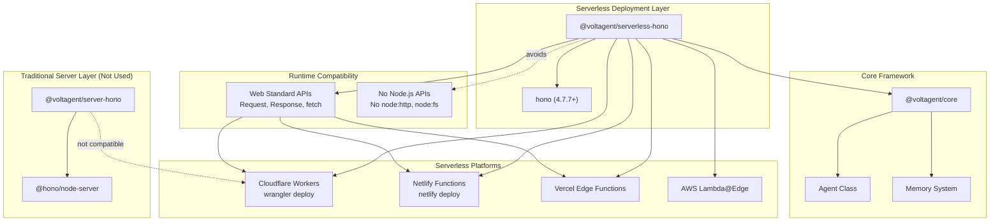
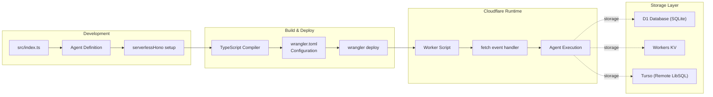
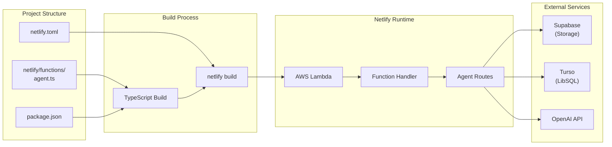
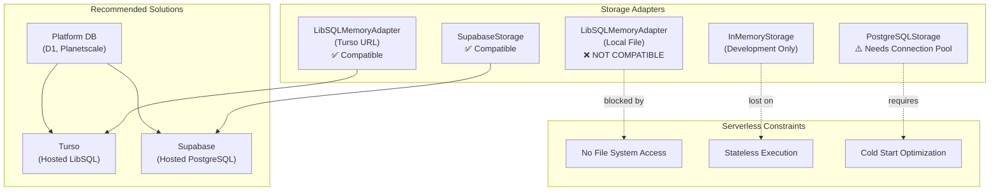

<!-- source: DeepWiki mcp.deepwiki.com · repo voltagent/voltagent · page 4.3 Serverless Deployment · fetched 2026-10-27 -->

# Serverless Deployment

<details>
<summary>Relevant source files</summary>

The following files were used as context for generating this wiki page:

- [examples/base/package.json](examples/base/package.json)
- [examples/github-repo-analyzer/package.json](examples/github-repo-analyzer/package.json)
- [examples/with-google-ai/package.json](examples/with-google-ai/package.json)
- [examples/with-google-vertex-ai/package.json](examples/with-google-vertex-ai/package.json)
- [examples/with-groq-ai/package.json](examples/with-groq-ai/package.json)
- [examples/with-mcp/package.json](examples/with-mcp/package.json)
- [examples/with-nextjs/package.json](examples/with-nextjs/package.json)
- [examples/with-rag-chatbot/package.json](examples/with-rag-chatbot/package.json)
- [examples/with-retrieval/package.json](examples/with-retrieval/package.json)
- [examples/with-subagents/package.json](examples/with-subagents/package.json)
- [examples/with-supabase/package.json](examples/with-supabase/package.json)
- [examples/with-tools/package.json](examples/with-tools/package.json)
- [examples/with-vercel-ai/package.json](examples/with-vercel-ai/package.json)
- [examples/with-voice-elevenlabs/package.json](examples/with-voice-elevenlabs/package.json)
- [examples/with-voice-openai/package.json](examples/with-voice-openai/package.json)
- [packages/core/package.json](packages/core/package.json)
- [pnpm-lock.yaml](pnpm-lock.yaml)

</details>


This document explains how to deploy VoltAgent applications to serverless and edge runtime environments using the `@voltagent/serverless-hono` package. This includes platforms like Cloudflare Workers, Netlify Functions, and other FaaS (Function-as-a-Service) providers.

For traditional Node.js server deployments, see [Hono Server Implementation](#4.2). For general server architecture concepts, see [Server Architecture](#4.1).

## Purpose and Scope

The `@voltagent/serverless-hono` package provides an adapter layer that enables VoltAgent agents to run in serverless and edge computing environments where traditional long-running Node.js processes are not supported. This package removes dependencies on Node.js-specific APIs (like `node:http`, `node:fs`) and provides runtime-agnostic request/response handling compatible with:

- Cloudflare Workers (edge runtime)
- Netlify Functions (serverless functions)
- Vercel Edge Functions
- AWS Lambda@Edge
- Other Web Standard Request/Response environments

The serverless adapter shares the same core agent execution logic from `@voltagent/core` but uses a minimal server layer optimized for cold starts and stateless execution.

**Sources:** [pnpm-lock.yaml:461-493](), [pnpm-lock.yaml:1071-1100]()

## Package Architecture



**Diagram: Serverless Package Architecture**

The `@voltagent/serverless-hono` package differs from `@voltagent/server-hono` in that it:
- Uses only Hono's core library without Node.js server adapters
- Relies exclusively on Web Standard Request/Response APIs
- Excludes `@hono/node-server` and other Node.js-specific dependencies
- Optimized for stateless, cold-start execution patterns
- Does not include built-in server startup logic (delegates to platform)

**Sources:** [pnpm-lock.yaml:461-493](), [pnpm-lock.yaml:1071-1100](), [examples/with-cloudflare-workers/package.json](), [examples/with-netlify-functions/package.json]()

## Package Dependencies

| Dependency | Version | Purpose |
|------------|---------|---------|
| `@voltagent/core` | ^1.1.26 | Core agent orchestration and execution |
| `hono` | ^4.7.7 | Lightweight web framework (runtime-agnostic) |
| `ai` | ^5.0.12 | Vercel AI SDK for LLM providers |
| `zod` | ^3.25.76 | Schema validation |

**Key Exclusions:** The serverless package does NOT include:
- `@hono/node-server` - Node.js HTTP server
- `@voltagent/logger` - May use alternative logging (optional peer dependency)
- Node.js-specific storage adapters by default (must use compatible alternatives)

**Sources:** [examples/with-cloudflare-workers/package.json:462-480](), [examples/with-netlify-functions/package.json:1072-1090]()

## Supported Platforms

### Platform Compatibility Matrix

| Platform | Runtime | Request/Response | Storage Recommendations | Example |
|----------|---------|------------------|------------------------|---------|
| Cloudflare Workers | V8 Isolates | Web Standard | D1, KV, R2 | [examples/with-cloudflare-workers]() |
| Netlify Functions | AWS Lambda | Web Standard | Supabase, Turso | [examples/with-netlify-functions]() |
| Vercel Edge Functions | Edge Runtime | Web Standard | Vercel KV, Upstash | Not provided |
| AWS Lambda@Edge | Lambda | Web Standard | DynamoDB, S3 | Not provided |

**Memory Storage Considerations:**
- **Cloudflare Workers:** Use D1 (SQLite), Durable Objects, or remote storage (Turso, Supabase)
- **Netlify Functions:** Use remote storage adapters (LibSQL with Turso, Supabase)
- **InMemoryStorage:** Only suitable for development/testing (data lost between invocations)
- **LibSQL Local:** NOT compatible (requires filesystem access)

**Sources:** [examples/with-cloudflare-workers/package.json](), [examples/with-netlify-functions/package.json]()

## Cloudflare Workers Deployment



**Diagram: Cloudflare Workers Deployment Flow**

### Project Structure

```
with-cloudflare-workers/
├── src/
│   └── index.ts          # Worker entry point
├── wrangler.toml         # Cloudflare configuration
├── package.json
└── tsconfig.json
```

### Key Configuration Files

**package.json dependencies:**
```json
{
  "@voltagent/core": "^1.1.26",
  "@voltagent/serverless-hono": "^1.0.3",
  "@ai-sdk/openai": "^2.0.2",
  "ai": "^5.0.12",
  "hono": "^4.7.7"
}
```

**devDependencies:**
```json
{
  "@cloudflare/workers-types": "^4.20250119.0",
  "wrangler": "^3.38.0",
  "typescript": "^5.8.2"
}
```

**Scripts:**
- Build: TypeScript compilation (`tsc`)
- Deploy: `wrangler deploy` (or `wrangler publish`)
- Development: `wrangler dev` (local development server)

**Sources:** [examples/with-cloudflare-workers/package.json:461-493]()

### Typical Usage Pattern

The serverless setup differs from traditional server setup in several ways:

1. **No server startup:** The platform handles request routing
2. **Export fetch handler:** Return Hono app's `fetch` method
3. **Stateless execution:** Each request is independent (cold start possible)
4. **Environment variables:** Accessed via platform-specific bindings

**Example structure (conceptual):**
```typescript
// Import serverless adapter (not traditional server)
import { serverlessHono } from '@voltagent/serverless-hono';
import { openai } from '@ai-sdk/openai';

// Create agent with serverless-compatible configuration
const agent = new Agent({
  name: 'cloudflare-agent',
  model: openai('gpt-4'),
  // Storage must be compatible with edge runtime
  memory: new InMemoryStorage() // or remote storage
});

// Create serverless app
const app = serverlessHono({
  agents: [agent]
});

// Export fetch handler (Cloudflare Workers entry point)
export default app;
```

**Key Differences:**
- No `honoServer()` call with `listen()` method
- No `VoltAgent` wrapper class
- Direct export of Hono app's fetch handler
- Platform provides HTTP server infrastructure

**Sources:** [examples/with-cloudflare-workers/package.json]()

## Netlify Functions Deployment



**Diagram: Netlify Functions Deployment Flow**

### Configuration

**netlify.toml structure:**
```toml
[build]
  functions = "netlify/functions"
  
[functions]
  node_bundler = "esbuild"
```

**package.json:**
```json
{
  "dependencies": {
    "@voltagent/core": "^1.1.26",
    "@voltagent/serverless-hono": "^1.0.3",
    "@ai-sdk/openai": "^2.0.2",
    "ai": "^5.0.12",
    "hono": "^4.7.7"
  },
  "devDependencies": {
    "netlify-cli": "^23.7.3",
    "typescript": "^5.8.2"
  }
}
```

**Scripts:**
- `dev`: Local development using `netlify dev`
- `build`: TypeScript compilation
- `deploy`: `netlify deploy` or `netlify deploy --prod`

**Sources:** [examples/with-netlify-functions/package.json:1071-1100]()

### Function Handler Structure

Netlify Functions require a specific export pattern:

```typescript
// netlify/functions/agent.ts
import { serverlessHono } from '@voltagent/serverless-hono';

const app = serverlessHono({ agents: [...] });

// Netlify expects a handler export
export const handler = app.fetch;
```

**Path mapping:**
- Function file: `netlify/functions/agent.ts`
- Deployed URL: `https://yoursite.netlify.app/.netlify/functions/agent`
- Agent endpoint: `https://yoursite.netlify.app/.netlify/functions/agent/agents/:id/text`

**Sources:** [examples/with-netlify-functions/package.json]()

## Traditional vs Serverless Comparison

| Aspect | Traditional Server<br/>(@voltagent/server-hono) | Serverless<br/>(@voltagent/serverless-hono) |
|--------|------------------------------------------------|---------------------------------------------|
| **Server Process** | Long-running Node.js process | Stateless function invocations |
| **HTTP Server** | Uses `@hono/node-server` | Platform-provided (Workers, Lambda) |
| **Startup** | `honoServer().listen(port)` | Export `app.fetch` handler |
| **Environment** | Node.js runtime required | Web Standard APIs only |
| **Storage** | LibSQL local files, PostgreSQL | Remote storage only (Turso, Supabase) |
| **Cold Starts** | Minimal (persistent process) | Possible on each request |
| **Scaling** | Manual/container orchestration | Automatic platform scaling |
| **Cost Model** | Constant (server running) | Pay-per-invocation |
| **File System** | Full access | Limited/none |
| **Memory** | Persistent in-process | Must use external storage |
| **WebSocket** | Supported | Limited platform support |
| **Deployment** | Docker, PM2, systemd | Platform CLI (wrangler, netlify) |

**Sources:** [examples/with-cloudflare-workers/package.json](), [examples/with-netlify-functions/package.json](), [pnpm-lock.yaml:461-493]()

## API Differences

### Server Initialization

**Traditional Server:**
```typescript
// Uses VoltAgent wrapper and honoServer
import { VoltAgent } from '@voltagent/server-hono';
import { honoServer } from '@voltagent/server-hono';

const app = new VoltAgent({ agents: [...] });
const server = honoServer(app);

// Start server
server.listen(3000, () => {
  console.log('Server running on http://localhost:3000');
});
```

**Serverless:**
```typescript
// Direct serverlessHono export
import { serverlessHono } from '@voltagent/serverless-hono';

const app = serverlessHono({ agents: [...] });

// Export for platform
export default app; // Cloudflare Workers
// or
export const handler = app.fetch; // Netlify/AWS Lambda
```

**Key Differences:**
1. No `VoltAgent` class wrapper
2. No `listen()` method or port configuration
3. No startup banner or logging initialization
4. Direct export of Hono app instance

**Sources:** [examples/with-cloudflare-workers/package.json](), [examples/with-netlify-functions/package.json]()

### Environment Variables

**Traditional Server:**
```typescript
// Uses process.env with dotenv
import 'dotenv/config';

const apiKey = process.env.OPENAI_API_KEY;
```

**Serverless (Cloudflare Workers):**
```typescript
// Environment bindings in wrangler.toml
export interface Env {
  OPENAI_API_KEY: string;
  DATABASE_URL: string;
}

export default {
  async fetch(request: Request, env: Env) {
    const apiKey = env.OPENAI_API_KEY;
  }
}
```

**Serverless (Netlify Functions):**
```typescript
// Uses process.env but configured via Netlify UI/CLI
const apiKey = process.env.OPENAI_API_KEY;
```

**Sources:** [examples/with-cloudflare-workers/package.json:482-484]()

## Memory and Storage Constraints



**Diagram: Storage Adapter Compatibility**

### Storage Recommendations

**✅ Compatible:**
- **Turso (Remote LibSQL):** Recommended for LibSQL users
  ```typescript
  new LibSQLMemoryAdapter({
    url: 'libsql://your-database.turso.io',
    authToken: 'your-auth-token'
  })
  ```
- **Supabase:** Full cloud-native solution
  ```typescript
  new SupabaseStorage({
    supabaseUrl: 'https://your-project.supabase.co',
    supabaseKey: 'your-anon-key'
  })
  ```
- **Cloudflare D1:** Platform-native SQLite
- **Upstash Redis:** Edge-compatible KV store

**❌ Not Compatible:**
- **LibSQL Local (.voltagent/memory.db):** Requires filesystem
- **InMemory (production):** Lost between invocations
- **Local PostgreSQL:** Requires persistent connection

**⚠️ Requires Tuning:**
- **PostgreSQL (Cloud):** Connection pooling required (e.g., Supabase Pooler)
- **Vector Databases:** Must use HTTP APIs (Pinecone, Qdrant Cloud)

**Sources:** [packages/core/package.json](), [examples/with-supabase/package.json]()

## Cold Start Optimization

### Strategies for Minimizing Cold Starts

**1. Reduce Bundle Size:**
```typescript
// ❌ Bad: Import entire package
import { Agent, Memory, Tool } from '@voltagent/core';

// ✅ Good: Import only what's needed
import { Agent } from '@voltagent/core/agent';
import { Memory } from '@voltagent/core/memory';
```

**2. Lazy-load Heavy Dependencies:**
```typescript
// Delay initialization until first request
let agent: Agent | null = null;

export default {
  async fetch(request: Request) {
    if (!agent) {
      agent = new Agent({ /* config */ });
    }
    return agent.handleRequest(request);
  }
}
```

**3. Use Platform-Specific Optimizations:**
- **Cloudflare Workers:** Durable Objects for stateful instances
- **Netlify:** Background Functions for async work
- **Vercel:** Edge Config for fast configuration access

**4. Pre-initialize Connections:**
```typescript
// Initialize storage adapter outside handler
const storage = new LibSQLMemoryAdapter({
  url: env.DATABASE_URL,
  authToken: env.DATABASE_TOKEN
});

export default {
  async fetch(request: Request) {
    // Storage already initialized
    const agent = new Agent({ memory: storage });
  }
}
```

**Sources:** [examples/with-cloudflare-workers/package.json]()

## Limitations and Considerations

### Platform-Specific Limitations

**Cloudflare Workers:**
- **CPU Time Limit:** 10ms (free tier), 50ms (paid)
- **Memory:** 128MB per invocation
- **Execution Time:** 30 seconds max (Enterprise: 15 minutes)
- **Subrequests:** 50 per request (free), 1000 (paid)
- **No Node.js APIs:** Must use Web Standards

**Netlify Functions:**
- **Execution Time:** 10 seconds (free), 26 seconds (Pro)
- **Memory:** 1GB default
- **Cold Start:** Can be 500ms-2s
- **Concurrency:** Limited by plan

**General Serverless Constraints:**
- **No Persistent State:** All data must be in external storage
- **No Background Tasks:** All work must complete within timeout
- **No WebSockets:** Traditional WebSocket support limited (use platform alternatives)
- **Limited Streaming:** Some platforms restrict streaming responses

### Feature Compatibility

| Feature | Traditional Server | Serverless | Notes |
|---------|-------------------|------------|-------|
| Text Generation | ✅ | ✅ | Fully supported |
| Streaming | ✅ | ⚠️ | Platform-dependent (Cloudflare ✅, some Lambda ❌) |
| MCP Integration | ✅ | ⚠️ | Limited to HTTP MCP servers (no stdio) |
| A2A Protocol | ✅ | ✅ | Works via HTTP |
| Voice Capabilities | ✅ | ✅ | Requires external services |
| Sub-agents | ✅ | ✅ | Supported |
| Working Memory | ✅ | ⚠️ | Requires remote storage |
| File Operations | ✅ | ❌ | No filesystem access |
| Long-running Tasks | ✅ | ❌ | Limited by execution timeout |

**Sources:** [examples/with-cloudflare-workers/package.json](), [examples/with-netlify-functions/package.json]()

## Migration from Traditional Server

### Step-by-Step Migration

**1. Update Dependencies:**
```json
{
  "dependencies": {
    // Remove
    // "@voltagent/server-hono": "^1.0.18",
    
    // Add
    "@voltagent/serverless-hono": "^1.0.3",
    "hono": "^4.7.7"
  }
}
```

**2. Change Import Statements:**
```typescript
// Before
import { VoltAgent, honoServer } from '@voltagent/server-hono';

// After
import { serverlessHono } from '@voltagent/serverless-hono';
```

**3. Update Initialization:**
```typescript
// Before
const app = new VoltAgent({ agents: [agent] });
const server = honoServer(app);
server.listen(3000);

// After
const app = serverlessHono({ agents: [agent] });
export default app; // or export { handler: app.fetch }
```

**4. Replace Storage Adapter:**
```typescript
// Before (local file)
import { LibSQLMemoryAdapter } from '@voltagent/libsql';
const storage = new LibSQLMemoryAdapter({
  url: 'file:.voltagent/memory.db'
});

// After (remote)
const storage = new LibSQLMemoryAdapter({
  url: process.env.TURSO_DATABASE_URL,
  authToken: process.env.TURSO_AUTH_TOKEN
});
```

**5. Configure Platform:**
- Create `wrangler.toml` (Cloudflare) or `netlify.toml` (Netlify)
- Set environment variables via platform UI/CLI
- Configure build settings

**Sources:** [examples/with-cloudflare-workers/package.json:461-493](), [examples/with-netlify-functions/package.json:1071-1100]()

## Development Workflow

### Local Development

**Cloudflare Workers:**
```bash
# Install dependencies
pnpm install

# Run local development server
pnpm dev
# or
wrangler dev

# Access at http://localhost:8787
```

**Netlify Functions:**
```bash
# Install dependencies
pnpm install

# Run local development server
netlify dev

# Access at http://localhost:8888
```

### Deployment

**Cloudflare Workers:**
```bash
# Build TypeScript
pnpm build

# Deploy to production
wrangler deploy

# Deploy with environment
wrangler deploy --env production
```

**Netlify Functions:**
```bash
# Deploy to preview
netlify deploy

# Deploy to production
netlify deploy --prod
```

**Sources:** [examples/with-cloudflare-workers/package.json](), [examples/with-netlify-functions/package.json]()

## Example Projects

The VoltAgent repository includes complete working examples for serverless deployment:

| Example | Location | Platform | Storage |
|---------|----------|----------|---------|
| Cloudflare Workers | [examples/with-cloudflare-workers]() | Cloudflare Workers | InMemory (demo) |
| Netlify Functions | [examples/with-netlify-functions]() | Netlify Functions | InMemory (demo) |

**To run examples:**
```bash
cd examples/with-cloudflare-workers
pnpm install
pnpm dev  # or wrangler dev
```

**Sources:** [examples/with-cloudflare-workers/package.json](), [examples/with-netlify-functions/package.json]()

## Best Practices

1. **Use Remote Storage:** Always configure remote storage adapters (Turso, Supabase) for production
2. **Optimize Bundle Size:** Import only needed modules to reduce cold start time
3. **Handle Timeouts:** Design agents to complete within platform execution limits
4. **Monitor Cold Starts:** Track cold start metrics and optimize accordingly
5. **Use Platform Features:** Leverage Durable Objects, Edge Config, etc. for stateful needs
6. **Test Locally:** Use platform CLI tools (`wrangler dev`, `netlify dev`) for local testing
7. **Environment Variables:** Use platform-specific environment management (don't commit secrets)
8. **Error Handling:** Implement robust error handling for network-dependent operations

**Sources:** [examples/with-cloudflare-workers/package.json](), [examples/with-netlify-functions/package.json]()

---

