<!-- source: DeepWiki mcp.deepwiki.com · repo voltagent/voltagent · page 4.4 API Endpoints · fetched 2026-10-27 -->

# API Endpoints

<details>
<summary>Relevant source files</summary>

The following files were used as context for generating this wiki page:

- [CHANGELOG.md](CHANGELOG.md)
- [changelog.sh](changelog.sh)
- [examples/base/src/index.ts](examples/base/src/index.ts)
- [packages/cli/package.json](packages/cli/package.json)
- [packages/create-voltagent-app/CHANGELOG.md](packages/create-voltagent-app/CHANGELOG.md)
- [packages/create-voltagent-app/package.json](packages/create-voltagent-app/package.json)
- [packages/server-core/package.json](packages/server-core/package.json)
- [packages/server-hono/package.json](packages/server-hono/package.json)
- [packages/voice/package.json](packages/voice/package.json)

</details>


This document covers the HTTP API endpoints provided by the VoltAgent server system, including request/response formats, endpoint categories, and usage patterns. The API enables programmatic interaction with agents, workflows, and observability features.

For server architecture and implementation details, see [Server Architecture](#4.1). For authentication and security, see [Authentication and Security](#4.4).

## Server API Architecture

The VoltAgent server exposes a comprehensive REST API through a framework-agnostic architecture. When you start a VoltAgent application, the server automatically provides these endpoints for interacting with your agents and workflows.

### Server Startup and Endpoint Availability

The VoltAgent server starts automatically when you initialize a `VoltAgent` instance with a server configuration. The default setup provides immediate API access:

```typescript
// Server starts and exposes endpoints automatically
new VoltAgent({
  agents: { agent },
  server: honoServer({
    port: 3141,
    enableSwaggerUI: true,
  }),
});
```

Upon startup, you'll see confirmation of available endpoints:
```
══════════════════════════════════════════════════
  VOLTAGENT SERVER STARTED SUCCESSFULLY
══════════════════════════════════════════════════
  ✓ HTTP Server:  http://localhost:3141
  ✓ Swagger UI:   http://localhost:3141/ui
══════════════════════════════════════════════════
```

**Sources:** [website/docs/api/overview.md:19-48](), [website/docs/getting-started/quick-start.md:143-154]()

## Endpoint Categories

### Endpoint Architecture Overview

```mermaid
graph TB
    subgraph "VoltAgent Server API"
        subgraph "Agent Operations"
            AgentList["/agents<br/>GET"]
            AgentText["/agents/:id/text<br/>POST"]
            AgentStream["/agents/:id/stream<br/>POST"]
            AgentObject["/agents/:id/object<br/>POST"]
            AgentStreamObject["/agents/:id/stream-object<br/>POST"]
            AgentHistory["/agents/:id/history<br/>GET"]
        end
        
        subgraph "Workflow Operations"
            WorkflowList["/workflows<br/>GET"]
            WorkflowExecute["/workflows/:id/execute<br/>POST"]
            WorkflowStream["/workflows/:id/stream<br/>POST"]
            WorkflowCancel["/workflows/:id/executions/:executionId/cancel<br/>POST"]
            WorkflowSuspend["/workflows/:id/executions/:executionId/suspend<br/>POST"]
            WorkflowResume["/workflows/:id/executions/:executionId/resume<br/>POST"]
            WorkflowState["/workflows/:id/executions/:executionId/state<br/>GET"]
        end
        
        subgraph "Model Context Protocol MCP"
            MCPStdio["stdio transport"]
            MCPDiscover["/mcp/:serverId/discover<br/>GET"]
            MCPConnect["/mcp/:serverId/sse<br/>GET"]
            MCPMessages["/mcp/:serverId/messages<br/>POST"]
        end
        
        subgraph "Agent-to-Agent A2A"
            A2ADiscovery["/.well-known/a2a/:serverId<br/>GET"]
            A2ARPC["/a2a/:serverId<br/>POST"]
            A2ASSE["/a2a/:serverId/stream<br/>GET"]
        end
        
        subgraph "Observability"
            ObsSetup["/setup-observability<br/>POST"]
            ObsStatus["/observability/status<br/>GET"]
            ObsTraces["/observability/traces<br/>GET"]
            ObsTrace["/observability/traces/:traceId<br/>GET"]
        end
        
        subgraph "System"
            SwaggerUI["/ui<br/>GET"]
            OpenAPI["/doc<br/>GET"]
        end
    end
    
    subgraph "Implementation Classes"
        AgentClass["Agent"]
        WorkflowClass["Workflow"]
        MCPServer["MCPServer"]
        A2AServer["A2AServer"]
        HonoServer["honoServer"]
        ServerCore["@voltagent/server-core handlers"]
    end
    
    AgentText --> AgentClass
    AgentStream --> AgentClass
    AgentObject --> AgentClass
    
    WorkflowExecute --> WorkflowClass
    WorkflowStream --> WorkflowClass
    WorkflowCancel --> WorkflowClass
    
    MCPDiscover --> MCPServer
    MCPConnect --> MCPServer
    MCPMessages --> MCPServer
    MCPStdio --> MCPServer
    
    A2ADiscovery --> A2AServer
    A2ARPC --> A2AServer
    A2ASSE --> A2AServer
    
    HonoServer --> ServerCore
    SwaggerUI --> HonoServer
```



**Sources:** [CHANGELOG.md:89-196](), [packages/server-hono/package.json:1-54](), [packages/server-core/package.json:1-63]()

### Agent Endpoints

Agent endpoints provide text generation, streaming, and structured output capabilities for individual agents. These endpoints are exposed through the `@voltagent/server-core` handlers and registered by `@voltagent/server-hono`.

| Endpoint | Method | Purpose | Response Type | Handler |
|----------|--------|---------|---------------|---------|
| `/agents` | GET | List all available agents | JSON array | `createAgentListHandler` |
| `/agents/:id/text` | POST | Generate text response | JSON object | `createAgentTextHandler` |
| `/agents/:id/stream` | POST | Stream text response | Server-Sent Events | `createAgentStreamHandler` |
| `/agents/:id/object` | POST | Generate structured object | JSON object | `createAgentObjectHandler` |
| `/agents/:id/stream-object` | POST | Stream structured object | Server-Sent Events | `createAgentStreamObjectHandler` |
| `/agents/:id/history` | GET | Get agent execution history | JSON array | `createAgentHistoryHandler` |

#### Agent Request Format

Agent endpoints accept three types of input:
- String message: `{ "message": "Your prompt" }`
- UIMessage array: `{ "messages": [...] }`
- ModelMessage array: `{ "messages": [...] }` (AI SDK v5 format)

```typescript
// POST /agents/:id/text - String input
{
  "message": "What's the weather like today?",
  "userId": "user-123",
  "conversationId": "conv-456",
  "context": {
    "location": "San Francisco"
  }
}

// POST /agents/:id/text - UIMessage array input
{
  "messages": [
    {
      "id": "msg-1",
      "role": "user",
      "parts": [
        { "type": "text", "text": "What's in this image?" },
        { "type": "file", "url": "https://example.com/image.jpg" }
      ]
    }
  ],
  "userId": "user-123"
}
```

#### Agent Response Format

```typescript
// Response from /agents/:id/text
{
  "text": "The weather in San Francisco is currently sunny with a high of 72°F.",
  "usage": {
    "promptTokens": 25,
    "completionTokens": 18,
    "totalTokens": 43
  },
  "conversationId": "conv-456",
  "finishReason": "stop"
}
```

**Sources:** [CHANGELOG.md:625-729](), [packages/server-core/package.json:1-63]()

### Workflow Endpoints

Workflow endpoints manage multi-step workflow execution, cancellation, suspension, and state management. The cancellation feature was added to support user-initiated workflow termination.

| Endpoint | Method | Purpose | Response Type | Handler |
|----------|--------|---------|---------------|---------|
| `/workflows` | GET | List all available workflows | JSON array | `createWorkflowListHandler` |
| `/workflows/:id/execute` | POST | Execute workflow | JSON object | `createWorkflowExecuteHandler` |
| `/workflows/:id/stream` | POST | Stream workflow execution | Server-Sent Events | `createWorkflowStreamHandler` |
| `/workflows/:id/executions/:executionId/cancel` | POST | Cancel running execution | JSON object | `createWorkflowCancelHandler` |
| `/workflows/:id/executions/:executionId/suspend` | POST | Suspend running execution | JSON object | `createWorkflowSuspendHandler` |
| `/workflows/:id/executions/:executionId/resume` | POST | Resume suspended execution | JSON object | `createWorkflowResumeHandler` |
| `/workflows/:id/executions/:executionId/state` | GET | Get execution state | JSON object | `createWorkflowStateHandler` |

#### Workflow Request Format

```typescript
// POST /workflows/:id/execute
{
  "input": {
    "amount": 450,
    "category": "equipment",
    "description": "New monitor for development workstation"
  },
  "metadata": {
    "userId": "user-123",
    "priority": "high"
  }
}

// POST /workflows/:id/executions/:executionId/cancel
{
  "reason": "User stopped the workflow"
}
```

#### Workflow Response Format

```typescript
// Response from /workflows/:id/execute
{
  "executionId": "exec-uuid",
  "status": "completed",
  "result": {
    "approved": false,
    "reason": "Amount exceeds auto-approval limit",
    "nextSteps": ["manual-review"]
  },
  "steps": [
    {
      "name": "validate-expense",
      "status": "completed",
      "duration": 120
    }
  ]
}

// Response from /workflows/:id/executions/:executionId/cancel
{
  "executionId": "exec-uuid",
  "status": "cancelled",
  "reason": "User stopped the workflow",
  "cancelledAt": "2024-01-01T12:00:00Z"
}
```

**Sources:** [CHANGELOG.md:29-48](), [packages/server-core/package.json:1-63]()

### Model Context Protocol (MCP) Endpoints

MCP endpoints expose VoltAgent agents, workflows, tools, and resources through the Model Context Protocol, enabling integration with IDEs and AI assistants. MCP servers are configured via the `mcpServers` option in `VoltAgent` and support stdio, HTTP, and SSE transports.

| Endpoint | Method | Purpose | Transport | Handler |
|----------|--------|---------|-----------|---------|
| stdio | - | Direct stdio communication | stdio | `MCPServer.start()` |
| `/mcp/:serverId/discover` | GET | Discover MCP server capabilities | HTTP | `createMCPDiscoverHandler` |
| `/mcp/:serverId/sse` | GET | SSE-based MCP connection | SSE | `createMCPSSEHandler` |
| `/mcp/:serverId/messages` | POST | Send MCP JSON-RPC messages | HTTP | `createMCPMessagesHandler` |

#### MCP Configuration

```typescript
import { MCPServer } from "@voltagent/mcp-server";
import { VoltAgent } from "@voltagent/core";

const mcpServer = new MCPServer({
  name: "support-mcp",
  version: "1.0.0",
  agents: { assistant },
  tools: { status },
  protocols: { 
    stdio: true,  // Enable stdio transport
    http: true,   // Enable HTTP transport
    sse: true     // Enable SSE transport
  },
});

new VoltAgent({
  agents: { assistant },
  mcpServers: { primary: mcpServer },
  server: honoServer({ port: 3141 }),
});
```

#### MCP Response Format

```typescript
// Response from /mcp/:serverId/discover
{
  "name": "support-mcp",
  "version": "1.0.0",
  "capabilities": {
    "tools": ["status", "delegate_task:assistant"],
    "resources": [],
    "prompts": []
  }
}
```

**Sources:** [CHANGELOG.md:122-196](), [packages/server-hono/package.json:11]()

### Agent-to-Agent (A2A) Protocol Endpoints

A2A endpoints enable JSON-RPC based inter-agent communication over HTTP/SSE, allowing external agents to discover and invoke VoltAgent instances. A2A servers are configured via the `a2aServers` option in `VoltAgent`.

| Endpoint | Method | Purpose | Response Type | Handler |
|----------|--------|---------|---------------|---------|
| `/.well-known/a2a/:serverId` | GET | A2A server discovery | JSON | `createA2ADiscoveryHandler` |
| `/a2a/:serverId` | POST | JSON-RPC agent invocation | JSON | `createA2ARPCHandler` |
| `/a2a/:serverId/stream` | GET | SSE-based streaming invocation | SSE | `createA2ASSEHandler` |

#### A2A Configuration

```typescript
import { A2AServer } from "@voltagent/a2a-server";
import { VoltAgent } from "@voltagent/core";

const a2aServer = new A2AServer({
  name: "support-agent",
  version: "0.1.0",
});

new VoltAgent({
  agents: { assistant },
  a2aServers: { a2aServer },
  server: honoServer({ port: 3141 }),
});
```

#### A2A Request Format

```typescript
// POST /a2a/:serverId
{
  "jsonrpc": "2.0",
  "id": "req-1",
  "method": "call_agent",
  "params": {
    "agentId": "assistant",
    "message": "How can I reset my password?",
    "userId": "user-123",
    "sessionId": "session-456"
  }
}
```

#### A2A Response Format

```typescript
// Response from /.well-known/a2a/:serverId
{
  "name": "support-agent",
  "version": "0.1.0",
  "agents": [
    {
      "id": "assistant",
      "name": "Support Assistant",
      "description": "Handle support questions"
    }
  ],
  "capabilities": ["streaming", "metadata"]
}

// Response from /a2a/:serverId
{
  "jsonrpc": "2.0",
  "id": "req-1",
  "result": {
    "text": "To reset your password, visit the account settings page...",
    "usage": {
      "promptTokens": 20,
      "completionTokens": 35,
      "totalTokens": 55
    }
  }
}
```

**Sources:** [CHANGELOG.md:89-120](), [packages/server-hono/package.json:8]()

### Observability and Monitoring Endpoints

These endpoints provide visibility into agent execution, traces, and system logs. VoltAgent uses OpenTelemetry for distributed tracing and supports both local console streaming and remote export to VoltOps.

| Endpoint | Method | Purpose | Response Type | Handler |
|----------|--------|---------|---------------|---------|
| `/setup-observability` | POST | Configure `.env` with VoltAgent keys | JSON object | `createObservabilitySetupHandler` |
| `/observability/status` | GET | Observability status | JSON object | `createObservabilityStatusHandler` |
| `/observability/traces` | GET | List traces | JSON array | `createTracesListHandler` |
| `/observability/traces/:traceId` | GET | Get trace by ID | JSON object | `createTraceDetailHandler` |
| `/observability/spans/:spanId` | GET | Get span details | JSON object | `createSpanDetailHandler` |
| `/observability/logs` | GET | Query logs with filters | JSON array | `createLogsQueryHandler` |

#### Observability Configuration

Observability is enabled automatically when `VOLTAGENT_PUBLIC_KEY` and `VOLTAGENT_SECRET_KEY` environment variables are set. Remote export uses OTLP HTTP protocol.

```typescript
// Environment-based configuration
VOLTAGENT_PUBLIC_KEY=pk_...
VOLTAGENT_SECRET_KEY=sk_...
```

#### Observability Response Format

```typescript
// Response from /observability/traces
{
  "traces": [
    {
      "traceId": "trace-uuid",
      "entityId": "weather-assistant",
      "entityType": "agent",
      "userId": "user-123",
      "status": "completed",
      "startTime": "2024-01-01T12:00:00Z",
      "duration": 1500,
      "spans": [
        {
          "spanId": "span-uuid",
          "name": "agent.generateText",
          "kind": "INTERNAL",
          "status": "completed",
          "attributes": {
            "agent.name": "weather-assistant",
            "model.name": "gpt-4o-mini"
          }
        }
      ]
    }
  ]
}
```

**Sources:** [CHANGELOG.md:54-55](), [CHANGELOG.md:286-334]()

### System Management Endpoints

System endpoints handle package updates and provide API documentation.

| Endpoint | Method | Purpose | Response Type |
|----------|--------|---------|---------------|
| `/updates` | GET | Check available updates | JSON object |
| `/updates/install` | POST | Install updates (all or specific package) | JSON object |
| `/ui` | GET | Swagger UI interface | HTML |
| `/doc` | GET | OpenAPI 3.1 specification | JSON/YAML |

**Sources:** [website/docs/api/overview.md:96-97]()

## Interactive API Documentation

### Swagger UI Interface

The VoltAgent server provides interactive API documentation through Swagger UI, accessible at `/ui` when `enableSwaggerUI` is configured.

```typescript
// Enable Swagger UI in server configuration
new VoltAgent({
  agents: { agent },
  server: honoServer({
    port: 3141,
    enableSwaggerUI: true, // Enables /ui endpoint
  }),
});
```

The Swagger UI provides:
- Interactive endpoint testing
- Request/response schema validation
- Real-time API exploration
- Authentication testing capabilities

### OpenAPI Specification

The raw OpenAPI 3.1 specification is available at `/doc` for:
- Code generation tools
- API client libraries
- Integration testing frameworks
- Documentation generation

**Sources:** [website/docs/api/overview.md:53-61]()

## Streaming Endpoints

### Server-Sent Events (SSE)

Streaming endpoints use Server-Sent Events for real-time data transmission. The streaming implementation uses the AI SDK v5 stream format and supports text deltas, tool calls, and structured output streaming.

#### Agent Streaming Endpoints

- `/agents/:id/stream` - Real-time text generation with `streamText`
- `/agents/:id/stream-object` - Real-time structured object generation with `streamObject`

#### Workflow Streaming Endpoints

- `/workflows/:id/stream` - Real-time workflow execution updates

#### MCP and A2A Streaming

- `/mcp/:serverId/sse` - MCP server connection via SSE
- `/a2a/:serverId/stream` - A2A agent invocation via SSE

### Agent SSE Response Format

```typescript
// Example SSE events from /agents/:id/stream
event: text-delta
data: {"type":"text-delta","textDelta":"Hello"}

event: text-delta  
data: {"type":"text-delta","textDelta":" world"}

event: tool-call
data: {"type":"tool-call","toolCallId":"call-1","toolName":"get_weather","args":{"city":"SF"}}

event: tool-result
data: {"type":"tool-result","toolCallId":"call-1","result":"Sunny, 72°F"}

event: finish
data: {"type":"finish","finishReason":"stop","usage":{"promptTokens":25,"completionTokens":18}}
```

### Workflow SSE Response Format

```typescript
// Example SSE events from /workflows/:id/stream
event: step-start
data: {"type":"step-start","stepId":"validate","stepName":"validate-expense","timestamp":"2024-01-01T12:00:00Z"}

event: step-progress
data: {"type":"step-progress","stepId":"validate","progress":0.5,"message":"Checking budget limits"}

event: step-complete
data: {"type":"step-complete","stepId":"validate","status":"success","result":{"valid":true},"duration":120}

event: workflow-complete
data: {"type":"workflow-complete","executionId":"exec-123","status":"completed","result":{"approved":true}}

event: error
data: {"type":"error","stepId":"validate","error":"Budget service unavailable","code":"SERVICE_ERROR"}
```

### Structured Output Streaming

The `experimental_partialOutputStream` feature from AI SDK v5 enables streaming of partial structured objects as they're generated:

```typescript
// Example SSE events from /agents/:id/stream-object
event: object-delta
data: {"type":"object-delta","partial":{"name":"Recipe"}}

event: object-delta
data: {"type":"object-delta","partial":{"name":"Recipe","ingredients":["pasta"]}}

event: object-delta
data: {"type":"object-delta","partial":{"name":"Recipe","ingredients":["pasta","garlic"]}}

event: object-complete
data: {"type":"object-complete","object":{"name":"Recipe","ingredients":["pasta","garlic","cream"]}}
```

**Sources:** [CHANGELOG.md:60-83](), [CHANGELOG.md:409-501]()

## Error Handling and Status Codes

### Standard HTTP Status Codes

| Status Code | Meaning | Usage |
|-------------|---------|-------|
| `200` | OK | Successful request |
| `201` | Created | Resource created successfully |
| `400` | Bad Request | Invalid request format or parameters |
| `401` | Unauthorized | Authentication required |
| `404` | Not Found | Agent, workflow, or resource not found |
| `429` | Too Many Requests | Rate limit exceeded |
| `500` | Internal Server Error | Server-side error |

### Error Response Format

```typescript
// Error response format
{
  "error": {
    "code": "AGENT_NOT_FOUND",
    "message": "Agent with id 'invalid-agent' not found",
    "details": {
      "availableAgents": ["weather-assistant", "support-agent"]
    }
  },
  "timestamp": "2024-01-01T12:00:00Z",
  "requestId": "req-uuid"
}
```

**Sources:** [website/docs/api/overview.md:104-107]()

## Integration Examples

### Basic Agent Interaction

```bash
# List available agents
curl http://localhost:3141/agents

# Generate text with an agent
curl -X POST http://localhost:3141/agents/weather-assistant/text \
  -H "Content-Type: application/json" \
  -d '{"message": "What is the weather like today?"}'

# Stream response from agent
curl -X POST http://localhost:3141/agents/weather-assistant/stream \
  -H "Content-Type: application/json" \
  -H "Accept: text/event-stream" \
  -d '{"message": "Tell me a story"}'
```

### Workflow Execution

```bash
# List available workflows
curl http://localhost:3141/workflows

# Execute a workflow
curl -X POST http://localhost:3141/workflows/expense-approval/execute \
  -H "Content-Type: application/json" \
  -d '{
    "input": {
      "amount": 450,
      "category": "equipment",
      "description": "New monitor"
    },
    "metadata": {
      "userId": "user-123"
    }
  }'
```

### Observability Integration

```bash
# Check observability status
curl http://localhost:3141/observability/status

# Get recent traces
curl http://localhost:3141/observability/traces?limit=10

# Get specific trace details
curl http://localhost:3141/observability/traces/trace-uuid
```

**Sources:** [website/docs/integrations/nextjs.md:89-104](), [website/docs/integrations/vercel-ai.md:282-292]()

---

