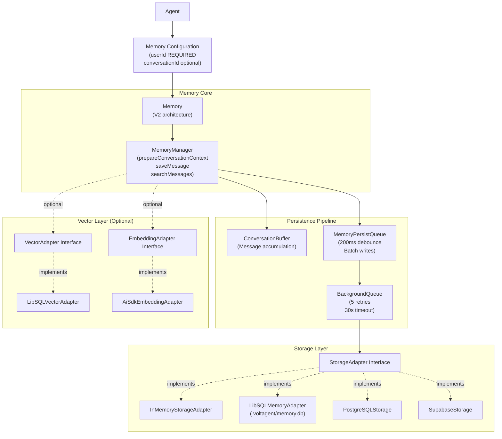
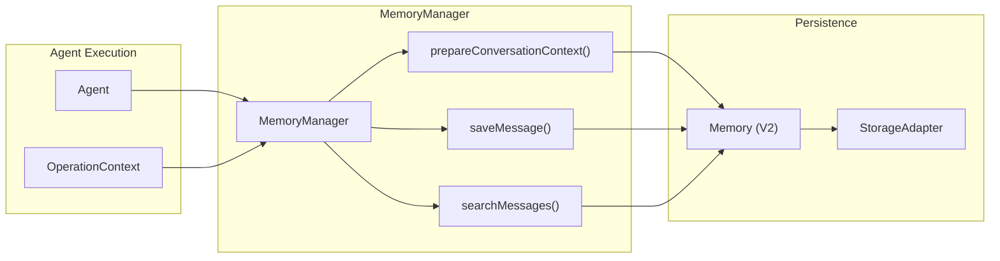
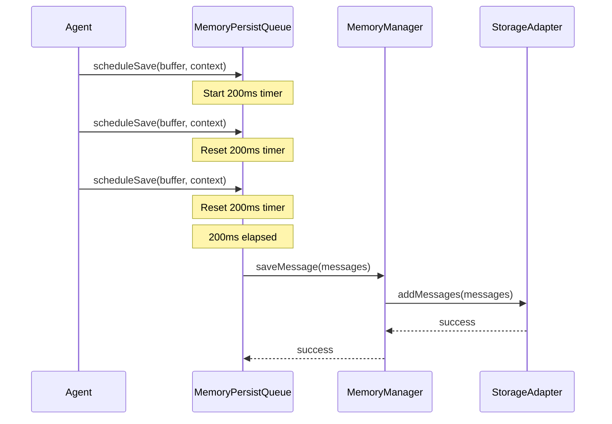
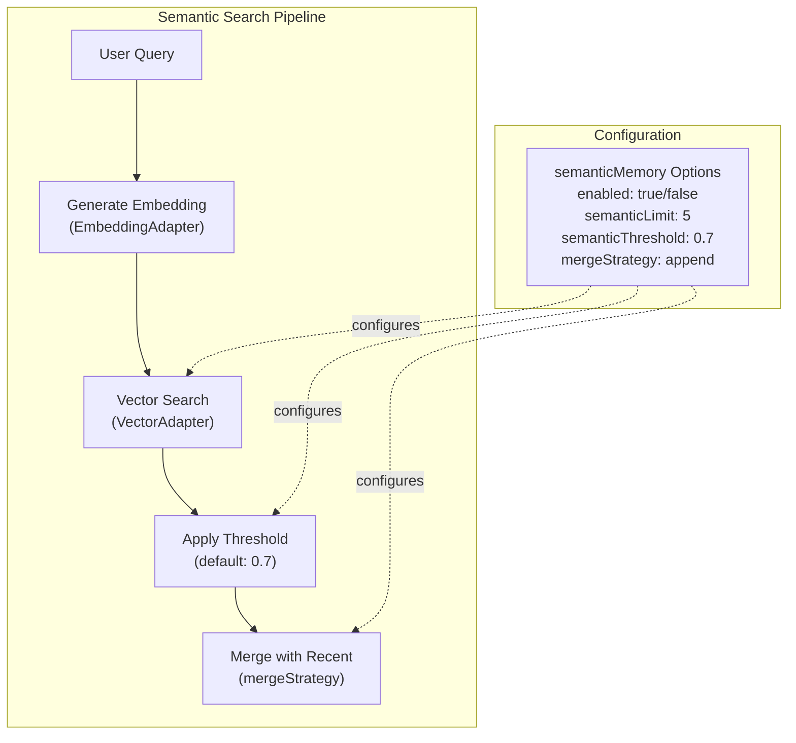
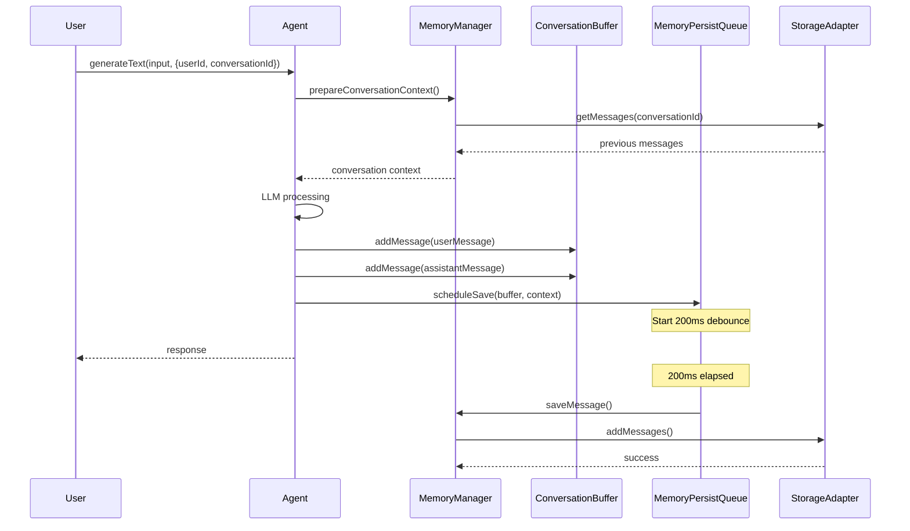

<!-- source: DeepWiki mcp.deepwiki.com · repo voltagent/voltagent · page 5 Memory and Persistence · fetched 2026-10-27 -->

# Memory and Persistence

<details>
<summary>Relevant source files</summary>

The following files were used as context for generating this wiki page:

- [CHANGELOG.md](CHANGELOG.md)
- [changelog.sh](changelog.sh)
- [examples/base/src/index.ts](examples/base/src/index.ts)
- [packages/cli/package.json](packages/cli/package.json)
- [packages/core/src/agent/agent.spec-d.ts](packages/core/src/agent/agent.spec-d.ts)
- [packages/core/src/agent/agent.spec.ts](packages/core/src/agent/agent.spec.ts)
- [packages/core/src/agent/agent.ts](packages/core/src/agent/agent.ts)
- [packages/core/src/agent/hooks/index.spec.ts](packages/core/src/agent/hooks/index.spec.ts)
- [packages/core/src/agent/hooks/index.ts](packages/core/src/agent/hooks/index.ts)
- [packages/core/src/agent/memory-persist-queue.ts](packages/core/src/agent/memory-persist-queue.ts)
- [packages/core/src/agent/message-normalizer.spec.ts](packages/core/src/agent/message-normalizer.spec.ts)
- [packages/core/src/agent/message-normalizer.ts](packages/core/src/agent/message-normalizer.ts)
- [packages/core/src/memory/manager/memory-manager.ts](packages/core/src/memory/manager/memory-manager.ts)
- [packages/create-voltagent-app/CHANGELOG.md](packages/create-voltagent-app/CHANGELOG.md)
- [packages/create-voltagent-app/package.json](packages/create-voltagent-app/package.json)
- [packages/voice/package.json](packages/voice/package.json)
- [website/docs/agents/context.md](website/docs/agents/context.md)
- [website/docs/agents/hooks.md](website/docs/agents/hooks.md)
- [website/docs/agents/tools.md](website/docs/agents/tools.md)

</details>


This document covers the complete memory and persistence system in VoltAgent, including the Memory V2 architecture, storage adapters, persistence pipeline, vector search capabilities, and working memory. The memory system enables agents to maintain conversation context across interactions, perform semantic search for RAG (Retrieval-Augmented Generation), and maintain structured working memory state.

For information about how agents use memory during execution, see [Agent System](#2.1). For details on the lifecycle and hooks that interact with memory operations, see [Agent Lifecycle and Hooks](#2.3).

## Overview

VoltAgent's memory system is built around a multi-tier architecture that separates concerns between conversation persistence, vector search, and working memory. The system provides:

- **Conversation History**: Persistent storage of user and assistant messages with configurable storage backends
- **Semantic Search**: Optional vector-based retrieval for contextually relevant information
- **Working Memory**: Structured state that agents can update and query during execution
- **Performance Optimization**: Debounced writes and asynchronous background operations
- **Adapter Pattern**: Pluggable storage backends (InMemory, LibSQL, PostgreSQL, Supabase)

The architecture follows a "context-first optimization" pattern: conversation history is loaded synchronously (blocking) to ensure continuity, while metadata operations are enqueued in the background to avoid blocking response generation.

**Sources:** [packages/core/src/agent/agent.ts:1-100](), [CHANGELOG.md:1-600](), Diagram 6 from high-level architecture

## Memory V2 Architecture



The `Memory` class is the primary interface for conversation persistence. It requires a `StorageAdapter` and optionally accepts `VectorAdapter` and `EmbeddingAdapter` for semantic search capabilities.

**Key Design Principles:**

1. **Adapter Pattern**: Storage backends are swappable via the `StorageAdapter` interface
2. **Debounced Persistence**: `MemoryPersistQueue` batches writes with a 200ms debounce window
3. **Background Operations**: `BackgroundQueue` handles non-critical operations asynchronously with retry logic
4. **Mandatory User Isolation**: `userId` is required for all memory operations to ensure proper data isolation
5. **Optional Conversation Threading**: `conversationId` provides thread-level granularity within a user's context

**Sources:** [packages/core/src/agent/agent.ts:241-336](), [packages/core/src/memory/manager/memory-manager.ts:1-100](), [packages/core/src/agent/memory-persist-queue.ts:1-149](), CHANGELOG.md:221-225

## Memory Manager

The `MemoryManager` class coordinates all memory operations for an agent. It acts as the bridge between the agent execution context and the underlying `Memory` instance.



### Core Methods

| Method | Purpose | Parameters |
|--------|---------|------------|
| `prepareConversationContext` | Load conversation history with optional semantic search | `context`, `userId`, `conversationId`, `limit`, `semanticOptions` |
| `saveMessage` | Persist a single message to storage | `context`, `message`, `userId`, `conversationId` |
| `searchMessages` | Perform semantic search across conversation history | `context`, `query`, `userId`, `conversationId`, `options` |
| `getMemory` | Access the underlying Memory instance | - |

The `MemoryManager` is instantiated once per agent and reused across all operations for that agent.

**Sources:** [packages/core/src/memory/manager/memory-manager.ts:28-92](), [packages/core/src/memory/manager/memory-manager.ts:95-172]()

## Persistence Pipeline

The persistence pipeline implements a three-stage buffering and debouncing system to optimize write performance without sacrificing conversation continuity.

### Stage 1: ConversationBuffer

The `ConversationBuffer` accumulates messages during multi-step agent operations (e.g., tool calls, reasoning steps). Messages are held in memory until explicitly drained.

```typescript
class ConversationBuffer {
  private pendingMessages: UIMessage[] = [];
  
  addMessage(message: UIMessage): void {
    this.pendingMessages.push(message);
  }
  
  drainPendingMessages(): UIMessage[] {
    const messages = [...this.pendingMessages];
    this.pendingMessages = [];
    return messages;
  }
}
```

**Sources:** [packages/core/src/agent/conversation-buffer.ts:1-50]()

### Stage 2: MemoryPersistQueue

The `MemoryPersistQueue` debounces writes with a 200ms delay. When `scheduleSave()` is called repeatedly, the timer resets, ensuring only one write occurs after activity stops.



**Key Methods:**

- `scheduleSave(buffer, context)`: Schedule a debounced save operation
- `flush(buffer, context)`: Immediately execute pending saves without debounce

The debounce window prevents excessive database writes during rapid agent operations (e.g., streaming responses with multiple tool calls).

**Sources:** [packages/core/src/agent/memory-persist-queue.ts:1-149]()

### Stage 3: BackgroundQueue

The `BackgroundQueue` handles asynchronous operations with retry logic:

- **Max Concurrency**: 10 concurrent operations
- **Default Timeout**: 30 seconds per operation
- **Default Retries**: 5 attempts with exponential backoff

This queue ensures that transient storage failures don't interrupt agent execution. Failed operations are logged but don't propagate errors to the caller.

**Sources:** [packages/core/src/memory/manager/memory-manager.ts:86-92](), [packages/core/src/utils/queue/queue.ts:1-200]()

## Storage Adapters

The `StorageAdapter` interface defines the contract that all storage backends must implement. This allows developers to choose the appropriate backend for their deployment environment.

### StorageAdapter Interface

```typescript
interface StorageAdapter {
  // Conversation management
  createConversation(conversation: Conversation): Promise<void>;
  getConversation(conversationId: string): Promise<Conversation | null>;
  deleteConversation(conversationId: string): Promise<void>;
  listConversations(userId: string, options?: ListOptions): Promise<Conversation[]>;
  
  // Message operations
  addMessages(messages: UIMessage[], userId: string, conversationId: string): Promise<void>;
  getMessages(conversationId: string, options?: GetMessagesOptions): Promise<UIMessage[]>;
  
  // Configuration
  storageLimit?: number; // Max messages to retain per conversation
}
```

**Sources:** [packages/core/src/memory/adapters/storage/types.ts:1-100]()

### Available Implementations

| Adapter | Use Case | Persistence | Configuration |
|---------|----------|-------------|---------------|
| `InMemoryStorageAdapter` | Development, testing | None (in-memory only) | No configuration required |
| `LibSQLMemoryAdapter` | Local development, edge deployments | Local SQLite file or Turso cloud | `.voltagent/memory.db` default path |
| `PostgreSQLStorage` | Enterprise deployments | PostgreSQL database | Connection string required |
| `SupabaseStorage` | Cloud-native deployments | Supabase backend | API URL and key required |

### InMemoryStorageAdapter

The simplest adapter, suitable for testing and development. All data is lost when the process exits.

```typescript
import { Memory } from "@voltagent/core";
import { InMemoryStorageAdapter } from "@voltagent/core";

const memory = new Memory({
  storage: new InMemoryStorageAdapter(),
});
```

**Sources:** [packages/core/src/memory/adapters/storage/in-memory.ts:1-200]()

### LibSQLMemoryAdapter

Uses SQLite for local persistence or Turso for cloud-hosted SQLite. The default storage location is `.voltagent/memory.db` in the project root.

```typescript
import { Memory } from "@voltagent/core";
import { LibSQLMemoryAdapter } from "@voltagent/libsql";

const memory = new Memory({
  storage: new LibSQLMemoryAdapter({
    storageLimit: 100, // Keep last 100 messages per conversation
    // Optional: specify custom database path or Turso URL
    url: process.env.TURSO_DATABASE_URL,
    authToken: process.env.TURSO_AUTH_TOKEN,
  }),
});
```

**Features:**
- Automatic schema initialization
- Conversation metadata tracking
- Message limit enforcement via `storageLimit` option
- Works with both local files and Turso cloud databases

**Sources:** [packages/libsql/src/memory-adapter.ts:1-300](), [examples/base/src/index.ts:1-38]()

### PostgreSQLStorage

Enterprise-grade storage with full PostgreSQL feature support.

```typescript
import { Memory } from "@voltagent/core";
import { PostgreSQLStorage } from "@voltagent/postgres";

const memory = new Memory({
  storage: new PostgreSQLStorage({
    connectionString: process.env.DATABASE_URL,
    storageLimit: 500,
  }),
});
```

**Sources:** [packages/postgres/src/storage.ts:1-400]()

### SupabaseStorage

Integrates with Supabase for cloud-native deployments with built-in authentication.

```typescript
import { Memory } from "@voltagent/core";
import { SupabaseStorage } from "@voltagent/supabase";

const memory = new Memory({
  storage: new SupabaseStorage({
    supabaseUrl: process.env.SUPABASE_URL,
    supabaseKey: process.env.SUPABASE_KEY,
  }),
});
```

**Sources:** [packages/supabase/src/storage.ts:1-400]()

## Vector Search and Semantic Memory

Semantic search enables agents to retrieve contextually relevant messages from conversation history, even when exact keywords don't match. This is essential for RAG (Retrieval-Augmented Generation) patterns.



### VectorAdapter Interface

The `VectorAdapter` interface defines vector storage and search operations:

```typescript
interface VectorAdapter {
  // Store embeddings for messages
  upsertEmbeddings(embeddings: MessageEmbedding[]): Promise<void>;
  
  // Search for similar messages
  searchSimilar(
    embedding: number[],
    options: {
      conversationId: string;
      userId: string;
      limit?: number;
      threshold?: number;
    }
  ): Promise<VectorSearchResult[]>;
  
  // Delete embeddings
  deleteEmbeddings(messageIds: string[]): Promise<void>;
}
```

**Sources:** [packages/core/src/memory/adapters/vector/types.ts:1-100]()

### EmbeddingAdapter Interface

The `EmbeddingAdapter` generates vector embeddings from text:

```typescript
interface EmbeddingAdapter {
  // Generate embedding for a single text
  embed(text: string): Promise<number[]>;
  
  // Generate embeddings for multiple texts (batch operation)
  embedMany(texts: string[]): Promise<number[][]>;
}
```

**Sources:** [packages/core/src/memory/adapters/embedding/types.ts:1-100]()

### Configuration Options

Semantic search is configured via the `semanticMemory` option on agent methods:

```typescript
const result = await agent.generateText("What did I say about my name?", {
  userId: "user-123",
  conversationId: "conv-456",
  semanticMemory: {
    enabled: true,           // Enable semantic search
    semanticLimit: 5,        // Retrieve 5 most similar messages
    semanticThreshold: 0.7,  // Minimum similarity score (0-1)
    mergeStrategy: "append", // How to merge with recent history
  },
});
```

**Merge Strategies:**

| Strategy | Behavior | Use Case |
|----------|----------|----------|
| `append` | Recent messages first, semantic hits after | Default; prevents stale semantic results from overriding recent context |
| `prepend` | Semantic hits first, recent messages after | Prioritize historical context |
| `interleave` | Alternating recent and semantic messages | Balanced view of recent and relevant history |

The default `append` strategy was chosen to prevent scenarios where outdated information (e.g., an old name "Ömer") overrides more recent updates (e.g., current name "Ahmet").

**Sources:** [packages/core/src/agent/agent.ts:192-198](), [CHANGELOG.md:552-586]()

### Available Implementations

```typescript
// LibSQL-based vector storage (local or Turso)
import { LibSQLVectorAdapter } from "@voltagent/libsql";
import { AiSdkEmbeddingAdapter } from "@voltagent/core";
import { openai } from "@ai-sdk/openai";

const memory = new Memory({
  storage: new LibSQLMemoryAdapter(),
  vector: new LibSQLVectorAdapter(),
  embedding: new AiSdkEmbeddingAdapter(
    openai.embedding("text-embedding-3-small")
  ),
});
```

When both `vector` and `embedding` adapters are provided, the `Memory` instance automatically:
1. Generates embeddings for new messages
2. Stores embeddings in the vector database
3. Performs similarity search when semantic options are provided

**Sources:** [examples/base/src/index.ts:6-24](), [packages/libsql/src/vector-adapter.ts:1-300]()

## Working Memory

Working memory provides agents with a structured, queryable state that persists across conversation turns. Unlike conversation history (which stores all messages), working memory stores only key-value pairs that the agent explicitly updates.

### The update_working_memory Tool

When an agent is configured with memory, it automatically receives the `update_working_memory` tool:

```typescript
createTool({
  name: "update_working_memory",
  description: "Update or retrieve the agent's working memory",
  parameters: z.object({
    action: z.enum(["set", "get", "update", "delete"]),
    key: z.string().optional(),
    value: z.any().optional(),
  }),
  execute: async (args, options) => {
    const { action, key, value } = args;
    const context = options?.operationContext;
    
    // Working memory stored in operation context
    const workingMemory = context?.workingMemory || {};
    
    switch (action) {
      case "set":
        workingMemory[key] = value;
        return { success: true };
      case "get":
        return workingMemory[key];
      // ... other actions
    }
  },
});
```

**Working memory is filtered from conversation history**: The `sanitizeMessagesForModel` function removes all `update_working_memory` tool calls before sending messages to the LLM, preventing the working memory implementation details from cluttering the context.

**Sources:** [packages/core/src/agent/message-normalizer.ts:1-50](), [packages/core/src/agent/agent.ts:1200-1300]()

### Working Memory with Schemas

You can define typed working memory using Zod schemas:

```typescript
import { z } from "zod";

const UserProfileSchema = z.object({
  name: z.string(),
  preferences: z.object({
    language: z.string(),
    timezone: z.string(),
  }),
  lastTopic: z.string().optional(),
});

// Agent can update working memory with validation
const agent = new Agent({
  name: "Profile Agent",
  instructions: `
    Use working memory to track user profile information.
    Schema: ${JSON.stringify(UserProfileSchema.shape)}
  `,
  model: openai("gpt-4o"),
  memory: memory,
});
```

The agent will use the `update_working_memory` tool to maintain structured state:

```typescript
// Example tool call from agent
{
  type: "tool-update_working_memory",
  input: {
    action: "set",
    key: "userProfile",
    value: {
      name: "Alice",
      preferences: {
        language: "en",
        timezone: "UTC"
      }
    }
  }
}
```

**Sources:** [packages/core/src/memory/working-memory.ts:1-200]()

## Integration with Agents

Agents integrate with the memory system through the `MemoryManager`, which is instantiated during agent construction.

### Agent Memory Configuration

```typescript
import { Agent, Memory } from "@voltagent/core";
import { LibSQLMemoryAdapter } from "@voltagent/libsql";
import { openai } from "@ai-sdk/openai";

const memory = new Memory({
  storage: new LibSQLMemoryAdapter({
    storageLimit: 100,
  }),
});

const agent = new Agent({
  name: "Assistant",
  instructions: "You are a helpful assistant with memory",
  model: openai("gpt-4o"),
  memory: memory, // Memory instance
});
```

### Memory During Execution

When calling agent methods, provide `userId` (required) and `conversationId` (optional):

```typescript
// First conversation
const result1 = await agent.generateText("My name is Alice", {
  userId: "user-123",
  conversationId: "conv-abc",
});

// Later in the same conversation
const result2 = await agent.generateText("What's my name?", {
  userId: "user-123",
  conversationId: "conv-abc",
});
// Agent responds: "Your name is Alice"
```

**Without conversationId**: Messages are still saved but not retrieved in subsequent calls (each call is isolated).

**Sources:** [packages/core/src/agent/agent.ts:268-313]()

### Memory Lifecycle in Agent Execution



**Sources:** [packages/core/src/agent/agent.ts:344-520](), [packages/core/src/memory/manager/memory-manager.ts:95-172]()

### Context Limit

The `contextLimit` option controls how many recent messages to load:

```typescript
const result = await agent.generateText("Tell me more", {
  userId: "user-123",
  conversationId: "conv-abc",
  contextLimit: 10, // Load only last 10 messages
});
```

This is useful for managing token usage with long conversations.

**Sources:** [packages/core/src/agent/agent.ts:190]()

## Configuration Examples

### Basic In-Memory Setup

```typescript
import { Agent, Memory } from "@voltagent/core";
import { InMemoryStorageAdapter } from "@voltagent/core";
import { openai } from "@ai-sdk/openai";

const memory = new Memory({
  storage: new InMemoryStorageAdapter(),
});

const agent = new Agent({
  name: "Basic Agent",
  instructions: "You are a helpful assistant",
  model: openai("gpt-4o"),
  memory: memory,
});
```

**Sources:** [packages/core/src/agent/agent.spec.ts:586-612]()

### LibSQL with Vector Search

```typescript
import { Memory } from "@voltagent/core";
import { LibSQLMemoryAdapter, LibSQLVectorAdapter } from "@voltagent/libsql";
import { AiSdkEmbeddingAdapter } from "@voltagent/core";
import { openai } from "@ai-sdk/openai";

const memory = new Memory({
  storage: new LibSQLMemoryAdapter({
    storageLimit: 100,
  }),
  embedding: new AiSdkEmbeddingAdapter(
    openai.embedding("text-embedding-3-small")
  ),
  vector: new LibSQLVectorAdapter(),
});

const agent = new Agent({
  name: "RAG Agent",
  instructions: "Use semantic search to find relevant information",
  model: openai("gpt-4o"),
  memory: memory,
});

// Use with semantic search
const result = await agent.generateText("What did we discuss about Python?", {
  userId: "user-123",
  conversationId: "conv-abc",
  semanticMemory: {
    enabled: true,
    semanticLimit: 5,
    semanticThreshold: 0.7,
    mergeStrategy: "append",
  },
});
```

**Sources:** [examples/base/src/index.ts:6-38]()

### PostgreSQL for Production

```typescript
import { Memory } from "@voltagent/core";
import { PostgreSQLStorage } from "@voltagent/postgres";

const memory = new Memory({
  storage: new PostgreSQLStorage({
    connectionString: process.env.DATABASE_URL,
    storageLimit: 500,
  }),
});

const agent = new Agent({
  name: "Production Agent",
  instructions: "Enterprise assistant with persistent storage",
  model: openai("gpt-4o"),
  memory: memory,
});
```

**Sources:** [packages/postgres/src/storage.ts:1-100]()

### Disabling Memory

```typescript
const agent = new Agent({
  name: "Stateless Agent",
  instructions: "No conversation history",
  model: openai("gpt-4o"),
  memory: false, // Explicitly disable memory
});
```

Each agent invocation is completely isolated when memory is disabled.

**Sources:** [packages/core/src/agent/agent.spec.ts:601-611]()

---

