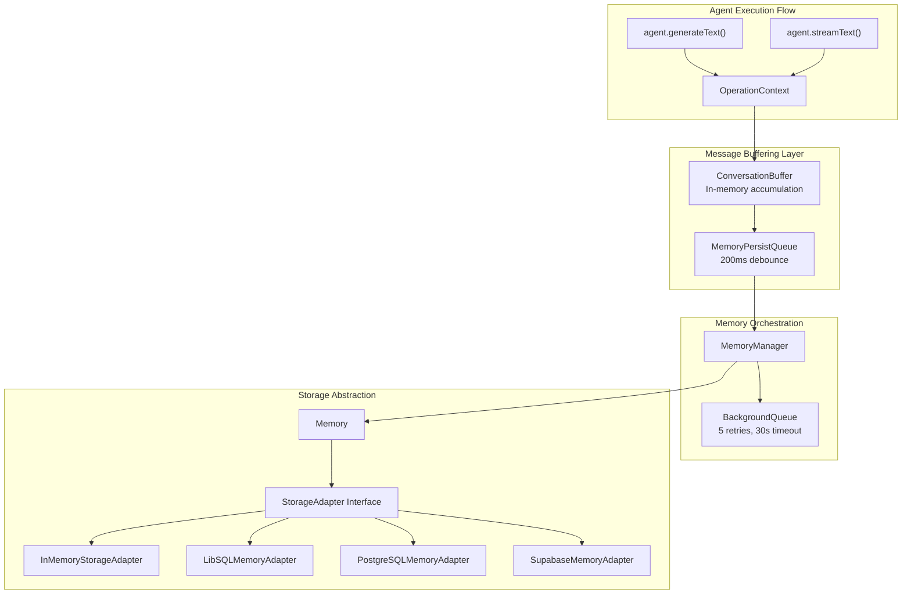
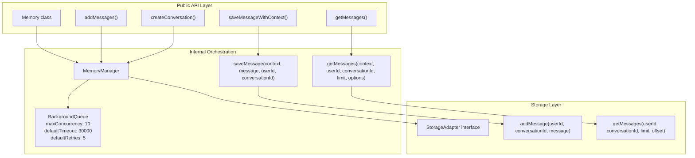
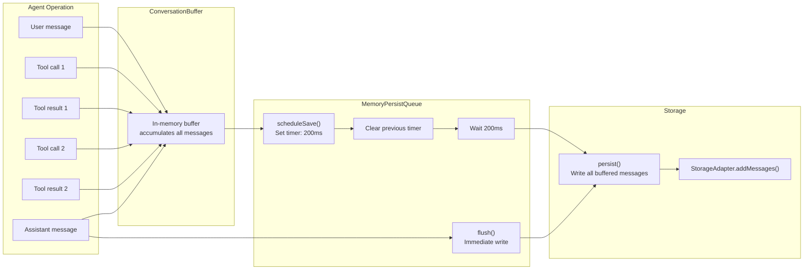
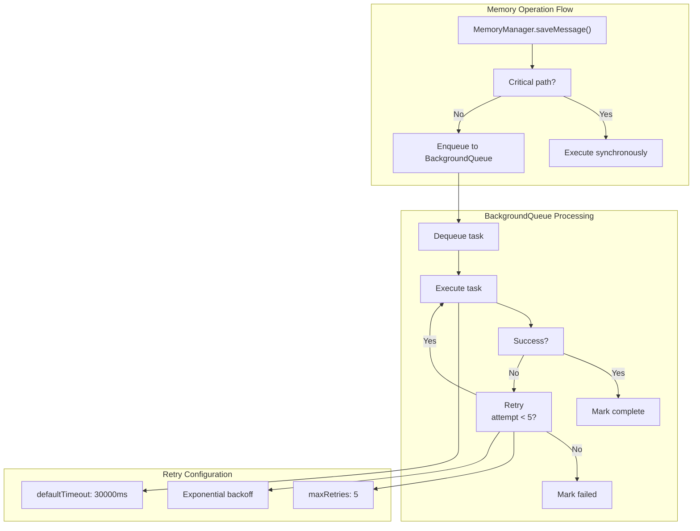
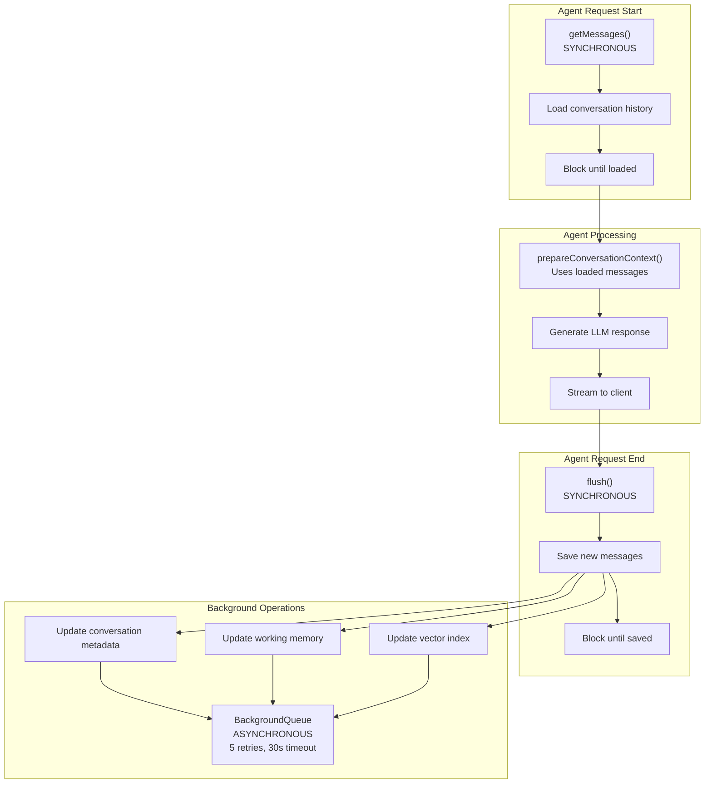
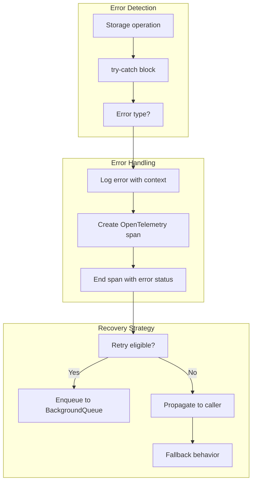
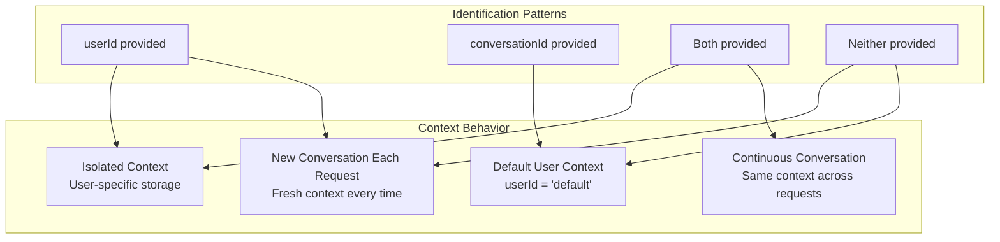

<!-- source: DeepWiki mcp.deepwiki.com · repo voltagent/voltagent · page 5.1 Memory V2 Architecture · fetched 2026-10-27 -->

# Memory V2 Architecture

<details>
<summary>Relevant source files</summary>

The following files were used as context for generating this wiki page:

- [CHANGELOG.md](CHANGELOG.md)
- [changelog.sh](changelog.sh)
- [examples/base/src/index.ts](examples/base/src/index.ts)
- [packages/cli/package.json](packages/cli/package.json)
- [packages/core/src/agent/agent.spec-d.ts](packages/core/src/agent/agent.spec-d.ts)
- [packages/core/src/agent/agent.spec.ts](packages/core/src/agent/agent.spec.ts)
- [packages/core/src/agent/agent.ts](packages/core/src/agent/agent.ts)
- [packages/core/src/agent/hooks/index.spec.ts](packages/core/src/agent/hooks/index.spec.ts)
- [packages/core/src/agent/hooks/index.ts](packages/core/src/agent/hooks/index.ts)
- [packages/core/src/agent/memory-persist-queue.ts](packages/core/src/agent/memory-persist-queue.ts)
- [packages/core/src/agent/message-normalizer.spec.ts](packages/core/src/agent/message-normalizer.spec.ts)
- [packages/core/src/agent/message-normalizer.ts](packages/core/src/agent/message-normalizer.ts)
- [packages/core/src/memory/manager/memory-manager.ts](packages/core/src/memory/manager/memory-manager.ts)
- [packages/create-voltagent-app/CHANGELOG.md](packages/create-voltagent-app/CHANGELOG.md)
- [packages/create-voltagent-app/package.json](packages/create-voltagent-app/package.json)
- [packages/voice/package.json](packages/voice/package.json)
- [website/docs/agents/context.md](website/docs/agents/context.md)
- [website/docs/agents/hooks.md](website/docs/agents/hooks.md)
- [website/docs/agents/tools.md](website/docs/agents/tools.md)

</details>


The Memory V2 architecture implements a sophisticated multi-tier persistence system designed for production reliability and performance. This page documents the core architecture, including the adapter pattern, debounced persistence queue, and background retry mechanisms that ensure conversation continuity without compromising response times.

For specific storage adapter implementations, see [Storage Adapters](#5.2). For semantic search capabilities, see [Semantic Search and RAG](#5.6). For working memory features, see [Working Memory](#5.7).

## Architecture Overview

Memory V2 implements three key architectural innovations:

1. **Adapter Pattern** - `StorageAdapter` interface enables pluggable backends (LibSQL, PostgreSQL, Supabase, InMemory)
2. **Debounced Persistence** - `MemoryPersistQueue` batches messages with 200ms debounce to minimize storage operations
3. **Background Queue** - `BackgroundQueue` handles non-critical operations asynchronously with retry logic (5 attempts, 30s timeout)

### High-Level Component Diagram



**Sources:** [packages/core/src/agent/agent.ts:62-79](), [packages/core/src/agent/memory-persist-queue.ts:1-149](), [packages/core/src/memory/manager/memory-manager.ts:1-315]()

## Core Components

### Memory and MemoryManager

The `Memory` class [packages/core/src/memory/memory.ts]() provides the public API for memory operations, while `MemoryManager` [packages/core/src/memory/manager/memory-manager.ts]() orchestrates persistence, retrieval, and background operations.



| Component | File Path | Purpose |
|-----------|-----------|---------|
| `Memory` | [packages/core/src/memory/memory.ts]() | Public-facing memory API |
| `MemoryManager` | [packages/core/src/memory/manager/memory-manager.ts:28-92]() | Orchestrates storage operations with logging and tracing |
| `BackgroundQueue` | [packages/core/src/utils/queue/queue.ts]() | Executes non-critical operations asynchronously with retry logic |
| `StorageAdapter` | [packages/core/src/memory/types.ts:248-299]() | Interface defining storage contract |

**Sources:** [packages/core/src/memory/manager/memory-manager.ts:28-92](), [packages/core/src/memory/types.ts:248-299]()

### StorageAdapter Interface

The `StorageAdapter` interface [packages/core/src/memory/types.ts:248-299]() defines the contract that all storage implementations must implement. This enables pluggable backends without changing agent code.

```typescript
interface StorageAdapter {
  // Message operations
  addMessage(userId: string, conversationId: string, message: UIMessage): Promise<void>;
  addMessages(userId: string, conversationId: string, messages: UIMessage[]): Promise<void>;
  getMessages(userId: string, conversationId: string, limit?: number, offset?: number): Promise<UIMessage[]>;
  clearMessages(userId: string, conversationId: string): Promise<void>;
  
  // Conversation operations
  createConversation(conversation: Conversation): Promise<void>;
  getConversation(conversationId: string): Promise<Conversation | undefined>;
  queryConversations(userId: string, filters?: ConversationFilters): Promise<Conversation[]>;
  updateConversation(conversationId: string, updates: Partial<Conversation>): Promise<void>;
  deleteConversation(conversationId: string): Promise<void>;
  
  // Working memory operations
  getWorkingMemory(userId: string, conversationId?: string): Promise<Record<string, any> | undefined>;
  setWorkingMemory(userId: string, workingMemory: Record<string, any>, conversationId?: string): Promise<void>;
  deleteWorkingMemory(userId: string, conversationId?: string): Promise<void>;
  
  // Workflow state operations
  getWorkflowState(workflowId: string, executionId: string): Promise<WorkflowStateEntry | undefined>;
  setWorkflowState(state: WorkflowStateEntry): Promise<void>;
  updateWorkflowState(workflowId: string, executionId: string, updates: Partial<WorkflowStateEntry>): Promise<void>;
  getSuspendedWorkflowStates(workflowId?: string): Promise<WorkflowStateEntry[]>;
}
```

| Implementation | Package | Backend | Primary Use Case |
|----------------|---------|---------|------------------|
| `InMemoryStorageAdapter` | `@voltagent/core` | RAM only | Development, testing |
| `LibSQLMemoryAdapter` | `@voltagent/libsql` | SQLite/Turso | Local development, edge deployments |
| `PostgreSQLMemoryAdapter` | `@voltagent/postgres` | PostgreSQL | Production applications |
| `SupabaseMemoryAdapter` | `@voltagent/supabase` | Supabase | Cloud-native applications |

**Sources:** [packages/core/src/memory/types.ts:248-299]()

## Persistence Pipeline

The persistence pipeline implements a three-stage architecture to optimize write operations: buffering, debouncing, and background persistence.

### Stage 1: ConversationBuffer

`ConversationBuffer` [packages/core/src/agent/conversation-buffer.ts]() accumulates messages in-memory during an agent operation. Messages are held until explicitly drained by the persistence queue.

```typescript
class ConversationBuffer {
  private pendingMessages: UIMessage[] = [];
  
  addMessage(message: UIMessage): void {
    this.pendingMessages.push(message);
  }
  
  drainPendingMessages(): UIMessage[] {
    const messages = this.pendingMessages;
    this.pendingMessages = [];
    return messages;
  }
}
```

**Sources:** [packages/core/src/agent/conversation-buffer.ts]()

### Stage 2: MemoryPersistQueue (Debouncing)

`MemoryPersistQueue` [packages/core/src/agent/memory-persist-queue.ts:20-148]() implements debounced persistence to batch rapid message updates (e.g., during multi-step tool calls) into single storage operations.



| Configuration | Default | Purpose |
|---------------|---------|---------|
| `debounceMs` | 200 | Delay before triggering persistence (milliseconds) |

**Key Methods:**

```typescript
class MemoryPersistQueue {
  constructor(
    private readonly memoryManager: MemoryManager,
    options: { debounceMs?: number } = {}
  ) {
    this.debounceMs = options.debounceMs ?? 200;
  }
  
  // Schedule a save with debouncing
  scheduleSave(buffer: ConversationBuffer, oc: OperationContext): void
  
  // Flush immediately (called at operation end)
  async flush(buffer: ConversationBuffer, oc: OperationContext): Promise<void>
}
```

**Sources:** [packages/core/src/agent/memory-persist-queue.ts:20-148](), [CHANGELOG.md:221]()

### Stage 3: BackgroundQueue (Retries)

`BackgroundQueue` [packages/core/src/utils/queue/queue.ts]() handles non-critical operations asynchronously with retry logic. Initialized by `MemoryManager` [packages/core/src/memory/manager/memory-manager.ts:88-92]() with production-ready defaults.



| Configuration | Default | Purpose |
|---------------|---------|---------|
| `maxConcurrency` | 10 | Maximum parallel operations |
| `defaultTimeout` | 30000 | Task timeout in milliseconds |
| `defaultRetries` | 5 | Maximum retry attempts for failed operations |

**Sources:** [packages/core/src/memory/manager/memory-manager.ts:88-92](), [packages/core/src/utils/queue/queue.ts]()

## Context-First Optimization

Memory V2 implements a "context-first" optimization pattern to ensure conversation continuity without compromising response times. Critical operations (conversation history loading) execute synchronously while non-critical operations (metadata updates) execute in the background.



| Operation Type | Execution Mode | Blocking | Purpose |
|----------------|----------------|----------|---------|
| `getMessages()` | Synchronous | Yes | Load conversation history before LLM call |
| `saveMessage()` | Synchronous | Yes | Persist messages before response completes |
| Metadata updates | Asynchronous | No | Update conversation metadata without blocking |
| Vector indexing | Asynchronous | No | Update semantic search index without blocking |
| Working memory sync | Asynchronous | No | Persist working memory state without blocking |

**Sources:** [packages/core/src/memory/manager/memory-manager.ts:98-172](), [packages/core/src/agent/agent.ts:356-519]()

## Error Handling and Resilience

The Memory V2 architecture implements comprehensive error handling at each layer to ensure reliability in production environments.

### Storage Operation Failures

When storage operations fail, the system logs errors with full context and attempts retries through `BackgroundQueue`.



**Error Handling Example:**

```typescript
// From MemoryManager.saveMessage()
try {
  await trace.withSpan(writeSpan, async () => {
    if (conversationId && userId) {
      await this.conversationMemory?.saveMessageWithContext(
        message, userId, conversationId, { logger: memoryLogger }
      );
    }
  });
  trace.endChildSpan(writeSpan, "completed", {
    output: { saved: true },
    attributes: { "memory.message_count": 1 }
  });
} catch (error) {
  trace.endChildSpan(writeSpan, "error", { error: error as Error });
  memoryLogger.error(
    `Memory write failed: ${error instanceof Error ? error.message : "Unknown error"}`,
    {
      event: LogEvents.MEMORY_OPERATION_FAILED,
      operation: "write",
      success: false,
      error: error instanceof Error ? { message: error.message, stack: error.stack } : error
    }
  );
}
```

**Sources:** [packages/core/src/memory/manager/memory-manager.ts:98-172]()

### Agent Operation Failures

When agent operations fail, pending messages are flushed to prevent data loss.

```typescript
// From Agent.generateText()
try {
  const result = await generateText({ /* ... */ });
  await persistQueue.flush(buffer, oc);
  return result;
} catch (error) {
  await this.flushPendingMessagesOnError(oc).catch(() => {});
  return this.handleError(error as Error, oc, options, startTime);
}
```

**Sources:** [packages/core/src/agent/agent.ts:408-519]()

## User and Conversation Identification

The memory system uses `userId` and `conversationId` to scope storage operations and maintain context isolation.

| Parameter | Purpose | Behavior |
|-----------|---------|----------|
| `userId` | User identification | Defaults to `"default"` if omitted |
| `conversationId` | Conversation thread identification | Generates new UUID if omitted (new conversation each request) |

**Memory Scoping Patterns:**



**Sources:** [website/docs/agents/memory/overview.md:247-348]()

---

