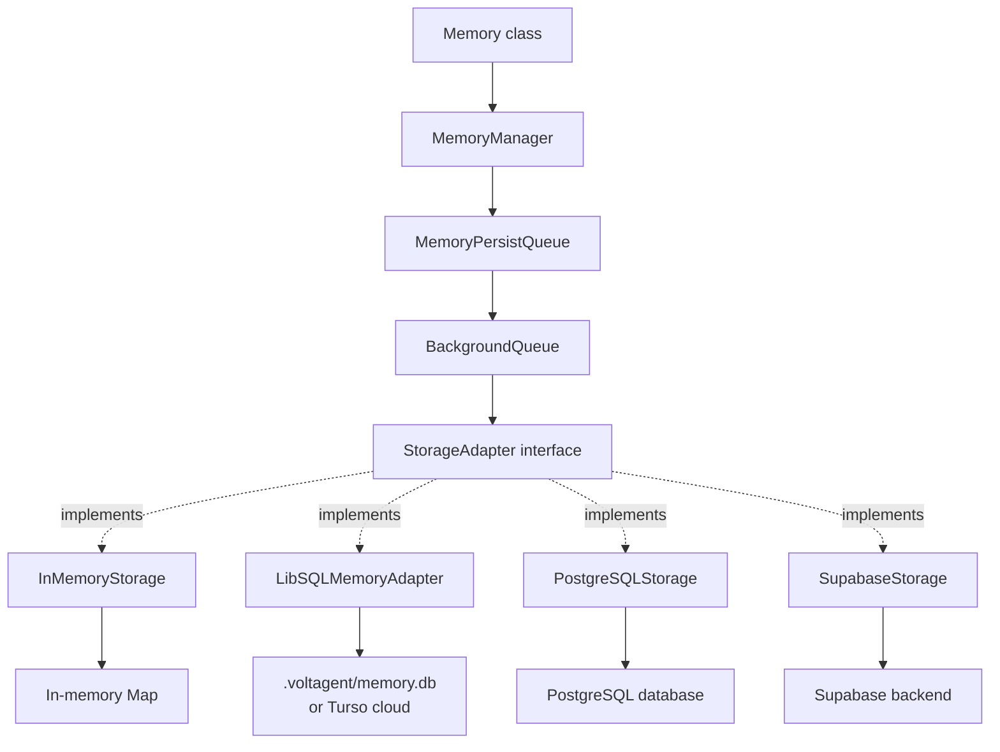
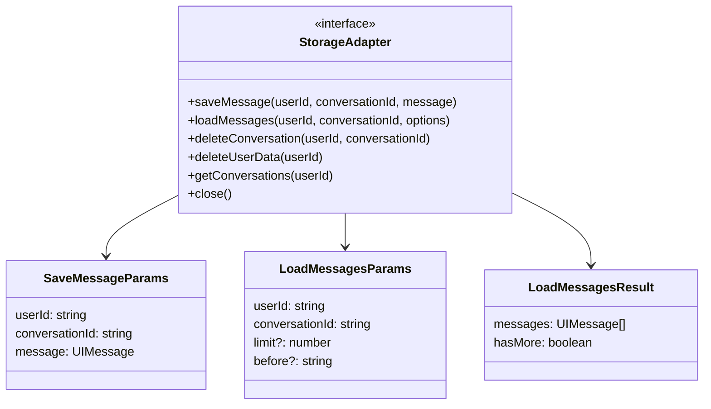
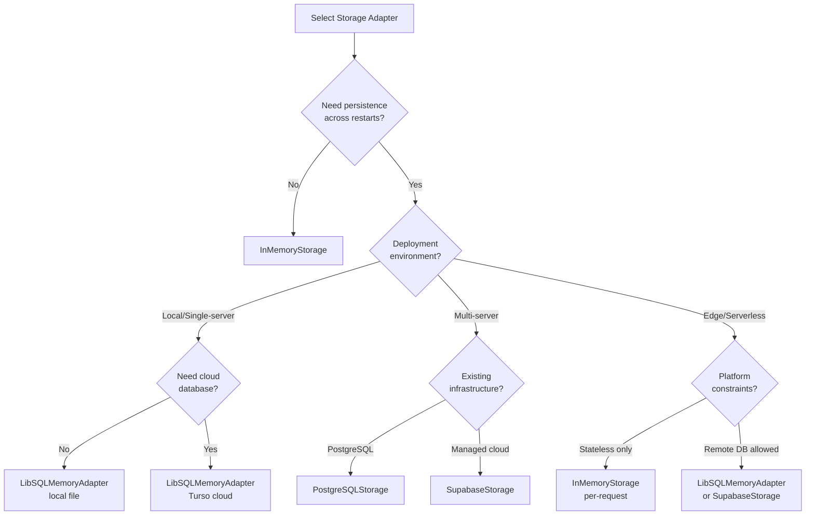
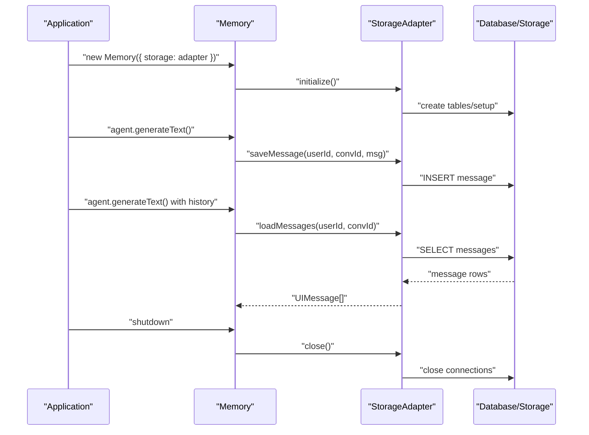
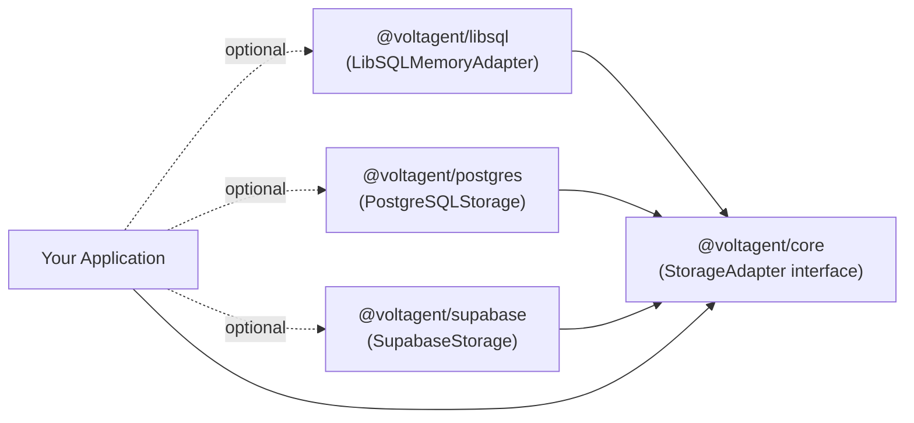
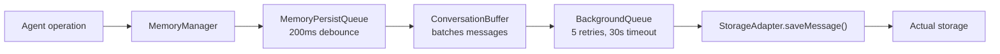

<!-- source: DeepWiki mcp.deepwiki.com · repo voltagent/voltagent · page 5.2 Storage Adapters · fetched 2026-10-27 -->

# Storage Adapters

<details>
<summary>Relevant source files</summary>

The following files were used as context for generating this wiki page:

- [CHANGELOG.md](CHANGELOG.md)
- [changelog.sh](changelog.sh)
- [examples/base/src/index.ts](examples/base/src/index.ts)
- [examples/with-google-ai/package.json](examples/with-google-ai/package.json)
- [examples/with-google-vertex-ai/package.json](examples/with-google-vertex-ai/package.json)
- [examples/with-groq-ai/package.json](examples/with-groq-ai/package.json)
- [examples/with-mcp/package.json](examples/with-mcp/package.json)
- [examples/with-nextjs/package.json](examples/with-nextjs/package.json)
- [packages/cli/package.json](packages/cli/package.json)
- [packages/core/package.json](packages/core/package.json)
- [packages/create-voltagent-app/CHANGELOG.md](packages/create-voltagent-app/CHANGELOG.md)
- [packages/create-voltagent-app/package.json](packages/create-voltagent-app/package.json)
- [packages/voice/package.json](packages/voice/package.json)
- [pnpm-lock.yaml](pnpm-lock.yaml)

</details>


## Purpose and Scope

This document describes the `StorageAdapter` interface and its implementations within the VoltAgent memory system. Storage adapters provide pluggable persistence backends for conversation history, enabling developers to choose between in-memory storage, local SQLite databases, cloud PostgreSQL instances, or Supabase backends based on their deployment requirements.

For information about the overall memory architecture and persistence pipeline, see [Memory V2 Architecture](#5.1). For details on semantic search and vector storage, see [Semantic Search and RAG](#5.6). For implementation-specific details, see [LibSQL Integration](#5.3), [PostgreSQL Integration](#5.4), or [Supabase Integration](#5.5).

## Storage Adapter Architecture

The storage adapter system implements the adapter pattern to decouple memory management from specific database implementations. All storage operations flow through the `StorageAdapter` interface, allowing runtime selection of persistence strategies.



**Sources**: Diagram 6 (Memory and Persistence Architecture), [packages/core/package.json:1-78]()

## StorageAdapter Interface

The `StorageAdapter` interface defines the contract that all storage implementations must fulfill. It provides methods for saving, loading, and managing conversation messages with user and conversation-level isolation.



**Key interface methods**:

| Method | Parameters | Returns | Purpose |
|--------|-----------|---------|---------|
| `saveMessage` | `userId`, `conversationId`, `message` | `Promise<void>` | Persist a single message to storage |
| `loadMessages` | `userId`, `conversationId`, `options?` | `Promise<LoadMessagesResult>` | Load conversation history with optional pagination |
| `deleteConversation` | `userId`, `conversationId` | `Promise<void>` | Remove all messages for a specific conversation |
| `deleteUserData` | `userId` | `Promise<void>` | Remove all data for a specific user |
| `getConversations` | `userId` | `Promise<string[]>` | List all conversation IDs for a user |
| `close` | - | `Promise<void>` | Cleanup resources and close connections |

**Sources**: Diagram 6 (Memory and Persistence Architecture), [packages/core/package.json:1-78]()

## Available Storage Adapter Implementations

VoltAgent provides four storage adapter implementations, each optimized for different use cases:

| Adapter | Package | Persistence | Use Case | Configuration Complexity |
|---------|---------|-------------|----------|-------------------------|
| `InMemoryStorage` | `@voltagent/core` | None (in-memory only) | Development, testing, stateless applications | None (default) |
| `LibSQLMemoryAdapter` | `@voltagent/libsql` | SQLite file or Turso cloud | Local development, single-server deployments | Low |
| `PostgreSQLStorage` | `@voltagent/postgres` | PostgreSQL database | Enterprise deployments, multi-server setups | Medium |
| `SupabaseStorage` | `@voltagent/supabase` | Supabase backend | Cloud-native applications, managed infrastructure | Low-Medium |

**Sources**: Diagram 1 (Monorepo Package Ecosystem), [pnpm-lock.yaml:1-300]()

### InMemoryStorage

The default adapter when no storage configuration is provided. Stores all conversation data in an in-memory `Map` structure. Data is lost when the process terminates.

**Usage pattern**:
```typescript
import { Memory, InMemoryStorage } from "@voltagent/core";

const memory = new Memory({
  storage: new InMemoryStorage(),
});
```

**Characteristics**:
- Zero configuration required
- No external dependencies
- No persistence across restarts
- Suitable for development and stateless scenarios
- Memory usage grows with conversation history

**Sources**: [examples/base/src/index.ts:1-38]()

### LibSQLMemoryAdapter

Persists conversation data to a SQLite database file or Turso cloud database. The default file location is `.voltagent/memory.db` in the project root.

**Usage pattern**:
```typescript
import { Memory } from "@voltagent/core";
import { LibSQLMemoryAdapter } from "@voltagent/libsql";

const memory = new Memory({
  storage: new LibSQLMemoryAdapter({
    storageLimit: 100, // Keep last 100 messages per conversation
  }),
});
```

**Characteristics**:
- File-based persistence with SQLite
- Optional cloud deployment via Turso
- Automatic database initialization
- Configurable message retention limits
- Single-file portability
- No separate database server required

**Sources**: [examples/base/src/index.ts:17-24](), [pnpm-lock.yaml:119-121]()

### PostgreSQLStorage

Connects to a PostgreSQL database for enterprise-grade persistence with support for connection pooling and high availability.

**Characteristics**:
- Enterprise-scale persistence
- Multi-server deployment support
- Connection pooling and transaction management
- High availability configurations
- Requires external PostgreSQL instance
- Suitable for production deployments

**Sources**: Diagram 1 (Monorepo Package Ecosystem), [pnpm-lock.yaml:1-300]()

### SupabaseStorage

Integrates with Supabase for cloud-native persistence with automatic authentication and real-time capabilities.

**Characteristics**:
- Managed cloud infrastructure
- Built-in authentication integration
- Real-time subscription support
- Automatic backups and scaling
- No database management overhead
- Row-level security policies

**Sources**: Diagram 1 (Monorepo Package Ecosystem), [pnpm-lock.yaml:1-300]()

## Adapter Selection Decision Tree



**Sources**: Diagram 6 (Memory and Persistence Architecture), [packages/core/package.json:1-78]()

## Configuration Examples

### Basic Memory Configuration with Adapter

All adapters are configured through the `Memory` constructor's `storage` option:

```typescript
import { Memory, Agent } from "@voltagent/core";
import { LibSQLMemoryAdapter } from "@voltagent/libsql";
import { openai } from "@ai-sdk/openai";

// Create memory with storage adapter
const memory = new Memory({
  storage: new LibSQLMemoryAdapter({
    storageLimit: 100,
  }),
});

// Attach memory to agent
const agent = new Agent({
  name: "Assistant",
  instructions: "You are a helpful assistant",
  model: openai("gpt-4o-mini"),
  memory: memory,
});
```

**Sources**: [examples/base/src/index.ts:17-31]()

### Storage Adapter with Vector Support

Storage adapters can be combined with vector adapters for semantic search capabilities:

```typescript
import { Memory, AiSdkEmbeddingAdapter } from "@voltagent/core";
import { LibSQLMemoryAdapter, LibSQLVectorAdapter } from "@voltagent/libsql";
import { openai } from "@ai-sdk/openai";

const memory = new Memory({
  storage: new LibSQLMemoryAdapter({
    storageLimit: 100,
  }),
  embedding: new AiSdkEmbeddingAdapter(
    openai.embedding("text-embedding-3-small")
  ),
  vector: new LibSQLVectorAdapter(),
});
```

**Sources**: [examples/base/src/index.ts:17-24]()

### Multiple Agents Sharing Storage

Multiple agents can share the same storage adapter instance, enabling conversation history to be accessible across different agent configurations:

```typescript
import { Memory, Agent } from "@voltagent/core";
import { LibSQLMemoryAdapter } from "@voltagent/libsql";

// Single storage instance
const sharedStorage = new LibSQLMemoryAdapter();

// Multiple agents using same storage
const agent1 = new Agent({
  name: "Support Agent",
  memory: new Memory({ storage: sharedStorage }),
  // ... other config
});

const agent2 = new Agent({
  name: "Sales Agent",
  memory: new Memory({ storage: sharedStorage }),
  // ... other config
});
```

**Sources**: [examples/base/src/index.ts:1-38]()

## Storage Adapter Lifecycle



**Sources**: Diagram 6 (Memory and Persistence Architecture), [CHANGELOG.md:1-100]()

## Isolation and Multi-Tenancy

Storage adapters enforce strict isolation through required parameters:

| Isolation Level | Parameter | Required | Purpose |
|----------------|-----------|----------|---------|
| User | `userId` | Yes | Isolates data between different users/tenants |
| Conversation | `conversationId` | Recommended | Isolates different conversation threads |

**Key isolation guarantees**:
- All `saveMessage` calls require `userId`
- `loadMessages` only returns messages for the specified `userId` and `conversationId`
- `deleteUserData(userId)` removes all conversations for that user
- Cross-user data access is prevented at the adapter level

**Sources**: Diagram 6 (Memory and Persistence Architecture), [CHANGELOG.md:556-587]()

## Adapter Implementation Requirements

When implementing a custom storage adapter, the following requirements must be met:

| Requirement | Description |
|-------------|-------------|
| **Interface compliance** | Must implement all methods of `StorageAdapter` interface |
| **User isolation** | Must enforce `userId` boundaries in all operations |
| **Message ordering** | Must preserve message chronological order |
| **Idempotency** | `saveMessage` should handle duplicate calls gracefully |
| **Cleanup** | `close()` must release all resources and connections |
| **Error handling** | Should throw meaningful errors on storage failures |
| **Pagination** | `loadMessages` should support optional `limit` and `before` parameters |

**Sources**: [packages/core/package.json:1-78](), Diagram 6 (Memory and Persistence Architecture)

## Package Dependencies



**Installation**:

```bash
# Core (includes InMemoryStorage)
npm install @voltagent/core

# Optional: LibSQL adapter
npm install @voltagent/libsql

# Optional: PostgreSQL adapter
npm install @voltagent/postgres

# Optional: Supabase adapter
npm install @voltagent/supabase
```

**Sources**: [packages/core/package.json:1-78](), [pnpm-lock.yaml:119-121](), Diagram 1 (Monorepo Package Ecosystem)

## Integration with Memory Persistence Queue

Storage adapters are invoked through the memory persistence pipeline, which batches and debounces writes for optimal performance:



**Key characteristics**:
- **Debouncing**: 200ms delay batches rapid successive writes
- **Batching**: Multiple messages from same operation are grouped
- **Background processing**: Non-critical writes happen asynchronously
- **Retry logic**: Failed writes are retried up to 5 times
- **Timeout protection**: Operations timeout after 30 seconds

**Sources**: [CHANGELOG.md:221-222](), Diagram 6 (Memory and Persistence Architecture)

## Common Patterns

### Pattern: Development to Production

```typescript
// Development: InMemoryStorage (no configuration needed)
const devMemory = new Memory({
  storage: new InMemoryStorage(),
});

// Production: Switch to persistent storage
const prodMemory = new Memory({
  storage: new LibSQLMemoryAdapter({
    url: process.env.TURSO_DATABASE_URL,
    authToken: process.env.TURSO_AUTH_TOKEN,
  }),
});

// Agent configuration remains identical
const agent = new Agent({
  memory: process.env.NODE_ENV === "production" ? prodMemory : devMemory,
  // ... rest of config
});
```

### Pattern: Storage Limit Management

```typescript
import { LibSQLMemoryAdapter } from "@voltagent/libsql";

// Configure message retention per conversation
const memory = new Memory({
  storage: new LibSQLMemoryAdapter({
    storageLimit: 100, // Keep last 100 messages
  }),
});
```

**Sources**: [examples/base/src/index.ts:17-24](), [pnpm-lock.yaml:119-121]()

## Troubleshooting

| Issue | Likely Cause | Solution |
|-------|--------------|----------|
| "userId is required" error | Missing `userId` parameter | Always provide `userId` when calling `generateText` or `streamText` |
| Messages not persisting | Using `InMemoryStorage` unintentionally | Explicitly configure a persistent adapter |
| Slow performance with large history | No storage limit configured | Set `storageLimit` option on adapter |
| Database connection errors | Incorrect connection configuration | Verify database URL, credentials, and network access |
| File permission errors (LibSQL) | Insufficient write permissions | Ensure `.voltagent` directory is writable |

**Sources**: Diagram 6 (Memory and Persistence Architecture), [CHANGELOG.md:556-587]()

---

