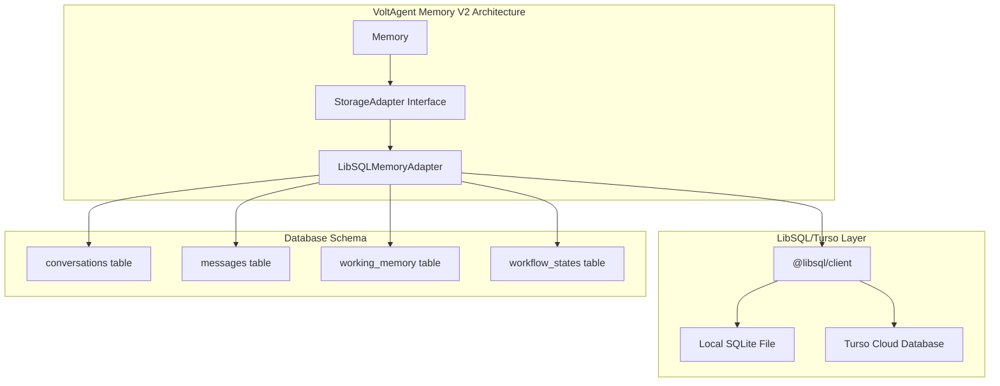
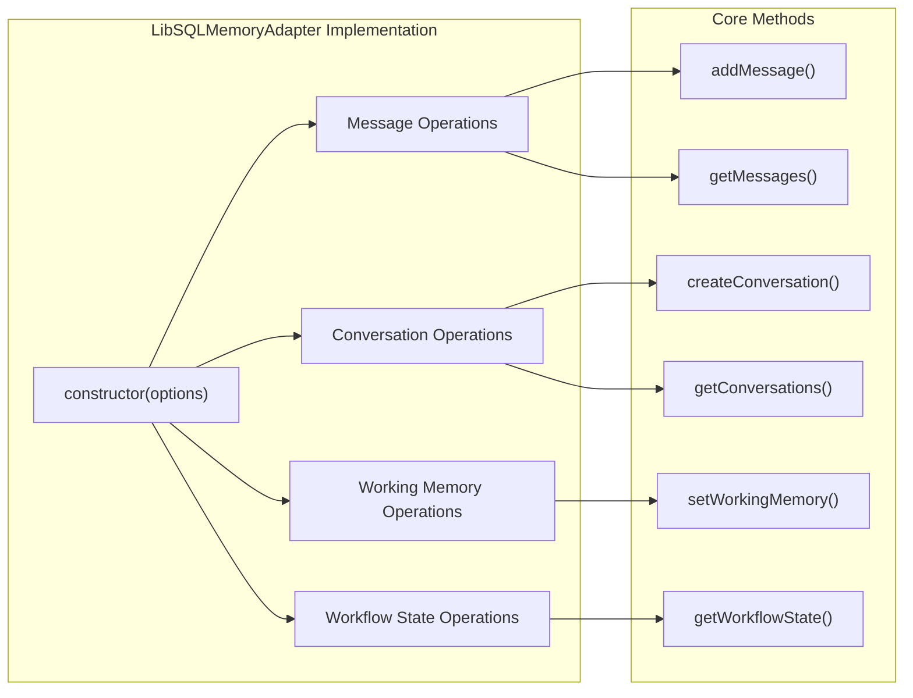

<!-- source: DeepWiki mcp.deepwiki.com · repo voltagent/voltagent · page 5.3 LibSQL Integration · fetched 2026-10-27 -->

# LibSQL Integration

<details>
<summary>Relevant source files</summary>

The following files were used as context for generating this wiki page:

- [examples/base/package.json](examples/base/package.json)
- [examples/github-repo-analyzer/package.json](examples/github-repo-analyzer/package.json)
- [examples/with-google-ai/package.json](examples/with-google-ai/package.json)
- [examples/with-google-vertex-ai/package.json](examples/with-google-vertex-ai/package.json)
- [examples/with-groq-ai/package.json](examples/with-groq-ai/package.json)
- [examples/with-mcp/package.json](examples/with-mcp/package.json)
- [examples/with-nextjs/package.json](examples/with-nextjs/package.json)
- [examples/with-rag-chatbot/package.json](examples/with-rag-chatbot/package.json)
- [examples/with-retrieval/package.json](examples/with-retrieval/package.json)
- [examples/with-subagents/package.json](examples/with-subagents/package.json)
- [examples/with-supabase/package.json](examples/with-supabase/package.json)
- [examples/with-tools/package.json](examples/with-tools/package.json)
- [examples/with-vercel-ai/package.json](examples/with-vercel-ai/package.json)
- [examples/with-voice-elevenlabs/package.json](examples/with-voice-elevenlabs/package.json)
- [examples/with-voice-openai/package.json](examples/with-voice-openai/package.json)
- [packages/core/package.json](packages/core/package.json)
- [pnpm-lock.yaml](pnpm-lock.yaml)

</details>


This document covers the LibSQL/Turso database integration for VoltAgent's Memory V2 system. LibSQL provides SQLite-compatible database persistence with cloud capabilities through Turso. For general memory system concepts, see [Memory System Overview](#5.1). For other storage options, see [PostgreSQL Integration](#5.3) and [Supabase Integration](#5.4).

## Overview

The `@voltagent/libsql` package implements the `StorageAdapter` interface to provide SQLite-compatible persistent storage for conversations, messages, workflow states, and working memory. LibSQL supports both local SQLite files and remote Turso cloud databases, making it suitable for development, edge deployment, and production environments.



Sources: [packages/libsql/package.json:1-56](), [packages/core/src/memory/types.ts:248-299]()

## LibSQL Memory Adapter

The `LibSQLMemoryAdapter` class implements the complete `StorageAdapter` interface, providing methods for managing conversations, messages, working memory, and workflow states. The adapter uses the `@libsql/client` for database connectivity and supports both local and remote database configurations.



Sources: [packages/core/src/memory/types.ts:248-299](), [packages/libsql/package.json:5-7]()

## Database Schema

LibSQL uses SQLite-compatible schema with automatic table creation and migration support. The adapter creates and manages four core tables for different data types:

| Table | Purpose | Key Columns |
|-------|---------|-------------|
| `conversations` | Conversation metadata | `id`, `resource_id`, `user_id`, `title`, `metadata` |
| `messages` | Chat messages | `id`, `user_id`, `conversation_id`, `role`, `content`, `created_at` |
| `working_memory` | Agent working memory | `id`, `conversation_id`, `user_id`, `scope`, `content` |
| `workflow_states` | Workflow execution state | `id`, `workflow_id`, `status`, `context`, `suspension` |

The schema supports:
- **Message type filtering** with `type` column for text, tool-call, and tool-result messages
- **Pagination** with proper indexing on timestamp and ID columns  
- **User isolation** through `user_id` foreign key constraints
- **Metadata storage** using JSON columns for flexible data structures

Sources: [packages/core/src/memory/types.ts:14-33](), [packages/core/src/memory/types.ts:87-121]()

## Configuration Options

The `LibSQLMemoryAdapter` accepts configuration through `LibSQLMemoryOptions` interface:

```typescript
// Local SQLite file
new LibSQLMemoryAdapter({
  url: "file:local.db"
})

// Turso cloud database  
new LibSQLMemoryAdapter({
  url: "libsql://your-database.turso.io",
  authToken: process.env.TURSO_AUTH_TOKEN
})

// Local development with Turso sync
new LibSQLMemoryAdapter({
  url: "file:local.db",
  syncUrl: "libsql://your-database.turso.io", 
  authToken: process.env.TURSO_AUTH_TOKEN
})
```

Integration with VoltAgent Memory V2:

```typescript
import { Memory } from "@voltagent/core";
import { LibSQLMemoryAdapter } from "@voltagent/libsql";

const memory = new Memory({
  storage: new LibSQLMemoryAdapter({
    url: process.env.DATABASE_URL || "file:voltagent.db"
  })
});

const agent = new Agent({
  memory,
  // ... other options
});
```

Sources: [packages/libsql/package.json:5-7](), [packages/core/src/memory/types.ts:152-197]()

## Advanced Features

### Message Type Filtering

The adapter supports filtering messages by type during retrieval, enabling efficient context preparation:

```typescript
// Get only text messages for LLM context
await storage.getMessages(userId, conversationId, {
  types: ["text"]
});

// Get tool-related messages for debugging
await storage.getMessages(userId, conversationId, {
  types: ["tool-call", "tool-result"]  
});
```

### Pagination and Limits

Built-in pagination support prevents performance issues with large conversation histories:

```typescript
// Get recent messages with limit
await storage.getMessages(userId, conversationId, {
  limit: 50,
  before: new Date()
});

// Context-aware retrieval
await storage.getMessages(userId, conversationId, {
  limit: 20  // Returns most recent 20 messages
});
```

### Working Memory Support

Persistent working memory for maintaining agent context across conversations:

```typescript
// Conversation-scoped working memory
await storage.setWorkingMemory({
  conversationId: "conv-123",
  content: "Important context to remember",
  scope: "conversation"
});

// User-scoped working memory  
await storage.setWorkingMemory({
  userId: "user-456", 
  content: "User preferences and history",
  scope: "user"
});
```

Sources: [packages/core/src/memory/types.ts:59-66](), [packages/core/src/memory/types.ts:128-143]()

## Turso Cloud Integration

LibSQL's Turso integration provides cloud-native SQLite with edge replication and global distribution. Key benefits include:

- **Edge deployment** with automatic geographic replication
- **Local-first architecture** with sync capabilities  
- **SQLite compatibility** without vendor lock-in
- **Serverless scaling** with pay-per-use pricing

Configuration patterns for different deployment scenarios:

```typescript
// Production: Remote-only Turso
new LibSQLMemoryAdapter({
  url: "libsql://prod-db.turso.io",
  authToken: process.env.TURSO_AUTH_TOKEN
})

// Development: Local with cloud sync
new LibSQLMemoryAdapter({ 
  url: "file:dev.db",
  syncUrl: "libsql://dev-db.turso.io",
  authToken: process.env.TURSO_DEV_TOKEN
})

// Edge: Embedded with fallback
new LibSQLMemoryAdapter({
  url: ":memory:",
  syncUrl: "libsql://edge-db.turso.io", 
  authToken: process.env.TURSO_EDGE_TOKEN
})
```

Sources: [packages/libsql/package.json:5-7]()

---

