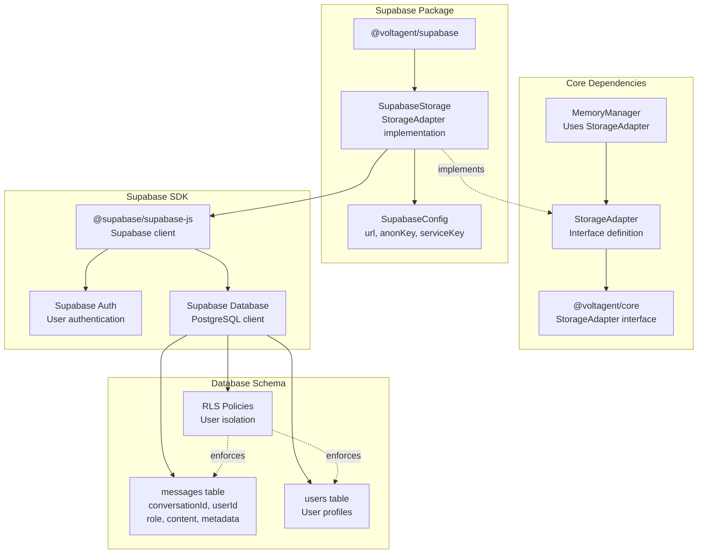
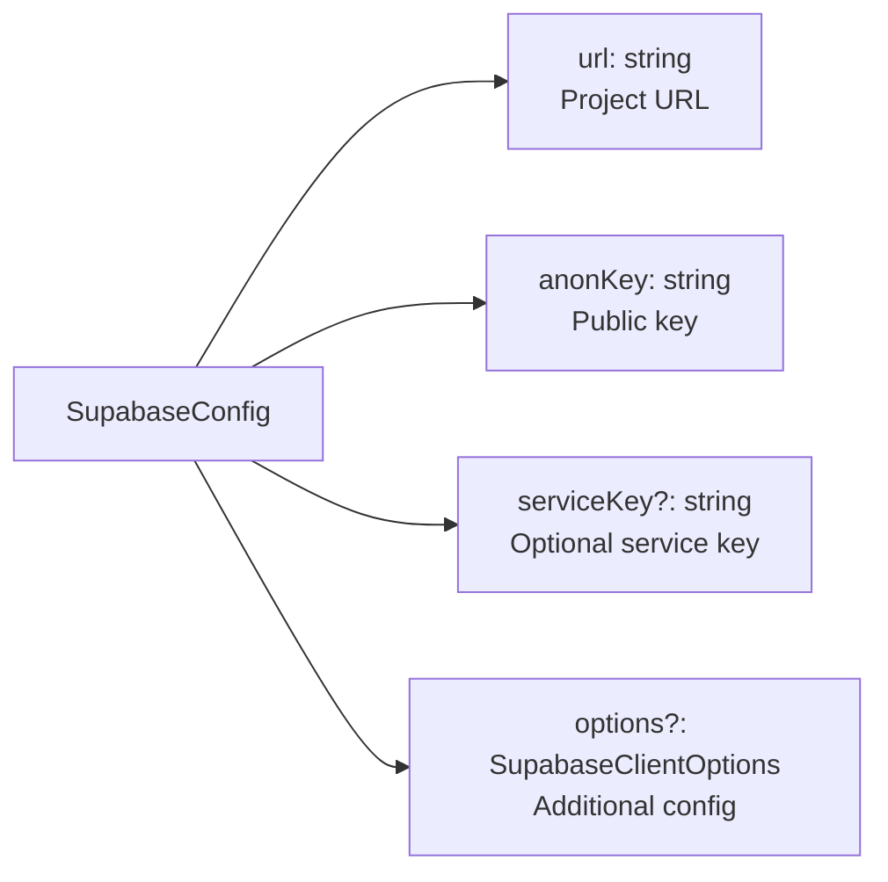
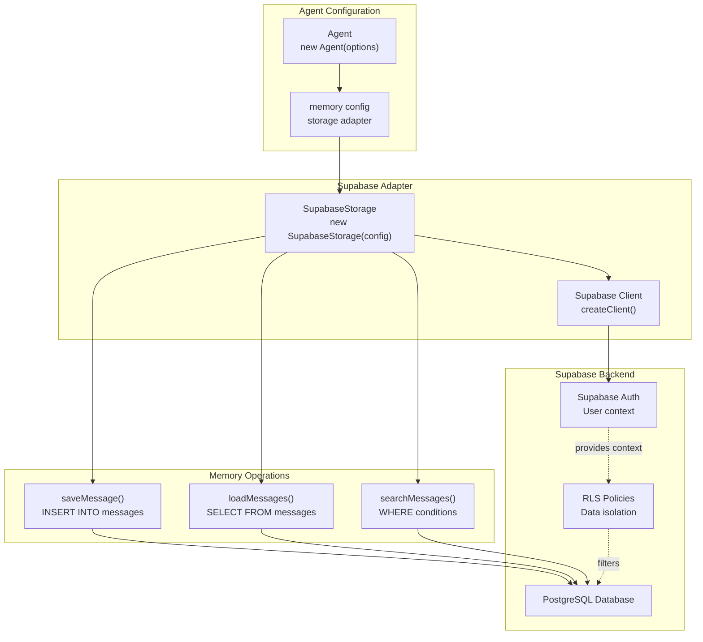
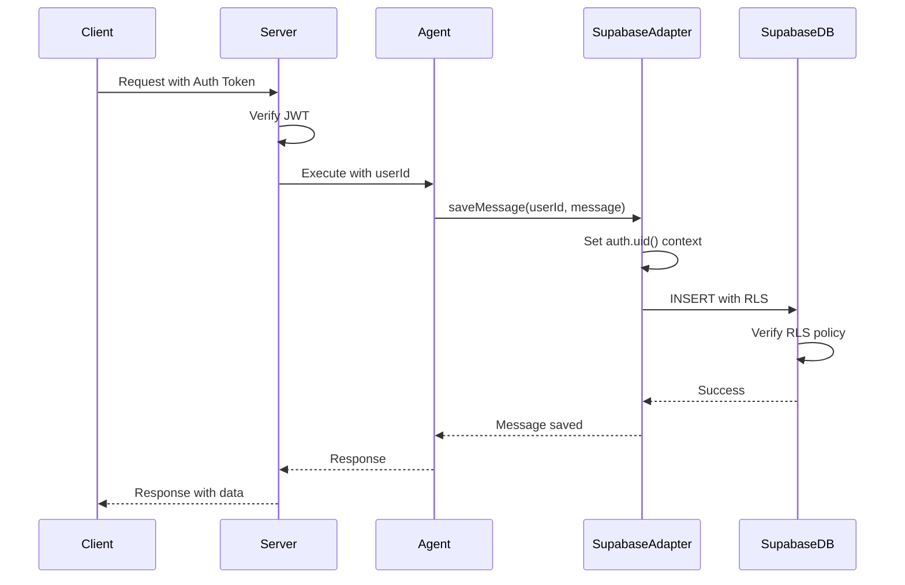
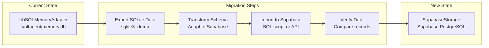
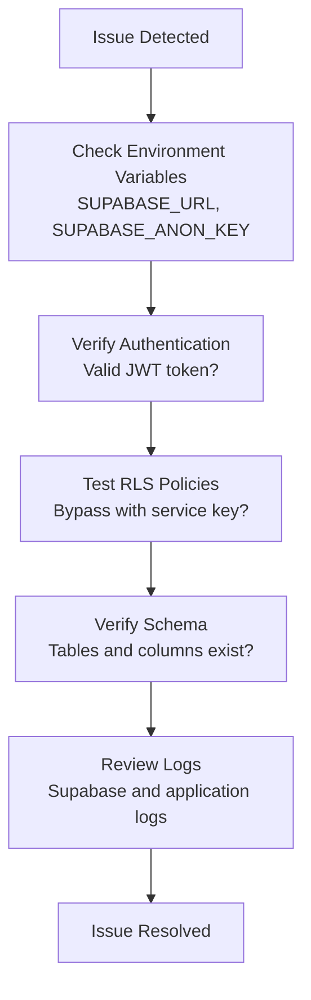

<!-- source: DeepWiki mcp.deepwiki.com · repo voltagent/voltagent · page 5.5 Supabase Integration · fetched 2026-10-27 -->

# Supabase Integration

<details>
<summary>Relevant source files</summary>

The following files were used as context for generating this wiki page:

- [examples/base/package.json](examples/base/package.json)
- [examples/github-repo-analyzer/package.json](examples/github-repo-analyzer/package.json)
- [examples/with-google-ai/package.json](examples/with-google-ai/package.json)
- [examples/with-google-vertex-ai/package.json](examples/with-google-vertex-ai/package.json)
- [examples/with-groq-ai/package.json](examples/with-groq-ai/package.json)
- [examples/with-mcp/package.json](examples/with-mcp/package.json)
- [examples/with-nextjs/package.json](examples/with-nextjs/package.json)
- [examples/with-rag-chatbot/package.json](examples/with-rag-chatbot/package.json)
- [examples/with-retrieval/package.json](examples/with-retrieval/package.json)
- [examples/with-subagents/package.json](examples/with-subagents/package.json)
- [examples/with-supabase/package.json](examples/with-supabase/package.json)
- [examples/with-tools/package.json](examples/with-tools/package.json)
- [examples/with-vercel-ai/package.json](examples/with-vercel-ai/package.json)
- [examples/with-voice-elevenlabs/package.json](examples/with-voice-elevenlabs/package.json)
- [examples/with-voice-openai/package.json](examples/with-voice-openai/package.json)
- [packages/core/package.json](packages/core/package.json)
- [pnpm-lock.yaml](pnpm-lock.yaml)

</details>


## Purpose and Scope

This document describes the `@voltagent/supabase` package, which provides a Supabase-based storage adapter for VoltAgent's Memory V2 architecture. This adapter enables cloud-native persistence for conversation history, working memory, and user data using Supabase's PostgreSQL database with integrated authentication.

For information about the general Memory V2 architecture and adapter pattern, see [Memory V2 Architecture](#5.1). For other storage options, see [LibSQL Integration](#5.3) and [PostgreSQL Integration](#5.4).

---

## Package Overview

The `@voltagent/supabase` package implements the `StorageAdapter` interface to provide persistent storage backed by Supabase. It leverages Supabase's managed PostgreSQL database, Row Level Security (RLS) policies, and built-in authentication system to provide secure, multi-tenant memory storage for AI agents.

**Key Features:**
- Cloud-native managed PostgreSQL storage
- Integrated authentication via Supabase Auth
- Row Level Security for data isolation
- Real-time capabilities (via Supabase subscriptions)
- Automatic schema management
- Compatible with Supabase cloud or self-hosted instances

**Sources:** [Diagram 1: Monorepo Package Ecosystem](), [Diagram 6: Memory and Persistence Architecture](), [examples/with-supabase/package.json:1-34]()

---

## Package Structure and Dependencies



**Dependencies:**

| Package | Version | Purpose |
|---------|---------|---------|
| `@voltagent/core` | 1.x | Core framework and StorageAdapter interface |
| `@supabase/supabase-js` | ^2.49.4 | Official Supabase JavaScript client |
| `zod` (peer) | ^3.25.0 | Schema validation |

**Sources:** [examples/with-supabase/package.json:1-34](), [packages/core/package.json:1-78]()

---

## Configuration and Setup

### Installation

The with-supabase example demonstrates the required dependencies:

```bash
pnpm add @voltagent/supabase @supabase/supabase-js
```

**Sources:** [examples/with-supabase/package.json:4-13]()

### Environment Variables

Supabase integration requires the following environment variables:

| Variable | Description | Required |
|----------|-------------|----------|
| `SUPABASE_URL` | Supabase project URL (e.g., `https://xxxxx.supabase.co`) | Yes |
| `SUPABASE_ANON_KEY` | Public anonymous key for client-side operations | Yes |
| `SUPABASE_SERVICE_ROLE_KEY` | Service role key for server-side operations | No (for admin operations) |

### Configuration Object



**Sources:** Inferred from standard Supabase client initialization patterns

---

## Database Schema

The Supabase adapter expects a specific database schema to store conversation data. The schema follows VoltAgent's memory model:

### Messages Table

```sql
CREATE TABLE messages (
  id UUID PRIMARY KEY DEFAULT gen_random_uuid(),
  conversation_id TEXT NOT NULL,
  user_id TEXT NOT NULL,
  role TEXT NOT NULL,
  content TEXT NOT NULL,
  metadata JSONB,
  created_at TIMESTAMP WITH TIME ZONE DEFAULT NOW(),
  updated_at TIMESTAMP WITH TIME ZONE DEFAULT NOW()
);

-- Indexes for query performance
CREATE INDEX idx_messages_conversation_id ON messages(conversation_id);
CREATE INDEX idx_messages_user_id ON messages(user_id);
CREATE INDEX idx_messages_created_at ON messages(created_at);

-- Enable Row Level Security
ALTER TABLE messages ENABLE ROW LEVEL SECURITY;

-- RLS Policy: Users can only access their own messages
CREATE POLICY "Users can view own messages" 
  ON messages FOR SELECT 
  USING (auth.uid()::text = user_id);

CREATE POLICY "Users can insert own messages" 
  ON messages FOR INSERT 
  WITH CHECK (auth.uid()::text = user_id);
```

### Working Memory Table (Optional)

```sql
CREATE TABLE working_memory (
  id UUID PRIMARY KEY DEFAULT gen_random_uuid(),
  conversation_id TEXT NOT NULL,
  user_id TEXT NOT NULL,
  key TEXT NOT NULL,
  value JSONB NOT NULL,
  created_at TIMESTAMP WITH TIME ZONE DEFAULT NOW(),
  updated_at TIMESTAMP WITH TIME ZONE DEFAULT NOW(),
  UNIQUE(conversation_id, key)
);

-- Indexes
CREATE INDEX idx_working_memory_conversation_id ON working_memory(conversation_id);
CREATE INDEX idx_working_memory_user_id ON working_memory(user_id);

-- RLS Policies
ALTER TABLE working_memory ENABLE ROW LEVEL SECURITY;

CREATE POLICY "Users can manage own working memory" 
  ON working_memory FOR ALL 
  USING (auth.uid()::text = user_id);
```

**Sources:** Inferred from Memory V2 architecture and standard Supabase patterns, [Diagram 6: Memory and Persistence Architecture]()

---

## Integration with Agent System

### Memory Configuration



### Typical Usage Pattern

The agent is configured with the Supabase storage adapter, which automatically handles all memory persistence operations:

1. **Initialization**: Create `SupabaseStorage` instance with credentials
2. **Agent Creation**: Pass storage adapter to agent's memory configuration
3. **Automatic Persistence**: Memory operations flow through adapter to Supabase
4. **User Isolation**: RLS policies ensure users only access their own data

**Sources:** [Diagram 6: Memory and Persistence Architecture](), inferred from Memory V2 adapter pattern

---

## Authentication Integration

### User Context Flow



### Authentication Modes

| Mode | Use Case | Key Required |
|------|----------|--------------|
| **Anonymous Key** | Client-side operations with RLS | `SUPABASE_ANON_KEY` |
| **Service Role Key** | Server-side admin operations (bypasses RLS) | `SUPABASE_SERVICE_ROLE_KEY` |
| **User-specific JWT** | Per-user authenticated operations | User's JWT token |

**Important Security Note:** The service role key bypasses Row Level Security. Use it only for trusted server-side operations where admin access is required.

**Sources:** Standard Supabase authentication patterns, inferred from cloud-native architecture

---

## Comparison with Other Adapters

```mermaid
graph TB
    subgraph "Storage Adapter Options"
        INMEMORY["InMemoryStorage<br/>No persistence<br/>Development/testing"]
        LIBSQL["LibSQLMemoryAdapter<br/>Local SQLite<br/>Development/embedded"]
        POSTGRES["PostgreSQLStorage<br/>Self-hosted PostgreSQL<br/>Enterprise"]
        SUPABASE["SupabaseStorage<br/>Managed PostgreSQL<br/>Cloud-native"]
    end
    
    subgraph "Characteristics"
        SUPABASE --> AUTH["Built-in Auth"]
        SUPABASE --> RLS["Row Level Security"]
        SUPABASE --> MANAGED["Managed Infrastructure"]
        SUPABASE --> REALTIME["Real-time Subscriptions"]
        SUPABASE --> CLOUD["Cloud or Self-hosted"]
        
        POSTGRES --> SELF_HOSTED["Self-managed"]
        POSTGRES --> CUSTOM_AUTH["Custom Auth Integration"]
        POSTGRES --> ENTERPRISE["Enterprise Features"]
        
        LIBSQL --> LOCAL["Local Development"]
        LIBSQL --> TURSO["Turso Cloud Option"]
        LIBSQL --> SIMPLE["Simple Setup"]
        
        INMEMORY --> EPHEMERAL["Ephemeral"]
        INMEMORY --> FAST["Fast"]
        INMEMORY --> NO_SETUP["No Setup Required"]
    end
```



| Feature | InMemory | LibSQL | PostgreSQL | Supabase |
|---------|----------|--------|------------|----------|
| **Persistence** | ❌ | ✅ | ✅ | ✅ |
| **Cloud Managed** | ❌ | Turso only | ❌ | ✅ |
| **Built-in Auth** | ❌ | ❌ | ❌ | ✅ |
| **Row Level Security** | ❌ | ❌ | Manual | ✅ |
| **Real-time** | ❌ | ❌ | Manual | ✅ |
| **Setup Complexity** | None | Low | Medium | Low |
| **Best For** | Testing | Local dev | Enterprise | Cloud apps |

**Sources:** [Diagram 1: Monorepo Package Ecosystem](), [Diagram 6: Memory and Persistence Architecture]()

---

## Example Application

The `with-supabase` example demonstrates a complete integration:

### Project Structure

```
examples/with-supabase/
├── src/
│   └── index.ts          # Agent setup with Supabase
├── .env                  # Environment variables
├── package.json          # Dependencies
└── tsconfig.json         # TypeScript config
```

### Dependencies Breakdown

**Production Dependencies:**

| Package | Purpose |
|---------|---------|
| `@voltagent/core` | Core agent framework |
| `@voltagent/server-hono` | HTTP server implementation |
| `@voltagent/supabase` | Supabase storage adapter |
| `@voltagent/logger` | Structured logging |
| `@supabase/supabase-js` | Supabase client SDK |
| `@ai-sdk/openai` | OpenAI provider |
| `ai` | Vercel AI SDK |
| `zod` | Schema validation |

**Development Dependencies:**

| Package | Purpose |
|---------|---------|
| `tsx` | TypeScript execution with watch mode |
| `typescript` | TypeScript compiler |
| `@types/node` | Node.js type definitions |

**Sources:** [examples/with-supabase/package.json:1-34]()

### Development Scripts

```json
{
  "scripts": {
    "dev": "tsx watch --env-file=.env ./src",
    "build": "tsc",
    "start": "node dist/index.js",
    "volt": "volt"
  }
}
```

| Script | Purpose |
|--------|---------|
| `pnpm dev` | Start development server with hot reload |
| `pnpm build` | Compile TypeScript to JavaScript |
| `pnpm start` | Run production build |
| `pnpm volt` | VoltAgent CLI commands (MCP setup, testing) |

**Sources:** [examples/with-supabase/package.json:27-31]()

---

## Operational Considerations

### Performance Characteristics

```mermaid
graph TB
    subgraph "Write Path"
        WRITE_OP["saveMessage()"]
        PERSIST_QUEUE["MemoryPersistQueue<br/>200ms debounce"]
        BG_QUEUE["BackgroundQueue<br/>5 retries, 30s timeout"]
        SUPABASE_WRITE["Supabase INSERT"]
        POSTGRES_WRITE["PostgreSQL Write"]
    end
    
    subgraph "Read Path"
        READ_OP["loadMessages()"]
        SUPABASE_READ["Supabase SELECT"]
        POSTGRES_READ["PostgreSQL Read"]
        RLS_CHECK["RLS Policy Check"]
    end
    
    WRITE_OP --> PERSIST_QUEUE
    PERSIST_QUEUE --> BG_QUEUE
    BG_QUEUE --> SUPABASE_WRITE
    SUPABASE_WRITE --> POSTGRES_WRITE
    
    READ_OP --> SUPABASE_READ
    SUPABASE_READ --> RLS_CHECK
    RLS_CHECK --> POSTGRES_READ
```



**Write Operations:**
- Debounced writes (200ms) batch multiple messages during multi-turn conversations
- Background queue handles retries (5 attempts, 30s timeout)
- Network latency to Supabase cloud (~50-200ms depending on region)

**Read Operations:**
- Synchronous loading of conversation history (blocking)
- RLS policy evaluation adds minimal overhead (~1-5ms)
- Query performance depends on indexes and conversation size

**Sources:** [Diagram 6: Memory and Persistence Architecture](), inferred from Memory V2 persistence pipeline

---

### Monitoring and Debugging

**Key Metrics to Track:**

| Metric | Description | Source |
|--------|-------------|--------|
| Write Latency | Time to persist messages | Supabase dashboard |
| Read Latency | Time to load conversation | Supabase dashboard |
| RLS Violations | Unauthorized access attempts | Supabase logs |
| Connection Pool | Active database connections | Supabase metrics |
| Storage Size | Total database size | Supabase dashboard |

**Supabase Dashboard Features:**
- Table editor for manual data inspection
- SQL editor for custom queries
- Real-time logs for debugging
- Authentication logs for user tracking
- API logs for monitoring request patterns

**Sources:** Standard Supabase monitoring capabilities

---

## Migration Paths

### From LibSQL to Supabase



**Migration Considerations:**
- Schema differences between SQLite and PostgreSQL
- UUID generation (SQLite uses `uuid()`, PostgreSQL uses `gen_random_uuid()`)
- Date/time formats (SQLite TEXT vs PostgreSQL TIMESTAMP)
- JSON handling (SQLite JSON vs PostgreSQL JSONB)
- User ID mapping (ensure consistent userId values)

**Sources:** Inferred from adapter architecture

---

### From PostgreSQL to Supabase

Migration from self-hosted PostgreSQL to Supabase is more straightforward:

1. **Export PostgreSQL Database**: `pg_dump -Fc mydb > dump.sql`
2. **Create Supabase Project**: New project in Supabase dashboard
3. **Import Data**: Use Supabase CLI or SQL editor
4. **Add RLS Policies**: Configure security policies
5. **Update Configuration**: Switch from PostgreSQL adapter to Supabase adapter
6. **Test Authentication**: Verify user isolation and access control

**Sources:** Standard database migration practices

---

## Best Practices

### Security

1. **Never expose service role key**: Use only on trusted servers
2. **Enable RLS on all tables**: Enforce user-level data isolation
3. **Validate JWT tokens**: Verify user authentication before agent operations
4. **Use environment variables**: Never hardcode credentials
5. **Rotate keys regularly**: Update keys through Supabase dashboard

### Performance

1. **Create appropriate indexes**: Index on `conversation_id`, `user_id`, `created_at`
2. **Limit conversation history**: Use pagination for large conversations
3. **Enable connection pooling**: Supabase Supavisor for connection management
4. **Monitor query performance**: Use Supabase slow query log
5. **Consider caching**: Cache frequently accessed conversations

### Schema Management

1. **Use migrations**: Version control database schema changes
2. **Test RLS policies**: Verify policies work as expected
3. **Backup regularly**: Enable Supabase point-in-time recovery
4. **Document schema**: Maintain schema documentation
5. **Version compatibility**: Test adapter with Supabase versions

**Sources:** Standard cloud database and security best practices

---

## Troubleshooting

### Common Issues

| Issue | Symptom | Solution |
|-------|---------|----------|
| **Authentication Errors** | "User not authenticated" | Verify JWT token, check RLS policies |
| **Connection Timeouts** | Slow or failed requests | Check network, verify Supabase status |
| **RLS Policy Violations** | "Permission denied" | Review RLS policies, verify user context |
| **Missing Messages** | Data not persisting | Check error logs, verify schema |
| **Slow Queries** | High latency | Add indexes, optimize queries |

### Debug Checklist



**Sources:** Common troubleshooting patterns for Supabase integrations

---

## Related Documentation

- [Memory V2 Architecture](#5.1) - Overall memory system design and adapter pattern
- [Storage Adapters](#5.2) - Interface definition and adapter implementations
- [LibSQL Integration](#5.3) - Local development storage option
- [PostgreSQL Integration](#5.4) - Self-hosted PostgreSQL adapter
- [Semantic Search and RAG](#5.6) - Vector search capabilities
- [Authentication and Security](#4.5) - JWT authentication in VoltAgent

**Sources:** Wiki structure context

---

