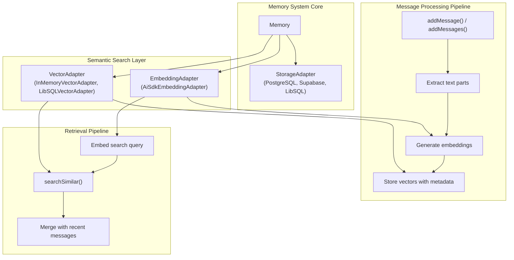
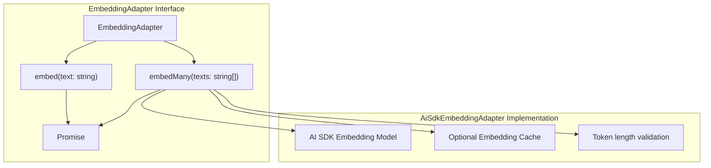
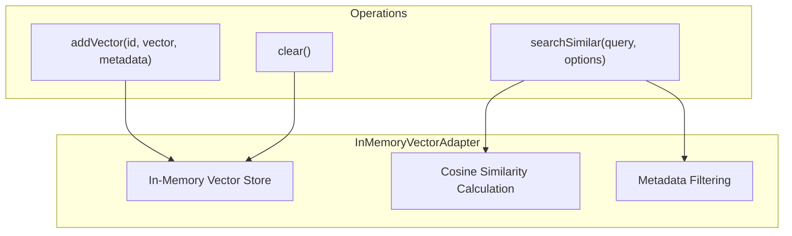
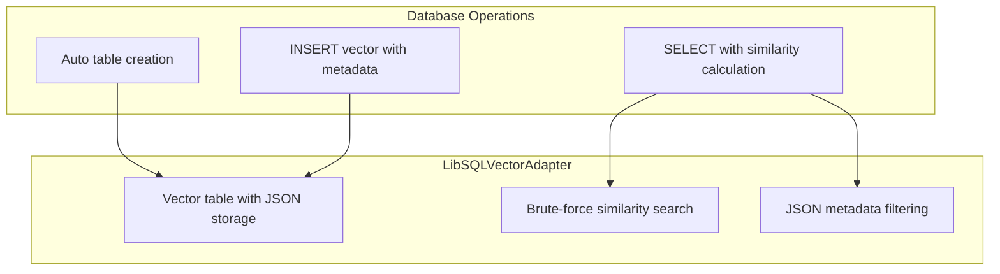
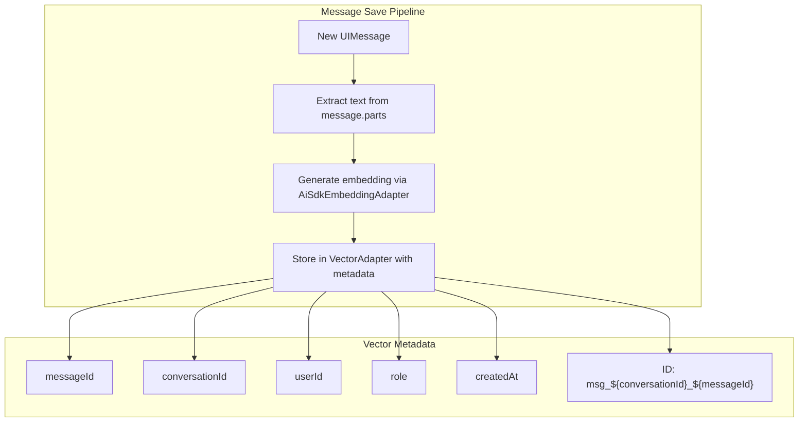
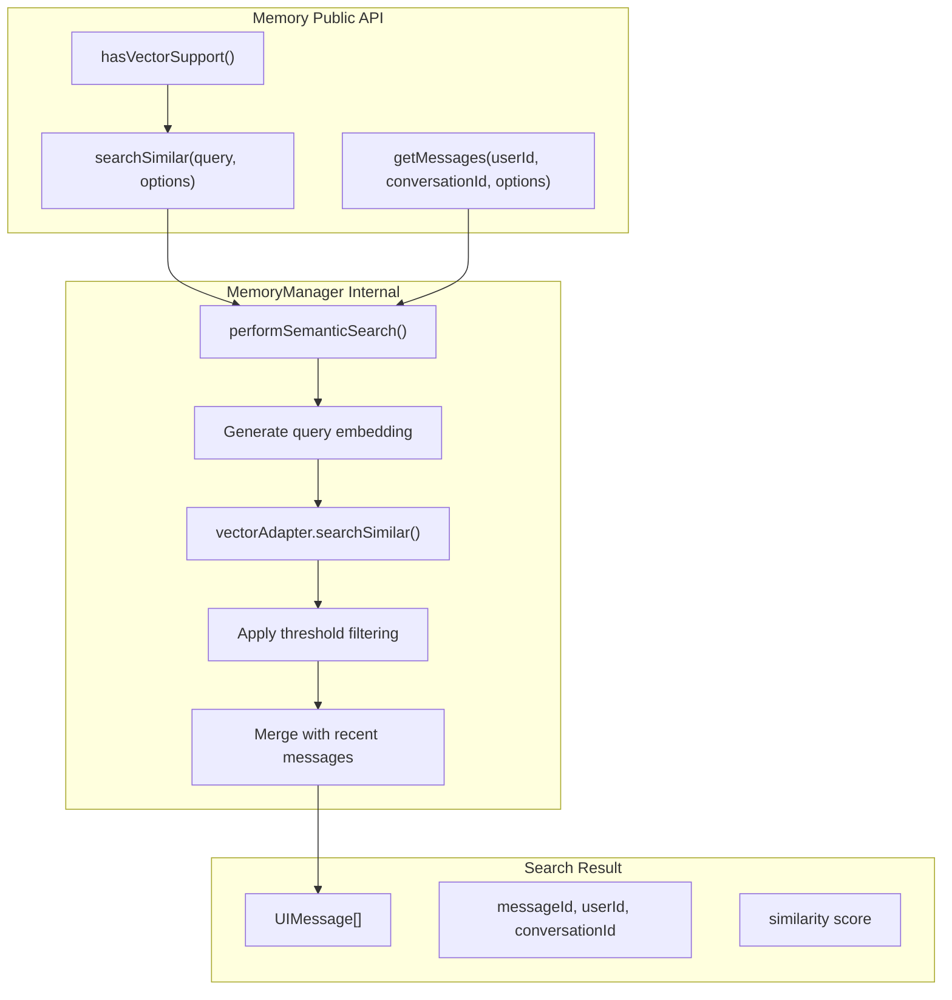
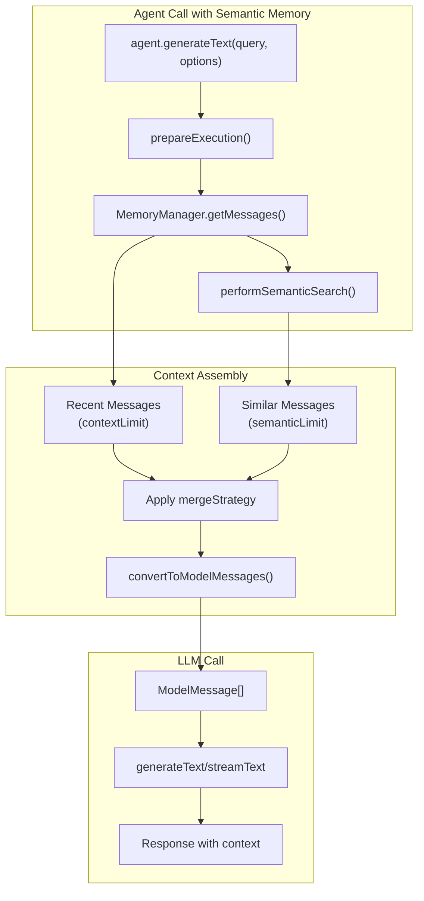
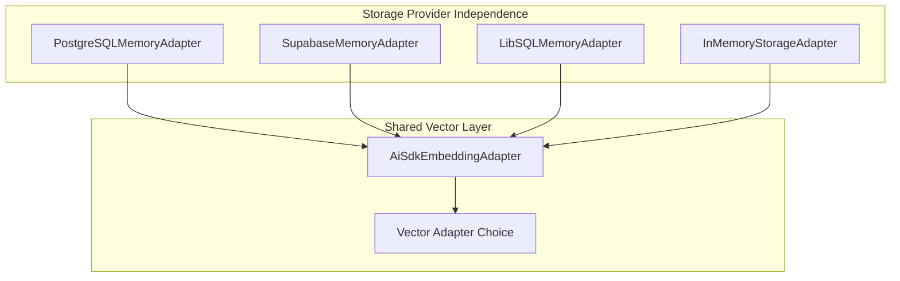

<!-- source: DeepWiki mcp.deepwiki.com · repo voltagent/voltagent · page 5.6 Semantic Search and RAG · fetched 2026-10-27 -->

# Semantic Search and RAG

<details>
<summary>Relevant source files</summary>

The following files were used as context for generating this wiki page:

- [examples/with-google-ai/package.json](examples/with-google-ai/package.json)
- [examples/with-google-vertex-ai/package.json](examples/with-google-vertex-ai/package.json)
- [examples/with-groq-ai/package.json](examples/with-groq-ai/package.json)
- [examples/with-mcp/package.json](examples/with-mcp/package.json)
- [examples/with-nextjs/package.json](examples/with-nextjs/package.json)
- [packages/core/package.json](packages/core/package.json)
- [packages/core/src/agent/agent.spec-d.ts](packages/core/src/agent/agent.spec-d.ts)
- [packages/core/src/agent/agent.spec.ts](packages/core/src/agent/agent.spec.ts)
- [packages/core/src/agent/agent.ts](packages/core/src/agent/agent.ts)
- [packages/core/src/agent/hooks/index.spec.ts](packages/core/src/agent/hooks/index.spec.ts)
- [packages/core/src/agent/hooks/index.ts](packages/core/src/agent/hooks/index.ts)
- [packages/core/src/agent/memory-persist-queue.ts](packages/core/src/agent/memory-persist-queue.ts)
- [packages/core/src/agent/message-normalizer.spec.ts](packages/core/src/agent/message-normalizer.spec.ts)
- [packages/core/src/agent/message-normalizer.ts](packages/core/src/agent/message-normalizer.ts)
- [packages/core/src/memory/manager/memory-manager.ts](packages/core/src/memory/manager/memory-manager.ts)
- [pnpm-lock.yaml](pnpm-lock.yaml)
- [website/docs/agents/context.md](website/docs/agents/context.md)
- [website/docs/agents/hooks.md](website/docs/agents/hooks.md)
- [website/docs/agents/tools.md](website/docs/agents/tools.md)

</details>


This document covers VoltAgent's semantic search and Retrieval-Augmented Generation (RAG) capabilities, which enable agents to perform similarity-based retrieval of past conversation messages using vector embeddings. The system allows agents to find and incorporate relevant historical context that goes beyond simple chronological message history.

For general memory system architecture and storage adapters, see [Memory System Overview](#5.1). For working memory and structured context management, see [Storage Adapters](#5.2).

## Architecture Overview

VoltAgent's semantic search system operates as a layer on top of the core memory system, using two separate but coordinated adapters: an embedding adapter for generating vector representations of text content, and a vector adapter for storing and searching those embeddings.



**Sources:** [website/docs/agents/memory/overview.md:152-221]()

## Embedding Adapters

The `EmbeddingAdapter` interface defines the contract for generating vector embeddings from text. The `AiSdkEmbeddingAdapter` implementation wraps AI SDK embedding models to provide this functionality.

### EmbeddingAdapter Interface



The `AiSdkEmbeddingAdapter` processes message text by:
1. Extracting text content from message parts
2. Validating token lengths against model limits
3. Generating embeddings via AI SDK's `embedMany()` call
4. Optionally caching results to avoid redundant API calls

### Configuration

```typescript
import { AiSdkEmbeddingAdapter } from "@voltagent/core";
import { openai } from "@ai-sdk/openai";

const embeddingAdapter = new AiSdkEmbeddingAdapter(
  openai.embedding("text-embedding-3-small")
);
```

**Sources:** [website/docs/agents/memory/overview.md:162-178]()

## Vector Adapters

VoltAgent provides multiple vector adapter implementations for different deployment scenarios and persistence requirements.

### InMemoryVectorAdapter

The `InMemoryVectorAdapter` provides lightweight vector storage suitable for development and testing scenarios.



### LibSQLVectorAdapter

The `LibSQLVectorAdapter` from `@voltagent/libsql` provides persistent vector storage using SQLite/LibSQL/Turso databases.



**Sources:** [website/docs/agents/memory/libsql.md:226-248]()

## Memory Configuration

Semantic search requires configuring both embedding and vector adapters on the `Memory` instance.

### Basic Setup

```typescript
import { Memory, AiSdkEmbeddingAdapter, InMemoryVectorAdapter } from "@voltagent/core";
import { LibSQLMemoryAdapter } from "@voltagent/libsql";
import { openai } from "@ai-sdk/openai";

const memory = new Memory({
  storage: new LibSQLMemoryAdapter({ url: "file:./.voltagent/memory.db" }),
  embedding: new AiSdkEmbeddingAdapter(openai.embedding("text-embedding-3-small")),
  vector: new InMemoryVectorAdapter(),
  enableCache: true, // Optional embedding cache
});
```

### Persistent Vector Storage

```typescript
import { LibSQLVectorAdapter } from "@voltagent/libsql";

const memory = new Memory({
  storage: new LibSQLMemoryAdapter({ url: "file:./.voltagent/memory.db" }),
  embedding: new AiSdkEmbeddingAdapter(openai.embedding("text-embedding-3-small")),
  vector: new LibSQLVectorAdapter({ url: "file:./.voltagent/memory.db" }),
});
```

**Sources:** [website/docs/agents/memory/overview.md:195-210]()

## Vector Storage Pipeline

When messages are saved to memory, the system automatically processes text content for vector storage.



**Sources:** [website/docs/agents/memory/overview.md:213-216]()

## Semantic Search Usage

### Agent-Level Configuration

Enable semantic search in agent calls using the `semanticMemory` options defined in `BaseGenerationOptions`:

```typescript
const response = await agent.generateText("What did I say about pricing last week?", {
  userId: "user-123",
  conversationId: "conversation-456",
  semanticMemory: {
    enabled: true,
    semanticLimit: 5,        // Max similar messages to retrieve (default: 5)
    semanticThreshold: 0.7,  // Minimum similarity score (default: 0.7)
    mergeStrategy: "append", // How to combine with recent messages
  },
});
```

All generation methods (`generateText`, `streamText`, `generateObject`, `streamObject`) support these semantic memory options.

### Default Values

When semantic search is enabled without explicit parameters:
- `semanticLimit`: 5 messages
- `semanticThreshold`: 0.7 (70% similarity)
- `mergeStrategy`: "append"

These defaults balance retrieval quality with performance, though applications should tune based on their specific use cases.

### Merge Strategies

The `mergeStrategy` parameter controls how semantically similar messages are combined with recent chronological messages:

| Strategy | Behavior | Use Case |
|----------|----------|----------|
| `"append"` | Add similar messages after recent messages | Default; keeps recent context first |
| `"prepend"` | Add similar messages before recent messages | Prioritize historical relevant context |
| `"interleave"` | Alternate between similar and recent messages | Balance temporal and semantic relevance |

**Sources:** [packages/core/src/agent/agent.ts:192-198](), [packages/core/src/memory/manager/memory-manager.ts:182-222]()

## Programmatic Search API

The `Memory` class provides direct access to semantic search capabilities through the `searchSimilar` method, which internally delegates to the `MemoryManager.performSemanticSearch` method.

### Memory Search Methods



### Usage Example

```typescript
// Check if vector support is available
if (memory.hasVectorSupport()) {
  // Perform semantic search
  const results = await memory.searchSimilar("pricing information", {
    limit: 10,
    threshold: 0.8,
    filter: { userId: "user-123" }
  });
  
  results.forEach(result => {
    console.log(`Score: ${result.score}, Message: ${result.metadata.messageId}`);
  });
}
```

### Internal Search Pipeline

The `MemoryManager.performSemanticSearch` method implements the full search pipeline:
1. Generates embedding for the search query using `EmbeddingAdapter`
2. Searches vectors using `VectorAdapter.searchSimilar()`
3. Filters results by similarity threshold
4. Optionally merges with recent messages based on `mergeStrategy`
5. Returns sorted and limited result set

**Sources:** [packages/core/src/memory/manager/memory-manager.ts:260-300](), [website/docs/agents/memory/overview.md:218-221]()

## RAG Implementation Patterns

### Basic RAG Chatbot

RAG chatbots combine semantic search with agent generation to provide contextually relevant responses based on historical conversations. The semantic memory system automatically integrates with the agent's message preparation pipeline.



### Retriever Integration

The `BaseRetriever` interface provides an alternative pattern for RAG, allowing custom retrieval logic to augment agent context:

```typescript
import { BaseRetriever } from "@voltagent/core";

class SemanticRetriever extends BaseRetriever {
  async retrieve(query: string, options?: { context?: Map<string, unknown> }) {
    // Custom retrieval logic using memory.searchSimilar()
    const results = await memory.searchSimilar(query, {
      limit: 10,
      threshold: 0.75,
    });
    
    // Format results for LLM context
    return results.map(r => 
      `[${r.metadata.createdAt}] ${r.metadata.role}: ${r.text}`
    ).join('\n\n');
  }
}

const agent = new Agent({
  name: "RAG Agent",
  model: openai("gpt-4o"),
  instructions: "Use retrieved context to answer questions",
  retriever: new SemanticRetriever(),
});
```

The retriever pattern is useful when you need custom retrieval logic beyond what semantic memory provides, such as external knowledge bases or specialized document search.

### Multi-Conversation RAG

For applications serving multiple users, semantic search can retrieve relevant information across conversation boundaries while respecting user privacy through metadata filtering.

```typescript
// Search across all conversations for a user
const results = await memory.searchSimilar("account settings", {
  filter: { userId: "user-123" },
  limit: 5,
  threshold: 0.75
});
```

**Sources:** [packages/core/src/agent/agent.ts:356-362](), [packages/core/src/retriever/retriever.ts:1-50](), [examples/with-rag-chatbot/package.json:1-32]()

## Performance Considerations

### Vector Storage Scaling

| Adapter Type | Suitable For | Limitations | Search Method |
|--------------|-------------|-------------|---------------|
| `InMemoryVectorAdapter` | Development, small datasets | Memory usage, no persistence | Cosine similarity |
| `LibSQLVectorAdapter` | Small to medium deployments | Brute-force search, single-node | JSON + cosine similarity |

Both adapters use brute-force similarity calculation, which is acceptable for datasets under 10,000 messages but may require external vector databases (like Pinecone or Qdrant) for larger scales.

### Embedding Cache

Enable embedding caching to reduce API calls for repeated text:

```typescript
const memory = new Memory({
  storage: storageAdapter,
  embedding: embeddingAdapter,
  vector: vectorAdapter,
  enableCache: true, // Caches embeddings to avoid re-computation
});
```

The cache is particularly useful when:
- Processing similar queries repeatedly
- Re-indexing existing messages
- Running batch operations on historical data

### Search Optimization Guidelines

| Parameter | Recommended Range | Impact |
|-----------|------------------|---------|
| `semanticThreshold` | 0.7 - 0.8 | Higher = stricter matching, fewer results |
| `semanticLimit` | 5 - 10 | Lower = faster search, reduced context |
| `contextLimit` | 10 - 50 | Controls recent message count |

Additional optimization strategies:
- Use metadata filters (`userId`, `conversationId`) to scope searches
- Consider `mergeStrategy` based on temporal vs semantic relevance needs
- Monitor token usage when combining semantic + recent messages
- Implement custom retrieval logic via `BaseRetriever` for complex use cases

### Message Text Extraction

The semantic search system automatically extracts text from `UIMessage.parts` of type `"text"`. Messages with only tool calls or file attachments are not embedded. This behavior is implemented in the `MemoryManager.performSemanticSearch` method.

**Sources:** [packages/core/src/memory/manager/memory-manager.ts:260-315](), [website/docs/agents/memory/overview.md:177-178](), [packages/core/src/memory/adapters/vector/in-memory.ts:1-100]()

## Integration with Storage Providers

All VoltAgent storage providers support semantic search through the adapter pattern:



**Sources:** [website/docs/agents/memory/supabase.md:398-414](), [website/docs/agents/memory/postgres.md:274-290](), [website/docs/agents/memory/libsql.md:226-248]()

---

