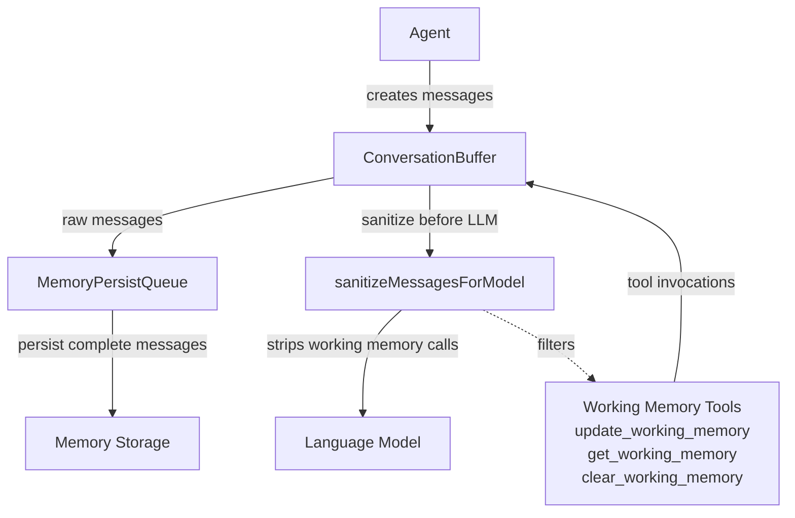
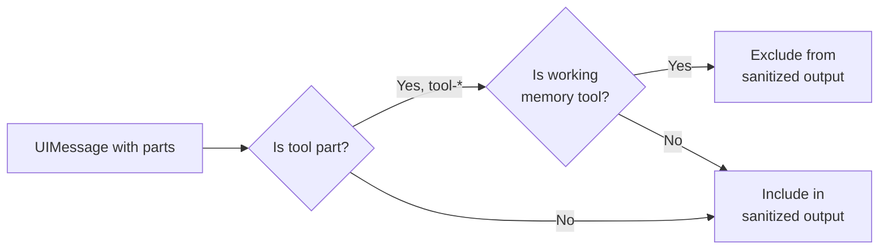
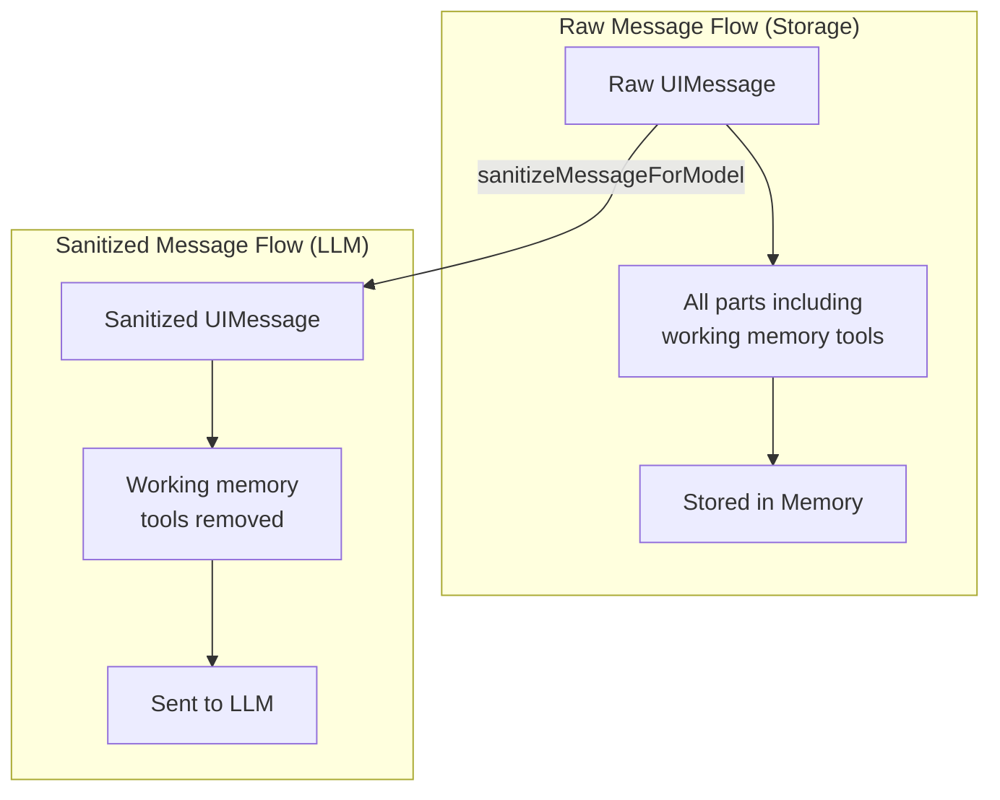
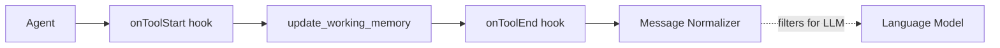
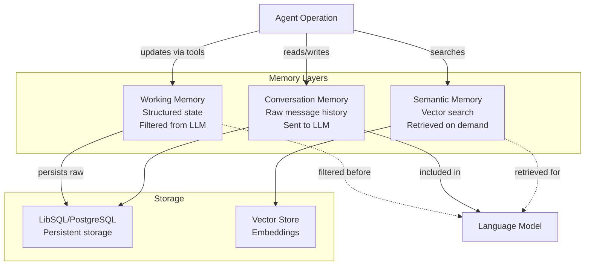

<!-- source: DeepWiki mcp.deepwiki.com · repo voltagent/voltagent · page 5.7 Working Memory · fetched 2026-10-27 -->

# Working Memory

<details>
<summary>Relevant source files</summary>

The following files were used as context for generating this wiki page:

- [CHANGELOG.md](CHANGELOG.md)
- [changelog.sh](changelog.sh)
- [examples/base/src/index.ts](examples/base/src/index.ts)
- [packages/cli/package.json](packages/cli/package.json)
- [packages/core/src/agent/agent.spec-d.ts](packages/core/src/agent/agent.spec-d.ts)
- [packages/core/src/agent/agent.spec.ts](packages/core/src/agent/agent.spec.ts)
- [packages/core/src/agent/agent.ts](packages/core/src/agent/agent.ts)
- [packages/core/src/agent/hooks/index.spec.ts](packages/core/src/agent/hooks/index.spec.ts)
- [packages/core/src/agent/hooks/index.ts](packages/core/src/agent/hooks/index.ts)
- [packages/core/src/agent/memory-persist-queue.ts](packages/core/src/agent/memory-persist-queue.ts)
- [packages/core/src/agent/message-normalizer.spec.ts](packages/core/src/agent/message-normalizer.spec.ts)
- [packages/core/src/agent/message-normalizer.ts](packages/core/src/agent/message-normalizer.ts)
- [packages/core/src/memory/manager/memory-manager.ts](packages/core/src/memory/manager/memory-manager.ts)
- [packages/create-voltagent-app/CHANGELOG.md](packages/create-voltagent-app/CHANGELOG.md)
- [packages/create-voltagent-app/package.json](packages/create-voltagent-app/package.json)
- [packages/voice/package.json](packages/voice/package.json)
- [website/docs/agents/context.md](website/docs/agents/context.md)
- [website/docs/agents/hooks.md](website/docs/agents/hooks.md)
- [website/docs/agents/tools.md](website/docs/agents/tools.md)

</details>


Working memory provides agents with a persistent, structured scratchpad for tracking evolving state across multi-turn conversations. Unlike conversation memory (see [Memory V2 Architecture](#5.1)) which stores raw message history, working memory maintains a typed, schema-validated data structure that the agent can query and update through dedicated tools.

For general conversation history and semantic search capabilities, see [Memory System](#2.7) and [Semantic Search and RAG](#5.6). For operation-scoped context passing, see [Operation Context](#2.4).

---

## System Overview

Working memory consists of three specialized tools that agents use to maintain structured state:

| Tool Name | Purpose | Visibility |
|-----------|---------|------------|
| `update_working_memory` | Updates or creates memory entries | Internal only |
| `get_working_memory` | Retrieves current memory state | Internal only |
| `clear_working_memory` | Resets memory state | Internal only |

These tools are treated specially by the message normalization pipeline: their invocations are stripped from messages before they reach the LLM, preventing the model from being confused by internal state management operations.

**Sources:** [packages/core/src/agent/message-normalizer.ts:3-7]()

---

## Architecture Position



**Diagram: Working Memory in the Agent Pipeline**

Working memory tools execute during normal agent operation but are filtered out when preparing messages for the LLM. The raw tool calls persist to storage (allowing audit/replay), but the sanitized message stream sent to the model excludes them to avoid confusing the LLM with internal bookkeeping.

**Sources:** [packages/core/src/agent/message-normalizer.ts:3-7](), [packages/core/src/agent/message-normalizer.ts:100-109](), [packages/core/src/agent/memory-persist-queue.ts:1-149]()

---

## Message Normalization and Filtering

### Tool Detection

Working memory tools are identified by name and filtered during the sanitization process:



**Diagram: Working Memory Tool Filtering Logic**

The constant `WORKING_MEMORY_TOOL_NAMES` defines the exact set of tool names to filter:

**Sources:** [packages/core/src/agent/message-normalizer.ts:3-7](), [packages/core/src/agent/message-normalizer.ts:100-104]()

### Sanitization Pipeline

The normalization process handles working memory tools in `normalizeToolPart`:

1. Extract tool name from part type (e.g., `"tool-update_working_memory"` → `"update_working_memory"`)
2. Check if tool name exists in `WORKING_MEMORY_TOOL_NAMES` set
3. Return `null` for working memory tools (filtered out)
4. Preserve all other tool parts with sanitized metadata

**Sources:** [packages/core/src/agent/message-normalizer.ts:106-129]()

---

## Storage vs. Sanitization Split



**Diagram: Dual-Path Message Handling**

Raw messages (with working memory tool calls) persist to storage for auditability and replay. Sanitized messages (without working memory tool calls) go to the LLM to prevent confusion. This split is enforced by the message normalizer.

**Sources:** [packages/core/src/agent/message-normalizer.ts:131-174](), [CHANGELOG.md:7-17]()

---

## Templates and Schema Validation

Working memory supports structured state through:

### Template Types

| Format | Description | Use Case |
|--------|-------------|----------|
| Markdown | Human-readable format | Summaries, notes, narrative state |
| JSON | Structured data | Typed objects, nested structures |

### Zod Schema Integration

Working memory state can be validated against Zod schemas, ensuring type safety for structured data. When an agent updates working memory with a schema-validated structure, the system enforces the schema at runtime.

**Example Schema-Validated State:**

```typescript
// Schema definition (conceptual - actual implementation not shown in provided files)
const TaskStateSchema = z.object({
  currentStep: z.number(),
  completedTasks: z.array(z.string()),
  pendingApprovals: z.array(z.object({
    id: z.string(),
    requester: z.string()
  }))
});
```

The agent can then use `update_working_memory` with typed data that conforms to this schema, and `get_working_memory` will return validated objects.

**Sources:** [CHANGELOG.md:410-495]() (mentions Zod support for structured generation), Diagram 6 from high-level architecture (mentions working memory with Zod schemas)

---

## Integration with Agent Operations

### Tool Execution Context

Working memory tools execute with access to the full `OperationContext`, allowing them to:

- Read/write to the current operation's state
- Access `userId` and `conversationId` for scoping
- Use the operation logger for debugging
- Participate in the OpenTelemetry trace hierarchy

**Sources:** [packages/core/src/agent/types.ts]() (inferred from OperationContext usage), [packages/core/src/agent/hooks/index.ts:30-47]()

### Hook Integration

Working memory operations can be observed through tool hooks:



**Diagram: Working Memory Tool Lifecycle with Hooks**

The `onToolStart` and `onToolEnd` hooks fire for working memory tools just like any other tool, allowing observability and policy enforcement. However, the tool calls themselves are filtered from the message stream sent to the LLM.

**Sources:** [packages/core/src/agent/hooks/index.ts:96-98](), [website/docs/agents/hooks.md:109-131]()

---

## Use Cases and Patterns

### State Tracking Across Turns

Working memory enables agents to maintain complex state that evolves over multiple conversation turns without cluttering the LLM context with bookkeeping details. Common patterns include:

| Pattern | Working Memory Content | Benefits |
|---------|------------------------|----------|
| Task Lists | JSON array of tasks with completion status | Agent tracks progress without re-analyzing history |
| User Preferences | Structured preference object | Consistent behavior across sessions |
| Conversation Summaries | Markdown summary of key points | Compress long conversations into working context |
| Workflow State | Current step, available transitions | Multi-step process orchestration |

### Separation of Concerns

By filtering working memory tool calls from the LLM's message stream, the system achieves:

- **Clean LLM Context:** Model sees only user-facing conversation
- **Full Audit Trail:** Raw storage includes all state updates
- **Efficient Token Usage:** State management doesn't consume prompt tokens
- **Type Safety:** Schema validation ensures data integrity

**Sources:** Inferred from system design in [packages/core/src/agent/message-normalizer.ts:3-7](), [packages/core/src/agent/memory-persist-queue.ts:77-112]()

---

## Relationship to Other Memory Systems



**Diagram: Working Memory vs. Other Memory Types**

- **Working Memory (5.7):** Structured, schema-validated state; filtered from LLM messages but persisted to storage
- **Conversation Memory (5.1-5.5):** Raw message history; included in LLM context; managed by MemoryManager
- **Semantic Memory (5.6):** Vector-based retrieval; augments context with relevant historical messages

**Sources:** [packages/core/src/memory/manager/memory-manager.ts:1-296](), [packages/core/src/agent/message-normalizer.ts:3-7](), [CHANGELOG.md:552-586]()

---

## Implementation Details

### Tool Name Recognition

The `isWorkingMemoryTool` function checks if a message part represents a working memory tool:

**Sources:** [packages/core/src/agent/message-normalizer.ts:100-104]()

### Tool Part Normalization

The `normalizeToolPart` function returns `null` for working memory tools, causing them to be filtered:

**Sources:** [packages/core/src/agent/message-normalizer.ts:106-129]()

### Message Sanitization

The `sanitizeMessageForModel` function orchestrates the filtering:

1. Iterate through message parts
2. Normalize each part (including tool filtering)
3. Remove `null` results (filtered tools)
4. Return sanitized message or `null` if no parts remain

**Sources:** [packages/core/src/agent/message-normalizer.ts:136-174]()

### Batch Processing

The `sanitizeMessagesForModel` function applies sanitization to message arrays:

**Sources:** [packages/core/src/agent/message-normalizer.ts:131-134]()

---

## Key Distinctions

| Aspect | Working Memory | Conversation Memory | Operation Context |
|--------|----------------|---------------------|-------------------|
| **Scope** | Conversation-level structured state | All messages in conversation | Single operation execution |
| **Persistence** | Raw calls stored, sanitized calls filtered | All messages stored and sent to LLM | Ephemeral, not persisted |
| **Access Method** | Via specialized tools | Via `MemoryManager.getMessages` | Via `context` Map on `OperationContext` |
| **Type Safety** | Zod schema validation | UIMessage format | Untyped Map<string\|symbol, unknown> |
| **LLM Visibility** | Hidden from LLM context | Sent to LLM as context | Not directly visible to LLM |

**Sources:** [packages/core/src/agent/types.ts]() (OperationContext), [packages/core/src/memory/manager/memory-manager.ts:98-172](), [packages/core/src/agent/message-normalizer.ts:3-7]()

---

## Summary

Working memory provides agents with a schema-validated, structured scratchpad that:

1. **Persists** raw state updates to storage for audit trails
2. **Filters** state management tool calls from LLM message streams
3. **Validates** updates against Zod schemas for type safety
4. **Separates** internal bookkeeping from user-facing conversation

This design allows agents to maintain complex, evolving state without polluting the LLM's context window with implementation details, while still preserving complete audit trails in storage.

**Sources:** [packages/core/src/agent/message-normalizer.ts:3-7](), [packages/core/src/agent/message-normalizer.ts:100-174](), [packages/core/src/agent/memory-persist-queue.ts:77-112](), [CHANGELOG.md:7-17]()

---

