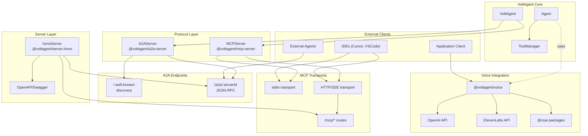
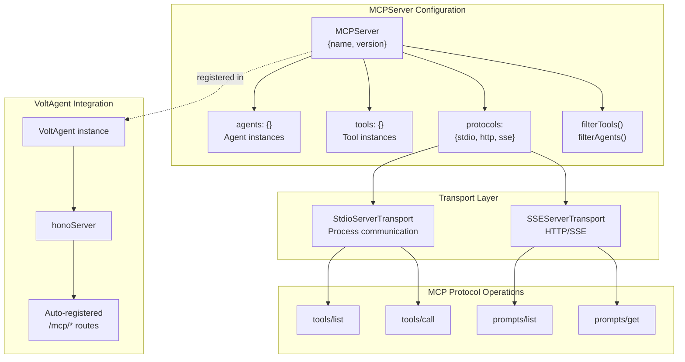
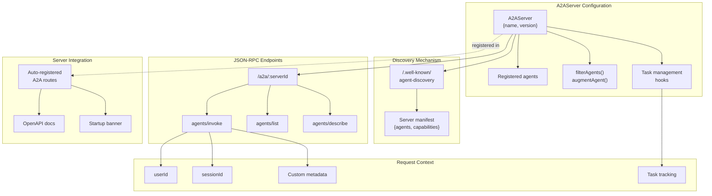

<!-- source: DeepWiki mcp.deepwiki.com · repo voltagent/voltagent · page 6 Protocols and Integrations · fetched 2026-10-27 -->

# Protocols and Integrations

<details>
<summary>Relevant source files</summary>

The following files were used as context for generating this wiki page:

- [CHANGELOG.md](CHANGELOG.md)
- [changelog.sh](changelog.sh)
- [examples/base/src/index.ts](examples/base/src/index.ts)
- [examples/with-google-ai/package.json](examples/with-google-ai/package.json)
- [examples/with-google-vertex-ai/package.json](examples/with-google-vertex-ai/package.json)
- [examples/with-groq-ai/package.json](examples/with-groq-ai/package.json)
- [examples/with-mcp/package.json](examples/with-mcp/package.json)
- [examples/with-nextjs/package.json](examples/with-nextjs/package.json)
- [packages/cli/package.json](packages/cli/package.json)
- [packages/core/package.json](packages/core/package.json)
- [packages/create-voltagent-app/CHANGELOG.md](packages/create-voltagent-app/CHANGELOG.md)
- [packages/create-voltagent-app/package.json](packages/create-voltagent-app/package.json)
- [packages/voice/package.json](packages/voice/package.json)
- [pnpm-lock.yaml](pnpm-lock.yaml)

</details>


This document covers the external protocol integrations and specialized capabilities in VoltAgent. VoltAgent implements two primary protocols for agent interoperability: Model Context Protocol (MCP) for tool access and Agent-to-Agent (A2A) for inter-agent communication. Additional integrations include voice capabilities, vector databases, and web frameworks.

For core framework functionality, see [Core Framework](#2). For AI provider integrations, see [AI Provider Integration](#3). For memory and storage systems, see [Memory and Storage](#5).
</thinking>

## Overview

VoltAgent extends agent capabilities through standardized protocols and service integrations:

| Integration Type | Package | Protocol/Standard | Purpose |
|-----------------|---------|-------------------|---------|
| MCP Server | `@voltagent/mcp-server` | Model Context Protocol | Expose agents/tools to IDEs |
| A2A Server | `@voltagent/a2a-server` | JSON-RPC over HTTP | Inter-agent communication |
| Voice | `@voltagent/voice` | Provider APIs | Speech synthesis/transcription |
| Vector DBs | Examples | Vendor SDKs | Semantic search for RAG |
| Web Frameworks | Examples | Framework-specific | Next.js, Nuxt integration |

**Sources:** [packages/core/package.json:6](), [CHANGELOG.md:91-196](), [pnpm-lock.yaml:1-2500]()

## Protocol and Integration Architecture

**Title:** VoltAgent Protocol and Integration Layer Architecture



**Sources:** [CHANGELOG.md:91-196](), [packages/core/package.json:6](), [packages/voice/package.json:1-51]()

## Model Context Protocol (MCP)

The Model Context Protocol provides standardized access to VoltAgent agents, tools, and resources from external clients like IDEs and other MCP-compatible applications.

### MCP Server Architecture

**Title:** MCP Server Component Architecture



**Sources:** [CHANGELOG.md:122-196](), [examples/with-mcp-server/package.json:1-29]()

### MCP Server Registration

VoltAgent auto-registers MCP servers when configured in the `VoltAgent` constructor:

**Configuration:** [examples/with-mcp-server/src/index.ts:1-50]() (example pattern)
**Server Setup:** `MCPServer` class from `@voltagent/mcp-server`
**Route Registration:** `honoServer` automatically exposes `/mcp/*` endpoints when `mcpServers` is configured

### MCP Transport Protocols

| Transport | Use Case | Configuration |
|-----------|----------|---------------|
| stdio | IDE integration (Cursor, VSCode) | `protocols: { stdio: true }` |
| HTTP | Remote client access | `protocols: { http: true }` |
| SSE | Streaming updates | `protocols: { sse: true }` |

**Example MCP Configuration:**

```typescript
// Register MCP server in VoltAgent
const mcpServer = new MCPServer({
  name: "support-mcp",
  version: "1.0.0",
  agents: { assistant },
  tools: { status },
  protocols: { stdio: true, http: true, sse: true }
});

export const voltAgent = new VoltAgent({
  agents: { assistant },
  mcpServers: { primary: mcpServer },
  server: honoServer({ port: 3141 })
});
```

**Sources:** [CHANGELOG.md:165-196](), [examples/with-mcp-server/package.json:5-12]()

### MCP Tool and Agent Filtering

The MCP server supports filtering exposed tools and agents:

**Filtering Pattern:**
- `filterTools({ items })` - Filter tools before exposing via MCP
- `filterAgents({ items })` - Filter agents before exposing via MCP
- Sub-agents are automatically filtered from listings

**Sources:** [CHANGELOG.md:159-162]()

### MCP Discovery and OpenAPI

When MCP is enabled with HTTP transport:
- Endpoints appear in OpenAPI/Swagger documentation
- Routes are listed in the server startup banner
- Discovery endpoints follow MCP specification

**Sources:** [CHANGELOG.md:169-170]()

## Agent-to-Agent (A2A) Protocol

The A2A protocol enables HTTP-based inter-agent communication using JSON-RPC. External agents can discover and invoke VoltAgent agents over HTTP/SSE.

### A2A Server Architecture

**Title:** Agent-to-Agent Protocol Architecture



**Sources:** [CHANGELOG.md:91-120](), [examples/with-a2a-server/package.json:1-20]()

### A2A Server Registration

Register A2A servers in the `VoltAgent` constructor:

```typescript
// Define A2A server
const a2aServer = new A2AServer({
  name: "support-agent",
  version: "0.1.0"
});

// Register with VoltAgent
export const voltAgent = new VoltAgent({
  agents: { assistant },
  a2aServers: { a2aServer },
  server: honoServer({ port: 3141 })
});
```

**Configuration:** [examples/with-a2a-server/src/index.ts:1-50]() (example pattern)
**Package:** `@voltagent/a2a-server`
**Auto-registration:** Routes automatically exposed when `a2aServers` configured

**Sources:** [CHANGELOG.md:97-120](), [examples/with-a2a-server/package.json:6-7]()

### A2A Discovery Mechanism

External agents discover available agents via the discovery endpoint:

| Endpoint | Method | Purpose |
|----------|--------|---------|
| `/.well-known/agent-discovery` | GET | Server manifest with agent list |
| `/a2a/:serverId` | POST | JSON-RPC agent invocation |

**Discovery Response:**
- Server name and version
- List of available agents
- Agent capabilities and descriptions
- Protocol version information

**Sources:** [CHANGELOG.md:95]()

### A2A Request Context

A2A requests forward context to agent invocations:

**Context Fields:**
- `userId` - User identifier for memory isolation
- `sessionId` - Session tracking
- `metadata` - Custom key-value pairs
- Task management hooks for long-running operations

**Sources:** [CHANGELOG.md:93-94]()

### A2A Task Management

The A2A server supports custom task stores for tracking long-running agent operations. Task management hooks allow filtering and augmenting agent invocations.

**Sources:** [CHANGELOG.md:94]()

## Extension Development Guidelines

Extensions in the VoltAgent ecosystem follow these patterns:

### Package Structure
- Follow `@voltagent/extension-name` naming convention
- Implement standard TypeScript exports with ESM/CJS dual publishing
- Include comprehensive peer dependencies for core framework compatibility
- Provide TypeScript definitions and proper module resolution

### Interface Implementation
- Extend core interfaces rather than replacing them
- Use dependency injection for configurable components
- Provide sensible defaults while allowing customization
- Follow established error handling patterns

### Example Integration Patterns
The codebase includes over 20 example integrations demonstrating various extension patterns:

| Example Type | Package Dependencies | Key Integration |
|-------------|---------------------|-----------------|
| Voice Integration | `@voltagent/voice`, `openai` | TTS/STT services |
| RAG Chatbot | `@voltagent/libsql`, vector embeddings | Semantic search |
| Supabase Integration | `@voltagent/supabase`, `@supabase/supabase-js` | Cloud database |
| Multi-agent Systems | `@voltagent/core` SubAgent classes | Agent delegation |

**Sources:** [examples/with-voice-openai/package.json:1-38](), [examples/with-rag-chatbot/package.json:1-31](), [examples/with-supabase/package.json:1-34](), [examples/with-subagents/package.json:1-34]()

For detailed information on specific extensions:
- Voice capabilities: [Voice Capabilities](#8.1)
- Web framework integration: [Web Framework Integration](#8.2)  
- IDE connectivity: [MCP Integration](#8.3)
- Vector databases: [Vector Databases](#8.4)

---

