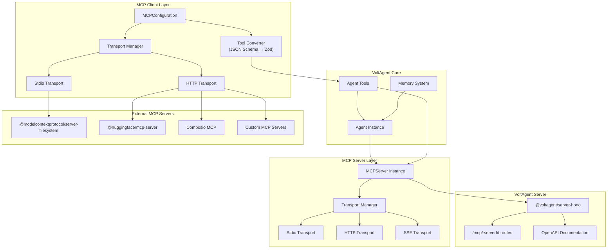
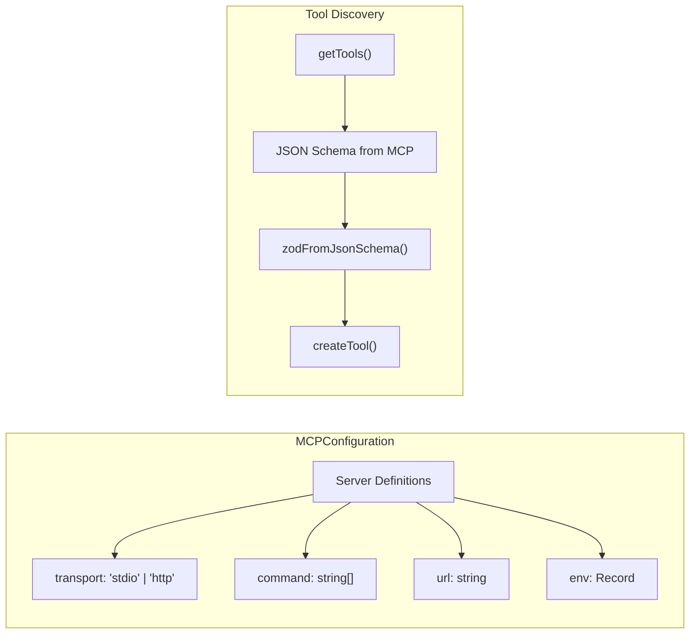
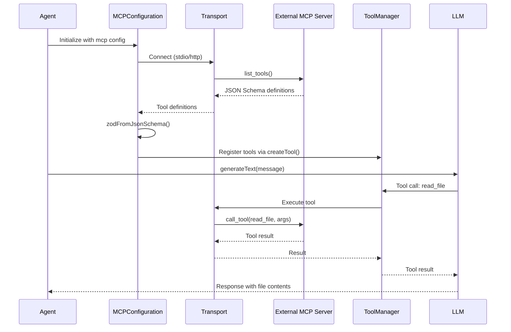
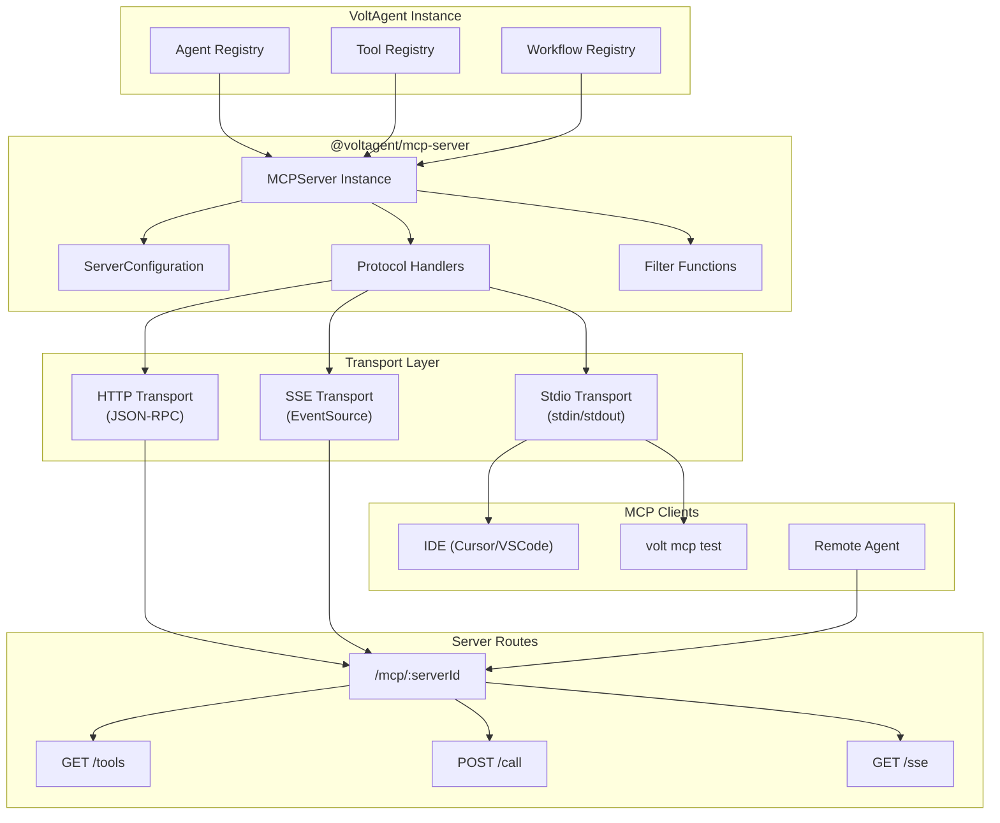
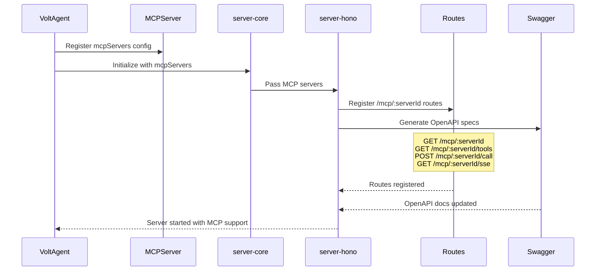
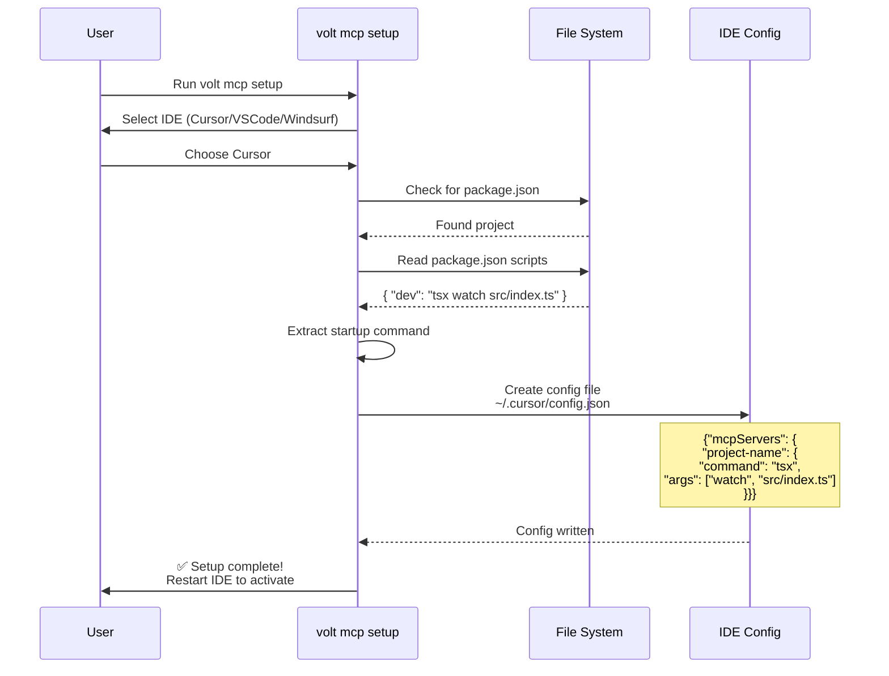

<!-- source: DeepWiki mcp.deepwiki.com · repo voltagent/voltagent · page 6.1 Model Context Protocol (MCP) · fetched 2026-10-27 -->

# Model Context Protocol (MCP)

<details>
<summary>Relevant source files</summary>

The following files were used as context for generating this wiki page:

- [CHANGELOG.md](CHANGELOG.md)
- [changelog.sh](changelog.sh)
- [examples/base/src/index.ts](examples/base/src/index.ts)
- [examples/with-google-ai/package.json](examples/with-google-ai/package.json)
- [examples/with-google-vertex-ai/package.json](examples/with-google-vertex-ai/package.json)
- [examples/with-groq-ai/package.json](examples/with-groq-ai/package.json)
- [examples/with-mcp/package.json](examples/with-mcp/package.json)
- [examples/with-nextjs/package.json](examples/with-nextjs/package.json)
- [packages/cli/package.json](packages/cli/package.json)
- [packages/core/package.json](packages/core/package.json)
- [packages/create-voltagent-app/CHANGELOG.md](packages/create-voltagent-app/CHANGELOG.md)
- [packages/create-voltagent-app/package.json](packages/create-voltagent-app/package.json)
- [packages/voice/package.json](packages/voice/package.json)
- [pnpm-lock.yaml](pnpm-lock.yaml)

</details>


## Purpose and Scope

This document covers VoltAgent's integration with the Model Context Protocol (MCP), an open protocol that enables AI agents to connect to external data sources, tools, and services. VoltAgent supports MCP in two modes:

1. **MCP Client** - Agents can consume tools and resources from external MCP servers (filesystem, APIs, databases, etc.)
2. **MCP Server** - VoltAgent agents, tools, and workflows can be exposed as MCP servers for consumption by other MCP-compatible clients

For inter-agent communication using VoltAgent's native protocol, see [Agent-to-Agent (A2A) Protocol](#6.2). For voice capabilities, see [Voice Capabilities](#6.3).

**Sources:** [CHANGELOG.md:122-196]()

---

## MCP Architecture Overview

The Model Context Protocol provides a standardized way for AI applications to discover and invoke capabilities across different systems. VoltAgent implements both client and server sides of the protocol.

### System Architecture



**Sources:** [CHANGELOG.md:122-196](), [packages/core/package.json:6]()

---

## MCP Client: Consuming External Tools

The MCP client enables VoltAgent agents to discover and execute tools from external MCP servers. This allows agents to access filesystems, APIs, databases, and other services through standardized protocols.

### MCPConfiguration Interface



**Sources:** [CHANGELOG.md:122-196](), [packages/core/package.json:22-23]()

### Configuration Example

Agents configure MCP servers through the `mcp` option in `AgentOptions`:

```typescript
import { Agent, MCPConfiguration } from "@voltagent/core";
import { openai } from "@ai-sdk/openai";

const mcpConfig: MCPConfiguration = {
  filesystem: {
    transport: "stdio",
    command: ["npx", "-y", "@modelcontextprotocol/server-filesystem", "./workspace"],
    env: {
      NODE_ENV: "production"
    }
  },
  huggingface: {
    transport: "http",
    url: "https://mcp-server.huggingface.co"
  }
};

const agent = new Agent({
  name: "Research Assistant",
  instructions: "Help with research tasks using filesystem and AI model access",
  model: openai("gpt-4o-mini"),
  mcp: mcpConfig
});
```

| Configuration Field | Type | Description |
|---------------------|------|-------------|
| `transport` | `"stdio" \| "http"` | Transport protocol for MCP communication |
| `command` | `string[]` | Command array for stdio transport (executable + args) |
| `url` | `string` | URL for HTTP transport servers |
| `env` | `Record<string, string>` | Environment variables passed to stdio servers |

**Sources:** [CHANGELOG.md:122-196]()

### Tool Discovery and Execution Flow



**Sources:** [packages/core/package.json:22-23](), [CHANGELOG.md:341-403]()

### Transport Types

#### Stdio Transport

Stdio transport launches local MCP servers as child processes, communicating via stdin/stdout:

```typescript
const mcpConfig: MCPConfiguration = {
  filesystem: {
    transport: "stdio",
    command: [
      "npx",
      "-y",
      "@modelcontextprotocol/server-filesystem",
      "./workspace"
    ],
    env: {
      NODE_ENV: "production",
      LOG_LEVEL: "error"
    }
  }
};
```

**Use cases:**
- Local file operations
- Database queries
- System utilities
- Development tooling

#### HTTP Transport

HTTP transport connects to remote MCP servers over HTTP/HTTPS:

```typescript
const mcpConfig: MCPConfiguration = {
  composio: {
    transport: "http",
    url: "https://api.composio.dev/mcp",
    headers: {
      "Authorization": `Bearer ${process.env.COMPOSIO_API_KEY}`
    }
  }
};
```

**Use cases:**
- Cloud services
- API integrations
- Shared MCP servers
- Production deployments

**Sources:** [examples/with-mcp/package.json:1-29]()

### Zod Schema Conversion

VoltAgent automatically converts MCP's JSON Schema tool definitions to Zod schemas, with version-aware handling:

| Zod Version | Converter Package | Usage |
|-------------|------------------|-------|
| v3.x | `zod-from-json-schema@^0.0.5` (aliased as `zod-from-json-schema-v3`) | Automatic fallback |
| v4.x | `zod-from-json-schema@^0.5.0` | Automatic detection |

The conversion happens transparently during tool registration:

```typescript
// MCP Server returns JSON Schema:
// {
//   "type": "object",
//   "properties": {
//     "path": { "type": "string", "description": "File path" }
//   },
//   "required": ["path"]
// }

// VoltAgent converts to Zod and registers as tool:
// z.object({
//   path: z.string().describe("File path")
// })
```

**Sources:** [packages/core/package.json:22-23](), [CHANGELOG.md:341-403]()

---

## MCP Server: Exposing VoltAgent via MCP

The `@voltagent/mcp-server` package allows VoltAgent agents, tools, and workflows to be exposed as MCP servers, making them consumable by any MCP-compatible client (IDEs, other agents, etc.).

### MCPServer Architecture



**Sources:** [CHANGELOG.md:165-196](), [examples/with-mcp-server/package.json:1-69]()

### MCPServer Configuration

```typescript
import { MCPServer } from "@voltagent/mcp-server";
import { Agent, VoltAgent, createTool } from "@voltagent/core";
import { honoServer } from "@voltagent/server-hono";
import { z } from "zod";

// Define tools
const statusTool = createTool({
  name: "status",
  description: "Return system status",
  parameters: z.object({}),
  async execute() {
    return { status: "ok", time: new Date().toISOString() };
  }
});

// Define agent
const assistant = new Agent({
  name: "SupportAgent",
  purpose: "Handle customer support inquiries",
  model: openai("gpt-4o-mini"),
  tools: [statusTool]
});

// Create MCP server
const mcpServer = new MCPServer({
  name: "support-server",
  version: "1.0.0",
  description: "Customer support MCP server",
  
  // Expose specific entities
  agents: { support: assistant },
  tools: { status: statusTool },
  
  // Protocol configuration
  protocols: {
    stdio: true,   // Enable stdio transport
    http: false,   // Disable HTTP
    sse: false     // Disable SSE
  },
  
  // Optional filters
  filterTools: ({ items }) => 
    items.filter(tool => !tool.name.startsWith("_"))
});

// Register with VoltAgent
export const voltAgent = new VoltAgent({
  agents: { assistant },
  mcpServers: { primary: mcpServer },
  server: honoServer({ port: 3141 })
});
```

| Configuration Field | Type | Description |
|---------------------|------|-------------|
| `name` | `string` | MCP server identifier |
| `version` | `string` | Semantic version |
| `description` | `string` | Human-readable description |
| `agents` | `Record<string, Agent>` | Agents to expose as tools |
| `tools` | `Record<string, Tool>` | Standalone tools to expose |
| `workflows` | `Record<string, Workflow>` | Workflows to expose |
| `protocols` | `{ stdio?, http?, sse? }` | Enable/disable transports |
| `filterTools` | `(context) => Tool[]` | Filter exposed tools |
| `filterAgents` | `(context) => Agent[]` | Filter exposed agents |

**Sources:** [CHANGELOG.md:165-196]()

### Agent Exposure

When agents are registered with an MCP server, they are automatically exposed as MCP tools. The tool interface is generated from the agent's configuration:

```typescript
// Agent definition
const formatter = new Agent({
  name: "Formatter",
  purpose: "Format text in various styles",
  model: openai("gpt-4o-mini")
});

// Exposed MCP tool schema
{
  "name": "Formatter",
  "description": "Format text in various styles", // from purpose or instructions
  "inputSchema": {
    "type": "object",
    "properties": {
      "message": {
        "type": "string",
        "description": "Task to delegate to the agent"
      },
      "context": {
        "type": "object",
        "description": "Additional context for the task"
      }
    },
    "required": ["message"]
  }
}
```

Subagents are automatically filtered out - only top-level agents are exposed to prevent internal implementation details from leaking.

**Sources:** [CHANGELOG.md:165-196]()

### Protocol Configuration

#### Stdio Mode (Default)

Stdio mode runs the MCP server as a child process, communicating via stdin/stdout. This is the primary mode for IDE integrations:

```typescript
const mcpServer = new MCPServer({
  name: "ide-integration",
  version: "1.0.0",
  agents: { assistant },
  protocols: {
    stdio: true  // Only stdio enabled
  }
});
```

**Configuration in IDE (Cursor example):**

```json
{
  "mcpServers": {
    "voltagent-ide": {
      "command": "node",
      "args": ["/path/to/dist/index.js"],
      "env": {
        "OPENAI_API_KEY": "sk-..."
      }
    }
  }
}
```

#### HTTP/SSE Mode

HTTP and SSE modes require `@voltagent/server-hono` integration. When enabled, MCP endpoints are automatically registered:

```typescript
const mcpServer = new MCPServer({
  name: "remote-mcp",
  version: "1.0.0",
  agents: { assistant },
  protocols: {
    stdio: false,
    http: true,   // Enable HTTP JSON-RPC
    sse: true     // Enable Server-Sent Events
  }
});

export const voltAgent = new VoltAgent({
  agents: { assistant },
  mcpServers: { remote: mcpServer },
  server: honoServer({ port: 3141 })  // Required for HTTP/SSE
});
```

**Auto-registered routes:**

| Route | Method | Description |
|-------|--------|-------------|
| `/mcp/:serverId` | GET | MCP server info |
| `/mcp/:serverId/tools` | GET | List available tools |
| `/mcp/:serverId/call` | POST | Execute tool via JSON-RPC |
| `/mcp/:serverId/sse` | GET | Server-Sent Events stream |

**Sources:** [CHANGELOG.md:125-170](), [examples/with-mcp-server/package.json:1-69]()

### Filter Functions

Filter functions allow you to control which tools and agents are exposed via the MCP server:

```typescript
const mcpServer = new MCPServer({
  name: "filtered-server",
  version: "1.0.0",
  agents: { agent1, agent2, agent3 },
  tools: { tool1, tool2, tool3 },
  
  // Filter tools - exclude internal tools
  filterTools: ({ items }) => {
    return items.filter(tool => 
      !tool.name.startsWith("_") &&
      !tool.name.includes("internal")
    );
  },
  
  // Filter agents - only expose production-ready agents
  filterAgents: ({ items }) => {
    return items.filter(agent => 
      agent.metadata?.production === true
    );
  }
});
```

Filter context provides:

```typescript
interface FilterContext {
  items: Array<Tool | Agent>;  // Items to filter
  serverName: string;           // MCP server name
  version: string;              // MCP server version
}
```

**Sources:** [CHANGELOG.md:165-196]()

---

## Server Route Integration

When MCP servers are registered with `VoltAgent` and `honoServer` is configured, HTTP/SSE routes are automatically registered and documented.

### Route Registration Flow



**Sources:** [CHANGELOG.md:125-170]()

### Startup Banner

When MCP servers are registered, they appear in the startup banner:

```
╔═══════════════════════════════════════════════════════════════╗
║                  🌟 VoltAgent Server Started                  ║
╠═══════════════════════════════════════════════════════════════╣
║  Server: http://localhost:3141                                ║
╠═══════════════════════════════════════════════════════════════╣
║  📊 OpenAPI: http://localhost:3141/docs                       ║
╠═══════════════════════════════════════════════════════════════╣
║  🔌 MCP Servers                                               ║
║    • primary (v1.0.0)                                         ║
║      - Protocols: stdio, http, sse                            ║
║      - Discovery: http://localhost:3141/mcp/primary           ║
║      - Tools: http://localhost:3141/mcp/primary/tools         ║
╚═══════════════════════════════════════════════════════════════╝
```

**Sources:** [CHANGELOG.md:125-170]()

---

## CLI Tools

The `@voltagent/cli` package provides commands for managing MCP integrations with IDEs.

### Available Commands

| Command | Description |
|---------|-------------|
| `volt mcp setup` | Interactive setup for IDE MCP configuration |
| `volt mcp test` | Test MCP server connection and list tools |
| `volt mcp status` | Show current MCP configuration status |
| `volt mcp remove` | Remove MCP configuration from IDE |

### Setup Workflow



**Sources:** [CHANGELOG.md:165-199](), [packages/cli/package.json:1-61]()

### IDE Configuration Files

| IDE | Config Location |
|-----|-----------------|
| Cursor | `~/.cursor/config.json` |
| VSCode | `~/.vscode/settings.json` |
| Windsurf | `~/.windsurf/config.json` |

Example generated configuration:

```json
{
  "mcpServers": {
    "my-voltagent-project": {
      "command": "tsx",
      "args": ["watch", "--env-file=.env", "./src/index.ts"],
      "env": {
        "NODE_ENV": "development"
      }
    }
  }
}
```

**Sources:** [CHANGELOG.md:165-199](), [packages/cli/package.json:1-61]()

### Testing MCP Connection

```bash
$ volt mcp test

Testing MCP server connection...

✓ Server: my-voltagent-project
✓ Version: 1.0.0
✓ Description: Customer support server

Available tools:
  1. SupportAgent - Handle customer support inquiries
  2. status - Return system status
  3. read_file - Read file contents

Example usage in IDE:
  "@SupportAgent help me with customer inquiry about refunds"
  "@status check system health"
```

**Sources:** [packages/cli/package.json:1-61]()

---

## Complete Example: MCP Client + Server

This example demonstrates both consuming external MCP tools and exposing VoltAgent as an MCP server.

```typescript
import { Agent, VoltAgent, MCPConfiguration, createTool } from "@voltagent/core";
import { MCPServer } from "@voltagent/mcp-server";
import { honoServer } from "@voltagent/server-hono";
import { openai } from "@ai-sdk/openai";
import { z } from "zod";

// 1. Configure MCP Client - consume external tools
const mcpConfig: MCPConfiguration = {
  filesystem: {
    transport: "stdio",
    command: [
      "npx",
      "-y", 
      "@modelcontextprotocol/server-filesystem",
      "./workspace"
    ]
  },
  composio: {
    transport: "http",
    url: "https://api.composio.dev/mcp",
    headers: {
      "Authorization": `Bearer ${process.env.COMPOSIO_API_KEY}`
    }
  }
};

// 2. Create custom tool
const analyticsTool = createTool({
  name: "analyze_data",
  description: "Analyze data files",
  parameters: z.object({
    filepath: z.string(),
    format: z.enum(["json", "csv", "xml"])
  }),
  async execute({ filepath, format }) {
    // Tool implementation
    return { summary: "Data analysis complete" };
  }
});

// 3. Create agent that uses MCP tools + custom tools
const researchAgent = new Agent({
  name: "ResearchAgent",
  purpose: "Research assistant with file access and API integrations",
  model: openai("gpt-4o-mini"),
  mcp: mcpConfig,  // MCP client config
  tools: [analyticsTool]
});

// 4. Create MCP Server to expose this agent
const mcpServer = new MCPServer({
  name: "research-mcp",
  version: "1.0.0",
  description: "Research agent with tool access",
  agents: { research: researchAgent },
  tools: { analytics: analyticsTool },
  protocols: {
    stdio: true,  // For IDE integration
    http: true,   // For remote access
    sse: true     // For streaming
  }
});

// 5. Initialize VoltAgent
export const voltAgent = new VoltAgent({
  agents: { research: researchAgent },
  mcpServers: { primary: mcpServer },
  server: honoServer({ port: 3141 })
});
```

### Usage Scenarios

**Scenario 1: IDE Integration (Stdio)**

```
// In Cursor/VSCode, after running `volt mcp setup`:
User: "@research analyze sales data from Q4"
Agent: [Uses read_file from filesystem MCP]
Agent: [Uses analyze_data custom tool]
Agent: "Q4 sales show 15% growth..."
```

**Scenario 2: Remote Agent Access (HTTP)**

```typescript
// Another VoltAgent instance consuming this MCP server
const clientAgent = new Agent({
  name: "ClientAgent",
  model: openai("gpt-4o-mini"),
  mcp: {
    research: {
      transport: "http",
      url: "http://localhost:3141/mcp/primary"
    }
  }
});

const result = await clientAgent.generateText(
  "Use the research agent to analyze our data files"
);
```

**Sources:** [examples/with-mcp/package.json:1-29](), [examples/with-mcp-server/package.json:1-69]()

---

## Common MCP Servers

### Official MCP Servers

| Server | Package | Description |
|--------|---------|-------------|
| Filesystem | `@modelcontextprotocol/server-filesystem` | Read/write/list files and directories |
| GitHub | `@modelcontextprotocol/server-github` | Repository operations, issues, PRs |
| Google Drive | `@modelcontextprotocol/server-gdrive` | Drive file operations |
| Slack | `@modelcontextprotocol/server-slack` | Message channels, search history |
| PostgreSQL | `@modelcontextprotocol/server-postgres` | Database queries and schema inspection |

### Third-Party Integrations

| Server | Transport | Description |
|--------|-----------|-------------|
| HuggingFace MCP | HTTP | Access AI models and datasets |
| Composio | HTTP | 100+ pre-built API integrations |
| Peaka | HTTP | Database and API unification |

**Example configuration:**

```typescript
const mcpConfig: MCPConfiguration = {
  // Local filesystem access
  filesystem: {
    transport: "stdio",
    command: ["npx", "-y", "@modelcontextprotocol/server-filesystem", "./data"]
  },
  
  // GitHub API access
  github: {
    transport: "stdio",
    command: ["npx", "-y", "@modelcontextprotocol/server-github"],
    env: {
      GITHUB_TOKEN: process.env.GITHUB_TOKEN || ""
    }
  },
  
  // HuggingFace models
  huggingface: {
    transport: "http",
    url: "https://mcp-server.huggingface.co",
    headers: {
      "Authorization": `Bearer ${process.env.HF_TOKEN}`
    }
  }
};
```

**Sources:** [examples/with-hugging-face-mcp/package.json:1-32](), [examples/with-composio-mcp/package.json:1-30](), [examples/with-peaka-mcp/package.json:1-50]()

---

## Type Definitions

### MCPConfiguration

```typescript
interface MCPConfiguration {
  [serverName: string]: MCPServerConfig;
}

interface MCPServerConfig {
  transport: "stdio" | "http";
  
  // Stdio transport
  command?: string[];
  env?: Record<string, string>;
  
  // HTTP transport
  url?: string;
  headers?: Record<string, string>;
}
```

### MCPServer Options

```typescript
interface MCPServerOptions {
  name: string;
  version: string;
  description?: string;
  
  agents?: Record<string, Agent>;
  tools?: Record<string, Tool>;
  workflows?: Record<string, Workflow>;
  
  protocols?: {
    stdio?: boolean;
    http?: boolean;
    sse?: boolean;
  };
  
  filterTools?: (context: FilterContext) => Tool[];
  filterAgents?: (context: FilterContext) => Agent[];
}

interface FilterContext {
  items: Array<Tool | Agent>;
  serverName: string;
  version: string;
}
```

**Sources:** [CHANGELOG.md:122-196](), [packages/core/package.json:6]()

---

## Best Practices

### Security Considerations

1. **Stdio Transport Security**
   - Stdio servers run in the same security context as your application
   - Validate all file paths and commands before passing to MCP servers
   - Use environment variables for sensitive configuration

2. **HTTP Transport Security**
   - Always use HTTPS in production
   - Implement authentication headers for remote MCP servers
   - Rate limit MCP endpoints to prevent abuse

3. **Tool Filtering**
   - Filter out internal/debug tools before exposing via MCP
   - Use descriptive tool names that don't leak implementation details
   - Document tool purposes clearly for external consumers

### Performance Tips

1. **Connection Pooling**
   - HTTP transport reuses connections for multiple tool calls
   - Stdio processes are kept alive for the agent's lifetime

2. **Tool Discovery Caching**
   - Tool schemas are cached after initial discovery
   - Restart the agent to refresh MCP tool definitions

3. **Error Handling**
   - MCP tool errors are propagated as standard tool execution errors
   - Implement retry logic for transient HTTP MCP failures

### Development Workflow

1. **Local Development**
   ```bash
   # Use stdio for local MCP servers
   pnpm dev  # Starts agent with stdio MCP
   volt mcp test  # Verify tool exposure
   ```

2. **IDE Integration**
   ```bash
   # Setup MCP in your IDE
   volt mcp setup
   # Restart IDE
   # Use @agent-name in chat
   ```

3. **Production Deployment**
   ```typescript
   // Enable HTTP/SSE for remote access
   protocols: {
     stdio: false,  // Disable stdio in production
     http: true,    // Enable HTTP
     sse: true      // Enable streaming
   }
   ```

**Sources:** [packages/cli/package.json:1-61](), [examples/with-mcp-server/package.json:1-69]()

---

## Troubleshooting

### Common Issues

| Issue | Cause | Solution |
|-------|-------|----------|
| "Command not found" | MCP server not installed | Run `npx -y package-name` to install |
| "Connection refused" | HTTP server not running | Verify server URL and ensure honoServer is configured |
| "Tools not appearing" | Stdio process failed | Check `env` configuration and command array |
| "Type error with Zod" | Zod version mismatch | Ensure Zod ^3.25.0 or ^4.0.0 is installed |
| "Agent not exposed" | SubAgent filtered out | Only top-level agents are exposed via MCP |

### Debug Mode

Enable verbose logging for MCP operations:

```typescript
import { createPinoLogger } from "@voltagent/logger";

const logger = createPinoLogger({
  level: "debug",  // Enable debug logs
  name: "mcp-debug"
});

const voltAgent = new VoltAgent({
  agents: { agent },
  mcpServers: { server: mcpServer },
  logger
});
```

### Testing MCP Servers

```bash
# List available tools
curl http://localhost:3141/mcp/primary/tools

# Test tool invocation
curl -X POST http://localhost:3141/mcp/primary/call \
  -H "Content-Type: application/json" \
  -d '{
    "jsonrpc": "2.0",
    "method": "tools/call",
    "params": {
      "name": "SupportAgent",
      "arguments": { "message": "test query" }
    },
    "id": 1
  }'
```

**Sources:** [packages/cli/package.json:1-61](), [CHANGELOG.md:125-170]()

---

