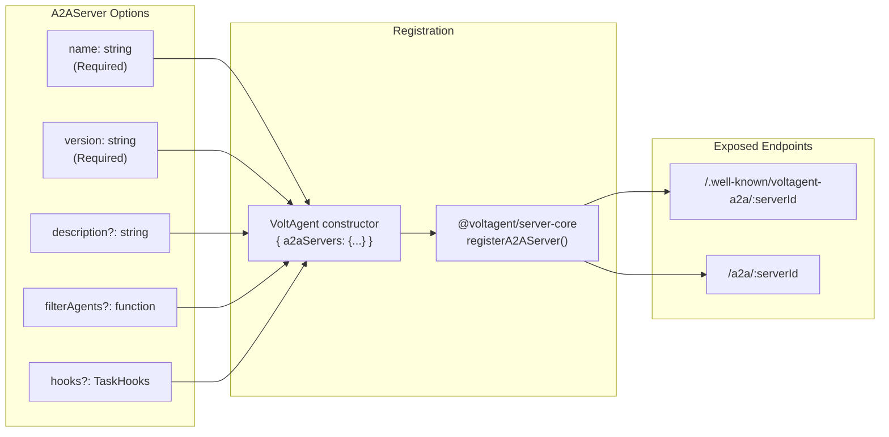
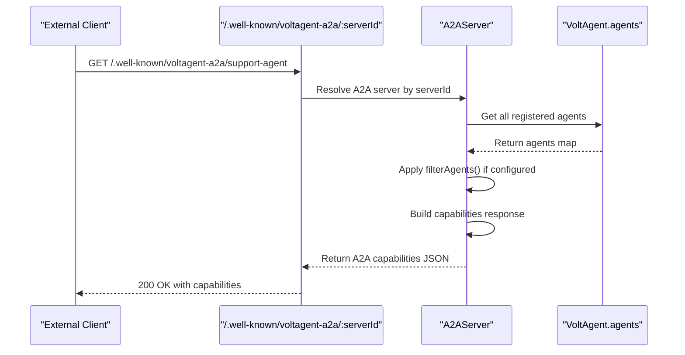
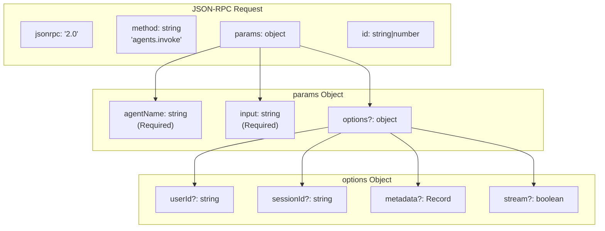
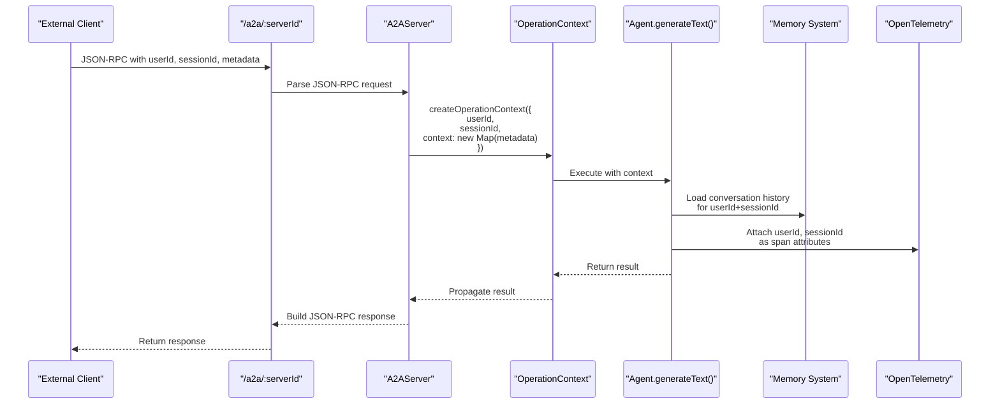
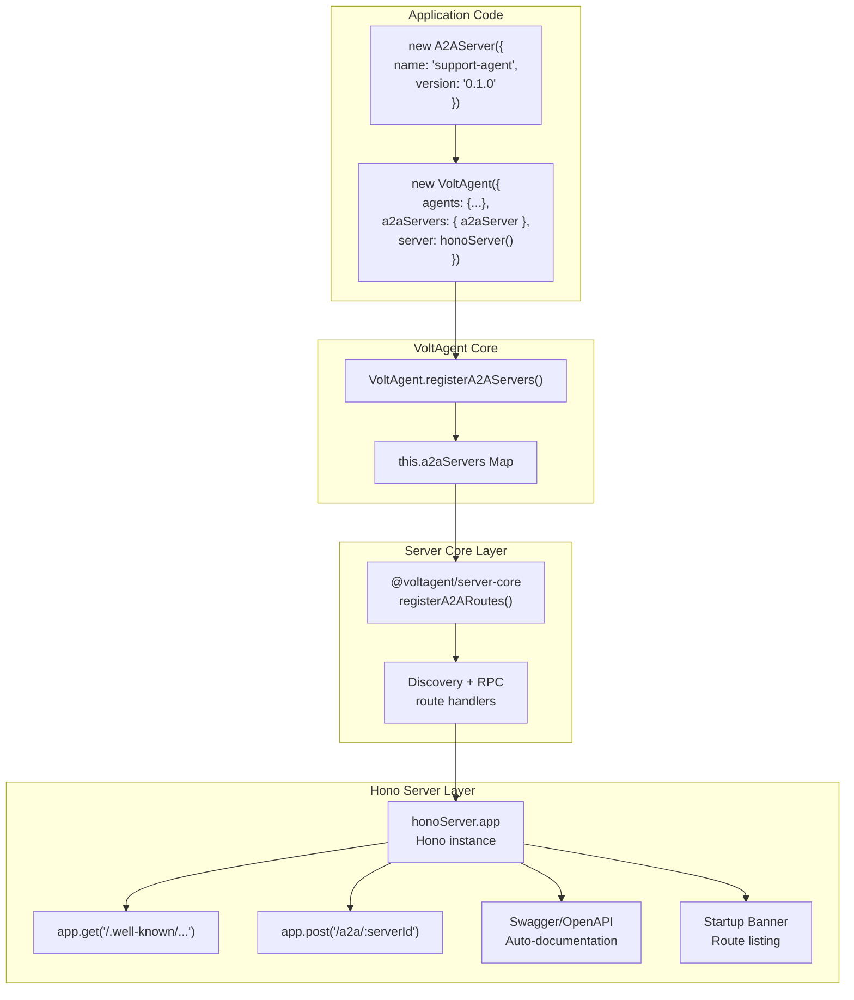
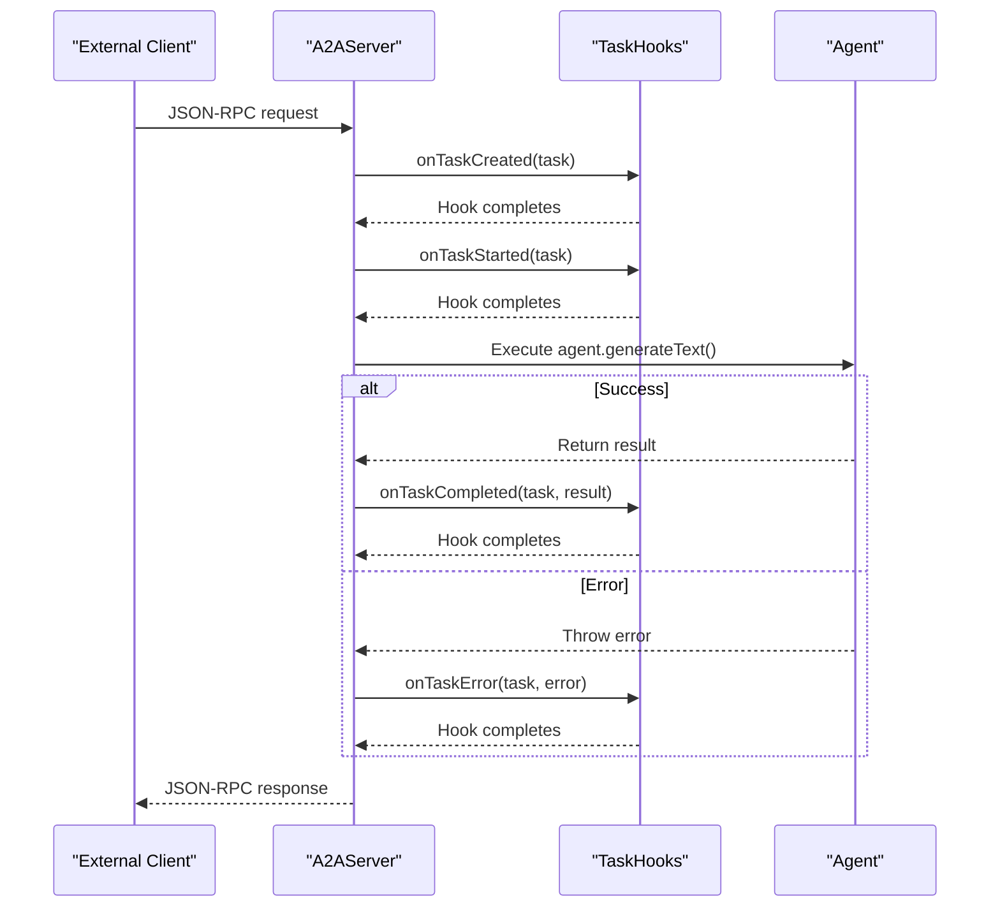
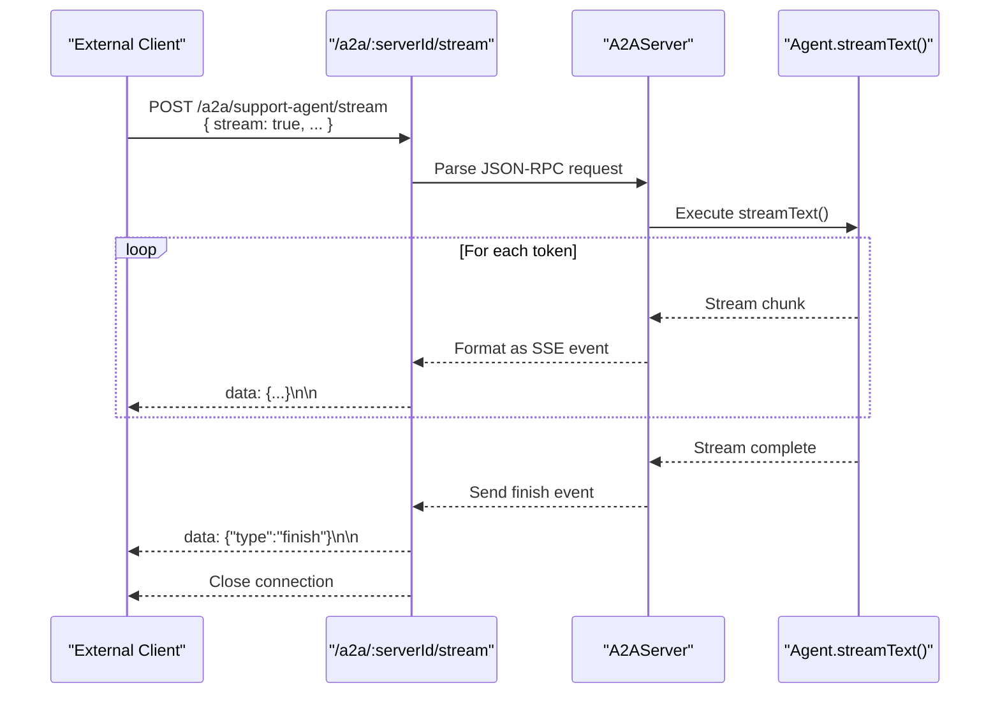
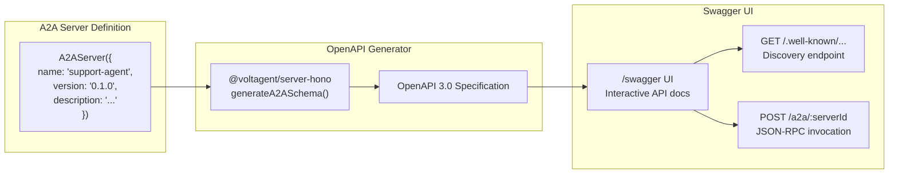

<!-- source: DeepWiki mcp.deepwiki.com · repo voltagent/voltagent · page 6.2 Agent-to-Agent (A2A) Protocol · fetched 2026-10-27 -->

# Agent-to-Agent (A2A) Protocol

<details>
<summary>Relevant source files</summary>

The following files were used as context for generating this wiki page:

- [CHANGELOG.md](CHANGELOG.md)
- [changelog.sh](changelog.sh)
- [examples/base/src/index.ts](examples/base/src/index.ts)
- [packages/cli/package.json](packages/cli/package.json)
- [packages/create-voltagent-app/CHANGELOG.md](packages/create-voltagent-app/CHANGELOG.md)
- [packages/create-voltagent-app/package.json](packages/create-voltagent-app/package.json)
- [packages/server-core/package.json](packages/server-core/package.json)
- [packages/server-hono/package.json](packages/server-hono/package.json)
- [packages/voice/package.json](packages/voice/package.json)

</details>


## Purpose and Scope

The Agent-to-Agent (A2A) Protocol enables remote communication between VoltAgent instances over HTTP/SSE using JSON-RPC 2.0. The `@voltagent/a2a-server` package exposes local agents to external systems, allowing other VoltAgent instances, third-party applications, or agent orchestration platforms to invoke agents remotely.

This document covers the A2A server implementation, discovery mechanisms, JSON-RPC invocation patterns, and integration with the VoltAgent HTTP server layer. For information about Model Context Protocol (MCP) integration, see [Model Context Protocol (MCP)](#6.1). For HTTP server configuration and deployment, see [Hono Server Implementation](#4.2).

**Sources:** [CHANGELOG.md:91-120](), [packages/server-hono/package.json:8]()

---

## Architecture Overview

The A2A Protocol implements a three-layer architecture consisting of discovery, invocation, and integration layers.

### High-Level A2A Architecture

```mermaid
graph TB
    subgraph "External Client"
        CLIENT["External Agent<br/>or Application"]
    end
    
    subgraph "A2A Server Layer"
        A2A_SERVER["A2AServer Instance"]
        DISCOVERY["Discovery Endpoint<br/>/.well-known/voltagent-a2a"]
        RPC["RPC Endpoint<br/>/a2a/:serverId"]
    end
    
    subgraph "VoltAgent Core"
        AGENT_REGISTRY["VoltAgent.agents<br/>Record<string, Agent>"]
        AGENT_INSTANCE["Agent Instance"]
        OPERATION_CONTEXT["OperationContext"]
    end
    
    subgraph "HTTP Transport"
        HONO_SERVER["honoServer<br/>Hono instance"]
        AUTO_ROUTES["Auto-registered<br/>A2A routes"]
    end
    
    CLIENT -->|"1. Discover agents"| DISCOVERY
    DISCOVERY -->|"Returns A2A capabilities"| CLIENT
    CLIENT -->|"2. Invoke agent"| RPC
    RPC -->|"JSON-RPC 2.0"| A2A_SERVER
    A2A_SERVER -->|"Resolve agent by key"| AGENT_REGISTRY
    A2A_SERVER -->|"Create OperationContext"| OPERATION_CONTEXT
    A2A_SERVER -->|"Execute generateText/streamText"| AGENT_INSTANCE
    AGENT_INSTANCE -->|"Return result"| RPC
    RPC -->|"JSON-RPC response"| CLIENT
    
    A2A_SERVER -."|Registers routes on VoltAgent.server"| HONO_SERVER
    HONO_SERVER -->|"Mounts /.well-known/ and /a2a/"| AUTO_ROUTES
```

**Sources:** [CHANGELOG.md:91-96](), [packages/server-hono/package.json:8]()

---

## A2AServer Configuration

The `A2AServer` class is instantiated with configuration options and registered with the `VoltAgent` instance. The server automatically exposes configured agents via discovery and RPC endpoints.

### A2AServer Constructor



| Property | Type | Required | Description |
|----------|------|----------|-------------|
| `name` | `string` | Yes | Unique identifier for the A2A server (used in URL paths) |
| `version` | `string` | Yes | Semantic version of the A2A server API |
| `description` | `string` | No | Human-readable description for discovery responses |
| `filterAgents` | `(context: FilterContext) => Agent[]` | No | Function to filter which agents are exposed remotely |
| `hooks` | `TaskHooks` | No | Lifecycle hooks for task creation, start, completion, and errors |

**Sources:** [CHANGELOG.md:91-96](), [CHANGELOG.md:104-119]()

### Basic A2AServer Setup

The following pattern demonstrates minimal A2A server configuration:

```typescript
// File reference: examples/with-a2a-server/src/index.ts (inferred structure)
import { Agent, VoltAgent } from "@voltagent/core";
import { A2AServer } from "@voltagent/a2a-server";
import { honoServer } from "@voltagent/server-hono";
import { openai } from "@ai-sdk/openai";

const supportAgent = new Agent({
  name: "SupportAgent",
  instructions: "Handle support questions from partner agents",
  model: openai("gpt-4o-mini"),
});

const a2aServer = new A2AServer({
  name: "support-agent",
  version: "0.1.0",
  description: "Support agent A2A server",
});

const voltAgent = new VoltAgent({
  agents: { supportAgent },
  a2aServers: { a2aServer },
  server: honoServer({ port: 3141 }),
});
```

When `honoServer` is configured, A2A routes are automatically mounted at:
- `/.well-known/voltagent-a2a/support-agent` (discovery)
- `/a2a/support-agent` (JSON-RPC invocation)

**Sources:** [CHANGELOG.md:104-119](), [packages/server-hono/package.json:8]()

---

## Discovery Mechanism

The A2A discovery endpoint follows the `/.well-known/` URI convention (RFC 8615) to enable automatic service detection.

### Discovery Request Flow



### Discovery Response Schema

The discovery response contains metadata about available agents and RPC endpoint location:

```json
{
  "name": "support-agent",
  "version": "0.1.0",
  "description": "Support agent A2A server",
  "agents": [
    {
      "name": "SupportAgent",
      "description": "Handle support questions from partner agents"
    }
  ],
  "endpoints": {
    "rpc": "/a2a/support-agent"
  }
}
```

| Field | Type | Description |
|-------|------|-------------|
| `name` | `string` | A2A server identifier (matches URL path parameter) |
| `version` | `string` | Semantic version of the A2A API |
| `description` | `string` | Human-readable server description |
| `agents` | `Array<{name, description}>` | List of exposed agents (after filtering) |
| `endpoints.rpc` | `string` | Relative URL path for JSON-RPC invocation |

**Sources:** [CHANGELOG.md:91-96]()

---

## JSON-RPC Invocation

The A2A RPC endpoint implements JSON-RPC 2.0 specification for agent invocation. Both HTTP POST (single-shot) and SSE (streaming) transports are supported.

### JSON-RPC Request Format



**Example JSON-RPC Request:**

```json
POST /a2a/support-agent
Content-Type: application/json

{
  "jsonrpc": "2.0",
  "method": "agents.invoke",
  "params": {
    "agentName": "SupportAgent",
    "input": "How do I reset my password?",
    "options": {
      "userId": "user-123",
      "sessionId": "session-456",
      "metadata": {
        "source": "partner-agent-alpha",
        "priority": "high"
      }
    }
  },
  "id": 1
}
```

**Sources:** [CHANGELOG.md:92-93]()

### JSON-RPC Response Format

#### Success Response (Non-Streaming)

```json
{
  "jsonrpc": "2.0",
  "result": {
    "text": "To reset your password, visit /account/password-reset...",
    "usage": {
      "promptTokens": 145,
      "completionTokens": 89,
      "totalTokens": 234
    },
    "finishReason": "stop"
  },
  "id": 1
}
```

#### Error Response

```json
{
  "jsonrpc": "2.0",
  "error": {
    "code": -32602,
    "message": "Invalid params: agentName is required"
  },
  "id": 1
}
```

**JSON-RPC Error Codes:**

| Code | Meaning | Description |
|------|---------|-------------|
| `-32700` | Parse error | Invalid JSON received |
| `-32600` | Invalid Request | JSON-RPC structure is invalid |
| `-32601` | Method not found | Method name doesn't exist |
| `-32602` | Invalid params | Invalid method parameters |
| `-32603` | Internal error | Server-side execution error |

**Sources:** [CHANGELOG.md:92-93]()

---

## Request Context Forwarding

The A2A Protocol forwards request context (`userId`, `sessionId`, `metadata`) from the JSON-RPC request into the agent's `OperationContext`, enabling authentication, multi-tenancy, and tracing across agent boundaries.

### Context Propagation Flow



The context forwarding mechanism ensures:
- **Authentication:** `userId` identifies the requesting user across systems
- **Session Management:** `sessionId` maintains conversation continuity
- **Metadata Propagation:** Custom metadata flows through the operation lifecycle
- **Observability:** Context values appear in traces and logs for debugging

**Sources:** [CHANGELOG.md:93]()

---

## Integration with VoltAgent and honoServer

The A2A server integrates with the VoltAgent ecosystem through automatic route registration when `honoServer` is configured.

### A2A Server Registration Flow



**Route Auto-Registration:**

When A2A servers are configured, the following routes are automatically mounted:

| Route Pattern | Method | Purpose |
|---------------|--------|---------|
| `/.well-known/voltagent-a2a/:serverId` | GET | Discovery endpoint |
| `/a2a/:serverId` | POST | JSON-RPC invocation |
| `/a2a/:serverId/stream` | GET | SSE streaming (if supported) |

These routes are:
- Documented in Swagger/OpenAPI automatically
- Listed in the startup banner for visibility
- Registered without manual configuration

**Sources:** [CHANGELOG.md:95-96](), [packages/server-hono/package.json:8]()

---

## Agent Filtering and Security

The `filterAgents` option controls which agents are exposed via the A2A Protocol, enabling security policies and multi-tenancy.

### Filter Function Signature

```typescript
interface FilterContext {
  items: Agent[];           // All registered agents
  userId?: string;          // Request userId (if provided)
  sessionId?: string;       // Request sessionId (if provided)
  metadata?: Record<string, unknown>; // Request metadata
}

type FilterAgents = (context: FilterContext) => Agent[];
```

### Filtering Strategies

#### Strategy 1: Whitelist by Agent Name

```typescript
const a2aServer = new A2AServer({
  name: "public-api",
  version: "1.0.0",
  filterAgents: ({ items }) => {
    const allowedNames = ["PublicAgent", "SupportAgent"];
    return items.filter(agent => allowedNames.includes(agent.name));
  },
});
```

#### Strategy 2: User-Based Access Control

```typescript
const a2aServer = new A2AServer({
  name: "multi-tenant",
  version: "1.0.0",
  filterAgents: ({ items, userId, metadata }) => {
    // Only expose agents for authenticated users
    if (!userId) return [];
    
    // Filter by tenant from metadata
    const tenantId = metadata?.tenantId;
    return items.filter(agent => {
      // Custom logic: check agent permissions for tenant
      return hasAccess(agent.name, tenantId);
    });
  },
});
```

#### Strategy 3: Exclude Internal Agents

```typescript
const a2aServer = new A2AServer({
  name: "external-api",
  version: "1.0.0",
  filterAgents: ({ items }) => {
    // Hide agents with "Internal" prefix
    return items.filter(agent => !agent.name.startsWith("Internal"));
  },
});
```

**Default Behavior (No Filter):**
- All agents registered with `VoltAgent` are exposed
- Discovery returns complete agent list
- RPC accepts invocations for any registered agent

**Sources:** [CHANGELOG.md:93]()

---

## Task Management Hooks

The A2A server supports lifecycle hooks for tracking and managing remote agent invocations. These hooks enable request logging, metrics collection, and custom validation.

### TaskHooks Interface

```typescript
interface TaskHooks {
  onTaskCreated?: (task: Task) => void | Promise<void>;
  onTaskStarted?: (task: Task) => void | Promise<void>;
  onTaskCompleted?: (task: Task, result: TaskResult) => void | Promise<void>;
  onTaskError?: (task: Task, error: Error) => void | Promise<void>;
}

interface Task {
  id: string;              // Unique task identifier
  agentName: string;       // Invoked agent name
  input: string;           // Request input
  userId?: string;         // Request userId
  sessionId?: string;      // Request sessionId
  metadata?: Record<string, unknown>; // Request metadata
  startedAt: Date;         // Task start timestamp
}

interface TaskResult {
  text: string;            // Agent response text
  usage?: {
    promptTokens: number;
    completionTokens: number;
    totalTokens: number;
  };
  finishReason: string;
}
```

### Hook Execution Flow



### Example: Task Logging Hook

```typescript
import { A2AServer } from "@voltagent/a2a-server";

const a2aServer = new A2AServer({
  name: "logged-server",
  version: "1.0.0",
  hooks: {
    onTaskCreated: async (task) => {
      console.log(`Task created: ${task.id} for agent ${task.agentName}`);
      // Store in task database
      await db.tasks.insert({
        id: task.id,
        agentName: task.agentName,
        userId: task.userId,
        status: "pending",
      });
    },
    
    onTaskStarted: async (task) => {
      console.log(`Task started: ${task.id}`);
      await db.tasks.update(task.id, { status: "running" });
    },
    
    onTaskCompleted: async (task, result) => {
      console.log(`Task completed: ${task.id}`);
      await db.tasks.update(task.id, {
        status: "completed",
        tokens: result.usage?.totalTokens,
        finishReason: result.finishReason,
      });
    },
    
    onTaskError: async (task, error) => {
      console.error(`Task error: ${task.id}`, error);
      await db.tasks.update(task.id, {
        status: "error",
        errorMessage: error.message,
      });
    },
  },
});
```

**Sources:** [CHANGELOG.md:93]()

---

## Streaming Support (SSE)

The A2A Protocol supports Server-Sent Events (SSE) for streaming agent responses, enabling real-time token-by-token delivery.

### SSE Request Pattern



### SSE Event Types

| Event Type | Description | Payload |
|------------|-------------|---------|
| `text-delta` | Incremental text token | `{ type: "text-delta", textDelta: "..." }` |
| `tool-call` | Agent invokes tool | `{ type: "tool-call", toolCallId, toolName, args }` |
| `tool-result` | Tool execution result | `{ type: "tool-result", toolCallId, result }` |
| `finish` | Stream completion | `{ type: "finish", finishReason, usage }` |
| `error` | Error occurred | `{ type: "error", error: "..." }` |

**Example SSE Response Stream:**

```
data: {"type":"text-delta","textDelta":"To reset"}

data: {"type":"text-delta","textDelta":" your password"}

data: {"type":"text-delta","textDelta":", visit"}

data: {"type":"finish","finishReason":"stop","usage":{"totalTokens":234}}
```

**Sources:** [CHANGELOG.md:92-93]()

---

## Swagger/OpenAPI Documentation

A2A endpoints are automatically documented in the Swagger UI when `honoServer` is configured with `enableSwaggerUI: true`.

### OpenAPI Schema Generation



The generated OpenAPI documentation includes:
- Discovery endpoint schema with example responses
- JSON-RPC request/response schemas
- Parameter descriptions and validation rules
- Error response formats
- Example requests for each exposed agent

**Sources:** [CHANGELOG.md:95-96](), [packages/server-hono/package.json:1-5]()

---

## Example: Multi-Server A2A Setup

A single VoltAgent instance can host multiple A2A servers, each exposing different agent subsets with independent configurations.

```typescript
// File reference: examples/with-a2a-server/src/index.ts (inferred structure)
import { Agent, VoltAgent } from "@voltagent/core";
import { A2AServer } from "@voltagent/a2a-server";
import { honoServer } from "@voltagent/server-hono";
import { openai } from "@ai-sdk/openai";

// Define agents
const publicAgent = new Agent({
  name: "PublicAssistant",
  instructions: "Handle general inquiries",
  model: openai("gpt-4o-mini"),
});

const internalAgent = new Agent({
  name: "InternalAnalyzer",
  instructions: "Perform internal analysis",
  model: openai("gpt-4o-mini"),
});

const supportAgent = new Agent({
  name: "SupportAgent",
  instructions: "Handle support tickets",
  model: openai("gpt-4o-mini"),
});

// Public A2A server - exposes only public agent
const publicA2A = new A2AServer({
  name: "public-api",
  version: "1.0.0",
  description: "Public-facing agent API",
  filterAgents: ({ items }) => 
    items.filter(agent => agent.name === "PublicAssistant"),
});

// Internal A2A server - exposes all agents
const internalA2A = new A2AServer({
  name: "internal-api",
  version: "1.0.0",
  description: "Internal agent API with full access",
  hooks: {
    onTaskCreated: async (task) => {
      console.log(`Internal task created: ${task.id}`);
    },
  },
});

const voltAgent = new VoltAgent({
  agents: {
    publicAgent,
    internalAgent,
    supportAgent,
  },
  a2aServers: {
    publicA2A,
    internalA2A,
  },
  server: honoServer({
    port: 3141,
    enableSwaggerUI: true,
  }),
});
```

**Resulting Routes:**

| Route | Exposed Agents |
|-------|----------------|
| `/.well-known/voltagent-a2a/public-api` | `PublicAssistant` only |
| `/a2a/public-api` | Invokes `PublicAssistant` |
| `/.well-known/voltagent-a2a/internal-api` | All agents |
| `/a2a/internal-api` | Invokes any agent |

**Sources:** [CHANGELOG.md:94-95](), [CHANGELOG.md:104-119]()

---

## Startup Banner Integration

When A2A servers are registered, the `honoServer` startup banner displays the available A2A endpoints for easy discovery.

**Example Startup Banner:**

```
╭─────────────────────────────────────────────╮
│                                             │
│   VoltAgent Server                          │
│   v1.0.18                                   │
│                                             │
╰─────────────────────────────────────────────╯

🚀 Server running at http://localhost:3141

📡 A2A Servers:
   • public-api (v1.0.0)
     Discovery: http://localhost:3141/.well-known/voltagent-a2a/public-api
     RPC:       http://localhost:3141/a2a/public-api
   
   • internal-api (v1.0.0)
     Discovery: http://localhost:3141/.well-known/voltagent-a2a/internal-api
     RPC:       http://localhost:3141/a2a/internal-api

📚 API Documentation: http://localhost:3141/swagger
```

The banner provides immediate visibility into:
- Number of A2A servers registered
- Server names and versions
- Discovery and RPC endpoint URLs
- Swagger documentation link

**Sources:** [CHANGELOG.md:95-96]()

---

