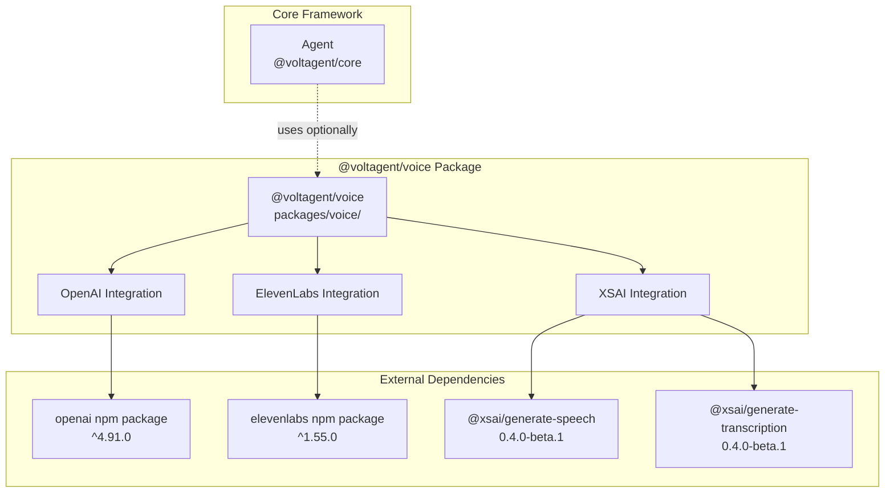
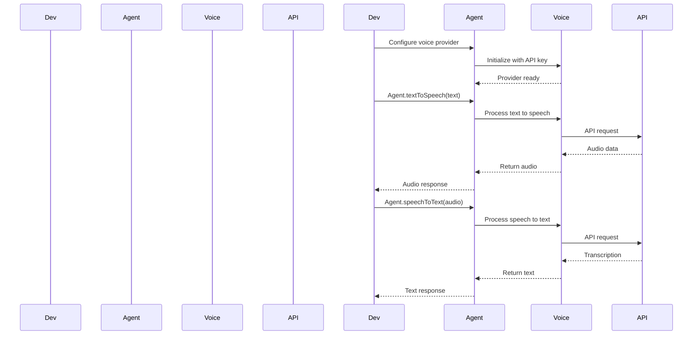
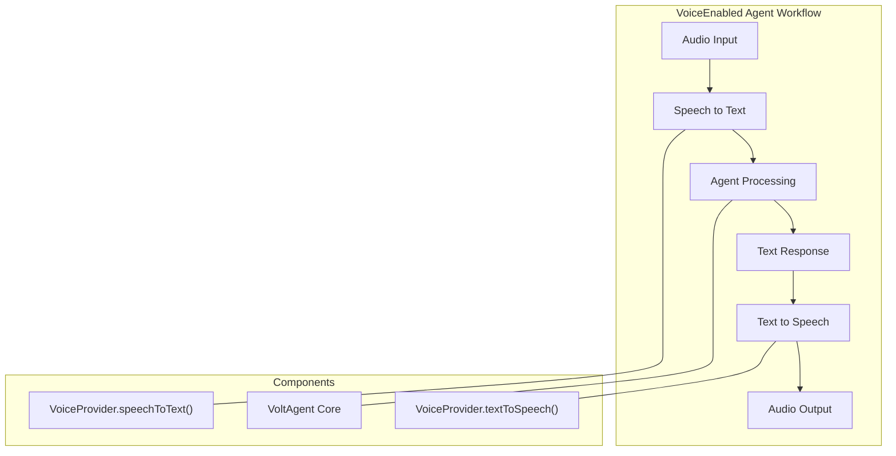

<!-- source: DeepWiki mcp.deepwiki.com · repo voltagent/voltagent · page 6.3 Voice Capabilities · fetched 2026-10-27 -->

# Voice Capabilities

<details>
<summary>Relevant source files</summary>

The following files were used as context for generating this wiki page:

- [CHANGELOG.md](CHANGELOG.md)
- [changelog.sh](changelog.sh)
- [examples/base/src/index.ts](examples/base/src/index.ts)
- [examples/with-google-ai/package.json](examples/with-google-ai/package.json)
- [examples/with-google-vertex-ai/package.json](examples/with-google-vertex-ai/package.json)
- [examples/with-groq-ai/package.json](examples/with-groq-ai/package.json)
- [examples/with-mcp/package.json](examples/with-mcp/package.json)
- [examples/with-nextjs/package.json](examples/with-nextjs/package.json)
- [packages/cli/package.json](packages/cli/package.json)
- [packages/core/package.json](packages/core/package.json)
- [packages/create-voltagent-app/CHANGELOG.md](packages/create-voltagent-app/CHANGELOG.md)
- [packages/create-voltagent-app/package.json](packages/create-voltagent-app/package.json)
- [packages/voice/package.json](packages/voice/package.json)
- [pnpm-lock.yaml](pnpm-lock.yaml)

</details>


The `@voltagent/voice` package provides voice processing capabilities for VoltAgent agents, enabling speech-to-text transcription and text-to-speech synthesis. The package integrates three external voice service providers through a unified interface.

## Package Structure

The `@voltagent/voice` package [packages/voice/package.json:1-51]() is an optional add-on to `@voltagent/core` with a peer dependency structure. It bundles integrations for three voice service providers without requiring users to install all provider SDKs.

**Package Dependencies:**
- `openai` (^4.91.0) - OpenAI TTS and Whisper STT
- `elevenlabs` (^1.55.0) - ElevenLabs TTS
- `@xsai/generate-speech` (0.4.0-beta.1) - XSAI TTS
- `@xsai/generate-transcription` (0.4.0-beta.1) - XSAI STT

The package exports from both CommonJS and ESM entry points [packages/voice/package.json:19-29]().

**Voice Integration Architecture**



Sources:
- [packages/voice/package.json:1-51]()
- [packages/core/package.json:1-78]()

## Voice Provider Capabilities

The package integrates three distinct voice service providers, each with different capabilities:

| Provider | Package Dependency | TTS Support | STT Support | Example Project |
|----------|-------------------|-------------|-------------|-----------------|
| OpenAI | `openai` ^4.91.0 | ✓ (TTS models) | ✓ (Whisper) | `examples/with-voice-openai` |
| ElevenLabs | `elevenlabs` ^1.55.0 | ✓ | ✗ | `examples/with-voice-elevenlabs` |
| XSAI | `@xsai/generate-speech`<br/>`@xsai/generate-transcription` | ✓ | ✓ | N/A |

**Provider Characteristics:**

- **OpenAI**: Provides both TTS through OpenAI's TTS models and STT through Whisper models. Requires OpenAI API key.
- **ElevenLabs**: Specialized high-quality TTS service with voice cloning capabilities. TTS-only, requires ElevenLabs API key.
- **XSAI**: Provides both TTS and STT through separate SDK packages. Part of the XSAI (Cross-platform Speech AI) ecosystem.

Sources:
- [packages/voice/package.json:5-10]()
- [examples/with-voice-openai/package.json:1-32]()
- [examples/with-voice-elevenlabs/package.json:1-32]()

## Integration with Agents

The voice package integrates with VoltAgent's core `Agent` class through optional voice configuration. Agents can be configured to use voice capabilities for processing speech inputs and generating audio outputs.

**Agent Voice Integration Flow**

```mermaid
sequenceDiagram
    participant Client
    participant Agent["Agent Instance<br/>@voltagent/core"]
    participant VoicePkg["@voltagent/voice"]
    participant Provider["Voice Provider<br/>(OpenAI/ElevenLabs/XSAI)"]
    
    Client->>Agent: "Configure agent with voice"
    Agent->>VoicePkg: "Initialize voice provider"
    VoicePkg->>Provider: "Setup API client"
    Provider-->>VoicePkg: "Client ready"
    VoicePkg-->>Agent: "Voice enabled"
    
    Note over Client,Provider: Speech-to-Text Flow
    Client->>Agent: "Process audio input"
    Agent->>VoicePkg: "transcribe(audioBuffer)"
    VoicePkg->>Provider: "API call (STT)"
    Provider-->>VoicePkg: "Text transcription"
    VoicePkg-->>Agent: "Return text"
    Agent-->>Client: "Transcribed text"
    
    Note over Client,Provider: Text-to-Speech Flow
    Client->>Agent: "Generate audio response"
    Agent->>VoicePkg: "synthesize(text)"
    VoicePkg->>Provider: "API call (TTS)"
    Provider-->>VoicePkg: "Audio buffer"
    VoicePkg-->>Agent: "Return audio"
    Agent-->>Client: "Audio response"
```

Sources:
- [packages/voice/package.json:1-51]()
- [packages/core/package.json:54-59]()

## Using Voice Capabilities

### Installation

To use voice capabilities in your VoltAgent project, install the voice package:

```bash
npm install @voltagent/voice
```

Additionally, install the package for your desired voice provider:

```bash
# For OpenAI voice capabilities
npm install openai

# For ElevenLabs voice capabilities 
npm install elevenlabs
```

### Configuration

The voice providers require specific configuration with API keys and other settings:



Sources:
- examples/with-voice-elevenlabs/package.json
- examples/with-voice-openai/package.json

### Example: Using ElevenLabs for Text-to-Speech

This example demonstrates how to configure and use the ElevenLabs provider for text-to-speech:

```typescript
import { VoltAgent } from '@voltagent/core';
import { ElevenLabsProvider } from '@voltagent/voice';
import { OpenAIProvider } from '@voltagent/vercel-ai';

// Create an agent with voice capabilities
const agent = new VoltAgent({
  provider: new OpenAIProvider({
    model: 'gpt-4o',
    apiKey: process.env.OPENAI_API_KEY
  }),
  voice: new ElevenLabsProvider({
    apiKey: process.env.ELEVENLABS_API_KEY,
    voiceId: 'voice-id-here' // Replace with actual voice ID
  })
});

// Convert agent response to speech
const response = await agent.generateText("Tell me about voice AI");
const audioBuffer = await agent.textToSpeech(response.text);

// Save or stream the audio
// ...
```

Sources:
- examples/with-voice-elevenlabs/package.json

### Example: Using OpenAI for Speech-to-Text and Text-to-Speech

This example demonstrates using OpenAI for both speech recognition and speech synthesis:

```typescript
import { VoltAgent } from '@voltagent/core';
import { OpenAIVoiceProvider } from '@voltagent/voice';
import { OpenAIProvider } from '@voltagent/vercel-ai';
import { readFileSync } from 'fs';

// Create an agent with OpenAI voice capabilities
const agent = new VoltAgent({
  provider: new OpenAIProvider({
    model: 'gpt-4o',
    apiKey: process.env.OPENAI_API_KEY
  }),
  voice: new OpenAIVoiceProvider({
    apiKey: process.env.OPENAI_API_KEY,
    ttsModel: 'tts-1',
    ttsVoice: 'alloy',
    sttModel: 'whisper-1'
  })
});

// Convert speech to text
const audioFile = readFileSync('input.mp3');
const transcription = await agent.speechToText(audioFile);

// Process with the agent
const response = await agent.generateText(transcription);

// Convert response to speech
const audioBuffer = await agent.textToSpeech(response.text);

// Save or stream the audio
// ...
```

Sources:
- examples/with-voice-openai/package.json

## Integration with Agent Workflow

Voice capabilities integrate seamlessly with the VoltAgent workflow, allowing agents to process voice input and generate voice output as part of their operation.



The voice capabilities can be integrated at different points in the agent workflow:

1. **Input Processing**: Convert audio input to text before passing to the agent
2. **Output Generation**: Convert agent text responses to speech for user consumption
3. **Multi-modal Interaction**: Combine text and voice interfaces for richer user experiences

Sources:
- examples/with-voice-elevenlabs/package.json
- examples/with-voice-openai/package.json

## Advanced Usage

### Customizing Voice Parameters

Both ElevenLabs and OpenAI providers support customization of voice parameters to control the characteristics of the generated speech:

```typescript
// ElevenLabs voice customization
const audioBuffer = await agent.textToSpeech(text, {
  stability: 0.7,
  similarity_boost: 0.8,
  style: 0.5,
  use_speaker_boost: true
});

// OpenAI voice customization
const audioBuffer = await agent.textToSpeech(text, {
  voice: 'nova',
  speed: 1.2,
  response_format: 'mp3'
});
```

### Streaming Audio

For real-time applications, streaming audio can provide a more responsive user experience:

```typescript
// Stream audio output
const stream = await agent.textToSpeechStream(text);
stream.on('data', (chunk) => {
  // Process audio chunk
});
stream.on('end', () => {
  // Audio complete
});
```

Sources:
- packages/voice/package.json
- examples/with-voice-elevenlabs/package.json
- examples/with-voice-openai/package.json

## Conclusion

The `@voltagent/voice` package extends VoltAgent with powerful voice processing capabilities through integrations with ElevenLabs and OpenAI. These capabilities enable the creation of voice-interactive AI agents that can process speech input and generate natural-sounding speech output.

By leveraging these voice capabilities, developers can build more accessible and natural AI interfaces that engage users through conversational voice interactions.

---

