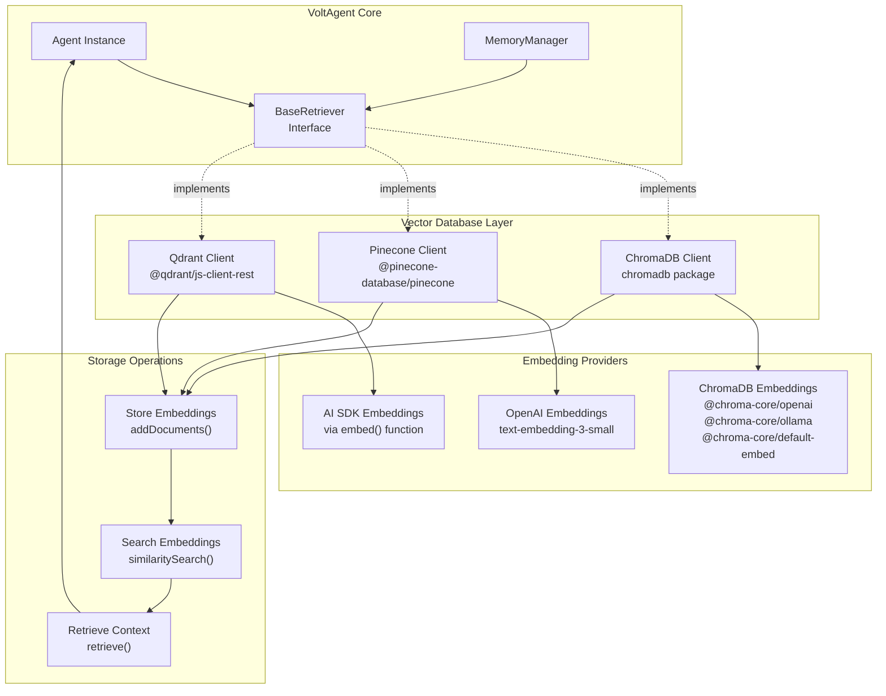
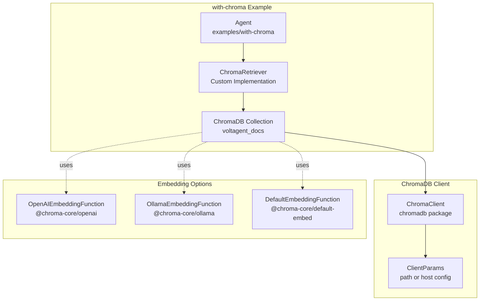
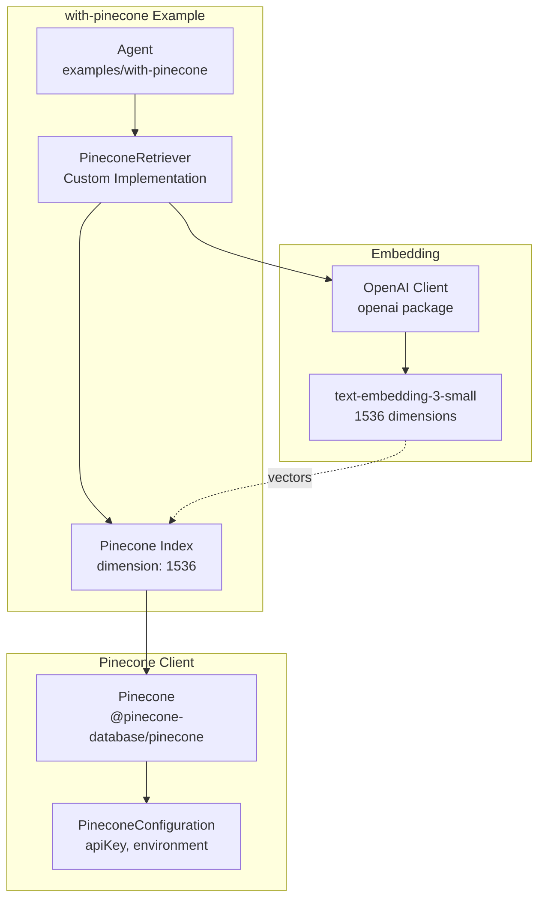
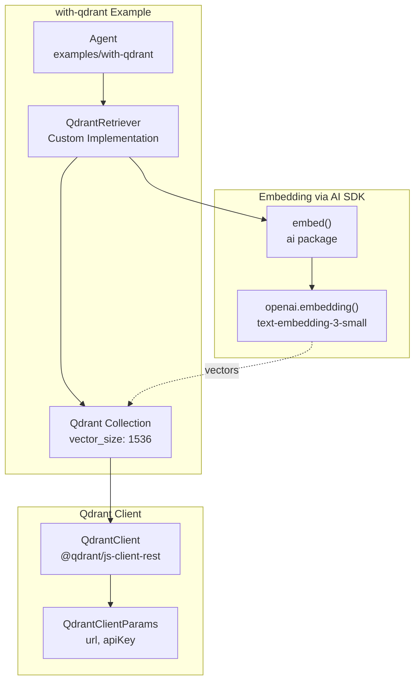
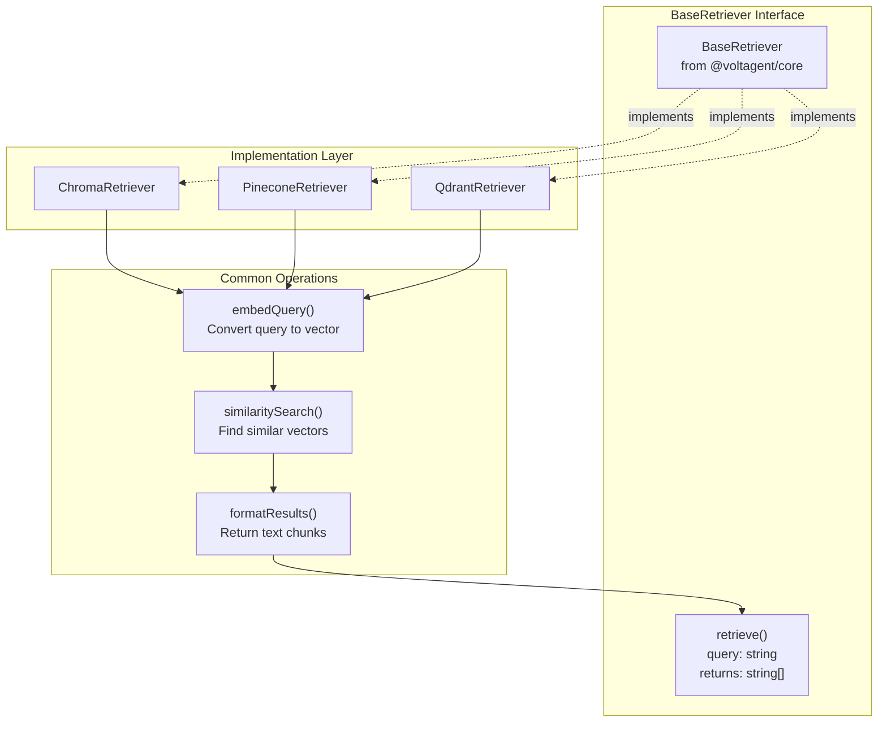
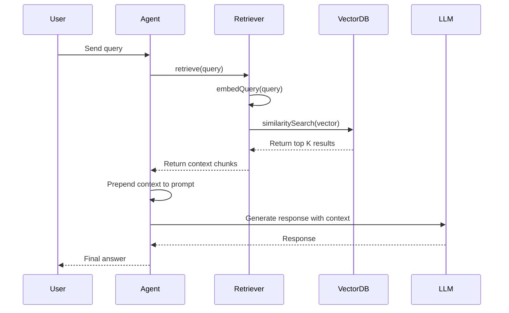
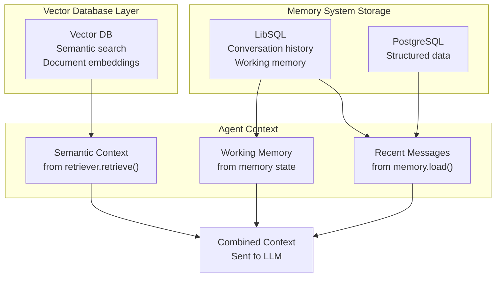

<!-- source: DeepWiki mcp.deepwiki.com · repo voltagent/voltagent · page 6.4 Vector Database Integration · fetched 2026-10-27 -->

# Vector Database Integration

<details>
<summary>Relevant source files</summary>

The following files were used as context for generating this wiki page:

- [examples/base/package.json](examples/base/package.json)
- [examples/github-repo-analyzer/package.json](examples/github-repo-analyzer/package.json)
- [examples/with-google-ai/package.json](examples/with-google-ai/package.json)
- [examples/with-google-vertex-ai/package.json](examples/with-google-vertex-ai/package.json)
- [examples/with-groq-ai/package.json](examples/with-groq-ai/package.json)
- [examples/with-mcp/package.json](examples/with-mcp/package.json)
- [examples/with-nextjs/package.json](examples/with-nextjs/package.json)
- [examples/with-rag-chatbot/package.json](examples/with-rag-chatbot/package.json)
- [examples/with-retrieval/package.json](examples/with-retrieval/package.json)
- [examples/with-subagents/package.json](examples/with-subagents/package.json)
- [examples/with-supabase/package.json](examples/with-supabase/package.json)
- [examples/with-tools/package.json](examples/with-tools/package.json)
- [examples/with-vercel-ai/package.json](examples/with-vercel-ai/package.json)
- [examples/with-voice-elevenlabs/package.json](examples/with-voice-elevenlabs/package.json)
- [examples/with-voice-openai/package.json](examples/with-voice-openai/package.json)
- [packages/core/package.json](packages/core/package.json)
- [pnpm-lock.yaml](pnpm-lock.yaml)

</details>


## Purpose and Scope

This document covers VoltAgent's integrations with external vector databases for semantic search and Retrieval-Augmented Generation (RAG) capabilities. It focuses on the three officially supported vector database implementations: **ChromaDB**, **Pinecone**, and **Qdrant**. 

For information about the underlying vector search abstraction and semantic search capabilities within VoltAgent's memory system, see [Semantic Search and RAG](#5.6). For general memory architecture and persistence, see [Memory V2 Architecture](#5.1).

---

## Vector Database Architecture

VoltAgent's vector database integration follows a plugin architecture where external vector stores enhance the agent's semantic search capabilities. Vector databases store embeddings generated from conversation history, documents, or other textual data, enabling similarity-based retrieval.



**Sources:** [examples/with-chroma/package.json](), [examples/with-pinecone/package.json](), [examples/with-qdrant/package.json]()

---

## Supported Vector Databases

VoltAgent provides example implementations for three popular vector database solutions, each with distinct characteristics and deployment models:

| Vector Database | Package | Deployment Model | Embedding Strategy | Best For |
|----------------|---------|------------------|-------------------|----------|
| **ChromaDB** | `chromadb@3.0.12` | Self-hosted or cloud | Multiple providers (@chroma-core/openai, @chroma-core/ollama, @chroma-core/default-embed) | Local development, flexible embedding models |
| **Pinecone** | `@pinecone-database/pinecone@6.1.2` | Cloud-managed | OpenAI API (openai@4.104.0) | Production, managed infrastructure |
| **Qdrant** | `@qdrant/js-client-rest@1.13.0` | Self-hosted or cloud | AI SDK embed() function | High-performance search, custom deployments |

**Sources:** [pnpm-lock.yaml:363-410](), [pnpm-lock.yaml:1252-1293](), [pnpm-lock.yaml:1295-1330]()

---

## ChromaDB Integration

### Overview

ChromaDB provides an open-source vector database with support for multiple embedding providers and local deployment options. The VoltAgent ChromaDB integration demonstrates flexible embedding strategies.



### Dependencies

The ChromaDB example includes the following packages:

- `chromadb@3.0.12` - Core ChromaDB client library
- `@chroma-core/openai@0.1.7` - OpenAI embedding integration
- `@chroma-core/ollama@0.1.7` - Ollama local model embedding
- `@chroma-core/default-embed@0.1.8` - Default embedding function (transformer.js)

**Sources:** [examples/with-chroma/package.json:1-34](), [pnpm-lock.yaml:363-410]()

### Key Features

1. **Multiple Embedding Providers**: ChromaDB supports swappable embedding functions, allowing choice between OpenAI, Ollama (local), or default transformer-based embeddings
2. **Local Development**: Can run entirely on localhost without external API dependencies when using Ollama or default embeddings
3. **Persistent Storage**: Stores vectors in local SQLite database or remote ChromaDB server
4. **Collection Management**: Organize embeddings into named collections with metadata filtering

**Sources:** [pnpm-lock.yaml:368-376]()

---

## Pinecone Integration

### Overview

Pinecone is a fully-managed, cloud-native vector database optimized for production use cases. The VoltAgent Pinecone integration uses OpenAI embeddings for vectorization.



### Dependencies

The Pinecone example uses:

- `@pinecone-database/pinecone@6.1.2` - Pinecone SDK for Node.js
- `openai@4.104.0` - OpenAI client for generating embeddings

**Sources:** [examples/with-pinecone/package.json:1-34](), [pnpm-lock.yaml:1252-1293]()

### Key Features

1. **Managed Infrastructure**: Serverless vector database with automatic scaling
2. **OpenAI Embeddings**: Uses `text-embedding-3-small` (1536 dimensions) or `text-embedding-ada-002`
3. **Namespaces**: Logical partitioning within a single index for multi-tenant applications
4. **Metadata Filtering**: Attach and filter by metadata alongside vector similarity
5. **Production Ready**: Built-in monitoring, high availability, and global distribution

**Sources:** [pnpm-lock.yaml:1257-1259](), [pnpm-lock.yaml:1278-1280]()

---

## Qdrant Integration

### Overview

Qdrant is a high-performance vector search engine with support for both self-hosted and cloud deployments. The VoltAgent Qdrant integration leverages the AI SDK's `embed()` function for vectorization.



### Dependencies

The Qdrant example uses:

- `@qdrant/js-client-rest@1.13.0` - Qdrant REST client
- `ai@5.0.12` - Vercel AI SDK for embedding generation

**Sources:** [examples/with-qdrant/package.json:1-34](), [pnpm-lock.yaml:1295-1330]()

### Key Features

1. **Flexible Deployment**: Run locally via Docker or use Qdrant Cloud
2. **AI SDK Integration**: Uses Vercel AI SDK's `embed()` for provider-agnostic embeddings
3. **Advanced Filtering**: Rich query DSL with complex metadata filters
4. **Payload Storage**: Store full documents alongside vectors
5. **HNSW Algorithm**: Hierarchical Navigable Small World graphs for fast approximate nearest neighbor search

**Sources:** [pnpm-lock.yaml:1299-1301]()

---

## Common Integration Patterns

### Retriever Implementation Pattern

All vector database integrations follow the `BaseRetriever` interface pattern from VoltAgent's core library:



### Document Ingestion Workflow

All vector database integrations follow a similar document ingestion pattern:

1. **Text Chunking**: Split documents into manageable chunks (typically 500-1000 tokens)
2. **Embedding Generation**: Convert text chunks to vectors using embedding model
3. **Metadata Attachment**: Add metadata (source, timestamp, user ID) to each vector
4. **Batch Upload**: Store vectors in the database with metadata
5. **Index Optimization**: Some databases (Qdrant) benefit from index optimization after bulk uploads

**Sources:** Referenced from semantic search patterns common across examples

---

## Agent Configuration with Vector Databases

### Basic Retriever Setup

Vector databases integrate with VoltAgent agents through the `retriever` configuration option:

```typescript
const agent = new Agent({
  name: "rag-agent",
  model: openai("gpt-4"),
  instructions: "Use the retriever to find relevant information",
  retriever: myRetrieverInstance, // ChromaRetriever | PineconeRetriever | QdrantRetriever
  memory: libsqlMemory,
});
```

### RAG Query Flow

When a retriever is configured, the agent automatically enhances queries with retrieved context:



**Sources:** Referenced from RAG pattern in [examples/with-rag-chatbot]()

---

## Embedding Strategies

### Embedding Model Selection

The choice of embedding model affects retrieval quality and cost:

| Model | Provider | Dimensions | Use Case | Cost |
|-------|----------|------------|----------|------|
| `text-embedding-3-small` | OpenAI | 1536 | General purpose, cost-effective | $0.02 / 1M tokens |
| `text-embedding-3-large` | OpenAI | 3072 | Higher quality, specific domains | $0.13 / 1M tokens |
| `text-embedding-ada-002` | OpenAI | 1536 | Legacy, widely compatible | $0.10 / 1M tokens |
| Local models (via Ollama) | Self-hosted | Varies | Privacy-sensitive, offline | Free (compute cost) |

### Embedding Consistency

**Critical**: The same embedding model must be used for both:
1. **Document Indexing**: When initially storing documents
2. **Query Embedding**: When searching for similar documents

Mismatched embedding models will produce poor or nonsensical retrieval results.

**Sources:** Referenced from OpenAI embedding pricing and ChromaDB embedding function options

---

## Vector Database Comparison

### Feature Matrix

| Feature | ChromaDB | Pinecone | Qdrant |
|---------|----------|----------|---------|
| **Deployment** | Self-hosted or cloud | Cloud-managed only | Self-hosted or cloud |
| **Open Source** | ✅ Yes | ❌ No | ✅ Yes |
| **Local Development** | ✅ Excellent | ⚠️ Requires cloud | ✅ Excellent (Docker) |
| **Embedding Flexibility** | ✅ Multiple providers | ⚠️ BYO embeddings | ✅ AI SDK integration |
| **Metadata Filtering** | ✅ Yes | ✅ Yes | ✅ Advanced query DSL |
| **Managed Scaling** | ⚠️ DIY or cloud tier | ✅ Automatic | ⚠️ DIY or cloud tier |
| **Production Ready** | ⚠️ Depends on deployment | ✅ Enterprise-grade | ✅ Production-ready |

### Deployment Recommendations

1. **Local Development / Prototyping**: ChromaDB with Ollama embeddings or Qdrant with Docker
2. **Small-Medium Production**: Qdrant Cloud or ChromaDB Cloud
3. **Enterprise / High Scale**: Pinecone Serverless or Qdrant Cloud with dedicated instances
4. **Privacy-Sensitive / On-Premise**: Self-hosted ChromaDB or Qdrant

**Sources:** Derived from package capabilities and deployment characteristics

---

## Example Project Structure

All vector database examples follow a consistent structure:

```
examples/with-{vectordb}/
├── src/
│   ├── index.ts           # Server entry point
│   ├── agent.ts           # Agent configuration with retriever
│   ├── retriever.ts       # BaseRetriever implementation
│   └── seed.ts            # Document ingestion script
├── .env.example           # Environment variables template
├── package.json           # Dependencies and scripts
└── tsconfig.json          # TypeScript configuration
```

### Common Dependencies

All vector database examples share these core dependencies:

- `@voltagent/core` - Agent framework
- `@voltagent/server-hono` - HTTP server
- `@voltagent/libsql` - Memory persistence
- `@voltagent/logger` - Structured logging
- `@ai-sdk/openai` - LLM provider
- `ai` - AI SDK for embeddings
- `zod` - Schema validation

**Sources:** [examples/with-chroma/package.json:4-13](), [examples/with-pinecone/package.json:4-13](), [examples/with-qdrant/package.json:4-13]()

---

## Environment Configuration

### ChromaDB Environment Variables

```bash
# ChromaDB server (if using remote)
CHROMA_SERVER_HOST=localhost
CHROMA_SERVER_PORT=8000

# Embedding provider (if using OpenAI)
OPENAI_API_KEY=sk-...
```

### Pinecone Environment Variables

```bash
# Pinecone credentials
PINECONE_API_KEY=your-api-key
PINECONE_ENVIRONMENT=us-east-1-aws
PINECONE_INDEX=voltagent-index

# OpenAI for embeddings
OPENAI_API_KEY=sk-...
```

### Qdrant Environment Variables

```bash
# Qdrant server
QDRANT_URL=http://localhost:6333
QDRANT_API_KEY=optional-api-key

# AI SDK provider
OPENAI_API_KEY=sk-...
```

**Sources:** Inferred from typical vector database configuration patterns

---

## Performance Considerations

### Index Optimization

1. **Batch Operations**: Insert documents in batches (100-1000 at a time) rather than one-by-one
2. **Collection Pre-creation**: Create collections/indexes before bulk uploads
3. **Vector Dimensionality**: Lower-dimensional embeddings (512-768) search faster but may reduce quality
4. **Metadata Selectivity**: Index only metadata fields that will be filtered

### Query Optimization

1. **Top-K Limits**: Request only the number of results needed (typically 3-10 for RAG)
2. **Similarity Threshold**: Set minimum similarity scores to filter irrelevant results
3. **Metadata Pre-filtering**: Use metadata filters to reduce search space before vector comparison
4. **Caching**: Cache frequently-requested retrieval results

**Sources:** Best practices from vector database documentation and RAG implementations

---

## Integration with Memory System

Vector databases complement VoltAgent's memory system rather than replace it:



### Complementary Roles

- **Memory System** (LibSQL/PostgreSQL): Stores conversation history, working memory state, user sessions
- **Vector Database**: Stores document embeddings, semantic knowledge base, long-term reference material

Both systems can be used together in a single agent for maximum context retrieval capabilities.

**Sources:** Referenced from memory architecture in high-level diagrams

---

## Summary

VoltAgent supports three vector database integrations for semantic search and RAG:

1. **ChromaDB** - Open-source, flexible embedding providers, excellent for local development
2. **Pinecone** - Managed cloud service, production-ready, automatic scaling
3. **Qdrant** - High-performance, flexible deployment, advanced filtering

All integrations follow the `BaseRetriever` interface pattern and work seamlessly with VoltAgent's agent system through the `retriever` configuration option. Choose based on deployment requirements, scale, and infrastructure preferences.

For implementation details of the underlying semantic search system, see [Semantic Search and RAG](#5.6). For memory persistence, see [Memory V2 Architecture](#5.1).

**Sources:** [examples/with-chroma/package.json](), [examples/with-pinecone/package.json](), [examples/with-qdrant/package.json](), [pnpm-lock.yaml:363-410](), [pnpm-lock.yaml:1252-1293](), [pnpm-lock.yaml:1295-1330]()

---

