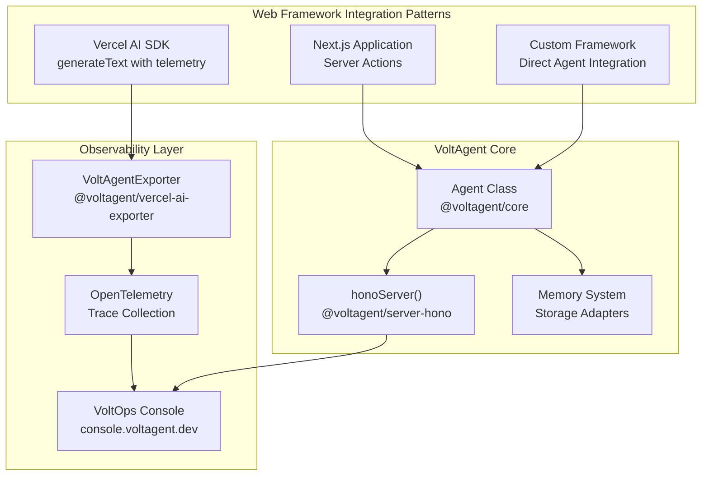
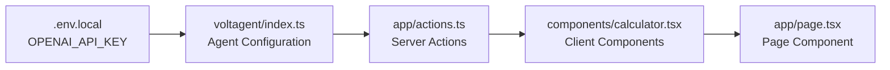
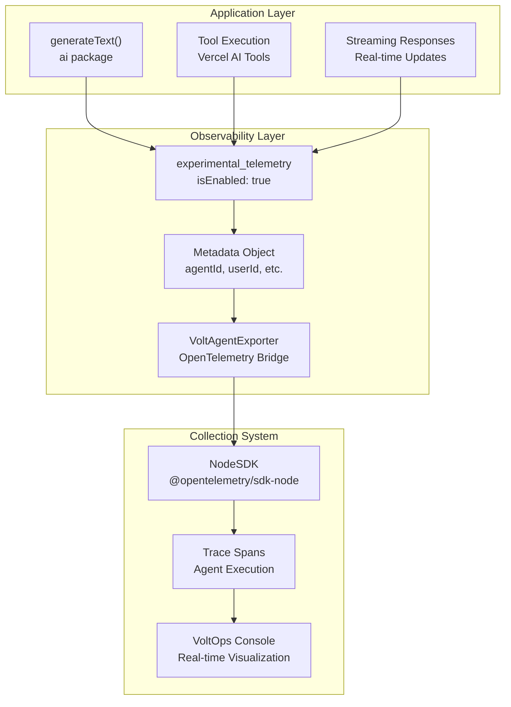
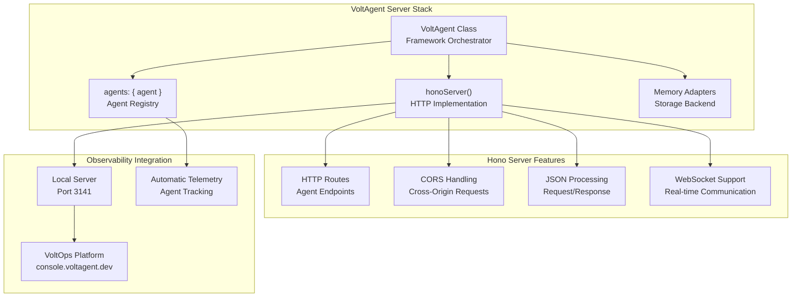
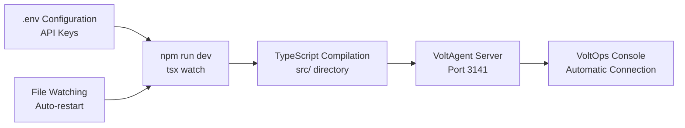

<!-- source: DeepWiki mcp.deepwiki.com · repo voltagent/voltagent · page 6.5 Web Framework Integration · fetched 2026-10-27 -->

# Web Framework Integration

<details>
<summary>Relevant source files</summary>

The following files were used as context for generating this wiki page:

- [examples/base/package.json](examples/base/package.json)
- [examples/github-repo-analyzer/package.json](examples/github-repo-analyzer/package.json)
- [examples/with-google-ai/package.json](examples/with-google-ai/package.json)
- [examples/with-google-vertex-ai/package.json](examples/with-google-vertex-ai/package.json)
- [examples/with-groq-ai/package.json](examples/with-groq-ai/package.json)
- [examples/with-mcp/package.json](examples/with-mcp/package.json)
- [examples/with-nextjs/package.json](examples/with-nextjs/package.json)
- [examples/with-rag-chatbot/package.json](examples/with-rag-chatbot/package.json)
- [examples/with-retrieval/package.json](examples/with-retrieval/package.json)
- [examples/with-subagents/package.json](examples/with-subagents/package.json)
- [examples/with-supabase/package.json](examples/with-supabase/package.json)
- [examples/with-tools/package.json](examples/with-tools/package.json)
- [examples/with-vercel-ai/package.json](examples/with-vercel-ai/package.json)
- [examples/with-voice-elevenlabs/package.json](examples/with-voice-elevenlabs/package.json)
- [examples/with-voice-openai/package.json](examples/with-voice-openai/package.json)
- [packages/core/package.json](packages/core/package.json)
- [pnpm-lock.yaml](pnpm-lock.yaml)

</details>


VoltAgent provides flexible integration patterns for modern web frameworks, enabling AI agent functionality within existing web applications. This document covers integration approaches for Next.js, Vercel AI SDK observability, and HTTP server implementations.

For core agent functionality, see [Agent System](#2.1). For observability platform details, see [VoltOps Platform](#7.1).

## Integration Architecture Overview

VoltAgent supports both standalone server deployments and embedded integration within web frameworks through multiple architectural patterns.



Sources: [website/docs/integrations/nextjs.md:1-187](), [website/docs/integrations/vercel-ai.md:1-464](), [examples/base/package.json:1-34]()

## Next.js Integration

VoltAgent integrates with Next.js applications through Server Actions, enabling AI agent functionality within the Next.js App Router architecture.

### Dependencies and Configuration

Next.js projects require specific package configuration to properly handle VoltAgent server-side packages:

| Package | Purpose | Version |
|---------|---------|---------|
| `@voltagent/core` | Core agent functionality | Latest |
| `@voltagent/cli` | Command line tools | Latest |
| `@ai-sdk/openai` | AI provider integration | ^2.0.0 |
| `zod` | Schema validation | ^3.25.0 |

The `next.config.mjs` file must mark VoltAgent packages as external to prevent bundling issues:

```typescript
experimental: {
  serverComponentsExternalPackages: ["@voltagent/*"]
}
```

### Agent Initialization Pattern

VoltAgent agents are typically initialized in a dedicated module and imported into Server Actions:



Sources: [website/docs/integrations/nextjs.md:44-88](), [website/docs/integrations/nextjs.md:66-79]()

### Server Action Implementation

Server Actions provide the bridge between client components and VoltAgent functionality:

```typescript
// Example pattern from integration guide
export async function calculateExpression(expression: string) {
  const result = await agent.generateText(
    `Calculate ${expression}. Only respond with the numeric result.`
  );
  return result.text;
}
```

Sources: [website/docs/integrations/nextjs.md:89-105]()

## Vercel AI SDK Integration

VoltAgent provides observability integration for Vercel AI SDK applications through the `@voltagent/vercel-ai-exporter` package, enabling telemetry collection without modifying core application logic.

### Telemetry Architecture



### Integration Patterns

The Vercel AI SDK integration supports progressive enhancement from basic telemetry to advanced multi-agent tracking:

| Integration Level | Features | Metadata Required |
|------------------|----------|-------------------|
| Basic | Default agent tracking | `isEnabled: true` |
| Identified | Named agent tracking | `agentId` |
| Contextual | User and session tracking | `userId`, `conversationId` |
| Multi-Agent | Hierarchical relationships | `parentAgentId` |

### Configuration Example

```typescript
// VoltAgentExporter initialization pattern
const voltAgentExporter = new VoltAgentExporter({
  publicKey: process.env.VOLTAGENT_PUBLIC_KEY,
  secretKey: process.env.VOLTAGENT_SECRET_KEY,
  baseUrl: "https://api.voltagent.dev",
  debug: process.env.NODE_ENV === "development"
});
```

Sources: [website/docs/integrations/vercel-ai.md:36-72](), [website/observability/vercel-ai.md:36-73]()

## HTTP Server Architecture

VoltAgent applications use the `@voltagent/server-hono` package for HTTP server functionality, providing a standardized server implementation across all example applications.

### Server Implementation Pattern

All VoltAgent examples follow a consistent server architecture pattern:



### Consistent Package Dependencies

All example applications use the same core server dependencies:

| Package | Role | Used In Examples |
|---------|------|------------------|
| `@voltagent/server-hono` | HTTP server implementation | All examples |
| `@voltagent/core` | Agent functionality | All examples |
| `@voltagent/logger` | Logging system | All examples |
| `ai` | Vercel AI SDK integration | All examples |

Sources: [examples/base/package.json:4-13](), [examples/with-supabase/package.json:4-13](), [examples/with-voice-openai/package.json:4-15]()

## Development Server Configuration

VoltAgent applications follow a standardized development server pattern with automatic observability integration.

### Standard Development Scripts



### Server Startup Message

All VoltAgent applications display a consistent startup message indicating successful server initialization:

```
══════════════════════════════════════════════════
  VOLTAGENT SERVER STARTED SUCCESSFULLY
══════════════════════════════════════════════════
  ✓ HTTP Server: http://localhost:3141

  VoltOps Platform:    https://console.voltagent.dev
══════════════════════════════════════════════════
```

Sources: [website/docs/getting-started/quick-start.md:142-154](), [CONSOLE.md:113-126]()

## Environment Variable Patterns

VoltAgent web framework integrations use consistent environment variable patterns across different deployment scenarios.

### Standard Environment Configuration

| Variable | Purpose | Used In |
|----------|---------|---------|
| `OPENAI_API_KEY` | OpenAI API access | Most examples |
| `ANTHROPIC_API_KEY` | Anthropic API access | Provider-specific |
| `VOLTAGENT_PUBLIC_KEY` | VoltOps identification | Vercel AI integration |
| `VOLTAGENT_SECRET_KEY` | VoltOps authentication | Vercel AI integration |

### Framework-Specific Configuration

Next.js applications use `.env.local` for environment variables, while standalone applications use `.env` files. The VoltAgent CLI automatically generates appropriate environment files during project creation.

Sources: [website/docs/integrations/nextjs.md:80-87](), [website/docs/integrations/vercel-ai.md:413-418](), [website/docs/getting-started/quick-start.md:84-106]()

---

