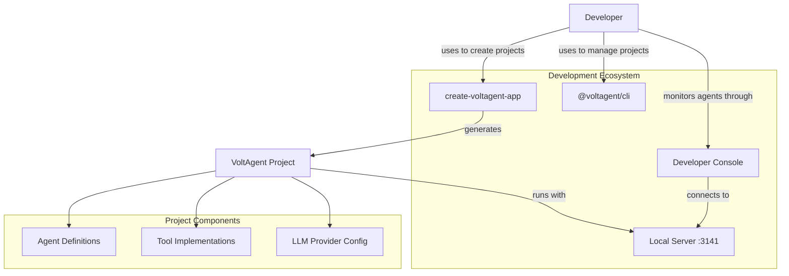
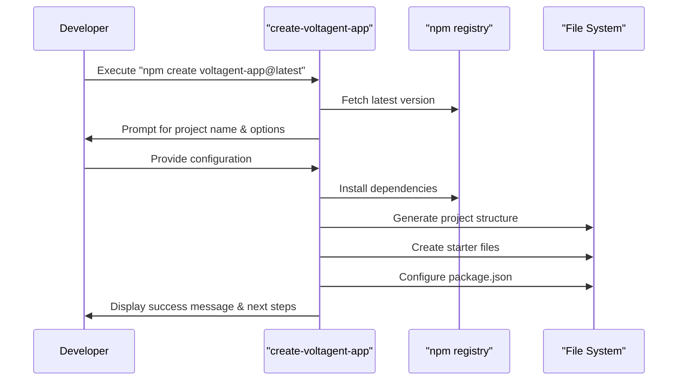
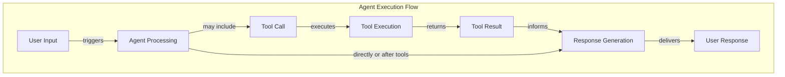
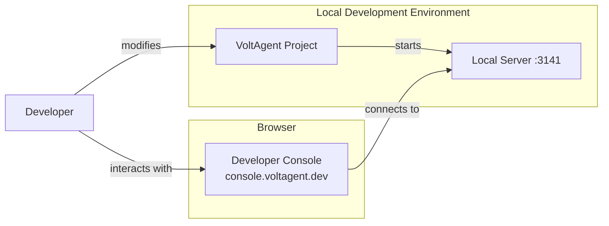
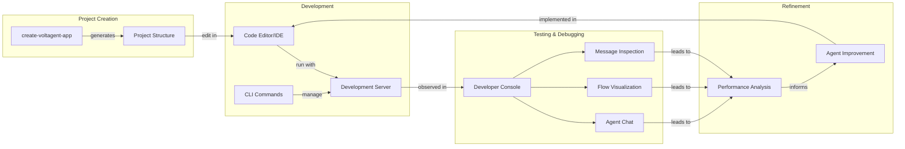
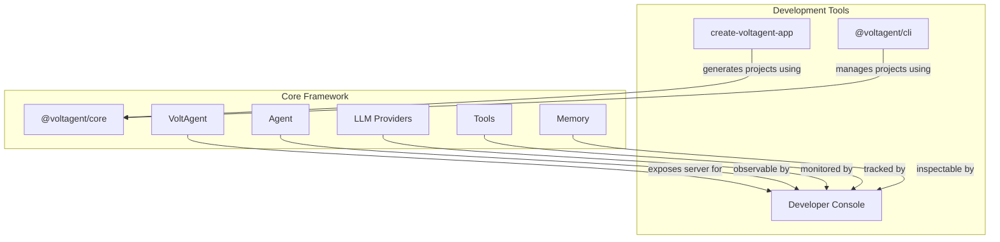

<!-- source: DeepWiki mcp.deepwiki.com · repo voltagent/voltagent · page 7 Development Tools · fetched 2026-10-27 -->

# Development Tools

Relevant source files

The following files were used as context for generating this wiki page:

- [.github/workflows/prerelease.yml](.github/workflows/prerelease.yml)
- [.github/workflows/pull-request.yml](.github/workflows/pull-request.yml)
- [.github/workflows/release.yml](.github/workflows/release.yml)
- [CHANGELOG.md](CHANGELOG.md)
- [changelog.sh](changelog.sh)
- [examples/base/src/index.ts](examples/base/src/index.ts)
- [examples/with-jwt-auth/src/index.ts](examples/with-jwt-auth/src/index.ts)
- [examples/with-playwright/src/index.ts](examples/with-playwright/src/index.ts)
- [package.json](package.json)
- [packages/cli/package.json](packages/cli/package.json)
- [packages/core/src/utils/message-helpers.spec.ts](packages/core/src/utils/message-helpers.spec.ts)
- [packages/core/src/utils/message-helpers.ts](packages/core/src/utils/message-helpers.ts)
- [packages/create-voltagent-app/CHANGELOG.md](packages/create-voltagent-app/CHANGELOG.md)
- [packages/create-voltagent-app/package.json](packages/create-voltagent-app/package.json)
- [packages/voice/package.json](packages/voice/package.json)
- [pnpm-workspace.yaml](pnpm-workspace.yaml)
- [website/docs/utils/message-helpers.md](website/docs/utils/message-helpers.md)

This page provides an overview of the development tools available in the VoltAgent ecosystem that help developers build, debug, monitor, and manage their AI agent applications. These tools are designed to streamline the development workflow and provide insights into agent behavior.

For information about specific integrations like voice or database capabilities, see [Extensions and Integrations](#4).

## Overview of Development Tools

The VoltAgent framework provides several key development tools that work together to support the agent development lifecycle:

Sources: [README.md:85-95](), [CONSOLE.md:20-26](), [packages/create-voltagent-app/package.json:1-10](), [packages/cli/package.json:1-14]()

## Project Creation with `create-voltagent-app`

The `create-voltagent-app` tool allows developers to quickly bootstrap new VoltAgent projects with the necessary structure and dependencies.

### Features and Usage

- **Command:** `npm create voltagent-app@latest [project-name]`
- **Interactive Setup:** Guides developers through configuration options
- **Template Selection:** Provides starter templates for different use cases
- **Environment Configuration:** Helps set up necessary API keys and environment variables

Sources: [README.md:87-95](), [packages/create-voltagent-app/package.json:1-54]()

### Project Structure

A typical project created with `create-voltagent-app` includes:

- Core configuration files (`package.json`, `tsconfig.json`)
- Source directory with example agent implementation
- Environment variables configuration (`.env`, `.env.example`)
- Development scripts for building and running the application

## VoltAgent CLI

The VoltAgent CLI (`@voltagent/cli`) provides command-line utilities for managing VoltAgent projects.

### Commands

| Command | Description | Status |
|---------|-------------|--------|
| `volt init` | Initialize a new or existing VoltAgent project | Available |
| `volt update` | Check for updates to VoltAgent packages | Available |
| `volt whoami` | Display current user identity information | Available |
| `volt add <agent-slug>` | Add an agent from the marketplace | Coming Soon |

Sources: [packages/cli/src/index.ts:15-26](), [packages/cli/src/commands/add.ts:5-43](), [packages/cli/package.json:1-55]()

## Developer Console

The VoltAgent Developer Console is a web-based tool for monitoring and debugging AI agents during development and execution.

### Key Features

#### 1. Real-Time Agent Visualization

The console provides visual representations of agent execution flow, allowing developers to understand how their agents process requests.

Sources: [CONSOLE.md:31-36]()

#### 2. Agent Chat Interface

The console provides an interactive chat interface for directly communicating with agents, making it easy to test and debug agent behavior.

Sources: [CONSOLE.md:38-43]()

#### 3. Granular Visibility into Agent Runs

Developers can inspect detailed information about each agent run, including:

- Input messages and parameters
- Internal processing steps
- Tool invocations and their results
- Response generation details
- Memory usage and context

Sources: [CONSOLE.md:45-50]()

#### 4. Agent List View

The console provides an overview of all active and recent agent sessions, making it easy to monitor multiple agents.

Sources: [CONSOLE.md:52-57]()

### Connection and Usage

The Developer Console connects to a local agent server, usually running on port 3141, which is automatically started when running a VoltAgent project in development mode.

To use the console:
1. Start your VoltAgent project with `npm run dev`
2. Open the Developer Console at https://console.voltagent.dev
3. The console automatically connects to the local server
4. Browse and interact with your agents through the console interface

Sources: [CONSOLE.md:59-97](), [README.md:125-144]()

## Development Workflow

The typical workflow for developing agents with VoltAgent involves using these tools together:

Sources: [README.md:85-144](), [CONSOLE.md:20-97]()

## Integration with Core Framework

The development tools are designed to work seamlessly with the VoltAgent core framework, providing visibility into agent operations, tool usage, and model interactions.

Sources: [README.md:45-63](), [CONSOLE.md:20-26]()

## Key Benefits

The VoltAgent development tools offer several advantages:

1. **Streamlined Setup:** Quick project creation and initialization
2. **Real-time Debugging:** Visual insights into agent behavior as it happens
3. **Transparent Operation:** Clear visibility into agent processing steps
4. **Interactive Testing:** Direct communication with agents through the console
5. **Efficient Workflow:** Tools designed to work together throughout the development lifecycle

Sources: [README.md:66-82](), [CONSOLE.md:9-10](), [CONSOLE.md:28-29]()

## Future Development

The VoltAgent team is actively developing additional development tools:

- **Agent Marketplace Integration:** The `volt add` command will allow importing pre-built agents from a marketplace (coming soon)
- **Enhanced Visualization:** Additional views and metrics in the Developer Console
- **Deployment Tools:** Simplified deployment workflows for production environments

Sources: [packages/cli/src/commands/add.ts:5-43]()

---

