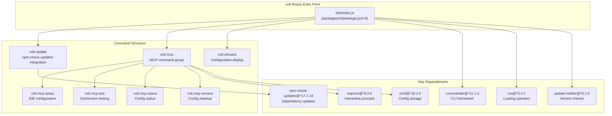
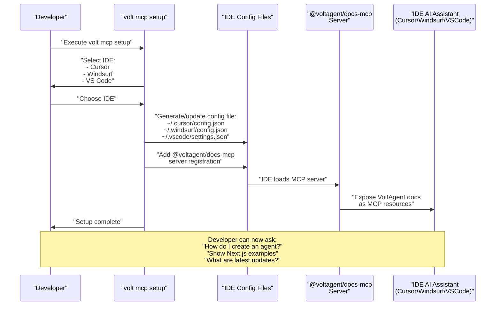
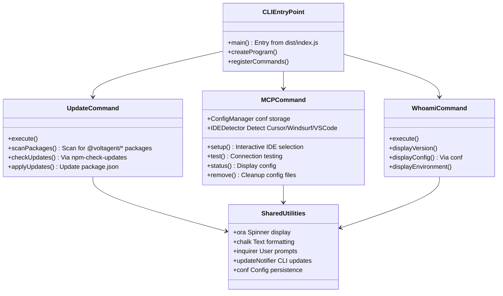
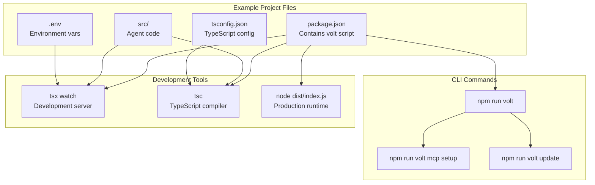
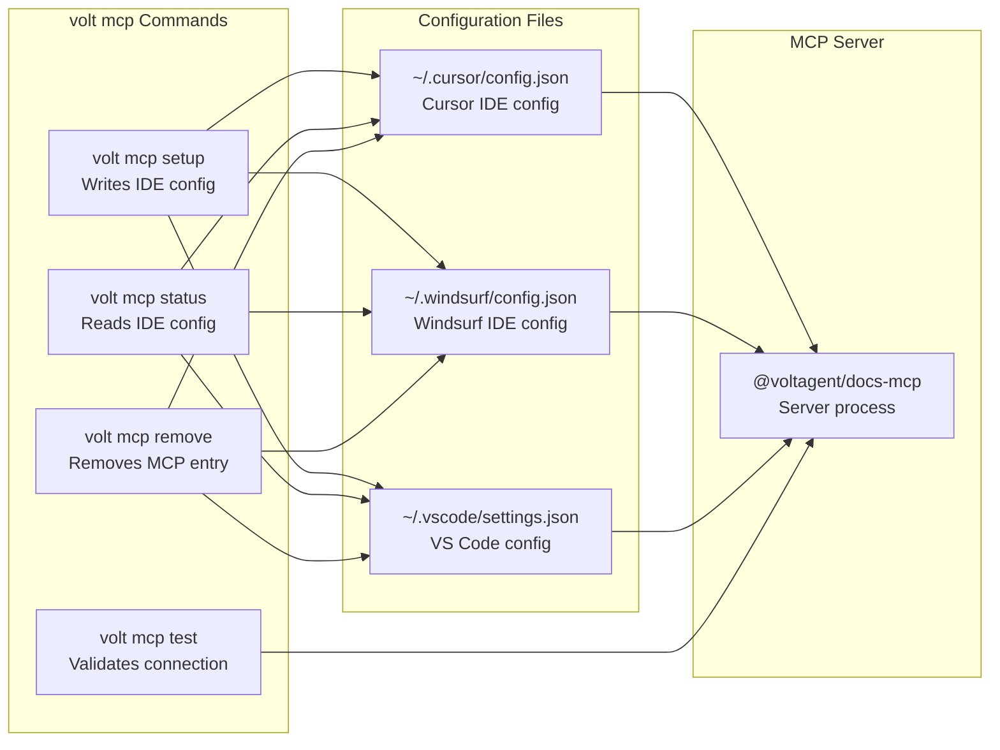

<!-- source: DeepWiki mcp.deepwiki.com · repo voltagent/voltagent · page 7.1 VoltAgent CLI · fetched 2026-10-27 -->

# VoltAgent CLI

<details>
<summary>Relevant source files</summary>

The following files were used as context for generating this wiki page:

- [CHANGELOG.md](CHANGELOG.md)
- [changelog.sh](changelog.sh)
- [examples/base/src/index.ts](examples/base/src/index.ts)
- [examples/with-google-ai/package.json](examples/with-google-ai/package.json)
- [examples/with-google-vertex-ai/package.json](examples/with-google-vertex-ai/package.json)
- [examples/with-groq-ai/package.json](examples/with-groq-ai/package.json)
- [examples/with-mcp/package.json](examples/with-mcp/package.json)
- [examples/with-nextjs/package.json](examples/with-nextjs/package.json)
- [packages/cli/package.json](packages/cli/package.json)
- [packages/core/package.json](packages/core/package.json)
- [packages/create-voltagent-app/CHANGELOG.md](packages/create-voltagent-app/CHANGELOG.md)
- [packages/create-voltagent-app/package.json](packages/create-voltagent-app/package.json)
- [packages/voice/package.json](packages/voice/package.json)
- [pnpm-lock.yaml](pnpm-lock.yaml)

</details>


The VoltAgent CLI (`volt`) is a command-line tool that provides development utilities for VoltAgent projects. It offers functionality for project management, dependency updates, MCP (Model Context Protocol) integration, and development workflow automation.

## Overview

The `@voltagent/cli` package provides the `volt` command-line interface for managing VoltAgent applications. The CLI binary is defined in [packages/cli/package.json:5-7]() and focuses on enhancing the developer experience through IDE integrations (MCP setup), dependency management, and project utilities.

Sources:
- [packages/cli/package.json:1-61]()

## CLI Command Structure

The CLI is structured around Commander.js with modular command implementations. The binary entry point is `dist/index.js`.



Sources:
- [packages/cli/package.json:5-7]() - Binary entry point
- [packages/cli/package.json:8-21]() - Dependencies
- [CHANGELOG.md:159-184]() - MCP command features

## Installation

### Installing the CLI

The VoltAgent CLI can be installed globally or as a project dependency:

```bash
# Global installation
npm install -g @voltagent/cli
yarn global add @voltagent/cli
pnpm add -g @voltagent/cli

# Project-specific installation
npm install --save-dev @voltagent/cli
yarn add --dev @voltagent/cli
pnpm add --save-dev @voltagent/cli
```

### System Requirements

- **Node.js**: Version 20.0.0 or higher (enforced in [packages/cli/package.json:37-39]())
- Package manager: npm, yarn, or pnpm

Sources:
- [packages/cli/package.json:37-39]()

### Project Integration

VoltAgent example projects include the CLI as a development dependency and add a `volt` script to their `package.json`:

```json
{
  "scripts": {
    "volt": "volt"
  },
  "devDependencies": {
    "@voltagent/cli": "^0.1.11"
  }
}
```

This allows running CLI commands via `npm run volt <command>` or `yarn volt <command>`.

Sources:
- [examples/with-google-ai/package.json:30]()
- [examples/with-mcp/package.json:26]()
- [examples/with-groq-ai/package.json:30]()
- [examples/with-nextjs/package.json:37]()

## Available Commands

### Core Commands

| Command | Description | Usage |
|---------|-------------|-------|
| `volt update` | Update VoltAgent dependencies | `volt update` |
| `volt whoami` | Display CLI configuration info | `volt whoami` |
| `volt mcp` | MCP integration management | `volt mcp <subcommand>` |

### MCP (Model Context Protocol) Commands

The CLI provides comprehensive MCP integration for connecting AI assistants in IDEs to VoltAgent documentation via the `@voltagent/docs-mcp` package:

| Command | Description | Usage |
|---------|-------------|-------|
| `volt mcp setup` | Interactive MCP setup for IDEs (Cursor, Windsurf, VS Code) | `volt mcp setup` |
| `volt mcp test` | Test MCP connection and provide usage examples | `volt mcp test` |
| `volt mcp status` | Show current MCP configuration status | `volt mcp status` |
| `volt mcp remove` | Remove MCP configuration | `volt mcp remove` |

Sources:
- [CHANGELOG.md:166-198]()

#### MCP Setup Flow

The MCP setup command creates configuration files for supported IDEs to connect to the `@voltagent/docs-mcp` server.



Sources:
- [CHANGELOG.md:166-198]() - MCP feature documentation
- [packages/cli/package.json:12]() - inquirer dependency for prompts

## Command Details

### Update Command

The `volt update` command checks for and applies updates to VoltAgent packages in your project using the `npm-check-updates` package:

```bash
# Check for updates to all @voltagent packages
volt update
```

The command:
- Scans your project for `@voltagent/*` packages
- Uses `npm-check-updates@^17.1.18` (dependency in [packages/cli/package.json:16]()) to check for available updates
- Prompts for confirmation before updating
- Updates `package.json` with new versions

Sources:
- [packages/cli/package.json:16]()

### Whoami Command

The `volt whoami` command displays CLI configuration and system information stored via the `conf` package:

```bash
volt whoami
```

This shows:
- CLI version information
- Configuration settings stored in `conf@^10.2.0` (see [packages/cli/package.json:12]())
- System environment details

Sources:
- [packages/cli/package.json:12]()

### MCP Integration Details

The MCP commands enable AI assistant integration in IDEs by configuring the `@voltagent/docs-mcp` server. After running `volt mcp setup`, developers can ask their AI assistant questions about VoltAgent directly in their IDE:

**Example Questions:**
- "How do I create an agent in VoltAgent?"
- "Show me VoltAgent examples with Next.js"
- "What are the latest VoltAgent updates?"
- "How do I use voice features?"

**IDE Support:**
- **Cursor**: Modifies `~/.cursor/config.json`
- **Windsurf**: Modifies `~/.windsurf/config.json`  
- **VS Code**: Modifies `~/.vscode/settings.json`

The `@voltagent/docs-mcp` server provides real-time access to:
- VoltAgent documentation pages
- Code examples from the repository
- Best practices and patterns
- Latest changelog updates

Sources:
- [CHANGELOG.md:166-198]()

## CLI Implementation Architecture

### Component Structure

The VoltAgent CLI is built using Commander.js (`commander@^11.1.0`) with a modular command structure. The binary entry point is `dist/index.js` built via `tsup`.



### Core Dependencies

The CLI leverages several key packages defined in [packages/cli/package.json:8-21]():

| Package | Version | Purpose | Usage in CLI |
|---------|---------|---------|--------------|
| `commander` | ^11.1.0 | CLI framework | Command parsing and routing |
| `inquirer` | ^8.2.6 | Interactive prompts | IDE selection in `mcp setup` |
| `npm-check-updates` | ^17.1.18 | Dependency updates | Package version management in `update` |
| `conf` | ^10.2.0 | Configuration storage | User settings persistence |
| `ora` | ^5.4.1 | Loading spinners | Progress indication |
| `update-notifier` | ^5.1.0 | Update checking | CLI version notifications |
| `chalk` | ^4.1.2 | Terminal styling | Colored output |
| `boxen` | ^5.1.2 | Terminal boxes | Message formatting |
| `figlet` | ^1.7.0 | ASCII art | CLI branding |

### Build Configuration

The CLI is built using `tsup` as defined in [packages/cli/package.json:50-59]():

```json
{
  "scripts": {
    "build": "tsup",
    "dev": "tsup --watch",
    "start": "node dist/index.js"
  }
}
```

Sources:
- [packages/cli/package.json:8-21]() - Dependencies
- [packages/cli/package.json:50-59]() - Build scripts
- [packages/cli/package.json:5-7]() - Binary entry point

## CLI Usage in Example Projects

### Common Project Scripts

VoltAgent example projects typically include the CLI in their development workflow via package.json scripts:

```json
{
  "scripts": {
    "dev": "tsx watch --env-file=.env ./src",
    "build": "tsc",
    "start": "node dist/index.js",
    "volt": "volt"
  },
  "devDependencies": {
    "@voltagent/cli": "^0.1.11"
  }
}
```

This pattern allows developers to:
- Run `npm run volt mcp setup` to configure IDE integration
- Run `npm run volt update` to update dependencies
- Run `npm run volt whoami` to check CLI configuration

### Example Project Structure



Sources:
- [examples/with-google-ai/package.json:26-31]()
- [examples/with-mcp/package.json:22-27]()
- [examples/with-groq-ai/package.json:26-31]()
- [examples/with-google-vertex-ai/package.json:26-31]()

## MCP Command Implementation Details

The MCP commands are the primary feature of the CLI, enabling documentation access within IDEs.

### MCP Configuration Storage

The CLI uses the `conf` package to persist MCP configuration settings:



### MCP Setup Process

When running `volt mcp setup`, the CLI:

1. **Detects Available IDEs**: Checks for Cursor, Windsurf, and VS Code installations
2. **Prompts User**: Uses `inquirer@^8.2.6` for interactive IDE selection
3. **Generates Configuration**: Creates/updates IDE-specific config files
4. **Registers Server**: Adds `@voltagent/docs-mcp` server to the selected IDE's MCP configuration
5. **Confirms Setup**: Displays success message with usage instructions

The configuration typically includes:
- Server name: `voltagent-docs`
- Server command: Path to `@voltagent/docs-mcp` executable
- Server transport: stdio, HTTP, or SSE depending on IDE support

Sources:
- [CHANGELOG.md:166-198]() - MCP feature description
- [packages/cli/package.json:12]() - inquirer dependency
- [packages/cli/package.json:12]() - conf dependency

## Conclusion

The VoltAgent CLI and project setup tools provide a streamlined developer experience for creating and managing AI agent applications. Through a combination of the `volt` CLI for existing projects and `create-voltagent-app` for new projects, developers can quickly scaffold and configure their agent implementations with minimal boilerplate.

For information about monitoring and debugging your agents during development, see the [Developer Console](#3.1) documentation.

---

