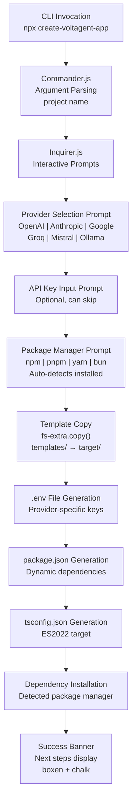
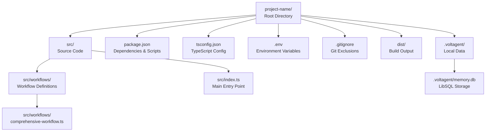
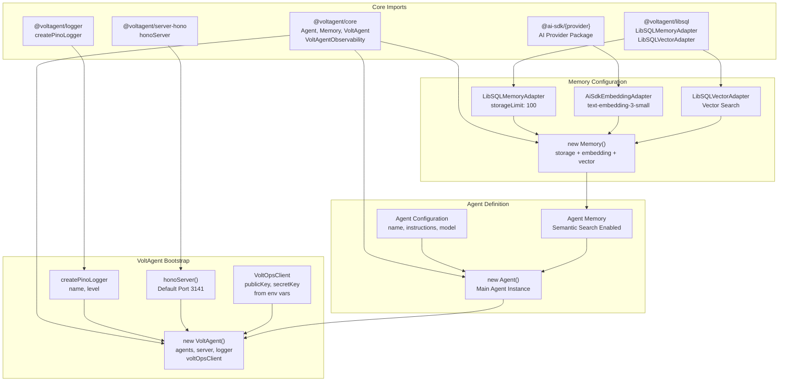
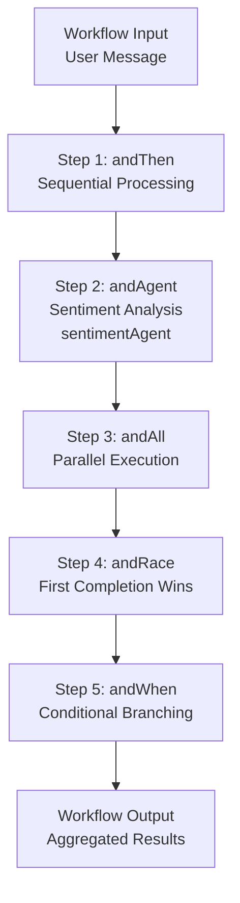
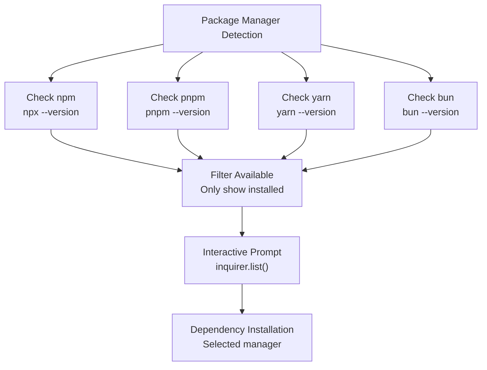
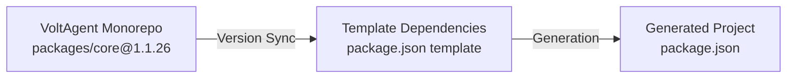

<!-- source: DeepWiki mcp.deepwiki.com · repo voltagent/voltagent · page 7.2 Project Scaffolding · fetched 2026-10-27 -->

# Project Scaffolding

<details>
<summary>Relevant source files</summary>

The following files were used as context for generating this wiki page:

- [CHANGELOG.md](CHANGELOG.md)
- [changelog.sh](changelog.sh)
- [examples/base/src/index.ts](examples/base/src/index.ts)
- [examples/with-google-ai/package.json](examples/with-google-ai/package.json)
- [examples/with-google-vertex-ai/package.json](examples/with-google-vertex-ai/package.json)
- [examples/with-groq-ai/package.json](examples/with-groq-ai/package.json)
- [examples/with-mcp/package.json](examples/with-mcp/package.json)
- [examples/with-nextjs/package.json](examples/with-nextjs/package.json)
- [packages/cli/package.json](packages/cli/package.json)
- [packages/core/package.json](packages/core/package.json)
- [packages/create-voltagent-app/CHANGELOG.md](packages/create-voltagent-app/CHANGELOG.md)
- [packages/create-voltagent-app/package.json](packages/create-voltagent-app/package.json)
- [packages/voice/package.json](packages/voice/package.json)
- [pnpm-lock.yaml](pnpm-lock.yaml)

</details>


This page documents the `create-voltagent-app` CLI tool, which provides an interactive scaffolding system for generating new VoltAgent projects. For information about the CLI commands available in existing projects, see [VoltAgent CLI](#7.1). For details about development workflow scripts in generated projects, see [Development Workflow](#7.3).

## Purpose and Scope

The `create-voltagent-app` package ([packages/create-voltagent-app/package.json:1-60]()) is a project generator that creates production-ready VoltAgent applications through an interactive terminal interface. It handles:

- **Provider Selection**: Interactive prompts for choosing AI providers (OpenAI, Anthropic, Google Gemini, Groq, Mistral, Ollama)
- **API Key Management**: Optional API key input with secure environment variable generation
- **Dependency Installation**: Automatic package manager detection and dependency installation
- **Template Generation**: Dynamic project scaffolding based on selected AI provider
- **Configuration Setup**: Automatic generation of TypeScript, build, and environment configurations

The tool outputs a complete, runnable VoltAgent project with agent definitions, memory adapters, server configuration, and observability integration.

**Sources**: [packages/create-voltagent-app/package.json:1-60](), [packages/create-voltagent-app/CHANGELOG.md:1-259]()

---

## CLI Installation and Invocation

### Binary Names and Execution

The package exposes two binary entry points ([packages/create-voltagent-app/package.json:5-8]()):

```json
{
  "bin": {
    "create-voltagent": "./dist/index.js",
    "create-voltagent-app": "./dist/index.js"
  }
}
```

Both commands execute the same scaffolding logic. Users can invoke the tool via:

```bash
# Using npx (recommended)
npx create-voltagent-app my-agent-project

# Using pnpm
pnpm create voltagent-app my-agent-project

# Using yarn
yarn create voltagent-app my-agent-project

# Using bun
bunx create-voltagent-app my-agent-project
```

### Node Version Requirements

The tool requires Node.js 20 or higher ([packages/create-voltagent-app/package.json:40-42]()):

```json
{
  "engines": {
    "node": ">=20"
  }
}
```

**Sources**: [packages/create-voltagent-app/package.json:5-8](), [packages/create-voltagent-app/package.json:40-42]()

---

## Interactive Scaffolding Workflow



**Interactive Flow Execution**: The scaffolding process uses the `commander` library for CLI argument parsing and `inquirer` for interactive prompts ([packages/create-voltagent-app/package.json:14](), [packages/create-voltagent-app/package.json:18]()). After collecting user preferences, `fs-extra` copies template files ([packages/create-voltagent-app/package.json:16]()), generates configuration files, and executes dependency installation using the detected package manager.

**Sources**: [packages/create-voltagent-app/package.json:9-22](), [packages/create-voltagent-app/CHANGELOG.md:124-133]()

---

## Provider Selection System

### Supported AI Providers

The tool supports six AI provider options with automatic dependency resolution:

| Provider | Package | Model Example | Environment Variable |
|----------|---------|---------------|---------------------|
| **OpenAI** | `@ai-sdk/openai` | `gpt-4o-mini`, `gpt-4o` | `OPENAI_API_KEY` |
| **Anthropic** | `@ai-sdk/anthropic` | `claude-3-5-sonnet-20241022` | `ANTHROPIC_API_KEY` |
| **Google Gemini** | `@ai-sdk/google` | `gemini-1.5-flash`, `gemini-1.5-pro` | `GOOGLE_GENERATIVE_AI_API_KEY` |
| **Groq** | `@ai-sdk/groq` | `llama-3.3-70b-versatile` | `GROQ_API_KEY` |
| **Mistral** | `@ai-sdk/mistral` | `mistral-large-latest` | `MISTRAL_API_KEY` |
| **Ollama** | `ollama` | `llama3.2`, `qwen2.5` | N/A (local) |

### Provider-Specific Template Generation

The scaffolding system generates provider-specific import statements and model initialization:

```typescript
// OpenAI template example
import { openai } from "@ai-sdk/openai";

const agent = new Agent({
  name: "Assistant",
  instructions: "You are a helpful assistant",
  model: openai("gpt-4o-mini"),
  // ...
});
```

```typescript
// Anthropic template example
import { anthropic } from "@ai-sdk/anthropic";

const agent = new Agent({
  name: "Assistant",
  instructions: "You are a helpful assistant",
  model: anthropic("claude-3-5-sonnet-20241022"),
  // ...
});
```

### Ollama Local LLM Support

For Ollama selection, the tool configures local model access without API keys ([packages/create-voltagent-app/CHANGELOG.md:131]()):

```typescript
import { ollama } from "ollama-ai-provider";

const agent = new Agent({
  model: ollama("llama3.2"),
  // No API key required - uses local Ollama instance
});
```

**Sources**: [packages/create-voltagent-app/CHANGELOG.md:124-133](), [examples/with-google-ai/package.json:5](), [examples/with-groq-ai/package.json:5]()

---

## Generated Project Structure

### File System Layout



**Directory Purpose Breakdown**:

- **`src/`**: TypeScript source code with modular structure
- **`src/workflows/`**: Workflow definitions using `andThen`, `andAgent`, `andAll` ([packages/create-voltagent-app/CHANGELOG.md:144-151]())
- **`dist/`**: Compiled JavaScript output from `tsup` bundler
- **`.voltagent/`**: Local data directory for SQLite memory storage

**Sources**: [packages/create-voltagent-app/CHANGELOG.md:144-154](), [examples/base/src/index.ts:1-38]()

---

## Generated Code Structure

### Main Entry Point: `src/index.ts`

The scaffolded `index.ts` file instantiates the complete VoltAgent system:



**Code Entity Mapping**: The generated `index.ts` ([examples/base/src/index.ts:1-38]()) follows this structure:

1. **Memory Stack** ([examples/base/src/index.ts:18-24]()):
   - `LibSQLMemoryAdapter` for conversation persistence with 100-message limit
   - `AiSdkEmbeddingAdapter` wrapping OpenAI's `text-embedding-3-small`
   - `LibSQLVectorAdapter` for semantic search capabilities

2. **Agent Initialization** ([examples/base/src/index.ts:26-31]()):
   - `new Agent()` with `name`, `instructions`, `model`, and `memory` properties
   - Automatically inherits semantic search from memory configuration

3. **VoltAgent Bootstrap** ([examples/base/src/index.ts:33-37]()):
   - `createPinoLogger()` for structured logging
   - `honoServer()` with auto-registration on port 3141
   - `VoltOpsClient` configured via environment variables ([packages/create-voltagent-app/CHANGELOG.md:49-61]())

**Sources**: [examples/base/src/index.ts:1-38](), [packages/create-voltagent-app/CHANGELOG.md:36-69]()

---

## Package Configuration Generation

### `package.json` Structure

The generated `package.json` includes provider-specific dependencies and standard development scripts:

```json
{
  "name": "project-name",
  "type": "module",
  "scripts": {
    "dev": "tsx watch --env-file=.env ./src",
    "build": "tsc",
    "start": "node dist/index.js",
    "volt": "volt"
  },
  "dependencies": {
    "@ai-sdk/openai": "^2.0.2",
    "@voltagent/cli": "^0.1.11",
    "@voltagent/core": "^1.1.26",
    "@voltagent/libsql": "^1.0.7",
    "@voltagent/logger": "^1.0.2",
    "@voltagent/server-hono": "^1.0.18",
    "ai": "^5.0.12",
    "zod": "^3.25.76"
  },
  "devDependencies": {
    "@types/node": "^24.2.1",
    "tsx": "^4.19.3",
    "typescript": "^5.8.2"
  }
}
```

### TypeScript Configuration: `tsconfig.json`

The TypeScript configuration targets ES2022 with Node.js module resolution ([packages/create-voltagent-app/CHANGELOG.md:210]()):

```json
{
  "compilerOptions": {
    "target": "ES2022",
    "module": "ESNext",
    "moduleResolution": "Node",
    "esModuleInterop": true,
    "skipLibCheck": true,
    "strict": true,
    "outDir": "./dist",
    "rootDir": "./src"
  },
  "include": ["src/**/*"],
  "exclude": ["node_modules", "dist"]
}
```

### Environment Variable Template: `.env`

The `.env` file is dynamically generated based on provider selection ([packages/create-voltagent-app/CHANGELOG.md:127]()):

```bash
# OpenAI Provider
OPENAI_API_KEY=your-api-key-here

# VoltOps Observability (Optional)
VOLTAGENT_PUBLIC_KEY=
VOLTAGENT_SECRET_KEY=
```

```bash
# Anthropic Provider
ANTHROPIC_API_KEY=your-api-key-here

# VoltOps Observability (Optional)
VOLTAGENT_PUBLIC_KEY=
VOLTAGENT_SECRET_KEY=
```

**Sources**: [examples/with-google-ai/package.json:1-33](), [examples/with-groq-ai/package.json:1-32](), [examples/with-mcp/package.json:1-29](), [packages/create-voltagent-app/CHANGELOG.md:124-133]()

---

## Workflow Template System

### Comprehensive Workflow Example

The scaffolding includes a demonstration workflow in `src/workflows/comprehensive-workflow.ts` ([packages/create-voltagent-app/CHANGELOG.md:145-154]()). This workflow showcases VoltAgent's orchestration primitives:



**Workflow Primitives Demonstrated**:

- **`andThen`**: Sequential step execution with data passing
- **`andAgent`**: Agent invocation within workflow context (uses dedicated `sentimentAgent`)
- **`andAll`**: Parallel step execution with result aggregation
- **`andRace`**: First-to-complete step selection
- **`andWhen`**: Conditional execution based on step output

The workflow uses a separate `sentimentAgent` instance to avoid conflicts with the main project agent ([packages/create-voltagent-app/CHANGELOG.md:150-151]()).

**Sources**: [packages/create-voltagent-app/CHANGELOG.md:144-154]()

---

## Build and Deployment Configuration

### Production Build Strategy

Since version 0.2.10, the template uses `tsdown` for production bundling ([packages/create-voltagent-app/CHANGELOG.md:7]()):

```json
{
  "scripts": {
    "build": "tsdown",
    "start": "node dist/index.js"
  },
  "devDependencies": {
    "tsdown": "^0.15.2"
  }
}
```

**Rationale**: The `tsdown` bundler resolves ES module (`.mjs`) compatibility issues, eliminating the need for manual `.js` extension additions in import paths or custom import mappers ([packages/create-voltagent-app/CHANGELOG.md:7]()).

### Development Mode with Watch

Development uses `tsx` with watch mode and environment file loading:

```bash
tsx watch --env-file=.env ./src
```

This configuration:
- Watches `src/` directory for file changes
- Automatically loads `.env` variables
- Provides TypeScript execution without compilation step

**Sources**: [packages/create-voltagent-app/CHANGELOG.md:7](), [examples/with-google-ai/package.json:26-30]()

---

## VoltOps Observability Integration

### Automatic VoltOps Client Configuration

Since version 0.2.7, all generated projects include `VoltOpsClient` configuration ([packages/create-voltagent-app/CHANGELOG.md:35-69]()):

```typescript
import { VoltAgent, VoltOpsClient, Agent } from "@voltagent/core";

new VoltAgent({
  agents: { agent },
  logger,
  voltOpsClient: new VoltOpsClient({
    publicKey: process.env.VOLTAGENT_PUBLIC_KEY || "",
    secretKey: process.env.VOLTAGENT_SECRET_KEY || "",
  }),
});
```

**Environment Variable Structure**:

```bash
# VoltOps Console (console.voltagent.dev)
VOLTAGENT_PUBLIC_KEY=va_pub_xxxxxxxxxxxxx
VOLTAGENT_SECRET_KEY=va_sec_xxxxxxxxxxxxx
```

**Integration Benefits**:
- **Zero Configuration**: Projects are observability-ready on creation
- **Console Integration**: One-click setup from VoltOps Console
- **Production Traces**: Automatic span collection and export to VoltOps platform
- **Cost Analysis**: Built-in token usage tracking and cost attribution

The client is instantiated with empty string fallbacks, allowing projects to run without keys while maintaining the integration interface.

**Sources**: [packages/create-voltagent-app/CHANGELOG.md:35-69]()

---

## MCP Documentation Server Setup

### Automatic MCP Configuration

The scaffolding includes `@voltagent/cli` dependency, which provides MCP documentation server setup ([packages/create-voltagent-app/CHANGELOG.md:165-199]()):

```json
{
  "scripts": {
    "volt": "volt"
  },
  "dependencies": {
    "@voltagent/cli": "^0.1.11"
  }
}
```

### Post-Creation MCP Setup Workflow

After project creation, users can configure IDE integration:

```bash
cd my-agent-project
pnpm volt mcp setup
```

**Interactive MCP Setup** ([packages/create-voltagent-app/CHANGELOG.md:178-182]()):
1. Prompts for IDE selection (Cursor, Windsurf, VS Code)
2. Generates IDE-specific configuration files
3. Configures VoltAgent documentation access via MCP protocol
4. Enables AI assistant queries like "How do I create an agent?" directly in the IDE

**Testing MCP Connection**:

```bash
pnpm volt mcp test
```

**Checking MCP Status**:

```bash
pnpm volt mcp status
```

The MCP integration allows IDE AI assistants to access VoltAgent documentation, examples, and API reference without leaving the development environment.

**Sources**: [packages/create-voltagent-app/CHANGELOG.md:165-199](), [packages/cli/package.json:1-61]()

---

## Package Manager Detection and Installation

### Automatic Package Manager Resolution

The scaffolding detects installed package managers and filters the selection prompt accordingly ([packages/create-voltagent-app/CHANGELOG.md:129]()):



**Detection Logic**: The tool executes version commands for each package manager and includes only those that respond successfully in the prompt. This prevents users from selecting unavailable tools.

### Automatic Dependency Installation

After project generation, the tool automatically installs dependencies using the selected package manager ([packages/create-voltagent-app/CHANGELOG.md:130]()):

```bash
# Example: pnpm selected
cd my-agent-project
pnpm install  # Executed automatically
```

**Sources**: [packages/create-voltagent-app/CHANGELOG.md:124-133](), [packages/create-voltagent-app/package.json:9-22]()

---

## Template Dependencies and Versioning

### Core Dependency Matrix

The scaffolding generates projects with these version constraints:

| Package | Version Range | Purpose |
|---------|--------------|---------|
| `@voltagent/core` | `^1.1.26` | Agent orchestration, memory, tools |
| `@voltagent/server-hono` | `^1.0.18` | HTTP server with auto-routes |
| `@voltagent/libsql` | `^1.0.7` | SQLite/Turso memory adapter |
| `@voltagent/logger` | `^1.0.2` | Pino-based structured logging |
| `@voltagent/cli` | `^0.1.11` | MCP setup and CLI utilities |
| `ai` | `^5.0.12` | Vercel AI SDK v5 |
| `zod` | `^3.25.76` | Schema validation |

### Provider-Specific Dependencies

Additional dependencies are added based on provider selection:

```typescript
// OpenAI
"@ai-sdk/openai": "^2.0.2"

// Anthropic
"@ai-sdk/anthropic": "^2.0.6"

// Google Gemini
"@ai-sdk/google": "^2.0.13"

// Groq
"@ai-sdk/groq": "^2.0.18"

// Mistral
"@ai-sdk/mistral": "^2.0.0"

// Ollama
"ollama": "latest"
```

### Development Dependencies

All generated projects include:

```json
{
  "devDependencies": {
    "@types/node": "^24.2.1",
    "tsx": "^4.19.3",
    "typescript": "^5.8.2"
  }
}
```

**Sources**: [examples/with-google-ai/package.json:4-12](), [examples/with-groq-ai/package.json:4-12](), [examples/with-google-vertex-ai/package.json:4-12](), [packages/core/package.json:54-59]()

---

## Post-Creation Success Banner

### Terminal Output Format

After successful project generation, the tool displays a formatted success banner using `boxen` and `chalk` ([packages/create-voltagent-app/package.json:10-11]()):

```
╔═══════════════════════════════════════════════════════╗
║                                                       ║
║   ✓ VoltAgent project created successfully!          ║
║                                                       ║
║   Project: my-agent-project                           ║
║   Provider: OpenAI                                    ║
║   Package Manager: pnpm                               ║
║                                                       ║
║   Next Steps:                                         ║
║   1. cd my-agent-project                              ║
║   2. Configure .env with your API keys                ║
║   3. pnpm dev                                         ║
║   4. Visit http://localhost:3141                      ║
║                                                       ║
║   Documentation: https://voltagent.dev                ║
║   MCP Setup: pnpm volt mcp setup                      ║
║                                                       ║
╚═══════════════════════════════════════════════════════╝
```

**Banner Components**:
- **Project Summary**: Name, provider, package manager
- **Next Steps**: Numbered action items for getting started
- **Resource Links**: Documentation URL and MCP setup command

**Sources**: [packages/create-voltagent-app/package.json:10-17](), [packages/create-voltagent-app/CHANGELOG.md:124-133]()

---

## Template Update Strategy

### Version Synchronization

The `create-voltagent-app` package maintains template dependency versions aligned with the latest VoltAgent releases:



**Synchronization Process**:
1. Monorepo packages receive version bumps via Changesets
2. Template files in `create-voltagent-app` are updated to reference new versions
3. Generated projects receive latest stable versions at creation time

### Zod Version Compatibility

Since version 0.2.8, templates enforce Zod `^3.25.0` for Vercel AI SDK v5 compatibility ([packages/create-voltagent-app/CHANGELOG.md:25-29]()):

```json
{
  "dependencies": {
    "zod": "^3.25.76"
  }
}
```

This version requirement ensures compatibility with `zod-from-json-schema` used in MCP tool schema conversion.

**Sources**: [packages/create-voltagent-app/CHANGELOG.md:3-30](), [packages/core/package.json:54-58]()

---

## Analytics and Telemetry

### PostHog Integration

The scaffolding tool includes PostHog for anonymous usage analytics ([packages/create-voltagent-app/package.json:20]()):

```json
{
  "dependencies": {
    "posthog-node": "^4.11.5"
  }
}
```

**Tracked Events**:
- Project creation attempts
- Provider selection distribution
- Package manager usage patterns
- Template generation success/failure rates

**Privacy**: All telemetry is anonymous and does not collect API keys, project names, or user-identifying information.

**Sources**: [packages/create-voltagent-app/package.json:20](), [packages/cli/package.json:18]()

---

