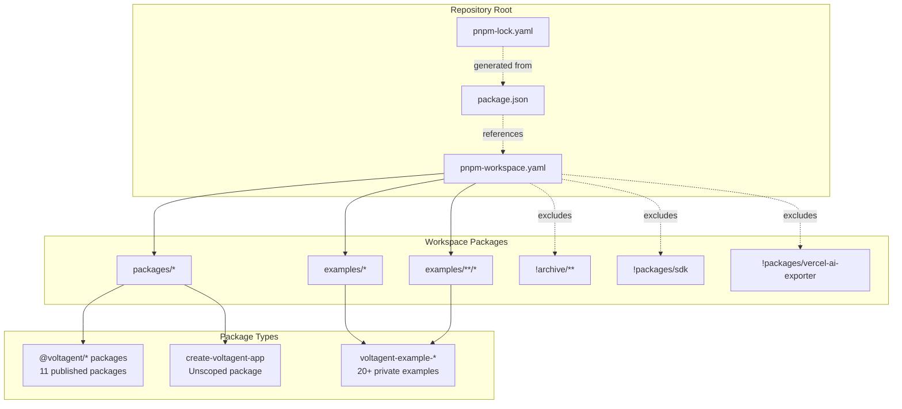
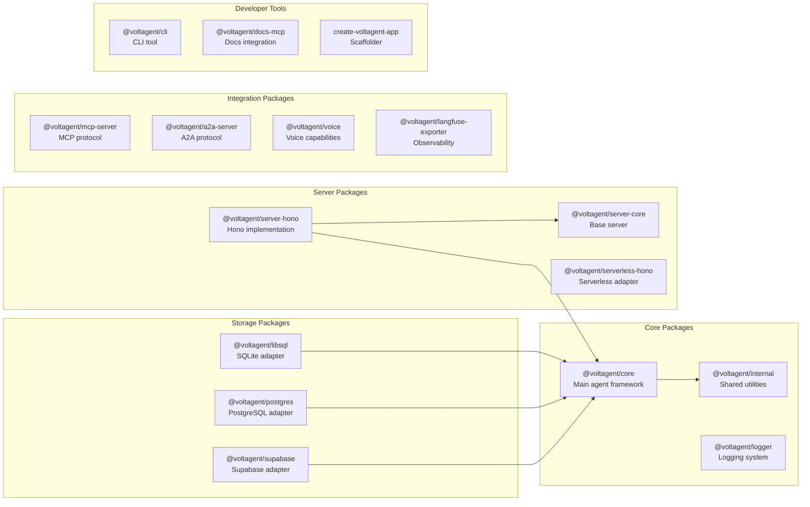
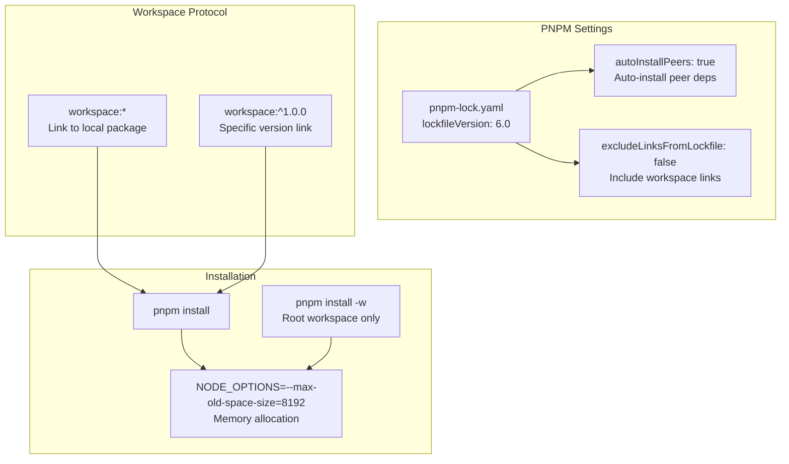
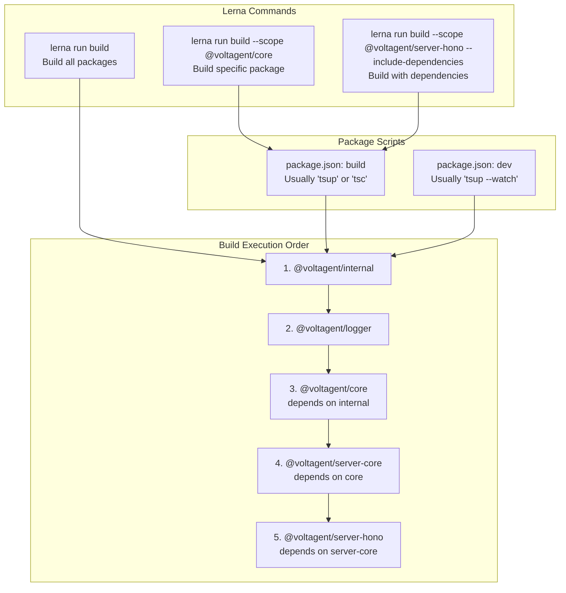
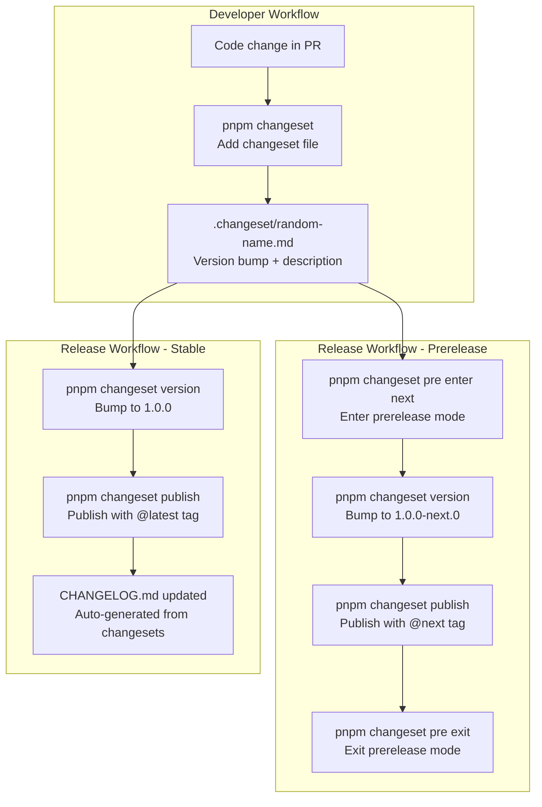
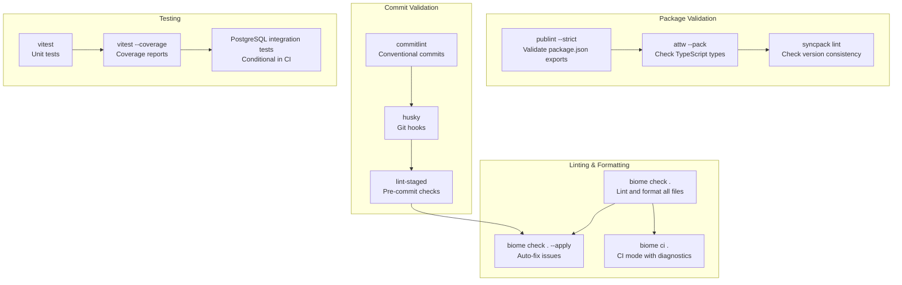
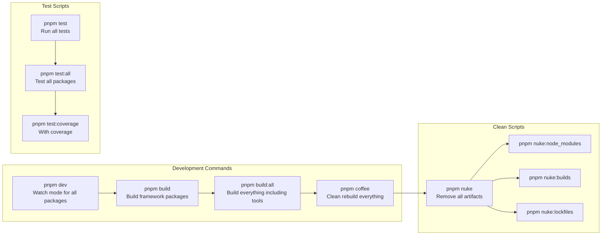
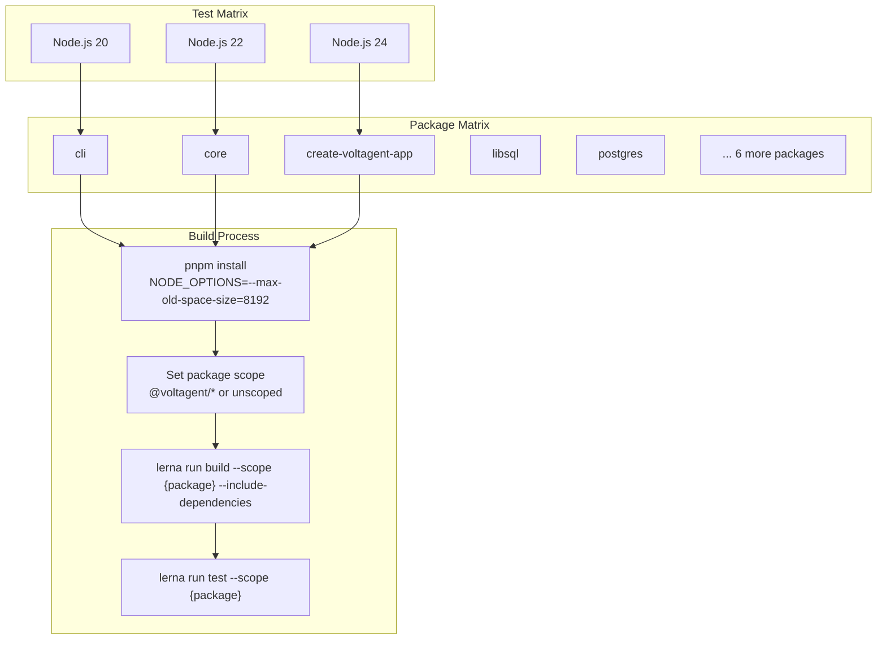
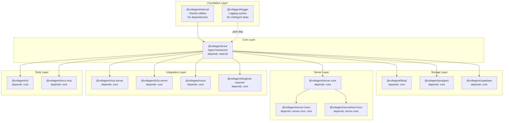

<!-- source: DeepWiki mcp.deepwiki.com · repo voltagent/voltagent · page 7.4 Monorepo Management · fetched 2026-10-27 -->

# Monorepo Management

<details>
<summary>Relevant source files</summary>

The following files were used as context for generating this wiki page:

- [.github/workflows/prerelease.yml](.github/workflows/prerelease.yml)
- [.github/workflows/pull-request.yml](.github/workflows/pull-request.yml)
- [.github/workflows/release.yml](.github/workflows/release.yml)
- [examples/with-google-ai/package.json](examples/with-google-ai/package.json)
- [examples/with-google-vertex-ai/package.json](examples/with-google-vertex-ai/package.json)
- [examples/with-groq-ai/package.json](examples/with-groq-ai/package.json)
- [examples/with-jwt-auth/src/index.ts](examples/with-jwt-auth/src/index.ts)
- [examples/with-mcp/package.json](examples/with-mcp/package.json)
- [examples/with-nextjs/package.json](examples/with-nextjs/package.json)
- [examples/with-playwright/src/index.ts](examples/with-playwright/src/index.ts)
- [package.json](package.json)
- [packages/core/package.json](packages/core/package.json)
- [packages/core/src/utils/message-helpers.spec.ts](packages/core/src/utils/message-helpers.spec.ts)
- [packages/core/src/utils/message-helpers.ts](packages/core/src/utils/message-helpers.ts)
- [pnpm-lock.yaml](pnpm-lock.yaml)
- [pnpm-workspace.yaml](pnpm-workspace.yaml)
- [website/docs/utils/message-helpers.md](website/docs/utils/message-helpers.md)

</details>


This document covers the monorepo structure, tooling, and workflows used to manage the VoltAgent codebase. It explains the workspace configuration, build orchestration, dependency management, versioning strategy, and quality assurance tools that enable coordinated development across 11+ packages and 20+ example applications.

For information about the CI/CD pipeline and release automation, see [CI/CD Pipeline](#7.5). For project scaffolding tools, see [Project Scaffolding](#7.2).

## Workspace Structure

VoltAgent uses **pnpm workspaces** to manage a monorepo containing multiple packages and example applications. The workspace configuration defines which directories contain publishable packages and which contain private examples.



**Sources:** [pnpm-workspace.yaml:1-8](), [package.json:97-100]()

The workspace configuration excludes deprecated packages (`archive/**`) and experimental packages (`packages/sdk`, `packages/vercel-ai-exporter`) from workspace operations.

| Configuration | Purpose |
|--------------|---------|
| `packages/*` | Core framework packages (scoped as `@voltagent/*`) |
| `examples/*` | Example applications (private, not published) |
| `examples/**/*` | Nested example applications with sub-projects |
| Exclusions | Remove deprecated/experimental code from workspace |

**Sources:** [pnpm-workspace.yaml:1-8]()

## Package Organization

The monorepo contains 11+ scoped packages under `@voltagent/*` and one unscoped package `create-voltagent-app`. Each package has a consistent structure with `package.json`, TypeScript source, and build outputs.



**Sources:** [package.json:62-63](), [pnpm-lock.yaml:1-1500]()

### Package Naming Convention

| Package Type | Naming Pattern | Example |
|-------------|----------------|---------|
| Core packages | `@voltagent/<name>` | `@voltagent/core` |
| Scaffolder | `create-voltagent-app` | Unscoped for npx usage |
| Examples | `voltagent-example-<name>` | `voltagent-example-with-nextjs` |

**Sources:** [packages/core/package.json:1-4](), [examples/with-nextjs/package.json:1-3]()

## Dependency Management

The monorepo uses **pnpm** for efficient dependency management with workspace protocol and **syncpack** for version consistency across packages.

### PNPM Configuration



**Sources:** [pnpm-lock.yaml:1-6](), [.github/workflows/pull-request.yml:30-34]()

The monorepo uses the `workspace:` protocol to reference local packages, ensuring they always use the local version during development:

```json
{
  "dependencies": {
    "@voltagent/core": "workspace:*",
    "@voltagent/libsql": "workspace:*"
  }
}
```

**Sources:** [examples/with-google-ai/package.json:4-12]()

### Syncpack Version Management

**Syncpack** enforces version consistency across all packages using the `syncpack` tool:

| Command | Purpose |
|---------|---------|
| `pnpm sp lint` | Check for version mismatches |
| `pnpm sp fix-mismatches` | Auto-fix version inconsistencies |
| `pnpm sp list-mismatches` | List all version conflicts |

**Sources:** [package.json:89](), [.github/workflows/pull-request.yml:39]()

The CI pipeline enforces syncpack validation on every pull request:

```yaml
- name: Syncpack
  run: pnpm sp lint
```

**Sources:** [.github/workflows/pull-request.yml:38-39]()

## Build Orchestration with Lerna

**Lerna** orchestrates builds across packages with dependency-aware execution. It ensures packages are built in the correct order based on their dependency graph.



**Sources:** [package.json:62-63](), [.github/workflows/pull-request.yml:107-110]()

### Key Lerna Operations

| Command | Purpose | Usage in CI |
|---------|---------|-------------|
| `lerna run build --scope @voltagent/*` | Build all scoped packages | Used in build workflows |
| `lerna run test --stream` | Run tests across packages | Used in test workflows |
| `lerna bootstrap` | Install dependencies for all packages | Legacy, replaced by pnpm |
| `lerna run <script> --scope <package> --include-dependencies` | Execute with dependencies | Used for targeted builds |

**Sources:** [package.json:61-63](), [.github/workflows/pull-request.yml:107-110]()

### Build Scripts

The root `package.json` provides several build orchestration scripts:

```json
{
  "scripts": {
    "build": "lerna run build --ignore @voltagent/sdk --ignore @voltagent/vercel-ai-exporter",
    "build:all": "lerna run build --scope @voltagent/* --ignore @voltagent/sdk --ignore @voltagent/vercel-ai-exporter --scope create-voltagent-app --concurrency 1"
  }
}
```

**Sources:** [package.json:62-63]()

The `--concurrency 1` flag ensures sequential execution, which is critical for packages with inter-dependencies.

## Version Management with Changesets

**Changesets** manages versioning and changelog generation across all packages. It uses a two-step process: creating changesets and consuming them during release.



**Sources:** [package.json:81-85](), [.github/workflows/prerelease.yml:136-139]()

### Changeset Workflow

1. **Create Changeset**: Developer runs `pnpm changeset` to create a changeset file describing the change
2. **Version Packages**: `pnpm changeset version` consumes changesets and updates package versions
3. **Publish Packages**: `pnpm changeset publish` publishes updated packages to npm

**Sources:** [package.json:65](), [package.json:95-96]()

### Prerelease Mode

The monorepo supports prerelease versions using changesets' prerelease mode:

```bash
# Enter prerelease mode
pnpm changeset pre enter next

# Version packages (creates versions like 1.0.0-next.0)
pnpm changeset version

# Publish with @next tag
pnpm changeset publish

# Exit prerelease mode
pnpm changeset pre exit
```

**Sources:** [package.json:81-84](), [.github/workflows/prerelease.yml:136-139]()

### Version Synchronization

The `version-packages` script combines changeset versioning with lockfile updates:

```json
{
  "scripts": {
    "version-packages": "pnpm changeset version && pnpm i --ignore-scripts --lockfile-only --no-frozen-lockfile --reporter=ndjson --stream && git add pnpm-lock.yaml"
  }
}
```

**Sources:** [package.json:95]()

This ensures that:
1. Package versions are updated via changesets
2. The lockfile reflects new versions
3. The lockfile is automatically committed with version changes

## Quality Assurance Tools

The monorepo uses multiple tools to enforce code quality and package integrity across all packages.



**Sources:** [package.json:6-38](), [.github/workflows/pull-request.yml:35-65]()

### Tool Configuration

| Tool | Purpose | Script | CI Validation |
|------|---------|--------|---------------|
| **Biome** | Linting & formatting | `pnpm lint`, `pnpm lint:fix` | `.github/workflows/pull-request.yml:35-37` |
| **Syncpack** | Version consistency | `pnpm sp lint` | `.github/workflows/pull-request.yml:38-39` |
| **Publint** | Package validation | `pnpm publint:all` | `.github/workflows/pull-request.yml:62-63` |
| **Commitlint** | Commit conventions | `commitlint` | `.github/workflows/pull-request.yml:5-13` |
| **Vitest** | Unit testing | `pnpm test:all` | `.github/workflows/pull-request.yml:67-110` |

**Sources:** [package.json:70-94](), [.github/workflows/pull-request.yml:1-175]()

### Biome Configuration

Biome handles both linting and formatting in a single tool:

```json
{
  "scripts": {
    "lint": "biome check .",
    "lint:ci": "biome ci .",
    "lint:fix": "biome check . --apply"
  }
}
```

**Sources:** [package.json:70-73]()

The `lint:ci` command uses Biome's CI mode which outputs diagnostics in a format suitable for CI systems.

### Publint Validation

Each package runs `publint` to validate its `package.json` configuration:

```json
{
  "scripts": {
    "publint": "publint --strict"
  }
}
```

**Sources:** [packages/core/package.json:71]()

Publint validates:
- Export maps are correctly configured
- Main/module/types fields point to existing files
- Browser/Node.js compatibility
- ESM/CJS dual publishing setup

**Sources:** [.github/workflows/pull-request.yml:62-63]()

## Common Scripts and Workflows

The root `package.json` provides orchestration scripts that operate across all packages.

### Development Scripts



**Sources:** [package.json:56-96]()

### Script Reference

| Script | Command | Purpose |
|--------|---------|---------|
| `dev` | `lerna run dev --ignore voltagent-example-*` | Watch mode for framework packages |
| `build` | `lerna run build --ignore @voltagent/sdk --ignore @voltagent/vercel-ai-exporter` | Build core packages |
| `build:all` | `lerna run build --scope @voltagent/* --scope create-voltagent-app --concurrency 1` | Build all publishable packages |
| `test` | `lerna run test --stream` | Run tests across packages |
| `test:all` | `lerna run test --stream --scope @voltagent/*` | Test framework packages only |
| `nuke` | Composite script | Remove all node_modules, builds, and lockfiles |
| `coffee` | `pnpm nuke && pnpm i && pnpm build:all` | Clean rebuild from scratch |

**Sources:** [package.json:56-96]()

### Nuke Scripts

The "nuke" scripts provide progressive cleaning:

```json
{
  "scripts": {
    "nuke": "echo 'Removing all node_modules, builds and lockfiles' && pnpm nuke:node_modules && pnpm nuke:builds && pnpm nuke:lockfiles",
    "nuke:builds": "lerna exec -- rimraf dist && lerna exec -- rimraf build",
    "nuke:lockfiles": "lerna exec -- rimraf package-lock.json && lerna exec -- rimraf yarn.lock && lerna exec -- rimraf pnpm-lock.yaml",
    "nuke:node_modules": "lerna clean --yes && rimraf node_modules"
  }
}
```

**Sources:** [package.json:75-78]()

### Package-Specific Scripts

Individual packages follow a consistent script naming convention:

| Script | Purpose | Example from @voltagent/core |
|--------|---------|------------------------------|
| `build` | Build package | `tsup` |
| `dev` | Watch mode | `tsup --watch` |
| `test` | Run tests | `vitest --reporter=hanging-process --reporter=default --typecheck` |
| `lint` | Check code | `biome check .` |
| `lint:fix` | Auto-fix | `biome check . --write` |
| `typecheck` | Type checking | `tsc --noEmit` |

**Sources:** [packages/core/package.json:65-76]()

## CI Build Matrix

GitHub Actions uses a build matrix to test packages across multiple Node.js versions with dependency-aware execution.



**Sources:** [.github/workflows/pull-request.yml:67-110]()

### Matrix Configuration

The test matrix defines packages explicitly to avoid testing deprecated/excluded packages:

```yaml
strategy:
  matrix:
    package:
      - cli
      - core
      - create-voltagent-app
      - docs-mcp
      - internal
      - logger
      - postgres
      - supabase
      - voice
      - server-core
      - libsql
```

**Sources:** [.github/workflows/pull-request.yml:69-82]()

### Scope Resolution

The CI workflow handles scoped vs. unscoped packages differently:

```yaml
- name: Set package scope
  id: scope
  run: |
    if [[ "${{ matrix.package }}" == "create-voltagent-app" ]]; then
      echo "scope=create-voltagent-app" >> $GITHUB_OUTPUT
    else
      echo "scope=@voltagent/${{ matrix.package }}" >> $GITHUB_OUTPUT
    fi
```

**Sources:** [.github/workflows/pull-request.yml:99-106]()

This allows `create-voltagent-app` (unscoped) to be tested alongside scoped `@voltagent/*` packages.

### Conditional PostgreSQL Tests

PostgreSQL integration tests only run when the `packages/postgres/` directory changes:

```yaml
- name: Check for PostgreSQL changes
  id: check_postgres
  run: |
    if git diff --name-only origin/main...HEAD | grep -E '^packages/postgres/'; then
      echo "postgres_changed=true" >> $GITHUB_OUTPUT
    else
      echo "postgres_changed=false" >> $GITHUB_OUTPUT
    fi
```

**Sources:** [.github/workflows/pull-request.yml:137-144]()

This optimization prevents unnecessary database setup and test execution when PostgreSQL code hasn't changed.

## Package Interdependencies

The monorepo maintains a clear dependency hierarchy to prevent circular dependencies and ensure clean builds.



**Sources:** [packages/core/package.json:5-23](), [pnpm-lock.yaml:1-200]()

### Dependency Rules

1. **Foundation packages** (`@voltagent/internal`, `@voltagent/logger`) have no internal dependencies
2. **Core package** (`@voltagent/core`) depends only on foundation packages
3. **All other packages** depend on `@voltagent/core` directly or transitively
4. **Peer dependencies** are used for optional integrations (logger is a peer dependency of core)

**Sources:** [packages/core/package.json:54-64]()

### Workspace Links in Examples

Example applications use `workspace:*` protocol to reference packages:

```json
{
  "dependencies": {
    "@voltagent/core": "^1.1.26",
    "@voltagent/libsql": "^1.0.7",
    "@voltagent/logger": "^1.0.2",
    "@voltagent/server-hono": "^1.0.18"
  }
}
```

**Sources:** [examples/with-google-ai/package.json:4-12]()

During local development, pnpm resolves these to workspace links automatically. During CI/CD, published versions are used.

---

