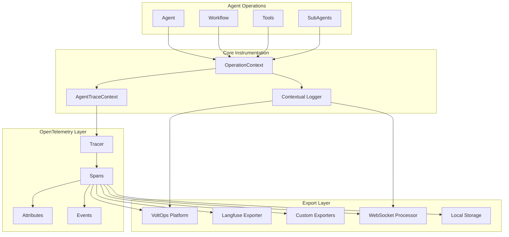
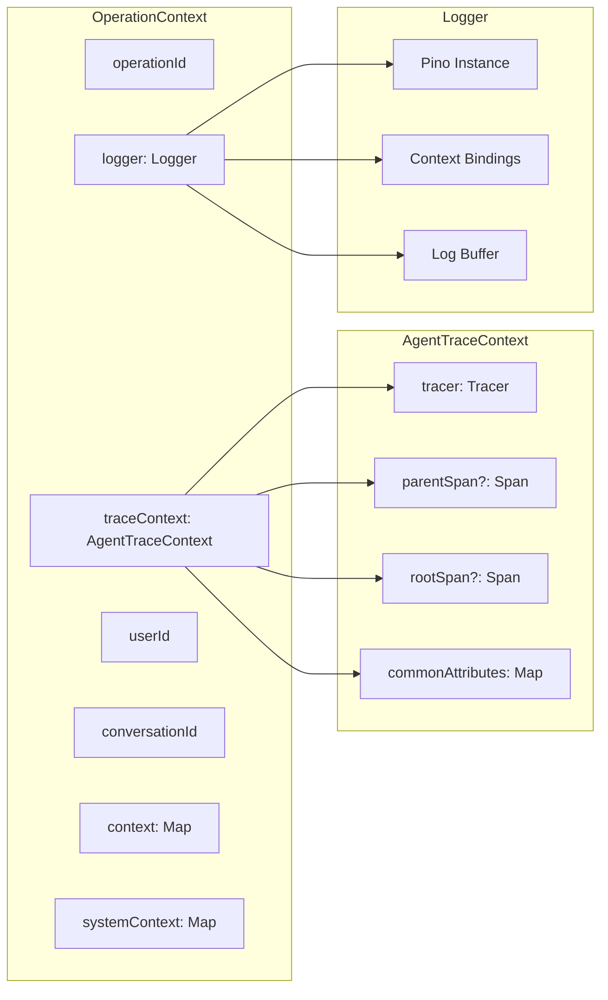
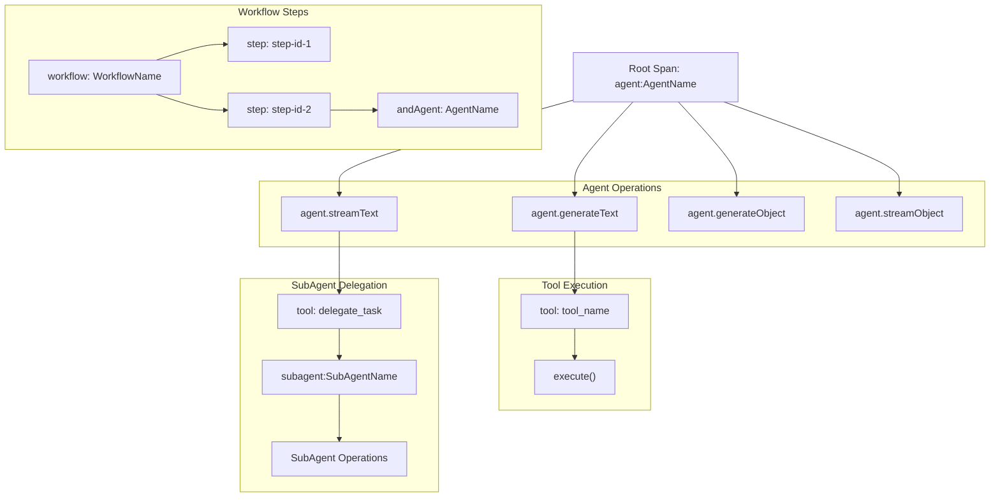
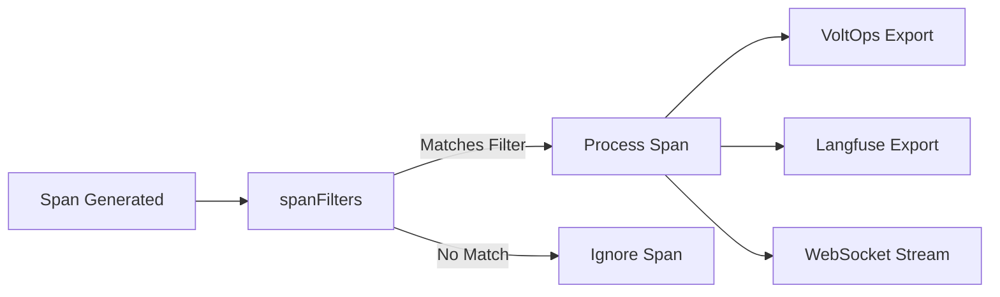
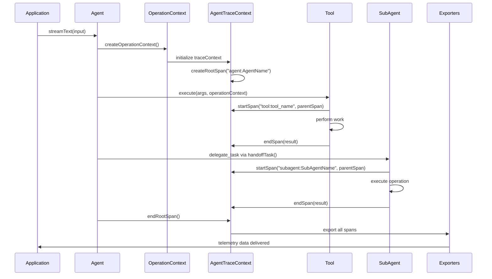
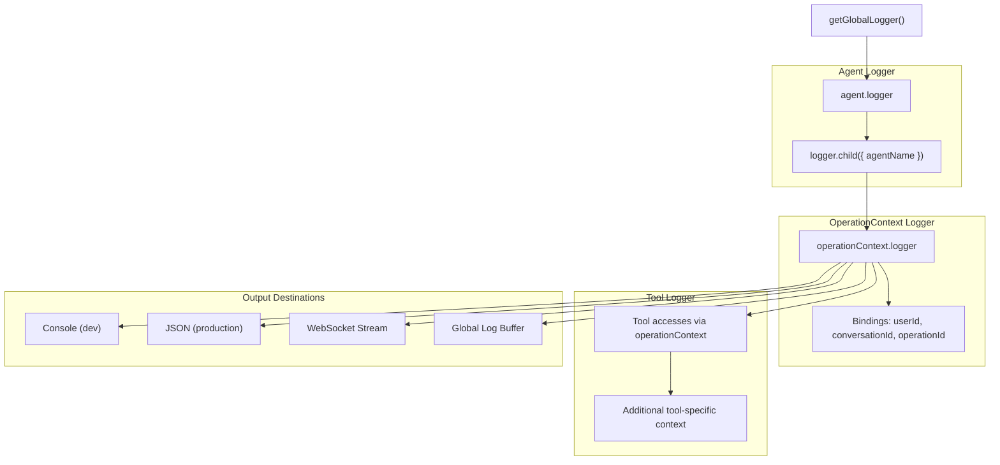
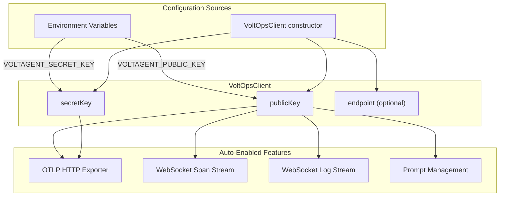
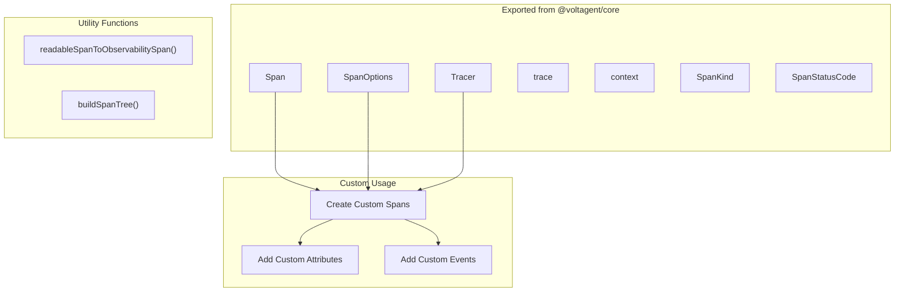
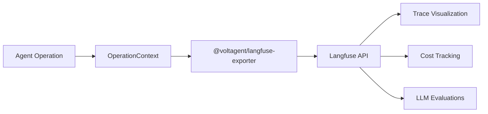

<!-- source: DeepWiki mcp.deepwiki.com · repo voltagent/voltagent · page 8 Observability and Monitoring · fetched 2026-10-27 -->

# Observability and Monitoring

<details>
<summary>Relevant source files</summary>

The following files were used as context for generating this wiki page:

- [.changeset/config.json](.changeset/config.json)
- [CHANGELOG.md](CHANGELOG.md)
- [changelog.sh](changelog.sh)
- [examples/base/src/index.ts](examples/base/src/index.ts)
- [packages/cli/package.json](packages/cli/package.json)
- [packages/core/src/agent/index.ts](packages/core/src/agent/index.ts)
- [packages/core/src/agent/providers/base/types.ts](packages/core/src/agent/providers/base/types.ts)
- [packages/core/src/agent/subagent/index.spec.ts](packages/core/src/agent/subagent/index.spec.ts)
- [packages/core/src/agent/subagent/index.ts](packages/core/src/agent/subagent/index.ts)
- [packages/core/src/agent/types.ts](packages/core/src/agent/types.ts)
- [packages/core/src/index.ts](packages/core/src/index.ts)
- [packages/create-voltagent-app/CHANGELOG.md](packages/create-voltagent-app/CHANGELOG.md)
- [packages/create-voltagent-app/package.json](packages/create-voltagent-app/package.json)
- [packages/voice/package.json](packages/voice/package.json)
- [website/docs/agents/overview.md](website/docs/agents/overview.md)
- [website/docs/agents/subagents.md](website/docs/agents/subagents.md)

</details>


This document covers the observability and monitoring capabilities built into VoltAgent, including distributed tracing, structured logging, and integration with observability platforms. VoltAgent provides comprehensive instrumentation for tracking agent operations, tool executions, and workflow steps across distributed systems.

For information about agent lifecycle hooks and custom monitoring logic, see [Agent Lifecycle and Hooks](#2.3). For workflow execution tracking, see [Workflow System](#2.8).

## Architecture Overview

VoltAgent's observability architecture consists of three integrated layers: OpenTelemetry-based distributed tracing, structured logging with contextual information, and observability platform integration through VoltOps or third-party exporters.

### Observability Stack



**Sources:** [packages/core/src/agent/types.ts:626-674](), [packages/core/src/index.ts:50-78]()

### OperationContext Observability Integration

The `OperationContext` serves as the central point for observability data collection during agent operations. Each operation (generateText, streamText, etc.) creates an `OperationContext` that carries tracing and logging state throughout the execution.



**Sources:** [packages/core/src/agent/types.ts:626-674]()

## Trace Hierarchy and Span Management

VoltAgent creates a hierarchical span structure that mirrors the execution flow of agents, tools, and workflows. This enables distributed tracing across multi-agent systems and nested workflow executions.

### Span Hierarchy Structure



**Sources:** [packages/core/src/agent/subagent/index.ts:296-643](), [CHANGELOG.md:286-335]()

### Span Attributes and Metadata

VoltAgent automatically captures semantic attributes following OpenTelemetry conventions. Attributes are organized into namespaces to distinguish between root agents, subagents, and other entities.

| Attribute Namespace | Usage | Example Attributes |
|-------------------|-------|-------------------|
| `entity.*` | Root agent identification | `entity.id`, `entity.type`, `entity.name` |
| `subagent.*` | SubAgent identification | `subagent.id`, `subagent.name`, `subagent.type` |
| `operation.*` | Operation metadata | `operation.id`, `operation.method` |
| `user.*` | User context | `user.id`, `user.conversationId` |
| `tool.*` | Tool execution | `tool.name`, `tool.args`, `tool.result` |
| `workflow.*` | Workflow execution | `workflow.id`, `workflow.step` |
| `model.*` | LLM metadata | `model.name`, `model.provider` |

**Sources:** [CHANGELOG.md:286-335]()

### Span Filtering Configuration

By default, VoltAgent only processes spans originating from VoltAgent operations to reduce noise. Custom filters can be configured through the `VoltAgentObservability` options.



**Sources:** [CHANGELOG.md:54-55]()

## Distributed Tracing Workflow

The following diagram illustrates how tracing flows through a typical agent operation with tool execution and subagent delegation.



**Sources:** [packages/core/src/agent/subagent/index.ts:296-643](), [packages/core/src/agent/types.ts:626-674]()

## Logging Architecture

VoltAgent provides structured logging through the `@voltagent/logger` package, which wraps Pino with VoltAgent-specific context binding. Logs are automatically enriched with execution context including `operationId`, `userId`, and `conversationId`.

### Logger Hierarchy



**Sources:** [packages/core/src/index.ts:160-161](), [examples/base/src/index.ts:12-15]()

### Contextual Logger Usage

The `OperationContext.logger` provides automatic context enrichment for all log statements within an operation. Tools and hooks receive this logger through the `operationContext` parameter.

**Log Context Fields:**

| Field | Description | Source |
|-------|-------------|--------|
| `operationId` | Unique operation identifier | Auto-generated UUID |
| `userId` | User identifier | Passed to generateText/streamText options |
| `conversationId` | Conversation thread ID | Passed to generateText/streamText options |
| `agentId` | Agent identifier | Agent instance |
| `agentName` | Agent name | Agent instance |
| `component` | Component name | Logger child context |

**Sources:** [packages/core/src/agent/types.ts:654-655]()

## VoltOps Integration

VoltOps provides a managed observability platform accessible at `console.voltagent.dev`. Integration requires only API keys set via environment variables or passed to the `VoltOpsClient` constructor.

### VoltOps Client Configuration



**Sources:** [CHANGELOG.md:854-863](), [examples/base/src/index.ts:1-38]()

### VoltOps Platform Features

The VoltOps Console provides real-time observability and management capabilities for production VoltAgent deployments:

- **Live Trace Viewer**: Real-time distributed trace visualization with span hierarchy and timing
- **Prompt Management**: Centralized prompt versioning and deployment with dynamic prompt loading
- **Cost Analysis**: Token usage tracking and cost estimation across models and providers
- **Entity Filtering**: Query traces by `entity.id` to isolate specific agent operations

**Sources:** [CHANGELOG.md:54-55](), [CHANGELOG.md:286-335]()

## OpenTelemetry Primitives

VoltAgent exposes OpenTelemetry primitives for advanced use cases requiring custom instrumentation or integration with existing observability infrastructure.

### Core OpenTelemetry Exports



**Sources:** [packages/core/src/index.ts:69-78]()

### Observability Storage Adapters

VoltAgent provides pluggable storage adapters for collecting observability data locally or streaming to custom backends.

**Available Adapters:**

| Adapter | Purpose | Usage |
|---------|---------|-------|
| `WebSocketSpanProcessor` | Real-time span streaming | VoltOps integration |
| `LocalStorageSpanProcessor` | Local span persistence | Development/testing |
| `InMemoryObservabilityAdapter` | In-memory span storage | Testing, demos |
| `WebSocketLogProcessor` | Real-time log streaming | VoltOps integration |

**Sources:** [packages/core/src/index.ts:50-78]()

## External Observability Platforms

VoltAgent supports integration with third-party observability platforms through exporters and custom processors.

### Langfuse Integration

The `@voltagent/langfuse-exporter` package provides native integration with Langfuse for LLM observability and analytics.



**Sources:** [CHANGELOG.md:1-869]()

### Custom Exporter Implementation

Custom exporters can be created by implementing the OpenTelemetry `SpanProcessor` or `LogRecordProcessor` interfaces and registering them with the `VoltAgentObservability` instance.

**Key Interfaces:**

- `ObservabilityStorageAdapter`: Storage backend for spans and logs
- `ObservabilitySpan`: Standardized span representation
- `ObservabilityLogRecord`: Standardized log record representation
- `SpanFilter`: Filtering logic for selective export

**Sources:** [packages/core/src/index.ts:56-67]()

## Performance Considerations

VoltAgent's observability implementation is designed for production use with minimal performance overhead:

- **Span Filtering**: Default filters exclude non-VoltAgent spans to reduce processing load
- **Async Export**: All exports occur asynchronously without blocking agent operations
- **Batching**: Spans and logs can be batched before export (depends on exporter configuration)
- **Sampling**: OpenTelemetry sampling can be configured at the tracer level

**Sources:** [CHANGELOG.md:54-55]()

## Configuration Examples

### Minimal VoltOps Setup

```typescript
import { VoltAgent, VoltOpsClient } from "@voltagent/core";

new VoltAgent({
  agents: { myAgent },
  voltOpsClient: new VoltOpsClient({
    publicKey: process.env.VOLTAGENT_PUBLIC_KEY || "",
    secretKey: process.env.VOLTAGENT_SECRET_KEY || "",
  }),
});
```

**Sources:** [examples/base/src/index.ts:1-38]()

### Custom Observability Configuration

```typescript
import { VoltAgent, VoltAgentObservability, WebSocketSpanProcessor } from "@voltagent/core";

const observability = new VoltAgentObservability({
  spanFilters: [
    // Custom filter logic
    (span) => span.attributes["entity.type"] === "agent"
  ],
  processors: [
    new WebSocketSpanProcessor({
      endpoint: "wss://custom-endpoint.example.com"
    })
  ]
});

new VoltAgent({
  agents: { myAgent },
  observability,
});
```

**Sources:** [CHANGELOG.md:54-55](), [packages/core/src/index.ts:50-78]()

### Logger Configuration

```typescript
import { createPinoLogger } from "@voltagent/logger";

const logger = createPinoLogger({
  name: "my-app",
  level: "info", // debug, info, warn, error
});

const agent = new Agent({
  name: "MyAgent",
  instructions: "...",
  model: openai("gpt-4o-mini"),
  logger,
});
```

**Sources:** [examples/base/src/index.ts:12-15]()

---

