<!-- source: DeepWiki mcp.deepwiki.com · repo voltagent/voltagent · page 8.1 VoltOps Platform · fetched 2026-10-27 -->

# VoltOps Platform

Relevant source files

The following files were used as context for generating this wiki page:

- [CHANGELOG.md](CHANGELOG.md)
- [changelog.sh](changelog.sh)
- [examples/base/src/index.ts](examples/base/src/index.ts)
- [packages/cli/package.json](packages/cli/package.json)
- [packages/create-voltagent-app/CHANGELOG.md](packages/create-voltagent-app/CHANGELOG.md)
- [packages/create-voltagent-app/package.json](packages/create-voltagent-app/package.json)
- [packages/voice/package.json](packages/voice/package.json)
- [website/src/components/console/PricingCalculatorModal.tsx](website/src/components/console/PricingCalculatorModal.tsx)
- [website/src/components/console/PricingSection.tsx](website/src/components/console/PricingSection.tsx)
- [website/src/components/two-blocks-pricing/index.tsx](website/src/components/two-blocks-pricing/index.tsx)
- [website/src/components/two-blocks/index.tsx](website/src/components/two-blocks/index.tsx)
- [website/src/pages/pricing.tsx](website/src/pages/pricing.tsx)

VoltOps is a framework-agnostic LLM observability platform designed to monitor, debug, and improve AI agents across any technology stack. It provides visual workflow monitoring, real-time debugging capabilities, and comprehensive trace collection for AI applications. The platform transforms black-box AI agent behavior into transparent, understandable workflows through interactive flowcharts and detailed execution tracking.

For information about the core VoltAgent framework that provides zero-configuration observability, see [Agent System](#2.1). For details about integrating observability into custom applications, see [Integration Methods](#7.2).

## Platform Architecture

VoltOps operates as a cloud-based observability platform that receives telemetry data from AI applications through multiple integration methods. The platform consists of a web console interface, data collection APIs, and visualization engines.

### System Overview

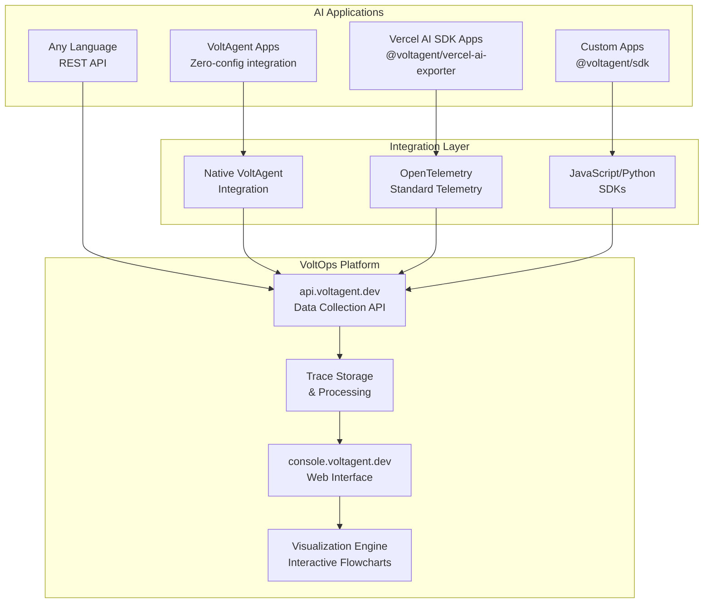

Sources: [CONSOLE.md:37-87](), [website/src/components/two-blocks-pricing/index.tsx:118-137]()

### Data Flow Architecture

The platform processes AI agent execution data through a structured pipeline that captures spans, events, and metadata to build comprehensive execution traces.

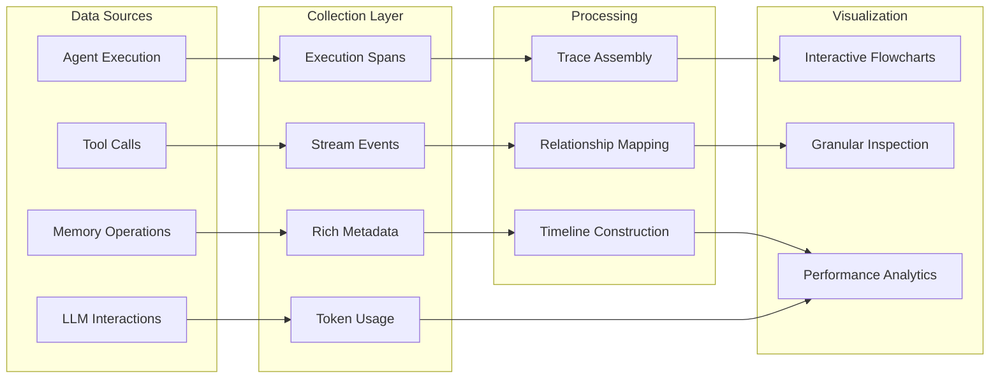

Sources: [CONSOLE.md:295-338](), [website/observability/vercel-ai.md:436-464]()

## Console Interface

The VoltOps console at `console.voltagent.dev` provides multiple views for monitoring and debugging AI agent workflows. The interface supports real-time visualization, detailed inspection, and agent management capabilities.

### Core Console Views

The platform provides four primary interface components for comprehensive AI agent monitoring:

| View | Purpose | Key Features |
|------|---------|--------------|
| Real-Time Visualization | Live workflow monitoring | Interactive flowcharts, execution timeline |
| Agent Chat Playground | Interactive testing | Built-in chat interface, live metrics |
| Granular Inspection | Detailed analysis | Input/output visibility, execution parameters |
| Agent Management | Session oversight | Active sessions, status tracking |

Sources: [CONSOLE.md:298-327]()

### Workflow Visualization Engine

The console transforms AI agent execution data into interactive visual representations that show decision-making processes, tool usage patterns, and multi-agent coordination.

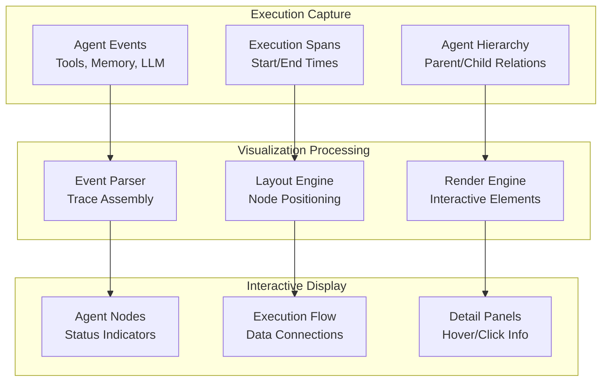

Sources: [CONSOLE.md:300-319](), [website/src/components/live-preview/index.tsx:272-282]()

## Integration Methods

VoltOps supports multiple integration approaches to accommodate different technology stacks and deployment scenarios. Each method provides varying levels of configuration complexity and feature access.

### Native VoltAgent Integration

VoltAgent Framework applications automatically include observability without additional configuration. The framework exposes a local server that the console connects to directly.

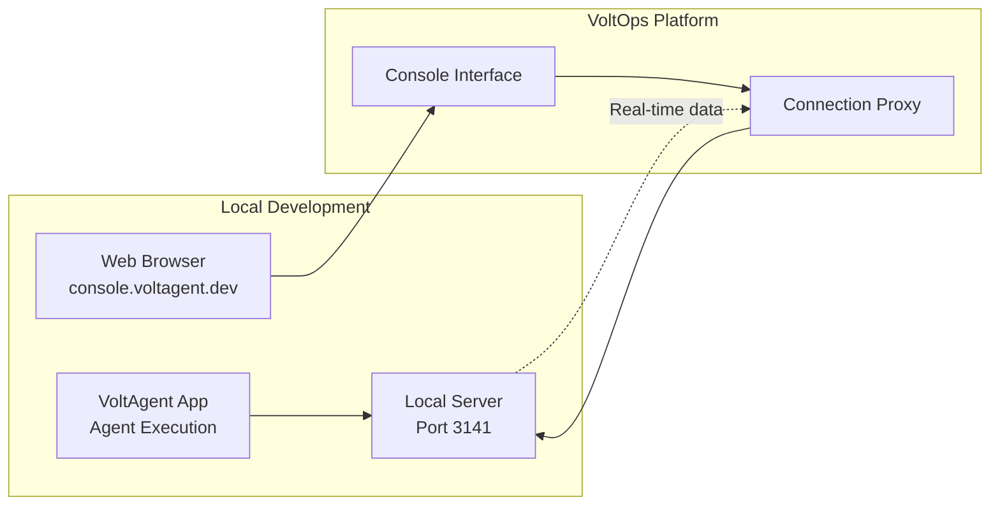

Sources: [CONSOLE.md:96-132](), [website/docs/getting-started/quick-start.md:143-167]()

### Vercel AI SDK Integration

Applications using Vercel AI SDK integrate through the `VoltAgentExporter` class and OpenTelemetry instrumentation. This approach requires minimal code changes to existing applications.

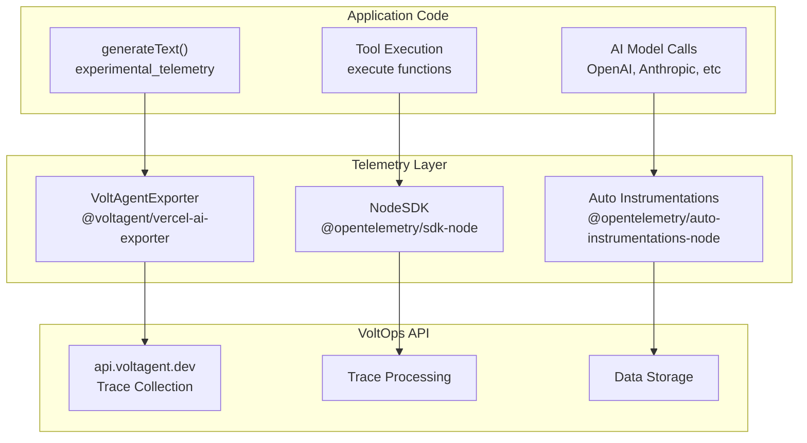

Sources: [website/docs/integrations/vercel-ai.md:52-73](), [website/observability/vercel-ai.md:52-73]()

### SDK Integration

The platform provides JavaScript and Python SDKs for custom applications that need programmatic trace creation and management.

#### JavaScript SDK Usage

The `@voltagent/sdk` package provides the `VoltAgentObservabilitySDK` class for manual trace construction:

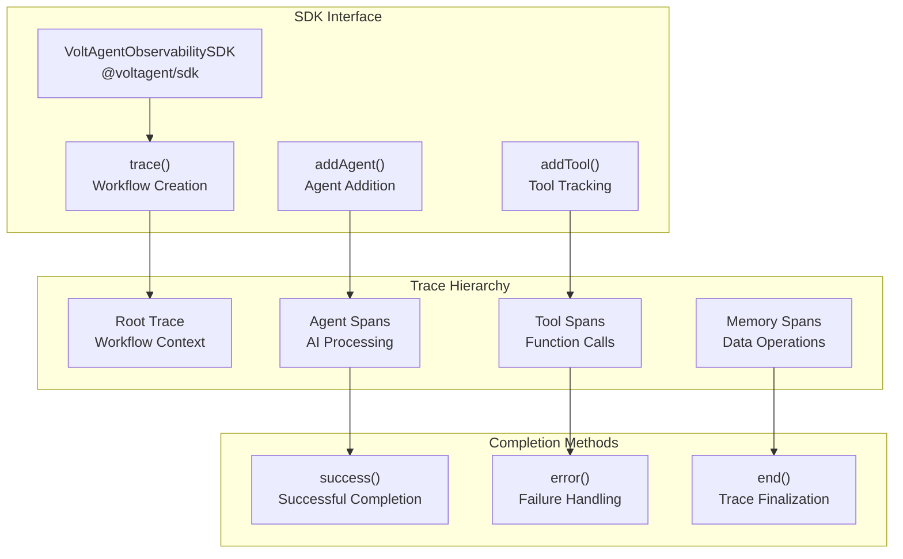

Sources: [CONSOLE.md:185-226]()

#### Python SDK Usage

The Python SDK provides async context management for automatic resource cleanup:

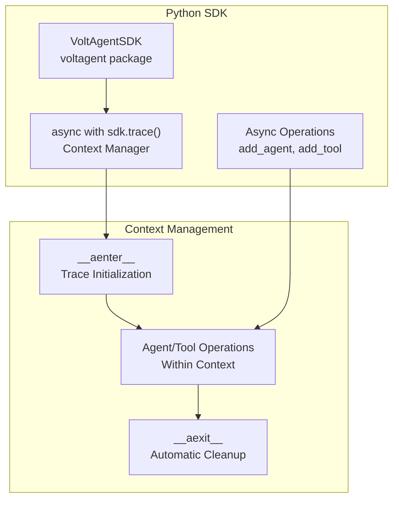

Sources: [CONSOLE.md:234-278]()

## Data Collection and Tracing

VoltOps implements a comprehensive tracing system that captures detailed execution information from AI agent workflows. The system builds hierarchical traces that represent complete execution flows from user input to agent response.

### Trace Structure

Each trace represents a complete workflow execution containing nested spans for individual operations:

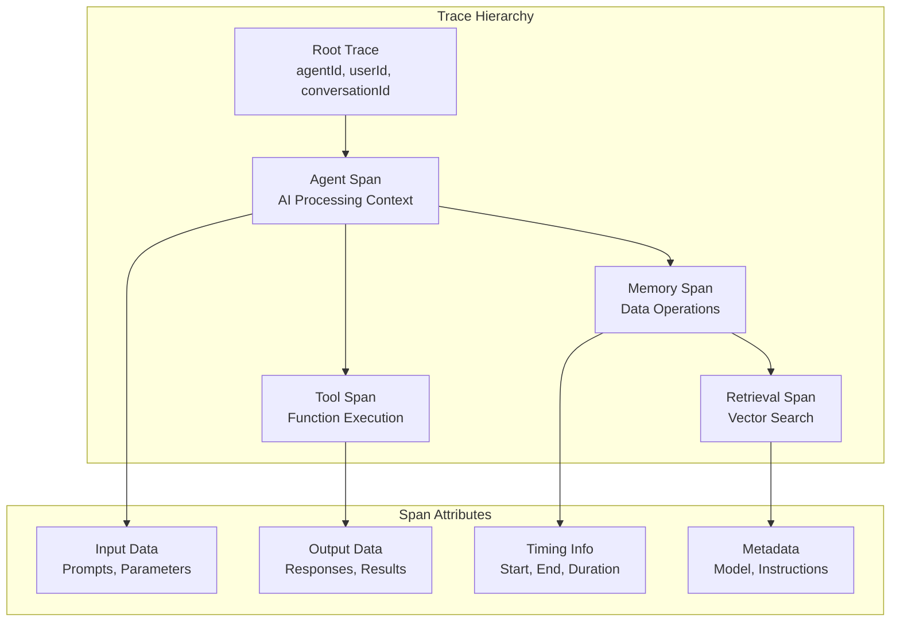

Sources: [CONSOLE.md:328-338](), [website/observability/vercel-ai.md:436-464]()

### Metadata Schema

The platform supports extensive metadata collection for enhanced filtering and analysis capabilities:

| Field | Type | Purpose | Example |
|-------|------|---------|---------|
| `agentId` | string | Agent identification | `"customer-support-bot"` |
| `userId` | string | User tracking | `"user-123"` |
| `conversationId` | string | Session grouping | `"conv-456"` |
| `parentAgentId` | string | Multi-agent hierarchy | `"supervisor-agent"` |
| `instructions` | string | Agent context | `"You are a helpful assistant"` |
| `tags` | string[] | Categorization | `["production", "support"]` |

Sources: [website/observability/vercel-ai.md:438-464]()

### Token Usage Analytics

The platform tracks comprehensive token usage metrics for cost analysis and performance optimization:

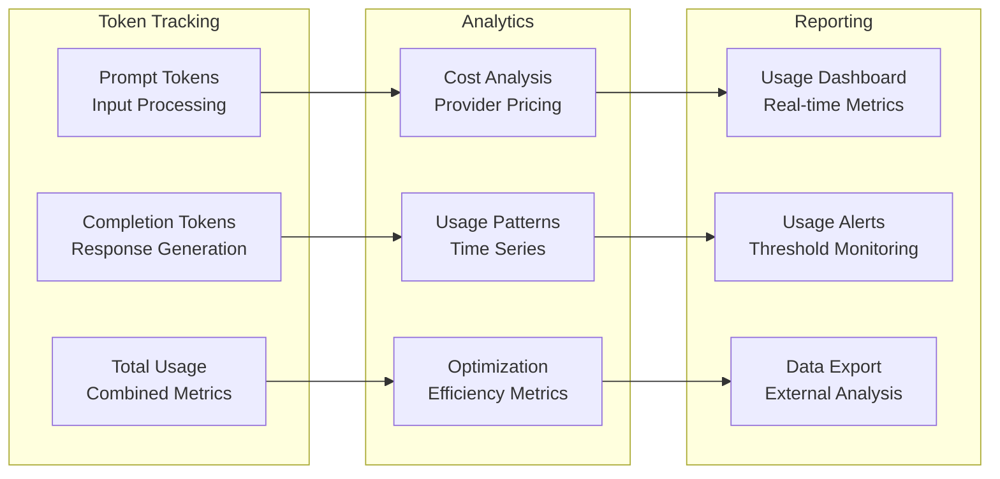

Sources: [CONSOLE.md:334](), [website/src/components/console/PricingSection.tsx:110-116]()

## Pricing and Deployment Models

VoltOps offers multiple pricing tiers to accommodate different usage scales and feature requirements. The platform operates on a trace-based pricing model with additional features available in higher tiers.

### Pricing Tiers

| Tier | Price | Traces/Month | Key Features |
|------|-------|--------------|--------------|
| Free | $0 | 100 | 1 seat, 3 prompts, 7-day retention |
| Core | $50 | 5,000 | 5 seats, unlimited prompts, 90-day retention |
| Pro | $500 | 20,000 | 20 seats, SSO, advanced analytics |
| Enterprise | Custom | Unlimited | Self-hosted, custom integrations, SLA |

Sources: [website/src/components/console/PricingSection.tsx:22-90]()

### Overage Pricing

The platform implements a pay-as-you-scale model with predictable overage costs:

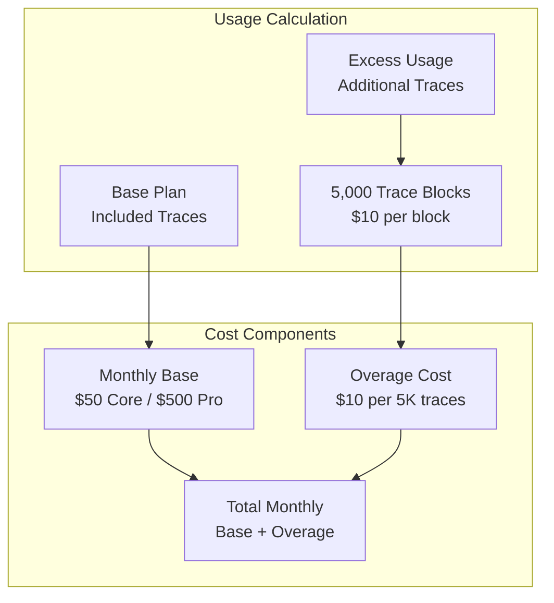

Sources: [website/src/components/console/PricingCalculatorModal.tsx:14-42]()

### Enterprise Deployment

Enterprise customers can deploy VoltOps in their own infrastructure for enhanced security and compliance:

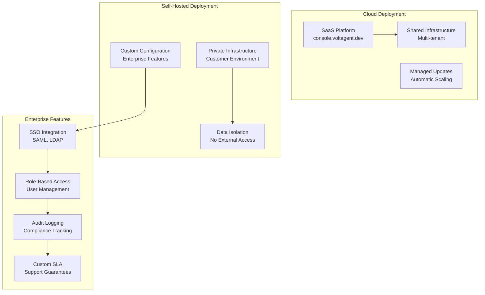

Sources: [CONSOLE.md:378-387](), [website/src/components/console/PricingSection.tsx:217-262]()

## Technical Implementation

VoltOps implements a distributed architecture that handles real-time data collection, processing, and visualization at scale. The platform integrates with OpenTelemetry standards while providing custom extensions for AI-specific observability requirements.

### API Endpoints

The platform exposes RESTful APIs for universal integration across programming languages and frameworks:

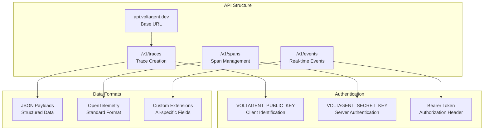

Sources: [CONSOLE.md:281-293](), [website/observability/vercel-ai.md:38-47]()

### Real-time Connection Architecture

For VoltAgent Framework applications, the platform establishes direct browser-to-local-server connections for minimal latency observability:

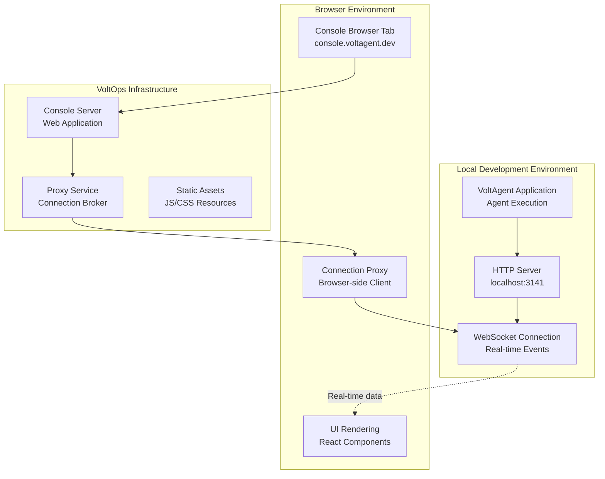

Sources: [CONSOLE.md:128-132](), [website/docs/getting-started/quick-start.md:156-169]()

---

