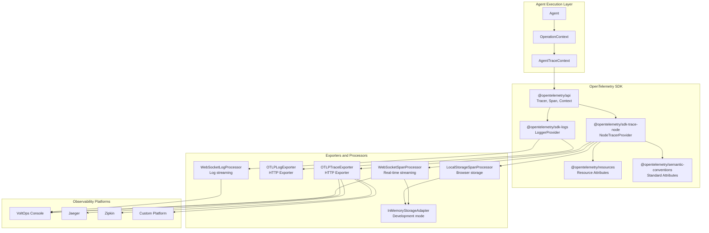
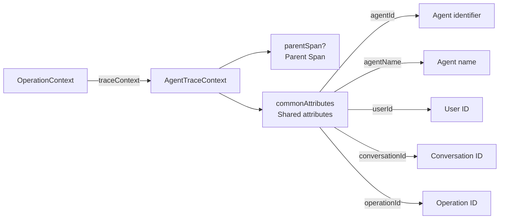
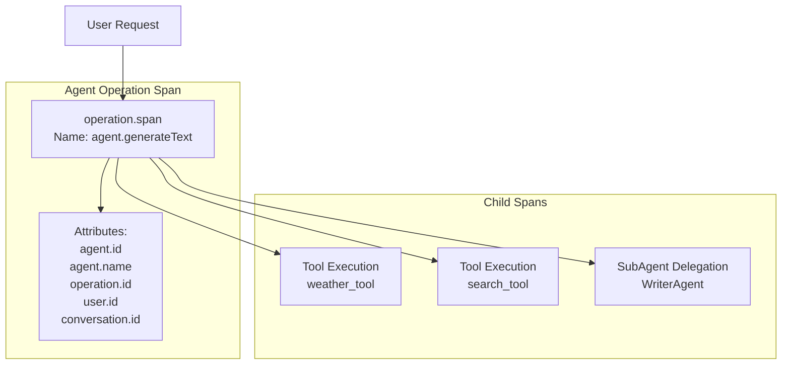
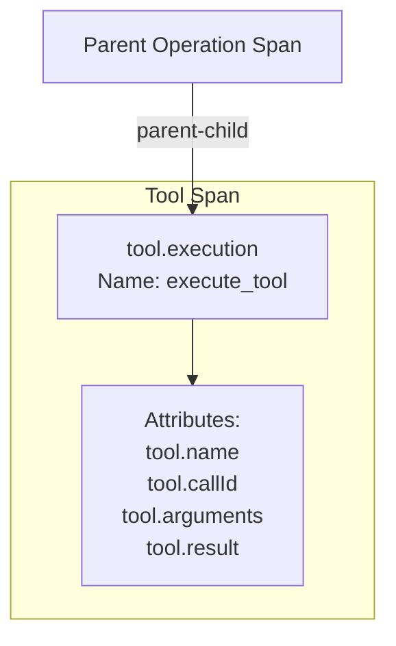
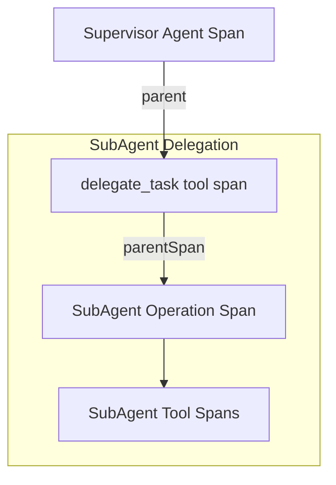
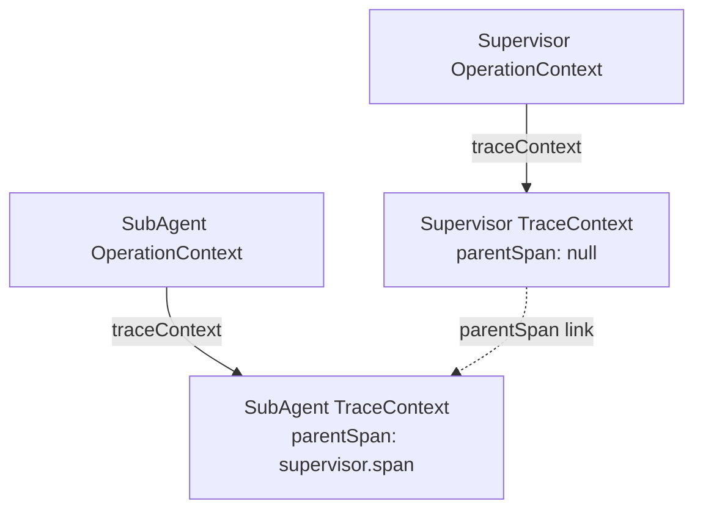
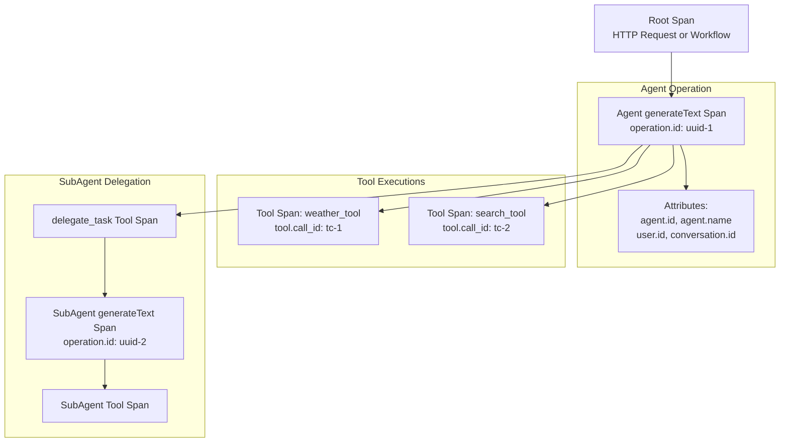
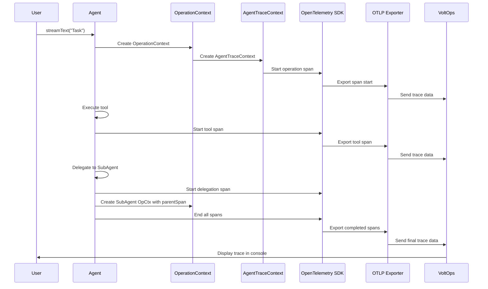

<!-- source: DeepWiki mcp.deepwiki.com · repo voltagent/voltagent · page 8.2 OpenTelemetry Integration · fetched 2026-10-27 -->

# OpenTelemetry Integration

<details>
<summary>Relevant source files</summary>

The following files were used as context for generating this wiki page:

- [.changeset/config.json](.changeset/config.json)
- [examples/with-google-ai/package.json](examples/with-google-ai/package.json)
- [examples/with-google-vertex-ai/package.json](examples/with-google-vertex-ai/package.json)
- [examples/with-groq-ai/package.json](examples/with-groq-ai/package.json)
- [examples/with-mcp/package.json](examples/with-mcp/package.json)
- [examples/with-nextjs/package.json](examples/with-nextjs/package.json)
- [packages/core/package.json](packages/core/package.json)
- [packages/core/src/agent/index.ts](packages/core/src/agent/index.ts)
- [packages/core/src/agent/providers/base/types.ts](packages/core/src/agent/providers/base/types.ts)
- [packages/core/src/agent/subagent/index.spec.ts](packages/core/src/agent/subagent/index.spec.ts)
- [packages/core/src/agent/subagent/index.ts](packages/core/src/agent/subagent/index.ts)
- [packages/core/src/agent/types.ts](packages/core/src/agent/types.ts)
- [packages/core/src/index.ts](packages/core/src/index.ts)
- [pnpm-lock.yaml](pnpm-lock.yaml)
- [website/docs/agents/overview.md](website/docs/agents/overview.md)
- [website/docs/agents/subagents.md](website/docs/agents/subagents.md)

</details>


This document covers VoltAgent's built-in OpenTelemetry support for distributed tracing and logging. For information about external observability platforms like Langfuse, see [External Observability](#8.4). For VoltOps-specific features, see [VoltOps Platform](#8.1).

## Purpose and Scope

VoltAgent includes native OpenTelemetry instrumentation that automatically traces all agent operations, tool executions, and subagent delegations. This integration provides:

- Automatic span creation for agent operations
- Hierarchical trace relationships (parent-child spans)
- OTLP HTTP exporters for traces and logs
- Semantic conventions for agent-specific attributes
- Integration with observability platforms (VoltOps, Jaeger, Zipkin, etc.)

## Architecture Overview



**Sources:** [packages/core/package.json:6-17](), [packages/core/src/index.ts:50-78]()

## Core Components

### OpenTelemetry Dependencies

VoltAgent includes the following OpenTelemetry packages:

| Package | Version | Purpose |
|---------|---------|---------|
| `@opentelemetry/api` | ^1.9.0 | Core tracing and context API |
| `@opentelemetry/api-logs` | ^0.204.0 | Logging API |
| `@opentelemetry/core` | ^2.0.0 | Shared utilities |
| `@opentelemetry/exporter-trace-otlp-http` | ^0.203.0 | HTTP trace exporter |
| `@opentelemetry/exporter-logs-otlp-http` | ^0.204.0 | HTTP log exporter |
| `@opentelemetry/otlp-transformer` | ^0.204.0 | OTLP format transformer |
| `@opentelemetry/resources` | ^2.0.0 | Resource attributes |
| `@opentelemetry/sdk-trace-base` | ^2.0.0 | Base tracing SDK |
| `@opentelemetry/sdk-trace-node` | ^2.0.0 | Node.js tracing SDK |
| `@opentelemetry/sdk-logs` | ^0.204.0 | Logging SDK |
| `@opentelemetry/semantic-conventions` | ^1.28.0 | Standard attribute names |

**Sources:** [packages/core/package.json:6-17]()

### AgentTraceContext

The `AgentTraceContext` is the central component for managing trace hierarchy and span attributes. It is stored in the `OperationContext` for every agent operation.



**Sources:** [packages/core/src/agent/types.ts:626-674]()

## Automatic Span Creation

### Operation-Level Spans

Every agent operation (`generateText`, `streamText`, `generateObject`, `streamObject`) automatically creates a span:



**Sources:** [packages/core/src/agent/types.ts:626-674]()

### Tool Execution Spans

Tool executions create child spans with tool-specific attributes:



**Sources:** [packages/core/src/agent/subagent/index.ts:1-2](), [packages/core/src/agent/types.ts:626-674]()

### SubAgent Delegation Spans

SubAgent delegations maintain proper parent-child relationships through `parentSpan`:



**Sources:** [packages/core/src/agent/subagent/index.ts:296-309](), [packages/core/src/agent/types.ts:428-441]()

## OTLP HTTP Exporters

### Trace Exporter Configuration

VoltAgent uses the OTLP HTTP trace exporter to send traces to compatible backends:

```typescript
import { VoltAgentObservability } from "@voltagent/core";

const observability = new VoltAgentObservability({
  // OTLP HTTP endpoint (e.g., VoltOps, Jaeger, custom collector)
  otlpEndpoint: "https://api.voltagent.dev/v1/traces",
  
  // Optional headers for authentication
  otlpHeaders: {
    "x-api-key": process.env.VOLTOPS_API_KEY,
  },
  
  // Service name for resource attributes
  serviceName: "my-agent-service",
});
```

**Sources:** [packages/core/package.json:11](), [packages/core/src/index.ts:51]()

### Log Exporter Configuration

Logs are exported via OTLP HTTP to the same or different endpoint:

```typescript
const observability = new VoltAgentObservability({
  // Same endpoint or different for logs
  otlpLogsEndpoint: "https://api.voltagent.dev/v1/logs",
  otlpLogsHeaders: {
    "x-api-key": process.env.VOLTOPS_API_KEY,
  },
});
```

**Sources:** [packages/core/package.json:10](), [packages/core/src/index.ts:51]()

## Semantic Conventions and Attributes

### Standard Attributes

VoltAgent uses OpenTelemetry semantic conventions with agent-specific extensions:

| Attribute Name | Type | Description |
|----------------|------|-------------|
| `service.name` | string | Service identifier |
| `agent.id` | string | Unique agent ID |
| `agent.name` | string | Agent name |
| `operation.id` | string | Operation ID (UUID) |
| `operation.type` | string | Operation type (generateText, streamText, etc.) |
| `user.id` | string | User identifier |
| `conversation.id` | string | Conversation ID |
| `model.name` | string | LLM model identifier |
| `tool.name` | string | Tool name |
| `tool.call_id` | string | Tool call ID |
| `subagent.id` | string | SubAgent ID |
| `subagent.name` | string | SubAgent name |

**Sources:** [packages/core/package.json:17](), [packages/core/src/agent/types.ts:626-674]()

### Trace Context Propagation

The `AgentTraceContext` in `OperationContext` ensures trace context flows through all operations:



**Sources:** [packages/core/src/agent/types.ts:626-674](), [packages/core/src/agent/subagent/index.ts:296-309]()

## Custom Span Processors

VoltAgent provides several custom span processors for different deployment scenarios:

### WebSocketSpanProcessor

Real-time span streaming to WebSocket endpoints (used by VoltOps):

```typescript
import { WebSocketSpanProcessor, WebSocketEventEmitter } from "@voltagent/core";

const emitter = new WebSocketEventEmitter({
  url: "wss://console.voltagent.dev/spans",
  headers: {
    "Authorization": `Bearer ${token}`,
  },
});

const processor = new WebSocketSpanProcessor(emitter);
```

**Sources:** [packages/core/src/index.ts:52]()

### LocalStorageSpanProcessor

Browser-based storage for client-side agents:

```typescript
import { LocalStorageSpanProcessor, InMemoryObservabilityAdapter } from "@voltagent/core";

const storage = new InMemoryObservabilityAdapter();
const processor = new LocalStorageSpanProcessor(storage);
```

**Sources:** [packages/core/src/index.ts:53-54]()

### WebSocketLogProcessor

Log streaming processor for real-time log delivery:

```typescript
import { WebSocketLogProcessor } from "@voltagent/core";

const logProcessor = new WebSocketLogProcessor(emitter);
```

**Sources:** [packages/core/src/index.ts:55]()

## Span Hierarchy and Context

### Parent-Child Relationships



**Sources:** [packages/core/src/agent/types.ts:626-674](), [packages/core/src/agent/subagent/index.ts:296-309]()

### Context Propagation Example

The `parentSpan` field in `InternalGenerateOptions` maintains hierarchy:

| Level | Component | parentSpan | Current Span |
|-------|-----------|------------|--------------|
| 1 | Supervisor Agent | null | supervisor.operation.span |
| 2 | delegate_task Tool | supervisor.operation.span | delegate.tool.span |
| 3 | SubAgent Operation | delegate.tool.span | subagent.operation.span |
| 4 | SubAgent Tool | subagent.operation.span | subagent.tool.span |

**Sources:** [packages/core/src/agent/types.ts:428-441](), [packages/core/src/agent/subagent/index.ts:368-380]()

## Observability Data Structures

### ObservabilitySpan

```typescript
export interface ObservabilitySpan {
  traceId: string;
  spanId: string;
  parentSpanId?: string;
  name: string;
  kind: SpanKind;
  startTime: number;
  endTime?: number;
  attributes: SpanAttributes;
  events: SpanEvent[];
  links: SpanLink[];
  status: SpanStatus;
}
```

**Sources:** [packages/core/src/index.ts:56-66]()

### ObservabilityLogRecord

```typescript
export interface ObservabilityLogRecord {
  timestamp: number;
  severityNumber: number;
  severityText: string;
  body: string;
  attributes: Record<string, any>;
  traceId?: string;
  spanId?: string;
}
```

**Sources:** [packages/core/src/index.ts:56-66]()

### SpanTreeNode

Hierarchical span representation for visualization:

```typescript
export interface SpanTreeNode {
  span: ObservabilitySpan;
  children: SpanTreeNode[];
  depth: number;
}
```

**Sources:** [packages/core/src/index.ts:56-66]()

## Storage Adapters

### ObservabilityStorageAdapter Interface

Custom storage implementations for spans and logs:

```typescript
export interface ObservabilityStorageAdapter {
  saveSpan(span: ObservabilitySpan): Promise<void>;
  saveLog(log: ObservabilityLogRecord): Promise<void>;
  getSpans(filter?: LogFilter): Promise<ObservabilitySpan[]>;
  getLogs(filter?: LogFilter): Promise<ObservabilityLogRecord[]>;
  clear(): Promise<void>;
}
```

**Sources:** [packages/core/src/index.ts:56-66]()

### InMemoryObservabilityAdapter

Default in-memory storage for development:

```typescript
import { InMemoryObservabilityAdapter } from "@voltagent/core";

const storage = new InMemoryObservabilityAdapter();
await storage.saveSpan(span);
const spans = await storage.getSpans({ traceId: "xyz" });
```

**Sources:** [packages/core/src/index.ts:54]()

## Utility Functions

### Span Conversion

Convert OpenTelemetry `ReadableSpan` to VoltAgent's `ObservabilitySpan`:

```typescript
import { readableSpanToObservabilitySpan } from "@voltagent/core";

const observabilitySpan = readableSpanToObservabilitySpan(readableSpan);
```

**Sources:** [packages/core/src/index.ts:71]()

### Span Tree Building

Build hierarchical span trees for visualization:

```typescript
import { buildSpanTree } from "@voltagent/core";

const spans: ObservabilitySpan[] = await storage.getSpans();
const tree: SpanTreeNode[] = buildSpanTree(spans);
```

**Sources:** [packages/core/src/index.ts:72]()

## Integration with VoltOps

VoltAgent automatically integrates with VoltOps when configured:

```typescript
import { Agent, VoltOpsClient } from "@voltagent/core";
import { openai } from "@ai-sdk/openai";

const agent = new Agent({
  name: "Assistant",
  model: openai("gpt-4o"),
  instructions: "You are a helpful assistant",
  
  // VoltOps integration (includes OpenTelemetry setup)
  voltOpsClient: new VoltOpsClient({
    publicKey: process.env.VOLTOPS_PUBLIC_KEY,
    secretKey: process.env.VOLTOPS_SECRET_KEY,
  }),
});
```

This automatically:
- Configures OTLP exporters to VoltOps endpoints
- Enables WebSocket span streaming
- Enables WebSocket log streaming
- Adds VoltOps-specific attributes

**Sources:** [packages/core/src/agent/types.ts:253-300]()

## OpenTelemetry API Re-exports

VoltAgent re-exports core OpenTelemetry APIs for convenience:

```typescript
import { trace, context, Span, SpanOptions, Tracer, SpanKind, SpanStatusCode } from "@voltagent/core";

// Create custom spans
const tracer = trace.getTracer("my-tracer");
const span = tracer.startSpan("custom-operation");

// Set attributes
span.setAttribute("custom.attribute", "value");

// End span
span.end();
```

**Sources:** [packages/core/src/index.ts:69-78]()

## Example: Complete Tracing Flow



**Sources:** [packages/core/src/agent/types.ts:626-674](), [packages/core/src/agent/subagent/index.ts:296-309](), [packages/core/package.json:6-17]()

---

